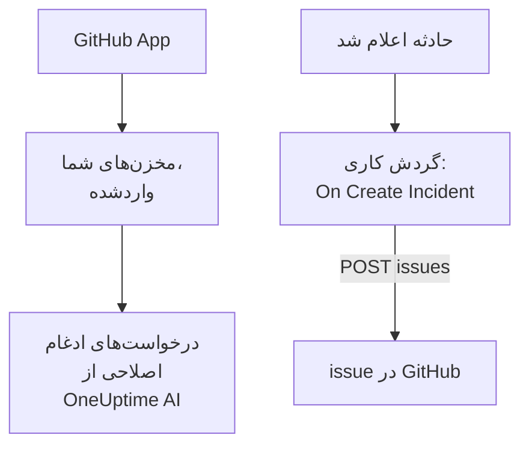

# GitHub

OneUptime به دو روش با [GitHub](https://github.com) کار می‌کند. مخزن‌هایتان را از طریق OneUptime GitHub App وصل کنید، تا OneUptime AI درخواست‌های ادغامی باز کند که آنچه را می‌یابد اصلاح می‌کنند، و وقتی در یک issue یا یک درخواست ادغام به آن اشاره می‌کنید پاسخ دهد. یا گردش کاری‌ای بسازید که برای هر حادثه یک issue در GitHub باز کند، تا کار پیگیری در مخزنی که مالک سرویس است دنبال شود.

:::cards
- [انتخاب روش اتصال](#انتخاب-روش-اتصال): GitHub App یا یک گردش کاری، و اینکه هر کدام چه می‌کند.
- [وصل کردن مخزن‌هایتان](#وصل-کردن-مخزنهایتان): GitHub App، برای درخواست‌های ادغام اصلاحی.
- [باز کردن یک issue برای هر حادثه](#باز-کردن-یک-issue-در-github-برای-هر-حادثه): یک گردش کاری، دو بلوک.
- [عیب‌یابی](#عیبیابی): وقتی GitHub یک درخواست را رد می‌کند.
:::

## چگونه کار می‌کند



این دو جدا از هم‌اند، و می‌توانید از یکی یا هر دو استفاده کنید. GitHub App در مخزن‌هایی کار می‌کند که آن را رویشان نصب می‌کنید. گردش کاری فقط به یک توکن نیاز دارد، و [REST API](https://docs.github.com/en/rest/issues/issues#create-an-issue) در GitHub را مانند هر API دیگری فرا می‌خواند.

## انتخاب روش اتصال

| روش | چه می‌کند | به چه نیاز دارد |
| --- | --- | --- |
| GitHub App | مخزن‌هایتان را وارد می‌کند. OneUptime AI در آن‌ها درخواست‌های ادغامی باز می‌کند که استثناها، ترِیس‌های کند و علت‌هایی را که بررسی‌هایش می‌یابند اصلاح می‌کنند، و به اشاره‌ها در issueها و درخواست‌های ادغام پاسخ می‌دهد. | یک سازمان یا حساب برای نصب برنامه روی آن. در OneUptime Cloud، طرح **Growth**. |
| یک گردش کاری | برای هر حادثه، در مخزنی که برمی‌گزینید، یک issue در GitHub باز می‌کند. | یک توکن GitHub که بتواند issue بسازد، و یک گردش کاری با دو بلوک. |

## وصل کردن مخزن‌هایتان

**محصولات** > **کد** را باز کنید و روی **اتصال GitHub** کلیک کنید. GitHub می‌پرسد برنامه کجا نصب شود و از کدام مخزن‌ها می‌تواند استفاده کند. هر مخزن در این نصب وارد می‌شود، و وقتی مخزن‌هایی به نصب می‌افزایید یا از آن برمی‌دارید هماهنگ می‌ماند.

اگر برنامه از پیش روی حساب نصب شده است، برای پروژه‌ای دیگر یا مستقیم از GitHub، به‌جای نصب دوباره، زیر **اتصال GitHub** روی **اتصال یک نصب موجود** کلیک کنید. این کار به یک حساب GitHub نیاز دارد که آن نصب را مدیریت کند: مالک یک حساب شخصی، یا کسی که روی همهٔ مخزن‌هایی که نصب به آن‌ها دسترسی دارد دسترسی admin دارد، همان‌طور که مالک سازمان دارد.

یک نمونهٔ خودمیزبان ابتدا به یک GitHub App از آنِ خودش نیاز دارد: [یکپارچه‌سازی GitHub](/docs/self-hosted/github-integration) نشان می‌دهد چگونه آن را بسازید. از آن پس، هوش مصنوعی از [کد](/docs/ai/ai-agent) در مخزن‌هایتان درخواست‌های ادغام باز می‌کند، و صفحهٔ [GitHub App](/docs/ai/github-app) نشان می‌دهد وقتی در یک issue یا یک درخواست ادغام به آن اشاره می‌کنید چه می‌کند.

## پیش از شروع

بقیهٔ این صفحه گردش کاری را می‌سازد. به این‌ها نیاز دارد:

- یک توکن GitHub که بتواند در مخزن issue بسازد: یک توکن دسترسی شخصی fine-grained برای آن مخزن، با مجوز **Issues** روی **Read and write**، یا یک توکن classic با دامنهٔ `repo`. یکی را در [تنظیمات توکن](https://github.com/settings/tokens) در GitHub بسازید.
- در OneUptime، اجازه ساختن گردش کاری و متغیر سراسری. در OneUptime Cloud، گردش‌های کاری به طرح **Growth** یا بالاتر نیاز دارند.

## ذخیره کردن توکن

:::steps
1. به **گردش‌های کاری** > **متغیرهای سراسری** بروید و روی **ساخت متغیر گردش کاری** کلیک کنید.
2. نامش را `GITHUB_TOKEN` بگذارید و روی **بعدی** کلیک کنید.
3. توکن را در **محتوا** بچسبانید، **راز** را روشن کنید، و روی **ساخت متغیر گردش کاری** کلیک کنید.
:::

یک متغیر راز در لاگ‌های اجرا با `[REDACTED]` جایگزین می‌شود، پس توکن هرگز در یک اجرا دیده نمی‌شود.

## باز کردن یک issue در GitHub برای هر حادثه

:::steps
### ساختن گردش کاری

به **گردش‌های کاری** بروید، روی **ساخت گردش کاری** و سپس **شروع از صفر** کلیک کنید. نامش را `Incidents to GitHub` بگذارید و روی **ساخت گردش کاری** کلیک کنید.

### افزودن تریگر

روی بلوک خط‌چین **انتخاب کنید چه چیزی این گردش کاری را شروع کند** کلیک کنید و **On Create Incident** را برگزینید. روی تریگر کلیک کنید: **Fields to pass on** آن از پیش **عنوان** را دارد، پس روی **افزودن فیلد** کلیک کنید و **توضیحات** و **Incident Number With Prefix** را برگزینید.

### باز کردن issue

روی **افزودن مؤلفه** کلیک کنید، یک بلوک **API Post (JSON)** اضافه کنید، و نقطه **Success** تریگر را به آن وصل کنید. **URL** آن را روی `https://api.github.com/repos/your-org/your-repo/issues` بگذارید، با مالک و نام مخزن خودتان. زیر **فیلدهای بیشتر**، **Request Headers** آن را روی این بگذارید:

```json
{
  "Authorization": "Bearer {{global.variables.GITHUB_TOKEN}}",
  "Accept": "application/vnd.github+json",
  "X-GitHub-Api-Version": "2022-11-28"
}
```

و **Request Body** آن را روی این:

```json
{
  "title": "{{local.components.incident-on-create-1.returnValues.model.title}}",
  "body": "{{local.components.incident-on-create-1.returnValues.model.description}}\n\nOpened by OneUptime for incident {{local.components.incident-on-create-1.returnValues.model.incidentNumberWithPrefix}}.",
  "labels": ["incident"]
}
```

### آزمایش، سپس روشن کردن

روی **اجرای گردش کاری** کلیک کنید، زیر **حادثه** یک حادثهٔ آزمایشی را برگزینید و اجرا کنید. گام **API Post (JSON)** یک پاسخ `201` نشان می‌دهد که issue تازه را همراه با `number` و `html_url` آن در خود دارد. سپس در بالای **سازنده** گزینه **فعال** را روشن کنید.
:::

وقتی حادثه رفع می‌شود issue باز می‌ماند، چون کار پیگیری معمولاً بیش از خود حادثه طول می‌کشد. برای تیکت‌هایی که در هر دو سو با حادثه هماهنگ می‌مانند، [Jira](/docs/integrations/jira) را ببینید.

## نکته‌ها

- **GitHub Enterprise Server.** درخواست را به جای آن به سرور خودتان بفرستید: `https://your-github-host/api/v3/repos/your-org/your-repo/issues`. سروری با نشانی شبکهٔ خصوصی به یک OneUptime خودمیزبان نیاز دارد که مدیرش آن را مجاز کرده باشد: [دسترسی شبکه خروجی](/docs/workflows/configuration#دسترسی-شبکه-خروجی) را ببینید.
- **واگذاری آن.** `"assignees": ["octocat"]` یا `"milestone": 3` را به بدنه بیفزایید. وقتی توکن نمی‌تواند به مخزن push کند، GitHub برچسب‌ها، واگذارشدگان و نقاط عطف را بی‌صدا کنار می‌گذارد.
- **فقط برخی حادثه‌ها.** یک بلوک **If / Else** میان تریگر و بلوک API بگذارید، و issueها را فقط در سمت **Yes** آن باز کنید، برای نمونه برای یک شدت.

## عیب‌یابی

وقتی GitHub درخواست را رد می‌کند، گام **API Post (JSON)** به **Error** می‌رود. **Response Status** و **Response Body** آن در اجرا دلیل را می‌گویند.

:::details GitHub با 401 پاسخ می‌دهد
توکن نادرست، منقضی یا باطل است. یک توکن تازه بسازید، و محتوای `GITHUB_TOKEN` را جایگزین کنید.
:::

:::details GitHub با 403 پاسخ می‌دهد
توکن نمی‌تواند آنجا issue بسازد: یک توکن fine-grained بدون **Issues** روی **Read and write** برای این مخزن، توکنی که سازمانتان آن را تأیید نکرده، یا یک توکن classic که برای ورود یکپارچهٔ سازمانتان مجاز نشده است. یک 403 که بدنه‌اش از محدودیت نرخ می‌گوید یعنی توکن درخواست‌های بیش از حدی فرستاده است: صبر کنید، یا برای حادثه‌های کمتری issue باز کنید.
:::

:::details GitHub با 404 پاسخ می‌دهد
مالک یا مخزن در **URL** نادرست است، یا توکن نمی‌تواند مخزن را ببیند. GitHub برای مخزن خصوصی‌ای که توکن نمی‌تواند ببیند با 404 پاسخ می‌دهد، نه 403.
:::

:::details GitHub با 410 یا 422 پاسخ می‌دهد
- `410`: issueها در تنظیمات مخزن خاموش‌اند.
- `422`: GitHub نمی‌تواند بدنه را بخواند. بررسی کنید که JSON معتبر باشد، که `title` تنظیم شده باشد، و که `labels` و `assignees` فهرست باشند.
:::

## گام‌های بعدی

:::cards
- [GitHub App](/docs/ai/github-app): از خود GitHub از OneUptime AI یک تغییر، یک بازنگری یا یک بازبینی بخواهید.
- [GitLab](/docs/integrations/gitlab): همین گردش کاری، برای issueهای GitLab.
- [اجزای گردش کاری](/docs/workflows/components#api): همه تنظیمات بلوک‌های API.
- [نمای کلی یکپارچه‌سازی‌ها](/docs/integrations/index): الگوهایی که پشت هر یکپارچه‌سازی هستند.
:::
