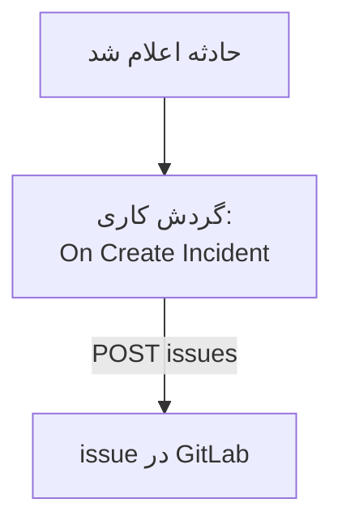

# GitLab

برای هر حادثهٔ OneUptime یک issue در [GitLab](https://gitlab.com) باز کنید، تا کار پیگیری در پروژه‌ای که مالک سرویس است دنبال شود. یک گردش کاری [Issues API](https://docs.gitlab.com/api/issues/#new-issue) در GitLab را فرا می‌خواند، روی GitLab.com یا روی GitLab خودتان.

:::cards
- [ذخیره کردن توکن](#ذخیره-کردن-توکن): توکن GitLab را بیرون از گردش‌های کاری‌تان نگه دارید.
- [باز کردن یک issue برای هر حادثه](#باز-کردن-یک-issue-در-gitlab-برای-هر-حادثه): یک گردش کاری، دو بلوک.
- [نکته‌ها](#نکتهها): GitLab خودتان، مسیرهای پروژه و واگذارشدگان.
- [عیب‌یابی](#عیبیابی): وقتی GitLab یک درخواست را رد می‌کند.
:::

> [!NOTE]
> OneUptime AI در مخزن‌های GitLab هم کار می‌کند: آن‌ها را با یک توکن دسترسی در کد متصل کنید تا برای هر اصلاح یک Merge Request باز کند. [اتصال یک مخزن](/docs/ai/ai-agent#اتصال-یک-مخزن) را ببینید.

## چگونه کار می‌کند



گردش کاری برای هر حادثهٔ تازه یک بار اجرا می‌شود. بلوک **API Post (JSON)** آن عنوان و توضیح حادثه را، امضاشده با یک توکن دسترسی، به issueهای پروژه می‌فرستد.

## پیش از شروع

- شناسهٔ پروژهٔ GitLab. در صفحهٔ نمای کلی پروژه، منوی کنش‌ها، یعنی سه نقطهٔ عمودی، را برگزینید، سپس **Copy project ID** را.
- یک توکن دسترسی GitLab با دامنهٔ `api`، برای کاربر یا باتی که نقشش در پروژه می‌تواند issue بسازد: یک توکن دسترسی پروژه، گروه یا شخصی. آن را زیر **Settings → Access tokens** در پروژه، گروه یا تنظیمات کاربری خودتان بسازید.
- در OneUptime، اجازه ساختن گردش کاری و متغیر سراسری. در OneUptime Cloud، گردش‌های کاری به طرح **Growth** یا بالاتر نیاز دارند.

## ذخیره کردن توکن

:::steps
1. به **گردش‌های کاری** > **متغیرهای سراسری** بروید و روی **ساخت متغیر گردش کاری** کلیک کنید.
2. نامش را `GITLAB_TOKEN` بگذارید و روی **بعدی** کلیک کنید.
3. توکن را در **محتوا** بچسبانید، **راز** را روشن کنید، و روی **ساخت متغیر گردش کاری** کلیک کنید.
:::

یک متغیر راز در لاگ‌های اجرا با `[REDACTED]` جایگزین می‌شود، پس توکن هرگز در یک اجرا دیده نمی‌شود.

## باز کردن یک issue در GitLab برای هر حادثه

:::steps
### ساختن گردش کاری

به **گردش‌های کاری** بروید، روی **ساخت گردش کاری** و سپس **شروع از صفر** کلیک کنید. نامش را `Incidents to GitLab` بگذارید و روی **ساخت گردش کاری** کلیک کنید.

### افزودن تریگر

روی بلوک خط‌چین **Choose what starts this workflow** کلیک کنید و **On Create Incident** را برگزینید. روی تریگر کلیک کنید: **Fields to pass on** آن از پیش **عنوان** را دارد، پس روی **افزودن فیلد** کلیک کنید و **توضیحات** و **Incident Number With Prefix** را برگزینید.

### باز کردن issue

روی **افزودن مؤلفه** کلیک کنید، یک بلوک **API Post (JSON)** اضافه کنید، و نقطه **Success** تریگر را به آن وصل کنید. **URL** آن را روی `https://gitlab.com/api/v4/projects/12345678/issues` بگذارید، با شناسهٔ پروژهٔ خودتان به جای `12345678`. زیر **فیلدهای بیشتر**، **Request Headers** آن را روی این بگذارید:

```json
{
  "PRIVATE-TOKEN": "{{global.variables.GITLAB_TOKEN}}"
}
```

و **Request Body** آن را روی این:

```json
{
  "title": "{{local.components.incident-on-create-1.returnValues.model.title}}",
  "description": "{{local.components.incident-on-create-1.returnValues.model.description}}\n\nOpened by OneUptime for incident {{local.components.incident-on-create-1.returnValues.model.incidentNumberWithPrefix}}.",
  "labels": "incident,oneuptime"
}
```

### آزمایش، سپس روشن کردن

روی **اجرای گردش کاری** کلیک کنید، زیر **حادثه** یک حادثهٔ آزمایشی را برگزینید و اجرا کنید. گام **API Post (JSON)** یک پاسخ `201` نشان می‌دهد که issue تازه را همراه با `iid` و `web_url` آن در خود دارد. سپس در بالای **سازنده** گزینه **فعال** را روشن کنید.
:::

بلوک JSON می‌فرستد، پس به سرآیند `Content-Type` نیازی ندارد. GitLab برچسب‌هایی را که پیش‌تر ندیده خودش می‌سازد، پس `incident` و `oneuptime` به هیچ آماده‌سازی‌ای نیاز ندارند. وقتی حادثه رفع می‌شود issue باز می‌ماند، چون کار پیگیری معمولاً بیش از خود حادثه طول می‌کشد.

## نکته‌ها

- **GitLab خودتان.** درخواست را به جای آن به سرور خودتان بفرستید: `https://gitlab.example.com/api/v4/projects/12345678/issues`. سروری با نشانی شبکهٔ خصوصی به یک OneUptime خودمیزبان نیاز دارد که مدیرش آن را مجاز کرده باشد: [دسترسی شبکه خروجی](/docs/workflows/configuration#دسترسی-شبکه-خروجی) را ببینید.
- **مسیر پروژه به جای شناسه‌اش.** مسیر به جای شناسه هم کار می‌کند، با `/` آن که به‌صورت `%2F` نوشته شود: `projects/your-group%2Fyour-project/issues`. نشانی دقیقاً همان‌طور که نوشته شده فرستاده می‌شود، پس خودتان آن را کدگذاری کنید.
- **واگذاری آن.** `"assignee_ids": [42]` یا `"due_date": "2026-12-31"` را به بدنه بیفزایید، یا `"confidential": true` را تا فقط به اعضای پروژه نشان داده شود.
- **فقط برخی حادثه‌ها.** یک بلوک **If / Else** میان تریگر و بلوک API بگذارید، و issueها را فقط در سمت **Yes** آن باز کنید، برای نمونه برای یک شدت.

## عیب‌یابی

وقتی GitLab درخواست را رد می‌کند، گام **API Post (JSON)** به **Error** می‌رود. **Response Status** و **Response Body** آن در اجرا دلیل را می‌گویند.

:::details GitLab با 401 پاسخ می‌دهد
توکن نادرست، منقضی یا باطل است. یک توکن تازه بسازید، و محتوای `GITLAB_TOKEN` را جایگزین کنید.
:::

:::details GitLab با 403 پاسخ می‌دهد
توکن دامنهٔ `api` را ندارد، یا نقش کاربرش در پروژه نمی‌تواند issue بسازد. وقتی مشکل از دامنه است، بدنه `insufficient_scope` را نام می‌برد.
:::

:::details GitLab با 404 پاسخ می‌دهد
شناسهٔ پروژه در **URL** نادرست است، یا توکن نمی‌تواند پروژه را ببیند. GitLab برای پروژهٔ خصوصی‌ای که توکن نمی‌تواند ببیند با 404 پاسخ می‌دهد، نه 403.
:::

:::details GitLab با 400 پاسخ می‌دهد
GitLab نمی‌تواند بدنه را بخواند: `title` وجود ندارد، یا نوع یک فیلد نادرست است. بدنه آن فیلد را نام می‌برد.
:::

## گام‌های بعدی

:::cards
- [GitHub](/docs/integrations/github): همین گردش کاری برای GitHub، و GitHub App.
- [اجزای گردش کاری](/docs/workflows/components#api): همه تنظیمات بلوک‌های API.
- [اجراهای گردش کاری](/docs/workflows/runs-and-logs): ببینید هر درخواست چه فرستاد و چه دریافت کرد.
- [نمای کلی یکپارچه‌سازی‌ها](/docs/integrations/index): الگوهایی که پشت هر یکپارچه‌سازی هستند.
:::
