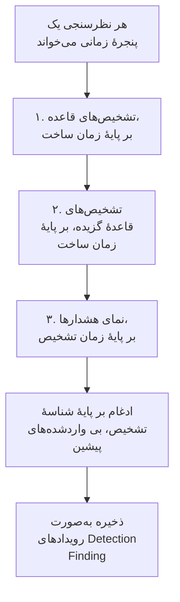

# Google SecOps

هشدارها و تشخیص‌های [Google SecOps](https://cloud.google.com/security/products/security-operations) (پیش‌تر Chronicle) را به رویدادهای امنیتی OneUptime بیاورید. آنجا آن‌ها را کنار لاگ‌ها، ترِیس‌ها و متریک‌هایتان جستجو می‌کنید، با هر منبع دیگری هم‌بسته می‌کنید، و برای آن‌هایی که مهم‌اند آنکال را فرا می‌خوانید.

:::cards
- [انتخاب شیوهٔ اتصال](#انتخاب-شیوهٔ-اتصال): یک وب‌هوک playbook در SOAR، رابط مدیریت‌شده، یا ارسال UDM.
- [راه‌اندازی رابط مدیریت‌شده](#راهاندازی-رابط-مدیریتشده): یک کلید حساب سرویس، و فرم اتصال.
- [رابط چگونه نظرسنجی می‌کند](#رابط-چگونه-نظرسنجی-میکند): سه بار خواندن هر پنجره، و بودجه‌هایشان.
- [عیب‌یابی](#عیبیابی): Last Error چه می‌گوید، و چه باید کرد.
- [ارسال رویدادهای امنیتی به Google SecOps](#ارسال-رویدادهای-امنیتی-به-google-secops): تشخیص‌های OneUptime در Google SecOps.
:::

## انتخاب شیوهٔ اتصال

| روش | چه چیزی می‌رسد | کی از آن استفاده کنید |
| --- | --- | --- |
| یک وب‌هوک playbook در SOAR | هر هشداری که یک playbook می‌فرستد، در چند ثانیه | playbookهای SOAR اجرا می‌کنید، و هشدارهایشان را بدون نظرسنجی در OneUptime می‌خواهید. |
| رابط مدیریت‌شده | هشدارها، و اگر بخواهید تشخیص‌های قاعده، با نظرسنجی در یک بازه | می‌خواهید OneUptime آن‌ها را برایتان بیاورد، بی‌آنکه در SecOps چیزی پیکربندی کنید. |
| ارسال رویدادهای UDM | رویدادهای خام UDM، برای جستجو و هم‌بسته‌سازی کامل | پیش‌تر رویدادهای UDM را برون‌بری می‌کنید، و همهٔ آن‌ها را می‌خواهید. |

هر روش آنچه را می‌رسد به [OCSF](https://schema.ocsf.io/) استاندارد می‌کند، یعنی Open Cybersecurity Schema Framework که OneUptime همهٔ رویدادهای امنیتی را در آن ذخیره می‌کند، پس قاعده‌های تشخیص و داشبوردها، منبع هر چه باشد، یکسان کار می‌کنند.

## پیش از شروع

- برای رابط مدیریت‌شده، در OneUptime، نقش Project Owner، Project Admin یا Security Admin. Security Member و Security Viewer می‌توانند اتصال‌ها را بخوانند، اما نمی‌توانند آن‌ها را بسازند.
- برای وب‌هوک و ارسال UDM، یک کلید دریافت داده: **تنظیمات پروژه** > **تله‌متری و APM** > **کلیدهای دریافت داده** را باز کنید و روی **ساخت کلید دریافت داده** کلیک کنید.
- برای رابط مدیریت‌شده، اجازهٔ ساختن یک حساب سرویس Google Cloud، روی پروژه‌ای که نمونهٔ SecOps شما به آن متصل است.

## فرستادن هشدارها از یک playbook در SOAR

playbookهای SOAR در Google SecOps می‌توانند هشدارها را به هر نقطهٔ پایانی HTTP بفرستند. یکی را به دریافت رویدادهای امنیتی OneUptime نشانه بگیرید.

:::steps
### افزودن یک کنش درخواست HTTP

در playbook SOAR در SecOps، یک کنش **HTTP request** اضافه کنید که روی هشدارهای تازه اجرا شود.

### نشانه گرفتن آن به OneUptime

**Method** آن را روی `POST`، و **URL** آن را روی `https://oneuptime.com/security-events/v1/ingest` بگذارید، یا روی یک نصب خودمیزبان `https://<your-host>/security-events/v1/ingest`. این سرآیندها را اضافه کنید:

```text
Content-Type: application/json
x-oneuptime-token: <your telemetry ingestion key>
```

JSON هشدار را به‌عنوان **Body** بفرستید. یک تشخیص، یعنی جزئیات قاعده با رویدادهای UDM جورشده زیر `collectionElements`، خودبه‌خود شناخته می‌شود، به‌صورت یک رویداد Detection Finding ذخیره می‌شود، و کاربران، میزبان‌ها و IPهای رویدادهای جورشده‌اش به‌صورت observable نگه داشته می‌شوند.

### بررسی اینکه هشدارها می‌رسند

playbook را اجرا کنید. هشدارهایش در چند ثانیه در **محصولات** > **رویدادهای امنیتی** نشان داده می‌شوند.
:::

## ارسال رویدادهای UDM

برای جستجو و هم‌بسته‌سازی کامل، خود رویدادهای UDM را بفرستید، برای نمونه از یک خط لولهٔ برون‌بری BigQuery، یک Cloud Function، یا هر فرستنده‌ای که پیش‌تر اجرا می‌کنید:

```bash
curl -X POST "https://oneuptime.com/security-events/v1/ingest?format=udm" \
  -H "Content-Type: application/json" \
  -H "x-oneuptime-token: <your telemetry ingestion key>" \
  -d '{
    "events": [
      {
        "metadata": {
          "event_type": "USER_LOGIN",
          "event_timestamp": "2026-08-21T10:00:00Z",
          "vendor_name": "Google",
          "product_name": "Google SecOps"
        },
        "principal": { "user": { "userid": "alice" }, "ip": ["203.0.113.7"] },
        "target": { "hostname": "vpn-gw-01" },
        "security_result": [{ "severity": "HIGH", "action": ["BLOCK"] }]
      }
    ]
  }'
```

- `format` می‌تواند `udm`، `ocsf`، `google-secops-alert` یا `generic` باشد. آن را حذف کنید، و قالب رویداد به رویداد تشخیص داده می‌شود.
- بدنه می‌تواند یک رویداد، فهرستی از رویدادها، یا `{ "events": [...] }` باشد.
- `x-oneuptime-service-name` سرویس تله‌متری‌ای را که رویدادها به آن تعلق دارند نام می‌برد. بدون آن، رویدادها به سرویسی تعلق دارند که به نام محصول محموله نام‌گذاری شده است.

## راه‌اندازی رابط مدیریت‌شده

OneUptime تشخیص‌ها و هشدارهای مستأجر شما را در یک بازه نظرسنجی می‌کند، بدون هیچ پیکربندی SOAR. Google SecOps یکی از ارائه‌دهندگان Security Event Connections است، پس در همان صفحه و به همان شیوهٔ هر رابط مدیریت‌شدهٔ دیگری ساخته، آزمایش، نظرسنجی و عیب‌یابی می‌شود.

:::steps
### ساختن یک کلید حساب سرویس

در Google Cloud، روی پروژه‌ای که نمونهٔ SecOps شما به آن متصل است یک حساب سرویس بسازید، و نقش **Chronicle API Viewer** (`roles/chronicle.viewer`) را به آن بدهید. این نقش مجوزهای `legacySearchDetections`، `legacySearchCuratedDetections`، `countAllCuratedRuleSetDetections` و `legacyFetchAlertsView` را که رابط با آن‌ها می‌خواند در بر دارد.

در زبانهٔ **Keys** حساب سرویس، یک کلید از نوع **JSON** اضافه و دانلود کنید. کل پرونده را در اتصال می‌چسبانید. `token_uri` آن باید یک نشانی `https` روی یک میزبان Google باشد، که کلیدی دانلودشده از Google Cloud از پیش همین‌طور است.

### یافتن منطقه و نام منبع نمونه

در Google SecOps، **SIEM Settings → Profile** را باز کنید. نام منبع نمونه شکل `projects/{project}/locations/{location}/instances/{instance}` را دارد، که در آن بخش instance شناسهٔ نمونهٔ SecOps است؛ نام نمایشی یک اتصال یا نام یک حساب سرویس جایگزین آن نمی‌شود. منطقه نقطهٔ پایانی منطقه‌ای است که آن مکان را سرویس می‌دهد، و باید با بخش locations نام منبع نمونه جور باشد، وگرنه اتصال هنگام ذخیره رد می‌شود.

### افزودن اتصال

**محصولات** > **رویدادهای امنیتی** > **اتصال‌ها** (`/dashboard/{projectId}/security-events/connections`) را باز کنید، **افزودن اتصال** را برگزینید، **Google SecOps** را انتخاب کنید، و فرم را با تنظیمات جدول زیر پر کنید.

### آزمایش پیش از ذخیره

پیش از ذخیره، **آزمودن این تنظیمات** را زیر **آزمایش پیش از ذخیره** برگزینید. آزمایش بدون ذخیرهٔ چیزی روی مقدارهای فرم اجرا می‌شود، پس یک کلید بدشکل، یک نقش جاافتاده یا یک نمونهٔ نادرست پیش از ساخته شدن اتصال گرفته می‌شود. در فرم ویرایش، همان دکمه **منطقه**، **نام منبع نمونه** و **Data to import** نمایش‌داده‌شده روی صفحه را با کلید ذخیره‌شده آزمایش می‌کند؛ فیلد اعتبارنامه‌ای که خالی بماند کلید ذخیره‌شده را نگه می‌دارد. وقتی هر چیز آزمایش‌شده با آنچه اتصال ذخیره کرده فرق کند، از جمله کلیدی که تازه وارد شده، هیچ ردیف تاریخچهٔ اجرا ثبت نمی‌شود، چون اتصال هنوز آن تنظیمات را ندارد.
:::

| تنظیم | کجا پیدایش کنید | لازم |
| --- | --- | --- |
| **منطقه** | نقطهٔ پایانی منطقه‌ای Google SecOps (`us`، `europe`، `asia-southeast1`، ...) که با مکان در نام منبع نمونهٔ شما جور است. هیچ پیش‌فرضی ندارد، تا مستأجری بیرون از آمریکا نتواند ناخواسته نقطهٔ پایانی نادرست را ذخیره کند. | بله |
| **نام منبع نمونه** | در Google SecOps، **SIEM Settings → Profile**: `projects/{project}/locations/{location}/instances/{instance}`. | بله |
| **بستن هشدارها هنگام بسته شدن پرونده‌شان** | در آخرین گام فرم، خاموش تا وقتی که روشنش کنید. روشن که باشد، بستن یک پرونده هشدارهای Google SecOps آن را می‌بندد: [بستن هشدارها هنگام بسته شدن پرونده‌شان](#بستن-هشدارها-هنگام-بسته-شدن-پروندهشان) را ببینید. | خیر |
| **JSON حساب سرویس** | در Google Cloud، زبانهٔ **Keys** حساب سرویس. کل پروندهٔ کلید JSON را بچسبانید. فقط‌نوشتنی: در حالت ذخیره رمزگذاری‌شده، هرگز از API برگردانده نمی‌شود، هرگز دوباره در صفحه نشان داده نمی‌شود. برای چرخاندن آن از **به‌روزرسانی اطلاعات ورود** روی اتصال استفاده کنید. | بله |
| **Data to import** | **هشدارها** همیشه وارد می‌شوند چون API هشدارهای Google همیشه آن‌ها را برمی‌گرداند. برای وارد کردن جورشدن‌های قاعده‌ای که هشداری نساخته‌اند هم، **تشخیص‌ها** را برگزینید. این رویدادهای خام UDM را نمی‌فرستد: آن‌ها را خودتان، مانند بالا، بفرستید. | هشدارها همیشه |

گام نظرسنجی فرم یک **نام**، یک **توضیحات** اختیاری، اینکه اتصال **فعال** باشد یا نه، و **فاصله فراخوانی (دقیقه)** را می‌خواهد: یک عدد صحیح از `1` تا `1440`، با پیش‌فرض `5`. هر چیزی بیرون از این بازه هنگام ذخیره رد می‌شود.

تشخیص‌های تازه به‌صورت رویدادهای Detection Finding وارد می‌شوند که به یک سرویس تله‌متری `Google SecOps` نسبت داده می‌شوند.

## خواندن سلامت اتصال

فهرست اتصال‌ها **نام** (با ارائه‌دهندهٔ اتصال و انتخاب Data to import آن زیر آن)، **سلامت**، **آخرین فراخوانی** و **آخرین رویداد واردشده** را نشان می‌دهد. **وضعیت** (فعال یا غیرفعال)، **فاصله (دقیقه)** و **آخرین فراخوانی موفق** در **سفارشی‌سازی ستون‌ها** هستند. وقتی اتصالی خطا دارد، **مشاهده خطا** در ستون **اقدام‌ها** آن، کنار **آزمایش اتصال**، **اجرای اکنون**، **عیب‌یابی**، **ویرایش** و **به‌روزرسانی اطلاعات ورود** ظاهر می‌شود. فعال یعنی نظرسنجی خودکار پیکربندی شده است. Last Polled یک تلاش را ثبت می‌کند؛ یک پنجرهٔ خالی موفق ثابت نمی‌کند که تشخیص خاصی وارد شده است.

**سلامت** فقط وقتی رویدادی وارد شده باشد **Last poll succeeded** را نشان می‌دهد. تا آن زمان اتصالی که موفق می‌شود **Polling, no events imported yet** را نشان می‌دهد، و این همان وضعیتی است که باید با آزمایش اتصال بررسی شود. وضعیت‌های دیگر **No records returned**، **Partial import**، **Catching up**، **Last poll failed**، **Poll overdue**، **Schedule paused** و **در انتظار اولین دریافت** هستند؛ برای دیدن معنای هر وضعیت، نشانگر ماوس را روی آن نگه دارید.

> [!NOTE]
> رابط از APIهای قدیمی تشخیص و هشدار `v1alpha` در Chronicle استفاده می‌کند، که Google آن‌ها را پیش از انتشار عمومی ارائه می‌دهد. وقتی یک نظرسنجی شکست می‌خورد، فیلد **آخرین خطا** اتصال پیام خطای کامل را، با اعتبارنامه‌های پوشانده‌شده، پشت پیشوندی ذخیره می‌کند که گام شکست‌خورده را نام می‌برد، از جمله وقتی Chronicle با `200` پاسخ می‌دهد و ردکردن را درون بدنه می‌گذارد. برای خواندن پیام، **مشاهده خطا** را در ستون **اقدام‌ها** اتصال برگزینید، سپس **کپی خطا** را در کادر گفتگو تا آن را برای پشتیبانی کپی کنید.

## رابط چگونه نظرسنجی می‌کند



هر دقیقه یک کارگر پس‌زمینه برای هر اتصال فعالی که از آخرین نظرسنجی‌اش بازه‌اش گذشته باشد، یک نظرسنجی در صف می‌گذارد. هر نظرسنجی یک اجرا در تاریخچهٔ اتصال است که یک کارگر انجامش می‌دهد. یک پنجرهٔ زمانی را به سه شیوه می‌خواند و نتیجه‌ها را بر پایهٔ شناسهٔ تشخیص ادغام می‌کند، پس رکوردی که بیش از یک گذر برگرداند یک بار ذخیره می‌شود:

1. **تشخیص‌های قاعده بر پایهٔ زمان ساخت.** `legacy:legacySearchDetections` با `ruleId=-` (هر بازبینی هر قاعده) و `listBasis=CREATED_TIME`، با دنبال کردن `nextPageToken` تا وقتی صفحه آخرین صفحه باشد.
2. **تشخیص‌های قاعدهٔ گزیده بر پایهٔ زمان ساخت.** `legacy:legacySearchCuratedDetections`، به همان شیوه، یک بار برای هر قاعدهٔ گزیده (نوشتهٔ Google). آن نقطهٔ پایانی یک شناسهٔ قاعدهٔ گزیده (`ur_...`) می‌گیرد و هیچ نویسهٔ عام «هر قاعده» ندارد، پس این گذر نخست `:countAllCuratedRuleSetDetections` را برای هفتهٔ پیش از پنجره تا پایان آن فرا می‌خواند، و هر قاعدهٔ گزیده‌ای را که تشخیص ساخته جستجو می‌کند. قاعدهٔ گزیده‌ای که در آن هفته فعال نشده چیزی برای وارد کردن ندارد. مستأجری که به قاعده‌های گزیده دسترسی ندارد به این گذر با `400`، `403` یا `404` پاسخ می‌دهد؛ این به‌صورت یک هشدار روی اجرا ثبت می‌شود، نه یک شکست.
3. **نمای هشدارها بر پایهٔ زمان تشخیص.** `legacy:legacyFetchAlertsView`، که افزون بر هشدارهای قاعده، هشدارهای تله‌متری، هشدارهای SOAR و هشدارهای هوش ماشینی را هم پوشش می‌دهد. این نقطهٔ پایانی صفحه‌بندی ندارد، پس پاسخی که Google محدودش کند به پنجره‌های کوچک‌تر شکسته و دوباره خوانده می‌شود.

نمای هشدارها فقط بر پایهٔ زمان تشخیص می‌تواند پالایش کند، و Google اغلب هشداری را مدت‌ها پس از زمان تشخیصش خواندنی می‌کند (تأخیر دریافت، قاعده‌های زمان‌بندی‌شده، اجرای دوباره روی داده‌های دیررس). پس یک نظرسنجی زمان‌بندی‌شده همچنین **نمای هشدارها را در ۲۴ ساعت پیش از پنجره‌اش دوباره می‌کاود**، فقط هشدارها، که به‌صورت بررسی **Read late alerts by detection time** ثبت می‌شود. رکوردهایی که پیش‌تر وارد شده‌اند رد می‌شوند، پس تکرارهای این کاوش زیر **Already imported** نشان داده می‌شوند. این کاوش در حد توان است: وقتی Google محدودش کند، بودجه‌اش تمام شود یا شکست بخورد، اجرا یک هشدار می‌گیرد، اما نظرسنجی Partial یا Failed نمی‌شود و نشانگر همچنان جلو می‌رود، چون روزی که به عقب می‌کاود را نظرسنجی‌های پیشین خوانده‌اند.

نظرسنجی بر پایهٔ **زمان ساخت** کل طراحی است. یک قاعدهٔ Google SecOps بر اساس زمان‌بندی اجرا می‌شود (هر ۱۰ دقیقه، هر ساعت، هر روز)، و تشخیصی که می‌سازد `detectionTime` دارد که پایان پنجرهٔ زمانی قاعده یا زمان رویداد جورشده است، در حالی که `createdTime` زمانی است که موتور تشخیص واقعاً آن را ساخته است. تشخیصی که ساعت ۱۰:۰۵ برای پنجره‌ای که ساعت ۰۹:۰۰ تمام می‌شود ساخته شده، زمان تشخیصی دارد که پیش‌تر پشت نشانگری مانده که چند نظرسنجی پیش از ۰۹:۰۰ گذشته است، پس رابطی که بر پایهٔ زمان تشخیص نظرسنجی کند هرگز آن را نمی‌بیند، و هیچ رویداد دیررسی را هم. خواندن بر پایهٔ زمان ساخت باعث می‌شود هر نظرسنجی بپرسد «از آخرین باری که نگاه کردم Google چه ساخته است»، و این همان پرسشی است که پاسخ دارد. هر اجرا تأخیر ساخت خود را ثبت می‌کند، یعنی چند رکورد واکشی‌شده بیش از یک بازهٔ نظرسنجی (به‌علاوهٔ یک دقیقه) پس از زمان تشخیصشان ساخته شده‌اند، و بزرگ‌ترین فاصله را، پس این اثر در Diagnostics دیده می‌شود.

نخستین نظرسنجی یک اتصال تازه بر پایهٔ زمان ساخت **۲۴ ساعت** به عقب نگاه می‌کند. هر نظرسنجی پس از آن از نشانگر ذخیره‌شدهٔ اتصال با **۱ دقیقه** هم‌پوشانی ادامه می‌دهد؛ رکوردی که روی مرز یک پنجره ساخته شود را هر دو نظرسنجی می‌خوانند و یک بار ذخیره می‌شود، چون نظرسنجی‌ها رویدادهایی را که پیش‌تر با همان شناسهٔ منبع ذخیره شده‌اند رد می‌کنند. هر نظرسنجی زمان‌بندی‌شده حداکثر **۲۴ ساعت** پس از نشانگر را می‌خواند، پس اتصالی با نشانگر ذخیره‌شدهٔ قدیمی‌تر در پنجره‌های پیاپی ۲۴ ساعته جبران می‌کند (Health، **Catching up** را نشان می‌دهد) به جای اینکه تشخیص‌های میانه را دور بریزد. برای رکوردهایی که پیش از نخستین پنجرهٔ ۲۴ ساعته ساخته شده‌اند، از **Import this time range** در Diagnostics استفاده کنید.

### وقتی یک پنجره بیش از توان یک نظرسنجی دارد

رابط به هر نظرسنجی بودجه‌های ثابتی می‌دهد: گذر تشخیص‌های قاعده **۲۰** صفحهٔ جستجو دارد، گذر گزیده تا **۲۰۰** درخواست (شمارش، به‌علاوهٔ دست‌کم یک صفحه برای هر قاعدهٔ گزیده‌ای که هفتهٔ گذشته فعال شده، پرکارترین قاعده‌ها اول)، نمای هشدارها و کاوش هشدارهای دیررسش **۱۶** درخواست را میان خود تقسیم می‌کنند، و کل خواندن پس از **۴ دقیقه** متوقف می‌شود. گذر گزیده وقتی ۶۰٪ از آن زمان صرف شد هیچ قاعدهٔ گزیدهٔ دیگری را شروع نمی‌کند، تا نمای هشدارها همچنان اجرا شود. وقتی یک نظرسنجی نتواند همهٔ قاعده‌های گزیدهٔ فعال را جستجو کند، به جای نگه داشتن نشانگر هشداری ثبت می‌کند که می‌گوید چند قاعده جستجو نشده‌اند، چون پنجره‌ای کوتاه‌تر هم همهٔ آن قاعده‌ها را برای جستجو خواهد داشت. گذری که بودجه‌ای آن را در میانه متوقف کرده، به‌صورت یک بررسی هشدار که بودجه را نام می‌برد ثبت می‌شود (برای نمونه `Read rule detections by created time was stopped by the request budget after 20 requests.`)، و گذری که بودجه هرگز نگذاشت شروع شود یک بررسی ردشده است با همان دلیل در هشدارهای اجرا، و هرگز یک موفقیت نیست. پنجره‌ای با تشخیص‌هایی بیش از این در یک نظرسنجی خوانده نمی‌شود، و نظرسنجی هرگز همان پنجره را تا ابد دوباره نمی‌خواند:

1. **باریک کردن.** نقطه‌های پایانی جستجوی Google تازه‌ترین تشخیص‌ها را اول برمی‌گردانند، پس نظرسنجی‌ای که زود متوقف شود هیچ نقطه‌ای برای ادامه ندارد. نظرسنجی **جزئی** ثبت می‌شود، نشانگر همان‌جا که بود می‌ماند، و نظرسنجی بعدی پنجره‌ای به نصف طول را از همان نقطهٔ شروع می‌خواند، با هشدار `This window holds more records than one poll can read; the next poll reads a {n} minute window from the same starting point.` نصف کردن تا یک دقیقه ادامه می‌یابد تا پنجره جا شود.
2. **دوباره بزرگ کردن.** هر نظرسنجی کامل پنجرهٔ بعدی را دو برابر می‌کند، تا بیشینهٔ ۲۴ ساعت، پس یک انفجار به جای یک اتصال همیشه کند، چند نظرسنجی کوتاه هزینه دارد.
3. **گذشتن از یک دقیقهٔ تنها.** اگر حتی یک دقیقه تشخیص‌هایی بیش از توان یک نظرسنجی داشته باشد، نظرسنجی نشانگر را از آن دقیقه می‌گذراند تا تشخیص‌های تازه‌تر همچنان برسند. اجرا **جزئی** است و همان متن در آغاز **آخرین خطا** می‌آید: `More records were created in the one minute from {start} to {end} than one poll can read. Polling moved past this minute so newer records keep arriving; use Import this time range in Diagnostics on this minute to recover what one run can read.` برای بازیابی آنچه یک اجرا می‌تواند بخواند، **عیب‌یابی** را باز کنید، یک بازهٔ سفارشی که آن دقیقه را پوشش دهد برگزینید (ورودی‌های بازه زمان محلی شما را به کار می‌برند؛ پیام به UTC است) و **Import this time range** را اجرا کنید؛ یک وارد کردن همان سقف‌های هر اجرای یک نظرسنجی را دارد. تشخیص‌هایی که پیش‌تر وارد شده‌اند رد می‌شوند.

یک نظرسنجی Partial هشدارهایش را هم در **آخرین خطا** ذخیره می‌کند، جایی که تا وقتی یک نظرسنجی کامل پاکشان کند می‌مانند. نظرسنجی‌ای که یکسره شکست بخورد (یک خطا، نه رکوردهای بیش از اندازه) نشانگر و طول پنجره‌اش را نگه می‌دارد و در تیک بعدی دوباره امتحان می‌شود. تنها استثنا درخواستی است که زمانش سر رسیده: نظرسنجی بعدی پنجره‌ای به نصف طول را از همان نقطهٔ شروع می‌خواند (`The source did not answer in time for this window; the next poll reads a {n} minute window from the same starting point.`)، چون وگرنه پنجره‌ای که برای پاسخ به‌موقع بیش از حد سنگین است در هر تلاش دوباره به پایان زمان می‌خورد. کوتاه کردن بازهٔ نظرسنجی هیچ‌کدام از این‌ها را تغییر نمی‌دهد: پنجره را نشانگر و نتیجهٔ آخرین نظرسنجی تعیین می‌کنند، نه اینکه نظرسنجی‌ها هر چند وقت اجرا شوند.

## آزمایش اتصال

**آزمایش اتصال**، در ردیف اتصال یا در **عیب‌یابی**، همگام در فرایند API اجرا می‌شود. به کارگر پس‌زمینه نیازی ندارد، و دقیقاً به همین دلیل می‌تواند به شما بگوید که هیچ کارگری اجرا نمی‌شود. فهرست بررسی:

1. **پیکربندی**: هر فیلد موجود و درست‌شکل است: یک **منطقه** پشتیبانی‌شده که با مکان نمونه جور باشد، یک **نام منبع نمونه** با شکل درست، و یک کلید **JSON حساب سرویس** با `client_email`، یک `private_key` خواندنی و یک `token_uri` از Google. اگر این شکست بخورد با هیچ جایی تماس گرفته نمی‌شود.
2. **Authenticate with Google**: کلید در نقطهٔ پایانی OAuth گوگل با یک توکن دسترسی مبادله می‌شود، پیش از اینکه با Chronicle تماس گرفته شود.
3. **Read rule detections**، **Read curated rule detections** و **Read the alerts view**: یک کاوش تک‌رکوردی از هر گذر روی ۲۴ ساعت گذشته. بررسی گزیده شمارش‌های قاعده‌های گزیده را برای ۷ روز گذشته می‌خواند و قاعدهٔ گزیده‌ای را که بیشترین تشخیص را دارد می‌کاود؛ اگر در آن هفته هیچ قاعدهٔ گزیده‌ای فعال نشده باشد، بی‌آنکه چیزی بکاود موفق می‌شود. خواندن گزیده‌ای که با `400`، `403` یا `404` پاسخ بگیرد یک هشدار است، چون شاید مستأجر اصلاً به قاعده‌های گزیده دسترسی نداشته باشد.
4. **Detections available to import**: آنچه Google با انتخاب ذخیره‌شدهٔ **Data to import** و با انتخاب دیگر (فقط هشدارها، یا هشدارها و **تشخیص‌ها**) در ۲۴ ساعت گذشته و ۷ روز گذشته دارد: شمارش جورشده‌های نمای هشدارها و یک صفحهٔ جستجو بر پایهٔ زمان ساخت برای هر بازه، که به‌صورت یک عدد یا `1000+` گزارش می‌شود. وقتی انتخاب ذخیره‌شده هیچ ندارد اما انتخاب دیگر دارد، بررسی هشدار می‌دهد: قاعده‌های شما تشخیص می‌سازند اما هشداردهی روی آن‌ها فعال نیست. اتصال را ویرایش کنید و **تشخیص‌ها** را زیر **Data to import** برگزینید، یا هشداردهی را روی قاعده‌ها در Google SecOps فعال کنید.
5. **Background workers**، **Poll scheduler** و **Security event storage**: آیا فرایندی صف Worker در OneUptime را مصرف می‌کند، آیا کار نظرسنجی دقیقه‌به‌دقیقه ثبت شده است، و آیا انبارهٔ رویدادهای امنیتی به همان جستجوی تکراری که نظرسنجی پیش از هر درج اجرا می‌کند پاسخ می‌دهد، تا یک پایگاه دادهٔ تحلیلی خراب همین‌جا با نام شکست بخورد، نه یک ساعت بعد به‌صورت یک خطای نظرسنجی.
6. **Scheduled polling** (فقط اتصال‌های ذخیره‌شده): آیا نظرسنجی فعال است، آیا اجرایی در صف در انتظار یک کارگر گیر کرده است، و آیا اتصال طبق زمان‌بندی نظرسنجی می‌شود.

هر درخواست در یک آزمایش مهلتی ۲۰ ثانیه‌ای دارد. آزمایش‌ها به نشانگر نظرسنجی و انبارهٔ رویدادها دست نمی‌زنند. اتصال ذخیره‌شده‌ای که با تنظیمات ذخیره‌شده‌اش آزمایش شود یک ردیف تاریخچهٔ اجرا از نوع test می‌گیرد، و جزئیات آن ردیف همان فهرست بررسی را نشان می‌دهد.

## پیش‌نمایش، اجرا و وارد کردن در صورت نیاز

**عیب‌یابی** را روی یک اتصال باز کنید تا اجراهای اخیر را ببینید و رابط را به کار بیندازید. Project Owner، Project Admin و Security Admin می‌توانند عملیات را شروع کنند. Security Member و Security Viewer می‌توانند تاریخچه را بخوانند.

- **اجرای اکنون** بی‌درنگ یک نظرسنجی در صف می‌گذارد، با نشانگر و مسیر دریافت معمول، حتی وقتی نظرسنجی زمان‌بندی‌شده غیرفعال است. وضعیت‌های در صف و در حال اجرا تا وقتی کارگر درخواست را انجام می‌دهد دیده می‌مانند. اگر اجرایی در صف بماند، بررسی کنید که کارگرها صف Worker را پردازش می‌کنند؛ بررسی **Background workers** در آزمایش اتصال می‌گوید آیا فرایندی این کار را می‌کند.
- **Preview detections** یک بازهٔ زمانی برگزیده را بی‌آنکه وارد کند یا نشانگر را تغییر دهد می‌خواند. از ساعت گذشته، ۲۴ ساعت، ۷ روز، یا یک بازهٔ سفارشی تا ۷ روز استفاده کنید. بازه با نمای هشدارهای SecOps جور است که بر پایهٔ زمان تشخیص می‌خواند، و دو گذر جستجو هم تشخیص‌هایی را که در آن ساخته شده‌اند می‌خوانند و هم تشخیص‌هایی را که زمان تشخیصشان در آن است، پس پیش‌نمایش دیروز، تشخیص‌هایی را هم نشان می‌دهد که دیروز دربارهٔ رویدادهای قدیمی‌تر ساخته شده‌اند. پیش‌نمایش زمان تشخیص و زمان ساخت را جداگانه نشان می‌دهد. نتیجه‌ها انتخاب ذخیره‌شدهٔ **Data to import** اتصال را بازتاب می‌دهند.
- **Import this time range** پس از تأیید شما بازهٔ برگزیده را وارد می‌کند، بی‌آنکه نشانگر نظرسنجی را جابه‌جا کند. این همچنین راه بازیابی دقیقه‌ای است که نظرسنجی از آن گذشته، همان‌طور که بالا آمد. اول بازه را پیش‌نمایش کنید. نظرسنجی‌ها و وارد کردن‌های تکراری رویدادهایی را که پیش‌تر با همان شناسهٔ منبع در پروژه ذخیره شده‌اند رد می‌کنند. وارد کردن‌ها ممکن است درست مانند نظرسنجی زمان‌بندی‌شده، قاعده‌های تشخیص و مانیتورهای پیکربندی‌شده را به کار بیندازند.

جزئیات هر اجرا **Requested window (UTC)**، انتخاب **Data to import** اتصال و پنج شمارش را نشان می‌دهد:

| شمارش | چه چیزی را می‌شمارد |
| --- | --- |
| **Returned by Google SecOps** | رکوردهایی که Google در سه گذر برگردانده، پس از ادغام بر پایهٔ شناسه. |
| **Imported into OneUptime** | ردیف‌هایی که در انبارهٔ رویدادها نوشته شده‌اند. |
| **Already imported** | رکوردهایی که رد شده‌اند چون همان شناسهٔ منبع پیش‌تر در این پروژه ذخیره شده است؛ هم‌پوشانی ۱ دقیقه‌ای و اجراهای دوباره این را عادی می‌کنند. |
| **ردشده** | شیءهای برگردانده‌شده‌ای که تشخیص Google SecOps نیستند. شمرده می‌شوند و دربارهٔ آن‌ها هشدار داده می‌شود، هرگز دوباره امتحان نمی‌شوند، و نشانگر را نگه نمی‌دارند. |
| **ناموفق** | رکوردهایی که نمی‌شد استاندارد کرد. یک نظرسنجی آن‌ها را در پنجره‌ای کوتاه‌تر دوباره امتحان می‌کند. |

**Provider details**، **Time basis read**، رکوردهای **Returned by each pass** (تشخیص‌های قاعده، تشخیص‌های قاعدهٔ گزیده و نمای هشدارها) و **Creation lag** را اضافه می‌کند. پس از آن بررسی‌ها، یکی برای هر گذر، هشدارها و نمونهٔ تشخیص‌ها می‌آیند. جزئیات یک نظرسنجی زمان‌بندی‌شده همچنین **Window read by this poll** و آنچه **Next scheduled poll reads** را نشان می‌دهد، و یک نظرسنجی Partial می‌گوید که آیا نقطهٔ شروعش را نگه داشته و پنجرهٔ بعدی را باریک کرده، یا از دقیقهٔ تنهایی که نام می‌برد گذشته است. **موفق**، **No records returned**، **جزئی** و **ناموفق** نتیجه‌های جداگانه‌ای هستند.

روی یک اجرا از **View events in this time range** استفاده کنید تا بازهٔ زمان رویداد تشخیص‌هایی که برگردانده باز شود. وگرنه تشخیصی که امروز با زمان تشخیص دیروز ساخته شده، ممکن است پشت یک پالایهٔ رویدادهای اخیر پنهان بماند. تاریخچهٔ اجرا شکست‌ها را حتی پس از اینکه یک نظرسنجی کامل بعدی Last Error را پاک کند نگه می‌دارد. هنگام تماس با پشتیبانی از **Copy diagnostics** استفاده کنید؛ اعتبارنامه‌ها و توکن‌های حساب سرویس هرگز در آن نیستند.

## چرا رویدادی نمی‌بینم؟

این‌ها را به ترتیب بررسی کنید. هر کدام در **عیب‌یابی** یا از **آزمایش اتصال** از بعدی قابل تشخیص است.

1. **Data to import.** به‌طور پیش‌فرض فقط **هشدارها** وارد می‌شوند، و یک تشخیص قاعده فقط وقتی هشدار است که هشداردهی روی آن قاعده در Google SecOps فعال باشد. مستأجری که قاعده‌هایش بدون هشداردهی تشخیص می‌سازند، صادقانه تا ابد خالی نظرسنجی می‌کند. **آزمایش اتصال** را اجرا کنید: بررسی **Detections available to import** با **تشخیص‌ها** و بدون آن می‌شمارد و وقتی انتخابش رکوردی اضافه کند همین را می‌گوید. اتصال را ویرایش کنید و **تشخیص‌ها** را زیر **Data to import** برگزینید، یا هشداردهی را روی قاعده‌ها فعال کنید.
2. **بسامد اجرای قاعده و تأخیر تشخیص.** تشخیص‌ها وقتی قاعده اجرا می‌شود ساخته می‌شوند، که می‌تواند تا یک ساعت یا یک روز پس از رویدادهایی باشد که توصیف می‌کنند. رابط بر پایهٔ زمان ساخت نظرسنجی می‌کند، پس آن‌ها در نخستین نظرسنجی پس از اینکه Google آن‌ها را ساخت می‌رسند، نه در زمان تشخیصشان. قاعده‌ای که تازه فعال کرده‌اید هنوز چیزی نساخته، و مستأجری آرام چیزی برای ساختن ندارد. بررسی دسترس‌پذیری گزارش می‌دهد چند تشخیص در ۲۴ ساعت و ۷ روز گذشته ساخته شده؛ صفر با **تشخیص‌ها** و بدون آن یعنی Google هنوز چیزی برای وارد کردن به OneUptime ندارد.
3. **شمارش‌های آخرین اجرا را بخوانید.** در Diagnostics، **Returned by Google SecOps** با صفر **Imported into OneUptime** و یک شمارش **Already imported** هم‌اندازه یعنی رابط همان‌طور که طراحی شده کار می‌کند: آن تشخیص‌ها را یک نظرسنجی پیشین وارد کرده است. رکوردهای **ردشده** شیءهایی‌اند که Google برگردانده و اصلاً تشخیص نیستند.
4. **آیا اصلاً چیزی نظرسنجی می‌شود؟** Last Polled با مقدار `Never` و Last Error خالی یعنی هیچ نظرسنجی‌ای برای این اتصال تمام نشده است. آزمایش اتصال **Background workers** (فرایندهایی که صف Worker را مصرف می‌کنند)، **Poll scheduler** (ثبت زمان‌بند دقیقه‌به‌دقیقه) و **Scheduled polling** (زمان‌بندی خود این اتصال، از جمله یک نظرسنجی دیرکرده یا اجرایی که در صف گیر کرده) را گزارش می‌دهد. برای تنظیمات استقراری که سببش می‌شوند، مدخل عیب‌یابی پایین را ببینید.
5. **در جای درست نگاه کنید.** رویدادها زیر زمان تشخیصشان ذخیره می‌شوند، که می‌تواند ساعت‌ها یا روزها پیش از زمان ساخته و وارد شدنشان باشد، پس پالایهٔ «ساعت گذشته» در رویدادهای امنیتی، تشخیصی را که یک دقیقه پیش دربارهٔ دیروز وارد شده پنهان می‌کند. روی یک اجرا در Diagnostics از **View events in this time range** استفاده کنید: بازهٔ زمان رویداد تشخیص‌هایی را که آن اجرا برگردانده باز می‌کند.

## شدت چگونه تعیین می‌شود

Google SecOps شدت یک تشخیص را بسته به اینکه چه کسی قاعده را نوشته، در جاهای مختلفی ذخیره می‌کند، و OneUptime آن‌ها را به این ترتیب می‌خواند و نخستین موردی را که شدتی نام ببرد به کار می‌برد:

1. **شدت خود Google** (`detection[].severity`). Google این را روی قاعده‌های گزیده تنظیم می‌کند، مانند Applied Threat Intelligence و مجموعه‌های قاعدهٔ گزیده.
2. **شدت هشدار** (`severity` در Collection)، برای هشدارهای SOAR و بدنه‌های وب‌هوک.
3. **شدت `meta` قاعده.** برای یک قاعدهٔ سفارشی YARA-L، Google فیلد `detection[].severity` را خالی می‌گذارد و بخش `meta` قاعده را به‌صورت `ruleLabels` برمی‌گرداند. OneUptime برچسب `severity` را می‌خواند، که همان مقداری است که داشبورد قاعده‌های Google SecOps نشان می‌دهد. Info، Informational، Low، Medium، High و Critical، با هر بزرگی و کوچکی حروف، شناخته می‌شوند.
4. **نتیجهٔ `$risk_score` قاعده**، اگر قاعده هیچ شدتی تنظیم نکرده باشد، که با [بازه‌های پیشنهادی Google](https://docs.cloud.google.com/chronicle/docs/yara-l/outcome-syntax) درجه‌بندی می‌شود: ۹۰–۱۰۰ Critical، ۸۰–۸۹ High، ۵۰–۷۹ Medium، ۲۰–۴۹ Low، ۱–۱۹ Informational. OneUptime فقط امتیازی را به کار می‌برد که خود قاعده تنظیم کرده است. `riskScore`ای را که Google برای قاعده‌های بدون امتیاز پر می‌کند (۴۰ برای قاعده‌های هشداردهنده، وگرنه ۱۵) نادیده می‌گیرد، چون آن پیش‌فرض چیزی دربارهٔ شدت تشخیص نمی‌گوید.

تشخیصی که هیچ‌کدام از این‌ها درجه‌بندی‌اش نکنند Unknown نشان داده می‌شود. برای درجه‌بندی یک قاعدهٔ سفارشی، در Google SecOps یک شدت به بخش `meta` آن اضافه کنید، برای نمونه `severity = "High"`، یا `$risk_score` را در بخش `outcome` آن تنظیم کنید. تشخیص‌هایی که قاعده پس از آن می‌سازد با همان شدت وارد می‌شوند.

## بستن هشدارها هنگام بسته شدن پرونده‌شان

با روشن بودن **بستن هشدارها هنگام بسته شدن پرونده‌شان** ، بستن یک [پروندهٔ امنیتی](/docs/telemetry/security-cases#بستن-یک-پرونده) هشدارهای Google SecOps را که از آن‌ها آمده می‌بندد. هر هشدار با حکم پرونده بسته علامت می‌خورد، True Positive به‌عنوان مخرب و False Positive یا Benign Positive به‌عنوان غیرمخرب، همراه با یادداشت بستن پرونده و پیوندی به خود پرونده. خط زمانی پرونده می‌گوید چند هشدار بسته شد.

- حساب سرویس به `chronicle.legacies.legacyUpdateAlert` نیاز دارد، که نقش `roles/chronicle.editor` آن را دارد. نقش `roles/chronicle.viewer` هشدارها را می‌خواند اما نمی‌تواند آن‌ها را ببندد، و در این حالت `403` روی پرونده نوشته می‌شود.
- هشداری که Google SecOps دیگر ندارد کنار گذاشته می‌شود. وقتی Google SecOps در دسترس نیست، OneUptime حدود یک ساعت دوباره تلاش می‌کند و سپس روی پرونده می‌نویسد چه چیزی را نتوانست ببندد.

## رویدادهای دیگرتان را برای شاخص‌های آن بپایید

یک [فید هوش تهدید](/docs/telemetry/threat-intelligence#google-secops-چگونه-خوانده-میشود) که **منبع** آن **Google SecOps** است، از راه این اتصال شاخص‌هایی را که هوش تهدید Google SecOps در رویدادهایش یافته می‌خواند، و بقیهٔ رویدادهای پروژهٔ شما را برای آن‌ها می‌پاید: ورودها، جریان‌های شبکه و رویدادهای نقطهٔ پایانی که Google SecOps هرگز ندید.

## ارسال رویدادهای امنیتی به Google SecOps

OneUptime می‌تواند یافته‌هایش را به Google SecOps هم بفرستد، تا SIEM‌ای که تیم شما در آن کار می‌کند تشخیص‌های OneUptime را کنار تشخیص‌های خودش ببیند. هر رویداد امنیتی همراه با شدت آن، برچسب‌های MITRE ATT&CK آن و قاعده‌ای که آن را پیدا کرد، به‌صورت یک رویداد UDM وارد می‌شود:

| رویداد امنیتی | نوع رویداد UDM |
| --- | --- |
| یک ورود | `USER_LOGIN` |
| اجرا، باز شدن، تزریق به یا پایان یک فرایند | `PROCESS_LAUNCH`, `PROCESS_OPEN`, `PROCESS_INJECTION`, `PROCESS_TERMINATION` |
| فرایندی که دسترسی‌هایش را بالا برد | `PROCESS_PRIVILEGE_ESCALATION` |
| هر فعالیت دیگر یک فرایند | `PROCESS_UNCATEGORIZED` |
| یک اتصال شبکه | `NETWORK_CONNECTION` |
| هر چیز دیگر، یا رویدادی بدون فیلدهایی که نوعش لازم دارد | `GENERIC_EVENT` |

در یک رویداد فرایند، `principal` فرایندی است که عمل کرد و `target` فرایندی که روی آن عمل شد: در اجرا، فرایند والد و فرایندی که آن را اجرا کرد.

:::steps
### ساختن کلیدی که بتواند رویداد وارد کند

در Google Cloud یک حساب سرویس در پروژه‌ای بسازید که نمونهٔ SecOps شما به آن متصل است، و نقشی با مجوز `chronicle.events.import` به آن بدهید، مانند **Chronicle API Editor** (`roles/chronicle.editor`). در زبانهٔ **Keys** آن، کلیدی از نوع **JSON** اضافه کنید و آن را بارگیری کنید.

### افزودن مقصد

**محصولات** > **رویدادهای امنیتی** > **اتصال‌ها** را باز کنید. زیر **ارسال به SIEM شما**، روی **افزودن مقصد** کلیک کنید، Google SecOps را زیر **SIEM** انتخاب کنید و روی **بعدی** کلیک کنید. **منطقه** را انتخاب کنید، **نام منبع نمونه** را مانند رابط بالا وارد کنید و کلید را در **JSON حساب سرویس** بچسبانید.

### ارسال یک رویداد آزمایشی

روی **ارسال رویداد آزمایشی** کلیک کنید. یک `GENERIC_EVENT` از محصول `OneUptime Security Events` با تنظیمات فرم به Google SecOps می‌رود و چیزی ذخیره نمی‌شود. ظرف چند دقیقه در Google SecOps دیده می‌شود.

### انتخاب آنچه ارسال می‌شود

زیر **چه چیزی فرستاده شود**، گزینهٔ **فقط تشخیص‌ها** را نگه دارید، یعنی آنچه قاعده‌ها و هوش تهدید شما پیدا کردند و هشدارهایی که محصولات متصل شما دادند، یا **همه رویدادهای امنیتی** را انتخاب کنید. روی **شروع ارسال** کلیک کنید.
:::

- یک مقصد رویدادهایی را می‌فرستد که از لحظهٔ ذخیره شدنش می‌رسند، هرگز تاریخچهٔ پروژه را، و رویدادهای تازه را هر دقیقه می‌فرستد.
- هشدارهایی که OneUptime از Google SecOps وارد کرده هرگز به آن بازگردانده نمی‌شوند.
- وقتی Google SecOps پاسخ نمی‌دهد یا دسته‌ای را رد می‌کند، مقصد جای خود را نگه می‌دارد و در اجرای بعدی دوباره تلاش می‌کند. **وضعیت** آن **ناموفق** را نشان می‌دهد و **مشاهده خطا** می‌گوید Google SecOps چه پاسخی داد.

## عیب‌یابی

:::details تشخیص‌های قاعدهٔ سفارشی شدت Unknown نشان می‌دهند در حالی که گزیده‌ها درجه‌بندی شده‌اند
قاعده هیچ شدتی تنظیم نمی‌کند. `severity = "Low"`، `"Medium"`، `"High"` یا `"Critical"` را به بخش `meta` قاعده اضافه کنید، یا `$risk_score` را در بخش `outcome` آن تنظیم کنید ([شدت چگونه تعیین می‌شود](#شدت-چگونه-تعیین-میشود) را ببینید). انتشارهای پیش از این تغییر، شدت `meta` قاعده‌های سفارشی را هم نادیده می‌گرفتند؛ ارتقا، تشخیص‌هایی را که آن انتشارها وارد کرده‌اند با برچسب‌های قاعدهٔ ذخیره‌شده همراه هر تشخیص دوباره درجه‌بندی می‌کند.
:::

:::details هشدارها در Google SecOps ظاهر می‌شوند اما هرگز در OneUptime نه
به انتشاری ارتقا دهید که تشخیص‌های قاعدهٔ گزیده را یکی‌یکی برای هر قاعدهٔ گزیده می‌خواند و نمای هشدارها را برای هشدارهای دیررس می‌کاود. انتشارهای پیشین `ruleId=-` را به `legacySearchCuratedDetections` می‌فرستادند، که نویسهٔ عام ندارد، پس Google به هر جستجوی گزیده با یک موفقیت خالی پاسخ می‌داد؛ و نمای هشدارها را فقط روی چند دقیقهٔ زمان تشخیص خود نظرسنجی می‌خواندند، پس هشداری که Google بعداً خواندنی می‌کرد هرگز دیده نمی‌شد. هر دو مانند یک اتصال سالم و آرام به نظر می‌رسیدند. پس از ارتقا، از **Import this time range** در Diagnostics برای وارد کردن ۷ روز گذشته استفاده کنید.
:::

:::details Google صفر رکورد برمی‌گرداند
پنجرهٔ زمانی دقیق، مبنای زمانی و انتخاب ذخیره‌شدهٔ **Data to import** را در Diagnostics بررسی کنید، و آزمایش اتصال را اجرا کنید تا شمارش‌های دسترس‌پذیری را با **تشخیص‌ها** و بدون آن بخوانید. جورشدن قاعده‌ای که هشدار نمی‌دهد به کادر **تشخیص‌ها** نیاز دارد. بازه‌ای را پیش‌نمایش کنید که هم زمان تشخیص و هم زمان ساخت آن را پوشش دهد. نخستین نظرسنجی زمان‌بندی‌شده بر پایهٔ زمان ساخت ۲۴ ساعت به عقب نگاه می‌کند؛ برای رکوردهای قدیمی‌تر از **Import this time range** استفاده کنید.
:::

:::details Health برابر Partial import است
تازه‌ترین اجرا را در **عیب‌یابی** باز کنید و هشدارهایش را بخوانید؛ همان هشدارها در Last Error هم هستند. `This window holds more records than one poll can read; ...` یعنی نظرسنجی در حال باریک کردن پنجره‌اش از همان نقطهٔ شروع است و کاری لازم نیست: وقتی نظرسنجی‌ها کامل شوند پنجره دوباره بزرگ می‌شود. `More records were created in the one minute from ...` یعنی نظرسنجی از آن دقیقه گذشته است؛ آن را با **Import this time range** وارد کنید تا تشخیص‌هایی که جا انداخته بازیابی شوند. هشداری که می‌گوید گذری با بودجهٔ درخواست یا بودجهٔ زمان نظرسنجی متوقف شده، یا به خاطر آن اجرا نشده، گذری را که کوتاه مانده نام می‌برد. کوتاه کردن بازهٔ نظرسنجی پنجره را تغییر نمی‌دهد. یک Last Error خالی به‌تنهایی پوشش کامل را ثابت نمی‌کند.
:::

:::details Health برابر Poll overdue است
نظرسنجی‌های زمان‌بندی‌شده به‌موقع اجرا نمی‌شوند. صف کارگرها را بررسی کنید، و آزمایش اتصال را برای بررسی‌های **Background workers** و **Scheduled polling** اجرا کنید.
:::

:::details وضعیت غیرفعال است
نظرسنجی زمان‌بندی‌شده از اتصال می‌گذرد. کاربران مجاز همچنان می‌توانند از Diagnostics آزمایش، پیش‌نمایش، با **اجرای اکنون** نظرسنجی، یا وارد کنند.
:::

:::details Last Polled برابر `Never` است و Last Error خالی است
هیچ نظرسنجی‌ای برای این اتصال تمام نشده است. **عیب‌یابی** را باز کنید: وقتی تاریخچهٔ اجرایش هیچ نظرسنجی‌ای ندارد، یا فقط یکی که در صف گیر کرده، کارگر پس‌زمینه اصلاً کار نظرسنجی را اجرا نکرده، پس هرگز چیزی به Chronicle نرسیده است. در استقرارهای خودمیزبان علت معمول `DISABLE_QUEUE_WORKERS=true` روی ظرف برنامه است، بدون استقرار کارگر جداگانه‌ای که صف‌ها را خالی کند. یا `DISABLE_QUEUE_WORKERS=false` را تنظیم کنید (پیش‌فرض `config.example.env` که Docker Compose همراهش است)، یا استقرار کارگر اختصاصی را اجرا کنید (Helm: `worker.enabled: true`، که به‌طور پیش‌فرض `false` است). آزمایش اتصال این را به‌صورت یک بررسی شکست‌خوردهٔ **Background workers**، **Poll scheduler** یا **Scheduled polling** گزارش می‌دهد. نظرسنجی‌ای که اجرا شده اما پیش از رسیدن به اتصال متوقف شده، به جای آن یک اجرای شکست‌خورده در آن تاریخچه است: `Another poll or import for this source is still running in this project` یعنی یک نظرسنجی یا وارد کردن دیگر Google SecOps در این پروژه قفل منبع را در دست داشت، و اتصال در تیک بعدی دوباره در صف گذاشته می‌شود. زمان‌بندی که حتی نتوانسته نظرسنجی‌ای در صف بگذارد، `Scheduler could not queue a poll:` و دلیل را روی Last Error می‌نویسد.
:::

:::details Last Error پر است
نظرسنجی‌ای انجام شد و چیزی در آن شکست خورد، نظرسنجی‌ای نتوانست کل پنجره‌اش را بخواند، یا زمان‌بند نتوانست نظرسنجی‌ای در صف بگذارد. برای یک نظرسنجی شکست‌خورده این فیلد پیام خطای کامل را، با اعتبارنامه‌های پوشانده‌شده، ذخیره می‌کند. وقتی اتصالی خطا دارد، **مشاهده خطا** را در ستون **اقدام‌ها** آن برگزینید تا پیام کامل باز شود، سپس **کپی خطا** را در کادر گفتگو تا آن را برای پشتیبانی کپی کنید. این فیلد در نظرسنجی کامل بعدی پاک می‌شود، که کنش **مشاهده خطا** را هم برمی‌دارد؛ تاریخچهٔ اجرا آن را نگه می‌دارد. اول پیشوند را بخوانید. پیامی که با `More records were created in the one minute from` شروع شود همان دقیقهٔ جاافتاده است، نه یک شکست؛ **Health برابر Partial import است** را در بالا ببینید. فقط چهار پیشوند یک وضعیت HTTP دارند، پس پیامی بدون آن شاهدی بر خرابی در سمت OneUptime نیست:

- `Google token exchange failed (HTTP ...)`: اعتبارنامهٔ حساب سرویس در نقطهٔ پایانی OAuth گوگل رد شد، پیش از اینکه اصلاً با Chronicle تماس گرفته شود. معمولاً یک کلید بدشکل، باطل‌شده، یا از پروژهٔ نادرست.
- `Google token exchange returned ...`: همان نقطهٔ پایانی OAuth پاسخ داد، اما با چیزی بی‌استفاده: بدون `access_token`، یا بدنه‌ای که JSON نیست. هنوز پیش از Chronicle، و معمولاً یک پراکسی یا دروازه در میانه است، نه خود کلید.
- `Google SecOps detections search failed (HTTP ...)`: خود Chronicle جستجوی بر پایهٔ زمان ساخت را رد کرد (`legacySearchDetections` یا `legacySearchCuratedDetections`). یک `403` معمولاً یعنی حساب سرویس نقش **Chronicle API Viewer** را روی پروژه‌ای که نمونه به آن متصل است ندارد؛ در گذر گزیده یک `400`، `403` یا `404` به هشدار تنزل می‌یابد، چون شاید مستأجر اصلاً به قاعده‌های گزیده دسترسی نداشته باشد.
- `Google SecOps detections search returned ...`: Chronicle به جستجو با `200` پاسخ داد، اما بدنه یک صفحهٔ تشخیص خواندنی نبود: خالی، غیر JSON، یا شکلی که تجزیه‌گر نمی‌شناسد. به جای اینکه یک پنجرهٔ آرام شمرده شود گزارش می‌شود، تا نشانگر نتواند از آنچه جا افتاده جلوتر برود.
- `Google SecOps curated rule detection counts failed (HTTP ...)`: Chronicle، `countAllCuratedRuleSetDetections` را رد کرد، همان فراخوانی که قاعده‌های گزیده‌ای را که گذر گزیده جستجو می‌کند نام می‌برد. یک `400`، `403` یا `404` به همان دلیل جستجوی گزیده به هشدار تنزل می‌یابد؛ هر چیز دیگری نظرسنجی را شکست می‌دهد.
- `Google SecOps curated rule detection counts returned ...`: Chronicle به شمارش‌های قاعدهٔ گزیده با `200` پاسخ داد، اما بدنه خالی، غیر JSON، یا شکلی بود که تجزیه‌گر نمی‌شناسد. به جای اینکه «هیچ قاعدهٔ گزیده‌ای فعال نشد» خوانده شود گزارش می‌شود، تا تشخیص‌های گزیده بی‌صدا جا نیفتند.
- `Google SecOps alerts fetch failed (HTTP ...)`: خود Chronicle درخواست نمای هشدارها را رد کرد. یک `403` معمولاً یعنی حساب سرویس نقش **Chronicle API Viewer** را روی پروژه‌ای که نمونه به آن متصل است ندارد؛ یک `404` معمولاً یعنی نام منبع نمونه به نمونهٔ دیگری اشاره می‌کند، یا پیشوند منطقه از آن‌هایی نیست که Chronicle سرویس می‌دهد.
- `Google SecOps alerts fetch returned ...`: Chronicle با `200` پاسخ داد، اما بدنه یک جریان خواندنی از هشدارهای تشخیص نبود: خالی، غیر JSON، یا شکلی که تجزیه‌گر نمی‌شناسد. عمداً به جای اینکه یک پنجرهٔ خالی شمرده شود گزارش می‌شود: رفتار با بدنه‌ای که نمی‌شد خواند به‌عنوان «هیچ هشداری» نشانگر را از هر آنچه جا افتاده جلوتر می‌برد.
- `Google SecOps alerts query was rejected by Chronicle on an HTTP 200`: Chronicle درخواست را پذیرفت، اجرایش کرد، و پرس‌وجو را درون بدنه‌ای که برگرداند رد کرد (`validSnapshotQuery` یا `validBaselineQuery` برابر false، یا `queryValidationErrors`). این ردکردن Google است، و هیچ وضعیت HTTP در آن نیست.
- `timed out after 60 seconds with no response`: نه نقطهٔ پایانی OAuth گوگل و نه Chronicle پیش از اینکه کلاینت دست بکشد پاسخ دادند (یک آزمایش اتصال برای هر درخواست مهلتی ۲۰ ثانیه‌ای به کار می‌برد و همین عبارت را با آن عدد گزارش می‌دهد). چیزی برنگشت، پس پیام هیچ طرفی را مقصر نمی‌داند؛ ترافیک خروجی کارگر OneUptime و نیز مستأجر را بررسی کنید.
- پیامی که با هیچ‌کدام از موارد بالا جور نیست از Google نیامده است. پیامی که با نام یک فیلد شروع شود، `Region`، `Instance resource name` یا `Service account JSON`، یعنی تنظیمات ذخیره‌شده از اعتبارسنجی نمی‌گذرند: اتصال را ویرایش کنید، یا کلید را با **به‌روزرسانی اطلاعات ورود** جایگزین کنید. اتصالی که از رابط پیشین Google SecOps منتقل شده و تنظیمات ذخیره‌شده‌اش دیگر از قاعده‌های امروز نمی‌گذرد، تا وقتی ویرایش شود همین‌جا می‌آید. وگرنه شکست در سمت OneUptime بوده است: معمولاً تشخیص‌ها رسیده‌اند و نوشتنشان در انبارهٔ تله‌متری شکست خورده است.
:::

:::details Last Error عبارت `Unknown name "pageSize": Cannot bind query parameter` را نقل می‌کند
پیام `Google SecOps alerts fetch failed (HTTP 400)` است، و یک پارامتر درخواست پشتیبانی‌نشده روی نمای هشدارها را مشخص می‌کند. **13.0.0** در بالادست پیش‌تر روی آن نقطهٔ پایانی `pageSize` را با `alertListOptions.maxReturnedAlerts` جایگزین کرده است. اگر این خطا هنوز ظاهر می‌شود، تصویرهای واقعی برنامه و کارگر را، از جمله ساخت‌های سفارشی و کارگرهای جداگانه مستقرشده، بررسی کنید. چرخاندن کلید حساب سرویس یک پارامتر پرس‌وجوی پشتیبانی‌نشده را درست نمی‌کند. یک مبادلهٔ موفق توکن OAuth پذیرفته شدن اعتبارنامه را تأیید می‌کند؛ ردکردن پارامتر به‌تنهایی دربارهٔ احراز هویت یا مجوز چیزی ثابت نمی‌کند.
:::

### یک درخواست هشدار هنوز `400 INVALID_ARGUMENT` برمی‌گرداند

یک مبادلهٔ موفق توکن OAuth تأیید می‌کند که Google اعتبارنامهٔ حساب سرویس را پذیرفته است. نام منبع نمونهٔ SecOps یا مجوز خواندن آن نمونه را تأیید نمی‌کند. یک پاسخ عمومی `Request contains an invalid argument` نمی‌گوید کدام آرگومان شکست خورده است.

انتشار **13.0.0** در بالادست پیش‌تر روی نمای هشدارها از `alertListOptions.maxReturnedAlerts` استفاده می‌کند. اگر استقراری که آن نسخه را گزارش می‌دهد هنوز `pageSize` را آنجا می‌فرستد، تصویرهایی را که هر کارگر نظرسنجی واقعاً به کار می‌برد، از جمله کارگرهای جداگانه مستقرشده و ساخت‌های سفارشی، بررسی کنید.

1. **نسخه‌های تصویر برنامه و کارگر در حال اجرا** را بررسی کنید. به‌روزرسانی یک پروندهٔ منبع رابط محلی یا بارگذاری دوبارهٔ JSON حساب سرویس، ظرف مستقرشده را به‌روز نمی‌کند. تصویری را که اصلاح رابط را دارد روی هر برنامه یا کارگر اختصاصی که کار نظرسنجی را اجرا می‌کند مستقر کنید. اگر تصویر خودتان را می‌سازید، آن را با منبع اصلاح‌شده دوباره بسازید و یک برچسب تازه و تغییرناپذیر مستقر کنید؛ راه‌اندازی دوبارهٔ یک pod با تصویر قدیمی کافی نیست.
2. درخواست نمای هشدارها را با [مرجع API گوگل](https://docs.cloud.google.com/chronicle/docs/reference/rest/v1alpha/projects.locations.instances.legacy/legacyFetchAlertsView) تطبیق دهید. از `timeRange.startTime`، `timeRange.endTime`، `snapshotQuery=` (مقدار خالی همهٔ وضعیت‌های هشدار را در بر می‌گیرد)، `alertListOptions.maxReturnedAlerts`، و `includeNonAlertingDetections` که صریحاً از انتخاب ذخیره‌شدهٔ **Data to import** تنظیم می‌شود استفاده می‌کند. نباید `pageSize` یا `pageToken` را روی آن نقطهٔ پایانی بفرستد. دو گذر بر پایهٔ زمان ساخت از [`legacySearchDetections`](https://docs.cloud.google.com/chronicle/docs/reference/rest/v1alpha/projects.locations.instances.legacy/legacySearchDetections) و `legacySearchCuratedDetections` استفاده می‌کنند، که در آن‌ها `ruleId`، `listBasis`، `alertState`، `pageSize` و `pageToken` پارامترهای مستندشده‌اند، و شکست‌هایشان به جای آن پیشوند جستجوی تشخیص‌ها را دارد. `legacySearchCuratedDetections` همیشه یک شناسهٔ قاعدهٔ گزیده می‌گیرد، هرگز `-`. پالایه‌ای را که هشدارهای بسته را کنار می‌گذارد جایگزین نکنید، چون تشخیص‌ها از دست می‌روند.
3. منبع کامل `projects/{project}/locations/{location}/instances/{instance}` را با مقدارهای تنظیمات مستأجر Google SecOps خود مقایسه کنید. بخش instance باید شناسهٔ نمونهٔ SecOps باشد؛ نام نمایشی یک اتصال یا نام یک حساب سرویس جایگزین آن نمی‌شود. تأیید کنید که نقطهٔ پایانی منطقه‌ای با مکان نمونه جور است.
4. پس از کامل شدن استقرار، تا بازهٔ نظرسنجی پیکربندی‌شدهٔ بعدی صبر کنید. **آخرین فراخوانی** باید جلو برود و **آخرین خطا** باید در یک نظرسنجی کامل پاک شود. اگر پنجره تشخیص داشته باشد، باید زیر **محصولات** > **رویدادهای امنیتی** ظاهر شوند؛ یک پنجرهٔ آرام می‌تواند به‌درستی صفر رویداد دریافت کند.

اگر همان خطا ادامه یافت، **مشاهده خطا** را از ستون **اقدام‌ها** اتصال باز کنید، از **کپی خطا** در کادر گفتگو استفاده کنید، و آن پیام، برچسب یا خلاصهٔ تصویر، منطقه، و نام منبع نمونه را به پشتیبانی بدهید. اعتبارنامه‌ها در پیام ثبت‌شده پوشانده شده‌اند؛ کلید خصوصی حساب سرویس، ادعای JWT یا توکن دسترسی را جداگانه نفرستید. خطاهایی که پیش از ارتقا ثبت شده‌اند ممکن است پیش‌تر کوتاه شده باشند؛ نظرسنجی شکست‌خوردهٔ بعدی پیام کامل را ثبت می‌کند. یک نظرسنجی شکست‌خورده پنجره‌اش را برای تلاش دوباره نگه می‌دارد، و یک نظرسنجی ناقص پنجرهٔ بعدی‌اش را باریک می‌کند یا از دقیقهٔ تنهایی که در Last Error نام می‌برد می‌گذرد. جبران زمان‌بندی‌شده در هر اجرا تا ۲۴ ساعت را پردازش می‌کند.

## ارتقا از رابط پیشین Google SecOps

Google SecOps پیش‌تر کارت اتصال، API و نظرسنج خودش را داشت. اکنون یکی از ارائه‌دهندگان Security Event Connections است، و ارتقا اتصال‌های موجود را برایتان منتقل می‌کند.

- **اتصال‌ها خودکار منتقل می‌شوند.** وقتی انتشار ارتقایافته مهاجرت‌های داده‌اش را اجرا می‌کند، هر اتصال Google SecOps با ارائه‌دهندهٔ `google-secops` به Security Event Connections کپی می‌شود. شناسه، نام، **منطقه**، **نام منبع نمونه**، کلید حساب سرویس، وضعیت **فعال**، بازهٔ نظرسنجی، انتخاب **Data to import**، نشانگر نظرسنجی، Last Polled، Last Successful Poll، Last Event Imported و Last Error خود را نگه می‌دارد، پس نظرسنجی از همان جایی که متوقف شده بود ادامه می‌یابد. رابط هویت `Google` / `Google SecOps` را که رابط پیشین با آن وارد می‌کرد نگه می‌دارد، پس تشخیص‌هایی که پیش‌تر وارد شده‌اند به جای دو بار ذخیره شدن، **Already imported** شمرده می‌شوند.
- **تاریخچهٔ اجرای اخیر هم همراه می‌آید.** ۵۰۰ اجرای اخیر هر اتصال به تاریخچهٔ اجرای آن در **عیب‌یابی** کپی می‌شود. اجرایی که هنوز در صف یا در حال اجرا بود، به‌صورت شکست‌خورده با `This operation was still in progress when Google SecOps moved to Security Event Connections, so its outcome was not recorded here. Check the imported security events before running it again.` کپی می‌شود.
- **ردیف‌های پیشین غیرفعال می‌شوند، نه پاک.** پس یک کارگر قدیمی که در طول یک استقرار غلتان هنوز اجرا می‌شود نمی‌تواند همان نمونه را بار دوم نظرسنجی کند. بازگشت به انتشاری با رابط پیشین، نیاز به فعال کردن دوبارهٔ آن ردیف‌ها دارد.
- **اتصالی که نمی‌شود منتقلش کرد سر جایش می‌ماند.** اتصالی بدون کلید ذخیره‌شده، یا اتصالی که کلیدش با `ENCRYPTION_SECRET` این کارساز رمزگشایی نمی‌شود، رد می‌شود و نامش در لاگ کارگر می‌آید؛ آن را دوباره زیر **محصولات** > **رویدادهای امنیتی** > **اتصال‌ها** اضافه کنید. اتصالی که تنظیمات ذخیره‌شده‌اش دیگر از اعتبارسنجی امروز نمی‌گذرد باز هم منتقل می‌شود، و نظرسنجی‌هایش تا وقتی ویرایشش کنید با پیامی که فیلد را نام می‌برد شکست می‌خورند. اتصالی که یک خطای گذرای پایگاه داده آن را قطع کرده، وقتی مهاجرت در راه‌اندازی بعدی کارگر دوباره اجرا شود منتقل می‌شود، و نظرسنجی از نشانگر کپی‌شده‌اش ادامه می‌یابد.
- **مسیرهای API تغییر کرده‌اند.** مسیرهای `/google-secops-connection` و `/google-secops-connection-run`، از جمله `/google-secops-connection/test` و `/google-secops-connection/:connectionId/run`، با `/security-event-connection` و `/security-event-connection-run` با ارائه‌دهندهٔ `google-secops` جایگزین شده‌اند؛ عملیات `/security-event-connection/test` و `/security-event-connection/:connectionId/run` هستند. فیلدهای سطح بالای پیشین به `config` و `secrets` منتقل می‌شوند:

  ```json
  {
    "data": {
      "name": "Google SecOps production",
      "provider": "google-secops",
      "config": {
        "region": "us",
        "instanceResourceName": "projects/{project}/locations/{location}/instances/{instance}"
      },
      "secrets": {
        "serviceAccountJson": "<the service account key file, as a JSON string>"
      },
      "alertingOnly": true,
      "pollIntervalInMinutes": 5,
      "isEnabled": true
    }
  }
  ```

  `alertingOnly` وارون `includeNonAlertingDetections` پیشین است: برای وارد کردن **تشخیص‌ها** هم، آن را روی `false` بگذارید. `secrets` فقط‌نوشتنی است، همان‌طور که `serviceAccountJson` بود.

- **رویدادها یک ویژگی اتصال تازه دارند.** تشخیص‌هایی که پیش از انتقال وارد شده‌اند ویژگی `oneuptime.google_secops.connection_id` را نگه می‌دارند. تشخیص‌هایی که پس از آن وارد می‌شوند، مانند هر رابط مدیریت‌شده‌ای، `oneuptime.security_connection.id` را دارند (با `oneuptime.security_connection.provider` برابر `google-secops`). هر دو همان شناسهٔ اتصال را دارند، پس برای جستجو در دو سوی ارتقا، بر پایهٔ هر دو پالایش کنید. **View events in this time range** روی یک اجرای منتقل‌شده، ویژگی‌ای را به کار می‌برد که رویدادهایش با آن نوشته شده‌اند.

## چه به دست می‌آورید

- **جستجو.** رویدادها را در کاوشگر رویدادهای امنیتی بر پایهٔ شدت، کلاس OCSF، کنشگر، هدف یا هر observable پالایش کنید.
- **هم‌بسته‌سازی.** کاربران، میزبان‌ها، IPها و دامنه‌های هر رویداد به‌صورت observable نمایه می‌شوند، پس یک جستجو هر چیزی را که به یک میزبان اشاره می‌کند، کنار لاگ‌ها و متریک‌های همان میزبان، پیدا می‌کند.
- **قاعده‌های تشخیص.** قاعده‌های Sigma که بر اساس زمان‌بندی روی رویدادهای امنیتی شما اجرا می‌شوند، هشدارهایی باز می‌کنند که آنکال را فرا می‌خوانند، و رویدادهای Detection Finding می‌نویسند.
- **مانیتورها.** مانیتورهای رویدادهای امنیتی رویدادهای جور را می‌شمارند، و پس از گذشتن از یک آستانه حادثه یا هشدار باز می‌کنند.
- **داشبوردها و هوش مصنوعی.** ابزارک‌های رویداد امنیتی روی داشبوردها، از جمله یک نمای جریان Sankey، و ابزارهای هوش مصنوعی `search_security_events` و `security_event_summary` برای پرسش‌هایی به زبان ساده.

رویدادهای امنیتی مانند بقیهٔ تله‌متری شما، بر اساس هر گیگابایت دریافت‌شده صورت‌حساب می‌شوند. [قیمت‌گذاری](https://oneuptime.com/pricing) را ببینید.

## گام‌های بعدی

:::cards
- [رویدادهای امنیتی](/docs/telemetry/security-events): آنچه را وارد می‌کنید جستجو و هم‌بسته کنید و روی آن هشدار بگیرید.
- [Microsoft Sentinel](/docs/integrations/microsoft-sentinel): حادثه‌های یک فضای کاری Sentinel را هم وارد کنید.
- [نقش‌ها](/docs/permissions/reference#نقشها): آنچه نقش‌های Security می‌توانند ببینند و تغییر دهند.
- [نمای کلی یکپارچه‌سازی‌ها](/docs/integrations/index): ابزارهای دیگری که می‌توانید وصل کنید.
:::
