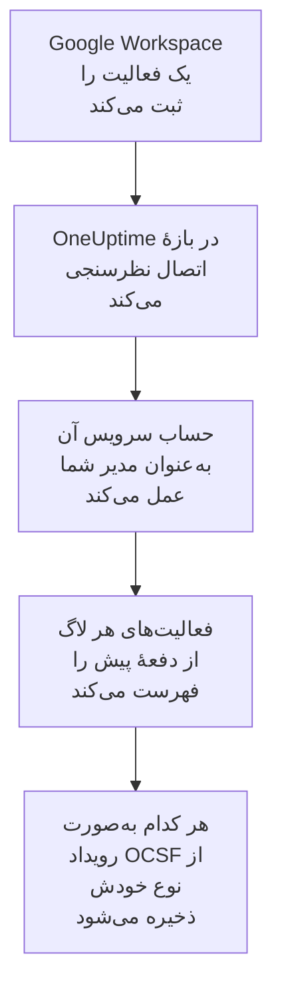

# Google Workspace

لاگ‌های ممیزی [Google Workspace](https://workspace.google.com) را به رویدادهای امنیتی OneUptime وارد کنید: ورودها و آنچه Google دربارهٔ آن‌ها علامت زده، تغییرات مدیران، برنامه‌هایی که به داده‌ها دسترسی گرفته‌اند، ورود یکپارچه، تنظیمات امنیتی خود حساب‌ها و، اگر بخواهید، پرونده‌هایی که بیرون از سازمان به اشتراک گذاشته یا در Google Drive دانلود شده‌اند. آنجا آن‌ها را کنار لاگ‌ها، ترِیس‌ها و متریک‌هایتان جستجو می‌کنید، با هر منبع دیگری هم‌بسته می‌کنید، و برای آن‌هایی که مهم‌اند آنکال را فرا می‌خوانید. OneUptime آن‌ها را با یک حساب سرویس که به‌عنوان یکی از مدیران شما عمل می‌کند می‌خواند، و چیزی را در Google Workspace تغییر نمی‌دهد.

:::cards
- [راه‌اندازی اتصال](#راهاندازی-اتصال): یک حساب سرویس، تفویض اختیار در سطح دامنه، و فرم اتصال.
- [چه چیزی وارد می‌شود](#چه-چیزی-وارد-میشود): کدام فعالیت‌ها، و هر کدام چگونه به یک رویداد امنیتی تبدیل می‌شود.
- [نظرسنجی چگونه کار می‌کند](#نظرسنجی-چگونه-کار-میکند): پنجره‌ای که هر نظرسنجی می‌خواند، و اینکه چرا ۲ ساعت هم‌پوشانی دارد.
- [عیب‌یابی](#عیبیابی): معنای هر خطا، و آنچه باید تغییر دهید.
:::

## چگونه کار می‌کند

OneUptime هر دقیقه از هر اتصال فعالی که بازهٔ نظرسنجی‌اش گذشته باشد نظرسنجی می‌کند. یک نظرسنجی از طرف مدیری که نام می‌برید به‌عنوان حساب سرویس شما وارد می‌شود، و فعالیت‌های هر لاگ ممیزی از نظرسنجی پیش را فهرست می‌کند ([Activities: list](https://developers.google.com/admin-sdk/reports/reference/rest/v1/activities/list)): مدیریت، ورودها، توکن‌های OAuth، SAML، امنیت حساب و، وقتی گزینهٔ **فعالیت Drive** روشن باشد، Drive. هر رویداد یک فعالیت به‌صورت یک رویداد [OCSF](https://schema.ocsf.io/) ذخیره می‌شود: یک ورود به‌صورت رویداد Authentication، یک نقش مدیر اختصاص‌یافته به‌صورت رویداد User Access Management، ورودی که Google علامت زده به‌صورت Detection Finding.

## پیش از شروع

- در OneUptime، نقش Project Owner، Project Admin یا Security Admin. Security Member و Security Viewer می‌توانند اتصال‌ها و تاریخچهٔ اجرایشان را ببینند، اما نمی‌توانند آن‌ها را تغییر دهند.
- یک مدیر ارشد Google Workspace، برای اجازه دادن به تفویض اختیار در سطح دامنه، و مدیری که حساب سرویس به‌عنوان او عمل کند، با امتیاز Reports. یک مدیر ارشد آن را دارد.
- یک پروژهٔ Google Cloud که بتوانید در آن یک حساب سرویس بسازید و Admin SDK API را روشن کنید.
- برای فعالیت Drive، نسخه‌ای که لاگ ممیزی Drive دارد، مانند Business Standard، Business Plus، Enterprise یا Education.
- HTTPS خروجی از برنامه و کارگرهای OneUptime به `oauth2.googleapis.com` و `admin.googleapis.com`.

## راه‌اندازی اتصال

اتصال با کلید یک حساب سرویس و [تفویض اختیار در سطح دامنه](https://developers.google.com/identity/protocols/oauth2/service-account#delegatingauthority) وارد می‌شود، با یک دامنهٔ دسترسی فقط‌خواندنی: `https://www.googleapis.com/auth/admin.reports.audit.readonly`.

:::steps
### ساختن یک حساب سرویس و یک کلید

1. در [کنسول Google Cloud](https://console.cloud.google.com)، یک پروژه برگزینید، **APIs & Services → Library** را باز کنید، **Admin SDK API** را پیدا کنید، و **Enable** را برگزینید.
2. **IAM & Admin → Service accounts → Create service account** را باز کنید، نامش را `oneuptime-security-events` بگذارید، و **Done** را برگزینید. به هیچ نقشی در پروژه نیاز ندارد.
3. حساب سرویس را باز کنید و **Unique ID** آن را کپی کنید، همان شناسهٔ کلاینتی که تفویض اختیار نام می‌برد. در زبانهٔ **Keys**، **Add key → Create new key → JSON** را برگزینید، و پرونده را نگه دارید: همان کلید است.

### اجازه دادن به تفویض اختیار در سطح دامنه

1. در [کنسول مدیریت Google](https://admin.google.com)، به‌عنوان مدیر ارشد، **Security → Access and data control → API controls → Manage domain-wide delegation** را باز کنید، و **Add new** را برگزینید.
2. **Unique ID** حساب سرویس را به‌عنوان **Client ID** وارد کنید، و `https://www.googleapis.com/auth/admin.reports.audit.readonly` را به‌عنوان **OAuth scope**. **Authorize** را برگزینید. اعمال آن ممکن است در Google چند دقیقه طول بکشد.
3. برای اینکه پلی‌بوک‌ها بتوانند کاربران را تعلیق کنند، تعلیقشان را لغو کنند و از حساب خارجشان کنند ([مهار](/docs/telemetry/security-cases#مهار) را ببینید)، `https://www.googleapis.com/auth/admin.directory.user` و `https://www.googleapis.com/auth/admin.directory.user.security` را با کاما جدا کنید و به دامنه‌های همان کلاینت اضافه کنید. آن‌گاه مدیری که اتصال به جای او عمل می‌کند باید مدیری باشد که آن کاربران را مدیریت می‌کند.

### افزودن اتصال در OneUptime

**محصولات** > **رویدادهای امنیتی** > **اتصال‌ها** (`/dashboard/{projectId}/security-events/connections`) را باز کنید، روی **افزودن اتصال** کلیک کنید، زیر **هویت**، **Google Workspace** را برگزینید، و روی **بعدی** کلیک کنید. **Administrator email** را وارد کنید، روی **بعدی** کلیک کنید، و محتوای پروندهٔ کلید را در **JSON حساب سرویس** بچسبانید. در گام **فراخوانی دوره‌ای**، **فعالیت Drive** را روشن کنید تا Drive هم خوانده شود.

### آزمایش پیش از ذخیره

روی **آزمودن این تنظیمات** زیر **آزمایش پیش از ذخیره** کلیک کنید. آزمایش با مقدارهای فرم وارد می‌شود و لاگ‌های ورود و مدیریت را می‌خواند، و چیزی ذخیره نمی‌کند، پس یک تفویض اختیار جاافتاده پیش از ساخته شدن اتصال آشکار می‌شود. سپس روی **بعدی** کلیک کنید، به اتصال یک **نام** بدهید، و آن را بسازید.
:::

| تنظیم | چه چیزی وارد کنید |
| --- | --- |
| **Administrator email** | نشانی مدیری که حساب سرویس به‌عنوان او عمل می‌کند، مانند `admin@example.com`. باید امتیاز Reports را داشته باشد. |
| **فعالیت Drive** | اختیاری، به‌طور پیش‌فرض خاموش. وقتی روشن باشد، هر نظرسنجی اشتراک‌گذاری‌ها و دانلودهای Drive را هم می‌خواند. |
| **JSON حساب سرویس** | کل پروندهٔ کلید، که `client_email` و `private_key` را در خود دارد. رمزگذاری می‌شود، API هرگز آن را برنمی‌گرداند و دیگر هرگز نشان داده نمی‌شود. آن را با **به‌روزرسانی اطلاعات ورود** روی اتصال جایگزین کنید. |

گام **فراخوانی دوره‌ای** همچنین یک **توضیحات** اختیاری دارد، **فاصله فراخوانی (دقیقه)**، یک عدد صحیح از `1` تا `1440` که با `5` شروع می‌شود، و **فعال**، که از آغاز روشن است.

## چه چیزی وارد می‌شود

هر رویداد فروشندهٔ `Google` و محصول `Google Workspace` دارد. فعالیتی که چند رویداد دارد برای هر کدام یک رویداد امنیتی می‌شود، و هر رویداد فیلدهای فعالیت و فیلدهای خودش را نگه می‌دارد، به‌صورت `event.name`، `event.type` و `parameters.<name>`، تا یک قاعده آن‌ها را با نام‌های Google بخواند.

| لاگ | رویدادها | کلاس OCSF | شدت |
| --- | --- | --- | --- |
| ورودها (`login`) | `login_success`، `login_failure` با دلیلش، `login_challenge`. یک خروج خوانده می‌شود اما وارد نمی‌شود. | Authentication (`3002`) | Informational؛ Low برای یک شکست؛ Medium وقتی Google آن را `is_suspicious` علامت بزند |
| یافته‌های Google (`login`) | `suspicious_login` و گونه‌هایش، `gov_attack_warning`، `account_disabled_hijacked` و حساب‌های دیگری که Google غیرفعال کرده | Detection Finding (`2004`) | Medium؛ High برای حمله‌ای با پشتیبانی یک دولت، حسابی ربوده‌شده یا گذرواژه‌ای فاش‌شده |
| مدیریت (`admin`) | امتیازها و نقش‌های مدیر که اعطا یا لغو شده‌اند، تفویض اختیار در سطح دامنه، کاربرانی که ساخته، حذف یا معلق شده‌اند، تأیید دومرحله‌ای خاموش‌شده، اعضای گروه، تنظیمات | User Access Management (`3005`)، Account Change (`3001`)، Group Management (`3006`)، Entity Management (`3004`) | Medium برای قدرت اعطاشده؛ Low برای کاربر حذف‌شده یا تأیید دومرحله‌ای خاموش‌شده |
| توکن‌های OAuth (`token`) | برنامه‌ای که به دادهٔ کسی دسترسی گرفته، با دامنه‌های دسترسی‌اش، یا آن دسترسی از آن گرفته شده | Authorize Session (`3003`) | Informational |
| SAML (`saml`) | ورود یکپارچه به یک برنامه | Authentication (`3002`) | Low برای یک شکست |
| امنیت حساب (`user_accounts`) | تغییرات تأیید دومرحله‌ای، گذرواژه و بازیابی | Account Change (`3001`) | Low وقتی حساب را ضعیف‌تر کند |
| Drive (`drive`)، با گزینهٔ روشن | `change_user_access`، `change_document_visibility`، `change_document_access_scope`، `change_acl_editors`، `download` | File Hosting Activity (`6006`) | Low برای پرونده‌ای که بیرون از دامنهٔ مالکش به اشتراک گذاشته شده یا برای یک پیوند باز شده |

قاعده‌های کتابخانهٔ قاعده‌ها برای Google Workspace این‌ها را همان‌طور که اینجا وارد می‌شوند می‌خوانند، مانند قاعده‌های ورودی که Google علامت زده، امتیازهای مدیر اعطاشده و پرونده‌ای که در Drive عمومی شده.

## نظرسنجی چگونه کار می‌کند

- **فعالیت‌ها بر اساس زمان رخ دادنشان خوانده می‌شوند.** Reports API زمان دیگری برای فهرست کردنشان ندارد، و Google مستند می‌کند که لاگ‌هایش از چند دقیقه تا چند ساعت دیر می‌رسند.
- **نخستین نظرسنجی ۲۴ ساعت به عقب نگاه می‌کند**، پس یک اتصال تازه بی‌درنگ فعالیت‌های اخیرش را نشان می‌دهد.
- **هر نظرسنجی بعدی ۱۲۰ دقیقه پیش از نشانگر ذخیره‌شده شروع می‌شود**، پس فعالیتی که Google تا ۲ ساعت دیرتر خواندنی می‌کند در نظرسنجی بعدی خوانده می‌شود، و رویدادهای تکراری با شناسهٔ هر رویداد در پروژه کنار گذاشته می‌شوند. فعالیتی که دیرتر از آن برسد با نظرسنجی خوانده نمی‌شود: بازهٔ زمانی‌اش را از **عیب‌یابی** وارد کنید.
- **یک نظرسنجی حداکثر ۲۴ ساعت پس از نشانگر را می‌خواند.** اتصالی که نشانگرش عقب افتاده، در رشته‌ای از پنجره‌های ۲۴ ساعته جبران می‌کند.
- **Drive رویداد به رویداد خوانده می‌شود**، چون Drive هر پرونده‌ای را که کسی باز کند ثبت می‌کند. وقتی Google لاگ Drive را رد کند، اجرا هشدار می‌دهد، و لاگ‌های دیگر همچنان وارد می‌شوند.
- **اجرای شکست‌خورده چیزی را تغییر نمی‌دهد.** پس از یک خطای شبکه، یا یک وضعیت خطا از Google، نشانگر و طول پنجره همان‌طور که بودند می‌مانند، و نظرسنجی بعدی همان پنجره را دوباره می‌خواند. تنها استثنا درخواستی است که زمانش سر رسیده: نشانگر می‌ماند، اما پنجرهٔ بعدی نصف طول می‌شود، چون پنجره‌ای که برای پاسخ به‌موقع بیش از حد سنگین است در هر تلاش به پایان زمان می‌خورد.

### وقتی یک پنجره بیش از توان یک نظرسنجی دارد

هر لاگ بودجهٔ خودش را دارد، در صفحه‌های ۱٬۰۰۰ فعالیتی: ۱۰ برای ورودها، ۵ برای هر کدام از مدیریت، توکن‌های OAuth و SAML، ۳ برای امنیت حساب، و ۴ برای هر رویداد Drive. یک نظرسنجی پس از ۴ دقیقه متوقف می‌شود. وقتی یک بودجه لاگی را پیش از پایان پنجره‌اش متوقف کند، اجرا **جزئی** است، و هشدار آن لاگ و بودجه را نام می‌برد. Google فعالیت‌ها را از جدیدترین فهرست می‌کند، پس OneUptime به‌جای جابه‌جا کردن نشانگر از فعالیت‌هایی که هرگز به آن‌ها نرسیده، پنجره را کوتاه می‌کند:

1. **باریک کردن.** نظرسنجی بعدی پنجره‌ای به نصف طول را از همان نقطهٔ شروع می‌خواند، و تا وقتی پنجره‌ای کامل خوانده شود دوباره نصف می‌کند، تا حداقل یک دقیقه. هشدار اجرا همین را می‌گوید: `This window holds more records than one poll can read; the next poll reads a {n} minute window from the same starting point.` فعالیت‌هایی که پیش‌تر از پنجرهٔ بلندتر وارد شده‌اند به‌عنوان تکراری رد می‌شوند.
2. **دوباره بزرگ کردن.** پس از اینکه پنجره‌ای کامل خوانده شد، نشانگر به انتهای آن می‌رود، و پنجرهٔ بعدی دوباره دو برابر می‌شود، تا ۲۴ ساعت.
3. **گذشتن از یک دقیقهٔ تنها.** اگر حتی یک دقیقه بیش از آنچه یک نظرسنجی می‌تواند بخواند داشته باشد، نظرسنجی از آن می‌گذرد، تا فعالیت‌های تازه‌تر همچنان برسند. اجرا **جزئی** می‌ماند، و **آخرین خطا** این را نشان می‌دهد: `More records were created in the one minute from {cursor} to {end} than one poll can read. Polling moved past this minute so newer records keep arriving; use Import this time range in Diagnostics on this minute to recover what one run can read.` آن دقیقه را با **Import this time range** وارد کنید تا آنچه یک اجرا می‌تواند بخواند بازیابی شود.

تغییر **فاصله فراخوانی (دقیقه)** هیچ‌کدام از این‌ها را تغییر نمی‌دهد: این تنظیم تعیین می‌کند یک نظرسنجی هر چند وقت شروع شود، نه اینکه پنجره‌اش از کجا شروع شود.

### اجرا، پیش‌نمایش و وارد کردن در صورت نیاز

روی **عیب‌یابی** یک اتصال کلیک کنید تا اجراهای اخیرش را ببینید و دستی با آن کار کنید. هر کسی که بتواند اتصال را تغییر دهد می‌تواند این‌ها را شروع کند؛ هر کسی که بتواند آن را ببیند می‌تواند تاریخچه را بخواند.

- **اجرای اکنون** بی‌درنگ یک نظرسنجی با نشانگر معمول شروع می‌کند، حتی وقتی اتصال **فعال** نیست.
- **Preview audit events** یک بازهٔ زمانی تا ۷ روز را می‌خواند و چیزی وارد نمی‌کند.
- **Import this time range** پس از تأیید شما بازه‌ای تا ۷ روز را وارد می‌کند، بی‌آنکه نشانگر را جابه‌جا کند. فعالیت‌هایی که پیش‌تر وارد شده‌اند رد می‌شوند. Google لاگ‌های ممیزی را ۶ ماه نگه می‌دارد.
- **Copy diagnostics** روی یک اجرا، گزارش آن را برای پشتیبانی کپی می‌کند. هرگز اعتبارنامه‌ها را در بر ندارد.

## آزمایش اتصال

**آزمایش اتصال** در ردیف یک اتصال، و **آزمودن این تنظیمات** در فرم، در فرایند API اجرا می‌شوند، نه در یک کارگر پس‌زمینه، پس یک آزمایش حتی وقتی مشکل از کارگرهاست هم پاسخ می‌دهد. این بررسی‌ها را به ترتیب انجام می‌دهد:

| بررسی | چه چیزی را بررسی می‌کند |
| --- | --- |
| **پیکربندی** | نشانی مدیر و کلید درست‌شکل‌اند. وقتی این شکست بخورد با هیچ جایی تماس گرفته نمی‌شود. |
| **Authenticate with Google** | Google به حساب سرویس اجازه می‌دهد به‌عنوان مدیر عمل کند: تفویض اختیار در سطح دامنه برقرار است. |
| **Read the audit logs** | لاگ‌های ورود و مدیریت ۲۴ ساعت گذشته خواندنی‌اند. |
| **Read Drive activity** | فقط با گزینهٔ روشن: لاگ Drive خواندنی است. |
| **Activities available to import** | ۲۴ ساعت گذشته چند فعالیت ورود و مدیریت دارد، از هر کدام حداکثر ۱٬۰۰۰، پس `1000+` یعنی بیشتر. هیچ، یک هشدار است. |
| **Background workers**، **Poll scheduler**، **Security event storage** | سمت خود OneUptime: فرایندی کارهای صف Worker را برمی‌دارد، کار نظرسنجی هر دقیقه اجرا می‌شود، و انبارهٔ رویدادهای امنیتی پاسخ می‌دهد. |
| **Scheduled polling** | برای یک اتصال ذخیره‌شده: نظرسنجی روشن است، هیچ اجرایی در انتظار یک کارگر گیر نکرده، و نظرسنجی‌ها به‌موقع اجرا می‌شوند. |

هر درخواست در یک آزمایش مهلتی ۲۰ ثانیه‌ای دارد. یک آزمایش هرگز چیزی وارد نمی‌کند یا نشانگر را جابه‌جا نمی‌کند، و هر بررسی شکست‌خورده می‌گوید چه چیزی را تغییر دهید.

## عیب‌یابی

**آخرین خطا** اتصال پیام خطای کامل را، با اعتبارنامه‌های پوشانده‌شده، نگه می‌دارد. وقتی اتصالی خطا دارد، برای خواندنش **مشاهده خطا** را در ستون **اقدام‌ها** آن برگزینید، و برای کپی کردنش **کپی خطا** را در کادر گفتگو. هر پیام با `Google Workspace` شروع می‌شود، سپس درخواستی را که شکست خورده نام می‌برد، و دلیل خود Google را نقل می‌کند.

:::details آخرین خطا می‌گوید `token request failed`
- `unauthorized_client`: حساب سرویس برای این دامنهٔ دسترسی تفویض اختیار در سطح دامنه ندارد. **Unique ID** آن را با `https://www.googleapis.com/auth/admin.reports.audit.readonly` زیر **Manage domain-wide delegation** اضافه کنید.
- `invalid_grant` با `Invalid email or User ID`: **Administrator email** کاربر این Google Workspace نیست.
- `invalid_grant` با `Invalid JWT Signature`: کلید حذف یا غیرفعال شده است. یک کلید تازه بسازید، و آن را با **به‌روزرسانی اطلاعات ورود** ذخیره کنید.
:::

:::details آخرین خطا می‌گوید `activities request failed (HTTP 403)`
- دلیل `SERVICE_DISABLED` یا `accessNotConfigured`: Admin SDK API در پروژهٔ حساب سرویس خاموش است. آن را روشن کنید، و چند دقیقه بعد دوباره آزمایش کنید.
- دلیل `forbidden`: مدیر امتیاز Reports را ندارد. آن را زیر **Account → Admin roles** در کنسول مدیریت Google اختصاص دهید، یا یک مدیر ارشد را نام ببرید.
:::

:::details فعالیت Drive خوانده نمی‌شود
لاگ Drive به نسخه‌ای نیاز دارد که آن را داشته باشد، و به مدیری با امتیاز Reports. هر اجرا هشدار `Drive activity was not read` می‌دهد، و لاگ‌های دیگر همچنان وارد می‌شوند. وقتی نسخهٔ شما لاگ Drive ندارد، **فعالیت Drive** را خاموش کنید.
:::

:::details آخرین خطا می‌گوید `did not complete`
درخواست پاسخی نگرفت: پایان زمان، نامی که به نشانی تبدیل نمی‌شود، یا نشانی‌ای که رد شده. بررسی کنید که برنامه و کارگرهای OneUptime بتوانند از طریق هر پراکسی‌ای که به کار می‌برید به `oauth2.googleapis.com` و `admin.googleapis.com` برسند.
:::

:::details آزمایش موفق است، اما Last Polled برابر Never است
کار نظرسنجی هرگز اجرا نشده است. بررسی‌های **Background workers** و **Poll scheduler** را بخوانید. در یک نصب خودمیزبان، علت معمول `DISABLE_QUEUE_WORKERS=true` روی برنامه است، بدون استقرار کارگر جداگانه‌ای که کارها را بردارد: آن را روی `false` بگذارید، یا استقرار کارگر را اجرا کنید (Helm: `worker.enabled: true`، که به‌طور پیش‌فرض `false` است).
:::

## گام‌های بعدی

:::cards
- [رویدادهای امنیتی](/docs/telemetry/security-events): آنچه را وارد می‌کنید جستجو و هم‌بسته کنید و روی آن هشدار بگیرید.
- [Microsoft Entra ID](/docs/integrations/microsoft-entra-id): ورودها و تغییرات دایرکتوری Microsoft را وارد کنید.
- [Google SecOps](/docs/integrations/google-secops): تشخیص‌های Google SecOps را هم بیاورید.
- [نمای کلی یکپارچه‌سازی‌ها](/docs/integrations/index): ابزارهای دیگری که می‌توانید وصل کنید.
:::
