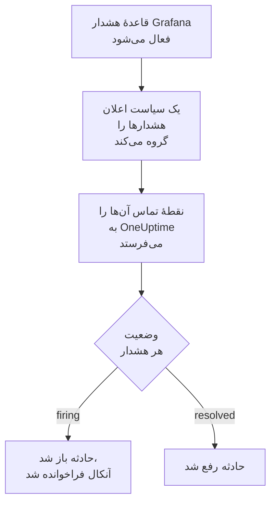

# Grafana

هشدارهای [Grafana](https://grafana.com) را به OneUptime بفرستید تا هر هشداری که فعال می‌شود به حادثه‌ای تبدیل شود که تیم آنکال شما را فرا می‌خواند، و وقتی هشدار بهبود یافت رفع شود. Grafana هشدارهایش را از طریق یک نقطهٔ تماس وب‌هوک می‌فرستد، پس در هیچ طرفی چیزی برای نصب نیست.

:::cards
- [انتخاب اینکه OneUptime هشدارها را چگونه دریافت کند](#انتخاب-اینکه-oneuptime-هشدارها-را-چگونه-دریافت-کند): یک مانیتور Incoming Request، یا یک گردش کاری از خودتان.
- [دریافت هشدارها با یک مانیتور](#دریافت-هشدارها-با-یک-مانیتور): یک حادثه برای هر هشدار، که با بهبود رفع می‌شود.
- [پیکربندی Grafana](#پیکربندی-grafana): یک نقطهٔ تماس وب‌هوک، و سیاستی که از آن استفاده می‌کند.
- [عیب‌یابی](#عیبیابی): وقتی هشدارها نمی‌رسند، یا حادثه‌ها باز می‌مانند.
:::

## چگونه کار می‌کند



سیاست‌های اعلان Grafana هشدارهایی را که فعال می‌شوند گروه‌بندی می‌کنند، و یک نقطهٔ تماس وب‌هوک هر گروه را به‌صورت یک اعلان JSON می‌فرستد. شکل آن همان شکل اعلان [Prometheus Alertmanager](/docs/integrations/prometheus-alertmanager) است: یک `status`، یک فهرست `alerts` که هر هشدار در آن `status` و `fingerprint` خودش را دارد، و `commonLabels` و `commonAnnotations` که هشدارهایش در آن‌ها مشترک‌اند. Grafana یک `title` و یک `message` هم اضافه می‌کند که برای خواندن آدم‌ها نوشته شده‌اند.

## پیش از شروع

- Grafana 9 یا بالاتر، با Grafana Alerting، که از Grafana 9 پیش‌فرض است. باید بتواند از طریق HTTPS به OneUptime شما برسد.
- در OneUptime، اجازهٔ ساختن مانیتور، یا اگر آن راه را برمی‌گزینید، گردش کاری.

## انتخاب اینکه OneUptime هشدارها را چگونه دریافت کند

اول OneUptime را راه بیندازید: نشانی‌ای را که Grafana به آن می‌فرستد، OneUptime به شما می‌دهد.

| روش | کی از آن استفاده کنید |
| --- | --- |
| یک مانیتور Incoming Request (پیشنهادی) | می‌خواهید هر هشدار حادثه‌ای باشد که آنکال را فرا می‌خواند، و وقتی هشدار بهبود یافت رفع شود. چیزی برای ساختن نیست. |
| یک گردش کاری با تریگر Webhook | به منطق خودتان نیاز دارید: پالایش هشدارها، تغییر شکل آن‌ها، یا اول فراخواندن سامانه‌های دیگر. یک گردش کاری برای هر اعلان یک حادثه باز می‌کند، نه برای هر هشدار، و آن را با بهبود رفع نمی‌کند. |

هر دو از همان نقطهٔ تماس همان JSON را می‌گیرند، پس می‌توانید با یکی شروع کنید و بعدها با تغییر یک نشانی در Grafana به دیگری بروید.

## دریافت هشدارها با یک مانیتور

یک [مانیتور Incoming Request](/docs/monitor/incoming-request-monitor) یک نشانی به شما می‌دهد، و معیارهایش تعیین می‌کنند هر اعلان چه کند.

:::steps
### ساختن مانیتور

به **مانیتورها** بروید و روی **ساخت مانیتور** کلیک کنید. زیر **نوع مانیتور**، **Incoming Request** را برگزینید، نامش را `Grafana` بگذارید، و روی **بعدی** کلیک کنید.

### اعلام یک حادثه برای هر هشدار فعال‌شده

در گام **معیارها**، نخستین معیار را باز کنید، همان که مانیتور را آفلاین علامت می‌زند. پالایهٔ آن را روی **بدنه درخواست**، **شامل است**، `"status":"firing"` بگذارید. این معیار از پیش وقتی پالایه‌اش جور شود حادثه اعلام می‌کند. حادثه را پر کنید:

- **عنوان حادثه**: `{{requestBody.commonLabels.alertname}}`.
- **توضیحات حادثه**، زیر **توضیحات**: `{{requestBody.message}}`، متنی که Grafana برای اعلان می‌نویسد.
- **شدت**: شدت حادثه‌ای که این هشدارها باید داشته باشند.
- **سیاست‌های آنکال**، زیر **آنکال**: سیاست‌هایی که باید فراخوانده شوند.
- **رفع خودکار حادثه**، زیر **فیلدهای بیشتر**: آن را روشن بگذارید، همان‌طور که از آغاز هست. بدون آن، بهبودها نادیده گرفته می‌شوند و حادثه‌ها باز می‌مانند.

### باز کردن یک حادثه برای هر هشدار

در همان معیار، **تنظیمات** را باز کنید و **Group incidents and alerts by a payload field** را روشن کنید. آن را مانند جدول زیر پر کنید تا هر هشدار حادثهٔ خودش را بگیرد و بهبودش آن را رفع کند:

| فیلد | مقدار |
| --- | --- |
| **Open a separate incident for each…** | `requestBody.alerts[*].fingerprint` |
| **Field that signals recovery** | `requestBody.alerts[*].status` |
| **Value that means recovered** | `resolved` |

### برگرداندن مانیتور به حالت آنلاین

معیار دوم را باز کنید، همان که مانیتور را آنلاین علامت می‌زند، و پالایه‌اش را روی **بدنه درخواست**، **شامل است**، `"status":"resolved"` بگذارید.

### کپی کردن نشانی

روی **ساخت مانیتور** کلیک کنید. صفحهٔ **نمای کلی** مانیتور، **Heartbeat URL** آن را نشان می‌دهد. آن را برای Grafana کپی کنید:

```text
https://oneuptime.com/heartbeat/<secret key>
```

یک نصب خودمیزبان به جای `oneuptime.com` میزبان خودش را دارد.
:::

هر هشدار یک اعلان حادثهٔ خودش را باز می‌کند، حداکثر به اندازهٔ **Max incidents per request** (`100`، مگر اینکه آن را تغییر دهید)، و `status` خود هر هشدار تعیین می‌کند حادثه‌اش کی رفع شود. `fingerprint` در Grafana یک هشدار را با برچسب‌هایش شناسایی می‌کند، پس همان مقداری است که باید بر پایه‌اش گروه‌بندی کرد. برای اینکه هر تنظیم چه می‌کند، [دریافت هشدار از سامانه‌ای دیگر](/docs/monitor/incoming-request-monitor#دریافت-هشدار-از-سامانهای-دیگر) را ببینید.

> [!WARNING]
> بر پایهٔ برچسبی که همهٔ هشدارهای یک اعلان در آن مشترک‌اند گروه‌بندی نکنید. سیاست اعلان پیش‌فرض Grafana هشدارها را بر پایهٔ `grafana_folder` و `alertname` گروه‌بندی می‌کند، پس همهٔ هشدارهای یک اعلان `alertname` یکسانی دارند: گروه‌بندی بر پایهٔ `requestBody.alerts[*].labels.alertname` کل اعلان را در یک حادثه ادغام می‌کند.

`{{requestBody.commonLabels.alertname}}` و `{{requestBody.message}}` کل اعلان را توصیف می‌کنند، که زیر سیاست پیش‌فرض یک قاعدهٔ هشدار است. کلید گروه‌بندی هم یک متغیر است، `{{fingerprint}}`، اما یک هش است که چیزی به پاسخ‌دهنده نمی‌گوید. برای همهٔ متغیرهایی که می‌توانید به کار ببرید، [قالب‌بندی حادثه و هشدار](/docs/monitor/incident-alert-templating) را ببینید.

## پیکربندی Grafana

:::steps
### افزودن یک نقطهٔ تماس وب‌هوک

در Grafana به **Alerting → Contact points** بروید و روی **+ Add contact point** کلیک کنید. در Grafana 11 و بالاتر، **Alerting** زیر **Alerts & IRM** است، و **Contact points** یکی از زبانه‌های **Notification configuration** است.

نام نقطهٔ تماس را `OneUptime` بگذارید، زیر **Integration**، **Webhook** را برگزینید، و نشانی کپی‌شده را در **URL** بچسبانید. **HTTP Method** را روی `POST` بگذارید، و روی **Save contact point** کلیک کنید.

### فرستادن هشدارها به آن

به **Alerting → Notification policies** بروید. نقطهٔ تماس سیاست پیش‌فرض را روی `OneUptime` بگذارید، یا یک سیاست فرزند اضافه کنید که با هشدارهایی که OneUptime باید بگیرد جور شود، با `OneUptime` به‌عنوان نقطهٔ تماسش.
:::

Grafana، `Content-Type: application/json` را می‌فرستد، که مانیتور برای خواندن فیلدهای یک اعلان به آن نیاز دارد. تنظیم **Max Alerts** نقطهٔ تماس، هشدارهای یک اعلان را محدود می‌کند: آن را روی `0`، یعنی بدون محدودیت، نگه دارید، یا حداکثر به اندازهٔ **Max incidents per request** مانیتور.

## آزمایش آن

1. در Grafana، نقطهٔ تماس `OneUptime` را باز کنید و روی **Test** کلیک کنید. Grafana یک هشدار آزمایشی فعال می‌فرستد، و حادثه‌ای در OneUptime باز می‌شود. هشدار آزمایشی هرگز بهبود نمی‌یابد، پس آن حادثه را دستی رفع کنید.
2. بگذارید یک قاعدهٔ هشدار واقعی فعال شود، برای نمونه با پایین آوردن آستانه‌اش برای لحظه‌ای، و ببینید حادثه‌اش باز می‌شود، سپس وقتی آستانه را برگرداندید رفع می‌شود.

## دریافت هشدارها با یک گردش کاری

وقتی میان Grafana و حادثه به گام‌های خودتان نیاز دارید، از یک [گردش کاری](/docs/workflows/index) استفاده کنید.

:::steps
### ساختن گردش کاری

به **گردش‌های کاری** بروید، روی **ساخت گردش کاری** و سپس **شروع از صفر** کلیک کنید. نامش را `Grafana alerts` بگذارید و روی **ساخت گردش کاری** کلیک کنید.

### افزودن تریگر Webhook

روی بلوک خط‌چین **انتخاب کنید چه چیزی این گردش کاری را شروع کند** کلیک کنید و **Webhook** را برگزینید. روی تریگر کلیک کنید، سپس روی **کپی نشانی**، و آن نشانی را در نقطهٔ تماس Grafana به کار ببرید.

### بررسی اینکه اعلان فعال است

روی **افزودن مؤلفه** کلیک کنید، یک بلوک **If / Else** اضافه کنید، و نقطهٔ **Out** تریگر را به آن وصل کنید. **Value to check** را روی `{{local.components.webhook-1.returnValues.request-body.status}}`، **Comparison** را روی **is equal to**، و **Compare with** را روی `firing` بگذارید.

### اعلام حادثه

یک بلوک **Create One Incident** اضافه کنید، و سمت **Yes** بلوک **If / Else** را به آن وصل کنید. در **Incident Template**، قالبی را برگزینید که شدت و سیاست‌های آنکالی را که باید فراخوانده شوند تعیین می‌کند ([قالب‌های حادثه](/docs/incidents/settings#قالبهای-حادثه) را ببینید). در **JSON Object**، آنچه را از Grafana می‌آید تعیین کنید:

```json
{
  "title": "{{local.components.webhook-1.returnValues.request-body.title}}",
  "description": "{{local.components.webhook-1.returnValues.request-body.message}}"
}
```

بدون قالب، **JSON Object** به `incidentSeverityId` هم نیاز دارد، یعنی شناسهٔ یکی از شدت‌های حادثهٔ پروژه.

### روشن کردن گردش کاری

در بالای **سازنده** گزینهٔ **فعال** را روشن کنید. گردش کاری خاموش به Grafana با `400` پاسخ می‌دهد.
:::

هر اجرا یک اعلان را پردازش می‌کند، پس هر چند هشدار که در اعلان باشد، فقط یک حادثه اعلام می‌کند. اعلانی که `resolved` باشد به سمت **No** بلوک **If / Else** می‌رود، جایی که چیزی وصل نیست، پس اجرا همان‌جا تمام می‌شود. برای یک حادثه برای هر هشدار، که با بهبود رفع شود، از مانیتور استفاده کنید.

## عیب‌یابی

:::details چیزی به OneUptime نمی‌رسد
- روی **Test** در نقطهٔ تماس کلیک کنید: وقتی Grafana نتواند به نشانی برسد، خطا نشان می‌دهد. جزئیات در لاگ کارساز Grafana است.
- مانیتور پیش از بررسی هر چیزی، بی‌درنگ با `200` پاسخ می‌دهد، حتی برای کلید محرمانهٔ نادرست. برای دیدن اینکه اعلان‌ها می‌رسند یا نه، خط زمانی مانیتور را بررسی کنید.
- گردش کاری خاموش با `400` پاسخ می‌دهد. در بالای **سازنده** آن، **فعال** را روشن کنید.
:::

:::details حادثه‌ها باز می‌شوند اما هرگز رفع نمی‌شوند
- حادثهٔ معیار به **رفع خودکار حادثه**، زیر **فیلدهای بیشتر**، نیاز دارد.
- **Field that signals recovery** باید `requestBody.alerts[*].status` باشد، و **Value that means recovered** دقیقاً `resolved`. مقایسه به بزرگی و کوچکی حروف حساس است.
- مسیرهای گروه‌بندی باید با `requestBody.` شروع شوند، و فقط نخستین `[*]` یک مسیر، فهرست را می‌خواند. مسیری که هر کدام از این دو قاعده را بشکند، بدون هیچ خطایی با چیزی جور نمی‌شود.
:::

:::details یک حادثه برای اعلانی پر از هشدار
بر پایهٔ برچسبی گروه‌بندی کرده‌اید که برای همهٔ هشدارهای یک اعلان یکسان است، مانند `alertname` زیر سیاست پیش‌فرض. به جای آن بر پایهٔ `requestBody.alerts[*].fingerprint` گروه‌بندی کنید.
:::

:::details حادثه به جای مقدار، یک ارجاع نشان می‌دهد
ارجاعی به فیلدی که اعلان ندارد، همان‌طور که نوشته شده با آکولادهایش باقی می‌ماند. نام فیلد را با آنچه Grafana فرستاده مقایسه کنید: برای یک گردش کاری، اجرا را در **لاگ‌ها** > **اجراها** باز کنید و با آنچه تریگر دریافت کرده مقایسه کنید.
:::

راهنمای [Prometheus Alertmanager](/docs/integrations/prometheus-alertmanager#عیبیابی) حالت‌های بیشتری را پوشش می‌دهد، و آن‌ها برای اعلان‌های Grafana هم صدق می‌کنند.

## امنیت

- **با نشانی مانند یک گذرواژه رفتار کنید.** هر کسی که آن را داشته باشد می‌تواند حادثه باز کند. اگر لو رفت، آن را بازنشانی کنید: **بازنشانی کلید محرمانه درخواست ورودی** در صفحهٔ **تنظیمات** مانیتور، یا **بازنشانی نشانی** در تریگر **Webhook** گردش کاری. سپس **URL** نقطهٔ تماس را در Grafana به‌روزرسانی کنید.
- **خودمیزبان؟** بگذارید Grafana از طریق دیوار آتش‌تان با HTTPS به OneUptime شما برسد.

## گام‌های بعدی

:::cards
- [مانیتور درخواست ورودی](/docs/monitor/incoming-request-monitor): همهٔ تنظیمات مانیتوری که هشدارهای شما را دریافت می‌کند.
- [Prometheus Alertmanager](/docs/integrations/prometheus-alertmanager): همین راه‌اندازی، با یک کلید مرد مرده برای سامانهٔ هشدارتان.
- [مانیتور متریک‌ها](/docs/monitor/metrics-monitor): روی همان متریک‌ها در خود OneUptime هشدار بگیرید.
- [نمای کلی یکپارچه‌سازی‌ها](/docs/integrations/index): ابزارهای دیگری که می‌توانید وصل کنید.
:::
