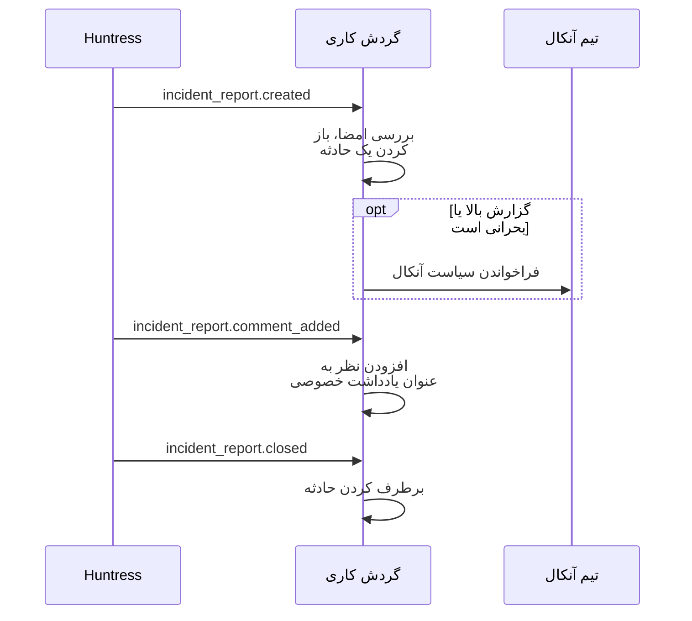

# یکپارچه‌سازی Huntress

با یک گردش کاری، برای گزارش‌های حادثه Huntress تیم آنکال خود را فرا بخوانید. وقتی SOC شرکت Huntress یک گزارش حادثه درباره یک نقطه پایانی یا یک هویت می‌فرستد، گردش کاری برای آن یک حادثه باز می‌کند، سیاست آنکالی را که برمی‌گزینید فرا می‌خواند، نظرهایی را که در Huntress گذاشته می‌شوند به عنوان یادداشت خصوصی می‌افزاید و وقتی گزارش در Huntress بسته شود، حادثه را برطرف می‌کند.

این یکپارچه‌سازی **ورودی** است: Huntress هر رویداد یک گزارش حادثه را به نشانی خود گردش کاری می‌فرستد و آن را با راز امضای نقطه پایانی امضا می‌کند. OneUptime هرگز Huntress را فراخوانی نمی‌کند، پس به هیچ کلید API از Huntress نیاز ندارد.

:::cards
- [چگونه کار می‌کند](#چگونه-کار-میکند): گردش کاری با هر رویداد یک گزارش چه می‌کند.
- [راه‌اندازی](#راهاندازی-یکپارچهسازی): گردش کاری را بسازید، نقطه پایانی را در Huntress اضافه کنید، راز امضای آن را ذخیره کنید و یک آزمایش بفرستید.
- [تریگر](#تریگر-huntress-incident-report): مقدارهایی که یک گزارش به گردش کاری می‌دهد، و تنظیمات تریگر.
- [عیب‌یابی](#عیبیابی): خطاهای تریگر چه معنایی دارند و چه چیزی را باید تغییر داد.
:::

## چگونه کار می‌کند

Huntress وقتی گزارش فرستاده می‌شود، وقتی کسی برای آن نظر می‌گذارد و وقتی بسته می‌شود، رویدادی درباره گزارش حادثه می‌فرستد. تریگر **Huntress Incident Report** برای هر رویداد یک بار گردش کاری را شروع می‌کند و **Event** آن می‌گوید کدام رویداد بوده است: `created`، `comment-added` یا `closed`.

1. **بررسی.** درخواست باید با راز امضای نقطه پایانی امضا شده باشد، حداکثر پنج دقیقه پیش از رسیدن. هر چیز دیگری رد می‌شود و تنظیمات تریگر دلیل آن را می‌گوید.
2. **شروع گردش کاری.** هر رویداد یک اجرا را شروع می‌کند و فیلدهای گزارش مقدارهای تریگر می‌شوند. رویدادی که Huntress دوباره می‌فرستد، دیگر چیزی را شروع نمی‌کند.
3. **باز کردن یک حادثه.** با `created`، گردش کاری حادثه‌ای با عنوانی برگرفته از گزارش باز می‌کند، مانند `Huntress: Incident on DESKTOP-01 (Acme Corp)`. شرح آن خلاصه گزارش، شدت آن در Huntress، سازمان، میزبان یا هویت آسیب‌دیده، شاخص‌هایی که Huntress یافته و پیوندی به گزارش در Huntress را دارد. حادثه برچسبی با سازمان گزارش می‌گیرد و وقتی گزارش بالا یا بحرانی باشد، سیاست آنکالی را که برمی‌گزینید فرا می‌خواند.
4. **دنبال کردن گزارش.** با `comment-added`، نظر یادداشتی خصوصی روی حادثه می‌شود. با `closed`، حادثه برطرف می‌شود و دلیل آن در خط زمانی‌اش می‌ماند.

حادثه شماره گزارش را در فیلدهای سفارشی خود، به صورت `huntressReportId`، نگه می‌دارد: گردش کاری وقتی Huntress برای گزارش نظر می‌گذارد یا آن را می‌بندد، حادثه را از همین راه دوباره پیدا می‌کند. حادثه‌هایی که این‌گونه باز می‌شوند هرگز روی صفحه وضعیت نمایش داده نمی‌شوند و قواعد حادثه شما (قواعد آنکال، مالک، برچسب و حریم خصوصی) مانند هر حادثه دیگری روی آن‌ها اعمال می‌شوند.

## پیش از شروع

- در OneUptime، نقشی که بتواند گردش کاری بسازد و ویرایش کند، مانند **مالک پروژه**، **مدیر پروژه** یا **مدیر گردش‌های کاری**.
- در Huntress، نقش **Account Admin**: فقط مدیران حساب می‌توانند وب‌هوک اضافه کنند.
- یک سیاست آنکال برای فراخوانی.
- در OneUptime Cloud، طرحی که گردش کاری دارد: Growth یا بالاتر. هر رویدادی که Huntress می‌فرستد یک اجرای گردش کاری است.
- در نصب خودمیزبان، OneUptime‌ای که Huntress بتواند از اینترنت از طریق HTTPS به آن برسد: Huntress وب‌هوک را فقط به نشانی‌های `https://` می‌فرستد.

## راه‌اندازی یکپارچه‌سازی

:::steps
### ساختن گردش کاری

**گردش‌های کاری** را باز کنید و روی **ساخت گردش کاری** کلیک کنید. در **یا از یک قالب شروع کنید**، دسته **Huntress** را انتخاب کنید، **Open an incident for each Huntress incident report** را برگزینید و روی **استفاده از این قالب** کلیک کنید.

### انتخاب اینکه چه کسی فراخوانده شود

سپس پنجره می‌پرسد چه کسی فراخوانده شود: زیر **Who to page for high and critical reports** سیاست‌های آنکالی را که باید فراخوانده شوند انتخاب کنید، یا هیچ‌کدام را تا کسی فراخوانده نشود، و روی **ساخت گردش کاری** کلیک کنید. گردش کاری خاموش، در **سازنده** باز می‌شود. برای اینکه بعداً تغییر دهید چه کسی فراخوانده شود، روی مرحله **Page an On-Call Policy** آن کلیک کنید و **سیاست‌های آنکال** آن را تغییر دهید.

### افزودن نقطه پایانی وب‌هوک در Huntress

روی تریگر **Huntress Incident Report** کلیک کنید و زیر **یک نقطه پایانی وب‌هوک در Huntress اضافه کنید** روی **کپی نشانی** کلیک کنید. نشانی شبیه `https://oneuptime.com/workflow/huntress/<key>` است؛ در نصب خودمیزبان با میزبان خودتان شروع می‌شود.

در Huntress منوی بالا سمت راست را باز کنید و **Integrations** را انتخاب کنید. روی **Add an Integration** کلیک کنید، **Webhooks** را انتخاب کنید و روی **Add Endpoint** کلیک کنید. نشانی را جای‌گذاری کنید، **Incident Reports** را روشن کنید و ذخیره کنید. **Escalations**، **Platform Actions** و **Account Notices** را خاموش بگذارید: تریگر این رویدادها را می‌پذیرد و برای آن‌ها چیزی را شروع نمی‌کند.

### ذخیره راز امضای نقطه پایانی

در Huntress منوی نقطه پایانی (⋯) را باز کنید و **View Signing Secret** را انتخاب کنید. همه آن را کپی کنید: با `whsec_` شروع می‌شود. در تریگر روی **ذخیره راز امضا** کلیک کنید، آن را جای‌گذاری کنید و روی **ذخیره راز امضا** کلیک کنید. راز رمزگذاری می‌شود و دیگر هرگز نمایش داده نمی‌شود.

تا وقتی راز ذخیره نشده باشد، تریگر هر درخواستی را رد می‌کند. Huntress رویداد ردشده را بعدا دوباره می‌فرستد، پس رویدادی که اکنون رد شود باز هم می‌رسد.

### روشن کردن گردش کاری و فرستادن یک آزمایش

**فعال** را در بالای **سازنده** روشن کنید. در Huntress منوی نقطه پایانی (⋯) را باز کنید و **Send Test** را انتخاب کنید. در چند ثانیه، تریگر **در حال دریافت گزارش‌ها** را نشان می‌دهد.

> [!NOTE]
> آزمایش هر چه در بر داشته باشد، تریگر نشان می‌دهد که رسیده است. آزمایشی که یک گزارش حادثه در بر دارد، مانند هر گزارش دیگری گردش کاری را شروع می‌کند.
:::

## گردش کاری چه می‌کند

پس از تریگر، **Incident From Another Tool** با شماره گزارش کاری را می‌کند که هر **Event** می‌خواهد:

| Event | گردش کاری چه می‌کند |
| --- | --- |
| `created` | حادثه‌ای با **Incident Severity ID** تریگر باز می‌کند و برچسب **Organization Label ID** آن را به حادثه می‌زند. برای گزارش بالا یا بحرانی، **Page an On-Call Policy** سیاست شما را فرا می‌خواند؛ گزارش پایین کسی را فرا نمی‌خواند. گزارشی که از قبل حادثه دارد، حادثه دیگری باز نمی‌کند. |
| `comment-added` | حادثه گزارش را پیدا می‌کند و نظر را به عنوان یادداشت خصوصی به آن می‌افزاید. |
| `closed` | حادثه گزارش را پیدا می‌کند و آن را برطرف می‌کند، مگر اینکه از قبل برطرف شده باشد. دلیل در خط زمانی‌اش می‌ماند: Huntress گزارش را بست. |

این هم گردش کاری‌ای مانند بقیه است، پس می‌توانید کاری را که می‌کند تغییر دهید: با تغییر چیزی که **If / Else** پس از **Incident From Another Tool** مقایسه می‌کند فقط برای گزارش‌های بحرانی فرا بخوانید، با یک مرحله Slack یا Microsoft Teams هر گزارش را در یک کانال گفتگو بفرستید، یا با یک **Switch / Case** روی **Organization** هر سازمان را به سیاست آنکال خودش بفرستید. هر اجرا، همراه کاری که هر مرحله کرد، در اجراهای گردش کاری فهرست می‌شود.

### شدت‌ها

Huntress به هر گزارش حادثه یکی از سه شدت را می‌دهد. **Incident Severity ID** تریگر شدت حادثه‌ای است که گزارش با آن باز می‌شود: همانی که تنظیم آن برمی‌گزیند، وگرنه ترتیب شدت‌های حادثه شما، همان‌طور که **حوادث → تنظیمات → شدت حادثه** آن‌ها را فهرست می‌کند:

| شدت در Huntress | منظور Huntress از آن | تنظیم | شدت حادثه وقتی تنظیم خالی است |
| --- | --- | --- | --- |
| Critical | مهاجمانی که مستقیم پشت صفحه‌کلید هستند، بدافزار خطرناک یا نفوذ فعال، که باید فورا مهار شود. | **شدت برای گزارش‌های بحرانی** | بالاترین |
| High | بدافزار تأییدشده که به رفع فوری نیاز دارد، یا نفوذ به هویتی که باید درباره‌اش اقدام کرد. | **شدت برای گزارش‌های بالا** | دومین |
| Low | برنامه‌های احتمالاً ناخواسته، بقایای بدافزار و یافته‌های قدیمی‌تر درباره هویت‌ها. | **شدت برای گزارش‌های پایین** | سومین |

پروژه‌ای که شدت‌های کمتری دارد، برای بقیه از پایین‌ترین شدت خود استفاده می‌کند. گزارشی که شدت ندارد، بالا در نظر گرفته می‌شود. اگر شدتی که انتخاب کرده‌اید حذف شود، دوباره ترتیب تصمیم می‌گیرد.

### سازمان‌ها

**Organization Label ID** تریگر برچسبی به نام سازمان Huntress گزارش است، مانند _Acme Corp_، که نخستین باری که گزارشی از آن سازمان برسد ساخته می‌شود. یک گردش کاری گزارش‌های همه سازمان‌های حساب Huntress شما را دریافت می‌کند و **فقط این سازمان‌ها** در تریگر آن را محدود می‌کند: در هر خط یک نام یا شناسه سازمان، و بزرگی و کوچکی حروف نام‌ها مهم نیست.

> [!TIP]
> برای فراخواندن تیم خود هر مشتری، برای هر سازمان یک قاعده آنکال حادثه اضافه کنید، مانند «اگر **برچسب‌های حادثه** یکی از _Acme Corp_ را دارد»، که سیاست آن مشتری را اجرا کند. [قواعد کشیک حادثه](/docs/incidents/settings#قواعد-کشیک-حادثه) را ببینید.

## تریگر Huntress Incident Report

تریگر با اطلاعات Huntress باز می‌شود: نشانی آن، یک تیک کنار هر مرحله راه‌اندازی که انجام شده، و آخرین چیزی که Huntress فرستاده است. تنظیمات آن، که همه اختیاری هستند، زیر **فیلدهای بیشتر** جمع شده‌اند: **فقط این سازمان‌ها**، **شدت برای گزارش‌های بحرانی**، **شدت برای گزارش‌های بالا** و **شدت برای گزارش‌های پایین**.

| مقدار | چه چیزی در آن است |
| --- | --- |
| **Event** | `created`، `comment-added` یا `closed`. گزارشی که از قبل بسته یا رد شده، هر رویدادی که آن را آورده باشد، `closed` است. |
| **Report ID** | شماره گزارش در Huntress. |
| **Severity** | `critical`، `high` یا `low`. |
| **Status** | وضعیت گزارش در Huntress، مانند `sent`، `closed` یا `dismissed`. |
| **Subject** | موضوع گزارش، همان‌طور که Huntress می‌نویسد. |
| **Summary** | آنچه تحلیلگر SOC نوشته است. |
| **Organization**، **Organization ID** | سازمان Huntress که گزارش درباره آن است. |
| **Affected** | میزبان یا هویتی که گزارش درباره آن است. |
| **Platform**، **Indicators** | Huntress آن را کجا یافت، و چه یافت. |
| **Comment** | نظری که کسی افزوده است، با `comment-added`. |
| **Report URL** | جایی که گزارش در Huntress باز می‌شود. |
| **Incident Title**، **Incident Description** | یک عنوان و یک شرح Markdown برای حادثه‌ای درباره گزارش. |
| **Note** | Markdown برای یادداشتی درباره رویداد: نظر، یا اینکه Huntress گزارش را بست. |
| **Incident Severity ID**، **Organization Label ID** | شدت حادثه و برچسب، همان‌طور که در بالا آمد. |
| **Received At** | زمانی که OneUptime رویداد را دریافت کرد. |

**Summary** و **Comment** متنی هستند که تحلیلگران Huntress نوشته‌اند. برای گذاشتن آن‌ها در یک حادثه یا یادداشت، از **Incident Description** و **Note** استفاده کنید: قالب‌بندی را نگه می‌دارند و هیچ چیز در آن‌ها تصویری بار نمی‌کند یا از کسی نام نمی‌برد.

برای امتحان گردش کاری بدون Huntress، در **سازنده** روی **اجرای گردش کاری** کلیک کنید و یک **Event**، یک **Report ID** و فیلدهایی را که لازم دارید بنویسید. برای دنبال کردن یک گزارش از `created` تا `closed`، از همان **Report ID** استفاده کنید.

## اتصال‌های Huntress که پیش‌تر ساخته شده‌اند

Huntress پیش‌تر در **حوادث → یکپارچه‌سازی‌ها → Huntress** راه‌اندازی می‌شد. هر اتصال Huntress به یک گردش کاری روشن با همان نام تبدیل شد که همان کاری را می‌کند که اتصال می‌کرد: برای همان گزارش‌ها همان سیاست‌های آنکال را فرا می‌خواند، همان برچسب‌ها را می‌افزاید و به همان شکل برطرف می‌کند (یا فقط یادداشت می‌گذارد). نشانی آن هنوز نشانی اتصال است، `https://oneuptime.com/api/huntress/webhook/<connection-id>`، و راز امضای آن همان است، پس در Huntress چیزی برای تغییر نیست. حادثه‌هایی که اتصال باز کرده بود شماره گزارششان را نگه می‌دارند، پس وقتی Huntress برای آن گزارش‌ها نظر می‌گذارد یا آن‌ها را می‌بندد، گردش کاری آن‌ها را پیدا می‌کند.

## امنیت

- **فقط درخواست‌های امضاشده.** تریگر سرآیندهای `svix-id`، `svix-timestamp` و `svix-signature` را که Huntress می‌فرستد، با بدنه درخواست دقیقا همان‌طور که رسیده مقایسه می‌کند. درخواستی که با راز ذخیره‌شده امضا نشده باشد، یا بیش از پنج دقیقه زودتر یا دیرتر امضا شده باشد، رد می‌شود.
- **راز، راز می‌ماند.** به صورت رمزگذاری‌شده نگهداری می‌شود، API هرگز آن را برنمی‌گرداند و دیگر هرگز نمایش داده نمی‌شود. **جایگزینی راز امضا** در تریگر راز دیگری را ذخیره می‌کند، مانند راز یک نقطه پایانی جدید.
- **نشانی یک آدرس است، نه گذرواژه.** نشانی به کلید گردش کاری ختم می‌شود؛ فقط درخواستی که با راز نقطه پایانی امضا شده باشد گردش کاری را شروع می‌کند.
- **یک نقطه پایانی برای هر گردش کاری.** هر گردش کاری نشانی و راز خودش را دارد. برای دریافت گزارش‌های یک حساب Huntress دیگر، گردش کاری دومی بسازید.

## استفاده از ایمیل به‌جای آن

Huntress گزارش‌های حادثه را با ایمیل هم می‌فرستد و یک [مانیتور ایمیل ورودی](/docs/monitor/incoming-email-monitor) می‌تواند از این ایمیل‌ها حادثه باز کند، مثلا وقتی موضوع شامل `Critical Incident Report` باشد. اما ایمیل‌ها را وضعیت یک مانیتور واحد در نظر می‌گیرد: تا وقتی حادثه آن باز است، گزارش بعدی حادثه‌ای باز نمی‌کند و حادثه با معیارهای مانیتور برطرف می‌شود، نه وقتی Huntress گزارش را می‌بندد. گردش کاری برای هر گزارش یک حادثه باز می‌کند و هر کدام را همراه گزارشش برطرف می‌کند، پس آن را ترجیح دهید. وقتی گردش کاری گزارش دریافت کرد، فرستادن ایمیل‌ها به مانیتور را متوقف کنید، وگرنه هر گزارش دو بار فرا می‌خواند.

## عیب‌یابی

وقتی تریگر درخواستی را رد می‌کند، تنظیمات آن دلیل را زیر **آخرین درخواست رد شد** نشان می‌دهد. در Huntress، **View Delivery Attempts** در منوی نقطه پایانی (⋯) هر تحویل را همراه پاسخ OneUptime فهرست می‌کند.

:::details "A request arrived but was refused, because no signing secret is saved for this workflow yet"
راز امضای نقطه پایانی را ذخیره کنید: [راه‌اندازی یکپارچه‌سازی](#راهاندازی-یکپارچهسازی) را ببینید. Huntress درخواست ردشده را دوباره می‌فرستد.
:::

:::details "The request's signature does not match the signing secret"
راز ذخیره‌شده متعلق به این نقطه پایانی نیست. هر نقطه پایانی راز خودش را دارد: در Huntress منوی نقطه پایانی (⋯) را باز کنید، **View Signing Secret** را انتخاب کنید، همه آن را کپی کنید و با **جایگزینی راز امضا** ذخیره کنید.
:::

:::details "The request was signed more than five minutes from now"
ساعت Huntress و سرور OneUptime شما بیش از پنج دقیقه با هم فاصله دارند، یا درخواست تکرار یک درخواست قدیمی است. در نصب خودمیزبان، بررسی کنید که ساعت سرور درست باشد.
:::

:::details "A request arrived while this workflow is off"
**فعال** را در بالای **سازنده** روشن کنید. Huntress درخواست ردشده را دوباره می‌فرستد و آن وقت گردش کاری را شروع می‌کند.
:::

:::details "No Huntress workflow has this address."
گردش کاری حذف یا بایگانی شده است، تریگر آن دیگر **Huntress Incident Report** نیست، یا نشانی نقطه پایانی در Huntress نشانی این گردش کاری نیست. نشانی را از تریگر کپی کنید و دوباره در نقطه پایانی در Huntress جای‌گذاری کنید.
:::

:::details حادثه‌ای باز نشد
اجراهای گردش کاری و اجرای آن گزارش را باز کنید. اگر **Incident From Another Tool** با `This project has no incident severities to put the incident at.` شکست خورد، یکی در **حوادث → تنظیمات → شدت حادثه** اضافه کنید.
:::

:::details کسی فراخوانده نشد
گزارش پایین حادثه را بدون فراخوانی باز می‌کند. در غیر این صورت، اجرای آن گزارش می‌گوید **Page an On-Call Policy** چه کرد، و صفحه **اجراهای آنکال** حادثه نشان می‌دهد هر سیاست چه کرد.
:::

## گام‌های بعدی

:::cards
- [تریگرهای گردش کاری](/docs/workflows/triggers): راه‌های دیگر شروع یک گردش کاری.
- [قواعد کشیک حادثه](/docs/incidents/settings#قواعد-کشیک-حادثه): تیم خود هر سازمان را با برچسبش فرا بخوانید.
- [وضعیت‌ها و شدت‌های حادثه](/docs/incidents/states-and-severities): ترتیب شدت‌هایی را که گزارش‌های Huntress با آن‌ها باز می‌شوند تعیین کنید.
- [نمای کلی یکپارچه‌سازی‌ها](/docs/integrations/index): ابزارهای دیگری که می‌توانید متصل کنید.
:::
