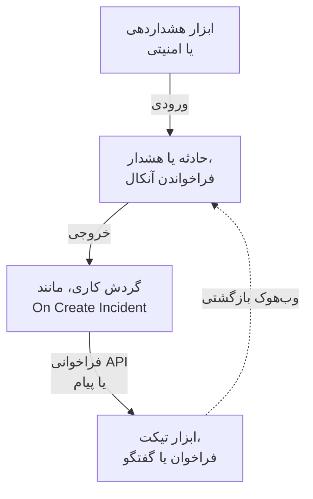

# نمای کلی یکپارچه‌سازی‌ها

OneUptime با ابزارهایی کار می‌کند که تیم شما همین حالا از آن‌ها استفاده می‌کند. ابزارهای هشداردهی در آن حادثه باز می‌کنند، و OneUptime در ابزارهای دیگر تیکت، فراخوان و پیام گفتگو باز می‌کند. برخی ابزارها از طریق یک فرم وصل می‌شوند، و برخی از طریق یک قالب آماده گردش کاری. هر ابزار دیگری که وب‌هوک یا API دارد، از طریق گردش کاری‌ای که خودتان می‌سازید وصل می‌شود.

:::cards
- [انتخاب روش اتصال](#انتخاب-روش-اتصال): چهار راه ورود، و اینکه هر کدام را کی به کار ببرید.
- [فهرست ابزارها](#فهرست-ابزارها): هر ابزاری که راهنما دارد، دسته‌بندی‌شده بر اساس کاری که انجام می‌دهد.
- [ساختن یکپارچه‌سازی خودتان](#ساختن-یکپارچهسازی-خودتان): الگوهای ورودی و خروجی، برای هر ابزار دیگر.
- [امن نگه داشتن اعتبارنامه‌ها](#امن-نگه-داشتن-اعتبارنامهها): متغیرهای راز، و سرآیندهایی که هر ابزار انتظار دارد.
:::

## یکپارچه‌سازی‌ها چگونه کار می‌کنند

هر یکپارچه‌سازی داده را در یک جهت یا هر دو جهت جابه‌جا می‌کند. در حالت **ورودی**، ابزار دیگری به OneUptime خبر می‌دهد که مشکلی هست، و OneUptime یک حادثه یا هشدار باز می‌کند و تیم آنکال را فرا می‌خواند. در حالت **خروجی**، اتفاقی در OneUptime می‌افتد و یک گردش کاری به ابزار دیگری خبر می‌دهد: تیکتی ثبت می‌کند، کسی را فرا می‌خواند یا پیامی می‌فرستد.



یک یکپارچه‌سازی دوطرفه، مانند Jira یا Dynamics 365، از هر دو جهت استفاده می‌کند: یک گردش کاری حادثه را بیرون می‌فرستد، و گردش کاری دیگری که با وب‌هوک ابزار دیگر شروع می‌شود، تغییرات را برمی‌گرداند.

## انتخاب روش اتصال

| روش | مناسب برای | نمونه‌ها |
| --- | --- | --- |
| یک اتصال داخلی | ابزارهایی که OneUptime خودش به آن‌ها وصل می‌شود. یک فرم را پر می‌کنید و چیزی برای ساختن نیست. | [Slack](/docs/workspace-connections/slack)، [Microsoft Teams](/docs/workspace-connections/microsoft-teams)، اتصال‌های [رویدادهای امنیتی](/docs/telemetry/security-events) |
| یک قالب گردش کاری | ابزارهای تیکت که در هر دو جهت هماهنگ نگه داشته می‌شوند، مشکل‌های پایش، گزارش‌های حادثه امنیتی و پیام‌های گفتگو. یک قالب برمی‌دارید و چند تنظیم را پر می‌کنید. | [Jira](/docs/integrations/jira)، [Microsoft Dynamics 365](/docs/integrations/microsoft-dynamics-365)، [Huntress](/docs/integrations/huntress)، [Zabbix](/docs/integrations/zabbix) |
| یک مانیتور Incoming Request | ابزارهای هشداردهی که وب‌هوک می‌فرستند. برای هر هشدار یک حادثه می‌گیرید که آنکال را فرا می‌خواند و با بهبود هشدار رفع می‌شود، بدون هیچ گردش کاری. | [Zabbix](/docs/integrations/zabbix)، [Prometheus Alertmanager](/docs/integrations/prometheus-alertmanager)، [Grafana](/docs/integrations/grafana) |
| گردش کاری‌ای که خودتان می‌سازید | هر ابزاری که وب‌هوک یا REST API دارد، و هر منطقی از خودتان. | [PagerDuty](/docs/integrations/pagerduty)، [Opsgenie](/docs/integrations/opsgenie)، [ServiceNow](/docs/integrations/servicenow) |

از بالای جدول شروع کنید: هر روشی که بالاتر است، نگه‌داری کمتری دارد.

## فهرست ابزارها

### ابزارهای پایش و هشداردهی

| ابزار | جهت | کاری که می‌کند |
| --- | --- | --- |
| [Zabbix](/docs/integrations/zabbix) | هر دو | مشکل‌های Zabbix را به حادثه یا هشدار تبدیل می‌کند، در بهبود آن‌ها را رفع می‌کند، و مشکل‌ها را از OneUptime تأیید یا بسته می‌کند. |
| [Prometheus Alertmanager](/docs/integrations/prometheus-alertmanager) | ورودی | اعلان‌های Alertmanager را به حادثه تبدیل می‌کند. |
| [Grafana](/docs/integrations/grafana) | ورودی | هشدارهای Grafana را به حادثه تبدیل می‌کند. |
| [Datadog](/docs/integrations/datadog) | ورودی | هشدارهای مانیتورهای Datadog را به حادثه تبدیل می‌کند. |

### ابزارهای امنیتی

| ابزار | جهت | کاری که می‌کند |
| --- | --- | --- |
| [Huntress](/docs/integrations/huntress) | ورودی | برای گزارش‌های حادثه Huntress آنکال را فرا می‌خواند، و با بسته شدن گزارش حادثه را رفع می‌کند. |
| [Google SecOps](/docs/integrations/google-secops) | هر دو | تشخیص‌ها و شاخص‌های Google SecOps را به رویدادهای امنیتی می‌آورد و آنچه OneUptime پیدا می‌کند را به Google SecOps می‌فرستد. |
| [Microsoft Sentinel](/docs/integrations/microsoft-sentinel) | هر دو | حادثه‌های Microsoft Sentinel را به رویدادهای امنیتی می‌آورد و آنچه OneUptime پیدا می‌کند را به Microsoft Sentinel می‌فرستد. |
| [Microsoft Defender XDR](/docs/integrations/microsoft-defender-xdr) | ورودی | هشدارهای Microsoft Defender XDR را به رویدادهای امنیتی می‌آورد. |
| [CrowdStrike Falcon](/docs/integrations/crowdstrike-falcon) | ورودی | هشدارهای CrowdStrike Falcon را به رویدادهای امنیتی می‌آورد. |
| [Splunk Enterprise Security](/docs/integrations/splunk) | هر دو | رویدادهای قابل توجه (notable event) Splunk را به رویدادهای امنیتی می‌آورد و آنچه OneUptime پیدا می‌کند را به Splunk می‌فرستد. |
| [Elastic Security](/docs/integrations/elastic-security) | هر دو | هشدارهای تشخیص Elastic Security را به رویدادهای امنیتی می‌آورد و آنچه OneUptime پیدا می‌کند را به Elastic Security می‌فرستد. |
| [AWS Security Hub](/docs/integrations/aws-security-hub) | ورودی | یافته‌های AWS Security Hub را به رویدادهای امنیتی می‌آورد. |
| [Okta System Log](/docs/integrations/okta) | ورودی | ورودهای Okta، تغییرات حساب و تشخیص تهدیدها را به رویدادهای امنیتی می‌آورد. |
| [Microsoft Entra ID](/docs/integrations/microsoft-entra-id) | ورودی | ورودها و تغییرات دایرکتوری Microsoft Entra ID و لاگ ممیزی Microsoft 365 را به رویدادهای امنیتی می‌آورد. |
| [Google Workspace](/docs/integrations/google-workspace) | ورودی | ورودها، تغییرات مدیران و تشخیص‌های خود Google در Google Workspace را به رویدادهای امنیتی می‌آورد. |

### تیکت و مدیریت خدمات فناوری اطلاعات

| ابزار | جهت | کاری که می‌کند |
| --- | --- | --- |
| [Jira](/docs/integrations/jira) | هر دو | برای هر حادثه یا هشدار یک issue در Jira باز می‌کند، و تغییرات وضعیت و نظرها را برمی‌گرداند. |
| [Microsoft Dynamics 365](/docs/integrations/microsoft-dynamics-365) | هر دو | برای هر حادثه یا هشدار یک پرونده (case) در Dynamics 365 باز می‌کند، و تغییرات وضعیت و یادداشت‌ها را برمی‌گرداند. |
| [ServiceNow](/docs/integrations/servicenow) | خروجی | برای هر حادثه OneUptime یک incident در ServiceNow باز می‌کند، و آن را همراه با حادثه رفع می‌کند. |
| [GitHub](/docs/integrations/github) | خروجی | برای یک حادثه یک issue در GitHub باز می‌کند. |
| [GitLab](/docs/integrations/gitlab) | خروجی | برای یک حادثه یک issue در GitLab باز می‌کند. |

### ابزارهای فراخوان

| ابزار | جهت | کاری که می‌کند |
| --- | --- | --- |
| [PagerDuty](/docs/integrations/pagerduty) | خروجی | برای هر حادثه OneUptime یک incident در PagerDuty راه می‌اندازد، و آن را همراه با حادثه رفع می‌کند. |
| [Opsgenie](/docs/integrations/opsgenie) | خروجی | برای هر حادثه OneUptime یک هشدار در Opsgenie می‌سازد، و آن را همراه با حادثه می‌بندد. |

### ابزارهای گفتگو

| ابزار | جهت | کاری که می‌کند |
| --- | --- | --- |
| [Slack](/docs/workspace-connections/slack) | هر دو | یک اتصال داخلی: کانال‌های حادثه، اقدام از درون Slack، و آنکال. |
| [Microsoft Teams](/docs/workspace-connections/microsoft-teams) | هر دو | یک اتصال داخلی: کانال‌های حادثه، اقدام از درون Teams، و آنکال. |
| [Mattermost](/docs/workflows/components#mattermost) | خروجی | به‌روزرسانی‌های حادثه را در یک کانال Mattermost می‌فرستد. |
| [Discord](/docs/integrations/discord) | خروجی | به‌روزرسانی‌های حادثه را در یک کانال Discord می‌فرستد. |
| [Telegram](/docs/integrations/telegram) | خروجی | وقتی هشداری ایجاد می‌شود، پیامی به یک گفتگوی Telegram می‌فرستد. |
| [IRC](/docs/integrations/irc) | خروجی | به‌روزرسانی‌های حادثه را در یک کانال IRC می‌فرستد. |

> [!TIP]
> Slack و Microsoft Teams گام‌های گردش کاری هم دارند. برای کانال‌های حادثه و آنکال از اتصال داخلی استفاده کنید، و وقتی فقط یک پیام در یک کانال لازم دارید، از یک گام گردش کاری.

### پلتفرم‌های میزبانی

| ابزار | جهت | کاری که می‌کند |
| --- | --- | --- |
| [Vercel](/docs/integrations/vercel) | ورودی | OneUptime را از Vercel Marketplace اضافه کنید: ردیابی‌ها، لاگ‌ها، مانیتورهای دسترس‌پذیری و یک صفحهٔ وضعیت برای پروژه‌های Vercel شما. |

## آمدن از ابزاری دیگر

برای کنار گذاشتن یک ابزار دیگر آنکال، پایش دسترس‌پذیری یا صفحه وضعیت، به جای وصل کردن این دو، تیم خود را به اینجا بیاورید. **تنظیمات پروژه** > **پیشرفته** > **درون‌ریزی از ابزاری دیگر** حساب شما را با یک کلید API می‌خواند، آنچه را یافته نشان می‌دهد، و هر چه را تیک بزنید می‌سازد. هر ابزار یک راهنما دارد:

- ابزارهای آنکال و حادثه: [Opsgenie](/docs/moving-to-oneuptime/opsgenie)، [PagerDuty](/docs/moving-to-oneuptime/pagerduty)، [incident.io](/docs/moving-to-oneuptime/incident-io)، [Splunk On-Call](/docs/moving-to-oneuptime/splunk-on-call) و [Grafana OnCall](/docs/moving-to-oneuptime/grafana-oncall).
- ابزارهای پایش دسترس‌پذیری و صفحه وضعیت: [UptimeRobot](/docs/moving-to-oneuptime/uptimerobot)، [Atlassian Statuspage](/docs/moving-to-oneuptime/atlassian-statuspage)، [Better Stack](/docs/moving-to-oneuptime/better-stack)، [Pingdom](/docs/moving-to-oneuptime/pingdom)، [StatusCake](/docs/moving-to-oneuptime/statuscake) و [Uptime Kuma](/docs/moving-to-oneuptime/uptime-kuma).

## ساختن یکپارچه‌سازی خودتان

ابزاری که راهنما ندارد هم در یکی از دو الگو جا می‌گیرد. اگر می‌تواند وب‌هوک بفرستد، از الگوی ورودی استفاده کنید. اگر REST API دارد، از الگوی خروجی استفاده کنید. هر دو گردش کاری هستند: برای شروع، [نمای کلی گردش‌های کاری](/docs/workflows/index) را ببینید.

### ورودی: ابزار دیگری داده به OneUptime می‌فرستد

برای یک ابزار هشداردهی، با یک [مانیتور Incoming Request](/docs/monitor/incoming-request-monitor#دریافت-هشدار-از-سامانهای-دیگر) شروع کنید: برای هر هشدار یک حادثه باز می‌کند و با بهبود آن را رفع می‌کند، بی‌آنکه چیزی بسازید. وقتی به منطق خودتان نیاز دارید، یک گردش کاری بسازید:

:::steps
1. **گردش‌های کاری** را باز کنید، روی **ساخت گردش کاری** و سپس **شروع از صفر** کلیک کنید. برای گردش کاری نامی بگذارید و روی **ساخت گردش کاری** کلیک کنید.
2. روی بلوک خط‌چین **انتخاب کنید چه چیزی این گردش کاری را شروع کند** کلیک کنید و **Webhook** را برگزینید. روی تریگر کلیک کنید، سپس روی **کپی نشانی**.
3. در ابزار دیگر، وب‌هوکش را به صورت یک `POST` با `Content-Type: application/json` به آن نشانی بفرستید.
4. بلوک‌هایی را که روی آن کار می‌کنند اضافه کنید. این بلوک‌ها درخواست را با ارجاع‌هایی مانند `{{local.components.webhook-1.returnValues.request-body.status}}` می‌خوانند: یک بلوک **If / Else** برای بررسی یک فیلد، سپس **Create One Incident** برای اعلام یک حادثه.
5. در بالای **سازنده** گزینه **فعال** را روشن کنید، از ابزار دیگر یک آزمایش بفرستید، و **لاگ‌ها** > **اجراها** را باز کنید تا ببینید چه رسید.
:::

نشانی تنها اعتبارنامه است، پس مانند یک گذرواژه با آن رفتار کنید. [Webhook](/docs/workflows/triggers#webhook) را ببینید.

### خروجی: OneUptime داده به ابزار دیگری می‌فرستد

:::steps
1. کلید API ابزار را به صورت یک متغیر سراسری راز ذخیره کنید، همان‌طور که [در ادامه](#امن-نگه-داشتن-اعتبارنامهها) آمده است.
2. یک گردش کاری بسازید، روی بلوک خط‌چین کلیک کنید و یک تریگر رویداد برگزینید، مانند **On Create Incident**. روی تریگر کلیک کنید: **Fields to pass on** آن از پیش **عنوان** را دارد، پس روی **افزودن فیلد** کلیک کنید و فیلدهای دیگری را که باید فرستاده شوند برگزینید، مانند **توضیحات**.
3. روی **افزودن مؤلفه** کلیک کنید و یک بلوک **API Post (JSON)** اضافه کنید. نقطه **Success** تریگر را به آن وصل کنید.
4. **URL** آن را پر کنید، **Request Headers** آن را با سرآیند `Authorization`، و **Request Body** آن را با فیلدهای حادثه، مانند `{{local.components.incident-on-create-1.returnValues.model.title}}`.
5. روی **اجرای گردش کاری** کلیک کنید، زیر **حادثه** یک حادثه را برگزینید و اجرا کنید. یک اجرای آزمایشی واقعاً درخواست را می‌فرستد. سپس **فعال** را روشن کنید.
:::

وقتی ابزار به داده‌ای با شکل دیگر نیاز دارد، یک بلوک [Run Custom JavaScript](/docs/workflows/components#custom-code) میان این دو اضافه کنید. دستورالعمل برای Zendesk، New Relic، AWS (از طریق SNS)، StatusCake و بقیه ابزارها همین است: فقط نشانی و بدنه تغییر می‌کنند.

## امن نگه داشتن اعتبارنامه‌ها

هرگز کلید API یا توکن را در یک بلوک نچسبانید. آن را یک بار به صورت یک متغیر سراسری راز ذخیره کنید:

:::steps
1. به **گردش‌های کاری** > **متغیرهای سراسری** بروید و روی **ساخت متغیر گردش کاری** کلیک کنید.
2. نامی برایش بگذارید، مانند `JIRA_AUTH`، و روی **بعدی** کلیک کنید.
3. کلید را در **محتوا** بچسبانید، **راز** را روشن کنید، و روی **ساخت متغیر گردش کاری** کلیک کنید.
:::

هر بلوکی آن را به شکل `{{global.variables.JIRA_AUTH}}` می‌خواند. محتوای یک متغیر پس از ذخیره قابل بازخوانی نیست، و متغیر راز در لاگ‌های اجرا با `[REDACTED]` جایگزین می‌شود. برای توکن‌هایی که منقضی می‌شوند، مانند توکن‌های Microsoft Entra ID، یک [متغیر OAuth 2.0](/docs/workflows/variables#متغیرهای-oauth-20-توکنهایی-که-خودشان-را-تازه-میکنند) خودش توکن تازه می‌گیرد. [متغیرهای گردش کاری](/docs/workflows/variables#متغیرهای-سراسری) را ببینید.

### برگه تقلب احراز هویت

بیشتر یکپارچه‌سازی‌های خروجی کلید را در یک سرآیند درخواست می‌گذارند. شکل‌های رایج:

| طرح | آنچه باید فرستاد | استفاده‌شده در |
| --- | --- | --- |
| توکن Bearer | `Authorization: Bearer {{global.variables.TOKEN}}` | GitHub، و بیشتر APIهای امروزی |
| احراز هویت Basic | `Authorization: Basic {{global.variables.BASE64_USER_PASS}}` | Jira Cloud، ServiceNow |
| سرآیند کلید API | `Authorization: GenieKey {{global.variables.OPSGENIE_KEY}}` | Opsgenie |
| سرآیند توکن خصوصی | `PRIVATE-TOKEN: {{global.variables.GITLAB_TOKEN}}` | GitLab |
| کلید در بدنه | `routing_key` در بدنه JSON | PagerDuty Events API |
| اعتبارنامه کلاینت OAuth 2.0 | `Authorization: Bearer {{local.variables.dynamicsAccessToken}}`، از یک متغیر OAuth 2.0 | Microsoft Dynamics 365 |

برای احراز هویت Basic، `username:password` یا `email:api_token` را یک بار کدگذاری کنید و نتیجه را به عنوان راز ذخیره کنید. در macOS یا Linux:

```bash
printf '%s' 'you@example.com:your_api_token' | base64 | tr -d '\n'
```

از `printf` استفاده کنید، نه `echo`: `echo` یک خط تازه اضافه می‌کند که همراه بقیه کدگذاری می‌شود و اعتبارنامه‌ها را خراب می‌کند. `tr` نتیجه بلند را در یک خط نگه می‌دارد.

## نصب‌های خودمیزبان

یک OneUptime خودمیزبان ابزارهای دیگر را از شبکه شما فرا می‌خواند، و ابزارهای دیگر آن را از شبکه خودشان:

- **خروجی:** درخواست‌های گردش کاری به نشانی‌های شبکه خصوصی رد می‌شوند، مگر اینکه یک مدیر اجازه‌شان را بدهد. [دسترسی شبکه خروجی](/docs/workflows/configuration#دسترسی-شبکه-خروجی) را ببینید.
- **ورودی:** وب‌هوک‌های یک ابزار باید از طریق HTTPS به OneUptime شما برسند، پس ابزاری که در ابر است به یک نشانی عمومی برای فراخوانی نیاز دارد.
- **یکپارچه‌سازی‌های داخلی** هر کدام یک راهنمای راه‌اندازی دارند: [Slack](/docs/self-hosted/slack-integration)، [Microsoft Teams](/docs/self-hosted/microsoft-teams-integration)، [GitHub](/docs/self-hosted/github-integration)، [Twilio](/docs/self-hosted/twilio-integration)، [ایمیل ورودی SendGrid](/docs/self-hosted/sendgrid-inbound-email) و [اعلان‌های پوش](/docs/self-hosted/push-notifications).

## گام‌های بعدی

:::cards
- [نمای کلی گردش‌های کاری](/docs/workflows/index): گردش‌های کاری چگونه اجرا می‌شوند، و چگونه اولین گردش کاری خود را بسازید.
- [مانیتور درخواست ورودی](/docs/monitor/incoming-request-monitor): هشدارها را از هر ابزاری بدون گردش کاری دریافت کنید.
- [Jira](/docs/integrations/jira): یک یکپارچه‌سازی دوطرفه کامل، با قالب‌ها.
- [متغیرهای گردش کاری](/docs/workflows/variables): داده را میان بلوک‌ها جابه‌جا کنید، و رازها را بیرون از آن‌ها نگه دارید.
:::
