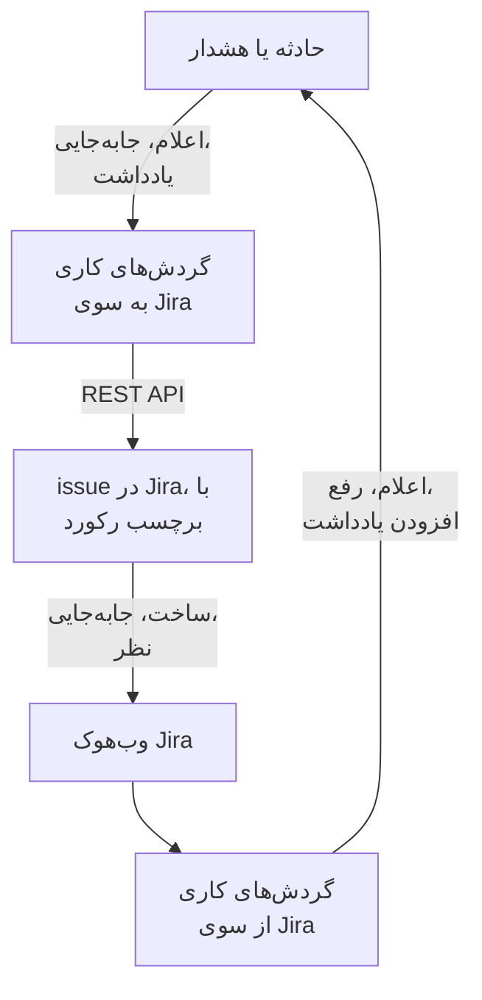

# Jira

در [Jira](https://www.atlassian.com/software/jira)، issueها را با حادثه‌ها و هشدارهای OneUptime در هر دو جهت هماهنگ نگه دارید. قالب‌های آماده گردش کاری برای هر حادثه یا هشدار یک issue باز می‌کنند، همراه با پیشرفت رکورد آن را جابه‌جا می‌کنند و یادداشت‌ها را به صورت نظر در آن کپی می‌کنند. قالب‌های دیگر از issueهای تازه حادثه اعلام می‌کنند و تغییرات وضعیت، نظرها و ویرایش‌ها را برمی‌گردانند. هیچ افزونه‌ای در کار نیست: گردش‌های کاری REST API در Jira را فرا می‌خوانند، و Jira نشانی‌های وب‌هوک آن‌ها را.

:::cards
- [شروع از یک قالب](#شروع-از-یک-قالب): ۱۷ قالب، آنچه می‌پرسند، و چگونگی راه‌اندازی‌شان.
- [قالب‌ها چگونه کار می‌کنند](#قالبها-چگونه-کار-میکنند): issueها و رکوردها چگونه بدون حلقه به هم وصل می‌مانند.
- [خودتان بسازید](#خودتان-بسازید): هر جهت به‌صورت دستی، برای وقتی که قالبی مناسب نیست.
- [عیب‌یابی](#عیبیابی): پاسخ‌های Jira چه معنایی دارند.
:::

> [!NOTE]
> Atlassian در حال تغییر نام چیزها در Jira Cloud است: در بخش زیادی از رابط کاربری، **پروژه** اکنون **فضا** است، و **issue** یک **آیتم کاری** است. سایت‌ها هر دو واژه را به کار می‌برند، پس هر جا واژه مهم باشد، اینجا هر دو را می‌بینید.

## چگونه کار می‌کند



هر قالب یک گردش کاری کوچک است، پس فقط جهت‌هایی را برمی‌دارید که می‌خواهید، برای حادثه‌ها، هشدارها یا هر دو. قالب‌های OneUptime به Jira از یک رویداد در OneUptime شروع می‌شوند و REST API در Jira را فرا می‌خوانند. قالب‌های Jira به OneUptime از یک وب‌هوک Jira شروع می‌شوند. همه آن‌ها رکوردهای یکدیگر را با دو برچسب روی issue پیدا می‌کنند.

همه چیز در این صفحه برای **Jira Cloud** نوشته شده است. [Jira Data Center](#jira-data-center) فهرست می‌کند که در Jira خودمدیریت‌شده چه چیزی تغییر می‌کند.

## پیش از شروع

- یک سایت Jira Cloud، مانند `https://your-domain.atlassian.net`، و پروژه‌ای برای ثبت issueها.
- یک کاربر Jira برای یکپارچه‌سازی، و یک توکن API برای آن. به کاربر در پروژه **Browse Projects**، **Create Issues**، **Edit Issues**، **Add Comments** و **Transition Issues** بدهید.
- یک مدیر Jira، برای ثبت وب‌هوک‌هایی که قالب‌های Jira به OneUptime لازم دارند.
- در OneUptime، اجازه ساختن گردش کاری. در OneUptime Cloud، گردش‌های کاری به طرح **Growth** یا بالاتر نیاز دارند.

## شروع از یک قالب

پنجره **ساخت یک گردش کاری** در فهرست دسته‌هایش، زیر **Jira**، ۱۷ قالب Jira دارد: نه قالب برای حادثه‌ها، سپس هشت قالب برای هشدارها، هر دسته زیر عنوان خودش. همه یک قرارداد مشترک دارند، یعنی برچسب‌های روی issue در Jira، پس هر ترکیبی از آن‌ها با هم کار می‌کند.

### قالب‌های حادثه

| قالب | کاری که می‌کند | آنچه می‌پرسد |
| --- | --- | --- |
| **از OneUptime به Jira** | | |
| Create a Jira issue when an incident is declared | برای هر حادثه تازه یک issue ثبت می‌کند و شناسه حادثه را به صورت برچسب روی آن می‌گذارد. حادثه‌هایی که از Jira اعلام شده‌اند، و حادثه‌های خصوصی، نادیده گرفته می‌شوند. | نشانی API، توکن API، کلید پروژه، نوع issue، نشانی OneUptime |
| Move the Jira issue when the incident is acknowledged or resolved | issue وصل‌شده را به جلو می‌برد: با تأیید حادثه به یک وضعیت In Progress، و با رفع آن به یک وضعیت Done. هرگز آن را به عقب برنمی‌گرداند. | نشانی API، توکن API |
| Copy incident private notes to the Jira issue | هر یادداشت خصوصی تازه را به صورت نظر روی issue وصل‌شده می‌فرستد — در Jira Service Management یک نظر داخلی. | نشانی API، توکن API |
| Copy incident public notes to the Jira issue | هر یادداشت عمومی تازه را به صورت نظر روی issue وصل‌شده می‌فرستد. | نشانی API، توکن API |
| Comment on the Jira issue when the incident is edited | وقتی عنوان، شدت، توضیحات، علت ریشه‌ای یا یادداشت‌های رفع حادثه تغییر کنند، وضعیت کنونی حادثه را می‌فرستد — در Jira Service Management یک نظر داخلی. | نشانی API، توکن API |
| **از Jira به OneUptime** | | |
| Declare an incident when a Jira issue is created | برای هر issue تازه یک حادثه اعلام می‌کند که از صفحه‌های وضعیت شما دور نگه داشته می‌شود، با شدتی که از اولویت issue انتخاب شده، سپس برای وصل کردن این دو روی issue برچسب می‌گذارد. | نشانی سایت، نشانی API، توکن API، و یک وب‌هوک Jira برای **Issue created** |
| Acknowledge or resolve the incident when its Jira issue moves | وقتی issue وصل‌شده به یک وضعیت In Progress برود حادثه را تأیید می‌کند، و وقتی به یک وضعیت Done برود آن را رفع می‌کند. | یک وب‌هوک Jira برای **Issue updated** |
| Add Jira comments to the incident as private notes | هر نظر روی یک issue وصل‌شده را به صورت یادداشت خصوصی روی حادثه کپی می‌کند. | نشانی سایت، نشانی API، توکن API، و یک وب‌هوک Jira برای **Comment created** |
| Add Jira issue changes to the incident as private notes | هر ویرایش یک issue وصل‌شده — اولویت، مسئول، خلاصه و مانند این‌ها — را به صورت یادداشت خصوصی روی حادثه ثبت می‌کند. تغییرات وضعیت به قالب بالا واگذار می‌شوند. | نشانی سایت، و یک وب‌هوک Jira برای **Issue updated** |

### قالب‌های هشدار

قالب‌های هشدار همان کارها را برای هشدارها انجام می‌دهند. یکی کمتر است، چون هشدارها یادداشت عمومی ندارند. [چه چیزی برای هشدارها فرق می‌کند](#چه-چیزی-برای-هشدارها-فرق-میکند) بقیه تفاوت‌ها را فهرست می‌کند.

| قالب | کاری که می‌کند | آنچه می‌پرسد |
| --- | --- | --- |
| **از OneUptime به Jira** | | |
| Create a Jira issue when an alert is created | برای هر هشدار تازه یک issue ثبت می‌کند، از جمله هر هشداری که یک مانیتور برمی‌انگیزد، و شناسه هشدار را به صورت برچسب روی آن می‌گذارد. هشدارهایی که از Jira ساخته شده‌اند، و هشدارهای خصوصی، نادیده گرفته می‌شوند. | نشانی API، توکن API، کلید پروژه، نوع issue، نشانی OneUptime |
| Move the Jira issue when the alert is acknowledged or resolved | issue وصل‌شده را به جلو می‌برد: با تأیید هشدار به یک وضعیت In Progress، و با رفع آن به یک وضعیت Done. هرگز آن را به عقب برنمی‌گرداند. | نشانی API، توکن API |
| Copy alert private notes to the Jira issue | هر یادداشت خصوصی تازه را به صورت نظر روی issue وصل‌شده می‌فرستد — در Jira Service Management یک نظر داخلی. | نشانی API، توکن API |
| Comment on the Jira issue when the alert is edited | وقتی عنوان، شدت، توضیحات، علت ریشه‌ای یا یادداشت‌های رفع هشدار تغییر کنند، وضعیت کنونی هشدار را می‌فرستد — در Jira Service Management یک نظر داخلی. | نشانی API، توکن API |
| **از Jira به OneUptime** | | |
| Create an alert when a Jira issue is created | برای هر issue تازه یک هشدار می‌سازد، با شدتی که از اولویت issue انتخاب شده، سپس برای وصل کردن این دو روی issue برچسب می‌گذارد. | نشانی سایت، نشانی API، توکن API، و یک وب‌هوک Jira برای **Issue created** |
| Acknowledge or resolve the alert when its Jira issue moves | وقتی issue وصل‌شده به یک وضعیت In Progress برود هشدار را تأیید می‌کند، و وقتی به یک وضعیت Done برود آن را رفع می‌کند. | یک وب‌هوک Jira برای **Issue updated** |
| Add Jira comments to the alert as private notes | هر نظر روی یک issue وصل‌شده را به صورت یادداشت خصوصی روی هشدار کپی می‌کند. | نشانی سایت، نشانی API، توکن API، و یک وب‌هوک Jira برای **Comment created** |
| Add Jira issue changes to the alert as private notes | هر ویرایش یک issue وصل‌شده — اولویت، مسئول، خلاصه و مانند این‌ها — را به صورت یادداشت خصوصی روی هشدار ثبت می‌کند. تغییرات وضعیت به قالب بالا واگذار می‌شوند. | نشانی سایت، و یک وب‌هوک Jira برای **Issue updated** |

هیچ‌یک از قالب‌های OneUptime به Jira حادثه‌ای را که [**حادثه خصوصی**](/docs/incidents/declaring-incidents#گام-۱-incident-details) علامت خورده، یا هشداری را که **هشدار خصوصی** علامت خورده، به Jira نمی‌فرستد: نه رکورد را، نه وضعیتش را، نه یادداشت‌ها و ویرایش‌هایش را، مگر اینکه این را روشن کنید. [محدودیت‌ها](#محدودیتها) را ببینید.

### چه چیزی برای هشدارها فرق می‌کند

هر قالب هشدار گام‌به‌گام مانند همتای حادثه‌اش ساخته شده است. هر جا هشدارها با حادثه‌ها فرق دارند، قالب‌ها هم فرق دارند:

- **بدون یادداشت عمومی.** هشدارها فقط یادداشت خصوصی دارند، پس هر نظری که قالب‌های هشدار می‌فرستند، در Jira Service Management یک نظر داخلی است.
- **بدون صفحه وضعیت.** یک هشدار هرگز به صفحه وضعیت نمی‌رسد، پس **Create an alert when a Jira issue is created** شدت، عنوان، توضیحات و `customFields.jiraIssueKey` را می‌نویسد، و نه چیز دیگری.
- **دو شدت، پس Medium به Low تبدیل می‌شود.** یک پروژه تازه دو شدت هشدار دارد، High و Low، در حالی که سه شدت حادثه دارد. قالب ساخت، اولویت‌های Jira را میان شدت‌هایی که پروژه دارد پخش می‌کند. با دو شدت پیش‌فرض، Highest، High، Critical و Blocker به High تبدیل می‌شوند، و هر اولویت دیگری، از جمله Medium و Major، به Low. برای فرستادن Medium به High، در اسکریپت `prepare-alert-1` در `PRIORITY_RANK` مقدار `medium: 1` را به `medium: 0` تغییر دهید.
- **پیوندها و برچسب‌های هشدار.** issue به `/dashboard/<project id>/alerts/<alert id>` پیوند می‌دهد، و برچسب `oneuptime-alert-<alert id>` را می‌گیرد.
- **شماره‌ها می‌گویند شماره چه چیزی هستند.** با پیشوند پیش‌فرض `#`، یک هشدار و یک حادثه هر دو می‌توانند `#12` باشند، پس قالب‌ها `Alert #12` یا `Incident #12` می‌نویسند. شماره‌ای با پیشوند خودش، مانند `ALT-12`، همان‌طور که هست نوشته می‌شود.
- **هشدارهای خصوصی.** هشداری که **هشدار خصوصی** علامت خورده، چه دستی و چه با یک قاعده حریم خصوصی هشدار، بیرون از Jira می‌ماند، مگر اینکه `SYNC_PRIVATE_ALERTS` را روی `true` بگذارید.

**مانیتورها خودشان هشدار برمی‌انگیزند، و ممکن است بسیار زیاد برانگیزند.** **Create a Jira issue when an alert is created** برای هر یک issue ثبت می‌کند. مگر اینکه هر هشداری ارزش یک تیکت را داشته باشد، پیش از گام Jira یک شرط بگذارید. برای ثبت issue فقط برای هشدارهای High:

1. **سازنده** گردش کاری را باز کنید و یک بلوک **If / Else** اضافه کنید.
2. **Value to check** را روی `{{local.components.alert-on-create-1.returnValues.model.alertSeverity.name}}`، **Comparison** را روی **is equal to**، و **Compare with** را روی `High` بگذارید.
3. خط میان `alert-on-create-1` و `prepare-issue-1` را با کشیدن سر آن از روی نقطه حذف کنید ([مرتب‌سازی](/docs/workflows/authoring#مرتبسازی) را ببینید). **Success** تریگر را به بلوک **If / Else**، و **Yes** آن را به `prepare-issue-1` وصل کنید.

هشداری که به سمت **No** برود، اجرا را همان‌جا تمام می‌کند، و برایش هیچ issueی ثبت نمی‌شود.

### آنچه قالب‌ها می‌پرسند

گام **پیکربندی** در جادوگر ساخت، حداکثر پنج مقدار می‌پرسد. جدول‌های بالا نشان می‌دهند هر قالب به کدام‌ها نیاز دارد.

- **Jira Site URL** — نشانی‌ای که Jira را در آن باز می‌کنید، مانند `https://your-domain.atlassian.net`. در Jira Data Center، نشانی پایه آن، مانند `https://jira.example.com:8443` یا `https://example.com/jira`. قالب‌هایی که Jira را به OneUptime می‌آورند، در توضیحات یا یادداشتی که می‌نویسند به issue پیوند می‌دهند، و آن پیوند همیشه به همین سایت می‌رود، هر چه رویداد بگوید. پس این فیلد فقط نشانی یک سایت را می‌پذیرد: یک طرح، یک میزبان، یک پورت اگر باشد و، در Data Center، مسیری که Jira زیر آن اجرا می‌شود. نشانی یک صفحه در سایت، یک پرس‌وجو یا یک نام کاربری را رد می‌کند، و می‌گوید به جایش چه بنویسید. یک اسلش در پایان اشکالی ندارد. اگر بعداً متغیر خالی شود، issue بدون پیوند نام برده می‌شود.
- **Jira API URL** — جایی که گردش کاری درخواست‌های Jira خود را می‌فرستد: سایت شما، مانند `https://your-domain.atlassian.net`، بدون اسلش پایانی. با یک توکن API دارای دامنه، که شامل هر توکن حساب سرویس می‌شود، به جای آن از `https://api.atlassian.com/ex/jira/<cloudId>` استفاده کنید. `cloudId` شما در JSON موجود در `https://your-domain.atlassian.net/_edge/tenant_info` است. با یک توکن کلاسیک، این همان نشانی **Jira Site URL** است، پس در قالب‌هایی که هر دو را می‌پرسند، جادوگر آن را از **Jira Site URL** پر می‌کند تا وقتی که خودتان در آن بنویسید.
- **Jira API Token (base64 of email:token)** — نه خود توکن، بلکه ایمیل حساب و توکن که با هم کدگذاری شده‌اند، که همان روشی است که Jira Cloud احراز هویت Basic را می‌پذیرد. [ساختن توکن API](#ساختن-توکن-api) روشش را نشان می‌دهد. توکن‌ها منقضی می‌شوند، به‌طور پیش‌فرض یک سال پس از ساخته شدن، پس تاریخ را جایی یادداشت کنید.
- **Jira Project Key** — پروژه (فضا)یی که issueهای تازه در آن ثبت می‌شوند: `OPS` در `OPS-123`.
- **Jira Issue Type** — نوع issueی که ساخته می‌شود، دقیقاً همان‌طور که در آن پروژه نوشته شده، مانند `Task`، `Bug` یا `Incident`.
- **OneUptime URL** — نشانی‌ای که OneUptime را در آن باز می‌کنید: `https://oneuptime.com`، یا میزبان خودتان. توضیحات issue با آن به حادثه یا هشدار پیوند برمی‌گردد.

### ساختن توکن API

:::steps
1. توکن را برای یک کاربر Jira اختصاصی بسازید، یعنی یک حساب معمولی Atlassian که فقط یکپارچه‌سازی از آن استفاده می‌کند، نه برای یک شخص: issueها و نظرها به نام مالک توکن ثبت می‌شوند. با آن کاربر وارد شوید و توکن را در [id.atlassian.com/manage-profile/security/api-tokens](https://id.atlassian.com/manage-profile/security/api-tokens) بسازید. یک توکن کلاسیک (**Create API token**) با نشانی سایت شما کار می‌کند. یک توکن دارای دامنه (**Create API token with scopes**) فقط با نشانی `api.atlassian.com` بالا کار می‌کند. دامنه‌های کلاسیک `read:jira-work` و `write:jira-work` همه فراخوانی‌هایی را که قالب‌ها انجام می‌دهند پوشش می‌دهند.
2. ایمیل آن حساب و توکن را کدگذاری کنید:

   ```bash
   printf '%s' 'jira-bot@example.com:your_api_token' | base64 | tr -d '\n'
   ```

   از `printf` استفاده کنید، نه `echo`: `echo` یک خط تازه اضافه می‌کند که همراه بقیه کدگذاری می‌شود، و Jira دیگر اعتبارنامه‌ها را نمی‌پذیرد. در نشانی سایت شما این به‌ندرت به صورت `401` ظاهر می‌شود ([محدودیت‌ها](#محدودیتها) را ببینید). `tr` خروجی را در یک خط نگه می‌دارد: `base64` گنو در Linux هر ۷۶ نویسه خط را می‌شکند، و یک توکن امروزی آن‌قدر بلند است که شکسته شود.

3. خروجی را در **Jira API Token (base64 of email:token)** بچسبانید.
:::

یک **حساب سرویس** Atlassian هم کار می‌کند. یک مدیر سازمان آن، و توکنش، را در [admin.atlassian.com](https://admin.atlassian.com) زیر **Directory → Service accounts** می‌سازد. آن توکن همیشه دامنه دارد، پس **Jira API URL** باید نشانی `https://api.atlassian.com/ex/jira/<cloudId>` باشد (**Jira Site URL** همان سایت شما می‌ماند)، و ایمیلی که کدگذاری می‌کنید ایمیل خود حساب سرویس است. مانند هر کاربر دیگری، دسترسی‌های پروژه‌ای را که در بالا آمده به حساب سرویس بدهید.

### ساختن گردش‌های کاری

:::steps
1. **گردش‌های کاری** > **ساخت گردش کاری** را باز کنید. زیر **یا از یک قالب شروع کنید**، **Jira** را از فهرست دسته‌ها برگزینید، یا `Jira` را در **جستجو در قالب‌ها…** بنویسید، و روی قالبی که می‌خواهید کلیک کنید. قالب باز می‌شود و نشان می‌دهد چه می‌کند و چه تنظیماتی خواهد پرسید. روی **استفاده از این قالب** کلیک کنید.
2. **نام** از روی قالب پر می‌شود. اگر خواستید آن را تغییر دهید.
3. **پیکربندی** مقدارهای بالا را می‌پرسد. آن‌ها به صورت متغیرهای خود گردش کاری، زیر **متغیرهای گردش کاری** در منوی آن، ذخیره می‌شوند. توکن API به صورت راز ذخیره می‌شود: از **لاگ‌ها** > **اجراها** پاک می‌شود، و فقط در سرآیند `Authorization` فراخوانی‌های Jira قرار می‌گیرد.
4. روی **ساخت گردش کاری** کلیک کنید. هر گردش کاری خاموش ساخته می‌شود: در بالای **سازنده** آن گزینه **فعال** را روشن کنید.
:::

با **Create a Jira issue when an incident is declared**، یا برای هشدارها با **Create a Jira issue when an alert is created**، شروع کنید: هر قالب دیگر OneUptime به Jira از همان نوع، issue را با برچسبی که این یکی اضافه می‌کند پیدا می‌کند. آن را روشن کنید، یک حادثه آزمایشی اعلام کنید یا یک هشدار آزمایشی بسازید، و در گردش کاری **لاگ‌ها** > **اجراها** را باز کنید. آخرین گام اجرا باید `✅ Created Jira issue` را نشان دهد و issue تازه را نام ببرد.

هر گردش کاری نسخه خودش از این مقدارها را نگه می‌دارد. وقتی توکن را جایگزین می‌کنید، `jiraBasicAuthToken` را زیر **متغیرهای گردش کاری** در هر گردش کاری Jira که آن را پرسیده به‌روزرسانی کنید. اگر Jira به نشانی دیگری برود، `jiraSiteUrl` و `jiraBaseUrl` را هم به همین شکل به‌روزرسانی کنید.

### وصل کردن قالب‌های وب‌هوک

قالب‌های Jira به OneUptime، چهار برای حادثه‌ها و چهار برای هشدارها، با یک [تریگر Webhook](/docs/workflows/triggers#webhook) شروع می‌شوند، پس باید به Jira گفت رویدادهایش را کجا بفرستد. این کار را به این ترتیب انجام دهید:

1. گردش کاری را بسازید و **اول آن را روشن کنید**. گردش کاری خاموش به Jira با `400` پاسخ می‌دهد، و Jira تحویلی را که با `4xx` رد شده دوباره نمی‌فرستد. رویدادهایی که پیش از روشن کردن فرستاده شوند از دست می‌روند، نه اینکه در صف بمانند.
2. **سازنده** گردش کاری را باز کنید، روی بلوک تریگر **Webhook** (`webhook-1`) کلیک کنید، و روی **کپی نشانی** در بالای تنظیماتش کلیک کنید. نشانی چیزی شبیه این است:

   ```text
   https://<your OneUptime host>/workflow/trigger/<webhook secret key>
   ```

3. در Jira به **Settings → System → WebHooks** (زیر **Advanced**) بروید و روی **Create a WebHook** کلیک کنید. نشانی را بچسبانید، رویداد جدول زیر را زیر **Issue related events** تیک بزنید، و یک پالایه JQL وارد کنید تا فقط issueهای پروژه شما آن را راه بیندازند. **Exclude body** را تیک نزنید: گردش کاری همه چیز را از بدنه می‌خواند.

| قالب | رویداد Jira | پالایه JQL |
| --- | --- | --- |
| **حوادث** | | |
| Declare an incident when a Jira issue is created | **Issue created** | `project = OPS AND (labels is EMPTY OR labels != oneuptime)` |
| Acknowledge or resolve the incident when its Jira issue moves | **Issue updated** | `project = OPS` |
| Add Jira comments to the incident as private notes | **Comment created** | `project = OPS` |
| Add Jira issue changes to the incident as private notes | **Issue updated** | `project = OPS` |
| **هشدارها** | | |
| Create an alert when a Jira issue is created | **Issue created** | `project = OPS AND (labels is EMPTY OR labels != oneuptime)` |
| Acknowledge or resolve the alert when its Jira issue moves | **Issue updated** | `project = OPS` |
| Add Jira comments to the alert as private notes | **Comment created** | `project = OPS` |
| Add Jira issue changes to the alert as private notes | **Issue updated** | `project = OPS` |

`OPS` را با کلید پروژه خودتان جایگزین کنید. پالایه روی دو قالبی که رکورد می‌سازند، نمی‌گذارد issueهایی که OneUptime باز کرده اصلاً به آن‌ها برسند: آن‌ها به هر حال نادیده‌شان می‌گرفتند، اما رویدادی که هرگز نرسد هیچ اجرایی مصرف نمی‌کند. `labels != oneuptime` به تنهایی هر issue بدون برچسب را هم کنار می‌گذاشت، و به همین دلیل `labels is EMPTY` آنجاست. قالب‌های دیگر فقط روی issueهای وصل‌شده کار می‌کنند، پس برای آن‌ها `project = OPS AND labels = oneuptime` پالایه تنگ‌تری است.

هر گردش کاری نشانی خودش را دارد، پس هر کدام به وب‌هوک Jira خودش نیاز دارد. دو قالب روی **Issue updated** یعنی دو وب‌هوک، و اگر نسخه‌های هشدار را هم به کار ببرید، چهار.

**از هر دو قالبی که رکورد می‌سازند استفاده می‌کنید؟** **Declare an incident when a Jira issue is created** و **Create an alert when a Jira issue is created** هر دو به **Issue created** گوش می‌دهند. هر کدام پیش از ساختن هر چیزی برچسب‌های issue را از Jira بررسی می‌کند، اما دو تحویل با هم می‌رسند، پس یک issue تازه ممکن است هم حادثه بگیرد و هم هشدار. این دو را برای issueهای متفاوت ثبت کنید، بر اساس پروژه یا نوع issue:

```text
project = OPS AND issuetype = Incident AND (labels is EMPTY OR labels != oneuptime)
project = OPS AND issuetype = Alert AND (labels is EMPTY OR labels != oneuptime)
```

نوع‌های issueی را به کار ببرید که در پروژه شما وجود دارند، همان‌طور که Jira می‌نویسد.

پیش از تکیه بر آن:

- **Jira فقط از HTTPS و روی پورت‌های مجازش فراخوانی می‌کند.** OneUptime Cloud مشکلی ندارد. یک نصب خودمیزبان باید از اینترنت با HTTPS روی پورتی از فهرست Jira در دسترس باشد.
- **هر کسی که نشانی را داشته باشد می‌تواند گردش کاری را راه بیندازد.** وب‌هوک‌های Jira چیزی ندارند که یک گردش کاری بتواند درستی‌اش را بسنجد، پس نشانی تنها راز است. کسی که آن را دارد می‌تواند حادثه اعلام کند یا هشدار بسازد — قالب‌هایی که رکورد می‌سازند از Jira می‌پرسند که آیا issueی که نام می‌برند وجود دارد و هنوز وصل نشده، اما عنوان، توضیحات و اولویت را از درخواست می‌گیرند — و می‌تواند حادثه‌ها و هشدارهایی را که شناسه یا کلید issue در Jira آن‌ها را می‌داند جابه‌جا کند یا به آن‌ها یادداشت بیفزاید. هر چه چنین درخواستی بگوید به صورت متن نوشته می‌شود ([محدودیت‌ها](#محدودیتها) را ببینید)، و پیوند به issue به سایتی می‌رود که **Jira Site URL** شما نام می‌برد، هر چه درخواست بگوید. نشانی را فقط در Jira نگه دارید. اگر لو رفت، در **سازنده** گردش کاری روی تریگر **Webhook** کلیک کنید، روی **بازنشانی نشانی** کلیک کنید، و نشانی تازه را در وب‌هوک Jira بچسبانید. نشانی قدیمی بی‌درنگ از کار می‌افتد.
- **هر رویداد یک اجراست.** در OneUptime Cloud هر تحویل جزو اجراهای گردش کاری طرح شما شمرده می‌شود، از جمله آن‌هایی که یک قالب نادیده می‌گیرد. پالایه JQL این شمار را پایین نگه می‌دارد. [محدودیت‌های طرح](/docs/workflows/configuration#محدودیتهای-طرح) را ببینید.

### بررسی اینکه کار می‌کند

هر قالب به یک گام **Log** ختم می‌شود که می‌گوید چه شد، پس آخرین گام یک اجرا در **لاگ‌ها** > **اجراها** جایی است که باید نگاه کرد:

- `✅` — کارش را انجام داد، و issue، حادثه یا هشدار را نام می‌برد.
- `ℹ️` — رویداد را عمداً نادیده گرفت، و می‌گوید چرا: issue به رکوردی از این نوع وصل نیست، یادداشت از Jira آمده، رکورد خصوصی است، یا وضعیت تازه هیچ وضعیت Jira نگاشت‌شده‌ای ندارد.
- `❌` — یک فراخوانی شکست خورد. برای یک فراخوانی Jira، آن خط پاسخ Jira را هم دارد.
- `⚠️` — قالبی که از یک issue در Jira رکورد می‌سازد آن را ساخت، اما Jira برچسب‌های پیوند را نپذیرفت، پس قالب‌های دیگر هنوز نمی‌توانند آن را پیدا کنند. برچسب‌ها را دستی اضافه کنید.

یک اجرای نادیده‌گرفته هم با **اجراشده** تمام می‌شود. نادیده گرفتن عادی است: بیشتر رویدادهای Jira از آن‌هایی نیستند که یک قالب خاص روی آن‌ها کاری انجام دهد. [اجراهای گردش کاری](/docs/workflows/runs-and-logs) را ببینید.

## قالب‌ها چگونه کار می‌کنند

### دو طرف چگونه به هم وصل می‌مانند

پیوند را Jira نگه می‌دارد. issueی که به یک حادثه یا هشدار تعلق دارد دو برچسب دارد:

- `oneuptime`، که issue را وصل‌شده علامت می‌زند.
- `oneuptime-incident-<incident id>` برای یک حادثه، یا `oneuptime-alert-<alert id>` برای یک هشدار، که رکورد را نام می‌برد. شناسه، آخرین بخش نشانی رکورد در داشبورد است: `/dashboard/<project id>/incidents/<incident id>`.

دو قالب ساخت issue هنگام ثبت issue هر دو برچسب را اضافه می‌کنند، و دو قالبی که از یک issue در Jira رکورد می‌سازند، به محض وجود رکورد هر دو را اضافه می‌کنند. هر قالب دیگر از طریق آن‌ها به سمت دیگر می‌رسد: قالب‌های OneUptime به Jira در Jira برچسب رکورد را جستجو می‌کنند، و قالب‌های Jira به OneUptime شناسه رکورد را از برچسب‌های issue می‌خوانند. پس نامشان را تغییر ندهید و حذفشان نکنید. برای وصل کردن issueی که دستی باز شده، دو برچسب را خودتان اضافه کنید، اما فقط وقتی که رکورد هنوز issueی ندارد.

**یک issue به یک حادثه یا به یک هشدار وصل است، هرگز به هر دو.** قالب‌هایی که رکورد می‌سازند، هر issueی را که `oneuptime`، یا برچسبی که با `oneuptime-incident-` یا `oneuptime-alert-` شروع شود، داشته باشد نادیده می‌گیرند، و قالب‌های یک نوع، issueهای وصل به نوع دیگر را نادیده می‌گیرند. وقتی یک issue را دستی وصل می‌کنید، یک برچسب رکورد به آن بدهید، نه یکی از هر نوع.

**یک رکورد یک issue دارد.** قالب‌هایی که روی یک issue می‌نویسند یا آن را جابه‌جا می‌کنند، فقط وقتی کار می‌کنند که دقیقاً یک issue برچسب رکورد را داشته باشد. شبیه‌سازی یک issue در Jira برچسب‌هایش را هم کپی می‌کند، پس شبیه یک issue وصل‌شده همان رکورد را ادعا می‌کند. از آن به بعد آن قالب‌ها متوقف می‌شوند، و هر اجرا با نادیده گرفتنی تمام می‌شود که هر دو issue را نام می‌برد:

```text
More than one Jira issue is labelled oneuptime-incident-<id> (OPS-17, OPS-30). A cloned issue copies the label: remove it from every issue except the one filed for the incident.
```

جهت دیگر چنین بررسی‌ای ندارد: تغییرات وضعیت، نظرها و ویرایش‌های روی شبیه، طوری به رکورد می‌رسند که گویی روی اصلی انجام شده‌اند. پس وقتی یک issue وصل‌شده را شبیه‌سازی می‌کنید، هر دو برچسب را از شبیه حذف کنید.

حادثه‌ها و هشدارهایی که از Jira ساخته می‌شوند، کلید issue را هم در `customFields.jiraIssueKey` نگه می‌دارند که هنگام ساختنشان نوشته می‌شود. قالب‌های ساخت issue از همین راه می‌فهمند که رکورد از قبل یک issue دارد.

### قالب‌ها چگونه از حلقه پرهیز می‌کنند

هر نوشتن در یک جهت، در جهت دیگر یک رویداد است: نظری که در Jira فرستاده شود به صورت یک وب‌هوک **Comment created** برمی‌گردد، و یادداشتی که در OneUptime اضافه شود تریگر یادداشت را فعال می‌کند. سه چیز این پژواک را متوقف می‌کند:

- **نشانگرها در متن.** هر نظری که قالب‌ها در Jira می‌فرستند با `Synced from OneUptime` شروع می‌شود. هر یادداشتی که از Jira نوشته شود، و علت ریشه‌ای هر تغییر وضعیتی که از Jira انجام شود، با `Synced from Jira` شروع می‌شود. هر جهت متنی را که نشانگر طرف دیگر را دارد نادیده می‌گیرد، حتی در نظری که کسی نوشته و نشانگری را نقل کرده است.
- **برچسب روی issueهای تازه.** issueهایی که OneUptime باز کرده برچسب `oneuptime` دارند، و قالب‌هایی که رکورد می‌سازند آن‌ها را نادیده می‌گیرند. این قالب‌ها پیش از ساختن هر چیزی، به جای اعتماد به رویداد، برچسب‌های issue را از Jira می‌پرسند. رکوردهایی که از Jira ساخته شده‌اند `customFields.jiraIssueKey` دارند، و قالب‌های ساخت issue آن‌ها را نادیده می‌گیرند.
- **وضعیت‌ها در هر دو طرف فقط به جلو می‌روند.** قالب‌های وضعیت، مانند دکمه **رفع**، یک ردیف تازه روی خط زمانی وضعیت رکورد می‌نویسند، و همیشه فقط به وضعیتی دیرتر. قالب‌های گذار هم هرگز یک issue را به عقب نمی‌برند. پس وقتی یک طرف رفع می‌کند، طرف دیگر خودش را از پیش تمام‌شده می‌یابد و چیزی را تغییر نمی‌دهد.

وقتی قالب‌ها را ویرایش می‌کنید، نشانگرها را نگه دارید. آن‌ها ثابت‌های `FROM_ONEUPTIME` و `FROM_JIRA` در بلوک کمکی بالای هر اسکریپت هستند. نظر یا یادداشتی که بدون نشانگرش نوشته شود، یکراست دوباره کپی می‌شود.

### قالب گذار چگونه یک وضعیت را برمی‌گزیند

Jira فراخوانی‌ای مانند «برو به Done» ندارد. یک issue با یک گذار جابه‌جا می‌شود، و اینکه چه گذارهایی دارد به گردش کار و وضعیت آن بستگی دارد. پس **Move the Jira issue when the incident is acknowledged or resolved**، و همتای هشدار آن، گذارهای باز برای issue را می‌خوانند و یکی را بر اساس وضعیتی که به آن می‌رسد برمی‌گزینند:

- **فقط به جلو.** Jira وضعیت‌ها را در سه دسته مرتب می‌کند، To Do، In Progress و Done، و قالب هرگز گذاری را به دسته‌ای پیش‌تر از دسته issue برنمی‌گزیند، حتی برای وضعیتی که در `STATE_TO_JIRA_STATUS` نام برده شده باشد. تأیید حادثه‌ای که issue آن از پیش Done است به `Jira issue OPS-17 is already Done, so it was not moved back to an In Progress status.` ختم می‌شود.
- **اول نام‌های رایج.** برای یک رکورد رفع‌شده، وضعیتی به نام Done، Resolved، Closed، Complete، Completed یا Fixed برنده است. برای یک رکورد تأییدشده، In Progress یا Work in Progress برنده است. وضعیتی با نام دیگر در دسته درست، وقتی به کار می‌رود که تنها گزینه مناسب باشد.
- **هرگز حدسی که کار را رها کند.** وضعیتی که نامش شبیه Canceled، Declined، Rejected، Won't Do، Duplicate، Obsolete، Waiting، Pending، Escalated، On Hold یا Blocked باشد هرگز برگزیده نمی‌شود، مگر اینکه `STATE_TO_JIRA_STATUS` آن را نام ببرد. پس درخواستی در Jira Service Management که می‌تواند به Resolved یا Canceled برود، به Resolved می‌رود.
- **دو راه به یک وضعیت.** وقتی دو گذار به یک وضعیت می‌رسند، آنی را برمی‌گزیند که صفحه ندارد.

وقتی با همه این‌ها مطمئن نیست، چیزی را جابه‌جا نمی‌کند و می‌گوید چرا: دو وضعیت به یک اندازه مناسب‌اند، یا هیچ‌یک از گذارها از آن‌هایی نیست که بتواند خودش برگزیند.

```text
Jira issue OPS-17 could move to Released or Deployed for a Done status. Name the one to use in STATE_TO_JIRA_STATUS.
Jira issue OPS-17 has no transition from In Review to a Done status that can be chosen without naming it in STATE_TO_JIRA_STATUS.
```

سپس وضعیت را در `STATE_TO_JIRA_STATUS` در بالای اسکریپت `plan-transition-1`، با نام‌های وضعیت OneUptime خودتان، نام ببرید. وضعیتی که آنجا فهرست شود، issue را با نام به آن وضعیت می‌برد، دسته‌اش هر چه باشد، تا وقتی که به عقب نباشد:

```javascript
const STATE_TO_JIRA_STATUS = {
  Resolved: "Resolved",
  Acknowledged: "In Progress",
};
```

### تغییر کاری که یک قالب انجام می‌دهد

**سازنده** گردش کاری را باز کنید و روی بلوکی که می‌خواهید تغییر دهید کلیک کنید. تنظیماتی که به احتمال زیاد می‌خواهید، ثابت‌هایی نزدیک بالای یک اسکریپت هستند، در **JavaScript Code** یک بلوک **Run Custom JavaScript**، درست زیر بلوک کمکی مشترک. نسخه‌های حادثه و هشدار یک قالب، همان ثابت‌ها را در همان بلوک‌ها نگه می‌دارند:

| ثابت | قالب، و بلوک | آنچه کنترل می‌کند |
| --- | --- | --- |
| `STATE_TO_JIRA_STATUS` | Move the Jira issue when the incident (or alert) is acknowledged or resolved — `plan-transition-1` | نام یک وضعیت OneUptime را به نام یک وضعیت Jira نگاشت می‌کند، مانند `{ Resolved: 'Resolved', Acknowledged: 'In Progress' }`. وضعیت‌هایی که فهرست نشده‌اند بر اساس معنا پیش می‌روند: تأییدشده issue را به یک وضعیت In Progress می‌برد، رفع‌شده به یک وضعیت Done، و هر وضعیت دیگری نادیده گرفته می‌شود. وقتی لاگ اجرا از شما می‌خواهد، اینجا یک وضعیت نام ببرید — [قالب گذار چگونه یک وضعیت را برمی‌گزیند](#قالب-گذار-چگونه-یک-وضعیت-را-برمیگزیند) را ببینید. |
| `PREFERRED_STATUS`, `NEVER_GUESS` | Move the Jira issue when the incident (or alert) is acknowledged or resolved — `plan-transition-1` | نام‌های وضعیتی که قالب وقتی بر اساس معنا پیش می‌رود ترجیح می‌دهد، و آن‌هایی که هرگز برنمی‌گزیند مگر اینکه `STATE_TO_JIRA_STATUS` نامشان را ببرد. هر دو عبارت‌های منظمی هستند که بی‌توجه به بزرگی و کوچکی حروف با نام وضعیت سنجیده می‌شوند. |
| `SYNC_PRIVATE_INCIDENTS` | هر قالب حادثه از OneUptime به Jira — `prepare-issue-1`، `plan-transition-1` یا `build-comment-1` | `false` حادثه‌هایی را که **حادثه خصوصی** علامت خورده‌اند بیرون از Jira نگه می‌دارد: برایش issueی ثبت نمی‌شود، issue آن جابه‌جا نمی‌شود، و نه یادداشت‌هایش فرستاده می‌شوند و نه ویرایش‌هایش. برای فرستادنشان به هر حال، آن را روی `true` بگذارید. هر قالب نسخه خودش را دارد، پس آن را در هر قالبی که باید آن‌ها را بفرستد تنظیم کنید. |
| `SYNC_PRIVATE_ALERTS` | هر قالب هشدار از OneUptime به Jira — `prepare-issue-1`، `plan-transition-1` یا `build-comment-1` | همین برای هشدارهایی که **هشدار خصوصی** علامت خورده‌اند: `false` آن‌ها را به همان شیوه‌ها بیرون از Jira نگه می‌دارد، و `true` به هر حال می‌فرستدشان. آن را در هر قالب هشداری که باید آن‌ها را بفرستد تنظیم کنید. |
| `JIRA_STATUS_TO_STATE` | Acknowledge or resolve the incident (or alert) when its Jira issue moves — `decide-state-1` | نام یک وضعیت Jira را به نام یک وضعیت OneUptime نگاشت می‌کند، مانند `{ 'In Review': 'Monitoring' }`. وضعیت‌هایی که فهرست نشده‌اند بر اساس دسته وضعیت Jira پیش می‌روند: In Progress حادثه یا هشدار را تأیید می‌کند، Done آن را رفع می‌کند، و To Do به هیچ چیز نگاشت نمی‌شود. |
| `PRIORITY_RANK` | Declare an incident when a Jira issue is created — `prepare-incident-1`؛ Create an alert when a Jira issue is created — `prepare-alert-1` | یک اولویت Jira را که با حروف کوچک نوشته شده، به `0` (شدیدترین شدت شما)، `1` یا `2` (کم‌شدت‌ترین) نگاشت می‌کند، و شدت‌های میانی در این بازه پخش می‌شوند. اولویت‌هایی که فهرست نشده‌اند در میانه قرار می‌گیرند. با دو شدت هشداری که یک پروژه تازه دارد، `0` همان High است و `1` و `2` هر دو Low، پس Medium به Low تبدیل می‌شود، مگر اینکه آن را به `medium: 0` تغییر دهید. |
| `EVENTS` | Add Jira comments to the incident (or alert) as private notes — `read-comment-1` | رویدادهای نظری که به یادداشت تبدیل می‌شوند. برای کپی کردن ویرایش‌ها هم `'comment_updated'` را اضافه کنید — هر ویرایش یک یادداشت تازه می‌شود — و **Comment updated** را هم در وب‌هوک Jira تیک بزنید. |
| `IGNORED_FIELDS` | Add Jira issue changes to the incident (or alert) as private notes — `read-changes-1` | فیلدهای Jira، با حروف کوچک، که تغییراتشان ارزش یک یادداشت را ندارد. یک تغییر وقتی کنار گذاشته می‌شود که شناسه فیلد یا نامش فهرست شده باشد، و `'rank'` به همین شکل Rank را می‌گیرد، که یک فیلد سفارشی است که با شناسه‌ای مانند `customfield_10019` می‌رسد. Status در فهرست است، چون قالب وضعیت به آن رسیدگی می‌کند. |

نام وضعیت‌هایی که به عنوان کلید به کار می‌روند باید دقیقاً همان‌طور که نام دارند نوشته شوند، با حروف بزرگ. `{{` را از کد بیرون نگه دارید: یک اسکریپت پیش از اجرا مانند هر تنظیم دیگری پر می‌شود، پس دو آکولاد باز پشت سر هم به عنوان یک ارجاع خوانده می‌شوند.

برای فرستادن فیلدهای بیشتر روی issueهای تازه، **Request Body** بلوک `create-issue-1` در قالب‌های ساخت issue را ویرایش کنید. این بدنه پروژه، نوع issue، خلاصه، برچسب‌ها و توضیحات issue را دارد، و می‌توانید درون `fields` یک اولویت، مؤلفه‌ها، یک مسئول یا فیلدهای سفارشی را به شکل‌هایی که [پر کردن فیلدهای بیشتر](#پر-کردن-فیلدهای-بیشتر) شرح می‌دهد اضافه کنید. هر دو برچسب را نگه دارید. عبارت‌بندی خلاصه و توضیحات در اسکریپت `prepare-issue-1` است. توضیحات، شدت، وضعیت و توضیحات رکورد را می‌آورد، سپس علت ریشه‌ای و یادداشت‌های رفع آن را اگر داشته باشد: یک مانیتور هنگام برانگیختن یک حادثه یا هشدار این‌ها را پر می‌کند، و اغلب آن را توضیح می‌دهند.

یادداشت‌های خصوصی و نظرهای ویرایش با مدخل `properties`، یعنی `sd.public.comment`، در **Request Body** بلوک `post-comment-1` آن‌ها داخلی علامت می‌خورند. فقط Jira Service Management آن را می‌خواند. آن را فقط وقتی حذف کنید که مشتریان باید آن نظرها را ببینند.

### محدودیت‌ها

- **فقط Jira Cloud.** قالب‌ها REST API نسخه ۳ در Jira Cloud را با احراز هویت Basic فرا می‌خوانند. Data Center نسخه ۳ ندارد و توکن دسترسی شخصی را به صورت `Bearer` می‌پذیرد، پس هر بلوک API به تغییرات [Jira Data Center](#jira-data-center) نیاز دارد: مسیرهای `/rest/api/2/...`، رشته‌های ساده به جای بدنه‌های Atlassian Document Format، و سرآیند. بلوک‌های `find-issue-1` بیشترین تغییر را دارند: Data Center مسیر `/search/jql` را ندارد، پس باید به جای آن به `/rest/api/2/search` درخواست `POST` بفرستند.
- **حادثه‌هایی که از Jira اعلام می‌شوند بی‌صدا هستند.** آن‌ها پنهان از صفحه‌های وضعیت شما و بدون خبر دادن به مشترکان صفحه وضعیت ساخته می‌شوند، چون متن یک issue برای مشتریان نوشته نشده است. برای نمایش یکی، **قابل مشاهده در صفحه وضعیت** را در صفحه **تنظیمات** حادثه روشن کنید ([دور نگه داشتن یک حادثه از صفحه وضعیت](/docs/incidents/states-and-severities#نگه-داشتن-حادثه-بیرون-از-صفحه-وضعیت) را ببینید)، یا `isVisibleOnStatusPage` و `shouldStatusPageSubscribersBeNotifiedOnIncidentCreated` را در بلوک `create-incident-1` قالب تغییر دهید.
- **حادثه‌ها و هشدارهای خصوصی در OneUptime می‌مانند.** قالب‌های OneUptime به Jira آن‌ها را نادیده می‌گیرند، و هر بار این را در **لاگ‌ها** > **اجراها** می‌گویند. برای فرستادنشان به هر حال، `SYNC_PRIVATE_INCIDENTS` یا `SYNC_PRIVATE_ALERTS` را روی `true` بگذارید. خصوصی کردن یک رکورد در آینده، همگام‌سازی را از آن به بعد متوقف می‌کند، اما آنچه Jira از قبل دارد را پس نمی‌گیرد. قالب‌های Jira به OneUptime این را بررسی نمی‌کنند، پس نظرها، ویرایش‌ها و تغییرات وضعیت روی یک issue وصل‌شده همچنان به یک رکورد خصوصی می‌رسند.
- **هیچ چیز به عقب نمی‌رود.** باز کردن دوباره یک issue در Jira چیزی را در OneUptime تغییر نمی‌دهد، و وضعیتی در دسته To Do به هیچ وضعیتی نگاشت نمی‌شود. [ترتیب یک محدودیت واقعی است](/docs/incidents/states-and-severities#ترتیب-محدودیتی-واقعی-است-نه-ترجیحی-نمایشی) را ببینید. قالب‌های گذار هم هرگز یک issue را به دسته وضعیتی پیش‌تر نمی‌برند.
- **هر هشدار یک issue می‌گیرد.** جز هشدارهای خصوصی، قالب ساخت issue برای هشدارها برای هر هشدار یک issue ثبت می‌کند، از جمله هر هشداری که یک مانیتور برمی‌انگیزد. [چه چیزی برای هشدارها فرق می‌کند](#چه-چیزی-برای-هشدارها-فرق-میکند) نشان می‌دهد چگونه یک شرط اضافه کنید.
- **چند ثانیه نخست ممکن است issue را از دست بدهد.** جستجوی Jira کمی پس از تغییر یک issue به‌روز می‌شود، پس یادداشت، تغییر وضعیت یا ویرایشی در چند ثانیه نخست پس از ساخت یک رکورد ممکن است issue تازه را نیابد و با نادیده گرفتن `No Jira issue is labelled …` تمام شود. آن اجرا دوباره تلاش نمی‌شود. همین درست پس از ساخت یک رکورد از Jira هم صدق می‌کند، تا وقتی که برچسب‌هایش اضافه شوند.
- **خصوصی و عمومی در Jira معنای دیگری دارند.** در یک پروژه Jira Service Management، یادداشت‌های خصوصی و نظرهای ویرایش، که علت ریشه‌ای و رفع را دارند، نظرهای داخلی می‌شوند، در حالی که یادداشت‌های عمومی یک حادثه نظرهایی می‌شوند که مشتری می‌تواند ببیند. در هر نوع پروژه دیگری، همه آن‌ها نظرهای معمولی هستند که هر کسی که issue را ببیند می‌تواند بخواند.
- **نظرهای ویرایش ذخیره‌ها را دنبال می‌کنند، نه تغییرات را.** فرم‌های جزئیات حادثه و هشدار با هر ذخیره، عنوان و شدت را می‌فرستند، پس ذخیره کردن پس از تغییر فقط برچسب‌ها، یا تنظیم Private، هم یک نظر می‌فرستد، با همان مقدارهای نظر قبلی. تریگر رکورد را همان‌طور که اکنون هست به گردش کاری می‌دهد، نه آنچه تغییر کرده است.
- **قالب‌بندی منتقل نمی‌شود.** یادداشت‌ها به صورت متن ساده در Jira فرستاده می‌شوند، پس Markdown به صورت نویسه‌های خام خود می‌رسد. متن غنی Jira به صورت نشانه‌گذاری ویکی‌ای که وب‌هوک‌های Jira می‌فرستند، مانند `*bold*`، به OneUptime می‌رسد، و دقیقاً همان‌طور که نوشته شده خوانده می‌شود: یک تصویر، یک پیوند، HTML، یک نمودار یا یک اشاره گفتگو مانند `<!channel>` که در یک issue، یک نظر، یک وضعیت یا یک نام تایپ شده باشد، به صورت نویسه‌هایش نشان داده می‌شود و کاری انجام نمی‌دهد، چون یک word joiner نامرئی پس از نویسه‌ای که آن را آغاز می‌کرد قرار می‌گیرد. رونوشت متن هم word joiner را نگه می‌دارد. پیوند به issue به سایتی می‌رود که **Jira Site URL** گردش کاری نام می‌برد. یک گردش کاری اسکریپت‌هایی را که با آن‌ها ساخته شده نگه می‌دارد، پس گردش کاری‌ای که از نسخه قدیمی‌تر یک قالب ساخته شده، متن را به شیوه همان نسخه می‌نویسد: برای به دست آوردن این رفتار، آن را دوباره از قالبش بسازید.
- **گردش‌های کاری ساخته‌شده پیش از Jira Site URL، issue را به سایتی که رویداد نام می‌برد پیوند می‌دهند.** یک گردش کاری اسکریپت‌ها و تنظیماتی را که با آن‌ها ساخته شده نگه می‌دارد، پس گردش کاری ساخت از issue، نظر یا تغییر issue که پیش از آنکه قالبش **Jira Site URL** را بپرسد ساخته شده، هنوز سایت پیوند issue را از نشانی issue در رویداد می‌گیرد. برای پیوند دادن به سایت خودتان، گردش کاری را دوباره از قالبش بسازید، که **Jira Site URL** را می‌پرسد. گردش کاری تازه را فعال کنید، نشانی وب‌هوک آن را به جای قبلی در وب‌هوک Jira بچسبانید (هر گردش کاری نشانی خودش را دارد)، سپس گردش کاری قدیمی را حذف کنید.
- **یک توکن بد یا منقضی به‌ندرت چنین می‌گوید.** در نشانی سایت شما، Jira به فراخوانی‌ای که نمی‌تواند احراز هویت کند مانند یک بازدیدکننده ناشناس پاسخ می‌دهد، نه با `401`. پس یک توکن نادرست یا منقضی به صورت `The target project doesn't exist or you don't have permission to create issues in it` در قالب ساخت (یک `400`)، به صورت `Issue does not exist or you do not have permission to see it` (یک `404`)، یا به صورت نادیده گرفتن `No Jira issue is labelled oneuptime-incident-<id>, or the Jira credentials cannot see it.` ظاهر می‌شود. یک `401` ساده بیشتر پاسخ نشانی `api.atlassian.com` است. برای آزمودن مقدار، آن را به `/rest/api/3/myself` بفرستید: وقتی مقدار کار کند با نام و ایمیل حساب پاسخ می‌دهد، و وقتی کار نکند با `401`.

  ```bash
  curl -H 'Authorization: Basic <the encoded value>' https://your-domain.atlassian.net/rest/api/3/myself
  ```

- **یک رویداد ممکن است دو بار برسد.** Jira تحویلی را که با خطای کارساز شکست خورده یا زمانش سر رسیده دوباره می‌فرستد. اگر OneUptime اجرا را از قبل آغاز کرده بود، قالب‌های نظر و تغییر issue یک یادداشت دوم اضافه می‌کنند. قالب‌هایی که رکورد می‌سازند رکورد دومی نمی‌سازند: اول برچسب‌های issue را از Jira می‌پرسند، و تا تلاش دوباره برسد، اجرای نخست به issue برچسب زده است. وقتی اجرای نخست رکورد را ساخته اما Jira برچسب‌ها را رد کرده، این کمکی نمی‌کند: اجرا با یک خط `⚠️` تمام می‌شود، و باید برچسب‌ها را دستی اضافه کنید.

## خودتان بسازید

قالب‌ها موارد رایج را پوشش می‌دهند. برای ساختن یک جهت به دست خودتان، یا تغییر آن فراتر از ثابت‌هایش، این بخش هر دو جهت را برای حادثه‌ها به‌صورت دستی می‌سازد. [همین کار را برای هشدارها انجام دهید](#همین-کار-را-برای-هشدارها-انجام-دهید) آن را بر هشدارها منطبق می‌کند.

### ذخیره اعتبارنامه‌های Jira

Jira Cloud احراز هویت Basic را می‌پذیرد که از ایمیل حساب و یک توکن API ساخته شده و با هم کدگذاری شده‌اند، همان‌طور که در [آنچه قالب‌ها می‌پرسند](#آنچه-قالبها-میپرسند) آمده است.

1. به **گردش‌های کاری** > **متغیرهای سراسری** بروید و روی **ساخت متغیر گردش کاری** کلیک کنید. نامش را `JIRA_AUTH` بگذارید، مقدار کدگذاری‌شده را در **محتوا** بچسبانید، **راز** را روشن کنید، و آن را بسازید.
2. متغیر دومی به نام `JIRA_URL` بسازید که `https://your-domain.atlassian.net` را بدون اسلش پایانی نگه دارد، و **راز** را خاموش بگذارید.

پس از آن هر بلوکی می‌تواند `Basic {{global.variables.JIRA_AUTH}}` را به عنوان سرآیند `Authorization` خود بفرستد، و توکن هرگز در گردش کاری یا اجراهایش دیده نمی‌شود. با یک توکن دارای دامنه، `JIRA_URL` به جای آن `https://api.atlassian.com/ex/jira/<cloudId>` است، و هر مسیر زیر بدون تغییر به دنبال آن می‌آید.

توکن‌ها به‌طور پیش‌فرض پس از یک سال منقضی می‌شوند و تازه نمی‌شوند. برای پرهیز از جایگزین کردن دستی آن‌ها، سازمانی که از مدیریت متمرکز کاربران Atlassian استفاده می‌کند می‌تواند به یک حساب سرویس یک [اعتبارنامه OAuth 2.0](https://support.atlassian.com/user-management/docs/create-oauth-2-0-credential-for-service-accounts/) بدهد: یک شناسه کلاینت و رازی که گردش کاری آن‌ها را با یک توکن کوتاه‌عمر عوض می‌کند، همان‌طور که صفحه [Microsoft Dynamics 365](/docs/integrations/microsoft-dynamics-365) انجام می‌دهد.

### باز کردن یک issue در Jira برای هر حادثه

:::steps
1. از صفر یک گردش کاری به نام `Incidents to Jira` بسازید. روی بلوک خط‌چین کلیک کنید و تریگر **On Create Incident** را اضافه کنید. **Fields to pass on** آن از پیش **عنوان** را دارد: روی **افزودن فیلد** کلیک کنید و **توضیحات** و **شماره حادثه** را برگزینید. شناسه همیشه منتقل می‌شود. **Identifier** آن را همان `incident-on-create-1` بگذارید.
2. روی **افزودن مؤلفه** کلیک کنید، یک بلوک **API Post (JSON)** اضافه کنید، و نقطه **Success** تریگر را به آن وصل کنید. **Identifier** آن را روی `create-issue`، **URL** آن را روی `{{global.variables.JIRA_URL}}/rest/api/3/issue`، و زیر **فیلدهای بیشتر**، **Request Headers** آن را روی `{"Authorization": "Basic {{global.variables.JIRA_AUTH}}", "Accept": "application/json"}` بگذارید.
3. **Request Body** آن را روی issue بگذارید، و `OPS` و `Bug` را با کلید پروژه خودتان و یک نوع issue از آن پروژه جایگزین کنید:

   ```json
   {
     "fields": {
       "project": { "key": "OPS" },
       "issuetype": { "name": "Bug" },
       "summary": "OneUptime #{{local.components.incident-on-create-1.returnValues.model.incidentNumber}}: {{local.components.incident-on-create-1.returnValues.model.title}}",
       "labels": ["oneuptime"],
       "description": {
         "type": "doc",
         "version": 1,
         "content": [
           {
             "type": "paragraph",
             "content": [
               {
                 "type": "text",
                 "text": "{{local.components.incident-on-create-1.returnValues.model.description}}"
               }
             ]
           }
         ]
       }
     }
   }
   ```

4. **فعال** را روشن کنید، یک حادثه آزمایشی اعلام کنید، و **لاگ‌ها** > **اجراها** را باز کنید. گام `create-issue` یک `201` و بدنه‌ای با `id`، `key` و `self` issue تازه نشان می‌دهد.
:::

توضیحات سنگین به نظر می‌رسد، چون API نسخه ۳ در Jira Cloud متن غنی را به صورت **Atlassian Document Format**، یعنی یک درخت سند به جای یک رشته، می‌پذیرد. بدنه بالا کوچک‌ترین سند معتبر را دارد: یک پاراگراف با یک گره متنی. همین درباره `environment` و فیلدهای سفارشی متنی چندخطی هم صدق می‌کند. یک بلوک بعدی کلید تازه را به شکل `{{local.components.create-issue.returnValues.response-body.key}}` می‌خواند.

### پر کردن فیلدهای بیشتر

درون `fields` می‌توانید این‌ها را اضافه کنید:

- **اولویت**: `"priority": { "id": "20000" }`، با شناسه اولویتی از سایت شما.
- **مسئول**: `"assignee": { "id": "<accountId>" }`. Jira Cloud افراد را با شناسه حساب Atlassian نام می‌برد.
- **برچسب‌ها**: `"labels": ["oneuptime", "sev1"]`، فهرستی از رشته‌ها بدون فاصله.
- **مؤلفه‌ها**: `"components": [{ "id": "10000" }]`.
- **فیلدهای سفارشی**: `"customfield_10034": "..."`، با شناسه خود فیلد. یک فیلد تک‌انتخابی `{"value": "red"}` می‌پذیرد، و یک فیلد متنی چندخطی سندی مانند توضیحات.

به جای حدس زدن، از Jira بپرسید یک پروژه به چه نیاز دارد. فراخوانی نخست نوع‌های issue یک پروژه را فهرست می‌کند، و دومی فیلدهای یکی از آن‌ها، اینکه کدام الزامی‌اند، و شناسه‌های `customfield_NNNNN` آن‌ها را:

```bash
curl -u 'you@example.com:your_api_token' \
  'https://your-domain.atlassian.net/rest/api/3/issue/createmeta/OPS/issuetypes'

curl -u 'you@example.com:your_api_token' \
  'https://your-domain.atlassian.net/rest/api/3/issue/createmeta/OPS/issuetypes/10001'
```

### بردن شناسه حادثه به Jira

هر نیمه از یک همگام‌سازی دوطرفه نیاز دارد که یک سامانه شناسه دیگری را نگه دارد. شناسه حادثه را روی issue نگه دارید: آن‌گاه Jira آن را با هر رویداد پس می‌فرستد، و گردش کاری ورودی آن را از درخواست می‌خواند. آن را در یک برچسب بگذارید، همان برچسبی که [قالب‌ها](#دو-طرف-چگونه-به-هم-وصل-میمانند) به کار می‌برند، تا گردش‌های کاری شما و قالب‌ها issueهای یکدیگر را پیدا کنند:

```json
"labels": ["oneuptime", "oneuptime-incident-{{local.components.incident-on-create-1.returnValues.model._id}}"]
```

یک مدیر Jira می‌تواند به جای آن یک فیلد سفارشی متنی کوتاه اضافه کند، مثلاً با نام OneUptime Incident ID، و شما آن را به شکل `"customfield_10050": "{{local.components.incident-on-create-1.returnValues.model._id}}"` تنظیم کنید. بازخوانی آن از یک برچسب ساده‌تر است.

برای اینکه همه در Jira راهی برای بازگشت داشته باشند، پس از `create-issue` یک بلوک **API Post (JSON)** اضافه کنید که یک پیوند راه دور را به `{{global.variables.JIRA_URL}}/rest/api/3/issue/{{local.components.create-issue.returnValues.response-body.key}}/remotelink` بفرستد:

```json
{
  "globalId": "system=https://oneuptime.com&id={{local.components.incident-on-create-1.returnValues.model._id}}",
  "object": {
    "url": "https://oneuptime.com/dashboard/{{local.components.incident-on-create-1.returnValues.model.projectId.value}}/incidents/{{local.components.incident-on-create-1.returnValues.model._id}}",
    "title": "OneUptime incident #{{local.components.incident-on-create-1.returnValues.model.incidentNumber}}"
  }
}
```

برای این کار در **Fields to pass on** تریگر روی **افزودن فیلد** کلیک کنید و **شناسه پروژه** را برگزینید، و `.value` را نگه دارید: ستونی که شناسه رکورد دیگری را نگه می‌دارد به شکل `{"_type": "ObjectID", "value": "..."}` می‌رسد. `globalId` تکرار فراخوانی را بی‌خطر می‌کند: Jira پیوندی را که آن را دارد به‌روزرسانی می‌کند، به جای اینکه پیوند دومی اضافه کند.

### نظر دادن و گذار همراه با پیشرفت حادثه

این را به صورت یک گردش کاری دوم بسازید، تا شکستی در اینجا هرگز جلوی باز شدن issueها را نگیرد.

:::steps
1. گردش کاری‌ای به نام `Incident updates to Jira` با تریگر **On Update Incident** بسازید. در **Fields to watch** روی **افزودن فیلد** کلیک کنید و **Current Incident State** را برگزینید. در **Fields to pass on** روی **افزودن فیلد** کلیک کنید، **Current Incident State** را باز کنید و **نام** را برگزینید.
2. یک بلوک **If / Else** اضافه کنید: **Value to check** برابر `{{local.components.incident-on-update-1.returnValues.model.currentIncidentState.name}}`، **Comparison** برابر **is equal to**، **Compare with** برابر `Resolved`، یا نام وضعیت رفع‌شده خودتان.
3. پس از سمت **Yes** آن، issue را با یک بلوک **API Post (JSON)** پیدا کنید که **Identifier** آن `find-issue` است و به `{{global.variables.JIRA_URL}}/rest/api/3/search/jql` می‌فرستد:

   ```json
   {
     "jql": "project = OPS AND labels = \"oneuptime-incident-{{local.components.incident-on-update-1.returnValues.model._id}}\"",
     "fields": ["key"],
     "maxResults": 1
   }
   ```

4. شناسه issue را به شکل `{{local.components.find-issue.returnValues.response-body.issues[0].id}}` بخوانید، و آن را در فراخوانی‌های زیر به کار ببرید.
:::

JQL را بفرستید، به جای اینکه آن را در نشانی بگذارید: یک نشانی دقیقاً همان‌طور که نوشته شده فرستاده می‌شود و برایتان کدگذاری نمی‌شود، و JQL پر از فاصله، نقل‌قول و نشانه `=` است. یک پرس‌وجو باید محدود باشد، و به همین دلیل بند `project =` آنجاست. در Cloud نقطه پایانی `/rest/api/3/search/jql` است؛ `/rest/api/3/search` قدیمی‌تر دیگر وجود ندارد.

- **نظر**: یک بلوک **API Post (JSON)** به `{{global.variables.JIRA_URL}}/rest/api/3/issue/<id>/comment`، با یک سند به عنوان `body` آن: `{"body": {"type": "doc", "version": 1, "content": [{"type": "paragraph", "content": [{"type": "text", "text": "Resolved in OneUptime."}]}]}}`.
- **گذار**: یک بلوک **API Get (JSON)** روی `{{global.variables.JIRA_URL}}/rest/api/3/issue/<id>/transitions` گذارهای باز از وضعیت issue را فهرست می‌کند، هر کدام با یک `id`، یک `name` و وضعیتی که به آن می‌رسد، `to`. یک بلوک **API Post (JSON)** به همان نشانی با `{"transition": {"id": "31"}}` یکی را انجام می‌دهد، و با `204` پاسخ می‌دهد.

شناسه یک گذار به گردش کار Jira برای آن issue تعلق دارد، پس مدیری که آن گردش کار را ویرایش کند می‌تواند شناسه‌ای را که در کد ثابت شده بشکند. خواندن فهرست در زمان اجرا، همان‌طور که قالب‌ها می‌کنند، از این جلوگیری می‌کند.

### دریافت تغییرات از Jira

اول گردش کاری دریافت‌کننده را بسازید:

1. گردش کاری‌ای به نام `Jira to OneUptime` با تریگر **Webhook** بسازید.
2. **سازنده** گردش کاری را باز کنید، روی تریگر **Webhook** کلیک کنید، و روی **کپی نشانی** در بالای تنظیماتش کلیک کنید. نشانی چیزی شبیه این است:

   ```text
   https://oneuptime.com/workflow/trigger/<webhook secret key>
   ```

   یک نصب خودمیزبان میزبان خودش را به کار می‌برد. با نشانی مانند یک گذرواژه رفتار کنید: هر کسی که آن را داشته باشد می‌تواند گردش کاری را آغاز کند. اگر لو رفت، در همان جا روی **بازنشانی نشانی** کلیک کنید، و نشانی قدیمی بی‌درنگ از کار می‌افتد.

3. از تریگر یک بلوک **Update One Incident** اضافه کنید. **Query** آن را روی `{"_id": "{{local.components.webhook-1.returnValues.request-body.oneuptimeIncidentId}}"}`، و **Data (JSON Object)** آن را روی تغییر بگذارید، مانند یک `currentIncidentStateId` تازه. یک بلوک **Find One Incident State** با پرس‌وجوی `{"name": "Resolved"}` آن شناسه را به شکل `{{local.components.incident-state-find-one-1.returnValues.model._id}}` به شما می‌دهد.

آن را روشن کنید، سپس کاری کنید که Jira آن را فرا بخواند، از یک قاعده خودکارسازی یا از یک وب‌هوک:

:::tabs
@tab Automation rule
1. در Jira خودکارسازی پروژه را باز کنید: **Space settings → Automation**، یا در سایت‌های قدیمی‌تر **Project settings → Automation**. برای چند پروژه، از **Settings → System → Global automation** استفاده کنید.
2. یک قاعده با تریگر **Work item transitioned** (در سایت‌های قدیمی‌تر **Issue transitioned**) بسازید، که وقتی وضعیت به **Done** می‌رود اجرا شود. تریگر **Work item updated** تغییرات وضعیت را در بر نمی‌گیرد.
3. کنش **Send web request** را اضافه کنید: **Web request URL** برابر نشانی گردش کاری، **HTTP method** برابر `POST`، یک سرآیند `Content-Type: application/json`، و یک بدنه **Custom data**:

   ```json
   {
     "oneuptimeIncidentId": "{{issue.customfield_10050}}",
     "issueKey": "{{issue.key}}",
     "status": "{{issue.status.name}}"
   }
   ```

   با یک برچسب به جای فیلد سفارشی، `"labels": "{{issue.labels}}"` را بفرستید، و شناسه را با یک بلوک **Run Custom JavaScript** بیرون بکشید.

4. قاعده را روشن کنید و یک issue آزمایشی را به Done ببرید. لاگ ممیزی قاعده را در Jira، و **لاگ‌ها** > **اجراها** را در OneUptime بررسی کنید.

برای اطمینان از اینکه یک درخواست از قاعده شما آمده، یک سرآیند دوم، `X-OneUptime-Secret`، با مقداری که خودتان می‌سازید اضافه کنید، و گزینه **Hide** کنش را روی آن به کار ببرید. در گردش کاری، پیش از به‌روزرسانی یک بلوک **If / Else** بگذارید: **Value to check** برابر `{{local.components.webhook-1.returnValues.request-headers.x-oneuptime-secret}}`، **Comparison** برابر **is equal to**، و **Compare with** برابر همان مقدار، که در یک متغیر سراسری راز نگه داشته شده است.

Send web request فقط پورت‌های ۸۰، ۸۰۸۰، ۴۴۳، ۶۰۱۷، ۸۴۴۳، ۸۴۴۴، ۷۹۹۰، ۸۰۹۰، ۸۰۸۵، ۸۰۶۰، ۸۹۰۰ و ۹۹۰۰ را فرا می‌خواند. Jira Cloud اجراهای قاعده را از سهمیه‌ای ماهانه کم می‌کند که به طرح شما بستگی دارد، پس قاعده‌ای روی هر گذار یک پروژه پرکار به سرعت جمع می‌شود.
@tab Jira webhook
1. به عنوان مدیر Jira، به **Settings → System → WebHooks** (زیر **Advanced**) بروید و روی **Create a WebHook** کلیک کنید.
2. نشانی گردش کاری را بچسبانید، **Issue updated** را تیک بزنید، و یک پالایه JQL وارد کنید، مانند `project = OPS AND labels = oneuptime`.
3. در گردش کاری، محموله خود Jira را بخوانید: `issue` خود issue را دارد، و `changelog.items` هر فیلد تغییرکرده را، پیش و پس. برای یک تغییر وضعیت، موردی را بگیرید که `field` آن `status` است. ساده‌ترین راه خواندن آن یک بلوک **Run Custom JavaScript** است.

یک وب‌هوک می‌تواند یک راز داشته باشد، و آن‌گاه Jira بدنه را در یک سرآیند `X-Hub-Signature` امضا می‌کند. یک گردش کاری نمی‌تواند آن را بررسی کند، چون تریگر Webhook بدنه‌ای را می‌دهد که از پیش به صورت JSON خوانده شده است. Jira یک تحویل ناموفق را تا پنج بار دوباره می‌فرستد، پس گردش کاری باید با دو بار رسیدن یک رویداد کنار بیاید.
:::

در هر دو حالت، نشانی گردش کاری یک اعتبارنامه است: آن را در Jira نگه دارید، و اگر لو رفت بازنشانی‌اش کنید.

### همین کار را برای هشدارها انجام دهید

با قالب‌های هشدار در [شروع از یک قالب](#شروع-از-یک-قالب) آغاز کنید. برای ساختن دستی یک گردش کاری هشدار، گام‌های بالا را با نسخه هشدار هر بلوک و فیلد دنبال کنید:

| حادثه | هشدار |
| --- | --- |
| **On Create Incident** (`incident-on-create-1`) | **On Create Alert** (`alert-on-create-1`) |
| **On Update Incident** (`incident-on-update-1`) | **On Update Alert** (`alert-on-update-1`) |
| **On Create Incident Internal Note** | **On Create Alert Internal Note** |
| **On Create Incident Public Note** | هیچ: هشدارها یادداشت عمومی ندارند |
| `incidentNumber`, `currentIncidentState`, `incidentSeverity` | `alertNumber`, `currentAlertState`, `alertSeverity` |
| **Find One Incident State** | **Find One Alert State** |
| **Update One Incident** | **Update One Alert** |
| برچسب `oneuptime-incident-<incident id>` | برچسب `oneuptime-alert-<alert id>` |
| `/dashboard/<project id>/incidents/<incident id>` | `/dashboard/<project id>/alerts/<alert id>` |

یک گردش کاری دقیقاً یک تریگر دارد، پس حادثه‌ها و هشدارها هر کدام به یک گردش کاری نیاز دارند. برای انجام همان کار Jira برای هر دو، آن را یک بار در یک گردش کاری با تریگر **Manual** بسازید، و آن را از هر دو با یک بلوک **Execute Workflow** آغاز کنید.

## Jira Data Center

Jira خودمدیریت‌شده با چند جایگزینی به همین شکل کار می‌کند. پشتیبانی Jira Server در فوریه ۲۰۲۴ به پایان رسید، پس هدف خودمدیریت‌شده Data Center است.

| Cloud | Data Center |
| --- | --- |
| `/rest/api/3/...` | `/rest/api/2/...` — در Data Center نسخه v3 وجود ندارد |
| `POST /rest/api/3/search/jql` برای جستجو با JQL | `POST /rest/api/2/search` — در Data Center مسیر `/search/jql` وجود ندارد. بدنه `jql`، `fields` و `maxResults` را نگه می‌دارد؛ `expand` را به صورت یک فهرست بفرستید، `["transitions"]` |
| `description` به صورت یک سند Atlassian Document Format | `description` به صورت یک رشته ساده در نشانه‌گذاری ویکی |
| `Authorization: Basic base64(email:api_token)` | `Authorization: Bearer <personal access token>` |
| توکن API از id.atlassian.com | **Profile → Personal access tokens → Create token** در حساب Jira خودتان |
| کنش خودکارسازی **Send web request** | کنش خودکارسازی **Send outgoing web request** |

پس بلوک ساخت issue به یک `POST` به `/rest/api/2/issue` با توضیحات ساده تبدیل می‌شود:

```json
{
  "fields": {
    "project": { "key": "OPS" },
    "issuetype": { "name": "Bug" },
    "summary": "OneUptime #123: Checkout is down",
    "description": "Plain text goes straight in here."
  }
}
```

تفاوت‌های دیگری که باید برایشان برنامه‌ریزی کنید:

- **Jira Site URL نشانی پایه شماست**، همان‌طور که **Administration → System → General configuration** نشانش می‌دهد، با پورتش و مسیری که Jira زیر آن اجرا می‌شود: `https://jira.example.com:8443` یا `https://example.com/jira`. قالب‌ها یک issue را در `<base URL>/browse/<key>` پیوند می‌دهند. این فیلد مسیری با یک بخش، مانند `/jira`، را می‌پذیرد و مسیر بلندتر را رد می‌کند، که نشانی یک صفحه در Jira است و نه نشانی پایه آن.
- **توکن‌های دسترسی شخصی** از Jira Core و Jira Software نسخه 8.14 و Jira Service Management نسخه 4.15 وجود دارند. منقضی می‌شوند، به‌طور پیش‌فرض پس از ۳۶۵ روز. احراز هویت Basic با گذرواژه هنوز کار می‌کند، اما چند ورود ناموفق یک CAPTCHA پیش می‌آورد که حساب را از REST API بیرون نگه می‌دارد تا کسی در یک مرورگر آن را پاک کند. توکن را ترجیح دهید.
- **خودکارسازی همراه بسته است** از Jira Data Center نسخه 10.0. پیش از آن، برنامه Automation for Jira بود که جدا نصب می‌شد.
- **تحویل وب‌هوک ناهمگام است** از Data Center نسخه 10.0، پس رویدادها ممکن است بی‌ترتیب برسند. گردش کاری دریافت‌کننده را طوری بسازید که با این کنار بیاید.

## عیب‌یابی

اول گام ناموفق را در **لاگ‌ها** > **اجراها** باز کنید. Jira با یک بدنه JSON پاسخ می‌دهد که آنچه را رد کرده نام می‌برد، و بلوک API آن را در `response-body` نگه می‌دارد.

:::details 401 Unauthorized
`email:api_token` را دوباره با `printf`، نه `echo`، کدگذاری کنید و توکن را به‌روزرسانی کنید: یک خط تازه در پایان علت معمول است. سپس بررسی کنید که حساب توکن بتواند در پروژه issue بسازد. در Data Center بررسی کنید که `Bearer` می‌فرستید، نه `Basic`. در نشانی یک سایت Cloud، اعتبارنامه‌های بد بیشتر شبیه مورد بعدی دیده می‌شوند.
:::

:::details Jira می‌گوید پروژه یا issueی که وجود دارد وجود ندارد، یا جستجو چیزی پیدا نمی‌کند
در نشانی یک سایت Cloud، علت معمولاً اعتبارنامه‌هاست، نه داده: Jira به فراخوانی‌ای که نمی‌تواند احراز هویت کند مانند یک بازدیدکننده ناشناس پاسخ می‌دهد. مقدار کدگذاری‌شده را به `/rest/api/3/myself` بفرستید، همان‌طور که [محدودیت‌ها](#محدودیتها) نشان می‌دهد. اگر با `401` پاسخ داد، دوباره کدگذاری کنید یا توکن را جایگزین کنید. اگر با حساب درست پاسخ داد، آن حساب یک دسترسی در پروژه کم دارد: **Browse Projects** برای دیدن issueهایش، **Create Issues** برای ثبت یکی.
:::

:::details 400 Bad Request که یک فیلد را نام می‌برد
نوع issue در پروژه وجود ندارد، یا پروژه فیلد الزامی‌ای دارد که نمی‌فرستید. فراخوانی‌های `createmeta` در [پر کردن فیلدهای بیشتر](#پر-کردن-فیلدهای-بیشتر) را برای آن پروژه و نوع issue اجرا کنید و مقایسه کنید. یک `400` درباره `description` یعنی API نسخه ۳ در Cloud به جای یک سند Atlassian Document Format، یک رشته گرفته است.
:::

:::details 404 Not Found
نشانی پایه و نسخه API را بررسی کنید: `/rest/api/3/...` در Cloud، `/rest/api/2/...` در Data Center.
:::

:::details 429 Too Many Requests
Jira سرعت فراخوانی‌های شما را محدود می‌کند. پاسخ `Retry-After` را به ثانیه دارد. نوشتن روی یک issue به‌سختی محدود شده است، پس گردش کاری‌ای که پشت سر هم نظر می‌دهد و گذار انجام می‌دهد ممکن است به این محدودیت بخورد. یک بلوک **Sleep** میان فراخوانی‌ها بگذارید، یا کار انبوه را به یک گردش کاری زمان‌بندی‌شده ببرید.
:::

:::details فراخوانی گذار با 400 پاسخ می‌دهد
آن شناسه گذار از وضعیت کنونی issue باز نیست. `/transitions` را برای آن issue بگیرید، و شناسه‌ای از پاسخ را به کار ببرید.
:::

:::details Jira نشان می‌دهد قاعده یا وب‌هوک اجرا شده، اما چیزی به OneUptime نمی‌رسد
اول پورت را بررسی کنید: Jira فقط پورت‌های مجازش را فرا می‌خواند. سپس خودتان با `curl` یک درخواست به نشانی گردش کاری بفرستید، و آن را در **لاگ‌ها** > **اجراها** پیدا کنید. اگر درخواست شما می‌رسد و درخواست Jira نه، مشکل در سمت Jira است. اگر اجرا آنجاست اما رد شده، بررسی کنید که گردش کاری روشن باشد.
:::

:::details گردش کاری اجرا می‌شود، اما حادثه تغییر نمی‌کند
یک بلوک **Update One Incident** وقتی پرس‌وجویش با چیزی جور نشود `Items Updated: 0` گزارش می‌دهد، و این یک موفقیت است، نه یک خطا. بررسی کنید که شناسه در درخواست واقعاً شناسه حادثه OneUptime باشد، و که روی `_id` پرس‌وجو می‌کنید.
:::

:::details یک ارجاع همان‌طور که نوشته شده در یک issue در Jira نشان داده می‌شود
ارجاعی که تحلیل نشود، به جای خالی شدن، همان‌طور که نوشته شده با آکولادهایش فرستاده می‌شود. در زبانه **گام‌ها** در صفحه اجرا، تنظیمی که ارجاع در آن بود با **Did not resolve** علامت می‌خورد: معمولاً یک شناسه بلوک اشتباه تایپ‌شده یا متغیری که نامش تغییر کرده.
:::

## گام‌های بعدی

:::cards
- [Microsoft Dynamics 365](/docs/integrations/microsoft-dynamics-365): همان همگام‌سازی دوطرفه برای پرونده‌های Dynamics 365.
- [متغیرهای گردش کاری](/docs/workflows/variables): رازها، و خواندن مقدارهای یک بلوک در بلوک بعدی.
- [پیکربندی و ایمنی گردش کاری](/docs/workflows/configuration): امنیت وب‌هوک، دسترسی شبکه خروجی و محدودیت‌های طرح.
- [نمای کلی یکپارچه‌سازی‌ها](/docs/integrations/index): ابزارهای دیگری که می‌توانید وصل کنید.
:::
