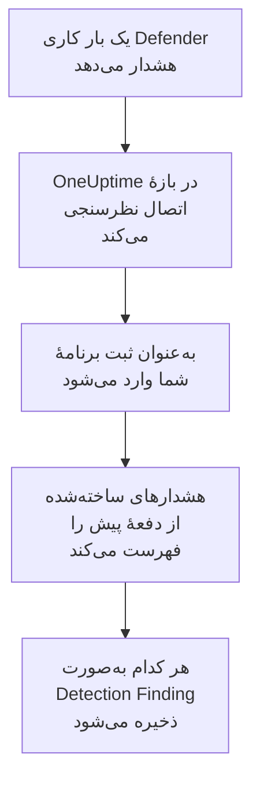

# Microsoft Defender XDR

هشدارهای همهٔ بارهای کاری [Microsoft Defender XDR](https://learn.microsoft.com/en-us/defender-xdr/)، از نقاط پایانی، هویت‌ها، ایمیل و برنامه‌های ابری، را به رویدادهای امنیتی OneUptime وارد کنید. آنجا آن‌ها را کنار لاگ‌ها، ترِیس‌ها و متریک‌هایتان جستجو می‌کنید، با هر منبع دیگری هم‌بسته می‌کنید، و برای آن‌هایی که مهم‌اند آنکال را فرا می‌خوانید. OneUptime آن‌ها را از طریق API امنیتی Microsoft Graph با یک ثبت برنامه که خودتان می‌سازید می‌خواند: نه عاملی لازم است، نه playbook و نه فضای کاری Sentinel.

:::cards
- [راه‌اندازی اتصال](#راهاندازی-اتصال): یک ثبت برنامه، یک مجوز، و فرم اتصال.
- [چه چیزی وارد می‌شود](#چه-چیزی-وارد-میشود): هر هشدار Defender چگونه به یک رویداد امنیتی تبدیل می‌شود.
- [نظرسنجی چگونه کار می‌کند](#نظرسنجی-چگونه-کار-میکند): پنجره‌ای که هر نظرسنجی می‌خواند، و اینکه یک مستأجر پرکار با آن چه می‌کند.
- [عیب‌یابی](#عیبیابی): معنای هر خطا، و آنچه باید تغییر دهید.
:::

## چگونه کار می‌کند



OneUptime هر دقیقه از هر اتصال فعالی که بازهٔ نظرسنجی‌اش گذشته باشد نظرسنجی می‌کند. یک نظرسنجی به‌عنوان ثبت برنامهٔ شما به Microsoft Entra ID وارد می‌شود، هشدارهای ساخته‌شده از نظرسنجی پیش را از Microsoft Graph می‌خواهد ([List alerts_v2](https://learn.microsoft.com/en-us/graph/api/security-list-alerts_v2))، و هر کدام را به‌صورت یک رویداد Detection Finding از [OCSF](https://schema.ocsf.io/) (کلاس `2004`) ذخیره می‌کند. از آن پس قاعده‌های تشخیص، مانیتورها و داشبوردها با آن مانند یک رویداد امنیتی از هر منبع دیگری رفتار می‌کنند.

## پیش از شروع

- در OneUptime، نقش Project Owner، Project Admin یا Security Admin. Security Member و Security Viewer می‌توانند اتصال‌ها و تاریخچهٔ اجرایشان را ببینند، اما نمی‌توانند آن‌ها را تغییر دهند.
- یک مستأجر Microsoft Entra با مجوز Microsoft Defender XDR: هر بار کاری Defender که به درگاه Microsoft Defender پیوسته باشد، مانند Defender for Endpoint، for Identity، for Office 365 یا for Cloud Apps.
- یک نقش Entra که بتواند برنامه ثبت کند، مانند Application Administrator، و یک Global Administrator یا Privileged Role Administrator برای اعطای رضایت مدیر.
- HTTPS خروجی از برنامه و کارگرهای OneUptime به `login.microsoftonline.com` و `graph.microsoft.com`، یا برای Azure Government به `login.microsoftonline.us` و `graph.microsoft.us`.

## راه‌اندازی اتصال

اتصال با [جریان اعتبارنامه‌های کلاینت OAuth 2.0](https://learn.microsoft.com/en-us/entra/identity-platform/v2-oauth2-client-creds-grant-flow) وارد می‌شود: به‌عنوان یک برنامه، هرگز به‌عنوان یک شخص، با یک مجوز برنامه.

:::steps
### ثبت یک برنامه

1. به [Azure portal](https://portal.azure.com) وارد شوید و **Microsoft Entra ID** را باز کنید.
2. به **App registrations → New registration** بروید. نامش را `OneUptime Security Events` بگذارید، **Supported account types** را روی **Accounts in this organizational directory only** نگه دارید، URI بازگشت را خالی بگذارید، و **Register** را برگزینید.
3. از صفحهٔ **Overview** برنامه، **شناسه برنامه (کلاینت)** و **شناسه دایرکتوری (مستأجر)** را کپی کنید.

### اجازهٔ خواندن هشدارها به آن

1. به **API permissions → Add a permission → Microsoft Graph → Application permissions** بروید، `SecurityAlert.Read.All` را برگزینید، و **Add permissions** را برگزینید. این کم‌امتیازترین مجوزی است که فراخوانی [List alerts_v2](https://learn.microsoft.com/en-us/graph/api/security-list-alerts_v2#permissions) برای یک برنامه می‌پذیرد: `SecurityAlert.ReadWrite.All` را اضافه نکنید.
2. برای مستأجرتان **Grant admin consent for** را برگزینید، و تأیید کنید. وضعیت مجوز باید **Granted** باشد: بدون رضایت، هر خواندنی با `403` رد می‌شود.

### ساختن یک رمز کلاینت

به **Certificates & secrets → Client secrets → New client secret** بروید، زمان انقضایش را برگزینید، و **Add** را برگزینید. پیش از ترک صفحه، **Value** رمز را کپی کنید، نه **Secret ID** آن را: این مقدار دیگر هرگز نشان داده نمی‌شود.

زمان انقضای رمز را یادداشت کنید. در آن روز، نظرسنجی با `Microsoft Defender XDR token request failed (HTTP 401)` متوقف می‌شود تا وقتی آن را با **به‌روزرسانی اطلاعات ورود** جایگزین کنید.

### افزودن اتصال در OneUptime

**محصولات** > **رویدادهای امنیتی** > **اتصال‌ها** (`/dashboard/{projectId}/security-events/connections`) را باز کنید، روی **افزودن اتصال** کلیک کنید، زیر **EDR / XDR**، **Microsoft Defender XDR** را برگزینید، و روی **بعدی** کلیک کنید. تنظیمات جدول زیر را پر کنید، روی **بعدی** کلیک کنید، و مقدار رمز را در **راز کلاینت** بچسبانید.

### آزمایش پیش از ذخیره

روی **آزمودن این تنظیمات** زیر **آزمایش پیش از ذخیره** کلیک کنید. آزمایش با مقدارهای فرم وارد می‌شود و هشدارها را می‌خواند، و چیزی ذخیره نمی‌کند، پس یک رمز نادرست یا یک رضایت جاافتاده پیش از ساخته شدن اتصال آشکار می‌شود. سپس روی **بعدی** کلیک کنید، به اتصال یک **نام** بدهید، و آن را بسازید.
:::

| تنظیم | کجا پیدایش کنید |
| --- | --- |
| **شناسه دایرکتوری (مستأجر)** | صفحهٔ **Overview** برنامه. GUID مستأجر، یا یک دامنهٔ تأییدشده مانند `contoso.onmicrosoft.com`. |
| **شناسه برنامه (کلاینت)** | صفحهٔ **Overview** برنامه. GUID برنامه‌ای که `SecurityAlert.Read.All` را دارد. |
| **ابر** | **ابر عمومی Azure**، که به Microsoft 365 GCC هم سرویس می‌دهد، یا **Azure Government (ایالات متحده)** برای GCC High (`login.microsoftonline.us` و `graph.microsoft.us`). Microsoft 365 DoD و ابر 21Vianet در چین پشتیبانی نمی‌شوند. |
| **راز کلاینت** | **Value** رمز. رمزگذاری می‌شود، API هرگز آن را برنمی‌گرداند و دیگر هرگز نشان داده نمی‌شود. آن را با **به‌روزرسانی اطلاعات ورود** روی اتصال جایگزین کنید. |

گام **فراخوانی دوره‌ای** همچنین یک **توضیحات** اختیاری دارد، **فاصله فراخوانی (دقیقه)**، یک عدد صحیح از `1` تا `1440` که با `5` شروع می‌شود، و **فعال**، که از آغاز روشن است.

## چه چیزی وارد می‌شود

هر [هشدار](https://learn.microsoft.com/en-us/graph/api/resources/security-alert) Defender XDR به یک رویداد Detection Finding تبدیل می‌شود (کلاس OCSF `2004`)، با فروشندهٔ `Microsoft` و محصول `Microsoft Defender XDR`، که به سرویس تله‌متری `Microsoft Defender XDR` نسبت داده می‌شود:

| ستون OCSF | فیلد هشدار |
| --- | --- |
| `eventUid` | `id`، شناسهٔ هشدار در Graph، که تکراری‌ها هم بر پایهٔ آن کنار گذاشته می‌شوند |
| `time` | `firstActivityDateTime`، یا اگر نباشد `createdDateTime` |
| `message`, `ruleName` | `title` |
| `ruleId` | `detectorId`، یا اگر نباشد `alertPolicyId` |
| `severityName` | `severity`: `informational`، `low`، `medium` یا `high`، و `unknown` همان Unknown می‌ماند |
| `statusName` | `status`: `new` به New تبدیل می‌شود، `inProgress` به In Progress، `resolved` به Resolved |
| `mitreTechniques` | `mitreTechniques` |
| `mitreTactics` | `categories` یا `category`، وقتی یک تاکتیک ATT&CK باشد: `CredentialAccess` به `TA0006` تبدیل می‌شود. دسته‌های دیگر در `attributes` می‌مانند. |
| `principalHost`, `principalUser`, `principalIp`, `principalProcess` | `evidence` با نقش `source`، `attacker` یا `compromised`، وگرنه نخستین مورد از هر نوع |
| `targetHost`, `targetUser`, `targetIp`, `targetResource` | `evidence` با نقشی از جنس هدف، مانند `destination` یا `attacked`. نشانی‌ها، صندوق‌های پستی و منابع ابری `targetResource` را پر می‌کنند. |
| `observables` | هر نام میزبان، IP، کاربر، نام پرونده، SHA-1 و SHA-256، نشانی، دامنه، صندوق پستی و شناسهٔ منبع در `evidence` |
| `attributes` | کل هشدار، تخت‌شده به کلیدهای نقطه‌دار مانند `evidence.0.hostName`، `serviceSource` و `incidentId` |

هشدارهای همهٔ `serviceSource`ها وارد می‌شوند، از جمله هشدارهای Microsoft Sentinel وقتی Sentinel به درگاه Defender وصل شده باشد. حادثه‌ها وارد نمی‌شوند، اما هر هشدار `incidentId` و `incidentWebUrl` خود را در `attributes` نگه می‌دارد.

## نظرسنجی چگونه کار می‌کند

هر نظرسنجی هشدارهای ساخته‌شده در پنجره‌اش را فهرست می‌کند، ۱۰۰ تا در هر صفحه، و `@odata.nextLink` در Graph را دنبال می‌کند تا کل پنجره را بخواند:

```text
GET https://graph.microsoft.com/v1.0/security/alerts_v2?$filter=createdDateTime ge {start} and createdDateTime lt {end}&$top=100
```

- **زمان ساخت، نشانگر است.** Defender اغلب هشداری را ساعت‌ها پس از `firstActivityDateTime` آن می‌سازد، و نشانگری بر پایهٔ زمان فعالیت همهٔ این هشدارها را جا می‌انداخت.
- **نخستین نظرسنجی ۲۴ ساعت به عقب نگاه می‌کند**، پس یک اتصال تازه بی‌درنگ هشدارهای اخیرش را نشان می‌دهد.
- **هر نظرسنجی بعدی ۱ دقیقه پیش از نشانگر ذخیره‌شده شروع می‌شود**، پس هشداری که روی مرز دو پنجره ساخته شود دو بار خوانده و یک بار وارد می‌شود.
- **یک نظرسنجی حداکثر ۲۴ ساعت پس از نشانگر را می‌خواند.** اتصالی که نشانگرش عقب افتاده، وقتی کارگرها از کار افتاده بودند یا مستأجر محدود شده بود، در رشته‌ای از پنجره‌های ۲۴ ساعته جبران می‌کند.
- **تکراری‌ها بر پایهٔ `id` هشدار کنار گذاشته می‌شوند**، میان رویدادهای پروژه از `Microsoft` / `Microsoft Defender XDR`، پس هم‌پوشانی، پنجره‌ای که دوباره امتحان شده و یک وارد کردن، هرگز یک هشدار را دو بار ذخیره نمی‌کنند.
- **یک اجرای شکست‌خورده چیزی را تغییر نمی‌دهد.** پس از یک خطای شبکه، یا یک وضعیت خطا از Graph، نشانگر و طول پنجره همان‌طور که بودند می‌مانند، و نظرسنجی بعدی همان پنجره را دوباره می‌خواند. تنها استثنا درخواستی است که زمانش سر رسیده: نشانگر می‌ماند، اما پنجرهٔ بعدی نصف طول می‌شود، چون پنجره‌ای که برای پاسخ به‌موقع بیش از حد سنگین است در هر تلاش به پایان زمان می‌خورد.

### وقتی یک پنجره بیش از توان یک نظرسنجی دارد

یک نظرسنجی حداکثر ۲۰ صفحهٔ ۱۰۰ هشداری را می‌خواند: ۲٬۰۰۰ هشدار. وقتی این سقف آن را پیش از پایان پنجره‌اش متوقف کند، اجرا **جزئی** است، با این هشدار:

```text
Stopped after 20 alerts requests (the per-run request limit) before reading the whole window. Microsoft Graph lists alerts newest first and documents no way to sort them oldest first, so this run cannot name a point to resume from.
```

[List alerts_v2](https://learn.microsoft.com/en-us/graph/api/security-list-alerts_v2) پارامترهای `$filter`، `$top`، `$skip` و `$count` را مستند می‌کند، اما `$orderby` را نه، و تازه‌ترین هشدارها را اول برمی‌گرداند. ۲٬۰۰۰ هشداری که یک اجرای متوقف‌شده خوانده، تازه‌ترین‌های پنجره‌اش هستند، پس بردن نشانگر به پس از آن‌ها، هشدارهای قدیمی‌تری را که هرگز به آن‌ها نرسیده جا می‌انداخت. OneUptime به جای آن پنجره را کوتاه می‌کند:

1. **باریک کردن.** نظرسنجی بعدی پنجره‌ای به نصف طول را از همان نقطهٔ شروع می‌خواند، و تا وقتی پنجره‌ای کامل خوانده شود دوباره نصف می‌کند، تا حداقل یک دقیقه. هشدار اجرا همین را می‌گوید: `This window holds more records than one poll can read; the next poll reads a {n} minute window from the same starting point.` هشدارهایی که پیش‌تر از پنجرهٔ بلندتر وارد شده‌اند به‌عنوان تکراری رد می‌شوند.
2. **دوباره بزرگ کردن.** پس از اینکه پنجره‌ای کامل خوانده شد، نشانگر به انتهای آن می‌رود، و پنجرهٔ بعدی دوباره دو برابر می‌شود، تا ۲۴ ساعت.
3. **گذشتن از یک دقیقهٔ تنها.** اگر حتی یک دقیقه بیش از ۲٬۰۰۰ هشدار داشته باشد، نظرسنجی از آن می‌گذرد، تا هشدارهای تازه‌تر همچنان برسند. اجرا **جزئی** می‌ماند، و **آخرین خطا** این را نشان می‌دهد: `More records were created in the one minute from {cursor} to {end} than one poll can read. Polling moved past this minute so newer records keep arriving; use Import this time range in Diagnostics on this minute to recover what one run can read.` آن دقیقه را با **Import this time range** وارد کنید تا آنچه یک اجرا می‌تواند بخواند بازیابی شود.

اجرایی که به دلیل دیگری **جزئی** باشد، مانند هشداری که نتوانسته به یک رویداد امنیتی خوانده شود، به همین شکل و از همان نقطهٔ شروع دوباره امتحان می‌شود. تغییر **فاصله فراخوانی (دقیقه)** هیچ‌کدام از این‌ها را تغییر نمی‌دهد: این تنظیم تعیین می‌کند یک نظرسنجی هر چند وقت شروع شود، نه اینکه پنجره‌اش از کجا شروع شود.

### اجرا، پیش‌نمایش و وارد کردن در صورت نیاز

روی **عیب‌یابی** یک اتصال کلیک کنید تا اجراهای اخیرش را ببینید و دستی با آن کار کنید. هر کسی که بتواند اتصال را تغییر دهد می‌تواند این‌ها را شروع کند؛ هر کسی که بتواند آن را ببیند می‌تواند تاریخچه را بخواند.

- **اجرای اکنون** بی‌درنگ یک نظرسنجی با نشانگر معمول شروع می‌کند، حتی وقتی اتصال **فعال** نیست.
- **Preview alerts** یک بازهٔ زمانی تا ۷ روز را می‌خواند و چیزی وارد نمی‌کند.
- **Import this time range** پس از تأیید شما بازه‌ای تا ۷ روز را وارد می‌کند، بی‌آنکه نشانگر را جابه‌جا کند. هشدارهایی که پیش‌تر وارد شده‌اند رد می‌شوند.
- **Copy diagnostics** روی یک اجرا، گزارش آن را برای پشتیبانی کپی می‌کند. هرگز اعتبارنامه‌ها را در بر ندارد.

## آزمایش اتصال

**آزمایش اتصال** در ردیف یک اتصال، و **آزمودن این تنظیمات** در فرم، در فرایند API اجرا می‌شوند، نه در یک کارگر پس‌زمینه، پس یک آزمایش حتی وقتی مشکل از کارگرهاست هم پاسخ می‌دهد. این بررسی‌ها را به ترتیب انجام می‌دهد:

| بررسی | چه چیزی را بررسی می‌کند |
| --- | --- |
| **پیکربندی** | چهار تنظیم موجود و درست‌شکل‌اند. وقتی این شکست بخورد با هیچ جایی تماس گرفته نمی‌شود. |
| **Authenticate with Microsoft Entra** | Microsoft Entra ID در ابری که برگزیدید، برای Microsoft Graph یک توکن صادر می‌کند. با رمز نادرست یا منقضی، مستأجر یا شناسهٔ کلاینت نادرست، یا ابر نادرست شکست می‌خورد. |
| **Read alerts from Microsoft Graph** | یک هشدار ساخته‌شده در ۲۴ ساعت گذشته خوانده می‌شود (`$top=1`). یک `403` در اینجا یعنی مجوز `SecurityAlert.Read.All` نیست، رضایت مدیر نیست، یا مستأجر Defender XDR ندارد. |
| **Alerts available to import** | چند هشدار در ۲۴ ساعت گذشته و ۷ روز گذشته ساخته شده، هر کدام با یک صفحهٔ ۱۰۰ تایی، پس `100+` یعنی بیشتر. هیچ هشداری در ۷ روز یک هشدار است، نه یک شکست. |
| **Background workers**، **Poll scheduler**، **Security event storage** | سمت خود OneUptime: فرایندی کارهای صف Worker را برمی‌دارد، کار نظرسنجی هر دقیقه اجرا می‌شود، و انبارهٔ رویدادهای امنیتی پاسخ می‌دهد. |
| **Scheduled polling** | برای یک اتصال ذخیره‌شده: نظرسنجی روشن است، هیچ اجرایی در انتظار یک کارگر گیر نکرده، و نظرسنجی‌ها به‌موقع اجرا می‌شوند. |

هر درخواست در یک آزمایش مهلتی ۲۰ ثانیه‌ای دارد. یک آزمایش هرگز چیزی وارد نمی‌کند یا نشانگر را جابه‌جا نمی‌کند، و هر بررسی شکست‌خورده می‌گوید چه چیزی را تغییر دهید.

## عیب‌یابی

**آخرین خطا** اتصال پیام خطای کامل را، با اعتبارنامه‌های پوشانده‌شده، پشت پیشوندی نگه می‌دارد که گام شکست‌خورده را نام می‌برد. وقتی اتصالی خطا دارد، برای خواندنش **مشاهده خطا** را در ستون **اقدام‌ها** آن برگزینید، و برای کپی کردنش **کپی خطا** را در کادر گفتگو. اول پیشوند را بخوانید.

:::details Last Error با `Microsoft Defender XDR token request` شروع می‌شود
- `Microsoft Defender XDR token request failed (HTTP ...)`: Microsoft Entra ID از صدور توکن خودداری کرد، پس هرگز با Graph تماس گرفته نشد. پیام با راهنمایی‌ای بر پایهٔ کد `error` در Entra تمام می‌شود:
  - `invalid_client` (`AADSTS7000215`): رمز نادرست، منقضی، یا متعلق به برنامهٔ دیگری است. یک رمز تازه زیر **Certificates & secrets** بسازید، و آن را با **به‌روزرسانی اطلاعات ورود** ذخیره کنید.
  - `unauthorized_client` (`AADSTS700016`): **شناسه برنامه (کلاینت)** در آن **شناسه دایرکتوری (مستأجر)** نیست، یا **ابر** نادرست است.
  - `AADSTS90002`: چنین مستأجری وجود ندارد.
  - `invalid_scope`: دامنهٔ Graph در ابری که برگزیدید وجود ندارد. **ابر** را بررسی کنید.
- `Microsoft Defender XDR token request returned ...`: Microsoft Entra ID با چیزی بی‌استفاده پاسخ داد، بدنه‌ای که JSON نیست یا `access_token` ندارد. این معمولاً یک پراکسی یا دروازه در میانه است، نه اعتبارنامه‌ها.
- `Microsoft Defender XDR token request did not complete: ...`: به نقطهٔ پایانی توکن نمی‌شد رسید، یا به‌موقع پاسخ نداد. HTTPS خروجی را از برنامه و کارگرهای OneUptime به `login.microsoftonline.com`، یا `login.microsoftonline.us` بررسی کنید.
:::

:::details Last Error با `Microsoft Defender XDR alerts request` شروع می‌شود
- `Microsoft Defender XDR alerts request failed (HTTP ...)`: Graph از فهرست کردن هشدارها خودداری کرد. پیام کد خطای Graph و یک راهنمایی را نام می‌برد:
  - `403` (`Authorization_RequestDenied`): `SecurityAlert.Read.All` یا رضایت مدیر آن نیست، یا مستأجر مجوز Defender XDR ندارد. اعمال شدن رضایت چند دقیقه طول می‌کشد.
  - `401` (`InvalidAuthenticationToken`) پس از صدور یک توکن: معمولاً **ابر** با مستأجر جور نیست.
  - `429` (`TooManyRequests`): Graph برنامه را محدود می‌کند، و نظرسنجی بعدی همان پنجره را دوباره می‌خواند. پیام نمی‌تواند `Retry-After` در Graph را نقل کند، چون کلاینت HTTP در OneUptime هنگام خطا هیچ سرآیند پاسخی نگه نمی‌دارد. اگر تکرار شد، **فاصله فراخوانی (دقیقه)** را بالا ببرید.
  - `5xx`: مشکلی در سمت Graph. نظرسنجی بعدی دوباره تلاش می‌کند.
  - `400`: Graph پرس‌وجو را اجرا نکرد، که OneUptime آن را می‌سازد، نه تنظیمات شما. پیام را برای پشتیبانی OneUptime کپی کنید.
- `Microsoft Defender XDR alerts request returned ...`: Graph با `200` پاسخ داد، اما با چیزی که رابط نمی‌توانست به کار ببرد: بدنه‌ای که JSON نیست، بدون فهرست `value`، یا یک `@odata.nextLink` که پیوند `https://` روی میزبان Graph ابر شما نیست. چنین پیوندی رد می‌شود، پس توکن هرگز به جای دیگری فرستاده نمی‌شود. این گزارش می‌شود به جای اینکه یک پنجرهٔ خالی به حساب آید، پس نشانگر هرگز از هشدارهایی که کسی نخوانده جلوتر نمی‌رود.
- `Microsoft Defender XDR alerts request did not complete: ...`: به Graph نمی‌شد رسید، یا به‌موقع پاسخ نداد: ۶۰ ثانیه برای یک نظرسنجی، ۲۰ برای یک آزمایش. HTTPS خروجی را به `graph.microsoft.com`، یا `graph.microsoft.us` بررسی کنید.
:::

:::details آزمایش موفق است، اما Last Polled برابر Never است
کار نظرسنجی هرگز اجرا نشده است. بررسی‌های **Background workers** و **Poll scheduler** را بخوانید. در یک نصب خودمیزبان، علت معمول `DISABLE_QUEUE_WORKERS=true` روی برنامه است، بدون استقرار کارگر جداگانه‌ای که کارها را بردارد: آن را روی `false` بگذارید، یا استقرار کارگر را اجرا کنید (Helm: `worker.enabled: true`، که به‌طور پیش‌فرض `false` است).
:::

:::details نظرسنجی‌ها موفق‌اند، اما هشداری که می‌شناسید نیست
`createdDateTime` هشدار را در درگاه Defender با پنجرهٔ اجرا در **عیب‌یابی** مقایسه کنید: پنجره‌ها بر پایهٔ زمان ساخت‌اند، نه زمان فعالیت.

- هشداری که پیش از ساخته شدن اتصال ساخته شده، از نخستین نگاه ۲۴ ساعته به عقب قدیمی‌تر است. آن را با **Import this time range** وارد کنید.
- یک اجرای **جزئی** با سقف ۲٬۰۰۰ هشدار متوقف شده است. نظرسنجی بعدی پنجره‌ای کوتاه‌تر را از همان شروع می‌خواند، پس هشدار وقتی وارد می‌شود که پنجره‌ای که آن را در خود دارد کامل خوانده شود.
- اگر **آخرین خطا** دقیقه‌ای را نام می‌برد که نظرسنجی از آن گذشته، آن دقیقه را با **Import this time range** وارد کنید.
:::

:::details یک هشدار دو بار ظاهر می‌شود
هم‌پوشانی ۱ دقیقه‌ای این کار را نمی‌کند: خواندن دوم تکراری شمرده می‌شود و ذخیره نمی‌شود. دو رویداد با `eventUid` یکسان زیر محصولات مختلف وارد شده‌اند، مانند همان هشدار که از طریق یک اتصال Microsoft Sentinel هم رسیده است. تکراری‌ها بر پایهٔ فروشنده و محصول کنار گذاشته می‌شوند.
:::

## چه به دست می‌آورید

- **جستجو.** هشدارهای Defender را در کاوشگر رویدادهای امنیتی، کنار لاگ‌ها و متریک‌های همان میزبان، بر پایهٔ شدت، وضعیت، تکنیک MITRE، میزبان، کاربر، IP یا هر observable پالایش کنید.
- **هم‌بسته‌سازی.** شواهد هر هشدار، یعنی دستگاه‌ها، کاربران، IPها، پرونده‌ها و نشانی‌هایش، به‌صورت observable نمایه می‌شوند، پس یک جستجو در همهٔ منابع هر چیزی را که به یک میزبان اشاره می‌کند پیدا می‌کند.
- **قاعده‌های تشخیص.** قاعده‌های Sigma که بر اساس زمان‌بندی روی رویدادهای امنیتی شما اجرا می‌شوند، و هشدارهایی باز می‌کنند که آنکال را فرا می‌خوانند.
- **مانیتورها.** مانیتورهای رویدادهای امنیتی رویدادهای جور را می‌شمارند، و پس از گذشتن از یک آستانه حادثه یا هشدار باز می‌کنند.

رویدادهای امنیتی مانند بقیهٔ تله‌متری شما، بر اساس هر گیگابایت دریافت‌شده صورت‌حساب می‌شوند. [قیمت‌گذاری](https://oneuptime.com/pricing) را ببینید.

## گام‌های بعدی

:::cards
- [رویدادهای امنیتی](/docs/telemetry/security-events): آنچه را وارد می‌کنید جستجو و هم‌بسته کنید و روی آن هشدار بگیرید.
- [Microsoft Sentinel](/docs/integrations/microsoft-sentinel): حادثه‌های یک فضای کاری Sentinel را هم وارد کنید.
- [نقش‌ها](/docs/permissions/reference#نقشها): آنچه نقش‌های Security می‌توانند ببینند و تغییر دهند.
- [نمای کلی یکپارچه‌سازی‌ها](/docs/integrations/index): ابزارهای دیگری که می‌توانید وصل کنید.
:::
