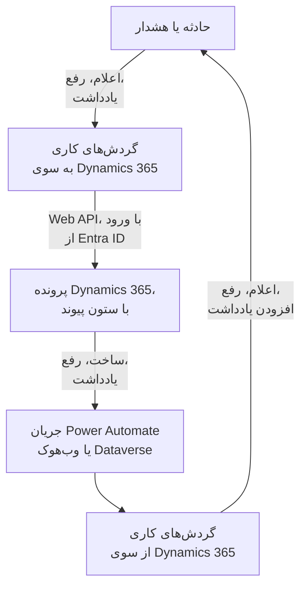

# Microsoft Dynamics 365

پرونده‌های (case) [Microsoft Dynamics 365](https://www.microsoft.com/dynamics-365) را با حادثه‌ها و هشدارهای OneUptime در هر دو جهت هماهنگ نگه دارید. قالب‌های آماده گردش کاری برای هر حادثه یا هشدار یک پرونده باز می‌کنند، وقتی رکورد رفع شد آن را می‌بندند و یادداشت‌ها را در آن کپی می‌کنند. قالب‌های دیگر از پرونده‌های تازه حادثه اعلام می‌کنند و رفع‌ها و یادداشت‌ها را برمی‌گردانند. هیچ افزونه‌ای در کار نیست: گردش‌های کاری Dataverse Web API را فرا می‌خوانند، و Dynamics 365 نشانی‌های وب‌هوک آن‌ها را.

:::cards
- [آماده کردن Dynamics 365](#آماده-کردن-dynamics-365): یک ثبت برنامه، یک کاربر برنامه و یک ستون پیوند.
- [شروع از یک قالب](#شروع-از-یک-قالب): ۱۳ قالب، آنچه می‌پرسند، و چگونگی راه‌اندازی‌شان.
- [قالب‌ها چگونه کار می‌کنند](#قالبها-چگونه-کار-میکنند): پرونده‌ها و رکوردها چگونه بدون حلقه به هم وصل می‌مانند.
- [خودتان بسازید](#خودتان-بسازید): هر جهت به‌صورت دستی، برای وقتی که قالبی مناسب نیست.
:::

## چگونه کار می‌کند



هر قالب یک گردش کاری کوچک است، پس فقط جهت‌هایی را برمی‌دارید که می‌خواهید، برای حادثه‌ها، هشدارها یا هر دو. قالب‌های OneUptime به Dynamics 365، Dataverse Web API را فرا می‌خوانند و از طریق Microsoft Entra ID به عنوان یک برنامه وارد می‌شوند. قالب‌های Dynamics 365 به OneUptime وقتی شروع می‌شوند که یک جریان Power Automate یا یک وب‌هوک Dataverse آن‌ها را فرا بخواند. یک ستون متنی که به جدول Case اضافه می‌کنید، هر پرونده را به رکوردش وصل می‌کند.

## پیش از شروع

- یک محیط Dynamics 365 با جدول **Case**. پرونده‌ها از Dynamics 365 Customer Service می‌آیند: یک محیط Dataverse بدون آن، جدول `incident`ی برای نوشتن ندارد.
- اجازه ثبت یک برنامه در **Microsoft Entra ID**، و ساختن یک کاربر برنامه در محیط. این دو اغلب دو مدیر متفاوت‌اند.
- در OneUptime، اجازه ساختن گردش کاری. در OneUptime Cloud، گردش‌های کاری به طرح **Growth** یا بالاتر نیاز دارند.

> [!NOTE]
> این صفحه نام‌های Dataverse را به کار می‌برد، نه برچسب‌های فرم‌های Dynamics را. یک پرونده جدول `incident` است، مجموعه آن در یک نشانی `incidents` است، کلیدش `incidentid` است و ستون عنوانش `title`. شماره پرونده‌ای که می‌بینید `ticketnumber` است.

## آماده کردن Dynamics 365

هم قالب‌ها و هم گردش کاری‌ای که خودتان می‌سازید به این‌ها نیاز دارند. OneUptime با جریان اعتبارنامه کلاینت OAuth 2.0 به عنوان یک برنامه وارد می‌شود، نه به عنوان یک شخص.

:::steps
### ثبت یک برنامه در Microsoft Entra ID

1. به عنوان مدیر مستأجر (tenant) محیط Dynamics خود وارد [Azure portal](https://portal.azure.com) شوید، و **Microsoft Entra ID** را باز کنید.
2. به **App registrations → New registration** بروید. نامش را `OneUptime Integration` بگذارید، **Supported account types** را روی **Accounts in this organizational directory only** نگه دارید، و **Register** را برگزینید.
3. از صفحه **Overview** برنامه، **Application (client) ID** و **Directory (tenant) ID** را کپی کنید.
4. به **Certificates & secrets → Client secrets → New client secret** بروید، و پیش از ترک صفحه، **Value** راز را کپی کنید، نه شناسه‌اش را: دیگر هرگز نشان داده نمی‌شود. یک راز کلاینت حداکثر ۲۴ ماه عمر می‌کند، پس زمان انقضایش را یادداشت کنید.

هیچ مجوز API اضافه نکنید و هیچ رضایت مدیر ندهید: بدون کاربر واردشده، کاری انجام نمی‌دهند. Dynamics 365 از طریق کاربر برنامه تصمیم می‌گیرد که برنامه چه کاری می‌تواند انجام دهد.

### ساختن کاربر برنامه

1. در [مرکز مدیریت Power Platform](https://admin.powerplatform.microsoft.com/)، **Manage → Environments** و سپس محیط خود را برگزینید.
2. **Settings → Users + permissions → Application users** و سپس **+ New app user** و **+ Add an app** را برگزینید. ثبت برنامه را انتخاب کنید و **Add** را برگزینید.
3. یک **Business unit** برگزینید، سپس با نماد ویرایش کنار **Security roles** یک نقش امنیتی سفارشی به آن بدهید. در سطح Organization، این نقش به این‌ها نیاز دارد:
   - **Case**: Create، Read، Write، Append و Append To.
   - **Note**: Create، Read و Append، برای قالب‌های یادداشت.
   - **Activity**: Create، Read و Append، چون بستن یک پرونده یک Case Resolution ثبت می‌کند که یک فعالیت است.
   - **Account**، و اگر پرونده‌ها به نام یک مخاطب ثبت می‌شوند **Contact**: Read و Append To.
4. **Save** و سپس **Create** را برگزینید.

یک کاربر برنامه فقط می‌تواند نقش سفارشی داشته باشد: یک نقش موجود را کپی کنید و آن را کوچک کنید. بدون این کاربر، Microsoft Entra ID باز هم توکن صادر می‌کند، اما هر فراخوانی Dynamics 365 با `403` و `0x80072560` شکست می‌خورد: «The user isn't a member of the organization.»

### افزودن یک ستون پیوند به جدول Case

Dataverse چیزی شبیه برچسب‌های Jira ندارد، پس یک پرونده و یک رکورد OneUptime یکدیگر را از طریق ستونی که اضافه می‌کنید پیدا می‌کنند.

1. در [make.powerapps.com](https://make.powerapps.com) محیط خود را برگزینید، **Tables → Case → Columns** را باز کنید، و **New column** را برگزینید.
2. نامش را `OneUptime Link` بگذارید، **Data type** را روی **Single line of text** نگه دارید، و ذخیره کنید. بیشینه طول پیش‌فرض ۱۰۰ کافی است: قالب‌ها حداکثر ۵۵ نویسه می‌نویسند.
3. ستون تازه را باز کنید و **Logical name** آن را کپی کنید، مانند `new_oneuptimelink`. پیشوند از ناشر راه‌حل شما می‌آید، پس ممکن است مال شما فرق کند، مانند `cr4f2_oneuptimelink`.

اگر کارشناسان باید پیوند را ببینند، ستون را به فرم Case اضافه کنید.
:::

## شروع از یک قالب

پنجره **ساخت یک گردش کاری** در فهرست دسته‌هایش، زیر **Dynamics 365**، ۱۳ قالب Dynamics 365 دارد: هفت قالب برای حادثه‌ها، سپس شش قالب برای هشدارها، هر دسته زیر عنوان خودش. همه ستون پیوند را به اشتراک می‌گذارند، پس هر ترکیبی از آن‌ها با هم کار می‌کند.

### قالب‌های حادثه

| قالب | کاری که می‌کند | آنچه می‌پرسد |
| --- | --- | --- |
| **از OneUptime به Dynamics 365** | | |
| Create a Dynamics 365 case when an incident is declared | برای هر حادثه تازه یک پرونده باز می‌کند، با اولویتی که از شدت آن انتخاب شده و شناسه حادثه در ستون پیوند. حادثه‌هایی که از Dynamics 365 اعلام شده‌اند، و حادثه‌های خصوصی، نادیده گرفته می‌شوند. | پنج تنظیم Dynamics 365، مشتری پرونده‌های تازه، و نشانی OneUptime |
| Resolve the Dynamics 365 case when the incident is resolved | وقتی حادثه رفع شد، پرونده وصل‌شده را به صورت **Problem Solved** می‌بندد، و مانند رفع دستی یک Case Resolution ثبت می‌کند. هرگز پرونده‌ای را دوباره باز نمی‌کند. | پنج تنظیم Dynamics 365 |
| Copy incident private notes to the Dynamics 365 case | هر یادداشت خصوصی تازه را به صورت یک یادداشت به پرونده وصل‌شده اضافه می‌کند. | پنج تنظیم Dynamics 365 |
| Copy incident public notes to the Dynamics 365 case | هر یادداشت عمومی تازه را به صورت یک یادداشت به پرونده وصل‌شده اضافه می‌کند، تا کارشناسان بتوانند آنچه صفحه وضعیت می‌گوید را به مشتریان بگویند. | پنج تنظیم Dynamics 365 |
| **از Dynamics 365 به OneUptime** | | |
| Declare an incident when a Dynamics 365 case is created | برای هر پرونده تازه یک حادثه اعلام می‌کند که از صفحه‌های وضعیت شما دور نگه داشته می‌شود، با شدتی که از اولویت پرونده انتخاب شده، سپس شناسه حادثه را در ستون پیوند پرونده می‌نویسد. | پنج تنظیم Dynamics 365، و یک جریان یا وب‌هوک برای پرونده‌های تازه |
| Resolve the incident when its Dynamics 365 case is resolved | وقتی پرونده وصل‌شده رفع شد، حادثه را رفع می‌کند. | پنج تنظیم Dynamics 365، و یک جریان یا وب‌هوک برای تغییرات وضعیت پرونده |
| Add Dynamics 365 case notes to the incident as private notes | هر یادداشتی را که یک کارشناس به یک پرونده وصل‌شده اضافه می‌کند، به صورت یادداشت خصوصی روی حادثه کپی می‌کند. | پنج تنظیم Dynamics 365، و یک جریان یا وب‌هوک برای یادداشت‌های تازه |

### قالب‌های هشدار

قالب‌های هشدار همان کارها را برای هشدارها انجام می‌دهند. یکی کمتر است، چون هشدارها یادداشت عمومی ندارند، و **Create an alert when a Dynamics 365 case is created** هیچ تنظیم صفحه وضعیتی نمی‌نویسد، چون یک هشدار هرگز به صفحه وضعیت نمی‌رسد.

| قالب | کاری که می‌کند | آنچه می‌پرسد |
| --- | --- | --- |
| **از OneUptime به Dynamics 365** | | |
| Create a Dynamics 365 case when an alert is created | برای هر هشدار تازه یک پرونده باز می‌کند، از جمله هر هشداری که یک مانیتور برمی‌انگیزد. هشدارهایی که از Dynamics 365 ساخته شده‌اند، و هشدارهای خصوصی، نادیده گرفته می‌شوند. | پنج تنظیم Dynamics 365، مشتری پرونده‌های تازه، و نشانی OneUptime |
| Resolve the Dynamics 365 case when the alert is resolved | وقتی هشدار رفع شد، پرونده وصل‌شده را به صورت **Problem Solved** می‌بندد. | پنج تنظیم Dynamics 365 |
| Copy alert private notes to the Dynamics 365 case | هر یادداشت خصوصی تازه را به صورت یک یادداشت به پرونده وصل‌شده اضافه می‌کند. | پنج تنظیم Dynamics 365 |
| **از Dynamics 365 به OneUptime** | | |
| Create an alert when a Dynamics 365 case is created | برای هر پرونده تازه یک هشدار می‌سازد، با شدتی که از اولویت پرونده انتخاب شده، سپس شناسه هشدار را در ستون پیوند پرونده می‌نویسد. | پنج تنظیم Dynamics 365، و یک جریان یا وب‌هوک برای پرونده‌های تازه |
| Resolve the alert when its Dynamics 365 case is resolved | وقتی پرونده وصل‌شده رفع شد، هشدار را رفع می‌کند. | پنج تنظیم Dynamics 365، و یک جریان یا وب‌هوک برای تغییرات وضعیت پرونده |
| Add Dynamics 365 case notes to the alert as private notes | هر یادداشتی را که یک کارشناس به یک پرونده وصل‌شده اضافه می‌کند، به صورت یادداشت خصوصی روی هشدار کپی می‌کند. | پنج تنظیم Dynamics 365، و یک جریان یا وب‌هوک برای یادداشت‌های تازه |

هیچ‌یک از قالب‌های OneUptime به Dynamics 365 حادثه‌ای را که **حادثه خصوصی** علامت خورده، یا هشداری را که **هشدار خصوصی** علامت خورده، به Dynamics 365 نمی‌فرستد: نه رکورد را، نه وضعیتش را، نه یادداشت‌هایش را، مگر اینکه این را روشن کنید. [تغییر کاری که یک قالب انجام می‌دهد](#تغییر-کاری-که-یک-قالب-انجام-میدهد) را ببینید.

**مانیتورها خودشان هشدار برمی‌انگیزند، و ممکن است بسیار زیاد برانگیزند.** **Create a Dynamics 365 case when an alert is created** برای هر یک پرونده باز می‌کند. مگر اینکه هر هشداری ارزش یک پرونده را داشته باشد، میان تریگر و بقیه گردش کاری یک بلوک **If / Else** بگذارید، مثلاً روی `{{local.components.alert-on-create-1.returnValues.model.alertSeverity.name}}`، و فقط سمت **Yes** آن را به ادامه وصل کنید.

### آنچه قالب‌ها می‌پرسند

گام **پیکربندی** در جادوگر ساخت، حداکثر هفت مقدار می‌پرسد: هر قالب پنج مقدار نخست، یعنی تنظیمات Dynamics 365، را می‌پرسد، و دو قالب ساخت پرونده دو مقدار آخر را هم. پیش از ساختن هر چیزی شکل هر تنظیم Dynamics 365 را بررسی می‌کند، و می‌گوید به جایش چه بنویسید، چون مقداری با شکل نادرست تا یک اجرا هیچ جا خطا نیست.

- **Dynamics 365 Environment URL** — نشانی محیط شما، مانند `https://yourorg.crm.dynamics.com`، از [مرکز مدیریت Power Platform](https://admin.powerplatform.microsoft.com/) زیر **Environments**، محیط شما، **Environment URL**. فقط نشانی: نه نقطه پایانی Web API که به `/api/data/v9.2` ختم می‌شود، و بدون اسلش در پایان.
- **Directory (Tenant) ID** — از صفحه **Overview** ثبت برنامه.
- **Application (Client) ID** — از همان صفحه.
- **Client Secret Value** — **Value** راز کلاینت از **Certificates & secrets**. نه **Secret ID** آن که یک GUID است: جادوگر یک GUID را اینجا رد می‌کند.
- **Case Link Column** — نام منطقی ستون پیوند، مانند `new_oneuptimelink`.
- **Customer for New Cases** — فقط دو قالب ساخت پرونده آن را می‌پرسند. هر پرونده به یک مشتری نیاز دارد، و یک حادثه OneUptime مشتری ندارد، پس همه پرونده‌های تازه به نام یک مشتری ثبت می‌شوند: شناسه یک حساب (account) را بچسبانید، یا برای یک مخاطب `contacts(<id>)` را. رکورد را در Dynamics 365 باز کنید: شناسه‌اش بخشی از نشانی پس از `id=` است.
- **OneUptime URL** — فقط دو قالب ساخت پرونده آن را می‌پرسند: نشانی‌ای که OneUptime را در آن باز می‌کنید، مانند `https://oneuptime.com`. توضیحات پرونده با آن به حادثه یا هشدار پیوند برمی‌گردد.

**قالب‌ها چگونه وارد می‌شوند.** جادوگر مستأجر، شناسه کلاینت و راز را در یک [متغیر OAuth 2.0](/docs/workflows/variables#متغیرهای-oauth-20-توکنهایی-که-خودشان-را-تازه-میکنند)، یعنی `dynamicsAccessToken`، زیر **متغیرهای گردش کاری** گردش کاری ذخیره می‌کند: Client Credentials، نشانی توکن `https://login.microsoftonline.com/<tenant>/oauth2/v2.0/token`، دامنه `<environment URL>/.default`، و راز کلاینت که در بدنه درخواست فرستاده و رمزگذاری‌شده ذخیره می‌شود. هر فراخوانی Dynamics 365 سرآیند `Authorization: Bearer {{local.variables.dynamicsAccessToken}}` را می‌فرستد. OneUptime توکن را نخستین باری که گامی به آن نیاز دارد می‌گیرد، پیش از انقضایش توکن تازه‌ای می‌گیرد، و در لاگ‌های اجرا و ردگیری گام‌ها آن را با `[REDACTED]` جایگزین می‌کند.

برای بررسی ورود پیش از اجرای هر چیزی، **متغیرهای گردش کاری** را باز کنید، روی **مشاهده** در `dynamicsAccessToken` کلیک کنید، و روی **تازه‌سازی فوری** کلیک کنید. **Access Token Fetched** یعنی ثبت برنامه درست است. در غیر این صورت خطای Microsoft Entra ID نام می‌برد چه چیزی نادرست است، مانند `AADSTS7000215: Invalid client secret provided`.

هر گردش کاری نسخه خودش را نگه می‌دارد. وقتی راز کلاینت را جایگزین می‌کنید، `dynamicsAccessToken` را در هر گردش کاری Dynamics 365 باز کنید و از **به‌روزرسانی اطلاعات ورود** استفاده کنید.

### ساختن گردش‌های کاری

:::steps
1. **گردش‌های کاری** > **ساخت گردش کاری** را باز کنید. زیر **یا از یک قالب شروع کنید**، **Dynamics 365** را از فهرست دسته‌ها برگزینید، یا `Dynamics` را در **جستجو در قالب‌ها…** بنویسید، و روی قالبی که می‌خواهید کلیک کنید. قالب باز می‌شود و نشان می‌دهد چه می‌کند و چه تنظیماتی خواهد پرسید. روی **استفاده از این قالب** کلیک کنید.
2. **نام** از روی قالب پر می‌شود. اگر خواستید آن را تغییر دهید.
3. **پیکربندی** مقدارهای بالا را می‌پرسد.
4. روی **ساخت گردش کاری** کلیک کنید. هر گردش کاری خاموش ساخته می‌شود: در بالای **سازنده** آن گزینه **فعال** را روشن کنید.
:::

با **Create a Dynamics 365 case when an incident is declared**، یا برای هشدارها با **Create a Dynamics 365 case when an alert is created**، شروع کنید: هر قالب دیگر OneUptime به Dynamics 365 از همان نوع، پرونده را با پیوندی که این یکی می‌نویسد پیدا می‌کند. آن را روشن کنید، یک حادثه آزمایشی اعلام کنید یا یک هشدار آزمایشی بسازید، و در گردش کاری **لاگ‌ها** > **اجراها** را باز کنید. اجرا باید با **اجراشده** تمام شود، و **Response Body** آخرین گام آن، `create-case-1`، `ticketnumber` پرونده تازه را دارد، مانند `CAS-01001-X1Y2Z3`.

### وصل کردن قالب‌های Dynamics 365 به OneUptime

قالب‌های Dynamics 365 به OneUptime، سه برای حادثه‌ها و سه برای هشدارها، با یک [تریگر Webhook](/docs/workflows/triggers#webhook) شروع می‌شوند، پس باید به Dynamics 365 گفت رویدادهایش را کجا بفرستد. این کار را به این ترتیب انجام دهید:

1. گردش کاری را بسازید و **اول آن را روشن کنید**. گردش کاری خاموش تحویل‌ها را رد می‌کند، و آن‌ها در صف نمی‌مانند.
2. **سازنده** گردش کاری را باز کنید، روی بلوک تریگر **Webhook** (`webhook-1`) کلیک کنید، و روی **کپی نشانی** در بالای تنظیماتش کلیک کنید. نشانی چیزی شبیه این است:

   ```text
   https://<your OneUptime host>/workflow/trigger/<webhook secret key>
   ```

3. کاری کنید که Dynamics 365 به آن بفرستد، از یک جریان Power Automate یا از یک وب‌هوک Dataverse.

هر قالب فقط باید بداند کدام ردیف تغییر کرده است. پیش از هر کاری آن ردیف را دوباره از Dynamics 365 می‌خواند، پس هرگز عنوان، وضعیت یا پیوند یک پرونده را از درخواست نمی‌گیرد، و برایش فرقی نمی‌کند کدام یک از این دو آن را بفرستد.

:::tabs
@tab Power Automate flow
در [Power Automate](https://make.powerautomate.com)، یک **Automated cloud flow** با تریگر **When a row is added, modified or deleted** از **Microsoft Dataverse** بسازید، که مانند زیر تنظیم شده، با **Scope** روی **Organization**. کنش داخلی **HTTP** را اضافه کنید: **Method** برابر `POST`، **URI** برابر نشانی گردش کاری، یک سرآیند `Content-Type: application/json`، و بدنه زیر، با شناسه ردیف که از محتوای پویای تریگر برگزیده شده است.

| قالب | Change type | Table name | Select columns | Body |
| --- | --- | --- | --- | --- |
| اعلام یک حادثه / ساختن یک هشدار وقتی پرونده‌ای ساخته شد | Added | Cases | | `{"PrimaryEntityId": "<Case>"}` |
| رفع حادثه / هشدار وقتی پرونده‌اش رفع شد | Modified | Cases | `statecode,statuscode` | `{"PrimaryEntityId": "<Case>"}` |
| افزودن یادداشت‌های پرونده به حادثه / هشدار به صورت یادداشت خصوصی | Added | Notes | | `{"PrimaryEntityId": "<Note>"}` |

برای فرستادن فقط برخی پرونده‌ها، از **Filter rows** تریگر استفاده کنید، مانند `prioritycode eq 1` برای پرونده‌های با اولویت High. بدنه ردیف را با `PrimaryEntityId` نام می‌برد، همان‌طور که یک وب‌هوک Dataverse نام می‌برد: قالب‌ها خود ردیف را دوباره از Dynamics 365 می‌خوانند.
@tab Dataverse webhook
نشانی را با [Plug-in Registration Tool](https://learn.microsoft.com/en-us/power-apps/developer/data-platform/register-web-hook) ثبت کنید: **Register New WebHook**، با احراز هویت **HttpHeader** و یک سرآیند از خودتان؛ خود نشانی راز است. سپس برای هر رویداد زیر یک گام روی آن ثبت کنید، با **Event Pipeline Stage of Execution** روی **PostOperation** و **Execution Mode** روی **Asynchronous**.

| قالب | Message | Primary Entity | Filtering Attributes |
| --- | --- | --- | --- |
| اعلام یک حادثه / ساختن یک هشدار وقتی پرونده‌ای ساخته شد | `Create` | `incident` | |
| رفع حادثه / هشدار وقتی پرونده‌اش رفع شد | `Close`، و `Update` برای تغییرات وضعیتی که دیگران انجام می‌دهند | `incident` | `statecode, statuscode` (Update) |
| افزودن یادداشت‌های پرونده به حادثه / هشدار به صورت یادداشت خصوصی | `Create` | `annotation` | |

رفع یک پرونده پیام **Close** را برمی‌انگیزد، نه **Update** را، و به همین دلیل آن قالب به هر دو نیاز دارد. یک وب‌هوک بافت اجرای افزونه را می‌فرستد، که ردیف را در `PrimaryEntityId` نام می‌برد، یا برای **Close** در `IncidentResolution` آن، و قالب‌ها آن را از آنجا می‌خوانند. یک وب‌هوک Dataverse فقط پورت‌های ۸۰ و ۴۴۳ را فرا می‌خواند، و پالایه ردیف خودش را ندارد: هر پرونده تازه به قالب ساخت می‌رسد، مگر اینکه آن را با `ONLY_PRIORITIES` محدود کنید.
:::

پیش از تکیه بر هر کدام:

- **هر کسی که نشانی را داشته باشد می‌تواند گردش کاری را راه بیندازد.** چون قالب‌ها هر ردیف را دوباره از Dynamics 365 می‌خوانند، یک درخواست فقط می‌تواند آن‌ها را به نگاه کردن به یک پرونده یا یادداشت واقعی وادارد. با این حال هنوز می‌تواند قالب‌های ساخت را روی پرونده‌ای که هنوز وصل نشده به کار بیندازد. نشانی را فقط در جریان یا وب‌هوک نگه دارید. اگر لو رفت، در **سازنده** گردش کاری روی تریگر **Webhook** کلیک کنید، روی **بازنشانی نشانی** کلیک کنید، و نشانی تازه را در جریان یا وب‌هوک بچسبانید. نشانی قدیمی بی‌درنگ از کار می‌افتد.
- **هر رویداد یک اجراست**، از جمله آن‌هایی که یک قالب نادیده می‌گیرد. در OneUptime Cloud هر کدام جزو اجراهای گردش کاری طرح شما شمرده می‌شود، و پالایش در جریان این شمار را پایین نگه می‌دارد. [محدودیت‌های طرح](/docs/workflows/configuration#محدودیتهای-طرح) را ببینید.
- **از هر دو قالب ساخت از پرونده استفاده می‌کنید؟** **Declare an incident when a Dynamics 365 case is created** و **Create an alert when a Dynamics 365 case is created** هر دو روی هر پرونده‌ای که برایشان فرستاده شود کار می‌کنند. هر کدام اول ستون پیوند را بررسی می‌کند، اما دو تحویل برای یک پرونده تازه با هم می‌رسند، پس پرونده ممکن است هم یک حادثه و هم یک هشدار بگیرد. پرونده‌های متفاوتی را برای این دو بفرستید، مثلاً بر اساس نوع پرونده.

### بررسی اینکه کار می‌کند

**گام‌ها**ی هر اجرا می‌گویند قالب چه کرد، پس اجرا را در **لاگ‌ها** > **اجراها** باز کنید و ببینید چگونه تمام شد:

- **اجراشده**: کارش را انجام داد، و آخرین گامش پرونده، حادثه یا هشدار را نام می‌برد.
- **اجراشده**، با گام **Check With JavaScript** روی **No**: رویداد را عمداً نادیده گرفت، و آن گام می‌گوید چرا: پرونده به رکوردی از این نوع وصل نیست، یادداشت از طرف دیگر آمده، رکورد خصوصی است، یا وضعیت تازه پرونده را نمی‌بندد.
- **خطا**: گامی شکست خورد، و مدخل آن در **گام‌ها** می‌گوید چرا. برای یک فراخوانی Dynamics 365، پاسخ Dynamics 365 را هم دارد.
- **خطا** در `link-case-1`: قالبی که از یک پرونده رکورد می‌سازد آن را ساخت، اما Dynamics 365 پیوند را نپذیرفت، پس قالب‌های دیگر هنوز نمی‌توانند آن را پیدا کنند. پیوند را دستی در ستون پرونده بنویسید.

اگر اجرایی در نخستین گام Dynamics 365 با `Could not get an OAuth 2.0 access token for {{local.variables.dynamicsAccessToken}}` متوقف شود، تنظیمات ورود نادرست‌اند، و پیام پاسخ Microsoft Entra ID را نقل می‌کند. [آنچه قالب‌ها می‌پرسند](#آنچه-قالبها-میپرسند) را ببینید.

## قالب‌ها چگونه کار می‌کنند

### دو طرف چگونه به هم وصل می‌مانند

پیوند را پرونده نگه می‌دارد. پرونده‌ای که به یک حادثه تعلق دارد در ستون پیوندش `oneuptime-incident-<incident id>` را دارد، و پرونده‌ای که به یک هشدار تعلق دارد `oneuptime-alert-<alert id>` را. شناسه، آخرین بخش نشانی رکورد در داشبورد است.

قالب‌های ساخت پرونده هنگام باز کردن پرونده آن را می‌نویسند، و قالب‌های ساخت از پرونده به محض وجود رکورد آن را می‌نویسند. هر قالب دیگر از طریق آن به سمت دیگر می‌رسد: قالب‌های OneUptime به Dynamics 365 پرونده را با پیوندش جستجو می‌کنند، و قالب‌های Dynamics 365 به OneUptime شناسه رکورد را از روی پرونده می‌خوانند. برای وصل کردن پرونده‌ای که دستی باز شده، مقدار را خودتان در ستون پیوندش بنویسید، اما فقط وقتی که رکورد هنوز پرونده‌ای ندارد.

**یک پرونده به یک حادثه یا به یک هشدار وصل است، هرگز به هر دو.** یک ستون به هر دو نوع خدمت می‌کند. قالب‌های حادثه پرونده‌ای را که به یک هشدار وصل است نادیده می‌گیرند، و برعکس، و قالب‌های ساخت از پرونده به هر پرونده‌ای که ستون پیوندش هر چیزی داشته باشد کاری ندارند.

**یک رکورد یک پرونده دارد.** قالب‌هایی که روی یک پرونده می‌نویسند فقط وقتی کار می‌کنند که دقیقاً یک پرونده پیوند رکورد را داشته باشد. اگر پیوند در پرونده دومی کپی شود، متوقف می‌شوند، و هر اجرا با نادیده گرفتنی تمام می‌شود که هر دو را نام می‌برد:

```text
More than one Dynamics 365 case holds the link oneuptime-incident-<id> (CAS-01001-X1Y2Z3, CAS-01002-K4L5M6). Clear it on every case except the one opened for the incident.
```

حادثه‌ها و هشدارهایی که از یک پرونده ساخته می‌شوند، شناسه و شماره پرونده را هم در `customFields.dynamicsCaseId` و `customFields.dynamicsCaseNumber` نگه می‌دارند که هنگام ساختنشان نوشته می‌شوند. قالب‌های ساخت پرونده از همین راه می‌فهمند که رکورد از قبل یک پرونده دارد.

### قالب‌ها چگونه از حلقه پرهیز می‌کنند

هر نوشتن در یک جهت، در جهت دیگر یک رویداد است: یادداشتی که به یک پرونده اضافه شود به صورت یک یادداشت تازه برمی‌گردد، و یادداشت خصوصی‌ای که در OneUptime اضافه شود تریگر یادداشت را فعال می‌کند. چهار چیز این پژواک را متوقف می‌کند:

- **نشانگرها در متن.** عنوان هر یادداشتی که قالب‌ها به یک پرونده اضافه می‌کنند `Synced from OneUptime: …` است، و موضوع هر Case Resolution که ثبت می‌کنند هم همین‌طور. هر یادداشتی که از Dynamics 365 نوشته شود، و علت ریشه‌ای هر تغییر وضعیتی که از آن انجام شود، با `Synced from Dynamics 365` شروع می‌شود. هر جهت متنی را که نشانگر طرف دیگر را دارد نادیده می‌گیرد، حتی در یادداشتی که کسی نوشته و نشانگری را نقل کرده است.
- **پیوند از نخستین ذخیره.** پرونده‌ای که OneUptime باز می‌کند از لحظه وجودش پیوندش را دارد، پس وقتی **Create** آن برمی‌گردد، قالب ساخت از پرونده آن را وصل‌شده می‌یابد و کاری انجام نمی‌دهد.
- **`customFields.dynamicsCaseId`.** رکوردی که از یک پرونده ساخته شده آن را دارد، و قالب‌های ساخت پرونده چنین رکوردهایی را نادیده می‌گیرند.
- **وضعیت‌ها در هر دو طرف فقط به جلو می‌روند.** رفع رکورد پرونده را می‌بندد، و سپس **Close** پرونده رکورد را از پیش رفع‌شده می‌یابد. وقتی پرونده اول رفع شود، رکورد رفع می‌شود، و به‌روزرسانی آن پرونده را از پیش بسته‌شده می‌یابد. پرونده‌ای که از پیش رفع یا لغو شده، هرگز دوباره باز نمی‌شود.

وقتی قالب‌ها را ویرایش می‌کنید، نشانگرها را نگه دارید. آن‌ها ثابت‌های `FROM_ONEUPTIME` و `FROM_DYNAMICS` در بلوک کمکی بالای هر اسکریپت هستند.

### تغییر کاری که یک قالب انجام می‌دهد

**سازنده** گردش کاری را باز کنید و روی بلوکی که می‌خواهید تغییر دهید کلیک کنید. تنظیماتی که به احتمال زیاد می‌خواهید، ثابت‌هایی نزدیک بالای یک اسکریپت هستند، در **JavaScript Code** یک بلوک **Check With JavaScript**، درست زیر بلوک کمکی مشترک. نسخه‌های حادثه و هشدار همان ثابت‌ها را در همان بلوک‌ها نگه می‌دارند.

| ثابت | قالب، و بلوک | آنچه کنترل می‌کند |
| --- | --- | --- |
| `SYNC_PRIVATE_INCIDENTS`, `SYNC_PRIVATE_ALERTS` | هر قالب از OneUptime به Dynamics 365 — `prepare-case-1`، `plan-case-1`، `build-note-1` | `false` رکوردهای خصوصی را بیرون از Dynamics 365 نگه می‌دارد: برای آن‌ها پرونده‌ای باز نمی‌شود، پرونده‌شان تغییر نمی‌کند، و یادداشت‌هایشان اضافه نمی‌شوند. آن را در هر قالبی که باید آن‌ها را بفرستد روی `true` بگذارید. |
| `SEVERITY_TO_PRIORITY`, `DEFAULT_PRIORITY` | Create a Dynamics 365 case — `prepare-case-1` | شدت‌های پروژه به ترتیبشان میان اولویت‌های پرونده پخش می‌شوند: شدیدترین یک پرونده High (`1`) باز می‌کند، کم‌شدت‌ترین یک Low (`3`)، و آن‌هایی که میان این دو هستند Normal (`2`). برای اینکه اولویت را خودتان برگزینید، یک شدت را با نامش و با حروف کوچک فهرست کنید، مانند `{ 'major incident': 1 }`. `DEFAULT_PRIORITY` (`2`) برای شدتی است که فهرست پروژه ندارد، یا برای پروژه‌ای که فقط یک شدت دارد. |
| `CASE_ORIGIN`, `CASE_TYPE` | Create a Dynamics 365 case — `prepare-case-1` | `caseorigincode` (`3`، Web) و `casetypecode` (`2`، Problem) پرونده تازه. برای تنظیم هر ستون دیگر، آن را با نام منطقی‌اش به `CASE` در همان اسکریپت اضافه کنید. |
| `MAX_TITLE_LENGTH`, `MAX_DESCRIPTION_LENGTH` | Create a Dynamics 365 case — `prepare-case-1` | محدودیت‌های خود جدول Case، ۲۰۰ و ۲۰۰۰ نویسه. هر چقدر هم بریده شود، توضیحات پیوند بازگشت به OneUptime را نگه می‌دارد. اگر جدول Case شما بیشتر اجازه می‌دهد، آن‌ها را بالا ببرید. |
| `RESOLVED_CASE_STATUS` | Resolve the Dynamics 365 case — `plan-case-1` | وضعیتی که یک رکورد رفع‌شده پرونده‌اش را با آن می‌بندد: `5` همان Problem Solved است، و `1000` همان Information Provided. |
| `STATE_TO_CASE_STATUS` | Resolve the Dynamics 365 case — `plan-case-1` | در یک وضعیت رفع‌شده از خودتان، با نام آن وضعیت، پرونده را با وضعیت رفع‌شده دیگری می‌بندد: `{ Closed: 1000 }` آن را با Information Provided می‌بندد. فقط رفع شدن رکورد پرونده‌اش را تغییر می‌دهد: وضعیتی فعال مانند Researching هرگز تنظیم نمی‌شود. |
| `PRIORITY_RANK` | Create from a Dynamics 365 case — `prepare-incident-1`، `prepare-alert-1` | یک اولویت پرونده (`1` High، `2` Normal، `3` Low) را به `0` (شدیدترین شدت شما)، `1` یا `2` (کم‌شدت‌ترین) نگاشت می‌کند. اولویت‌هایی که فهرست نشده‌اند در میانه قرار می‌گیرند. با دو شدت هشداری که یک پروژه تازه دارد، Normal به Low تبدیل می‌شود، مگر اینکه `2: 1` را به `2: 0` تغییر دهید. |
| `ONLY_PRIORITIES` | Create from a Dynamics 365 case — `prepare-incident-1`، `prepare-alert-1` | خالی، هر پرونده‌ای را که جریان یا وب‌هوک می‌فرستد می‌پذیرد. `[1]` فقط برای پرونده‌های با اولویت High رکورد می‌سازد. |
| `CASE_STATUS_TO_STATE`, `CASE_STATE_TO_STATE_FLAG` | Resolve when the Dynamics 365 case is resolved — `decide-state-1` | یک وضعیت پرونده، با نامش، به یک وضعیت OneUptime، مانند `{ Researching: 'Acknowledged' }`. در غیر این صورت حالت پرونده تصمیم می‌گیرد: Resolved رکورد را رفع می‌کند. برای اینکه وقتی پرونده لغو شد هم رفع شود، `2: 'isResolvedState'` را اضافه کنید. |
| `MESSAGES` | هر قالب از Dynamics 365 به OneUptime — `read-event-1`، یا `prepare-incident-1` و `prepare-alert-1` | رویدادهایی که قالب روی آن‌ها کار می‌کند. برای کپی کردن یادداشت‌های ویرایش‌شده هم، `'Update'` را به فهرست قالب یادداشت اضافه کنید: هر ویرایش یک یادداشت تازه می‌شود. |
| `MAX_NOTE_LENGTH` | قالب‌های یادداشت — `build-note-1`، `read-note-1` | بلندترین یادداشتی که هر کدام می‌نویسد: ۱۰۰٬۰۰۰ نویسه به Dynamics 365، که محدودیت خود یک یادداشت است، و ۳۰٬۰۰۰ به OneUptime. |

نام وضعیت‌هایی که به عنوان کلید به کار می‌روند باید دقیقاً همان‌طور که نام دارند نوشته شوند، با حروف بزرگ. `{{` را از کد بیرون نگه دارید: یک اسکریپت پیش از اجرا مانند هر تنظیم دیگری پر می‌شود، پس دو آکولاد باز پشت سر هم به عنوان یک ارجاع خوانده می‌شوند.

### محدودیت‌ها

- **ابر تجاری Microsoft.** نشانی توکن `login.microsoftonline.com` است. برای ابرهای دولت آمریکا (GCC High، DoD) یا چین، `dynamicsAccessToken` را باز کنید، از **ویرایش تنظیمات** استفاده کنید، و نشانی توکن را به میزبان ورود ابر خودتان تغییر دهید، مانند `login.microsoftonline.us`.
- **Dynamics 365 ممکن است از رفع یک پرونده سر باز زند.** تنظیمات Customer Service شما ممکن است جلوی رفع پرونده‌ای را که فعالیت‌های باز یا پرونده‌های فرزند باز دارد بگیرد، و یک قاعده کسب‌وکار یا افزونه هم ممکن است آن را رد کند. اجرا در `close-case-1` با دلیل Dynamics 365 ناموفق می‌شود، و پرونده همان‌طور که بود می‌ماند.
- **رکوردها و پرونده‌ها هرگز به عقب نمی‌روند.** باز کردن دوباره یک پرونده چیزی را در OneUptime تغییر نمی‌دهد، و یک رکورد رفع‌شده هرگز دوباره باز نمی‌شود. پرونده‌ای که از پیش رفع یا لغو شده، هرگز برای بسته شدن دوباره باز نمی‌شود.
- **یادداشت‌ها و توضیحات متن ساده‌اند.** یادداشتی که در ویرایشگر متن غنی Dynamics 365 نوشته شود، به صورت متنی که نشان می‌دهد به OneUptime می‌رسد، و توضیحات پرونده‌ای که در ویرایشگر نوشته شده یا از یک ایمیل گرفته شده هم همین‌طور: پاراگراف‌ها و شکست خط‌ها می‌مانند، در حالی که قالب‌بندی، تصویرها و سبک‌های خود ایمیل از میان می‌روند. یک یادداشت OneUptime به صورت نویسه‌های خامش، همراه با Markdown، به Dynamics 365 می‌رسد. متن آمده از Dynamics 365 — عنوان و توضیحات یک پرونده، یک یادداشت، نام وضعیت‌ها، اولویت‌ها، مشتریان و افراد — دقیقاً همان‌طور که نوشته شده خوانده می‌شود: یک تصویر، یک پیوند، HTML، یک نمودار یا یک اشاره گفتگو مانند `<!channel>` که در آن تایپ شده باشد، به صورت نویسه‌هایش نشان داده می‌شود و کاری انجام نمی‌دهد، چون یک word joiner نامرئی پس از نویسه‌ای که آن را آغاز می‌کرد قرار می‌گیرد. رونوشت متن هم word joiner را نگه می‌دارد. یک گردش کاری اسکریپت‌هایی را که با آن‌ها ساخته شده نگه می‌دارد، پس گردش کاری‌ای که از نسخه قدیمی‌تر یک قالب ساخته شده، متن را به شیوه همان نسخه می‌نویسد: برای به دست آوردن این رفتار، آن را دوباره از قالبش بسازید. پیوست‌ها در Dynamics 365 می‌مانند؛ یادداشت در OneUptime نام فایل را می‌آورد.
- **یادداشت‌های ویرایش‌شده کپی نمی‌شوند**، فقط یادداشت‌های تازه، مگر اینکه `'Update'` را به `MESSAGES` اضافه کنید.
- **حادثه‌ها و هشدارهای خصوصی در OneUptime می‌مانند**، اما قالب‌های Dynamics 365 به OneUptime این را بررسی نمی‌کنند: یادداشت‌ها و تغییرات وضعیت روی یک پرونده وصل‌شده همچنان به یک رکورد خصوصی می‌رسند.
- **هر پرونده یک رکورد می‌گیرد.** مگر اینکه جریان را پالایش کنید یا `ONLY_PRIORITIES` را تنظیم کنید، قالب‌های ساخت از پرونده برای هر پرونده تازه‌ای که برایشان فرستاده شود یک حادثه یا هشدار می‌سازند. در یک محیط خدمات مشتری پرکار، این بسیار زیاد است.
- **یک رویداد ممکن است دو بار برسد.** یک وب‌هوک Dataverse وقتی OneUptime با `502`، `503` یا `504` پاسخ دهد یک بار دوباره تلاش می‌کند. یک **Create** تکراری که پس از آنکه اجرای نخست پرونده را وصل کرد برسد، به حال خود رها می‌شود. تکراری که وقتی اجرای نخست هنوز در جریان است برسد، ممکن است رکورد دومی بسازد.

## خودتان بسازید

قالب‌ها موارد رایج را پوشش می‌دهند. برای ساختن یک جهت به دست خودتان، این بخش هر دو جهت را برای حادثه‌ها، پس از [آماده کردن Dynamics 365](#آماده-کردن-dynamics-365)، به‌صورت دستی می‌سازد. [همین کار را برای هشدارها انجام دهید](#همین-کار-را-برای-هشدارها-انجام-دهید) آن را بر هشدارها منطبق می‌کند.

### ورود با یک متغیر OAuth 2.0

توکن را یک بار، برای همه گردش‌های کاری، به صورت یک [متغیر OAuth 2.0](/docs/workflows/variables#متغیرهای-oauth-20-توکنهایی-که-خودشان-را-تازه-میکنند) بسازید:

1. به **گردش‌های کاری** > **متغیرهای سراسری** بروید، منوی **بیشتر** (**⋯**) کنار **ساخت متغیر گردش کاری** را باز کنید، و **Create OAuth 2.0 Variable** را برگزینید. نامش را `DYNAMICS_TOKEN` بگذارید.
2. در **ارائه‌دهنده**، **Microsoft Entra ID** را برگزینید، `{tenant-id}` را در **نشانی توکن** با Directory (tenant) ID خود جایگزین کنید، و **Client Credentials** را برگزینید.
3. در **اعتبارنامه‌ها**، **شناسه کلاینت** و **کلید محرمانه کلاینت** را وارد کنید. در **پیشرفته**، دامنه را روی `https://yourorg.crm.dynamics.com/.default` بگذارید، سپس متغیر را بسازید.

پس از آن هر بلوکی `Bearer {{global.variables.DYNAMICS_TOKEN}}` را در سرآیند `Authorization` خود می‌فرستد. OneUptime توکن را می‌گیرد، پیش از انقضایش توکن تازه‌ای می‌گیرد، و آن را بیرون از لاگ‌های اجرا نگه می‌دارد.

دامنه باید نشانی محیط شما و به دنبال آن `/.default` باشد. یک نشانی محیط نادرست علت معمول `AADSTS70011: The provided value for the input parameter 'scope' is not valid` است.

### باز کردن یک پرونده برای هر حادثه

:::steps
1. از صفر یک گردش کاری به نام `Incidents to Dynamics 365` بسازید. روی بلوک خط‌چین کلیک کنید و تریگر **On Create Incident** را اضافه کنید. **Fields to pass on** آن از پیش **عنوان** را دارد: روی **افزودن فیلد** کلیک کنید و **توضیحات** و **شماره حادثه** را برگزینید. شناسه همیشه منتقل می‌شود.
2. روی **افزودن مؤلفه** کلیک کنید، یک بلوک **API Post (JSON)** اضافه کنید، و نقطه **Success** تریگر را به آن وصل کنید. **Identifier** آن را روی `create-case`، و **URL** آن را روی `https://yourorg.crm.dynamics.com/api/data/v9.2/incidents?$select=incidentid,ticketnumber` بگذارید.
3. زیر **فیلدهای بیشتر**، **Request Headers** آن را روی این بگذارید:

   ```json
   {
     "Authorization": "Bearer {{global.variables.DYNAMICS_TOKEN}}",
     "OData-MaxVersion": "4.0",
     "OData-Version": "4.0",
     "Accept": "application/json",
     "If-None-Match": "null",
     "Prefer": "return=representation"
   }
   ```

4. **Request Body** آن را روی پرونده بگذارید، با GUID حسابی که پرونده‌های شما به آن تعلق دارند:

   ```json
   {
     "title": "OneUptime #{{local.components.incident-on-create-1.returnValues.model.incidentNumber}}: {{local.components.incident-on-create-1.returnValues.model.title}}",
     "description": "{{local.components.incident-on-create-1.returnValues.model.description}}",
     "caseorigincode": 3,
     "prioritycode": 1,
     "new_oneuptimelink": "oneuptime-incident-{{local.components.incident-on-create-1.returnValues.model._id}}",
     "customerid_account@odata.bind": "/accounts(00000000-0000-0000-0000-000000000000)"
   }
   ```

5. **فعال** را روشن کنید، یک حادثه آزمایشی اعلام کنید، و **لاگ‌ها** > **اجراها** را باز کنید. گام `create-case` یک `201` و بدنه‌ای با `incidentid` و `ticketnumber` تازه نشان می‌دهد.
:::

هر پرونده به یک مشتری نیاز دارد، پس `customerid` الزامی است. می‌تواند به یک حساب یا یک مخاطب اشاره کند، پس `customerid_account@odata.bind` یا `customerid_contact@odata.bind` را دقیقاً با همین املا می‌نویسید. `Prefer: return=representation` پاسخ را به یک `201` همراه با خود پرونده تبدیل می‌کند، تا بلوک بعدی بتواند `{{local.components.create-case.returnValues.response-body.incidentid}}` را بخواند. بدون آن، Dynamics 365 با `204` و بدون بدنه پاسخ می‌دهد.

`new_oneuptimelink` ستون پیوند از [آماده کردن Dynamics 365](#آماده-کردن-dynamics-365) است، که همان مقداری را که قالب‌ها می‌نویسند نگه می‌دارد، تا گردش‌های کاری شما و قالب‌ها پرونده‌های یکدیگر را پیدا کنند. نام منطقی ستون خودتان را به کار ببرید.

### نگاشت اولویت و وضعیت

Dynamics 365 ستون `severitycode` را با تنها یک گزینه عرضه می‌کند، پس به جای آن `prioritycode` را تنظیم کنید، و برای یک اولویت به ازای هر شدت، با یک بلوک **If / Else** بر اساس شدت حادثه شاخه بزنید. این ستون‌ها را به صورت عدد بفرستید:

| ستون | مقدارها |
| --- | --- |
| `prioritycode` | `1` High, `2` Normal, `3` Low |
| `caseorigincode` | `1` Phone, `2` Email, `3` Web, `2483` Facebook, `3986` Twitter, `700610000` IoT |
| `casetypecode` | `1` Question, `2` Problem, `3` Request |
| `statecode` | `0` Active, `1` Resolved, `2` Cancelled |
| `statuscode` | `1` In Progress, `2` On Hold, `3` Waiting for Details, `4` Researching, `5` Problem Solved, `6` Cancelled, `1000` Information Provided, `2000` Merged |

`statuscode` را می‌توان سفارشی کرد، پس محیط شما ممکن است مقدارهای خودش را داشته باشد.

### رفع پرونده وقتی حادثه رفع می‌شود

این را به صورت یک گردش کاری دوم بسازید، تا شکستی در اینجا هرگز جلوی باز شدن پرونده‌ها را نگیرد.

:::steps
1. گردش کاری‌ای به نام `Close Dynamics 365 cases` با تریگر **On Update Incident** بسازید. در **Fields to watch** روی **افزودن فیلد** کلیک کنید و **Current Incident State** را برگزینید. در **Fields to pass on** روی **افزودن فیلد** کلیک کنید، **Current Incident State** را باز کنید و **Is Resolved State** را برگزینید.
2. یک بلوک **If / Else** اضافه کنید: **Value to check** برابر `{{local.components.incident-on-update-1.returnValues.model.currentIncidentState.isResolvedState}}`، **Comparison** برابر **is true**.
3. پس از سمت **Yes** آن، یک بلوک **API Get (JSON)** با **Identifier** برابر `find-case`، همان سرآیندها بدون `Prefer`، و این **URL** اضافه کنید:

   ```text
   https://yourorg.crm.dynamics.com/api/data/v9.2/incidents?$select=incidentid&$filter=new_oneuptimelink%20eq%20'oneuptime-incident-{{local.components.incident-on-update-1.returnValues.model._id}}'
   ```

4. پس از آن یک بلوک **API Post (JSON)** به `https://yourorg.crm.dynamics.com/api/data/v9.2/CloseIncident` اضافه کنید، با همان سرآیندها و این بدنه:

   ```json
   {
     "IncidentResolution": {
       "@odata.type": "Microsoft.Dynamics.CRM.incidentresolution",
       "subject": "Resolved in OneUptime",
       "incidentid@odata.bind": "/incidents({{local.components.find-case.returnValues.response-body.value[0].incidentid}})"
     },
     "Status": 5
   }
   ```
:::

نشانی دقیقاً همان‌طور که نوشته شده فرستاده می‌شود، پس فاصله‌های درون `$filter` به صورت `%20` نوشته می‌شوند. یک پرس‌وجو با یک فهرست `value` پاسخ می‌دهد، و `value[0]` نخستین پرونده آن است. `Status` یک `statuscode` از حالت Resolved است: `5` همان Problem Solved است.

برای رفع، از `CloseIncident` استفاده کنید، نه از یک `PATCH` روی `statecode`: این کار Case Resolutionی را ثبت می‌کند که از یک پرونده رفع‌شده انتظار می‌رود، و جایی که یک مدیر گذارهای وضعیت را پیکربندی کرده، یک `PATCH` رد می‌شود. برای هر چیز دیگر، مانند یک اولویت یا یک عنوان، یک بلوک **API Patch (JSON)** به `https://yourorg.crm.dynamics.com/api/data/v9.2/incidents(<the case id>)` بفرستید، با یک سرآیند `If-Match: *` که جلوی ساختن پرونده تازه را می‌گیرد، و فقط با ستون‌هایی که تغییر می‌دهید.

### دریافت تغییرات از Dynamics 365

اول گردش کاری دریافت‌کننده را بسازید:

1. گردش کاری‌ای به نام `Dynamics 365 to OneUptime` با تریگر **Webhook** بسازید.
2. **سازنده** گردش کاری را باز کنید، روی تریگر **Webhook** کلیک کنید، و روی **کپی نشانی** در بالای تنظیماتش کلیک کنید. نشانی چیزی شبیه این است:

   ```text
   https://oneuptime.com/workflow/trigger/<webhook secret key>
   ```

   در یک نصب خودمیزبان، نشانی میزبان خود شما را دارد. با نشانی مانند یک گذرواژه رفتار کنید: هر کسی که آن را داشته باشد می‌تواند گردش کاری را آغاز کند. اگر لو رفت، در همان جا روی **بازنشانی نشانی** کلیک کنید، و نشانی قدیمی بی‌درنگ از کار می‌افتد.

3. یک بلوک **If / Else** اضافه کنید که پیش از هر کار دیگری یک راز مشترک را بررسی کند: **Value to check** برابر `{{local.components.webhook-1.returnValues.request-headers.x-oneuptime-secret}}`، **Comparison** برابر **is equal to**، **Compare with** برابر مقداری که خودتان می‌سازید و در یک متغیر سراسری راز نگه داشته می‌شود.
4. پس از سمت **Yes** آن، یک بلوک **Update One Incident** اضافه کنید. **Query** آن را روی `{"_id": "{{local.components.webhook-1.returnValues.request-body.oneuptimeIncidentId}}"}`، و **Data (JSON Object)** آن را روی تغییر بگذارید، مانند یک `currentIncidentStateId` تازه. یک بلوک **Find One Incident State** با پرس‌وجوی `{"name": "Resolved"}` آن شناسه را به شکل `{{local.components.incident-state-find-one-1.returnValues.model._id}}` به شما می‌دهد.

آن را روشن کنید، سپس کاری کنید که Dynamics 365 آن را فرا بخواند:

:::tabs
@tab Power Automate flow
1. در [Power Automate](https://make.powerautomate.com)، یک **Automated cloud flow** با تریگر **When a row is added, modified or deleted** از **Microsoft Dataverse** بسازید: **Change type** برابر `Modified`، **Table name** برابر `Cases`، **Scope** برابر `Organization`، و **Select columns** برابر `statecode,statuscode`، تا فقط با تغییرات وضعیت اجرا شود.
2. **Get a row by ID** را روی `Cases` اضافه کنید، با شناسه ردیف از تریگر: یک به‌روزرسانی فقط ستون‌هایی را که تغییر کرده‌اند با خود دارد.
3. کنش داخلی **HTTP** را اضافه کنید: **Method** برابر `POST`، **URI** برابر نشانی گردش کاری، سرآیندهای `Content-Type: application/json` و `X-OneUptime-Secret: <your secret>`، و بدنه‌ای که از ردیف ساخته شده: `oneuptimeIncidentId` همان ستون پیوند بدون `oneuptime-incident-` است، مانند `replace(<link column>, 'oneuptime-incident-', '')`، در کنار `ticketnumber` و `statecode`.
4. جریان را ذخیره و روشن کنید.

اتصال‌دهنده Microsoft Dataverse ممتاز است: مالک جریان به مجوز آن نیاز دارد، و اگر مجوز منقضی شود جریان متوقف می‌شود. تحویل معمولاً چند ثانیه طول می‌کشد.
@tab Dataverse webhook
1. نشانی گردش کاری را با [Plug-in Registration Tool](https://learn.microsoft.com/en-us/power-apps/developer/data-platform/register-web-hook) ثبت کنید: **Register New WebHook**، با احراز هویت **HttpHeader** و سرآیند `X-OneUptime-Secret`.
2. یک گام برای پیام **Update** روی `incident` ثبت کنید، با **Filtering Attributes** محدود به ستون‌هایی که نیاز دارید، **PostOperation** و **Asynchronous**.
3. در گردش کاری، محموله را بخوانید: این همان بافت اجرای افزونه است، که در آن `InputParameters` فهرستی از جفت‌های `{key, value}` است و ردیف تغییرکرده زیر `Target` قرار دارد. ساده‌ترین راه خواندن آن یک بلوک **Run Custom JavaScript** است.

Dataverse فقط پورت‌های ۸۰ و ۴۴۳ را فرا می‌خواند، ۶۰ ثانیه برای پاسخ صبر می‌کند، و فقط با `502`، `503` و `504` یک بار دوباره تلاش می‌کند. یک به‌روزرسانی فقط ستون‌هایی را که تغییر کرده‌اند با خود دارد، پس برای بقیه یک post image ثبت کنید.
:::

### همین کار را برای هشدارها انجام دهید

هشدارها به همین شکل کار می‌کنند. نوع رکورد را عوض کنید، و چیز دیگری تغییر نمی‌کند:

| حادثه | هشدار |
| --- | --- |
| **On Create Incident** (`incident-on-create-1`) | **On Create Alert** (`alert-on-create-1`) |
| **On Update Incident** (`incident-on-update-1`) | **On Update Alert** (`alert-on-update-1`) |
| `incidentNumber`, `currentIncidentState`, `incidentSeverity` | `alertNumber`, `currentAlertState`, `alertSeverity` |
| **Find One Incident State** | **Find One Alert State** |
| **Update One Incident** | **Update One Alert** |

یک گردش کاری دقیقاً یک تریگر دارد، پس حادثه‌ها و هشدارها هر کدام به یک گردش کاری نیاز دارند. برای انجام همان کار Dynamics 365 برای هر دو، آن را یک بار در یک گردش کاری با تریگر **Manual** بسازید، و آن را از هر دو با یک بلوک **Execute Workflow** آغاز کنید.

## عیب‌یابی

اول گام ناموفق را در **لاگ‌ها** > **اجراها** باز کنید. هر دو نقطه پایانی Microsoft با یک بدنه JSON پاسخ می‌دهند که مشکل را توضیح می‌دهد، و بلوک API آن را در `response-body` نگه می‌دارد.

:::details 400 با AADSTS70011، دامنه معتبر نیست
دامنه، نشانی محیط شما و به دنبال آن `/.default` نیست. نشانی را از مرکز مدیریت Power Platform کپی کنید، و هر اسلش پایانی و هر مسیر `/api/data/...` را بردارید.
:::

:::details 401 Unauthorized از Dynamics 365
سرآیند `Authorization` وجود ندارد یا بدشکل است. باید `Bearer`، یک فاصله، و سپس توکن باشد.
:::

:::details 403 Forbidden با 0x80072560
«The user isn't a member of the organization»: کاربر برنامه وجود ندارد، یا به ثبت برنامه دیگری تعلق دارد. توکن درست است. کاربر را مانند [آماده کردن Dynamics 365](#آماده-کردن-dynamics-365) بسازید.
:::

:::details 403 Forbidden با یک خطای امتیاز
کاربر برنامه وجود دارد، اما نقش امنیتی آن امتیازی را که فراخوانی نیاز دارد ندارد، مانند Create، Read یا Write روی **Case**.
:::

:::details 400 Bad Request درباره مشتری
`customerid` الزامی است. `customerid_account@odata.bind` یا `customerid_contact@odata.bind` را دقیقاً با همین املا، با نشانی‌ای مانند `/accounts(<guid>)` بفرستید.
:::

:::details 404 Not Found روی CloseIncident
`CloseIncident` همراه با Dynamics 365 Customer Service می‌آید، نه فقط با Dataverse. آن را در `$metadata` محیط خود جستجو کنید.
:::

:::details 412 Precondition Failed با DuplicateRecord
یک قاعده تشخیص تکراری جور شد. قاعده را تنگ‌تر کنید، یا فرستادن فیلدی را که بر اساس آن جور می‌شود متوقف کنید.
:::

:::details 429 Too Many Requests
محدودیت‌های حفاظت سرویس Dataverse در هر پنج دقیقه حدود ۶٬۰۰۰ درخواست و ۲۰ دقیقه زمان اجرا برای هر کاربر را مجاز می‌دانند. پاسخ `Retry-After` را به ثانیه دارد. در گردش کاری‌ای که ناگهان درخواست‌های زیادی می‌فرستد یک بلوک **Sleep** بگذارید، یا کار را به یک گردش کاری زمان‌بندی‌شده ببرید.
:::

:::details چیزی به OneUptime نمی‌رسد
خودتان با `curl` یک درخواست به نشانی وب‌هوک بفرستید، و آن را در **لاگ‌ها** > **اجراها** پیدا کنید. اگر درخواست شما می‌رسد و درخواست Dynamics 365 نه، به بالادست نگاه کنید: تاریخچه اجرای خود جریان، یا System Jobs ناموفق یک وب‌هوک Dataverse.
:::

:::details گردش کاری اجرا می‌شود، اما حادثه تغییر نمی‌کند
یک بلوک **Update One Incident** وقتی پرس‌وجویش با چیزی جور نشود `Items Updated: 0` گزارش می‌دهد، و این یک موفقیت است، نه یک خطا. بررسی کنید که شناسه در درخواست واقعاً شناسه حادثه OneUptime باشد، و که روی `_id` پرس‌وجو می‌کنید.
:::

## گام‌های بعدی

:::cards
- [Jira](/docs/integrations/jira): همان همگام‌سازی دوطرفه برای issueهای Jira.
- [متغیرهای گردش کاری](/docs/workflows/variables#متغیرهای-oauth-20-توکنهایی-که-خودشان-را-تازه-میکنند): متغیرهای OAuth 2.0، و توکن‌هایی که تازه نگه می‌دارند.
- [پیکربندی و ایمنی گردش کاری](/docs/workflows/configuration): امنیت وب‌هوک، دسترسی شبکه خروجی و محدودیت‌های طرح.
- [آدرس‌های IP](/docs/configuration/ip-addresses): نشانی‌های خروجی OneUptime، اگر Dynamics 365 پشت یک فهرست مجاز است.
:::
