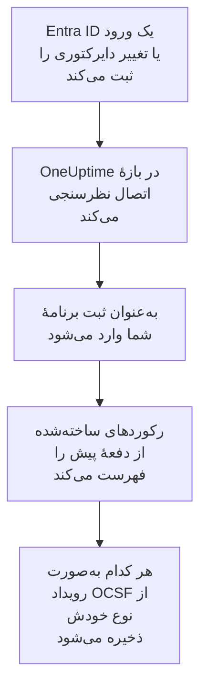

# Microsoft Entra ID

ورودها و تغییرات دایرکتوری [Microsoft Entra ID](https://learn.microsoft.com/en-us/entra/identity/) را به رویدادهای امنیتی OneUptime وارد کنید و، اگر بخواهید، فعالیت Exchange، SharePoint، OneDrive و Teams را از [لاگ ممیزی Microsoft 365](https://learn.microsoft.com/en-us/purview/audit-log-activities). آنجا آن‌ها را کنار لاگ‌ها، ترِیس‌ها و متریک‌هایتان جستجو می‌کنید، با هر منبع دیگری هم‌بسته می‌کنید، و برای آن‌هایی که مهم‌اند آنکال را فرا می‌خوانید. OneUptime آن‌ها را با یک ثبت برنامه که خودتان می‌سازید می‌خواند، و چیزی را در مستأجر شما تغییر نمی‌دهد.

:::cards
- [راه‌اندازی اتصال](#راهاندازی-اتصال): یک ثبت برنامه، مجوزهای آن، و فرم اتصال.
- [چه چیزی وارد می‌شود](#چه-چیزی-وارد-میشود): کدام رکوردها، و هر کدام چگونه به یک رویداد امنیتی تبدیل می‌شود.
- [نظرسنجی چگونه کار می‌کند](#نظرسنجی-چگونه-کار-میکند): پنجره‌ای که هر نظرسنجی می‌خواند، و اینکه چرا ۳۰ دقیقه هم‌پوشانی دارد.
- [عیب‌یابی](#عیبیابی): معنای هر خطا، و آنچه باید تغییر دهید.
:::

## چگونه کار می‌کند

OneUptime هر دقیقه از هر اتصال فعالی که بازهٔ نظرسنجی‌اش گذشته باشد نظرسنجی می‌کند. یک نظرسنجی به‌عنوان ثبت برنامهٔ شما به Microsoft Entra ID وارد می‌شود و به این ترتیب تغییرات دایرکتوری ([List directoryAudits](https://learn.microsoft.com/en-us/graph/api/directoryaudit-list)) و ورودهای ([List signIns](https://learn.microsoft.com/en-us/graph/api/signin-list)) ثبت‌شده از نظرسنجی پیش را می‌خواند، و سپس، وقتی گزینهٔ **لاگ ممیزی Microsoft 365** روشن باشد، محتوای تازهٔ لاگ ممیزی را ([Office 365 Management Activity API](https://learn.microsoft.com/en-us/office/office-365-management-api/office-365-management-activity-api-reference)). هر رکورد به‌صورت یک رویداد [OCSF](https://schema.ocsf.io/) ذخیره می‌شود: یک ورود به‌صورت رویداد Authentication، یک نقش اختصاص‌یافته به‌صورت رویداد User Access Management، یک حکم فیشینگ به‌صورت Detection Finding.

## پیش از شروع

- در OneUptime، نقش Project Owner، Project Admin یا Security Admin. Security Member و Security Viewer می‌توانند اتصال‌ها و تاریخچهٔ اجرایشان را ببینند، اما نمی‌توانند آن‌ها را تغییر دهند.
- برای ورودها، Microsoft Entra ID P1 یا P2، که در Microsoft 365 E3، E5 و Business Premium هست: Microsoft Graph ورودها را فقط به چنین مستأجرهایی می‌دهد. تغییرات دایرکتوری در هر مستأجری خوانده می‌شوند.
- یک نقش Entra که بتواند برنامه ثبت کند، مانند Application Administrator، و یک Global Administrator یا Privileged Role Administrator برای اعطای رضایت مدیر.
- برای لاگ ممیزی Microsoft 365، ممیزی روشن برای مستأجر، که به‌طور پیش‌فرض روشن است: در [درگاه Microsoft Purview](https://purview.microsoft.com)، **Audit** نباید **Start recording user and admin activity** را پیشنهاد کند.
- HTTPS خروجی از برنامه و کارگرهای OneUptime به `login.microsoftonline.com`، `graph.microsoft.com` و `manage.office.com`، یا برای Azure Government به `login.microsoftonline.us`، `graph.microsoft.us` و `manage.office365.us`.

## راه‌اندازی اتصال

اتصال با [جریان اعتبارنامه‌های کلاینت OAuth 2.0](https://learn.microsoft.com/en-us/entra/identity-platform/v2-oauth2-client-creds-grant-flow) وارد می‌شود: به‌عنوان یک برنامه، هرگز به‌عنوان یک شخص، با مجوزهای فقط‌خواندنی.

:::steps
### ثبت یک برنامه

1. به [مرکز مدیریت Microsoft Entra](https://entra.microsoft.com) وارد شوید و **App registrations** را باز کنید.
2. **New registration** را برگزینید. نامش را `OneUptime Security Events` بگذارید، **Supported account types** را روی **Accounts in this organizational directory only** نگه دارید، URI بازگشت را خالی بگذارید، و **Register** را برگزینید.
3. از صفحهٔ **Overview** برنامه، **شناسه برنامه (کلاینت)** و **شناسه دایرکتوری (مستأجر)** را کپی کنید.

### اجازهٔ خواندن لاگ‌ها به آن

1. به **API permissions → Add a permission → Microsoft Graph → Application permissions** بروید، `AuditLog.Read.All` را برگزینید، و **Add permissions** را برگزینید. Microsoft مستند می‌کند که فهرست ورودهایش ممکن است `Directory.Read.All` را هم بخواهد: اگر پس از اعطای رضایت ورودها با `403` رد شدند، آن را اضافه کنید.
2. برای لاگ ممیزی Microsoft 365، مجوز دومی اضافه کنید: **Add a permission → Office 365 Management APIs → Application permissions**، سپس `ActivityFeed.Read`.
3. برای مستأجرتان **Grant admin consent for** را برگزینید، و تأیید کنید. وضعیت هر مجوز باید **Granted** باشد: بدون رضایت، هر خواندنی با `403` رد می‌شود.

### ساختن یک رمز کلاینت

به **Certificates & secrets → Client secrets → New client secret** بروید، زمان انقضایش را برگزینید، و **Add** را برگزینید. پیش از ترک صفحه، **Value** رمز را کپی کنید، نه **Secret ID** آن را: این مقدار دیگر هرگز نشان داده نمی‌شود. در روزی که منقضی می‌شود، نظرسنجی با `Microsoft Entra ID token request failed (HTTP 401)` متوقف می‌شود تا وقتی آن را با **به‌روزرسانی اطلاعات ورود** جایگزین کنید.

### افزودن اتصال در OneUptime

**محصولات** > **رویدادهای امنیتی** > **اتصال‌ها** (`/dashboard/{projectId}/security-events/connections`) را باز کنید، روی **افزودن اتصال** کلیک کنید، زیر **هویت**، **Microsoft Entra ID** را برگزینید، و روی **بعدی** کلیک کنید. تنظیمات جدول زیر را پر کنید، روی **بعدی** کلیک کنید، و مقدار رمز را در **راز کلاینت** بچسبانید. در گام **فراخوانی دوره‌ای**، **لاگ ممیزی Microsoft 365** را روشن کنید تا آن هم خوانده شود.

### آزمایش پیش از ذخیره

روی **آزمودن این تنظیمات** زیر **آزمایش پیش از ذخیره** کلیک کنید. آزمایش با مقدارهای فرم وارد می‌شود و هر لاگ را می‌خواند، و چیزی ذخیره نمی‌کند، پس یک رمز نادرست یا یک رضایت جاافتاده پیش از ساخته شدن اتصال آشکار می‌شود. سپس روی **بعدی** کلیک کنید، به اتصال یک **نام** بدهید، و آن را بسازید.
:::

| تنظیم | کجا پیدایش کنید |
| --- | --- |
| **شناسه دایرکتوری (مستأجر)** | صفحهٔ **Overview** برنامه. GUID مستأجر، یا یک دامنهٔ تأییدشده مانند `contoso.onmicrosoft.com`. با **لاگ ممیزی Microsoft 365** روشن، GUID: Management API یک مستأجر را فقط با آن می‌شناسد. |
| **شناسه برنامه (کلاینت)** | صفحهٔ **Overview** برنامه. GUID برنامه‌ای که `AuditLog.Read.All` را دارد. |
| **ابر** | **ابر عمومی Azure**، یا **Azure Government (ایالات متحده)** برای GCC High (`login.microsoftonline.us`، `graph.microsoft.us` و `manage.office365.us`). |
| **لاگ ممیزی Microsoft 365** | اختیاری، به‌طور پیش‌فرض خاموش. وقتی روشن باشد، هر نظرسنجی لاگ ممیزی Microsoft 365 را هم می‌خواند. برنامه به `ActivityFeed.Read` نیاز دارد. |
| **راز کلاینت** | **Value** رمز. رمزگذاری می‌شود، API هرگز آن را برنمی‌گرداند و دیگر هرگز نشان داده نمی‌شود. آن را با **به‌روزرسانی اطلاعات ورود** روی اتصال جایگزین کنید. |

گام **فراخوانی دوره‌ای** همچنین یک **توضیحات** اختیاری دارد، **فاصله فراخوانی (دقیقه)**، یک عدد صحیح از `1` تا `1440` که با `5` شروع می‌شود، و **فعال**، که از آغاز روشن است.

## چه چیزی وارد می‌شود

هر رویداد فروشندهٔ `Microsoft` و محصول `Microsoft Entra ID` دارد. ویژگی `entra.log` آن می‌گوید یک ورود یا تغییر از کدام لاگ آمده، و `microsoft365.contentType` یک رکورد Microsoft 365 نوع محتوای آن را.

| رکورد | کلاس OCSF | شدت |
| --- | --- | --- |
| ورودی که موفق بود | Authentication (`3002`)، وضعیت `Success` | Informational |
| ورودی که منتظر گام دوم است، مانند MFA (`50074`، `50076`) یا درخواست تغییر گذرواژه | Authentication (`3002`)، وضعیت `Interrupted` | Informational: یک گام، نه یک شکست |
| ورودی که شکست خورد، با دلیل و کد خطای Entra | Authentication (`3002`)، وضعیت `Failure` | Low |
| ورودی که Identity Protection آن را با ریسک متوسط یا بالا ارزیابی کرد | Authentication (`3002`) | Medium یا High |
| کاربر، گروه یا نقشی که تغییر کرد، بر اساس دستهٔ آن | Account Change (`3001`)، Group Management (`3006`)، User Access Management (`3005`)، یا برای بقیه Entity Management (`3004`) | Medium برای یک نقش ممتاز، مانند Global Administrator؛ Low برای تغییری که شکست خورد |

با **لاگ ممیزی Microsoft 365** روشن، رکوردهایی که یک تیم امنیتی بر اساسشان اقدام می‌کند از آن وارد می‌شوند، و بقیه، مانند پرونده‌ای که باز شده یا ایمیلی که خوانده شده، فقط شمرده می‌شوند:

| رکورد Microsoft 365 | کلاس OCSF | شدت |
| --- | --- | --- |
| یک cmdlet از Exchange، مانند `New-InboxRule` یا `Set-Mailbox`، یک قاعدهٔ صندوق ورودی ساخته‌شده در Outlook، یا ایمیلی که به نام شخص دیگری فرستاده شده | API Activity (`6003`) | Medium وقتی ایمیل را بازارسال می‌کند، با `microsoft365.forwardsMail` برابر `true` |
| یک مجوز صندوق پستی اعطاشده، مانند `Add-MailboxPermission` | User Access Management (`3005`) | Low |
| پرونده‌ای که در SharePoint یا OneDrive به اشتراک گذاشته شده | File Hosting Activity (`6006`) | Low با یک مهمان یا پیوندی که هر کسی می‌تواند باز کند، با `microsoft365.sharedOutside` برابر `true` |
| مدیر مجموعهٔ سایتی که افزوده یا برداشته شده | User Access Management (`3005`) | Low |
| ایمیل بدافزار یا فیشینگ که Microsoft Defender for Office 365 پیدا کرده | Detection Finding (`2004`) | High برای بدافزار، Medium برای فیشینگ |
| هشداری که Microsoft 365 برانگیخته | Detection Finding (`2004`) | شدت خود هشدار |
| برنامه، بات یا رابطی که به یک تیم افزوده شده | Application Lifecycle (`6002`) | Low |

نگهداری خود Exchange، که با حساب سیستمی آن اجرا می‌شود، کنار گذاشته می‌شود مگر اینکه ایمیل را بازارسال کند. هر رویداد کل رکورد را نگه می‌دارد، تخت‌شده به کلیدهای نقطه‌دار مانند `status.errorCode` یا `Parameters.ForwardTo`، تا یک قاعده هر فیلدی را با نامی که Microsoft به آن داده بخواند. قاعده‌های کتابخانهٔ قاعده‌ها برای Entra ID آن‌ها را همان‌طور که اینجا وارد می‌شوند می‌خوانند.

همین ورودها و تغییرات دایرکتوری می‌توانند به‌صورت لاگ هم به OneUptime برسند، که یک تنظیم تشخیصی Azure آن‌ها را صادر می‌کند و [لاگ‌های شما](/docs/telemetry/security-events#یافتن-رویدادهای-امنیتی-در-لاگهای-شما) آن‌ها را می‌خواند. هر رکورد از هر دو راه همان شناسهٔ رویداد را می‌گیرد، اما رکوردی که از هر دو راه خوانده شود دو بار ذخیره می‌شود: Entra ID را فقط از یک راه بخوانید.

## نظرسنجی چگونه کار می‌کند

- **رکوردها بر اساس زمانی خوانده می‌شوند که Entra ID آن‌ها را ثبت کرده**، `activityDateTime` برای یک تغییر و `createdDateTime` برای یک ورود.
- **نخستین نظرسنجی ۲۴ ساعت به عقب نگاه می‌کند**، پس یک اتصال تازه بی‌درنگ رکوردهای اخیرش را نشان می‌دهد.
- **هر نظرسنجی بعدی ۳۰ دقیقه پیش از نشانگر ذخیره‌شده شروع می‌شود.** Microsoft مستند می‌کند که هر دو لاگ چند دقیقه دیر می‌رسند، پس هم‌پوشانی یک رکورد دیرکرده را در نظرسنجی بعدی می‌خواند، و رکوردهای تکراری با شناسهٔ رکورد در پروژه کنار گذاشته می‌شوند.
- **یک نظرسنجی حداکثر ۲۴ ساعت پس از نشانگر را می‌خواند.** اتصالی که نشانگرش عقب افتاده، در رشته‌ای از پنجره‌های ۲۴ ساعته جبران می‌کند.
- **مستأجری بدون Microsoft Entra ID P1 یا P2** تغییرات دایرکتوری‌اش را وارد می‌کند، و بررسی **Read sign-ins** هر اجرا هشدار می‌دهد که ورودها خوانده نشدند.
- **یک اجرای شکست‌خورده چیزی را تغییر نمی‌دهد.** پس از یک خطای شبکه، یا یک وضعیت خطا از Graph، نشانگر و طول پنجره همان‌طور که بودند می‌مانند، و نظرسنجی بعدی همان پنجره را دوباره می‌خواند. تنها استثنا درخواستی است که زمانش سر رسیده: نشانگر می‌ماند، اما پنجرهٔ بعدی نصف طول می‌شود، چون پنجره‌ای که برای پاسخ به‌موقع بیش از حد سنگین است در هر تلاش به پایان زمان می‌خورد.

لاگ ممیزی Microsoft 365 بر اساس زمانی خوانده می‌شود که Microsoft هر blob محتوا را در دسترس گذاشته، هر بار یک روز، و نه دورتر از ۷ روزی که Microsoft آن را نگه می‌دارد. نخستین نظرسنجی برنامه را در `Audit.Exchange`، `Audit.SharePoint` و `Audit.General` مشترک می‌کند، و Microsoft نخستین رکوردهای یک اشتراک تازه را ظرف ۱۲ ساعت در دسترس می‌گذارد. لاگ ممیزی هرگز لاگ‌های Entra ID را متوقف نمی‌کند: مجوز جاافتاده یک هشدار است و پنجره جلو می‌رود، در حالی که شکستی در سمت Microsoft، مانند `HTTP 503`، اجرا را **جزئی** می‌کند تا پنجره دوباره خوانده شود.

### وقتی یک پنجره بیش از توان یک نظرسنجی دارد

هر لاگ بودجهٔ خودش را دارد: ۱۰ صفحهٔ ۵۰۰ تایی تغییرات دایرکتوری، ۲۰ صفحهٔ ۵۰۰ تایی ورودها و، برای لاگ ممیزی Microsoft 365، ۱۲۰ درخواست و ۱۰٬۰۰۰ رکورد. یک نظرسنجی پس از ۴ دقیقه متوقف می‌شود. وقتی یک بودجه لاگی را پیش از پایان پنجره‌اش متوقف کند، اجرا **جزئی** است، و هشدار آن لاگ و بودجه را نام می‌برد. Microsoft Graph رکوردها را از جدیدترین فهرست می‌کند، پس OneUptime به‌جای جابه‌جا کردن نشانگر از رکوردهایی که هرگز به آن‌ها نرسیده، پنجره را کوتاه می‌کند:

1. **باریک کردن.** نظرسنجی بعدی پنجره‌ای به نصف طول را از همان نقطهٔ شروع می‌خواند، و تا وقتی پنجره‌ای کامل خوانده شود دوباره نصف می‌کند، تا حداقل یک دقیقه. هشدار اجرا همین را می‌گوید: `This window holds more records than one poll can read; the next poll reads a {n} minute window from the same starting point.` رکوردهایی که پیش‌تر از پنجرهٔ بلندتر وارد شده‌اند به‌عنوان تکراری رد می‌شوند.
2. **دوباره بزرگ کردن.** پس از اینکه پنجره‌ای کامل خوانده شد، نشانگر به انتهای آن می‌رود، و پنجرهٔ بعدی دوباره دو برابر می‌شود، تا ۲۴ ساعت.
3. **گذشتن از یک دقیقهٔ تنها.** اگر حتی یک دقیقه بیش از آنچه یک نظرسنجی می‌تواند بخواند داشته باشد، نظرسنجی از آن می‌گذرد، تا رکوردهای تازه‌تر همچنان برسند. اجرا **جزئی** می‌ماند، و **آخرین خطا** این را نشان می‌دهد: `More records were created in the one minute from {cursor} to {end} than one poll can read. Polling moved past this minute so newer records keep arriving; use Import this time range in Diagnostics on this minute to recover what one run can read.` آن دقیقه را با **Import this time range** وارد کنید تا آنچه یک اجرا می‌تواند بخواند بازیابی شود.

تغییر **فاصله فراخوانی (دقیقه)** هیچ‌کدام از این‌ها را تغییر نمی‌دهد: این تنظیم تعیین می‌کند یک نظرسنجی هر چند وقت شروع شود، نه اینکه پنجره‌اش از کجا شروع شود.

### اجرا، پیش‌نمایش و وارد کردن در صورت نیاز

روی **عیب‌یابی** یک اتصال کلیک کنید تا اجراهای اخیرش را ببینید و دستی با آن کار کنید. هر کسی که بتواند اتصال را تغییر دهد می‌تواند این‌ها را شروع کند؛ هر کسی که بتواند آن را ببیند می‌تواند تاریخچه را بخواند.

- **اجرای اکنون** بی‌درنگ یک نظرسنجی با نشانگر معمول شروع می‌کند، حتی وقتی اتصال **فعال** نیست.
- **Preview records** یک بازهٔ زمانی تا ۷ روز را می‌خواند و چیزی وارد نمی‌کند.
- **Import this time range** پس از تأیید شما بازه‌ای تا ۷ روز را وارد می‌کند، بی‌آنکه نشانگر را جابه‌جا کند. رکوردهایی که پیش‌تر وارد شده‌اند رد می‌شوند. Microsoft Entra ID ورودها و تغییرات دایرکتوری را با P1 یا P2 به مدت ۳۰ روز، و بدون آن‌ها ۷ روز نگه می‌دارد.
- **Copy diagnostics** روی یک اجرا، گزارش آن را برای پشتیبانی کپی می‌کند. هرگز اعتبارنامه‌ها را در بر ندارد.

## آزمایش اتصال

**آزمایش اتصال** در ردیف یک اتصال، و **آزمودن این تنظیمات** در فرم، در فرایند API اجرا می‌شوند، نه در یک کارگر پس‌زمینه، پس یک آزمایش حتی وقتی مشکل از کارگرهاست هم پاسخ می‌دهد. این بررسی‌ها را به ترتیب انجام می‌دهد:

| بررسی | چه چیزی را بررسی می‌کند |
| --- | --- |
| **پیکربندی** | هر تنظیم موجود و درست‌شکل است. وقتی این شکست بخورد با هیچ جایی تماس گرفته نمی‌شود. |
| **Authenticate with Microsoft Entra** | Entra ID برای برنامه، در ابری که برگزیده‌اید، یک توکن Microsoft Graph صادر می‌کند. |
| **Read sign-ins** | ورودهای ۲۴ ساعت گذشته خواندنی‌اند. در مستأجری بدون P1 یا P2 یک هشدار است، نه یک شکست. |
| **Read directory changes** | تغییرات دایرکتوری ۲۴ ساعت گذشته خواندنی‌اند. |
| **Read the Microsoft 365 audit log** | فقط با گزینهٔ روشن: Management API پاسخ می‌دهد، و برنامه در کدام نوع‌های محتوا مشترک است. |
| **Records available to import** | ۲۴ ساعت گذشته چند ورود و تغییر دایرکتوری دارد، از هر کدام حداکثر ۵۰۰، پس `500+` یعنی بیشتر. هیچ، یک هشدار است. |
| **Background workers**، **Poll scheduler**، **Security event storage** | سمت خود OneUptime: فرایندی کارهای صف Worker را برمی‌دارد، کار نظرسنجی هر دقیقه اجرا می‌شود، و انبارهٔ رویدادهای امنیتی پاسخ می‌دهد. |
| **Scheduled polling** | برای یک اتصال ذخیره‌شده: نظرسنجی روشن است، هیچ اجرایی در انتظار یک کارگر گیر نکرده، و نظرسنجی‌ها به‌موقع اجرا می‌شوند. |

هر درخواست در یک آزمایش مهلتی ۲۰ ثانیه‌ای دارد. یک آزمایش هرگز چیزی وارد نمی‌کند یا نشانگر را جابه‌جا نمی‌کند، و هر بررسی شکست‌خورده می‌گوید چه چیزی را تغییر دهید.

## عیب‌یابی

**آخرین خطا** اتصال پیام خطای کامل را، با اعتبارنامه‌های پوشانده‌شده، نگه می‌دارد. وقتی اتصالی خطا دارد، برای خواندنش **مشاهده خطا** را در ستون **اقدام‌ها** آن برگزینید، و برای کپی کردنش **کپی خطا** را در کادر گفتگو. هر پیام با `Microsoft Entra ID` شروع می‌شود، سپس درخواستی را که شکست خورده نام می‌برد، و کد خطای Microsoft را، اگر باشد، نقل می‌کند.

:::details آخرین خطا می‌گوید `token request failed`
- `HTTP 401` با `invalid_client`: راز کلاینت نادرست یا منقضی است. یک راز تازه بسازید، و آن را با **به‌روزرسانی اطلاعات ورود** ذخیره کنید.
- `HTTP 400` که شناسهٔ برنامه (کلاینت) یا مستأجر را نام می‌برد: هر دو را در صفحهٔ **Overview** برنامه بررسی کنید، و اینکه **ابر** همان ابر مستأجر باشد.
:::

:::details آخرین خطا می‌گوید `sign-ins request failed (HTTP 403)` یا `audit logs request failed (HTTP 403)`
- کد خطای `Authorization_RequestDenied`: برنامه `AuditLog.Read.All` را ندارد، یا رضایت اعطا نشده است. رضایت مدیر را اعطا کنید، چند دقیقه صبر کنید، و دوباره آزمایش کنید. برای ورودها، `Directory.Read.All` را هم اعطا کنید.
- کد خطای `Authentication_RequestFromNonPremiumTenantOrB2CTenant`: مستأجر Microsoft Entra ID P1 یا P2 ندارد. تغییرات دایرکتوری همچنان وارد می‌شوند.
:::

:::details لاگ ممیزی Microsoft 365 خوانده نمی‌شود
- `subscriptions request failed (HTTP 401)` یا `(HTTP 403)`، با `AF10001`: برنامه `ActivityFeed.Read` از Office 365 Management APIs را ندارد، یا رضایت اعطا نشده است.
- `AF20010` تا `AF20013`: Management API **شناسه دایرکتوری (مستأجر)** را نمی‌شناسد. GUID مستأجر را به کار ببرید.
- `subscription start failed` با `AF20023`: یک مدیر اشتراک را خاموش کرده است. نوع محتوایی که نمی‌توان در آن مشترک شد در هشدارهای اجرا نام برده می‌شود، و بقیه همچنان خوانده می‌شوند.
- هیچ رکوردی تا ساعت‌ها پس از نخستین نظرسنجی: Microsoft نخستین محتوای یک اشتراک تازه را ظرف ۱۲ ساعت در دسترس می‌گذارد.
:::

:::details آخرین خطا می‌گوید `did not complete`
درخواست پاسخی نگرفت: پایان زمان، نامی که به نشانی تبدیل نمی‌شود، یا نشانی‌ای که رد شده. بررسی کنید که برنامه و کارگرهای OneUptime بتوانند از طریق هر پراکسی‌ای که به کار می‌برید به میزبان‌های [پیش از شروع](#پیش-از-شروع) برسند.
:::

:::details آزمایش موفق است، اما Last Polled برابر Never است
کار نظرسنجی هرگز اجرا نشده است. بررسی‌های **Background workers** و **Poll scheduler** را بخوانید. در یک نصب خودمیزبان، علت معمول `DISABLE_QUEUE_WORKERS=true` روی برنامه است، بدون استقرار کارگر جداگانه‌ای که کارها را بردارد: آن را روی `false` بگذارید، یا استقرار کارگر را اجرا کنید (Helm: `worker.enabled: true`، که به‌طور پیش‌فرض `false` است).
:::

## گام‌های بعدی

:::cards
- [رویدادهای امنیتی](/docs/telemetry/security-events): آنچه را وارد می‌کنید جستجو و هم‌بسته کنید و روی آن هشدار بگیرید.
- [لاگ سیستم Okta](/docs/integrations/okta): ورودهای یک ارائه‌دهندهٔ هویت دیگر را وارد کنید.
- [Google Workspace](/docs/integrations/google-workspace): ورودها و تغییرات مدیریتی Google را وارد کنید.
- [نمای کلی یکپارچه‌سازی‌ها](/docs/integrations/index): ابزارهای دیگری که می‌توانید وصل کنید.
:::
