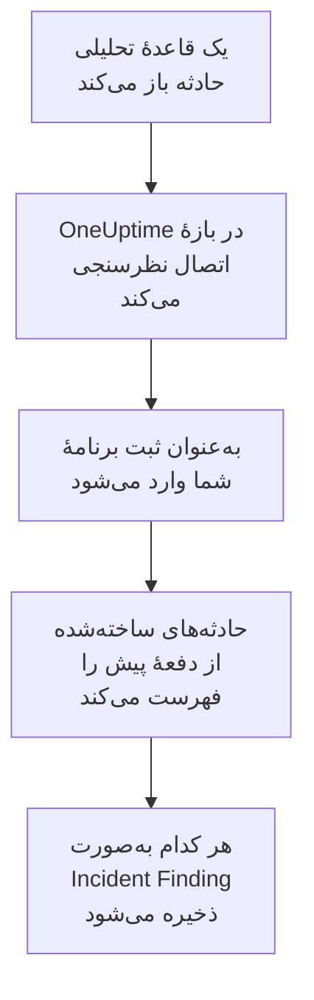

# Microsoft Sentinel

حادثه‌هایی را که قاعده‌های تحلیلی [Microsoft Sentinel](https://learn.microsoft.com/en-us/azure/sentinel/overview) شما باز می‌کنند، به رویدادهای امنیتی OneUptime وارد کنید. آنجا آن‌ها را کنار لاگ‌ها، ترِیس‌ها و متریک‌هایتان جستجو می‌کنید، با هر منبع دیگری هم‌بسته می‌کنید، و برای آن‌هایی که مهم‌اند آنکال را فرا می‌خوانید. OneUptime آن‌ها را با یک ثبت برنامه که خودتان می‌سازید می‌خواند، و در Azure چیزی را تغییر نمی‌دهد.

:::cards
- [راه‌اندازی اتصال](#راهاندازی-اتصال): یک ثبت برنامه، یک نقش، و فرم اتصال.
- [چه چیزی وارد می‌شود](#چه-چیزی-وارد-میشود): هر حادثهٔ Sentinel چگونه به یک رویداد امنیتی تبدیل می‌شود.
- [نظرسنجی چگونه کار می‌کند](#نظرسنجی-چگونه-کار-میکند): پنجره‌ای که هر نظرسنجی می‌خواند، و اینکه یک فضای کاری پرکار با آن چه می‌کند.
- [عیب‌یابی](#عیبیابی): معنای هر خطا، و آنچه باید تغییر دهید.
:::

## چگونه کار می‌کند



OneUptime هر دقیقه از هر اتصال فعالی که بازهٔ نظرسنجی‌اش گذشته باشد نظرسنجی می‌کند. یک نظرسنجی به‌عنوان ثبت برنامهٔ شما به Microsoft Entra ID وارد می‌شود، حادثه‌های ساخته‌شده از نظرسنجی پیش را از Azure Resource Manager می‌خواهد، و هر کدام را به‌صورت یک رویداد Incident Finding از [OCSF](https://schema.ocsf.io/) (کلاس `2005`) ذخیره می‌کند. از آن پس قاعده‌های تشخیص، مانیتورها و داشبوردها با آن مانند یک رویداد امنیتی از هر منبع دیگری رفتار می‌کنند.

## پیش از شروع

- در OneUptime، نقش Project Owner، Project Admin یا Security Admin. Security Member و Security Viewer می‌توانند اتصال‌ها و تاریخچهٔ اجرایشان را ببینند، اما نمی‌توانند آن‌ها را تغییر دهند.
- یک فضای کاری Log Analytics با Microsoft Sentinel فعال، در ابر عمومی Azure یا در Azure Government (US).
- در Microsoft Entra ID، اجازهٔ ساختن یک ثبت برنامه و یک رمز کلاینت.
- روی گروه منابعی که فضای کاری را در خود دارد، اجازهٔ واگذاری نقش، مانند Owner یا User Access Administrator.

## راه‌اندازی اتصال

اتصال با جریان اعتبارنامه‌های کلاینت OAuth 2.0 وارد می‌شود: به‌عنوان یک برنامه، هرگز به‌عنوان یک شخص. دسترسی‌اش از یک نقش Azure می‌آید، پس ثبت برنامه به هیچ مجوز API نیاز ندارد.

:::steps
### ثبت یک برنامه

1. به [Azure portal](https://portal.azure.com) وارد شوید و **Microsoft Entra ID** را باز کنید.
2. به **App registrations → New registration** بروید. نامش را `OneUptime Sentinel connector` بگذارید، **Supported account types** را روی **Accounts in this organizational directory only** نگه دارید، URI بازگشت را خالی بگذارید، و **Register** را برگزینید.
3. از صفحهٔ **Overview** برنامه، **شناسه برنامه (کلاینت)** و **شناسه دایرکتوری (مستأجر)** را کپی کنید.
4. به **Certificates & secrets → Client secrets → New client secret** بروید، زمان انقضایش را برگزینید، و **Add** را برگزینید. پیش از ترک صفحه، **Value** رمز را کپی کنید، نه **Secret ID** آن را: این مقدار دیگر هرگز نشان داده نمی‌شود.

### اجازهٔ خواندن حادثه‌ها به آن

1. در Azure portal، گروه منابعی را که فضای کاری Log Analytics شما را در خود دارد باز کنید.
2. **Access control (IAM) → Add → Add role assignment** را برگزینید.
3. در زبانهٔ **Role**، **Microsoft Sentinel Reader** را برگزینید.
4. در زبانهٔ **Members**، **User, group, or service principal** را برگزینید، روی **Select members** کلیک کنید، و ثبت برنامه‌تان را با نامش برگزینید.
5. **Review + assign** را برگزینید.

این نقش به برنامه اجازه می‌دهد حادثه‌ها را بخواند (`Microsoft.SecurityInsights/incidents/read`) و هیچ چیزی ننویسد. Microsoft توصیه می‌کند آن را به جای فضای کاری روی گروه منابع واگذار کنید، تا راه‌حل `SecurityInsights` را هم که حادثه‌ها از آن ارائه می‌شوند پوشش دهد. اعمال شدن یک واگذاری تازه ممکن است چند دقیقه طول بکشد.

### یافتن جزئیات فضای کاری

فضای کاری Log Analytics را در Azure portal باز کنید. صفحهٔ **Overview** آن، **شناسه اشتراک**، **Resource group** و نام فضای کاری را نشان می‌دهد. شناسهٔ منبع فضای کاری هم همین سه را در خود دارد:

```text
/subscriptions/{Subscription ID}/resourceGroups/{Resource group}/providers/Microsoft.OperationalInsights/workspaces/{Workspace name}
```

### افزودن اتصال در OneUptime

**محصولات** > **رویدادهای امنیتی** > **اتصال‌ها** (`/dashboard/{projectId}/security-events/connections`) را باز کنید، روی **افزودن اتصال** کلیک کنید، **Microsoft Sentinel** را برگزینید، و روی **بعدی** کلیک کنید. تنظیمات جدول زیر را پر کنید، روی **بعدی** کلیک کنید، و مقدار رمز را در **راز کلاینت** بچسبانید.

### آزمایش پیش از ذخیره

روی **آزمودن این تنظیمات** زیر **آزمایش پیش از ذخیره** کلیک کنید. آزمایش با مقدارهای فرم وارد می‌شود و حادثه‌ها را می‌خواند، و چیزی ذخیره نمی‌کند، پس یک رمز نادرست یا یک نقش جاافتاده پیش از ساخته شدن اتصال آشکار می‌شود. سپس روی **بعدی** کلیک کنید، به اتصال یک **نام** بدهید، و آن را بسازید.
:::

| تنظیم | کجا پیدایش کنید |
| --- | --- |
| **شناسه دایرکتوری (مستأجر)** | صفحهٔ **Overview** برنامه. GUID مستأجر، یا یک دامنهٔ تأییدشده مانند `contoso.onmicrosoft.com`. |
| **شناسه برنامه (کلاینت)** | صفحهٔ **Overview** برنامه. یک GUID. |
| **شناسه اشتراک** | صفحهٔ **Overview** فضای کاری. یک GUID. |
| **Resource group** | صفحهٔ **Overview** فضای کاری. ۱ تا ۹۰ حرف، رقم، زیرخط، خط تیره، نقطه یا پرانتز، که به نقطه ختم نشود. |
| **Workspace name** | صفحهٔ **Overview** فضای کاری. ۳ تا ۹۰ حرف، رقم یا خط تیره، که با یک حرف یا رقم شروع و تمام شود. |
| **ابر** | **ابر عمومی Azure** (`login.microsoftonline.com`، `management.azure.com`) یا **Azure Government (ایالات متحده)** (`login.microsoftonline.us`، `management.usgovcloudapi.net`). |
| **راز کلاینت** | **Value** رمز. رمزگذاری می‌شود، API هرگز آن را برنمی‌گرداند و دیگر هرگز نشان داده نمی‌شود. آن را با **به‌روزرسانی اطلاعات ورود** روی اتصال جایگزین کنید. |

گام **فراخوانی دوره‌ای** همچنین یک **توضیحات** اختیاری دارد، **فاصله فراخوانی (دقیقه)**، یک عدد صحیح از `1` تا `1440` که با `5` شروع می‌شود، و **فعال**، که از آغاز روشن است.

## چه چیزی وارد می‌شود

هر حادثهٔ Sentinel به یک رویداد Incident Finding تبدیل می‌شود (کلاس OCSF `2005`، فعالیت `Create`) که به سرویس تله‌متری `Microsoft Sentinel` نسبت داده می‌شود:

| ستون OCSF | فیلد حادثهٔ Sentinel |
| --- | --- |
| `time` | `properties.createdTimeUtc`، زمانی که Sentinel حادثه را ساخت |
| `eventUid` | `name`، GUID حادثه، که تکراری‌ها هم بر پایهٔ آن کنار گذاشته می‌شوند |
| `message`, `ruleName` | `properties.title` |
| `ruleId` | GUID قاعده در انتهای نخستین مدخل `properties.relatedAnalyticRuleIds` |
| `severityName` | `properties.severity`: `High`، `Medium`، `Low` یا `Informational` |
| `statusName` | `properties.status`: `New`، `Active` یا `Closed` |
| `mitreTactics` | `properties.additionalData.tactics`، به‌صورت شناسه‌های ATT&CK: `Persistence` به `TA0003` تبدیل می‌شود |
| `principalUser` | `properties.owner.userPrincipalName`، یا `properties.owner.email` |
| `targetResource` | `properties.incidentUrl`، پیوندی به حادثه در Azure portal |
| `observables` | UPN، ایمیل و شناسهٔ شیء مالک، و نام هر برچسب |
| `attributes` | کل حادثه، تخت‌شده به کلیدهای نقطه‌دار مانند `properties.classification` و `properties.firstActivityTimeUtc` |

حادثه‌های بسته‌ای هم که در پنجرهٔ یک نظرسنجی ساخته شده‌اند وارد می‌شوند. برای دیدن فقط حادثه‌های باز، در کاوشگر رویدادهای امنیتی بر پایهٔ `statusName` پالایش کنید.

## نظرسنجی چگونه کار می‌کند

هر نظرسنجی حادثه‌های ساخته‌شده در پنجره‌اش را فهرست می‌کند، قدیمی‌ترین‌ها اول، ۵۰ تا در هر صفحه، و `nextLink` در API را دنبال می‌کند تا کل پنجره را بخواند:

```text
GET https://management.azure.com/subscriptions/{sub}/resourceGroups/{rg}/providers/Microsoft.OperationalInsights/workspaces/{ws}/providers/Microsoft.SecurityInsights/incidents
    ?api-version=2024-03-01
    &$filter=(properties/createdTimeUtc ge {windowStart}) and (properties/createdTimeUtc lt {windowEnd})
    &$orderby=properties/createdTimeUtc asc
    &$top=50
```

- **زمان ساخت، نشانگر است.** یک قاعدهٔ تحلیلی زمان‌بندی‌شده که هر ساعت اجرا می‌شود، حادثه‌اش را مدت‌ها پس از فعالیتی که با آن جور شده باز می‌کند، و `firstActivityTimeUtc` حادثه می‌تواند ساعت‌ها یا روزها قدیمی‌تر باشد. نشانگری بر پایهٔ زمان فعالیت همهٔ این حادثه‌ها را جا می‌انداخت. زمان‌های فعالیت در `attributes` می‌مانند، و نمونه‌های Diagnostics هر دو را نشان می‌دهند.
- **نخستین نظرسنجی ۲۴ ساعت به عقب نگاه می‌کند**، پس یک اتصال تازه بی‌درنگ حادثه‌های اخیرش را نشان می‌دهد.
- **هر نظرسنجی بعدی ۱ دقیقه پیش از نشانگر ذخیره‌شده شروع می‌شود**، پس حادثه‌ای که روی مرز دو پنجره ساخته شود هرگز جا نمی‌ماند.
- **یک نظرسنجی حداکثر ۲۴ ساعت پس از نشانگر را می‌خواند.** اتصالی که نشانگرش عقب افتاده، در رشته‌ای از پنجره‌های ۲۴ ساعته جبران می‌کند، و **سلامت** آن **Catching up** را نشان می‌دهد.
- **تکراری‌ها بر پایهٔ GUID حادثه کنار گذاشته می‌شوند** (`name`)، درون پروژه، پس هم‌پوشانی، پنجره‌ای که دوباره امتحان شده و یک وارد کردن، هرگز یک حادثه را دو بار ذخیره نمی‌کنند.

### وقتی یک پنجره بیش از توان یک نظرسنجی دارد

یک نظرسنجی حداکثر ۲۰ صفحهٔ ۵۰ حادثه‌ای را می‌خواند: ۱٬۰۰۰ حادثه. وقتی این سقف آن را پیش از پایان پنجره‌اش متوقف کند، اجرا **جزئی** است، با هشداری مانند:

```text
Stopped after 20 incidents requests (the per-run request limit) before reading the whole window. Incidents are read oldest first; every incident created before 2026-09-14T08:12:44.000Z was read.
```

حادثه‌ها از قدیمی‌ترین خوانده می‌شوند، پس OneUptime نشانگر را به زمان ساخت آخرین حادثه‌ای که خوانده می‌برد، و نظرسنجی بعدی با همان طول پنجره از آنجا شروع می‌شود. یک فضای کاری پرکار در هر نظرسنجی حدود ۱٬۰۰۰ حادثه جبران می‌کند، به جای اینکه همان حادثه‌ها را دوباره بخواند. حادثه‌هایی که در همان لحظه ساخته شده‌اند دو بار خوانده می‌شوند، و بررسی تکراری نسخهٔ دوم را کنار می‌گذارد.

وقتی یک اجرا اصلاً نتواند از نشانگر ذخیره‌شده جلوتر برود، OneUptime به جای آن پنجره را کوتاه می‌کند:

1. **باریک کردن.** نظرسنجی بعدی پنجره‌ای به نصف طول را از همان نقطهٔ شروع می‌خواند، و تا وقتی پنجره‌ای کامل خوانده شود دوباره نصف می‌کند، تا حداقل یک دقیقه. هشدار اجرا همین را می‌گوید: `This window holds more records than one poll can read; the next poll reads a {n} minute window from the same starting point.`
2. **دوباره بزرگ کردن.** پس از اینکه پنجره‌ای کامل خوانده شد، پنجرهٔ بعدی دوباره دو برابر می‌شود، تا ۲۴ ساعت.
3. **گذشتن از یک دقیقهٔ تنها.** اگر حتی یک دقیقه بیش از توان یک نظرسنجی داشته باشد، نظرسنجی از آن می‌گذرد، تا حادثه‌های تازه‌تر همچنان برسند. اجرا **جزئی** می‌ماند، و **آخرین خطا** این را نشان می‌دهد: `More records were created in the one minute from {cursor} to {end} than one poll can read. Polling moved past this minute so newer records keep arriving; use Import this time range in Diagnostics on this minute to recover what one run can read.` آن دقیقه را با **Import this time range** وارد کنید تا آنچه یک اجرا می‌تواند بخواند بازیابی شود.

اجرایی که با خطایی از Microsoft Entra ID یا Azure Resource Manager یکسره شکست بخورد، نشانگر و طول پنجره را نگه می‌دارد، و نظرسنجی بعدی همان پنجره را دوباره می‌خواند. تنها استثنا درخواستی است که زمانش سر رسیده: نشانگر می‌ماند، اما پنجرهٔ بعدی نصف طول می‌شود، چون پنجره‌ای که برای پاسخ به‌موقع بیش از حد سنگین است در هر تلاش به پایان زمان می‌خورد. تغییر **فاصله فراخوانی (دقیقه)** هیچ‌کدام از این‌ها را تغییر نمی‌دهد: این تنظیم تعیین می‌کند یک نظرسنجی هر چند وقت شروع شود، نه اینکه پنجره‌اش از کجا شروع شود.

### اجرا، پیش‌نمایش و وارد کردن در صورت نیاز

روی **عیب‌یابی** یک اتصال کلیک کنید تا اجراهای اخیرش را ببینید و دستی با آن کار کنید. هر کسی که بتواند اتصال را تغییر دهد می‌تواند این‌ها را شروع کند؛ هر کسی که بتواند آن را ببیند می‌تواند تاریخچه را بخواند.

- **اجرای اکنون** بی‌درنگ یک نظرسنجی با نشانگر معمول شروع می‌کند، حتی وقتی اتصال **فعال** نیست.
- **Preview incidents** یک بازهٔ زمانی تا ۷ روز را می‌خواند و چیزی وارد نمی‌کند.
- **Import this time range** پس از تأیید شما بازه‌ای تا ۷ روز را وارد می‌کند، بی‌آنکه نشانگر را جابه‌جا کند. حادثه‌هایی که پیش‌تر وارد شده‌اند رد می‌شوند.
- **Copy diagnostics** روی یک اجرا، گزارش آن را برای پشتیبانی کپی می‌کند. هرگز اعتبارنامه‌ها را در بر ندارد.

## آزمایش اتصال

**آزمایش اتصال** در ردیف یک اتصال، و **آزمودن این تنظیمات** در فرم، در فرایند API اجرا می‌شوند، نه در یک کارگر پس‌زمینه، پس یک آزمایش حتی وقتی مشکل از کارگرهاست هم پاسخ می‌دهد. این بررسی‌ها را به ترتیب انجام می‌دهد:

| بررسی | چه چیزی را بررسی می‌کند |
| --- | --- |
| **پیکربندی** | هر تنظیم موجود و درست‌شکل است. وقتی این شکست بخورد با هیچ جایی تماس گرفته نمی‌شود. |
| **Authenticate with Microsoft Entra** | Microsoft Entra ID برای Azure Resource Manager به ثبت برنامهٔ شما یک توکن صادر می‌کند. |
| **Read incidents** | یک حادثهٔ ساخته‌شده در ۲۴ ساعت گذشته خوانده می‌شود (`$top=1`). این نقش و جزئیات فضای کاری را ثابت می‌کند. |
| **Incidents available to import** | چند حادثه در ۲۴ ساعت گذشته و ۷ روز گذشته ساخته شده، هر کدام با یک صفحهٔ ۵۰ تایی، پس `50+` یعنی بیشتر. هیچ حادثه‌ای در ۷ روز یک هشدار است، نه یک شکست. |
| **Background workers**، **Poll scheduler**، **Security event storage** | سمت خود OneUptime: فرایندی کارهای صف Worker را برمی‌دارد، کار نظرسنجی هر دقیقه اجرا می‌شود، و انبارهٔ رویدادهای امنیتی پاسخ می‌دهد. |
| **Scheduled polling** | برای یک اتصال ذخیره‌شده: نظرسنجی روشن است، هیچ اجرایی در انتظار یک کارگر گیر نکرده، و نظرسنجی‌ها به‌موقع اجرا می‌شوند. |

هر درخواست در یک آزمایش مهلتی ۲۰ ثانیه‌ای دارد. یک آزمایش هرگز چیزی وارد نمی‌کند یا نشانگر را جابه‌جا نمی‌کند، و هر بررسی شکست‌خورده می‌گوید چه چیزی را تغییر دهید.

## ارسال رویدادهای امنیتی به Microsoft Sentinel

OneUptime می‌تواند آنچه را می‌یابد از راه Logs Ingestion API در Azure Monitor به Microsoft Sentinel هم بفرستد، به یک جدول سفارشی در فضای کاری‌ای که Sentinel روی آن اجرا می‌شود. سپس قاعده‌های تحلیلی، پرس‌وجوهای شکار و کارپوشه‌های شما `OneUptimeSecurityEvents_CL` را کنار جدول‌های دیگرتان پرس‌وجو می‌کنند.

:::steps
### ساختن جدول و قاعدهٔ گردآوری دادهٔ آن

در Azure portal، **Tables → Create → New custom log (DCR-based)** فضای کاری را باز کنید. نام جدول را `OneUptimeSecurityEvents` بگذارید، یک قاعدهٔ گردآوری دادهٔ تازه بسازید، و اگر فرم خواست یک نقطهٔ پایانی گردآوری داده هم بسازید. نمونهٔ زیر را به‌عنوان پروندهٔ نمونه بارگذاری کنید، تبدیل را همان‌طور که هست نگه دارید، و جدول را بسازید.

### اجازهٔ ارسال به یک برنامه

یک برنامه ثبت کنید و به آن یک رمز سرویس‌گیرنده بدهید، مانند [ثبت یک برنامه](#ثبت-یک-برنامه). سپس قاعدهٔ گردآوری داده را باز کنید، **Access control (IAM) → Add → Add role assignment** ، **Monitoring Metrics Publisher** را برگزینید، و برنامه را انتخاب کنید.

### افزودن مقصد

**محصولات** > **رویدادهای امنیتی** > **اتصال‌ها** را باز کنید. زیر **ارسال به SIEM شما**، روی **افزودن مقصد** کلیک کنید، Microsoft Sentinel را زیر **SIEM** انتخاب کنید و روی **بعدی** کلیک کنید. **شناسه دایرکتوری (مستأجر)** ، **شناسه برنامه (کلاینت)** و **راز کلاینت** را پر کنید، **نقطهٔ پایانی دریافت لاگ** را از **Overview** نقطهٔ پایانی گردآوری داده (یا قاعده)، و **شناسهٔ تغییرناپذیر قاعدهٔ گردآوری داده** را از **JSON View** قاعده. **جریان** اختیاری است: اگر خالی بماند، `Custom-OneUptimeSecurityEvents_CL` است.

### ارسال یک رویداد آزمایشی و شروع ارسال

روی **ارسال رویداد آزمایشی** کلیک کنید: ظرف چند دقیقه یک ردیف به جدول می‌رسد. سپس زیر **چه چیزی فرستاده شود** گزینهٔ **فقط تشخیص‌ها** را نگه دارید یا **همه رویدادهای امنیتی** را برگزینید، و روی **شروع ارسال** کلیک کنید.
:::

پروندهٔ نمونه، یک ردیف با همهٔ ستون‌های جدول:

```json title="oneuptime-security-events-sample.json"
[
  {
    "TimeGenerated": "2026-10-21T10:00:00.000Z",
    "EventId": "0193c0de-cccc-4aaa-8bbb-000000000001",
    "EventUid": "okta-1",
    "ClassName": "Authentication",
    "CategoryName": "Identity & Access Management",
    "ActivityName": "Logon",
    "Severity": "Medium",
    "SeverityId": 3,
    "Status": "Failure",
    "Message": "Failed sign-in for alice",
    "VendorName": "Okta",
    "ProductName": "Okta System Log",
    "RuleId": "",
    "RuleName": "",
    "MitreTactics": [],
    "MitreTechniques": [],
    "PrincipalUser": "alice@example.com",
    "PrincipalHost": "laptop-7",
    "PrincipalIp": "203.0.113.7",
    "TargetUser": "",
    "TargetHost": "app.example.com",
    "TargetIp": "198.51.100.20",
    "TargetPort": 443,
    "TargetResource": "",
    "ProcessName": "",
    "ProcessCommandLine": "",
    "ParentProcessName": "",
    "Observables": [
      "alice@example.com",
      "203.0.113.7"
    ],
    "Attributes": {
      "okta.outcome.reason": "INVALID_CREDENTIALS"
    }
  }
]
```

- Logs Ingestion API در هر فراخوانی تا ۱ MB می‌پذیرد، پس ردیف‌ها در دسته‌هایی تا ۵۰۰ تایی می‌روند. دسته‌ای که Azure رد کند تقسیم می‌شود تا ردیفی که نمی‌پذیرد پیدا و کنار گذاشته شود، و محدودسازی (`429`) دوباره امتحان می‌شود.
- `403` یعنی برنامه نقش **Monitoring Metrics Publisher** را روی قاعده ندارد، و `404` یعنی شناسهٔ تغییرناپذیر یا جریان نادرست است.
- حادثه‌هایی که OneUptime از Microsoft Sentinel وارد کرده هرگز به آن برگردانده نمی‌شوند.

## عیب‌یابی

**آخرین خطا** اتصال پیام خطای کامل را، با اعتبارنامه‌های پوشانده‌شده، پشت پیشوندی نگه می‌دارد که گام شکست‌خورده را نام می‌برد. وقتی اتصالی خطا دارد، برای خواندنش **مشاهده خطا** را در ستون **اقدام‌ها** آن برگزینید، و برای کپی کردنش **کپی خطا** را در کادر گفتگو. اول پیشوند را بخوانید.

:::details Last Error با `Microsoft Sentinel token request` شروع می‌شود
- `Microsoft Sentinel token request failed (HTTP ...)`: Microsoft Entra ID از صدور توکن خودداری کرد، پس هرگز با Azure تماس گرفته نشد. پیام کد Entra را نقل می‌کند:
  - `AADSTS7000215` یا `invalid_client`: **راز کلاینت** نادرست یا منقضی است، یا شناسهٔ رمز است به جای مقدارش. یک رمز تازه بسازید، و آن را با **به‌روزرسانی اطلاعات ورود** ذخیره کنید.
  - `AADSTS700016` یا `unauthorized_client`: **شناسه برنامه (کلاینت)** در **شناسه دایرکتوری (مستأجر)** داده‌شده نیست. هر دو را با صفحهٔ **Overview** برنامه مقایسه کنید.
  - `AADSTS90002` یا `HTTP 404`: چنین مستأجری وجود ندارد. **شناسه دایرکتوری (مستأجر)** نادرست است، یا در ابر دیگری است: **ابر** را بررسی کنید.
  - `HTTP 429` یا `HTTP 5xx`: Microsoft Entra ID در حال محدودسازی است یا در دسترس نیست. نظرسنجی بعدی دوباره تلاش می‌کند.
- `Microsoft Sentinel token request returned ...`: Microsoft Entra ID با چیزی بی‌استفاده پاسخ داد، مانند بدنه‌ای که JSON نیست یا `access_token` ندارد. این معمولاً یک پراکسی یا دروازه در میانه است.
- `Microsoft Sentinel token request failed:`، بدون وضعیت، یا `Microsoft Sentinel token request timed out after ... seconds with no response`: درخواست پاسخی نگرفت. DNS، TLS و HTTPS خروجی را از برنامه و کارگرهای OneUptime به `login.microsoftonline.com` بررسی کنید.
:::

:::details Last Error با `Microsoft Sentinel incidents list` شروع می‌شود
- `Microsoft Sentinel incidents list failed (HTTP ...)`: Azure Resource Manager درخواست را رد کرد.
  - `HTTP 401`: توکن را نپذیرفت. تقریباً همیشه **ابر** با مستأجر جور نیست، یا ثبت برنامه پاک شده است. توکنی که میان دو صفحه منقضی شود، خودبه‌خود تمدید و یک بار دوباره امتحان می‌شود.
  - `HTTP 403` یا `AuthorizationFailed`: برنامه هنوز **Microsoft Sentinel Reader** را روی گروه منابع ندارد. آن را واگذار کنید، و چند دقیقه صبر کنید.
  - `HTTP 404`: هیچ فضای کاری با آن **شناسه اشتراک**، **Resource group** و **Workspace name** وجود ندارد، یا Microsoft Sentinel روی آن فعال نیست. آن‌ها را از صفحهٔ **Overview** فضای کاری کپی کنید.
  - `HTTP 429` یا `HTTP 5xx`: Azure Resource Manager در حال محدودسازی است یا در دسترس نیست. نظرسنجی بعدی دوباره تلاش می‌کند.
  - `HTTP 400`: Azure Resource Manager پرس‌وجو را رد کرد، که OneUptime آن را می‌سازد، نه تنظیمات شما. پیام را برای پشتیبانی OneUptime بفرستید.
- `Microsoft Sentinel incidents list returned ...`: Azure با `200` پاسخ داد، اما بدون صفحهٔ خواندنی از حادثه‌ها، یا با یک `nextLink` به میزبانی دیگر، که رابط آن را رد می‌کند تا توکن هرگز از Azure Resource Manager بیرون نرود. این گزارش می‌شود به جای اینکه یک پنجرهٔ خالی به حساب آید، پس نشانگر هرگز از حادثه‌هایی که کسی نخوانده جلوتر نمی‌رود.
- `Microsoft Sentinel incidents list failed:`، بدون وضعیت، یا `Microsoft Sentinel incidents list timed out after ... seconds with no response`: درخواست پاسخی نگرفت. HTTPS خروجی را از کارگرهای OneUptime به `management.azure.com`، یا `management.usgovcloudapi.net` بررسی کنید.
:::

:::details Last Polled برابر Never است و Last Error خالی است
هیچ نظرسنجی‌ای برای این اتصال تمام نشده است. **آزمایش اتصال** را اجرا کنید: بررسی‌های **Background workers** و **Poll scheduler** آن علت را نام می‌برند. در یک نصب خودمیزبان، علت معمول `DISABLE_QUEUE_WORKERS=true` روی برنامه است، بدون استقرار کارگر جداگانه‌ای که کارها را بردارد: آن را روی `false` بگذارید، یا استقرار کارگر را اجرا کنید (Helm: `worker.enabled: true`).
:::

:::details یک اجرا Partial است
- `Stopped after 20 incidents requests (the per-run request limit) before reading the whole window`: پنجره بیش از ۱٬۰۰۰ حادثه‌ای داشت که یک اجرا می‌خواند. چیزی از دست نمی‌رود: نظرسنجی بعدی پس از آخرین حادثهٔ خوانده‌شده شروع می‌شود. اتصالی که نظرسنجی پس از نظرسنجی **جزئی** می‌ماند در حال جبران یک انباشت است، و **آخرین فراخوانی** و **آخرین رویداد واردشده** آن همچنان جلو می‌روند.
- `Microsoft Sentinel returned incidents out of creation-time order, so this run cannot name a point to resume from.`: API ترتیب قدیمی‌ترین‌ها اول را نادیده گرفت، پس اجرا نمی‌تواند نشانگر را به آخرین حادثه‌اش ببرد، و نظرسنجی بعدی به جای آن پنجره‌ای کوتاه‌تر می‌خواند. اگر تکرار شد، گزارش اجرا را برای پشتیبانی OneUptime بفرستید.
- `More records were created in the one minute from ... than one poll can read`: نظرسنجی از آن دقیقه گذشت. آن را با **Import this time range** در **عیب‌یابی** وارد کنید. یک وارد کردن به اندازهٔ یک نظرسنجی می‌خواند.
:::

:::details آزمایش موفق است، اما چیزی وارد نمی‌شود
**Incidents available to import** را در گزارش آزمایش بخوانید. `0` در ۷ روز گذشته یعنی قاعده‌های تحلیلی فضای کاری هیچ حادثه‌ای باز نکرده‌اند، که تقصیر اتصال نیست. در Microsoft Sentinel بررسی کنید که قاعده‌ها فعال باشند و برای ساختن حادثه تنظیم شده باشند.
:::

## Azure Government

**ابر** را روی **Azure Government (ایالات متحده)** بگذارید. اتصال آنگاه در `login.microsoftonline.us` با دامنهٔ `https://management.usgovcloudapi.net/.default` وارد می‌شود، و حادثه‌ها را از `management.usgovcloudapi.net` می‌خواند. همهٔ چیزهای دیگر، از جمله واگذاری نقش، یکسان است.

## چه به دست می‌آورید

- **جستجو.** حادثه‌ها را در کاوشگر رویدادهای امنیتی، کنار هر منبع دیگری، بر پایهٔ شدت، وضعیت، مالک، برچسب یا تاکتیک پالایش کنید.
- **هم‌بسته‌سازی.** مالک و برچسب‌های هر حادثه به‌صورت observable نمایه می‌شوند، پس یک جستجو هر چیزی را که به آن‌ها اشاره می‌کند پیدا می‌کند.
- **قاعده‌های تشخیص.** قاعده‌های Sigma که بر اساس زمان‌بندی روی رویدادهای امنیتی شما اجرا می‌شوند، و هشدارهایی باز می‌کنند که آنکال را فرا می‌خوانند.
- **مانیتورها.** مانیتورهای رویدادهای امنیتی رویدادهای جور را می‌شمارند، برای نمونه حادثه‌های تازهٔ High، و پس از گذشتن از یک آستانه حادثه یا هشدار باز می‌کنند.

رویدادهای امنیتی مانند بقیهٔ تله‌متری شما، بر اساس هر گیگابایت دریافت‌شده صورت‌حساب می‌شوند. [قیمت‌گذاری](https://oneuptime.com/pricing) را ببینید.

## گام‌های بعدی

:::cards
- [رویدادهای امنیتی](/docs/telemetry/security-events): آنچه را وارد می‌کنید جستجو و هم‌بسته کنید و روی آن هشدار بگیرید.
- [Microsoft Defender XDR](/docs/integrations/microsoft-defender-xdr): هشدارهای همهٔ بارهای کاری Defender را هم وارد کنید.
- [نقش‌ها](/docs/permissions/reference#نقشها): آنچه نقش‌های Security می‌توانند ببینند و تغییر دهند.
- [نمای کلی یکپارچه‌سازی‌ها](/docs/integrations/index): ابزارهای دیگری که می‌توانید وصل کنید.
:::
