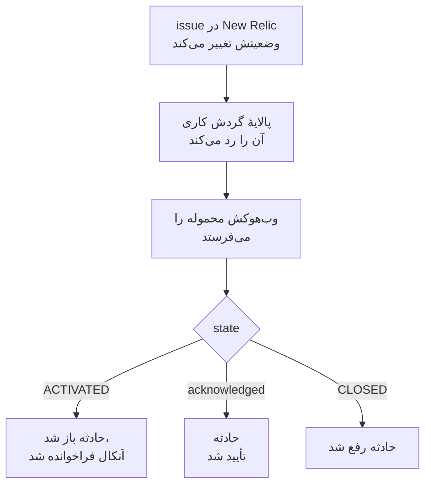

# New Relic

issueهای [New Relic](https://newrelic.com) را به OneUptime بفرستید تا هر issue به یک حادثه یا هشدار تبدیل شود که آنکال شما را فرا می‌خواند، وقتی کسی issue را تأیید کرد تأیید شود، و وقتی issue بسته شد رفع شود. New Relic issueهایش را از طریق یک [مقصد وب‌هوک](https://docs.newrelic.com/docs/alerts/get-notified/notification-integrations/) می‌فرستد، پس در هیچ طرفی چیزی برای نصب نیست.

:::cards
- [شروع با قالب](#شروع-با-قالب): تعیین کنید چه کسی فراخوانده شود، نشانی را کپی کنید، و ببینید هر issue چه می‌کند.
- [پیکربندی New Relic](#پیکربندی-new-relic): یک مقصد وب‌هوک، و گردش کاری‌ای که آن را خبر می‌کند.
- [آزمایش آن](#آزمایش-آن): خودتان یک issue بفرستید، سپس یکی از New Relic.
- [عیب‌یابی](#عیبیابی): وقتی issueها نمی‌رسند، یا حادثه‌ها باز می‌مانند.
:::

## چگونه کار می‌کند



یک گردش کاری در New Relic issueهایی را که باید فرستاده شوند با پالایهٔ خود برمی‌گزیند، و وقتی یکی فعال، تأیید یا بسته شود، یک مقصد وب‌هوک را با محموله JSON‌ای که New Relic پر می‌کند خبر می‌کند. شناسهٔ issue راهی است که OneUptime حادثه‌ای را که باز کرده پیدا می‌کند.

## پیش از شروع

- یک حساب New Relic که بتوانید در آن مقصد و گردش کاری بسازید.
- در OneUptime، اجازهٔ ساختن گردش کاری. در OneUptime Cloud، گردش‌های کاری به طرح **Growth** یا بالاتر نیاز دارند.

## شروع با قالب

اول OneUptime را راه بیندازید: نشانی‌ای را که New Relic به آن می‌فرستد، OneUptime به شما می‌دهد. پنجره **ساخت یک گردش کاری** دو قالب New Relic دارد، زیر **New Relic** در فهرست دسته‌هایش: **Declare an incident for each New Relic issue**، و برای هشدارها **Create an alert for each New Relic issue**. هر دو یک کار را می‌کنند، هر کدام با نوع رکورد خودش.

:::steps
1. به **گردش‌های کاری** بروید و روی **ساخت گردش کاری** کلیک کنید. زیر **یا از یک قالب شروع کنید**، **New Relic** را از فهرست دسته‌ها برگزینید، روی **Declare an incident for each New Relic issue** یا **Create an alert for each New Relic issue** کلیک کنید، و روی **استفاده از این قالب** کلیک کنید.
2. زیر **Who to page for new New Relic issues** سیاست‌های آنکالی را که باید فراخوانده شوند انتخاب کنید، یا هیچ‌کدام را تا کسی فراخوانده نشود، و روی **ساخت گردش کاری** کلیک کنید. گردش کاری در **سازنده** باز می‌شود، خاموش.
3. روی تریگر **Webhook** کلیک کنید، سپس روی **کپی نشانی**، و نشانی را برای New Relic نگه دارید.
4. در بالای **سازنده** گزینه **فعال** را روشن کنید. گردش کاری خاموش به New Relic با `400` پاسخ می‌دهد.
:::

سپس [New Relic را پیکربندی کنید](#پیکربندی-new-relic) تا issueهایش را به آن نشانی بفرستد. گام `read-event-1` گردش کاری با همان راه‌اندازی باز می‌شود، برای وقتی که در **سازنده** به آن برمی‌گردید.

### آنچه گردش کاری انجام می‌دهد

پس از تریگر **Webhook**، گام **Check With JavaScript** با شناسه `read-event-1` مقدار `state` را که New Relic می‌فرستد می‌خواند، و **Incident From Another Tool**، یا در قالب هشدار **Alert From Another Tool**، با شناسهٔ issue کاری را می‌کند که آن وضعیت می‌خواهد. حادثه شناسه را در فیلد سفارشی `newRelicIssueId` خود نگه می‌دارد.

| آنچه New Relic می‌فرستد | آنچه گردش کاری انجام می‌دهد |
| --- | --- |
| `state` برابر `ACTIVATED` یا `CREATED` است | حادثه‌ای با عنوان `New Relic: <issue>` اعلام می‌کند، با شدتی که اولویت issue به آن نگاشته می‌شود، و آن را از صفحه‌های وضعیت شما دور نگه می‌دارد. توضیحش به issue در New Relic پیوند می‌دهد و اولویت، موجودیت‌ها، سیاست‌ها و شرایط را فهرست می‌کند. سیاست‌های آنکالی را که برگزیدید فرا می‌خواند. همان issue دوباره، مثلاً وقتی New Relic آن را به CRITICAL ارتقا می‌دهد، حادثه دومی باز نمی‌کند و دوباره کسی را فرا نمی‌خواند. |
| `state` برابر `ACTIVATED` است و `isAcknowledged` برابر `true` | حادثهٔ issue را تأیید می‌کند، که تشدید آنکال را متوقف می‌کند. دلیلش روی خط زمانی آن است. |
| `state` برابر `CLOSED` است | حادثهٔ issue را رفع می‌کند، مگر اینکه از پیش رفع شده باشد. دلیلش روی خط زمانی آن است. |

تأیید یا بستن یک issue که حادثه ندارد چیزی را تغییر نمی‌دهد. هر چیز دیگری، مانند درخواستی از ابزاری دیگر، دست‌نخورده می‌ماند: `read-event-1` مسیر **No** را می‌گیرد، و **گام‌ها**ی اجرا دلیلش را می‌گویند. چیزی به New Relic برنمی‌گردد: New Relic issueهای خودش را وقتی سیگنال بهبود می‌یابد می‌بندد، و همین حادثه را رفع می‌کند.

### اولویت‌ها و فراخواندن

هر issue جدید، با هر اولویتی، سیاست‌های آنکالی را که برگزیدید فرا می‌خواند: New Relic یک issue را از HIGH به CRITICAL در همان issue ارتقا می‌دهد، پس منتظر CRITICAL ماندن هرگز برای issueهایی که با HIGH باز شدند و بدتر شدند کسی را فرا نمی‌خواند. برای اینکه برای issueهای کمتری فراخوانده شوید، پالایهٔ گردش کاری را در New Relic محدود کنید: فقط آنچه از آن بگذرد به OneUptime می‌رسد. در یک پروژه جدید، اولویت‌ها به این شدت‌های حادثه و هشدار نگاشته می‌شوند:

| اولویت New Relic | حادثه | هشدار | آنکال |
| --- | --- | --- | --- |
| CRITICAL | Critical Incident | High | فراخوانده می‌شود |
| HIGH | Major Incident | Low | فراخوانده می‌شود |
| MEDIUM | Minor Incident | Low | فراخوانده می‌شود |
| LOW | Minor Incident | Low | فراخوانده می‌شود |

با شدت‌های خودتان، CRITICAL به شدیدترین، HIGH به میانی، و MEDIUM و LOW به کم‌شدت‌ترین شما می‌روند. وقتی New Relic issue یک حادثه را ارتقا می‌دهد، حادثه شدتی را که با آن باز شد نگه می‌دارد.

برای نگاشت یک اولویت به یکی از شدت‌های خودتان با نام، `SEVERITY_BY_NAME` را در گام `read-event-1` ویرایش کنید، مانند `{ HIGH: 'Critical Incident' }`.

## پیکربندی New Relic

:::steps
### افزودن مقصد وب‌هوک

در New Relic، به **Alerts → Destinations** بروید و یک مقصد **Webhook** اضافه کنید. **Webhook name** را روی `OneUptime` و **Endpoint URL** را روی نشانی‌ای که از OneUptime کپی کردید بگذارید، و آن را ذخیره کنید. **Use authorization** را خاموش بگذارید: نشانی تنها اعتبارنامه است.

### افزودن گردش کاری

به **Alerts → Workflows** بروید و روی **Add a workflow** کلیک کنید. نامش را `OneUptime` بگذارید. پالایهٔ آن تعیین می‌کند کدام issueها به OneUptime برسند، مثلاً فقط issueهای CRITICAL، یا issueهای یک تیم.

### خبر دادن به مقصد

مقصد **Webhook**ی را که ساختید به گردش کاری اضافه کنید. محموله‌ای را که New Relic پر می‌کند نگه دارید، و یک خط برای `isAcknowledged` بعد از `state` اضافه کنید، تا حادثه همراه issue خود تأیید شود:

```json
{
  "id": {{ json issueId }},
  "issueUrl": {{ json issuePageUrl }},
  "title": {{ json annotations.title.[0] }},
  "priority": {{ json priority }},
  "impactedEntities": {{ json entitiesData.names }},
  "totalIncidents": {{ json totalIncidents }},
  "state": {{ json state }},
  "isAcknowledged": {{ json isAcknowledged }},
  "trigger": {{ json triggerEvent }},
  "isCorrelated": {{ json isCorrelated }},
  "createdAt": {{ createdAt }},
  "updatedAt": {{ updatedAt }},
  "sources": {{ json accumulations.source }},
  "alertPolicyNames": {{ json accumulations.policyName }},
  "alertConditionNames": {{ json accumulations.conditionName }},
  "workflowName": {{ json workflowName }}
}
```

خطی که باید اضافه شود `"isAcknowledged": {{ json isAcknowledged }},` است. سپس روی **Update message** کلیک کنید.

### خبر دادن هنگام فعال شدن، تأیید و بسته شدن

روی سه نقطهٔ مقصد کلیک کنید و **Notify when** را برگزینید. **Activated**، **Acknowledged** و **Closed** را روشن نگه دارید.

### فعال کردن گردش کاری

روی **Activate workflow** کلیک کنید.
:::

گردش کاری OneUptime این فیلدهای محموله را می‌خواند، و بقیه را دست‌نخورده می‌گذارد:

| فیلد | آنچه New Relic در آن می‌گذارد |
| --- | --- |
| `id` | شناسهٔ issue. |
| `issueUrl` | پیوندی به issue در New Relic. |
| `title` | عنوان issue. |
| `priority` | فوریت issue: `CRITICAL`, `HIGH`, `MEDIUM` یا `LOW`. |
| `state` | وضعیت issue: `CREATED`, `ACTIVATED` یا `CLOSED`. |
| `isAcknowledged` | `true` وقتی کسی issue را در New Relic تأیید کند. |
| `impactedEntities` | نام موجودیت‌هایی که issue درباره آن‌هاست. |
| `alertPolicyNames` | نام سیاست‌هایی که پشت issue هستند. |
| `alertConditionNames` | نام شرط‌هایی که پشت issue هستند. |

## آزمایش آن

یک issue را همان‌طور که New Relic می‌فرستد، به نشانی‌ای که کپی کردید بفرستید:

```bash
curl -X POST "<url>" \
  -H "Content-Type: application/json" \
  -d '{
    "id": "7d4a2e1c-3b5f-4c8e-9a1d-2f6b8c0e4a71",
    "issueUrl": "https://radar-api.service.newrelic.com/accounts/1234567/issues/7d4a2e1c-3b5f-4c8e-9a1d-2f6b8c0e4a71?notifier=WEBHOOK",
    "title": "High CPU on checkout-service",
    "priority": "CRITICAL",
    "impactedEntities": ["checkout-service"],
    "state": "ACTIVATED",
    "isAcknowledged": false,
    "alertPolicyNames": ["Production"],
    "alertConditionNames": ["CPU above 90%"]
  }'
```

حادثه‌ای با عنوان `New Relic: High CPU on checkout-service` باز می‌شود، و سیاست‌های آنکالی که برگزیدید فراخوانده می‌شوند. همان درخواست را با `isAcknowledged` روی `true` بفرستید، و حادثه تأیید می‌شود. آن را با `state` روی `CLOSED` بفرستید، و حادثه رفع می‌شود.

سپس از New Relic آزمایش کنید: پیام وب‌هوک گردش کاری را باز کنید، و روی **Send test notification** کلیک کنید. برای دیدن اینکه رسیده است، در گردش کاری OneUptime **لاگ‌ها** > **اجراها** را باز کنید.

## عیب‌یابی

:::details چیزی به OneUptime نمی‌رسد
- بررسی کنید که گردش کاری در New Relic فعال باشد، و پالایه‌اش issue را بگذراند.
- بررسی کنید که **Endpoint URL** مقصد نشانی تریگر **Webhook** باشد.
- گردش کاری خاموش با `400` پاسخ می‌دهد. در بالای **سازنده** آن، **فعال** را روشن کنید.
:::

:::details گردش کاری اجرا می‌شود، اما چیزی باز نمی‌کند
اجرا را در **لاگ‌ها** > **اجراها** باز کنید. مدخل `read-event-1` در **گام‌ها**ی آن می‌گوید چرا **No** را گرفته است.

- `New Relic named no issue ID`: خط `"id": {{ json issueId }},` را در محموله نگه دارید.
- `is in no state`: خط `"state": {{ json state }},` را در محموله نگه دارید.
:::

:::details حادثه‌ها تأیید نمی‌شوند
- محموله به خط `"isAcknowledged": {{ json isAcknowledged }},` نیاز دارد. بدون آن، حادثه‌ای باز می‌شود و همراه issue خود رفع می‌شود، اما هرگز تأیید نمی‌شود.
- گردش کاری در New Relic باید **Acknowledged** را زیر **Notify when** روشن نگه دارد.
:::

:::details حادثه‌ها باز می‌شوند اما هرگز رفع نمی‌شوند
- گردش کاری در New Relic باید **Closed** را زیر **Notify when** روشن نگه دارد.
- اجرای بستن را در **لاگ‌ها** > **اجراها** باز کنید: آخرین گامش دلیلش را می‌گوید. `id` بستن باید شناسهٔ همان issue باشد، پس `"id": {{ json issueId }},` را در محموله همان‌طور که هست نگه دارید.
:::

:::details آنکال برای issueهای بیش از حد فراخوانده می‌شود
هر issue جدیدی که به OneUptime می‌رسد فرا می‌خواند. پالایهٔ گردش کاری را در New Relic محدود کنید، تا فقط issueهایی که باید فرا بخوانند به آن برسند. [اولویت‌ها و فراخواندن](#اولویتها-و-فراخواندن) را ببینید.
:::

:::details آنکال فراخوانده نمی‌شود
- اعلانی برای یک issue که حادثه‌اش هست دوباره کسی را فرا نمی‌خواند، پس ارتقا به CRITICAL کسی را فرا نمی‌خواند.
- اگر در پنجره **ساخت یک گردش کاری** هیچ‌کس انتخاب نشده باشد، گردش کاری گامی که فرا بخواند ندارد.
:::

## امنیت

- **با نشانی مانند یک گذرواژه رفتار کنید.** هر کسی که آن را داشته باشد می‌تواند حادثه باز کند. اگر لو رفت، روی **بازنشانی نشانی** در تریگر **Webhook** گردش کاری کلیک کنید. سپس **Endpoint URL** مقصد را در New Relic به‌روزرسانی کنید.
- **پیوندها به New Relic می‌روند.** قالب، هر چه یک درخواست بگوید، یک issue را فقط روی یک سایت New Relic پیوند می‌دهد، و آنچه New Relic فرستاده را به‌صورت متن می‌نویسد.
- **خودمیزبان؟** New Relic وب‌هوک‌ها را از اینترنت می‌فرستد، پس OneUptime شما باید از اینترنت با HTTPS در دسترس باشد.

## گام‌های بعدی

:::cards
- [قالب‌های گردش کاری](/docs/workflows/authoring): یک گردش کاری از یک قالب بسازید، و آن را در سازنده تغییر دهید.
- [Datadog](/docs/integrations/datadog): همان قالب، برای مانیتورهای Datadog.
- [قواعد تشدید](/docs/on-call/escalation-rules): تعیین کنید یک سیاست آنکال چه کسی را و کی فرا بخواند.
- [نمای کلی یکپارچه‌سازی‌ها](/docs/integrations/index): ابزارهای دیگری که می‌توانید وصل کنید.
:::
