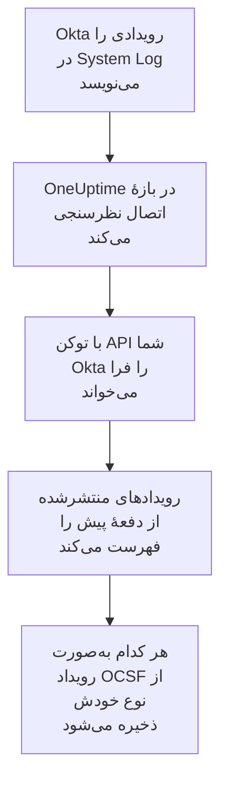

# لاگ سیستم Okta

[Okta System Log](https://developer.okta.com/docs/reference/system-log-query/) را به رویدادهای امنیتی OneUptime وارد کنید: ورودها، چالش‌های MFA، تغییرات حساب و گروه، و تشخیص‌های تهدید خود Okta. آنجا آن‌ها را کنار لاگ‌ها، ترِیس‌ها و متریک‌هایتان جستجو می‌کنید، با هر منبع دیگری هم‌بسته می‌کنید، و برای آن‌هایی که مهم‌اند آنکال را فرا می‌خوانید. OneUptime آن‌ها را با یک توکن API که خودتان می‌سازید می‌خواند، و هیچ چیزی را در Okta تغییر نمی‌دهد.

:::cards
- [راه‌اندازی اتصال](#راهاندازی-اتصال): یک توکن API، و فرم اتصال.
- [چه چیزی وارد می‌شود](#چه-چیزی-وارد-میشود): کدام رویدادها، و هر کدام چگونه به یک رویداد امنیتی تبدیل می‌شود.
- [نظرسنجی چگونه کار می‌کند](#نظرسنجی-چگونه-کار-میکند): پنجره‌ای که هر نظرسنجی می‌خواند، و اینکه چرا ۱۵ دقیقه هم‌پوشانی دارد.
- [عیب‌یابی](#عیبیابی): معنای هر خطا، و آنچه باید تغییر دهید.
:::

## چگونه کار می‌کند



OneUptime هر دقیقه از هر اتصال فعالی که بازهٔ نظرسنجی‌اش گذشته باشد نظرسنجی می‌کند. یک نظرسنجی رویدادهای System Log منتشرشده از نظرسنجی پیش را از Okta می‌خواهد، و هر کدام را به‌صورت یک رویداد [OCSF](https://schema.ocsf.io/) ذخیره می‌کند: یک ورود به‌صورت رویداد Authentication، یک ویرایش حساب به‌صورت Account Change، و یک تشخیص Okta به‌صورت Detection Finding. از آن پس قاعده‌های تشخیص، مانیتورها و داشبوردها با آن مانند یک رویداد امنیتی از هر منبع دیگری رفتار می‌کنند. با هر سلول Okta، یعنی `okta.com`، `oktapreview.com` و `okta-emea.com`، و با سازمانی روی دامنهٔ سفارشی کار می‌کند.

## پیش از شروع

- در OneUptime، نقش Project Owner، Project Admin یا Security Admin. Security Member و Security Viewer می‌توانند اتصال‌ها و تاریخچهٔ اجرایشان را ببینند، اما نمی‌توانند آن‌ها را تغییر دهند.
- یک مدیر Okta که بتواند System Log را ببیند، برای ساختن توکن. یک توکن هر کاری را که مدیرش می‌تواند انجام می‌دهد، پس از یک Read-only Administrator استفاده کنید: System Log را می‌خواند و هیچ چیزی را تغییر نمی‌دهد. یک مدیر فقط‌خواندنی کاربران، گروه‌ها، برنامه‌ها و تنظیمات را هم می‌بیند، پس توکن را به اندازهٔ یک رمز عبور امن نگه دارید.
- در حالت ایده‌آل، یک حساب سرویس برای آن مدیر. Okta توکنی را وقتی غیرفعال می‌کند که مدیرش غیرفعال شود، و وقتی ۳۰ روز بی‌استفاده بماند. نظرسنجی هر چند دقیقه از آن استفاده می‌کند، پس تا وقتی اتصال فعال است در استفاده می‌ماند.
- اگر سازمان شما فقط از یک ناحیهٔ شبکه فراخوانی API می‌پذیرد، ناحیه‌ای که نشانی‌هایی را که OneUptime از آن‌ها فرا می‌خواند در بر دارد: در OneUptime Cloud، نشانی‌های خروجی آن، و در یک نصب خودمیزبان، نشانی عمومی میزبان‌های برنامه و کارگر شما.

## راه‌اندازی اتصال

:::steps
### ساختن یک توکن API

1. به‌عنوان مدیر فقط‌خواندنی به **Admin Console** در Okta وارد شوید.
2. **Security → API** را باز کنید، سپس زبانهٔ **Tokens** را، و **Create token** را برگزینید.
3. نامی به آن بدهید، برای نمونه `OneUptime security events`. زیر محل‌هایی که فراخوانی‌هایش می‌توانند از آن‌ها بیایند، **Any IP** را نگه دارید، مگر اینکه سازمان شما به یک ناحیه نیاز داشته باشد.
4. **Create token** را برگزینید، و **Token Value** را کپی کنید. Okta آن را یک بار نشان می‌دهد.

هر توکن می‌تواند سهمی از محدودیت نرخ API سازمان را به کار ببرد، که ردیف آن در زبانهٔ **Tokens** نشان می‌دهد. یک نظرسنجی حداکثر ۲۰ درخواست می‌فرستد، پس سهم پیش‌فرض کافی است، مگر اینکه ابزارهای دیگر از همان توکن استفاده کنند.

### افزودن اتصال در OneUptime

**محصولات** > **رویدادهای امنیتی** > **اتصال‌ها** (`/dashboard/{projectId}/security-events/connections`) را باز کنید، روی **افزودن اتصال** کلیک کنید، **Okta System Log** را برگزینید، و روی **بعدی** کلیک کنید. تنظیمات جدول زیر را پر کنید، روی **بعدی** کلیک کنید، و توکن را در **API token** بچسبانید.

### آزمایش پیش از ذخیره

روی **آزمودن این تنظیمات** زیر **آزمایش پیش از ذخیره** کلیک کنید. آزمایش با مقدارهای فرم وارد می‌شود و رویدادها را می‌خواند، و چیزی ذخیره نمی‌کند، پس نشانی نادرست یا یک پالایهٔ بد پیش از ساخته شدن اتصال آشکار می‌شود. سپس روی **بعدی** کلیک کنید، به اتصال یک **نام** بدهید، و آن را بسازید.
:::

| تنظیم | چه چیزی وارد کنید |
| --- | --- |
| **Okta organization URL** | نشانی‌ای که کاربرانتان در آن وارد می‌شوند، مانند `https://acme.okta.com`، `https://acme.oktapreview.com` یا `https://login.example.com`. باید از `https` استفاده کند، بدون مسیر. نه نشانی `-admin` در Admin Console، که API را ارائه نمی‌کند. |
| **Event filter** | اختیاری. یک [پالایهٔ System Log](https://developer.okta.com/docs/reference/core-okta-api/#filter) که رویدادهای وارد شدنی را برمی‌گزیند، مانند `eventType sw "user.session" or eventType sw "security"`. خالی، خانواده‌های زیر را وارد می‌کند. حداکثر ۲٬۰۰۰ نویسه، در یک خط، و نه روی `published`: OneUptime بازهٔ زمانی را خودش تعیین می‌کند. |
| **API token** | مقدار توکن، به‌تنهایی: OneUptime طرح `SSWS` را خودش می‌افزاید. رمزگذاری می‌شود، API هرگز آن را برنمی‌گرداند و دیگر هرگز نشان داده نمی‌شود. آن را با **به‌روزرسانی اطلاعات ورود** روی اتصال جایگزین کنید. |

گام **فراخوانی دوره‌ای** همچنین یک **توضیحات** اختیاری دارد، **فاصله فراخوانی (دقیقه)**، یک عدد صحیح از `1` تا `1440` که با `5` شروع می‌شود، و **فعال**، که از آغاز روشن است.

## چه چیزی وارد می‌شود

بدون **Event filter**، OneUptime خانواده‌های رویدادی را که یک تیم امنیتی زیر نظر دارد، بر پایهٔ پیشوند `eventType`، وارد می‌کند. پالایهٔ خودتان این فهرست را جایگزین می‌کند، نه اینکه به آن بیفزاید:

| پیشوند | رویدادها |
| --- | --- |
| `user.session` | ورودها و خروج‌ها، دسترسی به Admin Console، ورود به‌جای کاربر دیگر |
| `user.authentication` | نتیجه‌های احراز هویت، از جمله ورود یکپارچه |
| `user.mfa` | ثبت عامل، چالش‌ها و بازنشانی‌ها |
| `user.account` | تغییر و بازنشانی رمز عبور، قفل شدن‌ها، تغییرات نمایه و امتیاز |
| `user.lifecycle` | کاربرانی که ساخته، فعال، معلق، غیرفعال و حذف شده‌اند |
| `security.` | ThreatInsight، گزارش‌های فعالیت مشکوک و دیگر تشخیص‌های Okta |
| `policy.` | ارزیابی‌های سیاست ورود، و تغییرات سیاست |
| `system.api_token` | توکن‌های API ساخته‌شده و ابطال‌شده |
| `application.user_membership` | تخصیص برنامه‌ها |
| `group.user_membership` | تغییرات عضویت گروه |

هر رویداد به یک رویداد OCSF تبدیل می‌شود، با فروشندهٔ `Okta` و محصول `Okta System Log`، از کلاسی که `eventType` آن می‌طلبد:

| `eventType` | کلاس OCSF | فعالیت |
| --- | --- | --- |
| `user.session.start` | Authentication (`3002`) | `Logon` |
| `user.session.end` | Authentication (`3002`) | `Logoff` |
| `user.authentication.*` | Authentication (`3002`) | `Logon` |
| `user.mfa.*` | Authentication (`3002`) | `Authentication Ticket` |
| رویدادهای دیگر `user.session.*` | Authentication (`3002`) | `Other` |
| `user.account.*`، `user.lifecycle.*` | Account Change (`3001`) | آخرین بخش نوع رویداد، مانند `Update Password` |
| `group.*` | Group Management (`3006`) | آخرین بخش نوع رویداد، مانند `Add` |
| `security.*`، و یک `policy.evaluate_sign_on` که دسترسی را رد کرد | Detection Finding (`2004`) | `Create`، با نوع رویداد به‌عنوان نام قاعده |
| هر چیز دیگر | `0`، به نام نوع رویداد | آخرین بخش نوع رویداد |

رویدادی که در هیچ‌کدام از این کلاس‌ها نمی‌گنجد باز هم هر فیلد را نگه می‌دارد، و بر پایهٔ هر کدام از آن‌ها جستجوپذیر می‌ماند. هر رویداد این ستون‌ها را پر می‌کند:

| فیلد Okta | ستون OneUptime |
| --- | --- |
| `uuid` | UID رویداد، که تکراری‌ها هم بر پایهٔ آن کنار گذاشته می‌شوند |
| `published`، وقتی رویداد رخ داد | زمان رویداد |
| `displayMessage`، وگرنه نوع رویداد و `outcome.reason` | پیام |
| `severity`: `DEBUG` و `INFO` Informational هستند، `WARN` Medium، `ERROR` High | شدت |
| `outcome.result`، مانند `SUCCESS`، `FAILURE`، `ALLOW` یا `DENY` | وضعیت |
| `actor.alternateId`، وگرنه `actor.displayName`؛ `client.ipAddress` | کاربر و IP اصلی |
| `alternateId` مربوط به `User` در `target` | کاربر هدف |
| `alternateId` مربوط به `AppInstance` در `target` | منبع هدف |
| کنشگر، هر هدف و IP کلاینت | Observableها |
| کل رویداد، تخت‌شده به کلیدهای نقطه‌دار، مانند `client.userAgent.browser` و `debugContext.debugData.requestUri` | `attributes` |

ورود ناموفق یا ردشده در `INFO` به Low بالا برده می‌شود، تا از یک ورود موفق متمایز شود. System Log هیچ ارجاع MITRE ATT&CK ندارد، پس آن ستون‌ها خالی می‌مانند.

## نظرسنجی چگونه کار می‌کند

هر نظرسنجی رویدادهای منتشرشده در پنجره‌اش را، قدیمی‌ترین‌ها اول، ۱٬۰۰۰ تا در هر صفحه، فهرست می‌کند، و پیوند `next` را که Okta می‌فرستد تا آخرین صفحه دنبال می‌کند:

```text
GET {Okta organization URL}/api/v1/logs?since={window start}&until={window end}&sortOrder=ASCENDING&limit=1000&filter={Event filter}
```

- **زمان انتشار، نشانگر است.** یک رویداد System Log خودِ فعالیت است، پس `published` هم زمان رخ دادن آن است و هم چیزی که نظرسنجی می‌خواند.
- **نخستین نظرسنجی ۲۴ ساعت به عقب نگاه می‌کند**، پس یک اتصال تازه بی‌درنگ رویدادهای اخیرش را نشان می‌دهد.
- **هر نظرسنجی بعدی ۱۵ دقیقه پیش از نشانگر ذخیره‌شده شروع می‌شود.** Okta هشدار می‌دهد که درخواستی با زمان پایان ممکن است رویدادهای دیرکرده را جا بیندازد، که آن را نادر می‌خواند. هم‌پوشانی آن‌ها را در نظرسنجی بعدی می‌خواند. رویدادی که بیش از ۱۵ دقیقه دیر کند ممکن است پشت نشانگر بیفتد: بازهٔ زمانی آن را وارد کنید تا بازیابی شود.
- **یک نظرسنجی حداکثر ۲۴ ساعت پس از نشانگر را می‌خواند.** اتصالی که نشانگرش عقب افتاده، در رشته‌ای از پنجره‌های ۲۴ ساعته جبران می‌کند، و **سلامت** آن **Catching up** را نشان می‌دهد.
- **تکراری‌ها بر پایهٔ `uuid` کنار گذاشته می‌شوند**، درون پروژه، پس هم‌پوشانی، پنجره‌ای که دوباره امتحان شده و یک وارد کردن هرگز یک رویداد را دو بار ذخیره نمی‌کنند.

پیوند `next` که به جایی جز **Okta organization URL** شما اشاره کند هرگز دنبال نمی‌شود، چون توکن با هر درخواست می‌رود.

### وقتی یک پنجره بیش از توان یک نظرسنجی دارد

یک نظرسنجی حداکثر ۱۰٬۰۰۰ رویداد را، در حداکثر ۲۰ درخواست، می‌خواند. وقتی پنجره‌ای بیشتر از این داشته باشد، اجرا **جزئی** است، با هشداری مانند:

```text
Stopped after collecting 10000 events; the window holds more. The last event read was published at 2026-09-14T08:12:44.000Z.
```

رویدادها قدیمی‌ترین‌ها اول خوانده می‌شوند، پس OneUptime نشانگر را به زمان انتشار آخرین رویدادی که خوانده می‌برد، و نظرسنجی بعدی از آنجا، بدون هم‌پوشانی ۱۵ دقیقه‌ای، با همان طول پنجره شروع می‌شود. یک سازمان پرکار در هر نظرسنجی ۱۰٬۰۰۰ رویداد جبران می‌کند، به جای اینکه همان رویدادها را دوباره بخواند. هم‌پوشانی وقتی برمی‌گردد که نشانگر ۱۵ دقیقه از آن نقطه جلوتر رفته باشد.

وقتی یک اجرا اصلاً نتواند از نشانگر ذخیره‌شده جلوتر برود، برای نمونه چون فقط ۱۵ دقیقهٔ هم‌پوشانی بیش از ۱۰٬۰۰۰ رویداد دارد، OneUptime به جای آن پنجره را کوتاه می‌کند:

1. **باریک کردن.** نظرسنجی بعدی پنجره‌ای به نصف طول را از همان نقطهٔ شروع می‌خواند، و تا وقتی پنجره‌ای کامل خوانده شود دوباره نصف می‌کند، تا حداقل یک دقیقه. هشدار اجرا همین را می‌گوید: `This window holds more records than one poll can read; the next poll reads a {n} minute window from the same starting point.`
2. **دوباره بزرگ کردن.** پس از اینکه پنجره‌ای کامل خوانده شد، پنجرهٔ بعدی دوباره دو برابر می‌شود، تا ۲۴ ساعت.
3. **گذشتن از یک دقیقهٔ تنها.** اگر حتی یک دقیقه بیش از توان یک نظرسنجی داشته باشد، نظرسنجی از آن می‌گذرد، تا رویدادهای تازه‌تر همچنان برسند، و هم‌پوشانی نظرسنجی‌های بعدی دیگر به آن نمی‌رسد. اجرا **جزئی** می‌ماند، و **آخرین خطا** این را نشان می‌دهد: `More records were created in the one minute from {cursor} to {end} than one poll can read. Polling moved past this minute so newer records keep arriving; use Import this time range in Diagnostics on this minute to recover what one run can read.` آن دقیقه را با **Import this time range** وارد کنید تا آنچه یک اجرا می‌تواند بخواند بازیابی شود، یا **Event filter** را باریک‌تر کنید.

اجرایی که با خطایی از Okta یکسره شکست بخورد، نشانگر و طول پنجره را نگه می‌دارد، و نظرسنجی بعدی همان پنجره را دوباره می‌خواند. تنها استثنا درخواستی است که زمانش سر رسیده: نشانگر می‌ماند، اما پنجرهٔ بعدی نصف طول می‌شود، چون پنجره‌ای که برای پاسخ به‌موقع بیش از حد سنگین است در هر تلاش به پایان زمان می‌خورد. تغییر **فاصله فراخوانی (دقیقه)** هیچ‌کدام از این‌ها را تغییر نمی‌دهد: این تنظیم تعیین می‌کند یک نظرسنجی هر چند وقت شروع شود، نه اینکه پنجره‌اش از کجا شروع شود.

### اجرا، پیش‌نمایش و وارد کردن در صورت نیاز

روی **عیب‌یابی** یک اتصال کلیک کنید تا اجراهای اخیرش را ببینید و دستی با آن کار کنید. هر کسی که بتواند اتصال را تغییر دهد می‌تواند این‌ها را شروع کند؛ هر کسی که بتواند آن را ببیند می‌تواند تاریخچه را بخواند.

- **اجرای اکنون** بی‌درنگ یک نظرسنجی با نشانگر معمول شروع می‌کند، حتی وقتی اتصال **فعال** نیست.
- **Preview log events** یک بازهٔ زمانی تا ۷ روز را می‌خواند و چیزی وارد نمی‌کند.
- **Import this time range** پس از تأیید شما بازه‌ای تا ۷ روز را وارد می‌کند، بی‌آنکه نشانگر را جابه‌جا کند. رویدادهایی که پیش‌تر وارد شده‌اند رد می‌شوند. Okta لاگ سیستم را ۹۰ روز نگه می‌دارد.
- **Copy diagnostics** روی یک اجرا، گزارش آن را برای پشتیبانی کپی می‌کند. هرگز اعتبارنامه‌ها را در بر ندارد.

## آزمایش اتصال

**آزمایش اتصال** در ردیف یک اتصال، و **آزمودن این تنظیمات** در فرم، در فرایند API اجرا می‌شوند، نه در یک کارگر پس‌زمینه، پس یک آزمایش حتی وقتی مشکل از کارگرهاست هم پاسخ می‌دهد. این بررسی‌ها را به ترتیب انجام می‌دهد:

| بررسی | چه چیزی را بررسی می‌کند |
| --- | --- |
| **پیکربندی** | هر تنظیم موجود و درست‌شکل است. وقتی این شکست بخورد با هیچ جایی تماس گرفته نمی‌شود. |
| **Authenticate with Okta** | Okta توکن را برای System Log می‌پذیرد، با خواندن یک رویداد و بدون پالایه. |
| **Read System Log events** | یک رویداد از ۲۴ ساعت گذشته را می‌توان از طریق پالایه‌ای که نظرسنجی به کار می‌برد، پالایهٔ شما یا پیش‌فرض، خواند، پس یک **Event filter** بد اینجا شکست می‌خورد نه در نخستین نظرسنجی. |
| **Events available to import** | چند رویداد در ۲۴ ساعت گذشته و ۷ روز گذشته منتشر شده است، برای هر کدام یک صفحه با ۱٬۰۰۰ رویداد، پس `1000+` یعنی بیشتر. هیچ رویدادی در ۷ روز یک هشدار است، نه یک شکست. |
| **Background workers**، **Poll scheduler**، **Security event storage** | سمت خود OneUptime: فرایندی کارهای صف Worker را برمی‌دارد، کار نظرسنجی هر دقیقه اجرا می‌شود، و انبارهٔ رویدادهای امنیتی پاسخ می‌دهد. |
| **Scheduled polling** | برای یک اتصال ذخیره‌شده: نظرسنجی روشن است، هیچ اجرایی در انتظار یک کارگر گیر نکرده، و نظرسنجی‌ها به‌موقع اجرا می‌شوند. |

هر درخواست در یک آزمایش مهلتی ۲۰ ثانیه‌ای دارد. یک آزمایش هرگز چیزی وارد نمی‌کند یا نشانگر را جابه‌جا نمی‌کند، و هر بررسی شکست‌خورده می‌گوید چه چیزی را تغییر دهید.

## عیب‌یابی

**آخرین خطا** اتصال پیام خطای کامل را، با اعتبارنامه‌های پوشانده‌شده، پشت پیشوندی نگه می‌دارد که گام شکست‌خورده را نام می‌برد. وقتی اتصالی خطا دارد، برای خواندنش **مشاهده خطا** را در ستون **اقدام‌ها** آن برگزینید، و برای کپی کردنش **کپی خطا** را در کادر گفتگو. هر پیام با `Okta System Log events request` شروع می‌شود، و کد خطای خود Okta را پس از وضعیت نقل می‌کند؛ آنچه پس از آن می‌آید را بخوانید.

:::details Last Error می‌گوید `failed (HTTP 400)`
Okta پارامترهای درخواست را رد کرد، `E0000053`. وقتی توکن کار می‌کرد، این تقریباً همیشه **Event filter** است: عملگرهای آن، `eq`، `ne`، `co`، `sw`، `ew`، `pr`، `gt`، `ge`، `lt` و `le`، `and` و `or` آن، و نقل‌قول‌های دوتایی دور مقدارهایش را بررسی کنید، یا آن را خالی کنید تا خانواده‌های پیش‌فرض به کار روند. در یک وارد کردن، ممکن است یعنی بازه بیش از ۱۸۰ روز پیش شروع می‌شود.
:::

:::details Last Error می‌گوید `failed (HTTP 401)` یا `failed (HTTP 403)`
- `HTTP 401`: Okta توکن را نپذیرفت، `E0000011`. باطل شده، ۳۰ روز بی‌استفاده مانده، یا همراه مدیرش غیرفعال شده است؛ یا با `SSWS` یا یک نویسهٔ اضافه چسبانده شده است. به‌عنوان مدیر فقط‌خواندنی یک توکن تازه بسازید، و آن را با **به‌روزرسانی اطلاعات ورود** ذخیره کنید.
- `HTTP 403`: توکن وارد می‌شود، اما مدیرش نمی‌تواند System Log را بخواند، `E0000006`. آن را به‌عنوان یک Read-only Administrator یا یک Super Administrator بسازید، و بررسی کنید که ناحیهٔ شبکهٔ آن نشانی‌هایی را که OneUptime از آن‌ها فرا می‌خواند مجاز می‌داند.
:::

:::details Last Error می‌گوید `failed (HTTP ...)` با وضعیتی دیگر
- `HTTP 404`: این نشانی API در Okta را ارائه نمی‌کند. نشانی خود سازمان را به کار ببرید، مانند `https://acme.okta.com`، بدون مسیر و نه نشانی `-admin`.
- `HTTP 3xx`: Okta درخواست را تغییر مسیر داد، و تغییر مسیرها رد می‌شوند، چون توکن با هر درخواست می‌رود. نشانی خود سازمان را به کار ببرید.
- `HTTP 429`: Okta توکن را محدود می‌کند، `E0000047`. نظرسنجی بعدی دوباره تلاش می‌کند. اگر تکرار شد، سهم توکن از محدودیت نرخ را در زبانهٔ **Tokens** بالا ببرید، به OneUptime یک توکن مخصوص خودش بدهید، یا کمتر نظرسنجی کنید.
- `HTTP 5xx`: Okta شکست خورد، یا پرس‌وجو از محدودیت ۳۰ ثانیه‌ای Okta گذشت، `E0000009`. نظرسنجی بعدی دوباره تلاش می‌کند؛ اگر تکرار شد، [status.okta.com](https://status.okta.com) را بررسی کنید.
:::

:::details Last Error می‌گوید `returned` یا `did not complete`
- `returned a non-JSON body.` یا `returned an unrecognized response shape`: چیزی جز API در Okta پاسخ داد، مانند یک صفحهٔ ورود یا یک پراکسی، یا Okta با یک خطا پاسخ داد. این گزارش می‌شود به جای اینکه یک پنجرهٔ خالی به حساب آید، پس نشانگر هرگز از رویدادهایی که کسی نخوانده جلوتر نمی‌رود.
- `returned a next link outside the Okta organization URL`: یک پیوند `next` به جای دیگری اشاره می‌کرد، و دنبال نشد. خود Okta هرگز این کار را نمی‌کند: دنبال پراکسی‌ای بگردید که سرآیندها را بازنویسی می‌کند.
- `did not complete`: درخواست هیچ پاسخی نگرفت: پایان زمان، نامی که به نشانی تبدیل نمی‌شود، گواهی‌ای که OneUptime به آن اعتماد ندارد، یا نشانی ردشده. بررسی کنید که برنامه و کارگرهای OneUptime بتوانند از طریق HTTPS، و از راه هر پراکسی‌ای که به کار می‌برید، به سازمان شما برسند.
:::

:::details Last Polled برابر Never است و Last Error خالی است
هیچ نظرسنجی‌ای برای این اتصال تمام نشده است. **آزمایش اتصال** را اجرا کنید: بررسی‌های **Background workers** و **Poll scheduler** آن علت را نام می‌برند. در یک نصب خودمیزبان، علت معمول `DISABLE_QUEUE_WORKERS=true` روی برنامه است، بدون استقرار کارگر جداگانه‌ای که کارها را بردارد: آن را روی `false` بگذارید، یا استقرار کارگر را اجرا کنید (Helm: `worker.enabled: true`).
:::

:::details یک اجرا Partial است
- `Stopped after collecting 10000 events`: پنجره بیش از ۱۰٬۰۰۰ رویدادی داشت که یک اجرا می‌خواند. چیزی از دست نمی‌رود: نظرسنجی بعدی پس از آخرین رویداد خوانده‌شده شروع می‌شود. اتصالی که نظرسنجی پس از نظرسنجی **جزئی** می‌ماند در حال جبران یک انباشت است، و **آخرین فراخوانی** و **آخرین رویداد واردشده** آن همچنان جلو می‌روند. اگر هرگز جبران نکند، سازمان بیش از آنچه یک بازهٔ نظرسنجی جا دارد رویداد جور منتشر می‌کند: **Event filter** را باریک کنید، یا **فاصله فراخوانی (دقیقه)** را کوتاه کنید.
- `More records were created in the one minute from ... than one poll can read`: نظرسنجی از آن دقیقه گذشت. آن را با **Import this time range** در **عیب‌یابی** وارد کنید. یک وارد کردن به اندازهٔ یک نظرسنجی می‌خواند.
:::

:::details آزمایش موفق است، اما چیزی وارد نمی‌شود
**Events available to import** را در گزارش آزمایش بخوانید. با پالایهٔ پیش‌فرض، سازمانی که هر تعداد کاربری داشته باشد پیوسته ورودها را منتشر می‌کند، پس `0` در ۷ روز گذشته یعنی نشانی یک sandbox یا یک سازمان بی‌استفاده است. با **Event filter** خودتان، یعنی پالایه با هیچ چیزی جور نشده است: آن را با نوع‌های رویداد در System Log در Admin Console مقایسه کنید.
:::

## چه به دست می‌آورید

- **جستجو.** ورودها، نتیجه‌های MFA، تغییرات حساب و تشخیص‌های Okta را در کاوشگر رویدادهای امنیتی، کنار هر منبع دیگری، بر پایهٔ شدت، وضعیت، کاربر، IP یا هر observable پالایش کنید.
- **هم‌بسته‌سازی.** کاربران، برنامه‌ها و IPهای هر رویداد به‌صورت observable نمایه می‌شوند، پس یک جستجو هر کاری را که یک کاربر کرده، کنار لاگ‌های خود برنامهٔ او، پیدا می‌کند.
- **قاعده‌های تشخیص.** قاعده‌های Sigma که بر اساس زمان‌بندی روی رویدادهای امنیتی شما اجرا می‌شوند، مانند ورودهای ناموفق برای هر IP یا ردهای MFA برای هر کاربر، و هشدارهایی باز می‌کنند که آنکال را فرا می‌خوانند.
- **مانیتورها.** مانیتورهای رویدادهای امنیتی رویدادهای جور را می‌شمارند و پس از گذشتن از یک آستانه حادثه یا هشدار باز می‌کنند.

رویدادهای امنیتی مانند بقیهٔ تله‌متری شما، بر اساس هر گیگابایت دریافت‌شده صورت‌حساب می‌شوند. [قیمت‌گذاری](https://oneuptime.com/pricing) را ببینید.

## گام‌های بعدی

:::cards
- [رویدادهای امنیتی](/docs/telemetry/security-events): آنچه را وارد می‌کنید جستجو و هم‌بسته کنید و روی آن هشدار بگیرید.
- [AWS Security Hub](/docs/integrations/aws-security-hub): یافته‌های ابر خود را هم وارد کنید.
- [نقش‌ها](/docs/permissions/reference#نقشها): آنچه نقش‌های Security می‌توانند ببینند و تغییر دهند.
- [نمای کلی یکپارچه‌سازی‌ها](/docs/integrations/index): ابزارهای دیگری که می‌توانید وصل کنید.
:::
