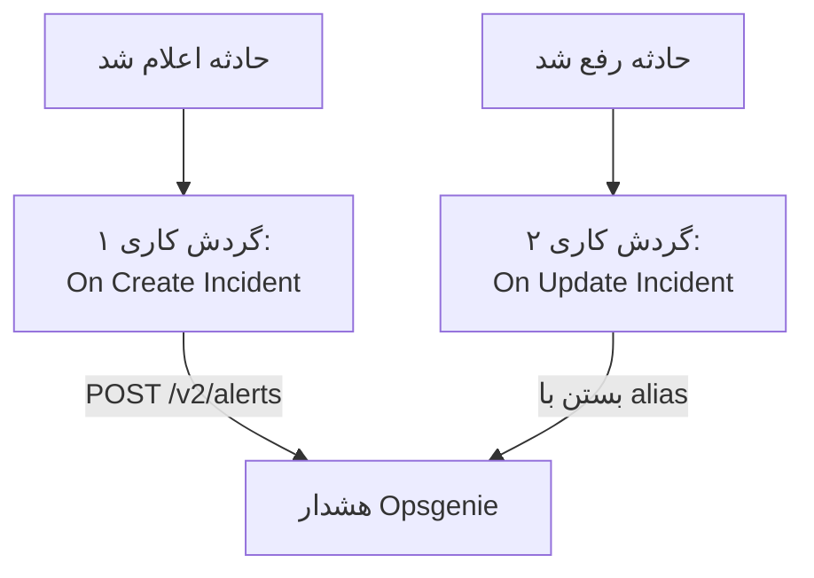

# Opsgenie

حادثه‌های OneUptime را به [Opsgenie](https://www.atlassian.com/software/opsgenie) بفرستید. یک گردش کاری با اعلام یک حادثه OneUptime یک هشدار در Opsgenie می‌سازد، و گردش کاری دوم با رفع حادثه OneUptime آن را می‌بندد. تا زمانی که Opsgenie هنوز تیم شما را فرا می‌خواند و OneUptime سامانه‌های شما را پایش می‌کند، از این روش استفاده کنید.

:::cards
- [ذخیره کلید API](#ذخیره-کلید-api): کلید Opsgenie را بیرون از گردش‌های کاری‌تان نگه دارید.
- [ساختن هشدارهای Opsgenie](#ساختن-یک-هشدار-opsgenie-برای-هر-حادثه): یک گردش کاری، دو بلوک.
- [بستن آن‌ها](#بستن-هشدار-opsgenie): گردش کاری دومی که وضعیت حادثه را دنبال می‌کند.
- [عیب‌یابی](#عیبیابی): وقتی Opsgenie یک درخواست را رد می‌کند.
:::

> [!IMPORTANT]
> Atlassian فروش Opsgenie را در ژوئن ۲۰۲۵ متوقف کرد و پشتیبانی آن را در آوریل ۲۰۲۷ پایان می‌دهد. OneUptime هم با سیاست‌های آنکال، زمان‌بندی‌ها و قواعد تشدید افراد را فرا می‌خواند. برای آوردن تیمتان، [انتقال از Opsgenie](/docs/moving-to-oneuptime/opsgenie) را ببینید: یک درون‌ریزی کاربران، تیم‌ها، زمان‌بندی‌ها و تشدیدهای شما را می‌آورد.

## چگونه کار می‌کند



هر دو گردش کاری [Opsgenie Alert API](https://docs.opsgenie.com/docs/alert-api) را فرا می‌خوانند. اولی به هشدار یک `alias` می‌دهد که از شناسه حادثه OneUptime ساخته شده است، و دومی هشدار را با همان alias می‌بندد.

## پیش از شروع

- یک یکپارچه‌سازی **API** در Opsgenie، و **API Key** آن. آن را زیر **Settings → Integrations** در Opsgenie اضافه کنید، یا برای فرستادن هشدارها به یک تیم، زیر **Integrations** آن تیم.
- ناحیه Opsgenie شما. حساب‌های اروپایی، که در `app.eu.opsgenie.com` وارد می‌شوند، از `api.eu.opsgenie.com` استفاده می‌کنند. همه حساب‌های دیگر از `api.opsgenie.com` استفاده می‌کنند.
- در OneUptime، اجازه ساختن گردش کاری و متغیر سراسری. در OneUptime Cloud، گردش‌های کاری به طرح **Growth** یا بالاتر نیاز دارند.

## ذخیره کلید API

:::steps
1. به **گردش‌های کاری** > **متغیرهای سراسری** بروید و روی **ساخت متغیر گردش کاری** کلیک کنید.
2. نامش را `OPSGENIE_KEY` بگذارید و روی **بعدی** کلیک کنید.
3. کلید API را در **محتوا** بچسبانید، **راز** را روشن کنید، و روی **ساخت متغیر گردش کاری** کلیک کنید.
:::

یک متغیر راز در لاگ‌های اجرا با `[REDACTED]` جایگزین می‌شود، پس کلید هرگز در یک اجرا دیده نمی‌شود.

## ساختن یک هشدار Opsgenie برای هر حادثه

:::steps
### ساختن گردش کاری

به **گردش‌های کاری** بروید، روی **ساخت گردش کاری** و سپس **شروع از صفر** کلیک کنید. نامش را `Incidents to Opsgenie` بگذارید و روی **ساخت گردش کاری** کلیک کنید.

### افزودن تریگر

روی بلوک خط‌چین **انتخاب کنید چه چیزی این گردش کاری را شروع کند** کلیک کنید و **On Create Incident** را برگزینید. روی تریگر کلیک کنید: **Fields to pass on** آن از پیش **عنوان** را دارد، پس روی **افزودن فیلد** کلیک کنید و **توضیحات** را برگزینید.

### ساختن هشدار

روی **افزودن مؤلفه** کلیک کنید، یک بلوک **API Post (JSON)** اضافه کنید، و نقطه **Success** تریگر را به آن وصل کنید. **URL** آن را روی `https://api.opsgenie.com/v2/alerts` بگذارید، یا در اروپا روی `https://api.eu.opsgenie.com/v2/alerts`. زیر **فیلدهای بیشتر**، **Request Headers** آن را روی این بگذارید:

```json
{ "Authorization": "GenieKey {{global.variables.OPSGENIE_KEY}}" }
```

و **Request Body** آن را روی این:

```json
{
  "message": "{{local.components.incident-on-create-1.returnValues.model.title}}",
  "alias": "oneuptime-{{local.components.incident-on-create-1.returnValues.model._id}}",
  "description": "{{local.components.incident-on-create-1.returnValues.model.description}}",
  "priority": "P1",
  "source": "OneUptime"
}
```

### آزمایش، سپس روشن کردن

روی **اجرای گردش کاری** کلیک کنید، زیر **حادثه** یک حادثهٔ آزمایشی را برگزینید و اجرا کنید. گام **API Post (JSON)** پاسخ `202` را نشان می‌دهد، و هشدار کمی بعد در Opsgenie ظاهر می‌شود. سپس در بالای **سازنده** گزینه **فعال** را روشن کنید.
:::

طرح Opsgenie واژه `GenieKey`، یک فاصله، و سپس کلید است. Opsgenie طول `message` را تا ۱۳۰ نویسه نگه می‌دارد، و اولویت‌هایش از `P1` تا `P5` هستند: برای فرستادن اولویت خود هر حادثه، [نگاشت اولویت‌ها](#نگاشت-اولویتها) را ببینید.

## بستن هشدار Opsgenie

یک گردش کاری یک تریگر دارد، پس بستن به گردش کاری دومی نیاز دارد که با تغییر وضعیت یک حادثه شروع می‌شود.

:::steps
### افزودن تریگر On Update Incident

گردش کاری‌ای به نام `Close Opsgenie alerts` بسازید، و **On Update Incident** را به عنوان تریگرش برگزینید. در **Fields to watch** روی **افزودن فیلد** کلیک کنید و **Current Incident State** را برگزینید تا فقط با تغییر وضعیت اجرا شود. در **Fields to pass on** بخواهید که آیا وضعیت تازه یک وضعیت رفع‌شده است یا نه: روی **افزودن فیلد** کلیک کنید، **Current Incident State** را باز کنید و **Is Resolved State** را برگزینید. یا روی **ویرایش به‌صورت JSON** کلیک کنید و JSON را با این جایگزین کنید:

```json
{ "_id": true, "currentIncidentState": { "isResolvedState": true } }
```

### بررسی اینکه حادثه رفع شده است

پس از تریگر یک بلوک **If / Else** اضافه کنید. **Value to check** را روی `{{local.components.incident-on-update-1.returnValues.model.currentIncidentState.isResolvedState}}` و **Comparison** را روی **is true** بگذارید.

### بستن هشدار

پس از سمت **Yes** یک بلوک **API Post (JSON)** اضافه کنید، با همان **Request Headers** و این **URL**:

```text
https://api.opsgenie.com/v2/alerts/oneuptime-{{local.components.incident-on-update-1.returnValues.model._id}}/close?identifierType=alias
```

**Request Body** آن را روی `{ "source": "OneUptime", "note": "Resolved in OneUptime" }` بگذارید.

### روشن کردن آن

**فعال** را روشن کنید، سپس یک حادثه آزمایشی را در OneUptime رفع کنید. Opsgenie هشدار خود را می‌بندد.
:::

`identifierType=alias` به Opsgenie می‌گوید که نشانی، هشدار را با alias آن نام می‌برد، نه با شناسه خودش.

## نگاشت اولویت‌ها

برای فرستادن شدت هر حادثه به عنوان یک اولویت Opsgenie، یک بلوک **Run Custom JavaScript** میان تریگر و بلوک **API Post (JSON)** اضافه کنید.

1. در **Fields to pass on** تریگر روی **افزودن فیلد** کلیک کنید، **شدت حادثه** را باز کنید و **نام** را برگزینید.
2. **Arguments** بلوک را روی `{ "severity": "{{local.components.incident-on-create-1.returnValues.model.incidentSeverity.name}}" }` و **JavaScript Code** آن را روی این بگذارید:

   ```javascript
   // Your incident severities, by name, to Opsgenie's priorities.
   const PRIORITY = {
     "Critical Incident": "P1",
     "Major Incident": "P2",
     "Minor Incident": "P3",
   };

   return { priority: PRIORITY[args.severity] || "P3" };
   ```

3. در بدنه درخواست، `"priority"` را روی `"{{local.components.javascript-1.returnValues.returnValue.priority}}"` بگذارید.

نام‌های بالا سه شدتی هستند که یک پروژه تازه با آن‌ها شروع می‌شود. اگر نامشان را تغییر داده‌اید، نام‌های خودتان را به کار ببرید.

## عیب‌یابی

:::details Opsgenie با 401 یا 403 پاسخ می‌دهد
کلید نادرست است، یا به ناحیه دیگر تعلق دارد. بررسی کنید که سرآیند `GenieKey`، یک فاصله و کلید باشد، که کلید از یک یکپارچه‌سازی **API** باشد، و که میزبان با ناحیه شما جور باشد: `api.opsgenie.com` یا `api.eu.opsgenie.com`.
:::

:::details بستن با 404 پاسخ می‌دهد
هیچ هشداری آن alias را ندارد. هر دو گردش کاری باید alias را به یک شکل بسازند، `oneuptime-` و سپس `_id` حادثه، و نشانی باید به `?identifierType=alias` ختم شود.
:::

:::details هشدار هرگز ظاهر نمی‌شود، هرچند گام 202 نشان می‌دهد
Opsgenie پیش از پردازش درخواست با `202` پاسخ می‌دهد، پس درخواستی که بعداً رد کند هم `202` نشان می‌دهد. درخواست را در لاگ‌های Opsgenie پیدا کنید تا ببینید چرا رد شده، مانند یکپارچه‌سازی‌ای که خاموش است.
:::

:::details گردش کاری هرگز اجرا نمی‌شود
بررسی کنید که روشن باشد: **فعال**، در بالای **سازنده** آن. سپس **لاگ‌ها** > **اجراها** را باز کنید: اجرایی که به سمت **No** بلوک **If / Else** رفته، به‌روزرسانی‌ای بوده که رفع نبوده است.
:::

## گام‌های بعدی

:::cards
- [انتقال از Opsgenie](/docs/moving-to-oneuptime/opsgenie): پیش از پایان Opsgenie، تیم، زمان‌بندی‌ها و تشدیدهای خود را به اینجا بیاورید.
- [قواعد تشدید](/docs/on-call/escalation-rules): افراد را از خود OneUptime فرا بخوانید.
- [PagerDuty](/docs/integrations/pagerduty): همان دو گردش کاری برای PagerDuty.
- [نمای کلی یکپارچه‌سازی‌ها](/docs/integrations/index): الگوهایی که پشت هر یکپارچه‌سازی هستند.
:::
