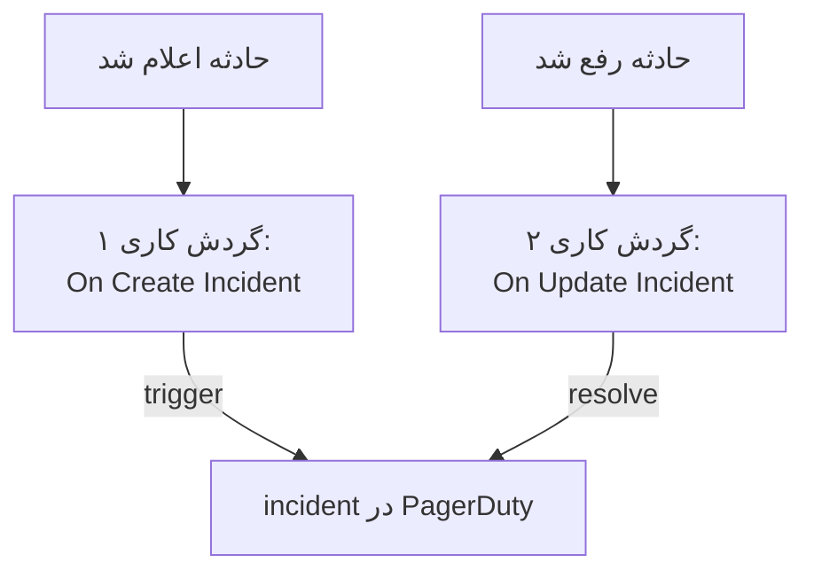

# PagerDuty

حادثه‌های OneUptime را به [PagerDuty](https://www.pagerduty.com) بفرستید. یک گردش کاری با اعلام یک حادثه OneUptime یک incident در PagerDuty راه می‌اندازد، و گردش کاری دوم با رفع حادثه OneUptime آن را رفع می‌کند. وقتی PagerDuty تیم شما را فرا می‌خواند و OneUptime سامانه‌های شما را پایش می‌کند، از این روش استفاده کنید.

:::cards
- [ذخیره کلید مسیریابی](#ذخیره-کلید-مسیریابی): کلید PagerDuty را بیرون از گردش‌های کاری‌تان نگه دارید.
- [راه‌اندازی incidentهای PagerDuty](#راهاندازی-یک-incident-در-pagerduty-برای-هر-حادثه): یک گردش کاری، دو بلوک.
- [رفع آن‌ها](#رفع-incident-در-pagerduty): گردش کاری دومی که وضعیت حادثه را دنبال می‌کند.
- [عیب‌یابی](#عیبیابی): وقتی PagerDuty یک رویداد را رد می‌کند.
:::

> [!TIP]
> OneUptime هم با سیاست‌های آنکال، زمان‌بندی‌ها و قواعد تشدید افراد را فرا می‌خواند. برای آوردن تیمتان از PagerDuty، [انتقال از PagerDuty](/docs/moving-to-oneuptime/pagerduty) را ببینید: یک درون‌ریزی کاربران، زمان‌بندی‌ها و سیاست‌های تشدید شما را می‌آورد.

## چگونه کار می‌کند



هر دو گردش کاری [Events API v2](https://developer.pagerduty.com/docs/events-api-v2/overview/) در PagerDuty را با یک `dedup_key` یکسان فرا می‌خوانند که از شناسه حادثه OneUptime ساخته می‌شود. PagerDuty با همین کلید می‌فهمد که رویداد resolve همان incidentی را می‌بندد که رویداد trigger باز کرده بود.

## پیش از شروع

- یک سرویس PagerDuty با یکپارچه‌سازی Events API v2. در PagerDuty سرویس را باز کنید، سپس **Integrations**، روی **Add an integration** کلیک کنید و **Events API V2** را برگزینید. **Integration Key** آن را کپی کنید: Events API آن را routing key می‌نامد.
- در OneUptime، اجازه ساختن گردش کاری و متغیر سراسری. در OneUptime Cloud، گردش‌های کاری به طرح **Growth** یا بالاتر نیاز دارند.

## ذخیره کلید مسیریابی

:::steps
1. به **گردش‌های کاری** > **متغیرهای سراسری** بروید و روی **ساخت متغیر گردش کاری** کلیک کنید.
2. نامش را `PAGERDUTY_ROUTING_KEY` بگذارید و روی **بعدی** کلیک کنید.
3. کلید یکپارچه‌سازی را در **محتوا** بچسبانید، **راز** را روشن کنید، و روی **ساخت متغیر گردش کاری** کلیک کنید.
:::

یک متغیر راز در لاگ‌های اجرا با `[REDACTED]` جایگزین می‌شود، پس کلید هرگز در یک اجرا دیده نمی‌شود.

## راه‌اندازی یک incident در PagerDuty برای هر حادثه

:::steps
### ساختن گردش کاری

به **گردش‌های کاری** بروید، روی **ساخت گردش کاری** و سپس **شروع از صفر** کلیک کنید. نامش را `Incidents to PagerDuty` بگذارید و روی **ساخت گردش کاری** کلیک کنید.

### افزودن تریگر

روی بلوک خط‌چین **انتخاب کنید چه چیزی این گردش کاری را شروع کند** کلیک کنید و **On Create Incident** را برگزینید. روی تریگر کلیک کنید: **Fields to pass on** آن از پیش **عنوان** را دارد، پس روی **افزودن فیلد** کلیک کنید و **توضیحات** را برگزینید.

### فرستادن رویداد trigger

روی **افزودن مؤلفه** کلیک کنید، یک بلوک **API Post (JSON)** اضافه کنید، و نقطه **Success** تریگر را به آن وصل کنید. **URL** آن را روی `https://events.pagerduty.com/v2/enqueue` و **Request Body** آن را روی این بگذارید:

```json
{
  "routing_key": "{{global.variables.PAGERDUTY_ROUTING_KEY}}",
  "event_action": "trigger",
  "dedup_key": "oneuptime-{{local.components.incident-on-create-1.returnValues.model._id}}",
  "payload": {
    "summary": "{{local.components.incident-on-create-1.returnValues.model.title}}",
    "source": "OneUptime",
    "severity": "critical",
    "custom_details": {
      "description": "{{local.components.incident-on-create-1.returnValues.model.description}}"
    }
  }
}
```

### آزمایش، سپس روشن کردن

روی **اجرای گردش کاری** کلیک کنید، زیر **حادثه** یک حادثهٔ آزمایشی را برگزینید و اجرا کنید. گام **API Post (JSON)** پاسخ `202` را با `"status": "success"` نشان می‌دهد، و PagerDuty یک incident باز می‌کند. سپس در بالای **سازنده** گزینه **فعال** را روشن کنید.
:::

بلوک JSON می‌فرستد، پس به سرآیند `Content-Type` نیازی ندارد. `severity` در PagerDuty یکی از `critical`، `error`، `warning` و `info` است: برای فرستادن شدت خود هر حادثه، [نگاشت شدت‌ها](#نگاشت-شدتها) را ببینید.

## رفع incident در PagerDuty

یک گردش کاری یک تریگر دارد، پس رفع کردن به گردش کاری دومی نیاز دارد که با تغییر وضعیت یک حادثه شروع می‌شود.

:::steps
### افزودن تریگر On Update Incident

گردش کاری‌ای به نام `Resolve PagerDuty incidents` بسازید، و **On Update Incident** را به عنوان تریگرش برگزینید. در **Fields to watch** روی **افزودن فیلد** کلیک کنید و **Current Incident State** را برگزینید تا فقط با تغییر وضعیت اجرا شود. در **Fields to pass on** بخواهید که آیا وضعیت تازه یک وضعیت رفع‌شده است یا نه: روی **افزودن فیلد** کلیک کنید، **Current Incident State** را باز کنید و **Is Resolved State** را برگزینید. یا روی **ویرایش به‌صورت JSON** کلیک کنید و JSON را با این جایگزین کنید:

```json
{ "_id": true, "currentIncidentState": { "isResolvedState": true } }
```

### بررسی اینکه حادثه رفع شده است

پس از تریگر یک بلوک **If / Else** اضافه کنید. **Value to check** را روی `{{local.components.incident-on-update-1.returnValues.model.currentIncidentState.isResolvedState}}` و **Comparison** را روی **is true** بگذارید.

### فرستادن رویداد resolve

پس از سمت **Yes** یک بلوک **API Post (JSON)** اضافه کنید، با همان **URL** و این **Request Body**:

```json
{
  "routing_key": "{{global.variables.PAGERDUTY_ROUTING_KEY}}",
  "event_action": "resolve",
  "dedup_key": "oneuptime-{{local.components.incident-on-update-1.returnValues.model._id}}"
}
```

### روشن کردن آن

**فعال** را روشن کنید، سپس یک حادثه آزمایشی را در OneUptime رفع کنید. PagerDuty incident خود را رفع می‌کند.
:::

بررسی `isResolvedState` به جای نام یک وضعیت، وقتی وضعیت‌هایتان را تغییر نام بدهید هم کار می‌کند. [وضعیت‌ها و شدت‌های حادثه](/docs/incidents/states-and-severities) را ببینید.

## نگاشت شدت‌ها

برای فرستادن شدت هر حادثه، یک بلوک **Run Custom JavaScript** میان تریگر و بلوک **API Post (JSON)** اضافه کنید، و پاسخ آن را در بدنه بخوانید.

1. در **Fields to pass on** تریگر روی **افزودن فیلد** کلیک کنید، **شدت حادثه** را باز کنید و **نام** را برگزینید.
2. **Arguments** بلوک را روی `{ "severity": "{{local.components.incident-on-create-1.returnValues.model.incidentSeverity.name}}" }` و **JavaScript Code** آن را روی این بگذارید:

   ```javascript
   // Your incident severities, by name, to PagerDuty's.
   const SEVERITY = {
     "Critical Incident": "critical",
     "Major Incident": "error",
     "Minor Incident": "warning",
   };

   return { severity: SEVERITY[args.severity] || "info" };
   ```

3. در بدنه درخواست، `"severity"` را روی `"{{local.components.javascript-1.returnValues.returnValue.severity}}"` بگذارید.

نام‌های بالا سه شدتی هستند که یک پروژه تازه با آن‌ها شروع می‌شود. اگر نامشان را تغییر داده‌اید، نام‌های خودتان را به کار ببرید.

## عیب‌یابی

:::details PagerDuty با 400 پاسخ می‌دهد
بدنه پاسخ می‌گوید PagerDuty چه چیزی را رد کرده، و گام **API Post (JSON)** در اجرا آن را نشان می‌دهد. معمولاً کلید مسیریابی کلید یکپارچه‌سازی Events API v2 نیست: آن را دوباره از **Integrations** سرویس کپی کنید. رویدادی بدون `summary`، `source` یا `severity` هم رد می‌شود.
:::

:::details رویداد resolve چیزی را نمی‌بندد
هر دو رویداد باید دقیقاً همان `dedup_key` را داشته باشند. بررسی کنید که هر دو بدنه آن را به شکل `oneuptime-` و سپس `_id` حادثه بسازند، و گردش کاری رفع روشن باشد.
:::

:::details گردش کاری هرگز اجرا نمی‌شود
بررسی کنید که روشن باشد: **فعال**، در بالای **سازنده** آن. سپس **لاگ‌ها** > **اجراها** را باز کنید: اجرایی که به سمت **No** بلوک **If / Else** رفته، به‌روزرسانی‌ای بوده که رفع نبوده است.
:::

:::details PagerDuty به جای مقدار، یک ارجاع نشان می‌دهد
ارجاعی که تحلیل نشود، همان‌طور که نوشته شده با آکولادهایش فرستاده می‌شود. شناسه بلوک، نام فیلد و نام متغیر را که به بزرگی و کوچکی حروف حساس است بررسی کنید. در زبانه **گام‌ها** در صفحه اجرا، تنظیمی که چنین ارجاعی دارد با **Did not resolve** علامت می‌خورد.
:::

## گام‌های بعدی

:::cards
- [انتقال از PagerDuty](/docs/moving-to-oneuptime/pagerduty): تیم، زمان‌بندی‌ها و سیاست‌های تشدید خود را به اینجا بیاورید.
- [قواعد تشدید](/docs/on-call/escalation-rules): افراد را از خود OneUptime فرا بخوانید.
- [Opsgenie](/docs/integrations/opsgenie): همان دو گردش کاری برای Opsgenie.
- [نمای کلی یکپارچه‌سازی‌ها](/docs/integrations/index): الگوهایی که پشت هر یکپارچه‌سازی هستند.
:::
