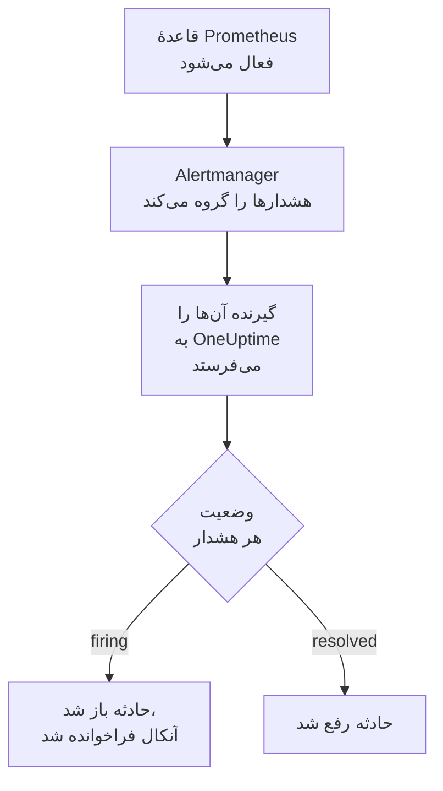

# Prometheus Alertmanager

هشدارهای [Prometheus Alertmanager](https://prometheus.io/docs/alerting/latest/alertmanager/) را به OneUptime بفرستید تا هر هشداری که فعال می‌شود به حادثه‌ای تبدیل شود که تیم آنکال شما را فرا می‌خواند، و وقتی هشدار بهبود یافت رفع شود. Alertmanager اعلان‌هایش را به یک گیرندهٔ وب‌هوک می‌فرستد، پس در هیچ طرفی چیزی برای نصب نیست.

:::cards
- [انتخاب اینکه OneUptime هشدارها را چگونه دریافت کند](#انتخاب-اینکه-oneuptime-هشدارها-را-چگونه-دریافت-کند): یک مانیتور Incoming Request، یا یک گردش کاری از خودتان.
- [دریافت هشدارها با یک مانیتور](#دریافت-هشدارها-با-یک-مانیتور): یک حادثه برای هر هشدار، که با بهبود رفع می‌شود.
- [پیکربندی Alertmanager](#پیکربندی-alertmanager): یک گیرندهٔ وب‌هوک، و مسیری که از آن استفاده می‌کند.
- [عیب‌یابی](#عیبیابی): وقتی هشدارها نمی‌رسند، یا حادثه‌ها باز می‌مانند.
:::

## چگونه کار می‌کند



Prometheus قاعده‌های هشدار شما را ارزیابی می‌کند و هشدارهایی را که فعال می‌شوند به Alertmanager می‌فرستد. Alertmanager آن‌ها را بر پایهٔ برچسب‌های `group_by` مسیرتان گروه‌بندی می‌کند، و هر گروه را به‌صورت یک اعلان JSON به گیرندهٔ وب‌هوک می‌فرستد. فهرست `alerts` اعلان همهٔ هشدارهای گروه را در خود دارد، هر کدام با `status` خودش (`firing` یا `resolved`)، برچسب‌ها و یادداشت‌هایش، و یک `fingerprint` که آن را شناسایی می‌کند.

## پیش از شروع

- یک Alertmanager که بتوانید `alertmanager.yml` آن را ویرایش کنید، و از طریق HTTPS به OneUptime شما دسترسی داشته باشد.
- در OneUptime، اجازهٔ ساختن مانیتور، یا اگر آن راه را برمی‌گزینید، گردش کاری.

## انتخاب اینکه OneUptime هشدارها را چگونه دریافت کند

اول OneUptime را راه بیندازید: نشانی‌ای را که Alertmanager به آن می‌فرستد، OneUptime به شما می‌دهد.

| روش | کی از آن استفاده کنید |
| --- | --- |
| یک مانیتور Incoming Request (پیشنهادی) | می‌خواهید هر هشدار حادثه‌ای باشد که آنکال را فرا می‌خواند، و وقتی هشدار بهبود یافت رفع شود. چیزی برای ساختن نیست. |
| یک گردش کاری با تریگر Webhook | به منطق خودتان نیاز دارید: پالایش هشدارها، تغییر شکل آن‌ها، یا اول فراخواندن سامانه‌های دیگر. یک گردش کاری برای هر اعلان یک حادثه باز می‌کند، نه برای هر هشدار، و آن را با بهبود رفع نمی‌کند. |

هر دو از همان گیرنده همان JSON را می‌گیرند، پس می‌توانید با یکی شروع کنید و بعدها با تغییر یک نشانی در `alertmanager.yml` به دیگری بروید.

## دریافت هشدارها با یک مانیتور

یک [مانیتور Incoming Request](/docs/monitor/incoming-request-monitor) یک نشانی به شما می‌دهد، و معیارهایش تعیین می‌کنند هر اعلان چه کند.

:::steps
### ساختن مانیتور

به **مانیتورها** بروید و روی **ساخت مانیتور** کلیک کنید. زیر **نوع مانیتور**، **Incoming Request** را برگزینید، نامش را `Alertmanager` بگذارید، و روی **بعدی** کلیک کنید.

### اعلام یک حادثه برای هر هشدار فعال‌شده

در گام **معیارها**، نخستین معیار را باز کنید، همان که مانیتور را آفلاین علامت می‌زند. پالایهٔ آن را روی **بدنه درخواست**، **شامل است**، `"status":"firing"` بگذارید. این معیار از پیش وقتی پالایه‌اش جور شود حادثه اعلام می‌کند. حادثه را پر کنید:

- **عنوان حادثه**: `{{requestBody.commonLabels.alertname}} on {{requestBody.commonLabels.instance}}`.
- **شدت**: شدت حادثه‌ای که این هشدارها باید داشته باشند.
- **سیاست‌های آنکال**، زیر **آنکال**: سیاست‌هایی که باید فراخوانده شوند.
- **رفع خودکار حادثه**، زیر **فیلدهای بیشتر**: آن را روشن بگذارید، همان‌طور که از آغاز هست. بدون آن، بهبودها نادیده گرفته می‌شوند و حادثه‌ها باز می‌مانند.

### باز کردن یک حادثه برای هر هشدار

در همان معیار، **تنظیمات** را باز کنید و **Group incidents and alerts by a payload field** را روشن کنید. آن را مانند جدول زیر پر کنید تا هر هشدار حادثهٔ خودش را بگیرد و بهبودش آن را رفع کند:

| فیلد | مقدار |
| --- | --- |
| **Open a separate incident for each…** | `requestBody.alerts[*].fingerprint` |
| **Field that signals recovery** | `requestBody.alerts[*].status` |
| **Value that means recovered** | `resolved` |

### برگرداندن مانیتور به حالت آنلاین

معیار دوم را باز کنید، همان که مانیتور را آنلاین علامت می‌زند، و پالایه‌اش را روی **بدنه درخواست**، **شامل است**، `"status":"resolved"` بگذارید.

### کپی کردن نشانی

روی **ساخت مانیتور** کلیک کنید. صفحهٔ **نمای کلی** مانیتور، **Heartbeat URL** آن را نشان می‌دهد. آن را برای Alertmanager کپی کنید:

```text
https://oneuptime.com/heartbeat/<secret key>
```

یک نصب خودمیزبان به جای `oneuptime.com` میزبان خودش را دارد.
:::

`[*]` همهٔ هشدارهای یک اعلان را می‌خواند، پس اعلانی با سه هشدار می‌تواند سه حادثه باز کند، حداکثر به اندازهٔ **Max incidents per request** (`100`، مگر اینکه آن را تغییر دهید). `status` خود هر هشدار تعیین می‌کند چه بر سر حادثه‌اش بیاید: وقتی یک هشدار از یک اعلان رفع شده و دو هشدار هنوز فعال‌اند، فقط حادثهٔ هشدار رفع‌شده بسته می‌شود. برای اینکه هر تنظیم چه می‌کند، [دریافت هشدار از سامانه‌ای دیگر](/docs/monitor/incoming-request-monitor#دریافت-هشدار-از-سامانهای-دیگر) را ببینید.

> [!WARNING]
> بر پایهٔ مقداری گروه‌بندی کنید که درون یک اعلان از هشداری به هشدار دیگر فرق می‌کند. `fingerprint` در Alertmanager هش کل مجموعهٔ برچسب‌های یک هشدار است، پس همیشه فرق می‌کند. برچسبی در `group_by` مسیرتان هرگز فرق نمی‌کند: همان است که هشدارها را در یک اعلان می‌گذارد. گروه‌بندی بر پایهٔ `requestBody.alerts[*].labels.alertname` با مسیر زیر، همهٔ هشدارهای یک اعلان را در یک حادثه ادغام می‌کند که وضعیت نخستین هشدار را می‌گیرد.

## نام‌گذاری حادثه‌ها

عنوان بالا برچسب‌هایی را می‌خواند که همهٔ هشدارهای اعلان در آن‌ها مشترک‌اند: `commonLabels` آن برچسب‌ها را دارد، و `commonAnnotations` یادداشت‌های مشترکشان را. با مسیر زیر، که بر پایهٔ `alertname` و `instance` گروه‌بندی می‌کند، هر دو حاضرند. زیر **توضیحات**، به حادثه یک **توضیحات حادثه** مانند این بدهید:

```text
{{requestBody.commonAnnotations.summary}}

{{requestBody.commonAnnotations.description}}
Severity: {{requestBody.commonLabels.severity}}
Alertmanager: {{requestBody.externalURL}}
```

- کلید گروه‌بندی هم یک متغیر است که به نام آخرین بخش مسیرش نام‌گذاری می‌شود: `{{fingerprint}}`. این یک هش است، پس چیزی به پاسخ‌دهنده نمی‌گوید.
- `{{requestBody.alerts[0].annotations.summary}}` نخستین هشدار اعلان را می‌خواند، که همیشه همان هشداری نیست که حادثه برایش باز شده است.
- ارجاعی به فیلدی که اعلان ندارد، به جای خالی شدن، همان‌طور که نوشته شده با آکولادهایش باقی می‌ماند.

برای همهٔ متغیرهایی که می‌توانید به کار ببرید، [قالب‌بندی حادثه و هشدار](/docs/monitor/incident-alert-templating) را ببینید.

## پیکربندی Alertmanager

:::steps
### افزودن یک گیرندهٔ وب‌هوک

در `alertmanager.yml`، گیرنده‌ای اضافه کنید که به نشانی کپی‌شده بفرستد، و آن را گیرندهٔ مسیر کنید:

```yaml title="alertmanager.yml"
route:
  receiver: oneuptime
  group_by: ["alertname", "instance"]

receivers:
  - name: oneuptime
    webhook_configs:
      - url: "https://oneuptime.com/heartbeat/<secret key>"
        send_resolved: true
```

`send_resolved: true` پیش‌فرض Alertmanager است و نوشته شده تا روشن بماند: بدون آن، OneUptime هرگز باخبر نمی‌شود که هشداری بهبود یافته است. Alertmanager، `Content-Type: application/json` را می‌فرستد، که مانیتور برای خواندن فیلدهای یک اعلان به آن نیاز دارد.

### بارگذاری دوبارهٔ Alertmanager

پیکربندی را دوباره بارگذاری کنید، یا Alertmanager را دوباره راه‌اندازی کنید:

```bash
curl -X POST http://localhost:9093/-/reload
```
:::

این مسیر زمان‌بندی‌های پیش‌فرض Alertmanager را نگه می‌دارد. پیش از فرستادن یک گروه تازه `30s` (`group_wait`) صبر می‌کند، پیش از فرستادن دوبارهٔ گروهی که هشدار تازه در آن هست `5m` (`group_interval`)، و پیش از تکرار اعلانی که تغییر نکرده `4h` (`repeat_interval`).

## آزمایش آن

اعلانی با دو هشدار فعال را همان‌طور که Alertmanager می‌فرستد، به OneUptime بفرستید:

```bash
curl -X POST "https://oneuptime.com/heartbeat/<secret key>" \
  -H "Content-Type: application/json" \
  -d '{
    "version": "4",
    "status": "firing",
    "receiver": "oneuptime",
    "groupLabels": { "alertname": "DiskFull", "instance": "web-1" },
    "commonLabels": { "alertname": "DiskFull", "instance": "web-1", "severity": "critical" },
    "commonAnnotations": { "summary": "Disk almost full on web-1" },
    "externalURL": "http://alertmanager:9093",
    "alerts": [
      {
        "status": "firing",
        "labels": { "alertname": "DiskFull", "instance": "web-1", "severity": "critical", "device": "/dev/sda1" },
        "fingerprint": "a1b2c3d4e5f60001"
      },
      {
        "status": "firing",
        "labels": { "alertname": "DiskFull", "instance": "web-1", "severity": "critical", "device": "/dev/sdb1" },
        "fingerprint": "a1b2c3d4e5f60002"
      }
    ]
  }'
```

دو حادثه باز می‌شود، یکی برای هر `fingerprint`، هر کدام با عنوان `DiskFull on web-1`. همان درخواست را با همهٔ `status`ها روی `resolved` بفرستید، و هر دو رفع می‌شوند.

برای آزمایش کل مسیر از Alertmanager، با `amtool` یک هشدار فعال کنید. Alertmanager آن را پس از `group_wait` می‌فرستد، و چند دقیقه بعد، وقتی هشدار منقضی شد، بهبودش را می‌فرستد:

```bash
amtool alert add test_alert severity=warning \
  --annotation=summary="Test from Alertmanager" \
  --alertmanager.url=http://localhost:9093
```

## دریافت هشدارها با یک گردش کاری

وقتی میان Alertmanager و حادثه به گام‌های خودتان نیاز دارید، از یک [گردش کاری](/docs/workflows/index) استفاده کنید.

:::steps
### ساختن گردش کاری

به **گردش‌های کاری** بروید، روی **ساخت گردش کاری** و سپس **شروع از صفر** کلیک کنید. نامش را `Alertmanager alerts` بگذارید و روی **ساخت گردش کاری** کلیک کنید.

### افزودن تریگر Webhook

روی بلوک خط‌چین **انتخاب کنید چه چیزی این گردش کاری را شروع کند** کلیک کنید و **Webhook** را برگزینید. روی تریگر کلیک کنید، سپس روی **کپی نشانی**، و آن نشانی را در گیرندهٔ `alertmanager.yml` به کار ببرید.

### بررسی اینکه اعلان فعال است

روی **افزودن مؤلفه** کلیک کنید، یک بلوک **If / Else** اضافه کنید، و نقطهٔ **Out** تریگر را به آن وصل کنید. **Value to check** را روی `{{local.components.webhook-1.returnValues.request-body.status}}`، **Comparison** را روی **is equal to**، و **Compare with** را روی `firing` بگذارید.

### اعلام حادثه

یک بلوک **Create One Incident** اضافه کنید، و سمت **Yes** بلوک **If / Else** را به آن وصل کنید. در **Incident Template**، قالبی را برگزینید که شدت و سیاست‌های آنکالی را که باید فراخوانده شوند تعیین می‌کند ([قالب‌های حادثه](/docs/incidents/settings#قالبهای-حادثه) را ببینید). در **JSON Object**، آنچه را از Alertmanager می‌آید تعیین کنید:

```json
{
  "title": "{{local.components.webhook-1.returnValues.request-body.commonLabels.alertname}}",
  "description": "{{local.components.webhook-1.returnValues.request-body.commonAnnotations.summary}}\nAlertmanager: {{local.components.webhook-1.returnValues.request-body.externalURL}}"
}
```

بدون قالب، **JSON Object** به `incidentSeverityId` هم نیاز دارد، یعنی شناسهٔ یکی از شدت‌های حادثهٔ پروژه.

### روشن کردن گردش کاری

در بالای **سازنده** گزینهٔ **فعال** را روشن کنید. گردش کاری خاموش به Alertmanager با `400` پاسخ می‌دهد.
:::

هر اجرا یک اعلان را پردازش می‌کند، پس هر چند هشدار که در اعلان باشد، فقط یک حادثه اعلام می‌کند. اعلانی که `resolved` باشد به سمت **No** بلوک **If / Else** می‌رود، جایی که چیزی وصل نیست، پس اجرا همان‌جا تمام می‌شود. برای یک حادثه برای هر هشدار، که با بهبود رفع شود، از مانیتور استفاده کنید.

## پاییدن خود Alertmanager

هیچ‌کدام از دو روش متوجه نمی‌شود که Prometheus یا Alertmanager از کار افتاده است: نرسیدن هیچ هشداری درست مانند این است که هیچ مشکلی نباشد. پس هشداری را که همیشه فعال است به مانیتور دومی بفرستید، که وقتی آن هشدار دیگر نرسید حادثه اعلام کند. [kube-prometheus-stack](https://github.com/prometheus-community/helm-charts/tree/main/charts/kube-prometheus-stack) چنین هشداری به نام `Watchdog` همراه دارد. روی یک Prometheus ساده، یک قاعدهٔ هشدار به نام `Watchdog` اضافه کنید که عبارتش همیشه درست است، مانند `vector(1)`.

:::steps
### ساختن مانیتور نگهبان

یک مانیتور Incoming Request دوم به نام `Alertmanager watchdog` بسازید. پالایهٔ نخستین معیار آن، همان که مانیتور را آفلاین علامت می‌زند، را روی **Incoming Request**، **Not Recieved In Minutes**، `10` بگذارید، و پالایهٔ معیار دومش را روی **Incoming Request**، **Recieved In Minutes**، `10`. داشبورد هر دو را با همین املا نشان می‌دهد. **Heartbeat URL** مانیتور تازه را کپی کنید.

### فرستادن هشدار نگهبان به آن

یک گیرنده برای نشانی مانیتور نگهبان اضافه کنید، و مسیری که `Watchdog` را هر پنج دقیقه به آن بفرستد. یک مسیر فرزند پیش از گیرندهٔ مسیر والدش بررسی می‌شود، پس `Watchdog` به مانیتور نگهبان می‌رود و هر هشدار دیگری همچنان به مانیتور اول می‌رود:

```yaml title="alertmanager.yml"
route:
  receiver: oneuptime
  group_by: ["alertname", "instance"]
  routes:
    - receiver: oneuptime-watchdog
      matchers:
        - alertname = "Watchdog"
      group_wait: 0s
      group_interval: 5m
      repeat_interval: 5m

receivers:
  - name: oneuptime
    webhook_configs:
      - url: "https://oneuptime.com/heartbeat/<secret key>"
        send_resolved: true
  - name: oneuptime-watchdog
    webhook_configs:
      - url: "https://oneuptime.com/heartbeat/<watchdog secret key>"
```
:::

وقتی هشدار نگهبان ده دقیقه نرسد، مانیتور نگهبان آفلاین می‌شود و حادثه اعلام می‌کند. اعلان نگهبان بعدی مانیتور را دوباره آنلاین می‌کند و حادثه را رفع می‌کند.

## عیب‌یابی

:::details چیزی به OneUptime نمی‌رسد
- لاگ Alertmanager را برای خطاهای تحویل به گیرنده بررسی کنید.
- مانیتور پیش از بررسی هر چیزی، بی‌درنگ با `200` پاسخ می‌دهد، حتی برای کلید محرمانهٔ نادرست. برای دیدن اینکه اعلان‌ها می‌رسند یا نه، خط زمانی مانیتور را بررسی کنید.
- گردش کاری خاموش با `400` پاسخ می‌دهد. در بالای **سازنده** آن، **فعال** را روشن کنید.
:::

:::details حادثه‌ها باز می‌شوند اما هرگز رفع نمی‌شوند
- بررسی کنید که هیچ گیرنده‌ای `send_resolved: false` را تنظیم نکرده باشد: در آن صورت Alertmanager هرگز بهبودی نمی‌فرستد.
- حادثهٔ معیار به **رفع خودکار حادثه**، زیر **فیلدهای بیشتر**، نیاز دارد.
- **Field that signals recovery** باید `requestBody.alerts[*].status` باشد، و **Value that means recovered** دقیقاً `resolved`. مقایسه به بزرگی و کوچکی حروف حساس است.
- هشدارهای یک اعلان که از **Max incidents per request** فراتر بروند اصلاً خوانده نمی‌شوند، پس بهبودهایشان هم از دست می‌رود.
- بهبودی که در یک انفجار درخواست‌ها جا بماند (پایین را ببینید) حادثه‌اش را برای همیشه باز می‌گذارد: Alertmanager هشدارهای فعال را تکرار می‌کند، اما هرگز بهبود را. چنین حادثه‌ای را دستی رفع کنید.
:::

:::details اصلاً هیچ حادثه‌ای باز نمی‌شود
مسیرهای گروه‌بندی باید با `requestBody.` شروع شوند، و فقط نخستین `[*]` یک مسیر، فهرست را می‌خواند. مسیری که هر کدام از این دو قاعده را بشکند، بدون هیچ خطایی با چیزی جور نمی‌شود.
:::

:::details یک حادثه برای اعلانی پر از هشدار
بر پایهٔ برچسبی گروه‌بندی کرده‌اید که برای همهٔ هشدارهای یک اعلان یکسان است، اغلب برچسبی در `group_by` مسیرتان. به جای آن بر پایهٔ `requestBody.alerts[*].fingerprint` گروه‌بندی کنید.
:::

:::details حادثه به جای مقدار، یک ارجاع نشان می‌دهد
ارجاعی به فیلدی که اعلان ندارد، همان‌طور که نوشته شده با آکولادهایش باقی می‌ماند. قاعده‌های مختلف یادداشت‌های مختلفی تنظیم می‌کنند، پس از فیلدهایی استفاده کنید که قاعده‌های شما تنظیم می‌کنند: در `commonAnnotations`، یا در `annotations` هر هشدار.
:::

:::details حادثه‌های بیش از اندازه
مسیرتان را بر پایهٔ برچسب‌های کمتری گروه‌بندی کنید، یا `group_interval` را بالا ببرید، تا Alertmanager هشدارهای مرتبط را با هم بفرستد. پایین آوردن **Max incidents per request** حادثه‌های یک اعلان را محدود می‌کند، اما هشدارهای فراتر از سقف خوانده نمی‌شوند، پس بهبودهایشان هم از دست می‌رود.
:::

:::details برخی اعلان‌ها در یک انفجار درخواست‌ها جا می‌مانند
وقتی درخواستی تازه‌تر پیش از ارزیابی درخواست قبلی به مانیتور برسد، OneUptime فقط درخواست تازه‌تر را ارزیابی می‌کند، تا یک فرستنده نتواند مانیتور را از پا درآورد. آخرین اعلان یک انفجار همیشه ارزیابی می‌شود، اما اعلانی قبلی دربارهٔ هشدارهای دیگر ممکن است جا بماند، چون Alertmanager هر گروه را به همان نشانی می‌فرستد. `group_wait` و `group_interval` را بالا ببرید تا فاصلهٔ اعلان‌ها بیشتر شود. در یک نصب خودمیزبان، برای ارزیابی همهٔ درخواست‌ها، `INCOMING_REQUEST_INGEST_COALESCE_ENABLED=false` را در محیط برنامهٔ OneUptime تنظیم کنید.
:::

## امنیت

- **با نشانی مانند یک گذرواژه رفتار کنید.** هر کسی که آن را داشته باشد می‌تواند حادثه باز کند. اگر لو رفت، آن را بازنشانی کنید: **بازنشانی کلید محرمانه درخواست ورودی** در صفحهٔ **تنظیمات** مانیتور، یا **بازنشانی نشانی** در تریگر **Webhook** گردش کاری. سپس `url` گیرنده را در `alertmanager.yml` به‌روزرسانی کنید.
- **خودمیزبان؟** بگذارید Alertmanager از طریق دیوار آتش‌تان با HTTPS به OneUptime شما برسد.

## گام‌های بعدی

:::cards
- [مانیتور درخواست ورودی](/docs/monitor/incoming-request-monitor): همهٔ تنظیمات مانیتوری که هشدارهای شما را دریافت می‌کند.
- [Grafana](/docs/integrations/grafana): همین راه‌اندازی، برای هشدارهای Grafana.
- [قواعد تشدید](/docs/on-call/escalation-rules): تعیین کنید یک سیاست آنکال چه کسی را و کی فرا بخواند.
- [نمای کلی یکپارچه‌سازی‌ها](/docs/integrations/index): ابزارهای دیگری که می‌توانید وصل کنید.
:::
