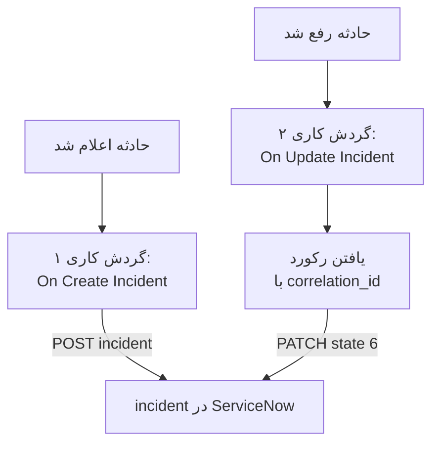

# ServiceNow

برای هر حادثه OneUptime یک incident در [ServiceNow](https://www.servicenow.com) باز کنید، و وقتی حادثه OneUptime رفع شد آن را رفع کنید، تا میز خدمات شما همپای آنچه پایش شما می‌بیند پیش برود. دو گردش کاری [Table API](https://developer.servicenow.com/dev.do#!/reference/api/latest/rest/c_TableAPI) در ServiceNow را فرا می‌خوانند.

:::cards
- [ذخیره اعتبارنامه‌ها](#ذخیره-اعتبارنامهها): گذرواژه ServiceNow را بیرون از گردش‌های کاری‌تان نگه دارید.
- [باز کردن incidentهای ServiceNow](#باز-کردن-یک-incident-در-servicenow-برای-هر-حادثه): یک گردش کاری، دو بلوک.
- [رفع آن‌ها](#رفع-incident-در-servicenow): رکورد را پیدا کنید، سپس آن را ببندید.
- [عیب‌یابی](#عیبیابی): وقتی ServiceNow یک درخواست را رد می‌کند.
:::

## چگونه کار می‌کند



گردش کاری نخست شناسه حادثه OneUptime را در `correlation_id` رکورد می‌نویسد. دومی رکورد را با آن پیدا می‌کند، سپس رکورد را رفع می‌کند.

## پیش از شروع

- یک نمونه ServiceNow، مانند `https://your-instance.service-now.com`.
- یک کاربر ServiceNow برای یکپارچه‌سازی که بتواند رکوردها را در جدول `incident` بسازد و به‌روزرسانی کند، معمولاً با نقش `itil`. نام و گذرواژه آن درخواست‌ها را امضا می‌کنند.
- در OneUptime، اجازه ساختن گردش کاری و متغیر سراسری. در OneUptime Cloud، گردش‌های کاری به طرح **Growth** یا بالاتر نیاز دارند.

## ذخیره اعتبارنامه‌ها

Table API احراز هویت Basic می‌پذیرد: نام کاربر و گذرواژه، که با هم کدگذاری شده‌اند.

:::steps
1. آن‌ها را یک بار در macOS یا Linux کدگذاری کنید:

   ```bash
   printf '%s' 'integration.user:password' | base64 | tr -d '\n'
   ```

   از `printf` استفاده کنید، نه `echo`: `echo` یک خط تازه اضافه می‌کند که همراه بقیه کدگذاری می‌شود و اعتبارنامه‌ها را خراب می‌کند.

2. در OneUptime به **گردش‌های کاری** > **متغیرهای سراسری** بروید و روی **ساخت متغیر گردش کاری** کلیک کنید. نامش را `SERVICENOW_AUTH` بگذارید و روی **بعدی** کلیک کنید.
3. مقدار کدگذاری‌شده را در **محتوا** بچسبانید، **راز** را روشن کنید، و روی **ساخت متغیر گردش کاری** کلیک کنید.
:::

## باز کردن یک incident در ServiceNow برای هر حادثه

:::steps
### ساختن گردش کاری

به **گردش‌های کاری** بروید، روی **ساخت گردش کاری** و سپس **شروع از صفر** کلیک کنید. نامش را `Incidents to ServiceNow` بگذارید و روی **ساخت گردش کاری** کلیک کنید.

### افزودن تریگر

روی بلوک خط‌چین **انتخاب کنید چه چیزی این گردش کاری را شروع کند** کلیک کنید و **On Create Incident** را برگزینید. روی تریگر کلیک کنید: **Fields to pass on** آن از پیش **عنوان** را دارد، پس روی **افزودن فیلد** کلیک کنید و **توضیحات** را برگزینید.

### ساختن رکورد

روی **افزودن مؤلفه** کلیک کنید، یک بلوک **API Post (JSON)** اضافه کنید، و نقطه **Success** تریگر را به آن وصل کنید. **URL** آن را روی `https://your-instance.service-now.com/api/now/table/incident` بگذارید. زیر **فیلدهای بیشتر**، **Request Headers** آن را روی این بگذارید:

```json
{
  "Authorization": "Basic {{global.variables.SERVICENOW_AUTH}}",
  "Accept": "application/json"
}
```

و **Request Body** آن را روی این:

```json
{
  "short_description": "OneUptime: {{local.components.incident-on-create-1.returnValues.model.title}}",
  "description": "{{local.components.incident-on-create-1.returnValues.model.description}}",
  "urgency": "1",
  "impact": "1",
  "correlation_id": "oneuptime-{{local.components.incident-on-create-1.returnValues.model._id}}"
}
```

### آزمایش، سپس روشن کردن

روی **اجرای گردش کاری** کلیک کنید، زیر **حادثه** یک حادثهٔ آزمایشی را برگزینید و اجرا کنید. گام **API Post (JSON)** یک پاسخ `201` نشان می‌دهد که رکورد تازه را همراه با `sys_id` و `number` آن، مانند `INC0012345`، در خود دارد. سپس در بالای **سازنده** گزینه **فعال** را روشن کنید.
:::

`urgency` و `impact` برای زیاد `1`، برای متوسط `2` و برای کم `3` می‌گیرند، و ServiceNow اولویت را از این دو حساب می‌کند. هر ستون دیگری از جدول `incident` را می‌توان با نام ستونش در بدنه گذاشت.

## رفع incident در ServiceNow

یک گردش کاری یک تریگر دارد، پس رفع کردن به گردش کاری دومی نیاز دارد که با تغییر وضعیت یک حادثه شروع می‌شود.

:::steps
### افزودن تریگر On Update Incident

گردش کاری‌ای به نام `Resolve ServiceNow incidents` بسازید، و **On Update Incident** را به عنوان تریگرش برگزینید. در **Fields to watch** روی **افزودن فیلد** کلیک کنید و **Current Incident State** را برگزینید تا فقط با تغییر وضعیت اجرا شود. در **Fields to pass on** بخواهید که آیا وضعیت تازه یک وضعیت رفع‌شده است یا نه: روی **افزودن فیلد** کلیک کنید، **Current Incident State** را باز کنید و **Is Resolved State** را برگزینید. یا روی **ویرایش به‌صورت JSON** کلیک کنید و JSON را با این جایگزین کنید:

```json
{ "_id": true, "currentIncidentState": { "isResolvedState": true } }
```

### بررسی اینکه حادثه رفع شده است

پس از تریگر یک بلوک **If / Else** اضافه کنید. **Value to check** را روی `{{local.components.incident-on-update-1.returnValues.model.currentIncidentState.isResolvedState}}` و **Comparison** را روی **is true** بگذارید.

### یافتن رکورد

پس از سمت **Yes** یک بلوک **API Get (JSON)** اضافه کنید، با همان **Request Headers** و این **URL**:

```text
https://your-instance.service-now.com/api/now/table/incident?sysparm_query=correlation_id=oneuptime-{{local.components.incident-on-update-1.returnValues.model._id}}&sysparm_fields=sys_id&sysparm_limit=1
```

### رفع رکورد

پس از **Success** بلوک یافتن، یک بلوک **API Patch (JSON)** اضافه کنید، با همان **Request Headers** و این **URL**:

```text
https://your-instance.service-now.com/api/now/table/incident/{{local.components.api-get-1.returnValues.response-body.result[0].sys_id}}
```

**Request Body** آن را روی این بگذارید:

```json
{
  "state": "6",
  "close_code": "Solution provided",
  "close_notes": "Resolved in OneUptime"
}
```

### روشن کردن آن

**فعال** را روشن کنید، سپس یک حادثه آزمایشی را در OneUptime رفع کنید. incident آن در ServiceNow به Resolved می‌رود.
:::

در وضعیت‌های پیش‌فرض incident در ServiceNow، `state` `6` همان Resolved است. `close_code` باید یکی از کدهای رفع نمونه شما باشد. بسیاری از نمونه‌ها بدون کد رفع و یادداشت، incident را رفع نمی‌کنند، پس هر دو را بفرستید.

## عیب‌یابی

:::details ServiceNow با 401 پاسخ می‌دهد
اعتبارنامه‌ها نادرست‌اند. `username:password` را دوباره با `printf`، نه `echo`، کدگذاری کنید و محتوای `SERVICENOW_AUTH` را جایگزین کنید.
:::

:::details ServiceNow با 403 پاسخ می‌دهد
کاربر نمی‌تواند در جدول `incident` بنویسد. نقش `itil` یا نقشی با همان حقوق را به آن بدهید، و بررسی کنید که هیچ قاعده کنترل دسترسی‌ای Table API را برای آن مسدود نکند.
:::

:::details ServiceNow با 400 پاسخ می‌دهد، یا رفع کردن چیزی را تغییر نمی‌دهد
نام یک ستون یا یک مقدار با نمونه شما جور نیست: یک فهرست `state` سفارشی‌شده، یا `close_code`ی که نمونه شما ندارد. با جدول `incident` زیر **System Definition → Tables** در ServiceNow، و با فرم خود رکورد مقایسه کنید.
:::

:::details رفع کردن با 404 پاسخ می‌دهد
گام یافتن هیچ رکوردی پیدا نکرد، پس نشانی ارجاع را همان‌طور که نوشته شده بود نگه داشت. بررسی کنید که گردش کاری نخست `correlation_id` را نوشته باشد، و هر دو گردش کاری آن را به یک شکل بسازند: `oneuptime-` و سپس `_id` حادثه.
:::

## گام‌های بعدی

:::cards
- [Jira](/docs/integrations/jira): یک یکپارچه‌سازی دوطرفه، که با قالب‌های آماده هماهنگ نگه داشته می‌شود.
- [اجزای گردش کاری](/docs/workflows/components#api): همه تنظیمات بلوک‌های API.
- [اجراهای گردش کاری](/docs/workflows/runs-and-logs): ببینید هر درخواست چه فرستاد و چه دریافت کرد.
- [نمای کلی یکپارچه‌سازی‌ها](/docs/integrations/index): الگوهایی که پشت هر یکپارچه‌سازی هستند.
:::
