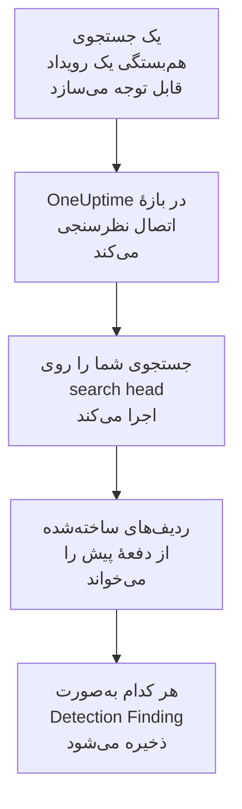

# Splunk Enterprise Security

رویدادهای قابل توجهی (notable event) را که جستجوهای هم‌بستگی [Splunk Enterprise Security](https://www.splunk.com/en_us/products/enterprise-security.html) می‌سازند، به رویدادهای امنیتی OneUptime وارد کنید. آنجا آن‌ها را کنار لاگ‌ها، ترِیس‌ها و متریک‌هایتان جستجو می‌کنید، با هر منبع دیگری هم‌بسته می‌کنید، و برای آن‌هایی که مهم‌اند آنکال را فرا می‌خوانید. OneUptime آن‌ها را با اجرای یک جستجو روی search head شما، به‌عنوان کاربری از Splunk که خودتان می‌سازید، می‌خواند، و هیچ چیزی را در Splunk تغییر نمی‌دهد. چون این فقط یک جستجوست، هر ایندکس یا خروجی جستجوی ذخیره‌شده‌ای را وارد می‌کند، نه فقط رویدادهای قابل توجه را.

:::cards
- [راه‌اندازی اتصال](#راهاندازی-اتصال): یک توکن، یک نقش، و فرم اتصال.
- [چه چیزی وارد می‌شود](#چه-چیزی-وارد-میشود): هر ردیف جستجو چگونه به یک رویداد امنیتی تبدیل می‌شود.
- [نظرسنجی چگونه کار می‌کند](#نظرسنجی-چگونه-کار-میکند): پنجره‌ای که هر نظرسنجی می‌خواند، و اینکه یک search head پرکار با آن چه می‌کند.
- [عیب‌یابی](#عیبیابی): معنای هر خطا، و آنچه باید تغییر دهید.
:::

## چگونه کار می‌کند



OneUptime هر دقیقه از هر اتصال فعالی که بازهٔ نظرسنجی‌اش گذشته باشد نظرسنجی می‌کند. یک نظرسنجی جستجوی شما را از طریق REST API در search head، روی ردیف‌های ساخته‌شده از نظرسنجی پیش، اجرا می‌کند، و هر ردیف را به‌صورت یک رویداد Detection Finding از [OCSF](https://schema.ocsf.io/) (کلاس `2004`) ذخیره می‌کند. از آن پس قاعده‌های تشخیص، مانیتورها و داشبوردها با آن مانند یک رویداد امنیتی از هر منبع دیگری رفتار می‌کنند.

## پیش از شروع

- در OneUptime، نقش Project Owner، Project Admin یا Security Admin. Security Member و Security Viewer می‌توانند اتصال‌ها و تاریخچهٔ اجرایشان را ببینند، اما نمی‌توانند آن‌ها را تغییر دهند.
- یک search head که Splunk Enterprise 9.0.1 یا جدیدتر، یا Splunk Cloud Platform را اجرا می‌کند. OneUptime با REST API آن روی پورت مدیریت، معمولاً `8089`، صحبت می‌کند. Splunk Web، روی پورت `8000`، REST API را ارائه نمی‌کند.
- یک کاربر Splunk برای OneUptime، که نقشش قابلیت `search` را دارد و می‌تواند ایندکسی را که جستجو می‌خواند بخواند: `notable` برای رویدادهای قابل توجه. نقش‌های Enterprise Security یعنی `ess_analyst` و `ess_user` هر دو را می‌دهند. اتصال فقط می‌خواند، پس نقش به چیز دیگری نیاز ندارد.
- یک search head که OneUptime بتواند از طریق HTTPS به آن برسد. OneUptime Cloud از اینترنت وصل می‌شود، پس search head به یک نشانی عمومی نیاز دارد: نشانی‌های خصوصی رد می‌شوند. یک OneUptime خودمیزبان از کانتینرهای برنامه و کارگرش وصل می‌شود، و می‌تواند به یک search head در شبکهٔ خصوصی شما برسد، مگر اینکه `DATA_SOURCE_BLOCK_PRIVATE_ADDRESSES` برابر `true` باشد.

## راه‌اندازی اتصال

اتصال با یک توکن احراز هویت Splunk، یا با یک نام کاربری و یک رمز عبور، وارد می‌شود.

:::steps
### ساختن یک توکن احراز هویت

1. در Splunk Web، **Settings → Tokens** را باز کنید. اگر Splunk گفت احراز هویت با توکن غیرفعال است، اول **Enable Token Authentication** را برگزینید.
2. **New Token** را برگزینید. در **User**، کاربر Splunk را که برای OneUptime ساختید وارد کنید، و در **Audience** بنویسید توکن برای چیست، مانند `OneUptime security events`.
3. یک **Expiration** برگزینید، یا هیچ. توکنی که منقضی شود اتصال را تا وقتی جایگزینش کنید متوقف می‌کند.
4. **Create** را برگزینید، و توکن را کپی کنید. Splunk آن را یک بار نشان می‌دهد.

برای ورود با رمز عبور به جای آن، این گام را رد کنید و نام و رمز عبور کاربر را دم دست نگه دارید.

### افزودن اتصال در OneUptime

**محصولات** > **رویدادهای امنیتی** > **Connections** (`/dashboard/{projectId}/security-events/connections`) را باز کنید، روی **افزودن اتصال** کلیک کنید، **Splunk Enterprise Security** را برگزینید، و روی **بعدی** کلیک کنید. تنظیمات جدول زیر را پر کنید، روی **بعدی** کلیک کنید، و توکن را در **Authentication token**، یا رمز عبور را در **رمز عبور** بچسبانید.

### آزمایش پیش از ذخیره

روی **Test these settings** زیر **آزمایش پیش از ذخیره** کلیک کنید. آزمایش با مقدارهای فرم وارد می‌شود و جستجوی شما را اجرا می‌کند، و چیزی ذخیره نمی‌کند، پس پورت نادرست یا نقشی که کم است پیش از ساخته شدن اتصال آشکار می‌شود. سپس روی **بعدی** کلیک کنید، به اتصال یک **نام** بدهید، و آن را بسازید.
:::

| تنظیم | چه چیزی وارد کنید |
| --- | --- |
| **Splunk management URL** | REST API در search head، مانند `https://splunk.example.com:8089`. باید از `https` استفاده کند، بدون رشتهٔ پرس‌وجو. یک مسیر نگه داشته می‌شود، برای پراکسی معکوسی که API را زیر یک مسیر ارائه می‌کند. |
| **جستجو** | جستجویی که آنچه وارد می‌شود را برمی‌گزیند، `index=notable` مگر اینکه آن را تغییر دهید. آن را باریک کنید، مانند `index=notable urgency IN (high, critical)`. OneUptime بازهٔ زمانی را خودش می‌افزاید، پس جستجو نمی‌تواند `earliest` یا `latest` را تعیین کند، و نمی‌تواند با یک پایپ شروع شود. یک `search` در آغاز کنار گذاشته می‌شود. |
| **نام کاربری** | نام کاربر Splunk، فقط وقتی با رمز عبور وارد می‌شود. |
| **Authentication token** | توکنی که در گام نخست ساختید. وقتی توکنی ذخیره شده باشد، همان به کار می‌رود، و نام کاربری و رمز عبور نه. |
| **رمز عبور** | رمز عبور کاربر Splunk، فقط وقتی هیچ توکنی به کار نمی‌رود. |

**Authentication token** و **رمز عبور** رمزگذاری می‌شوند، API هرگز آن‌ها را برنمی‌گرداند و دیگر هرگز نشان داده نمی‌شوند. هر کدام را با **Update credentials** روی اتصال جایگزین کنید. برای رفتن از یک روش ورود به دیگری، روش تازه را آنجا پر کنید و **Remove the stored Authentication token**، یا **Remove the stored Password** را روشن کنید.

گام **Polling** همچنین یک **توضیحات** اختیاری دارد، **Poll Interval (Minutes)**، یک عدد صحیح از `1` تا `1440` که با `5` شروع می‌شود، و **فعال**، که از آغاز روشن است.

## چه چیزی وارد می‌شود

هر ردیفی که جستجو برمی‌گرداند به یک رویداد Detection Finding تبدیل می‌شود (کلاس OCSF `2004`)، با فروشندهٔ `Splunk` و محصول `Splunk Enterprise Security`. برای یک رویداد قابل توجه:

| فیلد Splunk | ستون OneUptime |
| --- | --- |
| `event_id`، وگرنه `_bkt` و `_cd`، وگرنه هشی از ردیف | UID رویداد، که تکراری‌ها هم بر پایهٔ آن کنار گذاشته می‌شوند |
| `_time`، وقتی جستجوی هم‌بستگی رویداد قابل توجه را ساخت | زمان رویداد |
| `rule_name`، وگرنه `search_name`، وگرنه `source` | نام قاعده |
| `search_name`، وگرنه `source`، وگرنه `rule_name` | شناسهٔ قاعده |
| `rule_title`، وگرنه `rule_description`، وگرنه نام قاعده | پیام |
| `urgency`، وگرنه `severity` | شدت |
| `status_label`، وگرنه `status_description`، وگرنه نام وضعیت بازبینی‌ای که `status` نگه می‌دارد | وضعیت |
| `annotations.mitre_attack`، و فیلدهایی مانند `mitre_technique_id` و `mitre_tactic` | تاکتیک‌ها و تکنیک‌های MITRE ATT&CK |
| `user` یا `src_user`؛ `src`، `src_ip` یا `src_host`؛ `process`، `process_name` یا `parent_process` | کاربر، IP، میزبان و فرایند اصلی |
| `process_name` یا `process_exec`، `process_path` و `process`؛ `parent_process_name` یا `parent_process_exec`، `parent_process_path` و `parent_process` | نام، مسیر و خط فرمان فرایند؛ نام، مسیر و خط فرمان فرایند والد |
| `dest_user`؛ `dest`، `dest_ip` یا `dest_host`؛ `dest_port` | کاربر، IP، میزبان و پورت هدف |
| `file_path`، `url` یا `risk_object` | منبع هدف |
| هر کاربر، میزبان و IP، و `dvc`، `host`، `file_hash`، `file_name`، `url`، `domain`، `query` و `risk_object` | Observableها |
| هر فیلد ردیف، مانند `security_domain`، `owner`، `orig_sid` و `_raw` | `attributes`، زیر نام خود فیلد |

ردیفی از ایندکسی دیگر هم به همین شکل وارد می‌شود. ستون‌هایی که فیلدهایش پر نمی‌کنند خالی می‌مانند، و هر فیلد همچنان در `attributes` جستجوپذیر است.

## نظرسنجی چگونه کار می‌کند

هر نظرسنجی یک جستجوی export روی پنجره‌اش اجرا می‌کند، قدیمی‌ترین‌ها اول:

```text
POST {Splunk management URL}/services/search/v2/jobs/export
    search=search index=notable | fields * | sort 0 _time | head 10001
    earliest_time={window start}
    latest_time={window end}
    output_mode=json
```

- **زمان ساخت، نشانگر است.** پنجره بر پایهٔ `_time` است، که برای یک رویداد قابل توجه زمانی است که جستجوی هم‌بستگی آن را ساخت، نه زمانی که فعالیتی که با آن جور شد رخ داد. جستجویی که هر ساعت اجرا می‌شود رویدادهای قابل توجهش را با زمان اجرای خودش مهر می‌زند، پس هیچ‌کدام پشت نشانگر نمی‌افتد.
- **نخستین نظرسنجی ۲۴ ساعت به عقب نگاه می‌کند**، پس یک اتصال تازه بی‌درنگ رویدادهای قابل توجه اخیرش را نشان می‌دهد.
- **هر نظرسنجی بعدی ۱ دقیقه پیش از نشانگر ذخیره‌شده شروع می‌شود**، پس ردیفی که روی مرز دو پنجره ساخته شود هرگز جا نمی‌افتد.
- **یک نظرسنجی حداکثر ۲۴ ساعت پس از نشانگر را می‌خواند.** اتصالی که نشانگرش عقب افتاده، در رشته‌ای از پنجره‌های ۲۴ ساعته جبران می‌کند، و **Health** آن **Catching up** را نشان می‌دهد.
- **تکراری‌ها بر پایهٔ `event_id` کنار گذاشته می‌شوند**، یا بر پایهٔ `_bkt` و `_cd` خود Splunk، درون پروژه، پس هم‌پوشانی، پنجره‌ای که دوباره امتحان شده و یک وارد کردن هرگز یک ردیف را دو بار ذخیره نمی‌کنند.

یک search head قدیمی‌تر از 9.0.1 به درخواست `search/v2/jobs/export` با `404` پاسخ می‌دهد. آنگاه OneUptime آن را به `search/jobs/export` منسوخ می‌فرستد، و اجرا این را در یک هشدار می‌گوید. search head را ارتقا دهید: نسخه‌های کنونی آن نقطهٔ پایانی را خاموش می‌کنند.

### وقتی یک پنجره بیش از توان یک نظرسنجی دارد

یک نظرسنجی حداکثر ۱۰٬۰۰۰ ردیف می‌خواند. وقتی پنجره‌ای بیشتر از این داشته باشد، اجرا **Partial** است، با هشداری مانند:

```text
Stopped after collecting 10000 records; the window holds more. Records are read oldest first, and the last one read was created at 2026-09-14T08:12:44.000Z, where the next poll can resume.
```

جستجو پنجره را بر پایهٔ `_time`، قدیمی‌ترین‌ها اول، مرتب می‌کند، پس OneUptime نشانگر را به زمان ساخت آخرین ردیفی که خوانده می‌برد، و نظرسنجی بعدی با همان طول پنجره از آنجا شروع می‌شود. یک search head پرکار در هر نظرسنجی ۱۰٬۰۰۰ ردیف جبران می‌کند، به جای اینکه همان ردیف‌ها را دوباره بخواند. ردیف‌هایی که در همان لحظه ساخته شده‌اند دو بار خوانده می‌شوند، و بررسی تکراری نسخهٔ دوم را کنار می‌گذارد. Splunk کل پنجره را پیش از برگرداندن یک ردیف مرتب می‌کند، پس اگر **جستجو** با بسیار بیشتر از نیازتان جور شود، هر نظرسنجی کندتر می‌شود: آن را گزینشی نگه دارید.

وقتی یک اجرا اصلاً نتواند از نشانگر ذخیره‌شده جلوتر برود، OneUptime به جای آن پنجره را کوتاه می‌کند:

1. **باریک کردن.** نظرسنجی بعدی پنجره‌ای به نصف طول را از همان نقطهٔ شروع می‌خواند، و تا وقتی پنجره‌ای کامل خوانده شود دوباره نصف می‌کند، تا حداقل یک دقیقه. هشدار اجرا همین را می‌گوید: `This window holds more records than one poll can read; the next poll reads a {n} minute window from the same starting point.`
2. **دوباره بزرگ کردن.** پس از اینکه پنجره‌ای کامل خوانده شد، پنجرهٔ بعدی دوباره دو برابر می‌شود، تا ۲۴ ساعت.
3. **گذشتن از یک دقیقهٔ تنها.** اگر حتی یک دقیقه بیش از توان یک نظرسنجی داشته باشد، نظرسنجی از آن می‌گذرد، تا رویدادهای قابل توجه تازه‌تر همچنان برسند. اجرا **Partial** می‌ماند، و **آخرین خطا** این را نشان می‌دهد: `More records were created in the one minute from {cursor} to {end} than one poll can read. Polling moved past this minute so newer records keep arriving; use Import this time range in Diagnostics on this minute to recover what one run can read.` آن دقیقه را با **Import this time range** وارد کنید تا آنچه یک اجرا می‌تواند بخواند بازیابی شود.

اجرایی که با خطایی از Splunk یکسره شکست بخورد، نشانگر و طول پنجره را نگه می‌دارد، و نظرسنجی بعدی همان پنجره را دوباره می‌خواند. تنها استثنا درخواستی است که زمانش سر رسیده: نشانگر می‌ماند، اما پنجرهٔ بعدی نصف طول می‌شود، چون پنجره‌ای که برای پاسخ به‌موقع بیش از حد سنگین است در هر تلاش به پایان زمان می‌خورد. تغییر **Poll Interval (Minutes)** هیچ‌کدام از این‌ها را تغییر نمی‌دهد: این تنظیم تعیین می‌کند یک نظرسنجی هر چند وقت شروع شود، نه اینکه پنجره‌اش از کجا شروع شود.

### اجرا، پیش‌نمایش و وارد کردن در صورت نیاز

روی **Diagnostics** یک اتصال کلیک کنید تا اجراهای اخیرش را ببینید و دستی با آن کار کنید. هر کسی که بتواند اتصال را تغییر دهد می‌تواند این‌ها را شروع کند؛ هر کسی که بتواند آن را ببیند می‌تواند تاریخچه را بخواند.

- **Run now** بی‌درنگ یک نظرسنجی با نشانگر معمول شروع می‌کند، حتی وقتی اتصال **فعال** نیست.
- **Preview notable events** یک بازهٔ زمانی تا ۷ روز را می‌خواند و چیزی وارد نمی‌کند.
- **Import this time range** پس از تأیید شما بازه‌ای تا ۷ روز را وارد می‌کند، بی‌آنکه نشانگر را جابه‌جا کند. ردیف‌هایی که پیش‌تر وارد شده‌اند رد می‌شوند.
- **Copy diagnostics** روی یک اجرا، گزارش آن را برای پشتیبانی کپی می‌کند. هرگز اعتبارنامه‌ها را در بر ندارد.

## آزمایش اتصال

**آزمایش اتصال** در ردیف یک اتصال، و **Test these settings** در فرم، در فرایند API اجرا می‌شوند، نه در یک کارگر پس‌زمینه، پس یک آزمایش حتی وقتی مشکل از کارگرهاست هم پاسخ می‌دهد. این بررسی‌ها را به ترتیب انجام می‌دهد:

| بررسی | چه چیزی را بررسی می‌کند |
| --- | --- |
| **پیکربندی** | هر تنظیم موجود و درست‌شکل است. وقتی این شکست بخورد با هیچ جایی تماس گرفته نمی‌شود. |
| **Authenticate with Splunk** | Splunk توکن، یا نام کاربری و رمز عبور، را می‌پذیرد و کاربر و نقش‌هایش را نام می‌برد، تا آن را با نقشی که می‌خواستید بدهید مقایسه کنید. |
| **Run the search on Splunk** | **جستجو** روی ۲۴ ساعت گذشته، برای یک ردیف، اجرا می‌شود و می‌گوید کدام نقطهٔ پایانی export پاسخ داد. |
| **Notable events available to import** | چند ردیف در ۲۴ ساعت گذشته و ۷ روز گذشته با **جستجو** جور می‌شوند. هیچ ردیفی در ۷ روز یک هشدار است، نه یک شکست. |
| **Background workers**، **Poll scheduler**، **Security event storage** | سمت خود OneUptime: فرایندی کارهای صف Worker را برمی‌دارد، کار نظرسنجی هر دقیقه اجرا می‌شود، و انبارهٔ رویدادهای امنیتی پاسخ می‌دهد. |
| **Scheduled polling** | برای یک اتصال ذخیره‌شده: نظرسنجی روشن است، هیچ اجرایی در انتظار یک کارگر گیر نکرده، و نظرسنجی‌ها به‌موقع اجرا می‌شوند. |

هر درخواست در یک آزمایش مهلتی ۲۰ ثانیه‌ای دارد. یک آزمایش هرگز چیزی وارد نمی‌کند یا نشانگر را جابه‌جا نمی‌کند، و هر بررسی شکست‌خورده می‌گوید چه چیزی را تغییر دهید.

## ارسال رویدادهای امنیتی به Splunk

OneUptime می‌تواند آنچه را می‌یابد از راه HTTP Event Collector (HEC) به Splunk هم بفرستد، تا جستجوها و داشبوردهای شما تشخیص‌های OneUptime را کنار تشخیص‌های خودتان ببینند. هر رویداد امنیتی یک رویداد HEC با sourcetype `oneuptime:security` است، و فیلدهایش همان نام‌هایی را دارند که Common Information Model در Splunk به آن‌ها می‌دهد: `src`، `src_ip`، `src_user`، `dest`، `dest_ip`، `dest_port`، `user`، `signature` و `severity`.

:::steps
### ساختن یک توکن HEC

در Splunk Web، **Settings → Data inputs → HTTP Event Collector** را باز کنید و روی **New Token** کلیک کنید. نامی به آن بدهید، ایندکس‌هایی را که می‌تواند در آن‌ها بنویسد و ایندکس پیش‌فرضش را برگزینید، و مقدار توکن را کپی کنید. در Splunk Cloud، HEC روی `https://http-inputs-<stack>.splunkcloud.com` گوش می‌دهد؛ در Splunk Enterprise، پس از اینکه **Global Settings** توکن‌ها را روشن کند، روی پورت `8088`.

### افزودن مقصد

**محصولات** > **رویدادهای امنیتی** > **Connections** را باز کنید. زیر **ارسال به SIEM شما**، روی **افزودن مقصد** کلیک کنید، Splunk را زیر **SIEM** انتخاب کنید و روی **بعدی** کلیک کنید. **URL مربوط به HEC** را پر کنید و توکن را در **توکن HEC** بچسبانید. **Index** و **نوع منبع** اختیاری‌اند: اگر خالی بمانند، رویدادها با sourcetype `oneuptime:security` به ایندکس پیش‌فرض توکن می‌روند.

### ارسال یک رویداد آزمایشی و شروع ارسال

روی **ارسال رویداد آزمایشی** کلیک کنید: یک رویداد اطلاعاتی با تنظیمات فرم به Splunk می‌رود، و چیزی ذخیره نمی‌شود. آن را با `sourcetype="oneuptime:security"` جستجو کنید. سپس زیر **چه چیزی فرستاده شود** گزینهٔ **فقط تشخیص‌ها** را نگه دارید یا **همه رویدادهای امنیتی** را برگزینید، و روی **شروع ارسال** کلیک کنید.
:::

- **URL مربوط به HEC** باید از `https` استفاده کند، با گواهی‌ای که OneUptime به آن اعتماد دارد: بررسی گواهی هرگز کنار گذاشته نمی‌شود.
- رویدادها در دسته‌هایی تا ۵۰۰ تایی می‌روند. رویدادی که Splunk رد کند کنار گذاشته می‌شود و در **مشاهده خطا** نام برده می‌شود، یک گردآورندهٔ پرمشغله (`503`) دوباره امتحان می‌شود، و یک توکن یا ایندکس ردشده ارسال را تا وقتی درستش کنید متوقف می‌کند.
- رویدادهای قابل توجهی که OneUptime از Splunk وارد کرده هرگز به آن برگردانده نمی‌شوند.

## عیب‌یابی

**آخرین خطا** اتصال پیام خطای کامل را، با اعتبارنامه‌های پوشانده‌شده، پشت پیشوندی نگه می‌دارد که گام شکست‌خورده را نام می‌برد. وقتی اتصالی خطا دارد، برای خواندنش **مشاهده خطا** را در ستون **اقدام‌ها** آن برگزینید، و برای کپی کردنش **کپی خطا** را در کادر گفتگو. اول پیشوند را بخوانید.

:::details Last Error با `Splunk Enterprise Security authentication request` شروع می‌شود
- `Splunk Enterprise Security authentication request failed (HTTP ...)`: Splunk از گفتن اینکه فراخواننده کیست سر باز زد.
  - `HTTP 401`: Splunk اعتبارنامه‌ها را نپذیرفت. توکن نادرست، منقضی یا حذف‌شده است، احراز هویت با توکن روی search head غیرفعال است، یا نام کاربری یا رمز عبور نادرست است. یک توکن تازه بسازید، و آن را با **Update credentials** ذخیره کنید.
  - `HTTP 404`: **Splunk management URL** همان REST API نیست. به Splunk Web روی پورت `8000` اشاره می‌کند، یا مسیری دارد که search head ارائه نمی‌کند.
- `Splunk Enterprise Security authentication request returned ...`: چیزی جز REST API در search head پاسخ داد، مانند HTML مربوط به Splunk Web روی پورت `8000`، یا صفحهٔ یک پراکسی. نشانی را به پورت مدیریت ببرید.
:::

:::details Last Error با `Splunk Enterprise Security search export` یا `Splunk Enterprise Security count search` شروع می‌شود
- `Splunk Enterprise Security search export failed (HTTP ...)`: Splunk از اجرای جستجو سر باز زد.
  - `HTTP 400`: Splunk نمی‌تواند جستجو را تجزیه کند. **جستجو** را در Splunk Web اجرا کنید تا خطایش را بخوانید.
  - `HTTP 403`: نقش کاربر قابلیت `search` را ندارد، یا نمی‌تواند ایندکس را بخواند. `notable`، یا ایندکس خودتان، را به ایندکس‌هایی که نقش می‌تواند جستجو کند بیفزایید.
  - `HTTP 404`: هیچ‌کدام از دو نقطهٔ پایانی export در آن نشانی وجود ندارد، پس این پورت مدیریت یک search head نیست.
  - `HTTP 429` یا `HTTP 5xx`: Splunk نرخ کاربر را محدود می‌کند، مشغول است، یا جستجو به یکی از محدودیت‌هایش خورده است. نظرسنجی بعدی دوباره تلاش می‌کند.
- `Splunk Enterprise Security search export was rejected by Splunk on an HTTP 200`: Splunk پاسخ داد، اما جستجو را با یک خطا متوقف کرد. پیام آن را نقل می‌کند.
- `Splunk Enterprise Security search export returned a body that is not newline-delimited JSON.`: چیزی جز REST API پاسخ داد، مانند Splunk Web، یا صفحهٔ ورود یک پراکسی. این گزارش می‌شود به جای اینکه یک پنجرهٔ خالی به حساب آید، پس نشانگر هرگز از ردیف‌هایی که کسی نخوانده جلوتر نمی‌رود.
- `Splunk Enterprise Security count search ...`: همان شکست‌ها، از شمارش **Notable events available to import**، که فقط یک آزمایش اجرا می‌کند.
:::

:::details Last Error با `did not complete` تمام می‌شود
`Splunk Enterprise Security search export did not complete`، و همین برای گام‌های دیگر، یعنی درخواست هیچ پاسخی نگرفت: پایان زمان، نامی که به نشانی تبدیل نمی‌شود، گواهی‌ای که OneUptime به آن اعتماد ندارد، یا نشانی خصوصی ردشده. بررسی کنید که برنامه و کارگرهای OneUptime بتوانند یک اتصال HTTPS به پورت مدیریت باز کنند. اگر search head به درخواست‌های دیگر پاسخ می‌دهد اما روی جستجو به پایان زمان می‌خورد، بیش از حد مرتب می‌کند: نظرسنجی بعدی پنجره‌ای به نصف طول می‌خواند، و باریک‌تر کردن **جستجو** آن را برای همیشه درست می‌کند.
:::

:::details Last Polled برابر Never است و Last Error خالی است
هیچ نظرسنجی‌ای برای این اتصال تمام نشده است. **آزمایش اتصال** را اجرا کنید: بررسی‌های **Background workers** و **Poll scheduler** آن علت را نام می‌برند. در یک نصب خودمیزبان، علت معمول `DISABLE_QUEUE_WORKERS=true` روی برنامه است، بدون استقرار کارگر جداگانه‌ای که کارها را بردارد: آن را روی `false` بگذارید، یا استقرار کارگر را اجرا کنید (Helm: `worker.enabled: true`).
:::

:::details یک اجرا Partial است
- `Stopped after collecting 10000 records; the window holds more`: پنجره بیش از ۱۰٬۰۰۰ ردیفی داشت که یک اجرا می‌خواند. چیزی از دست نمی‌رود: نظرسنجی بعدی پس از آخرین ردیف خوانده‌شده شروع می‌شود. اتصالی که نظرسنجی پس از نظرسنجی **Partial** می‌ماند در حال جبران یک انباشت است، و **Last Polled** و **Last Event Imported** آن همچنان جلو می‌روند. اگر هرگز جبران نکند، **جستجو** در هر بازهٔ نظرسنجی با بیش از ۱۰٬۰۰۰ ردیف جور می‌شود: آن را باریک کنید، یا **Poll Interval (Minutes)** را کوتاه کنید.
- `More records were created in the one minute from ... than one poll can read`: نظرسنجی از آن دقیقه گذشت. آن را با **Import this time range** در **Diagnostics** وارد کنید. یک وارد کردن به اندازهٔ یک نظرسنجی می‌خواند.
:::

:::details آزمایش موفق است، اما چیزی وارد نمی‌شود
**Notable events available to import** را در گزارش آزمایش بخوانید. `0` در ۷ روز گذشته یعنی **جستجو** در Splunk با هیچ چیزی جور نشد: در Incident Review بررسی کنید که جستجوهای هم‌بستگی فعال باشند و رویداد قابل توجه بسازند، و اینکه **جستجو** باریک‌تر از آنچه می‌خواستید نباشد.
:::

## چه به دست می‌آورید

- **جستجو.** رویدادهای قابل توجه را در کاوشگر رویدادهای امنیتی، کنار هر منبع دیگری، بر پایهٔ فوریت، وضعیت، قاعده، کاربر، میزبان یا هر observable پالایش کنید.
- **هم‌بسته‌سازی.** کاربران، میزبان‌ها، IPها و دامنه‌های هر ردیف به‌صورت observable نمایه می‌شوند، پس یک جستجو هر چیزی را که به آن‌ها اشاره می‌کند پیدا می‌کند.
- **قاعده‌های تشخیص.** قاعده‌های Sigma که بر اساس زمان‌بندی روی رویدادهای امنیتی شما اجرا می‌شوند، و هشدارهایی باز می‌کنند که آنکال را فرا می‌خوانند.
- **مانیتورها.** مانیتورهای رویدادهای امنیتی رویدادهای جور را می‌شمارند، برای نمونه رویدادهای قابل توجه بحرانی تازه، و پس از گذشتن از یک آستانه حادثه یا هشدار باز می‌کنند.

رویدادهای امنیتی مانند بقیهٔ تله‌متری شما، بر اساس هر گیگابایت دریافت‌شده صورت‌حساب می‌شوند. [قیمت‌گذاری](https://oneuptime.com/pricing) را ببینید.

## گام‌های بعدی

:::cards
- [رویدادهای امنیتی](/docs/telemetry/security-events): آنچه را وارد می‌کنید جستجو و هم‌بسته کنید و روی آن هشدار بگیرید.
- [Elastic Security](/docs/integrations/elastic-security): هشدارهای تشخیص یک پشتهٔ Elastic را هم وارد کنید.
- [نقش‌ها](/docs/permissions/reference#نقشها): آنچه نقش‌های Security می‌توانند ببینند و تغییر دهند.
- [نمای کلی یکپارچه‌سازی‌ها](/docs/integrations/index): ابزارهای دیگری که می‌توانید وصل کنید.
:::
