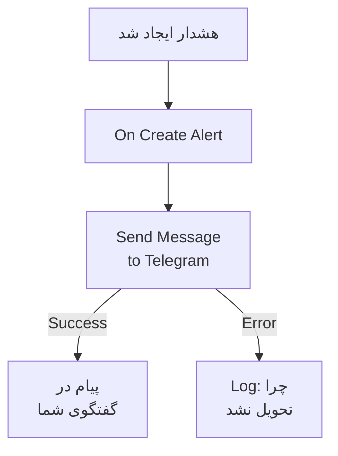

# Telegram

وقتی هشداری ایجاد می‌شود یا حادثه‌ای باز می‌شود، پیامی به یک گفتگو، گروه یا کانال [Telegram](https://telegram.org) بفرستید. مرحلهٔ گردش کاری **Send Message to Telegram** در OneUptime آن را به‌عنوان رباتی که خودتان می‌سازید می‌فرستد، و یک قالب آماده گردش کاری را برای هشدارها می‌سازد. این یکپارچه‌سازی **خروجی** است: ربات پیام می‌فرستد، و آنچه در گفتگو گفته می‌شود را نمی‌خواند.

:::cards
- [چگونه کار می‌کند](#چگونه-کار-میکند): گردش کاری وقتی هشداری ایجاد می‌شود چه می‌کند.
- [راه‌اندازی](#راهاندازی-یکپارچهسازی): یک ربات، گفتگوی آن، سپس گردش کاری: از قالب یا از صفر.
- [نکته‌ها](#نکتهها): متن ساده، پیام‌های بلند، و حادثه‌ها.
- [عیب‌یابی](#عیبیابی): خطاهای Telegram چه معنایی دارند و چه چیزی را باید تغییر داد.
:::

## چگونه کار می‌کند



مرحله **Message Text** را از طریق Bot API در Telegram، به‌عنوان ربات شما، به گفتگو می‌فرستد. وقتی Telegram پیام را بپذیرد از خروجی **Success** ادامه می‌دهد، و وقتی Telegram آن را رد کند، با دلیل Telegram، از خروجی **Error**. قالب یک مرحلهٔ **Log** را به **Error** وصل می‌کند، تا اجرایی که نتوانست پیام بفرستد دلیلش را بگوید.

## پیش از شروع

- یک حساب Telegram، برای ساختن ربات و افزودن آن به گفتگو.
- در OneUptime، اجازه ساختن گردش کاری و متغیر. در OneUptime Cloud، گردش‌های کاری به طرح **Growth** یا بالاتر نیاز دارند.

## راه‌اندازی یکپارچه‌سازی

:::steps
### ساختن یک ربات

در Telegram، `/newbot` را به [@BotFather](https://t.me/BotFather) بفرستید و به پرسش‌هایش پاسخ دهید. او توکن ربات را به شما می‌دهد، مانند `123456789:ABCdefGhIJKlmnoPQRstuVWxyz`. هر کسی که توکن را داشته باشد می‌تواند به‌عنوان ربات شما پیام بفرستد، پس آن را به اندازهٔ یک رمز عبور امن نگه دارید.

### یافتن شناسهٔ گفتگو

1. ربات را به گروه بیفزایید، یا آن را مدیر کانال کنید. برای پیام دادن به یک شخص، آن شخص ابتدا گفتگویی با ربات آغاز می‌کند.
2. پیامی در گروه بفرستید که به ربات اشاره کند، مانند `/start@your_bot`، تا ربات آن را ببیند.
3. `https://api.telegram.org/bot<token>/getUpdates` را در یک مرورگر باز کنید، با توکن ربات به جای `<token>`.
4. `"chat":{"id":` را در پاسخ پیدا کنید. عددی که پس از آن می‌آید شناسهٔ گفتگوست. شناسهٔ یک گروه با `-` شروع می‌شود، و شناسهٔ یک گروه بزرگ با `-100`.

یک کانال عمومی را می‌توان به جای شناسه با `@username` آن نام برد.

### ساخت گردش کاری

از قالب شروع کنید، که کل گردش کاری را برای هشدارها می‌سازد، یا از صفر.

:::tabs
@tab از قالب
1. **گردش‌های کاری** را باز کنید و روی **ساخت گردش کاری** کلیک کنید.
2. در **جستجو در قالب‌ها…** عبارت `Telegram` را بنویسید، روی **Tell Telegram when an alert fires** کلیک کنید، سپس روی **استفاده از این قالب** کلیک کنید.
3. نام **Notify Telegram on new alert** را نگه دارید یا تغییر دهید، و روی **بعدی** کلیک کنید.
4. توکن را در **Telegram Bot Token** و شناسه را در **Telegram Chat ID** بچسبانید، و روی **ساخت گردش کاری** کلیک کنید.

گردش کاری در **سازنده** با سه مرحله باز می‌شود: **On Create Alert**؛ **Send Message to Telegram**، که شماره، عنوان، شدت و وضعیت هشدار را می‌فرستد؛ و یک مرحلهٔ **Log** روی خروجی **Error** آن. توکن به‌صورت متغیر راز `telegramBotToken` گردش کاری ذخیره می‌شود، و شناسه به‌صورت `telegramChatId`.
@tab از صفر
1. توکن را به‌صورت یک متغیر سراسری راز ذخیره کنید: به **گردش‌های کاری** > **متغیرهای سراسری** بروید، روی **ساخت متغیر گردش کاری** کلیک کنید، نامش را `TELEGRAM_BOT_TOKEN` بگذارید، و روی **بعدی** کلیک کنید. توکن را در **محتوا** بچسبانید، **راز** را روشن کنید، و روی **ساخت متغیر گردش کاری** کلیک کنید.
2. به **گردش‌های کاری** بروید، روی **ساخت گردش کاری** کلیک کنید، **شروع از صفر** را برگزینید، برای گردش کاری نامی بگذارید، و روی **ساخت گردش کاری** کلیک کنید.
3. در **سازنده** روی **انتخاب کنید چه چیزی این گردش کاری را شروع کند** کلیک کنید و **On Create Alert** را زیر **محبوب** برگزینید. روی تریگر کلیک کنید: **Fields to pass on** آن از پیش **عنوان** را دارد، پس روی **افزودن فیلد** کلیک کنید و فیلدهای دیگری را که پیامتان نشان می‌دهد برگزینید، مانند **Alert Number With Prefix**.
4. روی **افزودن مؤلفه** کلیک کنید، `telegram` را جستجو کنید، و روی **Send Message to Telegram** کلیک کنید. خروجی **Success** تریگر را به آن وصل کنید.
5. روی مرحلهٔ تازه کلیک کنید. در **Telegram Bot Token** روی **{ }** کلیک کنید و `TELEGRAM_BOT_TOKEN` را زیر **Global variables** برگزینید. شناسهٔ گفتگو را در **Chat ID** وارد کنید، پیام را در **Message Text** بنویسید، و فیلدهای هشدار را با **{ }** درج کنید.
:::

پیامی که از صفر ساخته شده فیلدهای هشدار را با ارجاع‌هایی مانند این‌ها می‌خواند:

```text
🚨 Alert {{local.components.alert-on-create-1.returnValues.model.alertNumberWithPrefix}} fired
Title: {{local.components.alert-on-create-1.returnValues.model.title}}
```

### روشن کردن و آزمودن

**فعال** را در بالای **سازنده** روشن کنید. از این پس هر هشدار تازه به گفتگو فرستاده می‌شود.

برای آزمودن بدون ایجاد هشدار، روی **اجرای گردش کاری** کلیک کنید و زیر **هشدار** هشداری را که از پیش دارید برگزینید: تازه‌ترین‌ها فهرست شده‌اند، و با تایپ شماره یا بخشی از عنوانش هشدار دیگری پیدا می‌شود. روی **اجرای دستی گردش کاری** کلیک کنید و با **اجرا** تأیید کنید. پنل **اجرای گردش کاری** اجرا را دنبال می‌کند، و پیام در گفتگو پدیدار می‌شود. اگر مرحله به‌جای آن از **Error** ادامه دهد، خط مرحلهٔ **Log** دلیل را می‌گوید: [عیب‌یابی](#عیبیابی) را ببینید.
:::

## نکته‌ها

- **متن ساده.** مرحله متن را همان‌طور که نوشته شده، بدون قالب‌بندی Telegram، می‌فرستد، پس `*` و `_` همان‌طور که هستند نشان داده می‌شوند.
- **محدودیت ۴٬۰۹۶ نویسه را در نظر بگیرید.** Telegram پیام‌هایی تا ۴٬۰۹۶ نویسه را می‌پذیرد. پیام بلندتر به جای رد شدن کوتاه می‌شود، و با "… (truncated — see OneUptime for the full text)" پایان می‌یابد.
- **حادثه‌ها هم.** همین گردش کاری را روی **On Create Incident** بسازید، یا روی **On Update Incident** برای تغییرات وضعیت. برای فرستادن فقط برخی هشدارها، یک بلوک **If / Else** پیش از مرحله بگذارید.
- **شکل توکن بررسی می‌شود.** توکنی که شکلی مانند `123456789:ABCdef…` ندارد اجرا را پیش از فرستادن هر چیزی متوقف می‌کند، و توکن هرگز در لاگ نوشته نمی‌شود.

## عیب‌یابی

وقتی مرحله از **Error** ادامه می‌دهد، اجرا دلیل را می‌گوید: مرحلهٔ **Log** قالب `❌ Telegram could not deliver the alert notification:`، دلیل Telegram، و یادآوری‌ای را می‌نویسد که ربات باید در گفتگو باشد.

:::details Telegram با "Bad Request: chat not found" پاسخ می‌دهد
**Chat ID** نادرست است، یا ربات نمی‌تواند گفتگو را ببیند: ربات را به گروه بیفزایید، آن را مدیر کانال کنید، یا از آن شخص بخواهید گفتگویی با ربات آغاز کند. شناسهٔ یک گروه با `-` شروع می‌شود.
:::

:::details Telegram با "Forbidden: bot was blocked by the user" یا "bot is not a member" پاسخ می‌دهد
آن شخص ربات را مسدود کرده، یا ربات از گروه یا کانال برداشته شده است. آن را دوباره بیفزایید، یا به گفتگوی دیگری بفرستید.
:::

:::details Telegram با "Unauthorized" پاسخ می‌دهد
Telegram توکن را نپذیرفت: در @BotFather باطل شده، یا نادرست کپی شده است. توکن کنونی ربات را از @BotFather کپی کنید، و مقدار متغیر را جایگزین کنید.
:::

:::details Telegram با "Too Many Requests: retry after" پاسخ می‌دهد
Telegram محدود می‌کند که یک ربات با چه سرعتی پیام بفرستد، به‌ویژه به یک گروه. موجی از هشدارها می‌تواند به این محدودیت بخورد: پیام‌های کمتری بفرستید، برای نمونه فقط برای برخی شدت‌ها.
:::

## گام‌های بعدی

:::cards
- [اجزای گردش کاری](/docs/workflows/components#telegram): همهٔ تنظیمات مرحله، و معنای خروجی‌هایش.
- [Discord](/docs/integrations/discord): همین ایده، در یک کانال Discord.
- [اجراهای گردش کاری](/docs/workflows/runs-and-logs): ببینید هر اجرای گردش کاری چه کرد.
- [نمای کلی یکپارچه‌سازی‌ها](/docs/integrations/index): الگوی خروجی، و ابزارهای دیگری که می‌توانید وصل کنید.
:::
