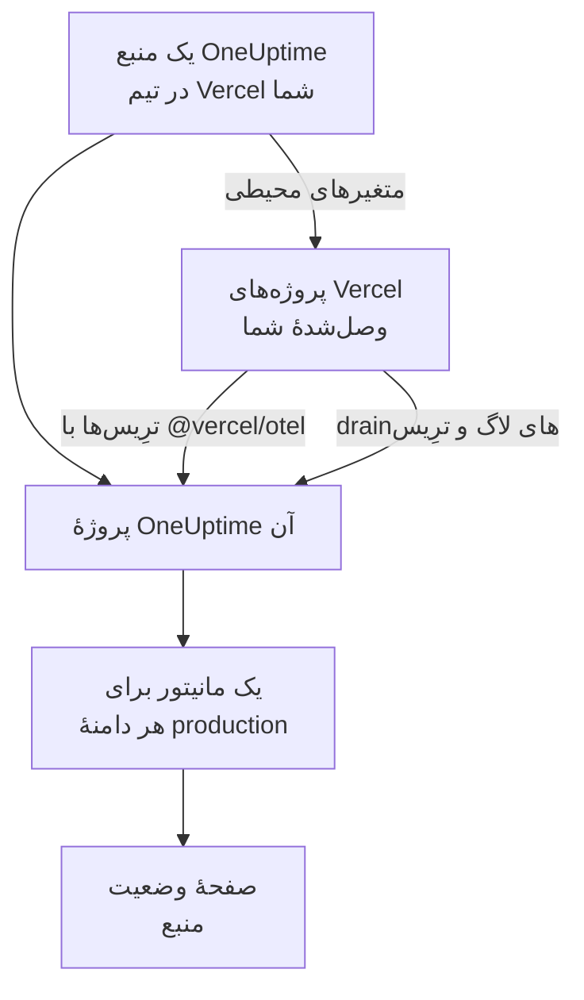

# Vercel

OneUptime را از [Vercel Marketplace](https://vercel.com/marketplace) به تیم Vercel خود اضافه کنید. با حساب Vercel خود وارد می‌شوید و هزینه را روی صورت‌حساب Vercel خود می‌پردازید، و پروژه‌های Vercel شما بی‌آنکه چیزی را دستی راه‌اندازی کنید، در OneUptime ترِیس‌ها، لاگ‌ها، پایش دسترس‌پذیری و یک صفحهٔ وضعیت می‌گیرند.

:::cards
- [افزودن OneUptime به تیم Vercel شما](#افزودن-oneuptime-به-تیم-vercel-شما): یک منبع، یک طرح و پروژه‌هایتان، در داشبورد Vercel.
- [ارسال ترِیس‌ها با `@vercel/otel`](#ارسال-ترِیسها-با-vercelotel): متغیرهای محیطی از پیش تنظیم شده‌اند.
- [ارسال لاگ‌ها و ترِیس‌ها با drainها](#ارسال-لاگها-و-ترِیسها-با-drainها): لاگ‌ها و اسپن‌های خود Vercel، در طرح‌های Pro و Enterprise.
- [طرح‌ها و صورت‌حساب](#طرحها-و-صورتحساب): طرح‌های OneUptime، روی فاکتور Vercel شما.
:::

## چگونه کار می‌کند

هر منبع OneUptime که در Vercel اضافه می‌کنید، یک پروژهٔ OneUptime مستقل است. Vercel به هر پروژهٔ Vercel که به منبع وصل می‌کنید، متغیرهای محیطی منبع را می‌دهد، که ترِیس‌های پروژه را به OneUptime می‌فرستند. drainها لاگ‌ها و اسپن‌های Vercel را می‌فرستند، و دامنهٔ production هر پروژهٔ وصل‌شده یک مانیتور دسترس‌پذیری روی صفحهٔ وضعیت منبع می‌گیرد.



این یکپارچه‌سازی برای OneUptime Cloud (`oneuptime.com`) است. یک OneUptime خودمیزبان را نمی‌توان از Vercel Marketplace اضافه کرد: [OneUptime خودمیزبان](#oneuptime-خودمیزبان) را ببینید.

## پیش از شروع

- **یک تیم Vercel**، با هر طرحی. drainهای لاگ و ترِیس به طرح Pro یا Enterprise در Vercel نیاز دارند؛ ترِیس‌های `@vercel/otel` در همهٔ طرح‌ها کار می‌کنند.
- **یک نشانی ایمیل تأییدشده** روی حساب Vercel شما. OneUptime با همین نشانی شما را وارد می‌کند، و اگر حساب OneUptime ندارید، حسابتان را با آن می‌سازد.
- **یک روش پرداخت در Vercel**، برای همهٔ طرح‌ها: هزینهٔ مانیتورها و تله‌متری بر اساس مصرف محاسبه می‌شود، از جمله در طرح Free. [طرح‌ها و صورت‌حساب](#طرحها-و-صورتحساب) را ببینید.

## افزودن OneUptime به تیم Vercel شما

:::steps
### باز کردن OneUptime در Vercel Marketplace

در داشبورد Vercel، **Integrations** و سپس **Browse Marketplace** را باز کنید، و OneUptime را زیر **Observability** پیدا کنید. روی **نصب** کلیک کنید و شرایط OneUptime را بپذیرید.

### انتخاب طرح

**رایگان**، **Growth** یا **Scale** را برگزینید. این طرح‌ها از آنِ خود OneUptime هستند، با قیمت‌هایی که در [oneuptime.com/pricing](https://oneuptime.com/pricing) آمده است.

### نام‌گذاری منبع و انتخاب تنظیمات آن

برای منبع نامی برگزینید که بگوید چه چیزی را پایش می‌کند، مانند `storefront`: پروژهٔ OneUptime و صفحهٔ وضعیت آن همین نام را می‌گیرند. دو تنظیم در آغاز روشن‌اند:

- **Monitor production domains**: یک مانیتور وب‌سایت برای دامنهٔ production هر پروژهٔ Vercel که وصل می‌کنید.
- **Create a status page**: یک صفحهٔ وضعیت عمومی برای منبع، که همین مانیتورها را نشان می‌دهد.

### وصل کردن پروژه‌هایتان

پروژه‌های Vercel را که به این منبع داده می‌فرستند برگزینید، و محیط‌هایی را که متغیرهای محیطی آن را می‌گیرند. به اتصال پیشوند سفارشی ندهید: `@vercel/otel` متغیرها را با نام‌های خودشان می‌خواند.
:::

منبع ظرف چند ثانیه آماده می‌شود. برای دیدن پروژهٔ آن روی **Open in OneUptime** کلیک کنید.

## آنچه هر منبع به شما می‌دهد

| چه | کجا آن را بیابید |
| --- | --- |
| یک پروژهٔ OneUptime، هم‌نام با منبع | مالک آن شما هستید. هم‌تیمی‌هایتان وقتی آن را از Vercel باز کنند به آن می‌پیوندند. |
| یک کلید دریافت داده با نام `Vercel` | **تنظیمات پروژه** > **تله‌متری و APM** > **کلیدهای دریافت داده** |
| متغیرهای محیطی در هر پروژهٔ Vercel وصل‌شده | **Settings → Environment Variables** پروژه در Vercel |
| یک مانیتور وب‌سایت برای هر پروژهٔ وصل‌شده | **مانیتورها**، هم‌نام با پروژهٔ Vercel |
| یک صفحهٔ وضعیت عمومی | **صفحات وضعیت**، هم‌نام با منبع |

متغیرهای محیطی در همهٔ پروژه‌های وصل‌شده یکسان‌اند:

| متغیر | مقدار |
| --- | --- |
| `OTEL_EXPORTER_OTLP_ENDPOINT` | `https://oneuptime.com/otlp` |
| `OTEL_EXPORTER_OTLP_HEADERS` | `x-oneuptime-token=` و کلید دریافت دادهٔ منبع |
| `OTEL_EXPORTER_OTLP_PROTOCOL` | `http/protobuf` |
| `ONEUPTIME_TELEMETRY_INGESTION_KEY` | خودِ کلید دریافت داده به‌تنهایی، که drainها می‌فرستند |

هر استقرار متغیرها را هنگام ساخته شدنش می‌گیرد: پس از وصل کردن یک پروژه، دوباره مستقر کنید.

## ارسال ترِیس‌ها با `@vercel/otel`

`@vercel/otel` بستهٔ OpenTelemetry خود Vercel برای Next.js و دیگر فریم‌ورک‌هایی است که Vercel اجرا می‌کند. این بسته متغیرهای `OTEL_EXPORTER_OTLP_*` را می‌خواند، پس پروژه‌ای که به منبع وصل است فقط به همین بسته نیاز دارد.

:::steps
### نصب بسته

```bash
npm install @vercel/otel @opentelemetry/api @opentelemetry/api-logs
```

### ثبت کردن آن

`instrumentation.ts` را در ریشهٔ پروژه بسازید، یا اگر پروژه پوشهٔ `src` دارد، در آن، و نام سرویس را تعیین کنید:

```ts title="instrumentation.ts"
import { registerOTel } from "@vercel/otel";

export function register(): void {
  registerOTel({ serviceName: "storefront" });
}
```

### مستقر کردن

پروژه را مستقر کنید. ترِیس‌های آن در **ترِیس‌ها**، زیر نام سرویس، نمایش داده می‌شوند.
:::

در طرح‌های Pro و Enterprise در Vercel، یک drain ترِیس هم اضافه کنید: آنگاه Vercel برای هر درخواست اسپن‌های خودش را همراه با اسپن‌های برنامهٔ شما به OneUptime می‌فرستد، و `@vercel/otel` فرستادن آن‌ها را به drain می‌سپارد، پس هیچ چیز دو بار نمی‌رسد.

## ارسال لاگ‌ها و ترِیس‌ها با drainها

یک drain آنچه را Vercel دربارهٔ پروژه‌های شما ثبت می‌کند به OneUptime می‌فرستد: drain لاگ برای لاگ‌های ساخت، تابع، edge و درخواستِ آن‌هاست، و drain ترِیس برای اسپن‌هایشان. drainها به طرح Pro یا Enterprise در Vercel نیاز دارند، و Vercel هزینهٔ داده‌ای را که می‌فرستند روی صورت‌حساب Vercel شما می‌آورد.

:::steps
### افزودن یک drain

در Vercel، **Team Settings → Drains** را باز کنید و روی **Add Drain** کلیک کنید. **Logs** یا **Traces** را برگزینید، و سپس OneUptime را زیر **Native Integrations** برگزینید.

### انتخاب پروژه‌ها

پروژه‌ها را برگزینید، و برای لاگ‌ها منشأها و محیط‌ها را هم. drain با کلید دریافت دادهٔ منبع می‌فرستد: چیزی برای تایپ کردن نیست.
:::

هر پروژهٔ Vercel در OneUptime یک سرویس است، هم‌نام با پروژه. هر لاگ زمان، سطح و پیام خود را نگه می‌دارد، و اطلاعات درخواستش را با نام‌های OpenTelemetry:

| فیلد Vercel | در OneUptime |
| --- | --- |
| `projectName` | سرویس، `service.name` |
| `timestamp`، `level`، `message` | زمان، شدت و بدنهٔ لاگ |
| `deploymentId`، `environment` | `vercel.deployment.id`، `deployment.environment.name` |
| `proxy.method`، `proxy.path`، `proxy.statusCode` | `http.request.method`، `url.path`، `vercel.proxy.status_code` |
| `traceId`، `spanId` | ترِیس لاگ، پیوندخورده به همان ترِیس در **ترِیس‌ها** |
| هر فیلد دیگر | یک ویژگی زیر `vercel.`، مانند `vercel.source` |

## مانیتورهای دسترس‌پذیری و صفحهٔ وضعیت

وقتی یک پروژهٔ Vercel را وصل می‌کنید، OneUptime برای دامنهٔ production آن یک مانیتور وب‌سایت می‌سازد که از پراب‌های OneUptime بررسی می‌شود، و آن را به صفحهٔ وضعیت منبع اضافه می‌کند. پروژه‌ای که پیش از نخستین استقرار production خود وصل شود هنوز دامنه‌ای ندارد: مانیتورش در همان استقرار ساخته می‌شود. قطع اتصال پروژه، مانیتور آن را حذف می‌کند.

هر یک از این مانیتورها یک مانیتور فعال است، هزینه‌اش مانند هر مانیتور دیگری محاسبه می‌شود، و درست مانند مانیتوری که خودتان ساخته‌اید کار می‌کند: [مانیتور وب‌سایت](/docs/monitor/website-monitor) را ببینید. برای اینکه هیچ مانیتوری ساخته نشود، **Monitor production domains** را در تنظیمات منبع در Vercel خاموش کنید. روشن کردن دوبارهٔ آن، مانیتورهایی را که هنوز ساخته نشده‌اند می‌سازد.

## باز کردن OneUptime از Vercel

روی **Open in OneUptime** در منبع، یا روی هر یک از پیوندهای آن در Vercel، کلیک کنید تا با نشانی ایمیل حساب Vercel خود وارد OneUptime شوید. بار نخست به پروژهٔ منبع می‌پیوندید: اگر مالک یا عضو تیم Vercel باشید به‌عنوان مدیر، و اگر یکی از نقش‌های فقط‌خواندنی آن را داشته باشید به‌عنوان عضو.

اگر حساب OneUptime با آن نشانی ایمیل از پیش وجود داشته باشد، به همان حساب وارد می‌شوید. حسابی که احراز هویت دومرحله‌ای آن روشن است، یا متعلق به یک مدیر OneUptime است، به‌جای آن با گذرواژهٔ خودش وارد می‌شود. در هر حال، شما عضو پروژه می‌شوید.

## طرح‌ها و صورت‌حساب

| | چگونه کار می‌کند |
| --- | --- |
| طرح‌ها | **رایگان**، **Growth** و **Scale**، با قیمت‌های oneuptime.com: قیمت طرح برای هر کاربر، مانیتورهای فعال با $۱ برای هر مانیتور در ماه، و تله‌متری به ازای هر گیگابایت. |
| کجا پرداخت می‌کنید | روی فاکتور Vercel شما، ماهی یک بار، برای هر منبع. Vercel مصرف ماه تا این لحظه را روی منبع نشان می‌دهد، و آن را هر ساعت به‌روز می‌کند. |
| دوره‌های آزمایشی | تا وقتی دورهٔ آزمایشی طرح ادامه دارد هزینه‌ای گرفته نمی‌شود: نه برای کاربرانش، نه مانیتورهایش و نه تله‌متری‌اش. |
| تغییر طرح | در Vercel، روی منبع، یا در OneUptime زیر **تنظیمات پروژه** > **صورت‌حساب و فاکتورها** > **صورت‌حساب**. تغییر در هر کدام، در هر دو جا اعمال می‌شود. |
| فاکتورهای پرداخت‌نشده | Vercel تا ۱۵ روز پرداخت را دوباره امتحان می‌کند. پس از آن، پروژه تا پرداخت فاکتور از دسترس خارج می‌شود: داده‌هایش نگه داشته می‌شوند و هیچ چیز حذف نمی‌شود. |

روی فاکتور، هر منبع برای کاربرانش، مانیتورهای فعالش، تله‌متری‌اش و هر شارژ موجودی یک ردیف دارد، بر حسب واحدهای مصرف $۰٫۰۱.

## حذف OneUptime

| شما | چه پیش می‌آید |
| --- | --- |
| یک منبع را در Vercel حذف می‌کنید | پروژهٔ آن، پس از صورت‌حساب شدن مصرفش تا آن لحظه، حذف می‌شود. پروژه‌های Vercel وصل‌شده در استقرار بعدی‌شان متغیرهای محیطی آن را از دست می‌دهند. |
| OneUptime را از تیم حذف نصب می‌کنید | پروژهٔ همهٔ منبع‌ها حذف می‌شود، و فاکتور نهایی فرستاده می‌شود. |
| پروژه را در OneUptime حذف می‌کنید | منبع در Vercel هم حذف می‌شود. |

> [!CAUTION]
> حذف یک پروژه، مانیتورها، صفحهٔ وضعیت، حادثه‌ها و تله‌متری آن را برای همیشه پاک می‌کند. پیش از آن، از هر چیزی که می‌خواهید نگه دارید خروجی بگیرید.

## OneUptime خودمیزبان

یک OneUptime خودمیزبان را نمی‌توان از Vercel Marketplace اضافه کرد، چون Vercel Marketplace فقط OneUptime Cloud را فراهم می‌کند. با این حال پروژه‌های Vercel شما همچنان می‌توانند به آن داده بفرستند:

- **ترِیس‌ها**: در **Settings → Environment Variables** پروژهٔ Vercel، متغیرهای [آنچه هر منبع به شما می‌دهد](#آنچه-هر-منبع-به-شما-میدهد) را تنظیم کنید، با `https://YOUR-ONEUPTIME-HOST/otlp` به‌عنوان نقطهٔ پایانی و یک کلید دریافت داده از پروژهٔ خودتان.
- **لاگ‌ها**: در **Team Settings → Drains** یک drain لاگ سفارشی به `https://YOUR-ONEUPTIME-HOST/telemetry/vercel/v1/logs` اضافه کنید، در قالب JSON یا NDJSON. سرآیند `x-oneuptime-token` را با کلید دریافت داده‌تان اضافه کنید، و راز امضای drain را روی همان کلید بگذارید: OneUptime فقط ارسال‌هایی را می‌پذیرد که Vercel با آن امضا کرده باشد.

همین drain سفارشی در OneUptime Cloud هم کار می‌کند، با `oneuptime.com` به‌عنوان میزبان.

## عیب‌یابی

:::details هیچ ترِیسی نمی‌رسد
- پروژه را دوباره مستقر کنید: استقراری که پیش از وصل شدن پروژه ساخته شده، متغیرهای `OTEL_EXPORTER_OTLP_*` را ندارد.
- نام متغیرها را در **Settings → Environment Variables** پروژه بررسی کنید. اتصالی که با یک پیشوند سفارشی ساخته شده نام آن‌ها را تغییر می‌دهد، و `@vercel/otel` دیگر آن‌ها را نمی‌خواند: پروژه را بدون پیشوند دوباره وصل کنید.
- بررسی کنید که `instrumentation.ts` تابع `registerOTel` را فرا می‌خواند، و در Next.js 14 و نسخه‌های قدیمی‌تر، که `experimental.instrumentationHook` در `next.config.js` روشن است.
:::

:::details Vercel برای drain خطا نشان می‌دهد
Vercel پاسخ OneUptime به ارسال‌های drain را نشان می‌دهد:

- `403` با `x-vercel-signature` در پیام: Vercel ارسال را با کلیدی که می‌فرستد امضا نکرده است. برای یک drain سفارشی، سرآیند `x-oneuptime-token` آن را بررسی کنید، و راز امضایش را روی همان کلید بگذارید.
- `401`: OneUptime هیچ پروژه‌ای را با کلیدی که drain می‌فرستد نمی‌شناسد: کلید حذف شده، یا در هر دو جا اشتباه تایپ شده است. از کلیدی در **تنظیمات پروژه** > **تله‌متری و APM** > **کلیدهای دریافت داده** استفاده کنید.
- `422`: کلید خاموش شده است. آن را در همان صفحه دوباره روشن کنید، یا از کلید دیگری استفاده کنید.
:::

:::details یک پروژهٔ وصل‌شده مانیتور ندارد
- **Monitor production domains** در تنظیمات منبع در Vercel خاموش است.
- پروژه هنوز دامنهٔ production ندارد: مانیتورش در نخستین استقرار production آن ساخته می‌شود.
- پروژه به سقف مانیتورهای فعالی که طرحش اجازه می‌دهد رسیده است: طرح را ارتقا دهید، سپس **Monitor production domains** را خاموش و دوباره روشن کنید.
:::

:::details Vercel می‌گوید نشانی ایمیل خود را تأیید کنید
OneUptime به نشانی ایمیلی نیاز دارد که Vercel آن را تأیید کرده باشد، و اگر حساب OneUptime با آن نشانی از پیش وجود دارد، نشانی آن حساب هم باید تأیید شده باشد. نشانی را تأیید کنید، سپس منبع را اضافه کنید یا OneUptime را دوباره باز کنید.
:::

## گام‌های بعدی

:::cards
- [کاوشگر ترِیس](/docs/telemetry/traces-explorer): یک درخواست کند و اسپن‌هایش را پیدا کنید.
- [کاوشگر لاگ](/docs/telemetry/logs-explorer): در لاگ‌های Vercel خود جستجو کنید.
- [صفحات وضعیت](/docs/status-pages/index): برندینگ صفحهٔ وضعیت منبع را تنظیم کنید، و مشترک اضافه کنید.
- [کلیدهای دریافت داده](/docs/telemetry/ingestion-keys): کلید منبع را بچرخانید یا خاموش کنید.
:::
