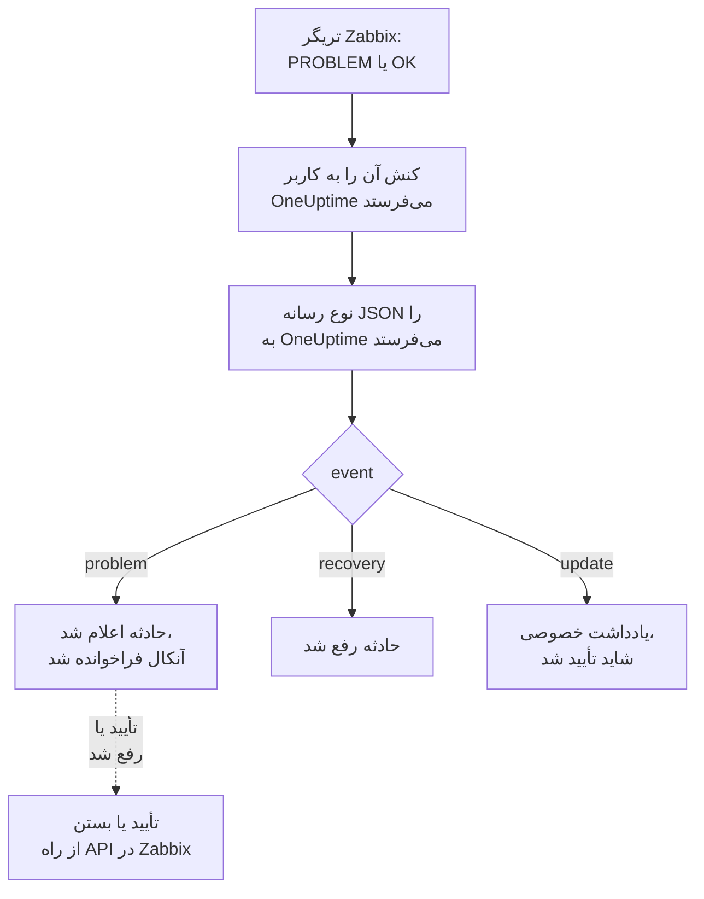

# Zabbix

مشکل‌های [Zabbix](https://www.zabbix.com) را به OneUptime بفرستید تا هر مشکل به حادثه‌ای تبدیل شود که تیم آنکال شما را فرا می‌خواند، و وقتی Zabbix بهبود را اعلام کرد رفع شود. قالب‌های آماده گردش کاری دو طرف را هماهنگ نگه می‌دارند: کاری که افراد در Zabbix انجام می‌دهند روی حادثه یادداشت می‌شود، و تأیید یا رفع حادثه، مشکل را در Zabbix تأیید یا بسته می‌کند. Zabbix هر مشکل را از طریق یک نوع رسانه وب‌هوک می‌فرستد، پس در هیچ‌یک از دو طرف چیزی برای نصب نیست.

:::cards
- [انتخاب اینکه OneUptime مشکل‌ها را چگونه دریافت کند](#انتخاب-اینکه-oneuptime-مشکلها-را-چگونه-دریافت-کند): قالب‌های گردش کاری، یا یک مانیتور Incoming Request.
- [شروع با قالب‌ها](#شروع-با-قالبها): شش قالب، اینکه چه می‌کنند و چه می‌خواهند.
- [پیکربندی Zabbix](#پیکربندی-zabbix): یک نوع رسانه، یک کاربر و یک کنش.
- [عیب‌یابی](#عیبیابی): وقتی مشکل‌ها نمی‌رسند، یا حادثه‌ها باز می‌مانند.
:::

## چگونه کار می‌کند



Zabbix یک مشکل را از طریق رسانه یک کاربر به آن کاربر می‌فرستد. اینجا رسانه یک نوع رسانه وب‌هوک به نام **OneUptime** است: اسکریپت آن برای هر مشکل، برای بهبود آن، و برای هر به‌روزرسانی‌ای که کسی در Zabbix روی آن انجام می‌دهد، یک سند کوچک JSON با شناسه رویداد، نام، میزبان و شدت مشکل به OneUptime می‌فرستد. OneUptime با شناسه رویداد، حادثه‌ای را که یک مشکل باز کرده پیدا می‌کند.

## پیش از شروع

- یک کارساز Zabbix که مدیرش هستید. این راهنما برای Zabbix 6.0 LTS و Zabbix 7.0 LTS نوشته شده است. انواع رسانه وب‌هوک از Zabbix 5.0 به بعد به همین شکل کار می‌کنند. قالب‌هایی که Zabbix را از طریق API آن فرا می‌خوانند به Zabbix 6.4 یا بالاتر، یا [یک تغییر در Zabbix 6.0](#در-zabbix-60) نیاز دارند.
- یک کارساز Zabbix که از طریق HTTPS به OneUptime شما دسترسی داشته باشد، و برای قالب‌هایی که Zabbix را فرا می‌خوانند، یک OneUptime که به Zabbix دسترسی داشته باشد.
- در OneUptime، اجازه ساختن گردش کاری، یا اگر راه مانیتور را برمی‌گزینید، مانیتور. در OneUptime Cloud، گردش‌های کاری به طرح **Growth** یا بالاتر نیاز دارند.

## انتخاب اینکه OneUptime مشکل‌ها را چگونه دریافت کند

اول OneUptime را راه بیندازید: نشانی‌ای را که Zabbix به آن می‌فرستد، OneUptime به شما می‌دهد.

| روش | کی از آن استفاده کنید |
| --- | --- |
| قالب‌های گردش کاری (پیشنهادی) | می‌خواهید هر مشکل با شدت Zabbix خود به یک حادثه یا هشدار تبدیل شود، برای High و Disaster آنکال فراخوانده شود، با بهبود رفع شود، کاری که افراد در Zabbix انجام می‌دهند روی آن یادداشت شود، و Zabbix از OneUptime تأیید یا بسته شود. |
| یک مانیتور Incoming Request | حادثه‌ها را بدون گردش کاری، در هر طرحی، و مانیتوری می‌خواهید که وضعیتش از Zabbix پیروی کند. چیزی به Zabbix برنمی‌گردد. |

هر دو از همان نوع رسانه همان JSON را می‌گیرند، پس می‌توانید با یکی شروع کنید و بعدها با تغییر یک نشانی در Zabbix به دیگری بروید.

## شروع با قالب‌ها

پنجره **ساخت یک گردش کاری** شش قالب Zabbix دارد، زیر **Zabbix** در فهرست دسته‌هایش: سه قالب برای حادثه‌ها، سپس همان سه برای هشدارها.

| قالب | چه می‌کند | چه می‌خواهد |
| --- | --- | --- |
| **حوادث** | | |
| Declare an incident for each Zabbix problem | گردش کاری‌ای که Zabbix هر رویداد را به آن می‌فرستد. برای هر مشکل یک حادثه اعلام می‌کند، برای High و Disaster آنکال را فرا می‌خواند، به‌روزرسانی‌های انجام‌شده در Zabbix را یادداشت می‌کند، و با بهبود حادثه را رفع می‌کند. | Zabbix URL |
| Acknowledge or close the Zabbix problem with the incident | وقتی حادثه تأیید شود، مشکل آن را تأیید می‌کند. وقتی رفع شود، مشکل را می‌بندد، یا جایی که Zabbix بستن دستی را اجازه نمی‌دهد، آن را تأیید می‌کند. | Zabbix URL، Zabbix API Token |
| Copy incident private notes to the Zabbix problem | هر یادداشت خصوصی حادثه را به‌عنوان یک پیام به مشکل آن اضافه می‌کند. | Zabbix URL، Zabbix API Token |
| **هشدارها** | | |
| Create an alert for each Zabbix problem | مانند حادثه‌ها، با یک هشدار برای هر مشکل. | Zabbix URL |
| Acknowledge or close the Zabbix problem with the alert | مانند حادثه‌ها، بر پایه وضعیت هشدار. | Zabbix URL، Zabbix API Token |
| Copy alert private notes to the Zabbix problem | هر یادداشت خصوصی هشدار را به‌عنوان یک پیام به مشکل آن اضافه می‌کند. | Zabbix URL، Zabbix API Token |

با **Declare an incident for each Zabbix problem**، یا برای هشدارها با **Create an alert for each Zabbix problem**، شروع کنید: حادثه یا هشداری که باز می‌کند شناسه رویداد مشکل را در فیلد سفارشی `zabbixEventId` خود نگه می‌دارد، و دو قالب دیگر مشکل را با آن پیدا می‌کنند.

### آنچه قالب‌ها می‌خواهند

- **Zabbix URL**: نشانی‌ای که Zabbix را در آن باز می‌کنید، مانند `https://zabbix.example.com`، یا `https://example.com/zabbix` وقتی Zabbix زیر یک مسیر اجرا می‌شود. پیوندهای یک مشکل به آنجا می‌روند، و قالب‌هایی که Zabbix را فرا می‌خوانند درخواست‌هایشان را به `api_jsonrpc.php` آن می‌فرستند. این فیلد نشانی یک صفحه درون Zabbix را نمی‌پذیرد.
- **Zabbix API Token**: یک توکن API از کاربر Zabbix که گردش کاری به جای او عمل می‌کند. [ساختن توکن API](#ساختن-توکن-api) روشش را نشان می‌دهد. به‌عنوان یک متغیر محرمانه ذخیره می‌شود، و فقط به Zabbix فرستاده می‌شود: در سرآیند `Authorization`، یا در Zabbix 6.0 در بدنه درخواست.

### دریافت مشکل‌ها با قالب

:::steps
1. به **گردش‌های کاری** بروید و روی **ساخت گردش کاری** کلیک کنید. زیر **یا از یک قالب شروع کنید**، **Zabbix** را از فهرست دسته‌ها برگزینید، روی **Declare an incident for each Zabbix problem** کلیک کنید، و روی **استفاده از این قالب** کلیک کنید.
2. **Zabbix URL** را پر کنید. زیر **Who to page for High and Disaster problems** سیاست‌های آنکالی را که باید فراخوانده شوند انتخاب کنید، یا هیچ‌کدام را تا کسی فراخوانده نشود، و روی **ساخت گردش کاری** کلیک کنید. گردش کاری در **سازنده** باز می‌شود، خاموش.
3. روی تریگر **Webhook** کلیک کنید، سپس روی **کپی نشانی**، و نشانی را برای Zabbix نگه دارید.
4. در بالای **سازنده** گزینه **فعال** را روشن کنید. گردش کاری خاموش به Zabbix با `400` پاسخ می‌دهد.
:::

سپس [Zabbix را پیکربندی کنید](#پیکربندی-zabbix) تا مشکل‌هایش را به آن نشانی بفرستد.

### آنچه گردش کاری انجام می‌دهد

پس از تریگر **Webhook**، گام **Check With JavaScript** با شناسه `read-event-1` مقدار `event` را که نوع رسانه می‌فرستد می‌خواند، و **Incident From Another Tool**، یا در قالب هشدار **Alert From Another Tool**، با شناسه رویداد مشکل کاری را می‌کند که آن رویداد می‌خواهد:

| رویداد | آنچه گردش کاری انجام می‌دهد |
| --- | --- |
| `problem` | حادثه‌ای با عنوان `Zabbix: <problem> on <host>` اعلام می‌کند، با شدتی که شدت Zabbix به آن نگاشته می‌شود، و آن را از صفحه‌های وضعیت شما دور نگه می‌دارد. توضیحش به مشکل در Zabbix پیوند می‌دهد و میزبان، شدت، زمان شروع، داده‌های عملیاتی و برچسب‌هایش را فهرست می‌کند. برای یک مشکل High یا Disaster، سیاست آنکالی را که برگزیدید فرا می‌خواند. مشکلی که Zabbix دوباره با همان شناسه رویداد می‌فرستد، حادثه دومی باز نمی‌کند. |
| `recovery` | حادثه مشکل را رفع می‌کند، مگر اینکه از پیش رفع شده باشد. دلیلش روی خط زمانی آن است. |
| `update` | آنچه در Zabbix انجام شد را به‌عنوان یادداشت خصوصی به حادثه اضافه می‌کند: چه کسی انجامش داد، چه کرد، و چه نوشت. وقتی به‌روزرسانی مشکل را تأیید کرده باشد، حادثه را هم تأیید می‌کند، که تشدید آنکال را متوقف می‌کند. |

هر چیز دیگری، مانند درخواستی از ابزاری دیگر، دست‌نخورده می‌ماند: `read-event-1` مسیر **No** را می‌گیرد، و **گام‌ها**ی اجرا دلیلش را می‌گویند. گامی که شکست بخورد اجرا را ناموفق می‌کند، و مدخل آن در **گام‌ها** دلیلش را می‌گوید.

### شدت‌ها

در یک پروژه جدید، قالب شش شدت Zabbix را به این شدت‌های حادثه و هشدار نگاشت می‌کند:

| شدت Zabbix | حادثه | هشدار | آنکال |
| --- | --- | --- | --- |
| Disaster | Critical Incident | High | فراخوانده می‌شود |
| High | Critical Incident | High | فراخوانده می‌شود |
| Average | Major Incident | Low | فراخوانده نمی‌شود |
| Warning | Major Incident | Low | فراخوانده نمی‌شود |
| Information | Minor Incident | Low | فراخوانده نمی‌شود |
| Not classified | Minor Incident | Low | فراخوانده نمی‌شود |

با شدت‌های خودتان، Disaster و High به شدیدترین، Average و Warning به میانی، و Information و Not classified به کم‌شدت‌ترین شما می‌روند. Zabbix شدت‌هایش را از 0 (Not classified) تا 5 (Disaster) شماره‌گذاری می‌کند، و قالب شماره را می‌خواند، پس تغییر نام یک شدت در Zabbix چیزی را تغییر نمی‌دهد.

- برای نگاشت یک شدت به یکی از شدت‌های خودتان با نام، `SEVERITY_BY_NAME` را در گام `read-event-1` ویرایش کنید، مانند `{ 2: 'Minor Incident' }` برای Warning.
- برای فراخواندن آنکال برای مشکل‌های Average هم، **Compare with** در گام **If / Else** با شناسه `if-page-1` را روی `3` بگذارید.

### فرستادن تأییدها و یادداشت‌ها به Zabbix

:::steps
1. [توکن API را بسازید](#ساختن-توکن-api).
2. از **Acknowledge or close the Zabbix problem with the incident** یک گردش کاری بسازید. **Zabbix URL** و **Zabbix API Token** را پر کنید، روی **ساخت گردش کاری** کلیک کنید، و **فعال** را روشن کنید.
3. اگر یادداشت‌ها را هم در Zabbix می‌خواهید، همین کار را با **Copy incident private notes to the Zabbix problem** انجام دهید.
:::

قالب وضعیت نخست از Zabbix درباره مشکل می‌پرسد، پس مشکلی که Zabbix از پیش تأیید یا رفع کرده همان‌طور که هست می‌ماند. برای بستن یک مشکل، تریگر آن در Zabbix به **Allow manual close** نیاز دارد. بدون آن، مشکل به جای بسته شدن تأیید می‌شود، با پیامی که می‌گوید حادثه رفع شد، و Zabbix وقتی بهبود یافت آن را می‌بندد. حادثه‌هایی که هیچ مشکل Zabbix بازشان نکرده، و حادثه‌هایی که با **حادثه خصوصی** علامت خورده‌اند، هرگز به Zabbix فرستاده نمی‌شوند.

### ساختن توکن API

:::steps
1. از کاربر `OneUptime` که [مشکل‌ها را دریافت می‌کند](#ساختن-کاربری-برای-دریافت-مشکلها) استفاده کنید. Zabbix به‌روزرسانی‌های خود یک کاربر را برایش نمی‌فرستد، پس با توکن این کاربر، تأییدها و پیام‌های OneUptime هرگز به‌عنوان به‌روزرسانی به OneUptime برنمی‌گردند.
2. نقش کاربر را در **Users → User roles** بررسی کنید. باید **Access to API** روشن باشد، و **Acknowledge problems**، **Add problem comments** و **Close problems** مجاز باشند. **User role** این‌ها را مجاز می‌کند، مگر اینکه کسی آن را تغییر داده باشد.
3. گروه کاربر را در **Users → User groups** بررسی کنید. مجوز **Read** روی گروه‌های میزبان برای تأیید مشکل‌ها و افزودن پیام بس است. برای بستن مشکل‌ها، به **Read-write** نیاز دارد.
4. به **Users → API tokens** بروید و روی **Create API token** کلیک کنید. کاربر `OneUptime` را برگزینید، تیک **Set expiration date and time** را بردارید یا تاریخ را یادداشت کنید، و روی **Add** کلیک کنید.
5. **Auth token** را کپی کنید: Zabbix آن را فقط یک بار نشان می‌دهد. آن را در **Zabbix API Token** بچسبانید.
:::

### در Zabbix 6.0

Zabbix 6.0 توکن API را از بدنه درخواست می‌خواند، نه از سرآیند `Authorization` آن. در گام **Update Zabbix Problem** هر قالبی که Zabbix را فرا می‌خواند، **Zabbix 6.0** را زیر **فیلدهای بیشتر** روشن کنید. Zabbix 7.2 و بالاتر توکنِ داخل بدنه را نمی‌پذیرند، پس هنگام ارتقا دوباره آن را خاموش کنید.

## دریافت مشکل‌ها با یک مانیتور

یک [مانیتور Incoming Request](/docs/monitor/incoming-request-monitor) یک نشانی به شما می‌دهد، و معیارهایش تعیین می‌کنند هر درخواست چه کند.

:::steps
### ساختن مانیتور

به **مانیتورها** بروید و روی **ساخت مانیتور** کلیک کنید. زیر **نوع مانیتور**، **Incoming Request** را برگزینید، نامش را `Zabbix` بگذارید، و روی **بعدی** کلیک کنید.

### اعلام یک حادثه برای هر مشکل

در گام **معیارها**، نخستین معیار را باز کنید، همان که مانیتور را آفلاین علامت می‌زند. پالایه آن را روی **بدنه درخواست**، **شامل است**، `"status":"1"` بگذارید. این معیار از پیش وقتی پالایه‌اش جور شود حادثه اعلام می‌کند. حادثه را پر کنید:

- **عنوان حادثه**: `Zabbix: {{requestBody.name}} on {{requestBody.host}}`.
- **شدت**: شدت حادثه‌ای که مشکل‌های Zabbix باید داشته باشند.
- **سیاست‌های آنکال**، زیر **آنکال**: سیاست‌هایی که باید فراخوانده شوند.
- **رفع خودکار حادثه**، زیر **فیلدهای بیشتر**: آن را روشن بگذارید، همان‌طور که از آغاز هست. بدون آن، بهبودها نادیده گرفته می‌شوند و حادثه‌ها باز می‌مانند.

### باز کردن یک حادثه برای هر مشکل

در همان معیار، **تنظیمات** را باز کنید و **Group incidents and alerts by a payload field** را روشن کنید. آن را مانند جدول زیر پر کنید تا هر مشکل حادثه خودش را بگیرد و بهبودش آن را رفع کند:

| فیلد | مقدار |
| --- | --- |
| **Open a separate incident for each…** | `requestBody.event_id` |
| **Field that signals recovery** | `requestBody.status` |
| **Value that means recovered** | `0` |

### برگرداندن مانیتور به حالت آنلاین

معیار دوم را باز کنید، همان که مانیتور را آنلاین علامت می‌زند، و پالایه‌اش را روی **بدنه درخواست**، **شامل است**، `"status":"0"` بگذارید.

### کپی کردن نشانی

روی **ساخت مانیتور** کلیک کنید. صفحه **نمای کلی** مانیتور، **Heartbeat URL** آن را نشان می‌دهد. آن را برای Zabbix کپی کنید:

```text
https://oneuptime.com/heartbeat/<secret key>
```

یک نصب خودمیزبان به جای `oneuptime.com` میزبان خودش را دارد.
:::

مانیتور JSON درخواست را همان‌طور که نوشته شده می‌خواند: `"status":"1"`، بدون فاصله. برای اینکه هر تنظیم چه می‌کند، [دریافت هشدار از سامانه‌ای دیگر](/docs/monitor/incoming-request-monitor#دریافت-هشدار-از-سامانهای-دیگر) را ببینید. به‌روزرسانی‌ای که در Zabbix انجام شود هم با `"status":"1"` فرستاده می‌شود، که مانیتور دوباره آن را همان مشکل می‌خواند و حادثه دومی برایش باز نمی‌کند.

## پیکربندی Zabbix

Zabbix به سه چیز نیاز دارد: یک نوع رسانه که به OneUptime می‌فرستد، کاربری که به او فرستاده شود، و کنشی که مشکل‌ها را به آن کاربر بفرستد.

:::steps
### ساختن نوع رسانه OneUptime

1. به **Alerts → Media types** بروید، یا در Zabbix 6.0 به **Administration → Media types**، و روی **Create media type** کلیک کنید.
2. **Name** را روی `OneUptime` و **Type** را روی **Webhook** بگذارید.
3. این **Parameters** را اضافه کنید. هر کدام یک [ماکرو](https://www.zabbix.com/documentation/current/en/manual/appendix/macros/supported_by_location) Zabbix را در درخواست می‌گذارد:

   | نام | مقدار |
   | --- | --- |
   | `url` | `{ALERT.SENDTO}` |
   | `event_id` | `{EVENT.ID}` |
   | `event_name` | `{EVENT.NAME}` |
   | `event_value` | `{EVENT.VALUE}` |
   | `event_severity` | `{EVENT.SEVERITY}` |
   | `event_nseverity` | `{EVENT.NSEVERITY}` |
   | `host` | `{HOST.NAME}` |
   | `event_date` | `{EVENT.DATE}` |
   | `event_time` | `{EVENT.TIME}` |
   | `event_opdata` | `{EVENT.OPDATA}` |
   | `event_tags` | `{EVENT.TAGSJSON}` |
   | `trigger_id` | `{TRIGGER.ID}` |
   | `event_update_status` | `{EVENT.UPDATE.STATUS}` |
   | `event_update_action` | `{EVENT.UPDATE.ACTION}` |
   | `event_update_message` | `{EVENT.UPDATE.MESSAGE}` |
   | `event_update_user` | `{USER.FULLNAME}` |

4. این را در **Script** بچسبانید:

   ```javascript
   var params = JSON.parse(value);

   // Zabbix leaves a macro it has no value for as it is written, such as
   // {EVENT.UPDATE.MESSAGE} on a problem: it is sent as nothing.
   function given(text) {
     var written = String(text === undefined || text === null ? "" : text);
     return /^\{[A-Z0-9_.]+\}$/.test(written) || written === "*UNKNOWN*"
       ? ""
       : written;
   }

   var isUpdate = given(params.event_update_status) === "1";
   var payload = {
     source: "zabbix",
     // "problem", "recovery" or "update".
     event: isUpdate
       ? "update"
       : params.event_value === "0"
         ? "recovery"
         : "problem",
     event_id: params.event_id,
     name: params.event_name,
     host: params.host,
     severity: params.event_severity,
     // 0 Not classified, 1 Information, 2 Warning, 3 Average, 4 High, 5 Disaster.
     severity_number: params.event_nseverity,
     // "1" for a problem, "0" for its recovery.
     status: params.event_value,
     date: params.event_date,
     time: params.event_time,
     opdata: given(params.event_opdata),
     tags: [],
     trigger_id: params.trigger_id,
   };

   try {
     var tags = JSON.parse(given(params.event_tags) || "[]");
     payload.tags = Array.isArray(tags) ? tags : [];
   } catch (error) {
     payload.tags = [];
   }

   if (isUpdate) {
     payload.update = {
       action: given(params.event_update_action),
       message: given(params.event_update_message),
       user: given(params.event_update_user),
     };
   }

   var request = new HttpRequest();
   request.addHeader("Content-Type: application/json");

   var response = request.post(params.url, JSON.stringify(payload));

   if (request.getStatus() < 200 || request.getStatus() >= 300) {
     throw (
       "OneUptime responded with HTTP " + request.getStatus() + ": " + response
     );
   }

   return "OK";
   ```

5. در زبانه **Message templates**، یک قالب برای **Problem**، یکی برای **Problem recovery** و یکی برای **Problem update** اضافه کنید. متن آن‌ها را خالی بگذارید: درخواست را اسکریپت می‌سازد. Zabbix یک نوع رسانه را فقط برای گونه‌هایی از رویداد به کار می‌برد که برایشان قالب دارد.
6. روی **Add** کلیک کنید.

### ساختن کاربری برای دریافت مشکل‌ها

1. به **Users → Users** بروید، یا در Zabbix 6.0 به **Administration → Users**، و روی **Create user** کلیک کنید. نامش را `OneUptime` بگذارید، و یک گروه کاربری و نقشی به او بدهید که بتواند اعلان دریافت کند، مانند **User role**.
2. در زبانه **Media**، روی **Add** کلیک کنید. **Type** را روی `OneUptime` و **Send to** را روی نشانی‌ای که از OneUptime کپی کردید بگذارید. **When active** و شدت‌ها را همان‌طور که هستند بگذارید، یا تیک شدت‌هایی را که OneUptime نباید بگیرد بردارید.
3. روی **Add** کلیک کنید، سپس دوباره روی **Add** تا کاربر ذخیره شود.

### فرستادن مشکل‌ها به OneUptime با یک کنش

1. به **Alerts → Actions → Trigger actions** بروید، یا در Zabbix 6.0 به **Configuration → Actions**، و روی **Create action** کلیک کنید. نامش را `Notify OneUptime` بگذارید.
2. اگر خواستید، زیر **Conditions** دامنه را تنگ‌تر کنید، مانند **Trigger severity is greater than or equals Warning**. بدون شرط، هر مشکلی فرستاده می‌شود.
3. در زبانه **Operations**، عملیاتی اضافه کنید که از طریق نوع رسانه `OneUptime` به کاربر `OneUptime` بفرستد.
4. همان عملیات را زیر **Recovery operations** هم اضافه کنید تا بهبودها هم فرستاده شوند، و زیر **Update operations** تا تأییدها و نظرهایی که در Zabbix ثبت می‌شوند فرستاده شوند.
5. روی **Add** کلیک کنید، و بررسی کنید که کنش فعال باشد.
:::

برای فرستادن برخی مشکل‌ها به قالب حادثه و برخی دیگر به قالب هشدار، به کاربر `OneUptime` دو رسانه از نوع `OneUptime` بدهید: هر کدام به نشانی یک گردش کاری می‌فرستد، با شدت‌هایی که باید دریافت کند.

## آزمایش آن

1. در Zabbix، **Alerts → Media types** را باز کنید و روی **Test** کنار `OneUptime` کلیک کنید. نشانی‌ای را که کپی کردید و مقدارهای نمونه را پر کنید، مانند `event_id` `12345`، `event_name` `Test problem`، `host` `web-1`، `event_nseverity` `4` و `event_value` `1`. روی **Test** کلیک کنید: Zabbix پاسخ اسکریپت، `OK`، یا خطایی را که پرتاب کرد نشان می‌دهد.
2. در OneUptime، در گردش کاری **لاگ‌ها** > **اجراها** را باز کنید و اجرا را بررسی کنید، یا مانیتور را باز کنید و بررسی کنید که حادثه‌ای باز شده باشد.
3. دوباره با `event_value` `0` و همان `event_id` آزمایش کنید. حادثه رفع می‌شود.

سپس بگذارید یک تریگر واقعی فعال شود، مثلاً با پایین آوردن موقت یک آستانه، و رسیدن مشکل را تماشا کنید. برای آزمودن یک به‌روزرسانی، مشکل را در Zabbix با یک پیام تأیید کنید: حادثه یک یادداشت خصوصی می‌گیرد، و تأیید می‌شود.

## نگاشت شدت‌های Zabbix

Zabbix شدت خود را به صورت متن می‌فرستد: `Not classified`، `Information`، `Warning`، `Average`، `High` یا `Disaster`.

- **با قالب‌ها**، شدت‌ها برایتان نگاشت می‌شوند: [شدت‌ها](#شدتها) را ببینید.
- **با مانیتور**، برای هر گروه از شدت‌ها روی **افزودن معیار** کلیک کنید، و معیار تازه را بالای نخستین معیار بکشید: معیارها از بالا بررسی می‌شوند، و نخستین معیاری که جور شود تصمیم می‌گیرد. به هر کدام دو پالایه بدهید، `"status":"1"` و یک شدت مانند `"severity":"Disaster"`، با **شرط تطابق** روی **همه**. به هر کدام یک حادثه با **شدت** و **رفع خودکار حادثه** خودش، و همان تنظیمات گروه‌بندی بدهید.

## عیب‌یابی

:::details چیزی به OneUptime نمی‌رسد
- در Zabbix، **Reports → Action log** را باز کنید و بررسی کنید که کنش مشکل را فرستاده باشد، و چه چیزی برگشته است.
- از کارساز Zabbix خودتان یک درخواست بفرستید: `curl -i -X POST <url> -H 'Content-Type: application/json' -d '{"source":"zabbix","event":"problem","event_id":"1","name":"Test","host":"test","severity_number":"4","status":"1"}'`.
- مانیتور پیش از بررسی هر چیزی، بی‌درنگ با `200` پاسخ می‌دهد، حتی برای کلید محرمانه نادرست. برای دیدن اینکه درخواست‌ها می‌رسند یا نه، خط زمانی مانیتور را بررسی کنید.
- گردش کاری خاموش با `400` پاسخ می‌دهد. در بالای **سازنده** آن، **فعال** را روشن کنید.
:::

:::details Zabbix خطای اسکریپت گزارش می‌دهد
نوع رسانه را باز کنید و از **Test** استفاده کنید: Zabbix نتیجه اسکریپت یا خطایی را که پرتاب کرده نشان می‌دهد. پاسخی غیر از `2xx` از OneUptime را اسکریپت همراه با وضعیتش پرتاب می‌کند، پس اول نشانی را بررسی کنید.
:::

:::details حادثه‌ها باز می‌شوند اما هرگز رفع نمی‌شوند
- کنش به **Recovery operations** نیاز دارد، وگرنه Zabbix هرگز بهبود را نمی‌فرستد.
- با قالب، در گردش کاری **لاگ‌ها** > **اجراها** را باز کنید و اجرای بهبود را ببینید: گام آخرش دلیل را می‌گوید. بهبود مشکلی که هیچ حادثه‌ای باز نکرده چیزی را تغییر نمی‌دهد.
- با مانیتور، حادثه معیار به **رفع خودکار حادثه** زیر **فیلدهای بیشتر** نیاز دارد. **Field that signals recovery** باید `requestBody.status` باشد، و **Value that means recovered** دقیقاً `0`.
:::

:::details مشکل در Zabbix تأیید یا بسته نمی‌شود
اجرای قالب وضعیت را در **لاگ‌ها** > **اجراها** باز کنید: گام آخرش می‌گوید Zabbix چه پاسخی داد.

- `Not authorized`: توکن API نادرست، منقضی یا غیرفعال است، یا Zabbix قدیمی‌تر از 6.4 است ([در Zabbix 6.0](#در-zabbix-60) را ببینید).
- `Cannot close problem: trigger does not allow manual closing`: **Allow manual close** را روی تریگر روشن کنید. قالب از پیش چنین مشکل‌هایی را به جای بستن تأیید می‌کند.
- `No permissions to referred object or it does not exist!`: کاربر مشکل را می‌بیند، اما برای بستن آن به مجوز **Read-write** نیاز دارد.
- `Zabbix has no problem with event ID`: کاربر میزبان مشکل را نمی‌بیند. به گروه کاربری‌اش مجوز **Read** روی گروه میزبان بدهید.
:::

:::details حادثه به جای مقدار، یک ارجاع نشان می‌دهد
ارجاعی به فیلدی که درخواست ندارد، به جای خالی شدن، همان‌طور که نوشته شده با آکولادهایش باقی می‌ماند. بررسی کنید که Zabbix `Content-Type: application/json` را بفرستد، و نام فیلدهایی که به کار می‌برید (`name`، `host`، `severity`، `status`، `event_id`) با محموله اسکریپت جور باشند. برای یک گردش کاری، اجرا را در **لاگ‌ها** > **اجراها** باز کنید و با آنچه تریگر دریافت کرده مقایسه کنید. [نکته‌های دام‌دار](/docs/workflows/variables#نکتههای-ریز) را ببینید.
:::

:::details هر مشکل دو بار می‌رسد
احتمالاً کنش دو عملیات دارد که به همان کاربر می‌فرستند، مانند یک گام نخست و یک گام تشدید. قالب، هر چه برسد، برای هر شناسه رویداد فقط یک حادثه باز می‌کند، اما هر تحویل یک اجراست. **Operations** کنش را بررسی کنید.
:::

## امنیت

- **با نشانی مانند یک گذرواژه رفتار کنید.** هر کسی که آن را داشته باشد می‌تواند حادثه باز کند. اگر لو رفت، آن را بازنشانی کنید: **بازنشانی نشانی** در تریگر **Webhook** گردش کاری، یا **بازنشانی کلید محرمانه درخواست ورودی** در صفحه **تنظیمات** مانیتور. سپس **Send to** را در رسانه کاربر Zabbix به‌روز کنید.
- **پیوندها به Zabbix شما می‌روند.** قالب، هر چه یک درخواست بگوید، مشکل را روی سایتی پیوند می‌دهد که **Zabbix URL** آن نام می‌برد، و آنچه Zabbix فرستاده را به‌صورت متن می‌نویسد.
- **توکن API را به کار گردش کاری محدود کنید.** یک متغیر محرمانه است، در لاگ‌های اجرا پنهان می‌شود، و فقط به Zabbix فرستاده می‌شود، در سرآیند `Authorization` مگر اینکه **Zabbix 6.0** روشن باشد. به کاربرش نقشی بدهید که چیزی بیش از کنش‌های بالا نداشته باشد، و اگر توکن لو رفت آن را در **Users → API tokens** حذف کنید.
- **فقط آنچه را که به حادثه نیاز دارد بفرستید.** از شرط‌های کنش، یا شدت‌های رسانه کاربر، استفاده کنید تا مشکل‌های کم‌شدت در Zabbix بمانند.
- **خودمیزبان؟** بگذارید کارساز Zabbix شما از طریق دیوار آتش‌تان با HTTPS به OneUptime شما برسد. برای فراخواندن یک Zabbix در یک شبکه خصوصی، گردش کاری به [دسترسی شبکه خروجی](/docs/workflows/configuration#دسترسی-شبکه-خروجی) نیاز دارد.

## گام‌های بعدی

:::cards
- [قالب‌های گردش کاری](/docs/workflows/authoring): یک گردش کاری از یک قالب بسازید، و آن را در سازنده تغییر دهید.
- [مانیتور درخواست ورودی](/docs/monitor/incoming-request-monitor): همه تنظیمات مانیتوری که مشکل‌های Zabbix را دریافت می‌کند.
- [قواعد تشدید](/docs/on-call/escalation-rules): تعیین کنید یک سیاست آنکال چه کسی را و کی فرا بخواند.
- [نمای کلی یکپارچه‌سازی‌ها](/docs/integrations/index): ابزارهای دیگری که می‌توانید وصل کنید.
:::
