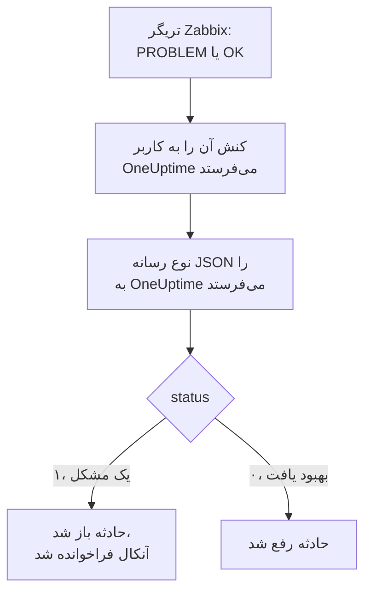

# Zabbix

مشکل‌های [Zabbix](https://www.zabbix.com) را به OneUptime بفرستید تا هر مشکل به حادثه‌ای تبدیل شود که تیم آنکال شما را فرا می‌خواند، و وقتی Zabbix بهبود را اعلام کرد رفع شود. Zabbix هر مشکل را از طریق یک نوع رسانه وب‌هوک می‌فرستد، پس در هیچ طرفی چیزی برای نصب نیست.

:::cards
- [انتخاب اینکه OneUptime مشکل‌ها را چگونه دریافت کند](#انتخاب-اینکه-oneuptime-مشکلها-را-چگونه-دریافت-کند): یک مانیتور Incoming Request، یا یک گردش کاری از خودتان.
- [دریافت مشکل‌ها با یک مانیتور](#دریافت-مشکلها-با-یک-مانیتور): یک حادثه برای هر مشکل، که با بهبود رفع می‌شود.
- [پیکربندی Zabbix](#پیکربندی-zabbix): یک نوع رسانه، یک کاربر و یک کنش.
- [عیب‌یابی](#عیبیابی): وقتی مشکل‌ها نمی‌رسند، یا حادثه‌ها باز می‌مانند.
:::

## چگونه کار می‌کند



Zabbix یک مشکل را از طریق رسانه یک کاربر به آن کاربر می‌فرستد. اینجا رسانه یک نوع رسانه وب‌هوک به نام **OneUptime** است: اسکریپت آن یک سند کوچک JSON با شناسه رویداد، نام، میزبان، شدت و وضعیت مشکل به OneUptime می‌فرستد. وضعیت برای یک مشکل `1` و برای بهبود آن `0` است.

## پیش از شروع

- یک کارساز Zabbix که مدیرش هستید. این راهنما برای Zabbix 6.0 LTS و Zabbix 7.0 LTS نوشته شده است. انواع رسانه وب‌هوک از Zabbix 5.0 به بعد به همین شکل کار می‌کنند.
- یک کارساز Zabbix که از طریق HTTPS به OneUptime شما دسترسی داشته باشد.
- در OneUptime، اجازه ساختن مانیتور، یا اگر آن راه را برمی‌گزینید، گردش کاری.

## انتخاب اینکه OneUptime مشکل‌ها را چگونه دریافت کند

اول OneUptime را راه بیندازید: نشانی‌ای را که Zabbix به آن می‌فرستد، OneUptime به شما می‌دهد.

| روش | کی از آن استفاده کنید |
| --- | --- |
| یک مانیتور Incoming Request (پیشنهادی) | می‌خواهید هر مشکل Zabbix حادثه‌ای باشد که آنکال را فرا می‌خواند، و وقتی Zabbix بهبود را اعلام کرد رفع شود. چیزی برای ساختن نیست. |
| یک گردش کاری با تریگر Webhook | به منطق خودتان نیاز دارید: پالایش مشکل‌ها، تغییر شکل آن‌ها، یا اول فراخواندن سامانه‌های دیگر. یک گردش کاری حادثه را با بهبود خودبه‌خود رفع نمی‌کند. |

هر دو از همان نوع رسانه همان JSON را می‌گیرند، پس می‌توانید با یکی شروع کنید و بعدها با تغییر یک نشانی در Zabbix به دیگری بروید.

## دریافت مشکل‌ها با یک مانیتور

یک [مانیتور Incoming Request](/docs/monitor/incoming-request-monitor) یک نشانی به شما می‌دهد، و معیارهایش تعیین می‌کنند هر درخواست چه کند.

:::steps
### ساختن مانیتور

به **مانیتورها** بروید و روی **ساخت مانیتور** کلیک کنید. زیر **نوع مانیتور**، **Incoming Request** را برگزینید، نامش را `Zabbix` بگذارید، و روی **بعدی** کلیک کنید.

### اعلام یک حادثه برای هر مشکل

در گام **معیارها**، نخستین معیار را باز کنید، همان که مانیتور را آفلاین علامت می‌زند. پالایه آن را روی **بدنه درخواست**، **شامل است**، `"status":"1"` بگذارید. این معیار از پیش وقتی پالایه‌اش جور شود حادثه اعلام می‌کند. حادثه را پر کنید:

- **عنوان حادثه**: `Zabbix: {{requestBody.name}} on {{requestBody.host}}`.
- **شدت**: شدت حادثه‌ای که مشکل‌های Zabbix باید داشته باشند.
- **سیاست‌های آنکال**، زیر **آنکال**: سیاست‌هایی که باید فراخوانده شوند.
- **رفع خودکار حادثه**، زیر **فیلدهای بیشتر**: آن را روشن بگذارید، همان‌طور که از آغاز هست. بدون آن، بهبودها نادیده گرفته می‌شوند و حادثه‌ها باز می‌مانند.

### باز کردن یک حادثه برای هر مشکل

در همان معیار، **تنظیمات** را باز کنید و **Group incidents and alerts by a payload field** را روشن کنید. آن را مانند جدول زیر پر کنید تا هر مشکل حادثه خودش را بگیرد و بهبودش آن را رفع کند:

| فیلد | مقدار |
| --- | --- |
| **Open a separate incident for each…** | `requestBody.event_id` |
| **Field that signals recovery** | `requestBody.status` |
| **Value that means recovered** | `0` |

### برگرداندن مانیتور به حالت آنلاین

معیار دوم را باز کنید، همان که مانیتور را آنلاین علامت می‌زند، و پالایه‌اش را روی **بدنه درخواست**، **شامل است**، `"status":"0"` بگذارید.

### کپی کردن نشانی

روی **ساخت مانیتور** کلیک کنید. صفحه **نمای کلی** مانیتور، **Heartbeat URL** آن را نشان می‌دهد. آن را برای Zabbix کپی کنید:

```text
https://oneuptime.com/heartbeat/<secret key>
```

یک نصب خودمیزبان به جای `oneuptime.com` میزبان خودش را دارد.
:::

مانیتور JSON درخواست را همان‌طور که نوشته شده می‌خواند: `"status":"1"`، بدون فاصله. برای اینکه هر تنظیم چه می‌کند، [دریافت هشدار از سامانه‌ای دیگر](/docs/monitor/incoming-request-monitor#دریافت-هشدار-از-سامانهای-دیگر) را ببینید.

## دریافت مشکل‌ها با یک گردش کاری

وقتی میان Zabbix و حادثه به گام‌های خودتان نیاز دارید، از یک [گردش کاری](/docs/workflows/index) استفاده کنید.

:::steps
### ساختن گردش کاری

به **گردش‌های کاری** بروید، روی **ساخت گردش کاری** و سپس **شروع از صفر** کلیک کنید. نامش را `Zabbix problems` بگذارید و روی **ساخت گردش کاری** کلیک کنید.

### افزودن تریگر Webhook

روی بلوک خط‌چین **Choose what starts this workflow** کلیک کنید و **Webhook** را برگزینید. روی تریگر کلیک کنید، سپس روی **کپی نشانی**، و نشانی را برای Zabbix نگه دارید.

### بررسی اینکه یک مشکل است

روی **افزودن مؤلفه** کلیک کنید، یک بلوک **If / Else** اضافه کنید، و نقطه **Out** تریگر را به آن وصل کنید. **Value to check** را روی `{{local.components.webhook-1.returnValues.request-body.status}}`، **Comparison** را روی **is equal to**، و **Compare with** را روی `1` بگذارید.

### اعلام حادثه

یک بلوک **Create One Incident** اضافه کنید، و سمت **Yes** بلوک **If / Else** را به آن وصل کنید. در **Incident Template**، قالبی را برگزینید که شدت و سیاست‌های آنکالی را که باید فراخوانده شوند تعیین می‌کند ([قالب‌های حادثه](/docs/incidents/settings#قالبهای-حادثه) را ببینید). در **JSON Object**، آنچه را از Zabbix می‌آید تعیین کنید:

```json
{
  "title": "Zabbix: {{local.components.webhook-1.returnValues.request-body.name}}",
  "description": "Host: {{local.components.webhook-1.returnValues.request-body.host}}\nSeverity: {{local.components.webhook-1.returnValues.request-body.severity}}\nZabbix event: {{local.components.webhook-1.returnValues.request-body.event_id}}"
}
```

بدون قالب، **JSON Object** به `incidentSeverityId` هم نیاز دارد، یعنی شناسه یکی از شدت‌های حادثه پروژه.

### روشن کردن آن

در بالای **سازنده** گزینه **فعال** را روشن کنید. گردش کاری خاموش به Zabbix با `400` پاسخ می‌دهد.
:::

بهبود به سمت **No** بلوک **If / Else** می‌رود، جایی که چیزی وصل نیست، پس اجرا همان‌جا تمام می‌شود. برای رفع حادثه‌ها با بهبود، از مانیتور استفاده کنید.

## پیکربندی Zabbix

Zabbix به سه چیز نیاز دارد: یک نوع رسانه که به OneUptime می‌فرستد، کاربری که به او فرستاده شود، و کنشی که مشکل‌ها را به آن کاربر بفرستد.

:::steps
### ساختن نوع رسانه OneUptime

1. به **Alerts → Media types** بروید، یا در Zabbix 6.0 به **Administration → Media types**، و روی **Create media type** کلیک کنید.
2. **Name** را روی `OneUptime` و **Type** را روی **Webhook** بگذارید.
3. این **Parameters** را اضافه کنید. هر کدام یک [ماکرو](https://www.zabbix.com/documentation/current/en/manual/appendix/macros/supported_by_location) Zabbix را در درخواست می‌گذارد:

   | نام | مقدار |
   | --- | --- |
   | `url` | `{ALERT.SENDTO}` |
   | `event_id` | `{EVENT.ID}` |
   | `event_name` | `{EVENT.NAME}` |
   | `event_value` | `{EVENT.VALUE}` |
   | `event_severity` | `{EVENT.SEVERITY}` |
   | `host` | `{HOST.NAME}` |
   | `event_date` | `{EVENT.DATE}` |
   | `event_time` | `{EVENT.TIME}` |

4. این را در **Script** بچسبانید:

   ```javascript
   var params = JSON.parse(value);
   var request = new HttpRequest();
   request.addHeader("Content-Type: application/json");

   var payload = {
     source: "zabbix",
     event_id: params.event_id,
     name: params.event_name,
     host: params.host,
     severity: params.event_severity,
     // "1" for a problem, "0" for its recovery.
     status: params.event_value,
     date: params.event_date,
     time: params.event_time,
   };

   var response = request.post(params.url, JSON.stringify(payload));

   if (request.getStatus() < 200 || request.getStatus() >= 300) {
     throw (
       "OneUptime responded with HTTP " + request.getStatus() + ": " + response
     );
   }

   return "OK";
   ```

5. در زبانه **Message templates**، یک قالب برای **Problem** و یکی برای **Problem recovery** اضافه کنید. متن آن‌ها را خالی بگذارید: درخواست را اسکریپت می‌سازد. Zabbix یک نوع رسانه را فقط برای گونه‌هایی از رویداد به کار می‌برد که برایشان قالب دارد.
6. روی **Add** کلیک کنید.

### ساختن کاربری برای دریافت مشکل‌ها

1. به **Users → Users** بروید، یا در Zabbix 6.0 به **Administration → Users**، و روی **Create user** کلیک کنید. نامش را `OneUptime` بگذارید، و یک گروه کاربری و نقشی به او بدهید که بتواند اعلان دریافت کند، مانند **User role**.
2. در زبانه **Media**، روی **Add** کلیک کنید. **Type** را روی `OneUptime` و **Send to** را روی نشانی‌ای که از OneUptime کپی کردید بگذارید. **When active** و شدت‌ها را همان‌طور که هستند بگذارید، یا تیک شدت‌هایی را که OneUptime نباید بگیرد بردارید.
3. روی **Add** کلیک کنید، سپس دوباره روی **Add** تا کاربر ذخیره شود.

### فرستادن مشکل‌ها به OneUptime با یک کنش

1. به **Alerts → Actions → Trigger actions** بروید، یا در Zabbix 6.0 به **Configuration → Actions**، و روی **Create action** کلیک کنید. نامش را `Notify OneUptime` بگذارید.
2. اگر خواستید، زیر **Conditions** دامنه را تنگ‌تر کنید، مانند **Trigger severity is greater than or equals Warning**. بدون شرط، هر مشکلی فرستاده می‌شود.
3. در زبانه **Operations**، عملیاتی اضافه کنید که از طریق نوع رسانه `OneUptime` به کاربر `OneUptime` بفرستد.
4. همان عملیات را زیر **Recovery operations** هم اضافه کنید تا بهبودها هم فرستاده شوند.
5. روی **Add** کلیک کنید، و بررسی کنید که کنش فعال باشد.
:::

## آزمایش آن

1. در Zabbix، **Alerts → Media types** را باز کنید و روی **Test** کنار `OneUptime` کلیک کنید. نشانی‌ای را که کپی کردید و مقدارهای نمونه را پر کنید، مانند `event_id` `12345`، `event_name` `Test problem`، `host` `web-1` و `event_value` `1`. روی **Test** کلیک کنید: Zabbix پاسخ اسکریپت، `OK`، یا خطایی را که پرتاب کرده نشان می‌دهد.
2. در OneUptime، مانیتور را باز کنید و بررسی کنید که حادثه‌ای باز شده باشد، یا در گردش کاری **لاگ‌ها** > **اجراها** را باز کنید و اجرا را بررسی کنید.
3. دوباره با `event_value` `0` و همان `event_id` آزمایش کنید. با مانیتور، حادثه رفع می‌شود.

سپس بگذارید یک تریگر واقعی فعال شود، مثلاً با پایین آوردن موقت یک آستانه، و رسیدن مشکل را تماشا کنید.

## نگاشت شدت‌های Zabbix

Zabbix شدت خود را به صورت متن می‌فرستد: `Not classified`، `Information`، `Warning`، `Average`، `High` یا `Disaster`.

- **با مانیتور**، برای هر گروه از شدت‌ها روی **افزودن معیار** کلیک کنید، و معیار تازه را بالای نخستین معیار بکشید: معیارها از بالا بررسی می‌شوند، و نخستین معیاری که جور شود تصمیم می‌گیرد. به هر کدام دو پالایه بدهید، `"status":"1"` و یک شدت مانند `"severity":"Disaster"`، با **شرط تطابق** روی **همه**. به هر کدام یک حادثه با **شدت** و **رفع خودکار حادثه** خودش، و همان تنظیمات گروه‌بندی بدهید.
- **با گردش کاری**، یک بلوک [Switch / Case](/docs/workflows/components#switch-case) روی `{{local.components.webhook-1.returnValues.request-body.severity}}` اضافه کنید، با یک حالت برای هر شدت، و پس از هر حالت یک بلوک **Create One Incident** با قالب خودش.

## عیب‌یابی

:::details چیزی به OneUptime نمی‌رسد
- در Zabbix، **Reports → Action log** را باز کنید و بررسی کنید که کنش مشکل را فرستاده باشد، و چه چیزی برگشته است.
- از کارساز Zabbix خودتان یک درخواست بفرستید: `curl -i -X POST <url> -H 'Content-Type: application/json' -d '{"status":"1","event_id":"1","name":"Test","host":"test"}'`.
- مانیتور پیش از بررسی هر چیزی، بی‌درنگ با `200` پاسخ می‌دهد، حتی برای کلید محرمانه نادرست. برای دیدن اینکه درخواست‌ها می‌رسند یا نه، خط زمانی مانیتور را بررسی کنید.
- گردش کاری خاموش با `400` پاسخ می‌دهد. در بالای **سازنده** آن، **فعال** را روشن کنید.
:::

:::details Zabbix خطای اسکریپت گزارش می‌دهد
نوع رسانه را باز کنید و از **Test** استفاده کنید: Zabbix نتیجه اسکریپت یا خطایی را که پرتاب کرده نشان می‌دهد. پاسخی غیر از `2xx` از OneUptime را اسکریپت همراه با وضعیتش پرتاب می‌کند، پس اول نشانی را بررسی کنید.
:::

:::details حادثه‌ها باز می‌شوند اما هرگز رفع نمی‌شوند
- کنش به **Recovery operations** نیاز دارد، وگرنه Zabbix هرگز بهبود را نمی‌فرستد.
- حادثه معیار به **رفع خودکار حادثه**، زیر **فیلدهای بیشتر**، نیاز دارد.
- **Field that signals recovery** باید `requestBody.status` باشد، و **Value that means recovered** دقیقاً `0`.
- گردش کاری حادثه‌ها را با بهبود رفع نمی‌کند. از مانیتور استفاده کنید.
:::

:::details حادثه به جای مقدار، یک ارجاع نشان می‌دهد
ارجاعی به فیلدی که درخواست ندارد، به جای خالی شدن، همان‌طور که نوشته شده با آکولادهایش باقی می‌ماند. بررسی کنید که Zabbix `Content-Type: application/json` را بفرستد، و نام فیلدهایی که به کار می‌برید (`name`، `host`، `severity`، `status`، `event_id`) با محموله اسکریپت جور باشند. برای یک گردش کاری، اجرا را در **لاگ‌ها** > **اجراها** باز کنید و با آنچه تریگر دریافت کرده مقایسه کنید. [نکته‌های دام‌دار](/docs/workflows/variables#نکتههای-ریز) را ببینید.
:::

:::details هر مشکل دو بار می‌رسد
احتمالاً کنش دو عملیات دارد که به همان کاربر می‌فرستند، مانند یک گام نخست و یک گام تشدید. **Operations** کنش را بررسی کنید.
:::

## امنیت

- **با نشانی مانند یک گذرواژه رفتار کنید.** هر کسی که آن را داشته باشد می‌تواند حادثه باز کند. اگر لو رفت، آن را بازنشانی کنید: **بازنشانی کلید محرمانه درخواست ورودی** در صفحه **تنظیمات** مانیتور، یا **بازنشانی نشانی** در تریگر **Webhook** گردش کاری. سپس **Send to** را در رسانه کاربر Zabbix به‌روزرسانی کنید.
- **فقط آنچه را که به حادثه نیاز دارد بفرستید.** از شرط‌های کنش، یا شدت‌های رسانه کاربر، استفاده کنید تا مشکل‌های کم‌شدت در Zabbix بمانند.
- **خودمیزبان؟** بگذارید کارساز Zabbix شما از طریق دیوار آتش‌تان با HTTPS به OneUptime شما برسد.

## گام‌های بعدی

:::cards
- [مانیتور درخواست ورودی](/docs/monitor/incoming-request-monitor): همه تنظیمات مانیتوری که مشکل‌های Zabbix را دریافت می‌کند.
- [قواعد تشدید](/docs/on-call/escalation-rules): تعیین کنید یک سیاست آنکال چه کسی را و کی فرا بخواند.
- [تریگرهای گردش کاری](/docs/workflows/triggers#webhook): نشانی وب‌هوک یک گردش کاری چگونه کار می‌کند.
- [نمای کلی یکپارچه‌سازی‌ها](/docs/integrations/index): ابزارهای دیگری که می‌توانید وصل کنید.
:::
