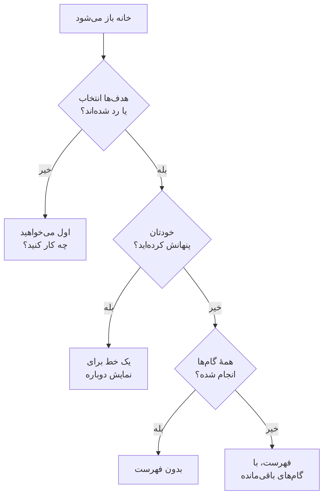

# صفحه اصلی و میان‌برها

خانه نخستین صفحه‌ای است که در یک پروژه می‌بینید. با یک نگاه به شما می‌گوید آیا همین حالا چیزی به شما نیاز دارد، و پروژه تازه را در نخستین راه‌اندازی‌اش همراهی می‌کند. این صفحه توضیح می‌دهد خانه چه چیزهایی نشان می‌دهد، چگونه هر محصول، صفحه یا اقدامی را در داشبورد پیدا کنید، و میان‌برهای صفحه‌کلیدی که شما را از رفت‌وآمد در منوها بی‌نیاز می‌کنند.

:::cards
- [آنچه خانه نشان می‌دهد](#آنچه-خانه-نشان-میدهد): اینکه آیا مشکلی هست، چه چیزی به شما نیاز دارد، پروژه چه چیزهایی دارد و همه محصولات.
- [پیدا کردن راه](#پیدا-کردن-راه): منوی محصولات و نوارهای بالای هر صفحه.
- [جستجو](#جستجوی-یک-صفحه-یک-تنظیم-یا-یک-اقدام): هر صفحه، تنظیم یا اقدامی را با تایپ نامش پیدا کنید.
- [میان‌برهای صفحه‌کلید](#میانبرهای-صفحهکلید): با دو کلید به خانه، مانیتورها یا حوادث بروید.
:::

## آنچه خانه نشان می‌دهد

**خانه** را در نوار بالا باز کنید، یا از هر جایی `g` و سپس `h` را فشار دهید. خانه نمای کلی پروژه شماست، یک صفحه بدون منوی کناری. از بالا به پایین این‌ها را نشان می‌دهد:

1. یک کادر جستجو، با **اعلام حادثه** و **ساخت** در کنارش.
2. یک خط که می‌گوید آیا مشکلی هست، و زیر آن پنج عدد که آنچه را نیاز به توجه دارد می‌شمارند.
3. **به OneUptime خوش آمدید 👋**، فهرستی برای پروژه تازه، تا وقتی کامل شود.
4. **نیاز به توجه**، همه مشکلاتی که همین حالا باز هستند، با نامشان.
5. **پروژه شما**، اینکه پروژه از چه چیزهایی تشکیل شده است، و **تعمیر و نگهداری پیش‌رو** وقتی چیزی زمان‌بندی شده باشد.
6. **کاوش در OneUptime**، همه محصولات، هر بار یک دسته.

### جستجو و ساخت

کادر جستجو، جستجو را باز می‌کند، درست مانند `Mod` + `K`: نام هر صفحه، مانیتور، حادثه، هشدار، صفحه وضعیت یا سیاست آنکالی را تایپ کنید. [جستجو](#جستجوی-یک-صفحه-یک-تنظیم-یا-یک-اقدام) را ببینید. **اعلام حادثه** فرمی را باز می‌کند که با آن یک حادثه اعلام می‌شود. **ساخت** گزینه‌های **ساخت مانیتور**، **زمان‌بندی تعمیر و نگهداری** و **ساخت اطلاعیه** را پیشنهاد می‌دهد. هر کدام فقط به کسانی نشان داده می‌شود که اجازه استفاده از آن را دارند.

### تیتر

خط بالا فوری‌ترین چیزی را که باز است، با رنگی متناسب با آن، نام می‌برد:

| چه زمانی | خانه چه می‌گوید |
| --- | --- |
| یک حادثه باز است | چند حادثه فعال است، به رنگ قرمز |
| هیچ حادثه‌ای باز نیست، اما هشدارهای باز، مانیتورهایی که عملیاتی نیستند یا SLOهای در معرض خطر وجود دارند | چند مورد نیاز به توجه دارند، به رنگ کهربایی |
| هیچ مشکلی نیست و تعمیر و نگهداری در حال انجام است | چند رویداد تعمیر و نگهداری در حال انجام است |
| مانیتورها در حال اجرا هستند و هیچ چیز باز نیست | **همه سیستم‌ها عملیاتی هستند** |
| پروژه هنوز هیچ مانیتوری ندارد | **هنوز چیزی پایش نمی‌شود** |

کنار آن، خانه می‌گوید آخرین بار کی پروژه را خوانده است، و **تازه‌سازی** آن را دوباره می‌خواند. وقتی پس از یک دقیقه یا بیشتر به زبانه خانه برمی‌گردید، خودش تازه‌سازی می‌شود.

تا وقتی هنوز چیزی پایش نمی‌شود، این سطر با **اولین مانیتور خود را بسازید** تمام می‌شود که راه‌اندازی گام‌به‌گام **بدانم وب‌سایت یا API من کی از کار افتاده است** را باز می‌کند. فقط کسانی آن را می‌بینند که اجازهٔ ساخت مانیتور دارند.

### پنج عدد

هر عدد چیزی را می‌شمارد، می‌گوید آیا به شما نیاز دارد، و فهرست پشت آن را در محصولی که به آن تعلق دارد باز می‌کند.

| عدد | چه چیزی می‌شمارد | وقتی شمار صفر است | چه چیزی باز می‌کند |
| --- | --- | --- | --- |
| **حوادث فعال** | حوادثی که رفع نشده‌اند | **همه چیز مرتب است** | **حوادث ← حوادث فعال** |
| **هشدارهای فعال** | هشدارهایی که رفع نشده‌اند | **همه چیز مرتب است** | **هشدارها ← هشدارهای فعال** |
| **مانیتورهای خارج از سرویس** | مانیتورهایی که وضعیتشان از وضعیت‌های عملیاتی نیست. مانیتورهای بایگانی‌شده، و مانیتورهایی که پایششان خاموش است، شمرده نمی‌شوند. | **همه عملیاتی** | **مانیتورها ← خارج از سرویس** |
| **تعمیر و نگهداری در حال انجام** | رویدادهای تعمیر و نگهداری که در جریان‌اند | **موردی در حال انجام نیست** | **تعمیر و نگهداری زمان‌بندی‌شده ← رویدادهای تعمیر و نگهداری در جریان** |
| **SLOهای در معرض خطر** | SLOهای روشنی که در معرض خطرند یا بودجه خطایشان را مصرف کرده‌اند | **بودجه‌ها سالم هستند** | **SLOs** |

شمار بیشتر از صفر **نیاز به توجه** را نشان می‌دهد، و برای تعمیر و نگهداری و SLOها به ترتیب **در حال انجام** و **بودجه در حال مصرف**. تا وقتی SLOای در معرض خطر باشد، **SLOهای در معرض خطر** فهرست **SLOs** را فقط با همان SLOها باز می‌کند. پروژه‌ای که هنوز مانیتوری ندارد **هنوز مانیتوری وجود ندارد** را می‌بیند، و پروژه‌ای که SLO ندارد **هنوز SLOای وجود ندارد** را: یک پروژه خالی با یک پروژه سالم یکی نیست. در این حالت آن دو، فهرست‌های **مانیتورها** و **SLOs** را باز می‌کنند تا نخستین را بسازید.

### فهرست خوشامد

نخستین باری که مالک یا مدیر پروژه صفحهٔ اصلی یک پروژهٔ تازه را باز می‌کند، کارت می‌پرسد **اول می‌خواهید چه کار کنید؟** یک یا چند هدف را تیک بزنید، مانند **بدانم وب‌سایت یا API من کی از کار افتاده است** یا **فقط نگاهی می‌اندازم**، و روی **ادامه** کلیک کنید: فهرست آنگاه گام‌هایی را دارد که این هدف‌ها نیاز دارند. **رد شدن** همان چهار گامی را می‌دهد که هر پروژه می‌گیرد. برای پاسخ دوباره در آینده، در فهرست روی **تغییر** کلیک کنید. از پروژه‌ای که از پیش مانیتور، تله‌متری یا آنکال به کار می‌برد پرسیده نمی‌شود.

هر گام وقتی کار واقعاً کار کند خودش تیک می‌خورد، نه وقتی رکوردی ساخته شود، و همهٔ کسانی که پروژه را راه‌اندازی می‌کنند روی هر دستگاهی همین فهرست را می‌بینند:

| گام | چه زمانی انجام شده | چه چیزی باز می‌کند |
| --- | --- | --- |
| **واردسازی از ابزار فعلی‌تان** | یک واردسازی از ابزاری دیگر تمام شود. | **درون‌ریزی از ابزاری دیگر** |
| **اولین مانیتور خود را بسازید** | نخستین بررسی آن برسد. | راه‌اندازی گام‌به‌گام **بدانم وب‌سایت یا API من کی از کار افتاده است**، یا برای کسی که نمی‌تواند مانیتور بسازد، فهرست **مانیتورها**. |
| **یک سرور یا خوشه را وصل کنید** | نخستین معیارهای آن برسند. | **میزبان‌ها** |
| **نخستین لاگ‌ها، معیارها یا ردگیری‌هایتان را بفرستید** | نخستین لاگ‌ها، معیارها، ردگیری‌ها، استثناها یا پروفایل‌های پروژه برسند. | راه‌اندازی گام‌به‌گام **لاگ‌ها، متریک‌ها و ترِیس‌ها را بفرستید و هشدار بگیرید** |
| **یک سیاست آنکال تنظیم کنید** | یک خبر آزمایشی تأیید شود، یک خبر به کسی برسد، یا یک قاعدهٔ آنکال سیاستی را اجرا کند که می‌تواند به کسی برسد. | راه‌اندازی گام‌به‌گام **وقتی چیزی خراب می‌شود، فرد درست را خبر کنم** |
| **یک صفحهٔ وضعیت منتشر کنید** | یک صفحهٔ وضعیت یک مانیتور نشان دهد. | راه‌اندازی گام‌به‌گام **یک صفحهٔ وضعیت منتشر کنید**، یا برای کسی که نمی‌تواند صفحهٔ وضعیت بسازد، فهرست **صفحات وضعیت**. |
| **تیم خود را دعوت کنید** | کسی دعوت شما را بپذیرد. | **کاربران** |

گامی که باید اول انجام دهید با **گام بعدی** نشان داده می‌شود. در طرح Free فضای ابری OneUptime که یک نفر دارد، **تیم خود را دعوت کنید** می‌گوید به طرح Growth نیاز دارد و **صورت‌حساب** را باز می‌کند. روی سرور خودمیزبانی که هنوز نمی‌تواند ایمیل بفرستد، مدیران سرور نخست **این سرور هنوز نمی‌تواند ایمیل بفرستد** را می‌بینند؛ این گام داشبورد مدیریت را باز می‌کند.

یک راه‌اندازی گام‌به‌گام همهٔ کار را در یک صفحه، گام به گام، انجام می‌دهد و در پایان می‌گوید چه چیزی را راه‌اندازی کرد و گام بعدی چیست. برای این‌که بعداً دوباره بازش کنید، نامش را جست‌وجو کنید.

زیر گام‌ها، **OneUptime چگونه کار می‌کند** چهار محصول اصلی را به ترتیبی نشان می‌دهد که یک مشکل از آن‌ها عبور می‌کند: **مانیتورها**، **حوادث و هشدارها**، **آنکال** و **صفحات وضعیت**. روی هر کدام کلیک کنید تا باز شود. زیر آن‌ها آمده است که چه چیزی این چرخه را تغذیه می‌کند، یعنی تله‌متری و زیرساخت، و به [مفاهیم اصلی](/docs/introduction/core-concepts) و [واژه‌نامه](/docs/introduction/glossary) پیوند می‌دهد.

فهرست وقتی همهٔ گام‌ها انجام شود برای همه کنار می‌رود. برای پنهان کردن زودترش، روی **پنهان کردن** کلیک کنید: فقط برای شما، روی هر دستگاهی پنهان می‌شود، و یک خط با **نمایش** و **OneUptime چگونه کار می‌کند** می‌ماند. کسانی که به‌عنوان عضو به پروژه دعوت شده‌اند فهرست را نمی‌بینند. **OneUptime چگونه کار می‌کند** در هر پروژه‌ای یک کلیک فاصله دارد: آن را از **راهنما** باز کنید، یا با دکمه کنار **کاوش در OneUptime**.

### نیاز به توجه

**نیاز به توجه** آنچه را عددها می‌شمارند با نامشان فهرست می‌کند: حوادث باز، هشدارهای باز، مانیتورهایی که عملیاتی نیستند، SLOهای در معرض خطر و تعمیر و نگهداری در حال انجام، فوری‌ترین اول. هر ردیف شدت یا وضعیتش را نشان می‌دهد، می‌گوید یک حادثه یا هشدار کی شروع شده و تعمیر و نگهداری کی پایان می‌یابد، و رکورد آن را باز می‌کند. از هر نوع حداکثر پنج مورد نشان داده می‌شود، و برای بقیه **نمایش همه** هست که همان فهرستی را باز می‌کند که عددش باز می‌کند. وقتی هیچ چیز باز نیست، **چیزی نیاز به توجه شما ندارد** را نشان می‌دهد.

### سلامت پیکربندی

وقتی چیزی در پیکربندی پروژه مانع از خبردار شدن افراد شود، **نیاز به توجه** با **راه‌اندازی** تمام می‌شود: چند مورد به یک نگاه نیاز دارند. این ردیف **سلامت پیکربندی** را باز می‌کند که آنچه نادرست پیکربندی شده را، جدی‌ترین اول، زیر **فراخوان‌ها نمی‌رسند**، **ارزش رفع کردن دارد** و **پیشنهادها** فهرست می‌کند: مانیتوری که هیچ‌کس را فرا نمی‌خواند، سیاست آنکالی که هیچ چیز آن را اجرا نمی‌کند، کسی که نمی‌توان او را فرا خواند، پیامک خاموش، زمان‌بندی‌ای که هیچ‌کس در آن کشیک نیست، صفحه وضعیتی که هیچ مانیتوری نشان نمی‌دهد. هر یافته در یک جمله می‌گوید چه چیزی اشتباه است، همراه با دکمه‌ای که محل رفع آن را باز می‌کند، و یافته‌های یک مانیتور همان گسست‌هایی هستند که کارت **وقتی از کار بیفتد** آن نام می‌برد. یافته‌ای را که تیم شما عمداً همان‌طور رها می‌کند می‌توان با ذکر دلیل برای همه پنهان کرد و از **رد‌شده** بازیابی کرد. جستجو این صفحه را با نام **سلامت پیکربندی** پیدا می‌کند، و پرسش از هوش مصنوعی بر اساس آن به «آیا پیکربندی من درست است؟» پاسخ می‌دهد.

### پروژه شما

**پروژه شما** شمار **مانیتورها**، **صفحات وضعیت**، **سیاست‌های آنکال**، **SLOs**، **سرویس‌ها**، **داشبوردها** و **گردش‌های کاری** پروژه را نشان می‌دهد، بدون موارد بایگانی‌شده. هر ردیف فهرست خودش را باز می‌کند. نوعی که پروژه هیچ موردی از آن ندارد، به جای عدد **راه‌اندازی** را نشان می‌دهد.

**تعمیر و نگهداری پیش‌رو** سه بازه بعدی تعمیر و نگهداری زمان‌بندی‌شده را فهرست می‌کند، نزدیک‌ترین اول. وقتی چیزی زمان‌بندی نشده باشد، نشان داده نمی‌شود.

### کاوش در OneUptime

**کاوش در OneUptime** محصولات منوی **محصولات** را هر بار یک دسته نشان می‌دهد، با شروع از ملزومات. هر محصول می‌گوید به چه کاری می‌آید و با کلیک روی آن باز می‌شود. محصولاتی که پروژه شما پنهان می‌کند، در آن نیستند.

## پیدا کردن راه

همه چیز در OneUptime زیر **محصولات** در نوار بالا است. منو گروه‌هایش را به‌صورت ردیف‌های یک فهرست نشان می‌دهد، و همیشه با نخستین آن‌ها، یعنی ملزومات، به‌صورت باز گشوده می‌شود: مانیتورها، حوادث، هشدارها، آنکال، صفحات وضعیت، تعمیر و نگهداری زمان‌بندی‌شده و SLOها. هر گروه دیگر (مشاهده‌پذیری، امنیت، هوش مصنوعی، کد، منابع، زیرساخت، ابر، داشبوردها و خودکارسازی و تنظیمات) در یک ردیف از همان فهرست جمع شده است. هر ردیف نام محصولات آن گروه را می‌آورد و می‌گوید چند تا هستند. روی یک ردیف کلیک کنید تا باز یا جمع شود، یا با کلیدهای جهت‌نما به آن بروید و **Enter** را فشار دهید.

- **جستجو همه چیز را پیدا می‌کند.** در کادر جستجوی منو تایپ کنید تا هر محصولی را با نامش، با کاری که انجام می‌دهد، یا با واژه‌ای آشنا مانند `k8s` یا `RUM` پیدا کنید. جستجو درون گروه‌های جمع‌شده را هم می‌گردد.
- **از همان جایی که هستید شروع می‌کنید.** گروه صفحه‌ای که در آن هستید خودش باز می‌شود، و محصولاتی که اخیراً باز کرده‌اید در بالا فهرست می‌شوند.
- **انتخاب‌هایتان می‌مانند.** منو در مرورگر شما به خاطر می‌سپارد کدام‌یک از گروه‌های دیگر را باز یا جمع کرده‌اید. ملزومات هر بار که منو را باز می‌کنید دوباره باز است، حتی اگر جمعش کرده باشید.
- **روی گوشی**، دکمه منو محصولات را به همان شکل فهرست می‌کند: ملزومات در بالا باز است، و هر گروه دیگر یک ردیف است که با یک لمس باز می‌شود.
- **محصولاتی که پروژه از آن‌ها استفاده نمی‌کند.** مالک یا مدیر پروژه می‌تواند آن‌ها را در **تنظیمات پروژه ← پایه ← محصولات** پنهان کند. محصول پنهان به **محصولات بیشتر**، آخرین ردیف منو، می‌رود: جستجو همچنان آن را پیدا می‌کند، صفحه‌هایش کار می‌کنند و داده‌هایش همچنان می‌رسند. وقتی یکی از آن‌ها شروع به دریافت داده کند، «خانه» این را به کسانی می‌گوید که می‌توانند دوباره نشانش دهند.
- **سنجاق کردن.** محصولی را در نوار بالا، کنار **خانه** و **محصولات**، نگه دارید: سنجاق روی کارت آن در منو را بزنید، یا **سنجاق کردن** را کنار عنوان صفحه‌اش. می‌توانید پنج محصول را سنجاق کنید، و در هر مرورگری همراهتان هستند. روی گوشی، محصولات سنجاق‌شده شما اول منو می‌آیند.
- **آنچه در حال استفاده است.** در هر گروه به‌جز ملزومات و تنظیمات، محصولاتی که پروژه شما از آن‌ها استفاده می‌کند اول می‌آیند، و محصولی که هنوز راه‌اندازی نکرده‌اید **راه‌اندازی نشده** را نشان می‌دهد. در OneUptime Cloud، محصولی که طرح شما آن را ندارد، نام طرحی را که آن را دارد نشان می‌دهد.

### نوارهای بالا

دو نوار در بالای هر صفحه کشیده شده‌اند.

| کجا | چه چیزی آنجاست |
| --- | --- |
| بالا سمت چپ | انتخاب‌گر پروژه: به پروژه دیگری از پروژه‌هایتان بروید، یا پروژه تازه‌ای بسازید. |
| بالا سمت راست | **جستجو** و **پرسش از هوش مصنوعی**، زنگ اعلان با آنچه همین حالا به شما نیاز دارد (حوادث و هشدارهای فعال، سیاست‌های آنکالی که در آن‌ها کشیک هستید، دعوت‌های در انتظار)، **راهنما**، و تصویر شما که منوی [حساب](/docs/introduction/your-account) شما را باز می‌کند. |
| زیر آن‌ها | **خانه** و **محصولات** در سمت چپ، **تنظیمات کاربر** در سمت راست: اینکه OneUptime در این پروژه چگونه به شما می‌رسد. |

**راهنما** با چیزهایی شروع می‌شود که به یادگیری کمک می‌کنند: **شروع سریع**، **OneUptime چگونه کار می‌کند**، **واژه‌نامه** و این مستندات (**مستندات**). زیر آن‌ها فهرست **میان‌برهای صفحه‌کلید** و پشتیبانی از طریق ایمیل و Slack آمده است. روی تبلت یا در پنجره‌ای باریک، **پرسش از هوش مصنوعی** برای صرفه‌جویی در جا کنار گذاشته می‌شود: آن را میان کارهای **جستجو** پیدا می‌کنید. روی گوشی، **جستجو** و **راهنما** به فهرست دکمهٔ منو می‌روند، به بالای آن و به پایین آن؛ زنگ و تصویر شما می‌مانند.

واژه‌ای که زیرش خط نقطه‌چین دارد، مانند **پراب‌ها** در فرم یک مانیتور تازه، وقتی نشانگر را رویش ببرید، با Tab به آن برسید یا لمسش کنید، معنایش را می‌گوید. **بیشتر بخوانید** آن واژه را در [واژه‌نامه](/docs/introduction/glossary) باز می‌کند.

### صفحه‌ها و فهرست‌ها

بالای عنوان هر صفحه، مسیری مانند *پروژه › Docker › تنظیمات › قواعد مالکیت* می‌گوید صفحه کجاست. هر گام پیش از گام آخر، صفحه خودش را باز می‌کند.

- **فهرست‌ها خودشان به‌روز می‌مانند.** وقتی حادثه یا هشداری در هر جایی ساخته، تأیید یا حل شود، فهرست‌های حوادث، هشدارها و اپیزودها آن را در چند ثانیه نشان می‌دهند، بدون بازخوانی صفحه. وقتی وسط کاری روی یک فهرست هستید، مثلاً ردیف‌هایی را علامت زده‌اید یا پنجره‌ای باز است، فهرست صبر می‌کند و وقتی کارتان تمام شد به‌روز می‌شود.
- **روی گوشی، تراشه‌های فیلتر جمع می‌شوند** پشت **فیلتر**، تا فهرست بالاتر شروع شود. تراشه‌هایی که تنظیم کرده‌اید، همراه با **پاک کردن همه**، در دید می‌مانند. **فیلتر** را فشار دهید تا همه تراشه‌ها را ببینید، و دوباره تا جمعشان کنید.
- گزینه **ستون‌ها** در منوی **⋯** یک فهرست انتخاب می‌کند فهرست کدام ستون‌ها را و به چه ترتیبی نشان دهد، و آن‌ها را برای شما در همین مرورگر نگه می‌دارد. مالک پروژه یا مدیر پروژه می‌تواند آن‌جا **نمایش این ستون‌ها به همه در این پروژه** را هم علامت بزند: هر کسی که برای آن فهرست ستون‌های خودش را انتخاب نکرده، همین‌ها را می‌بیند، و **بازنشانی به پیش‌فرض پروژه** ستون‌های شما را به همین‌ها برمی‌گرداند.
- گزینه **سطرهای فشرده** در همان منو ردیف‌های همه فهرست‌ها را کوتاه‌تر می‌کشد، تا یک فهرست بلند حدود یک پنجم ردیف بیشتر نشان دهد. این انتخاب در همین مرورگر نگه داشته می‌شود.
- **روی گوشی، یا در کارتی که برای ردیف‌هایش زیادی باریک است، فهرست به شکل کارت نشان داده می‌شود، برای هر ردیف یک کارت.** نوار بالای کارت‌ها می‌گوید به چه ترتیبی هستند، مثلاً **مرتب‌شده بر اساس نام**: آن را فشار دهید تا ستونی را که بر اساس آن مرتب می‌شوند انتخاب کنید، و **صعودی** یا **نزولی** را.
- **صفحه‌های یک حادثه با شماره آن شروع می‌شوند.** عنوان صفحه، گام آن در مسیر و زبانه مرورگر `INC-42 Checkout is down` را نشان می‌دهند، و پنجره‌هایی که از آن نام می‌برند هم همین‌طور، تا حادثه‌هایی که عنوان یکسانی دارند از هم بازشناخته شوند. هشدارها، رویدادهای تعمیر و نگهداری و اپیزودها هم همین‌طورند.

## جستجوی یک صفحه، یک تنظیم یا یک اقدام

**Cmd+K** (Mac) یا **Ctrl+K** (Windows و Linux) را فشار دهید، یا روی نماد جستجو در نوار بالا کلیک کنید، و شروع به تایپ کنید. جستجو این‌ها را پیدا می‌کند:

- **هر صفحه در منوها**، با نامی که منو به آن داده است: کلیدهای API، منطقه خطر، زمان‌بندی‌های آنکال، شدت حادثه، روش‌های اعلان خودتان. هر نتیجه می‌گوید کجا قرار دارد، مانند *تنظیمات پروژه › پیشرفته*، تا صفحه‌هایی که نام یکسانی دارند (فیلدهای سفارشی در حوادث، هشدارها و مانیتورها) به‌آسانی از هم تشخیص داده شوند.
- **تنظیمات یک صفحه**، با نامی که کارت یا کلید آن نشان می‌دهد: *الزامی کردن SSO برای ورود* صفحه SSO را پیدا می‌کند، و *پیکربندی‌های SMTP سفارشی* صفحه کانال‌های اعلان را. نام را به انگلیسی یا به زبان خودتان تایپ کنید.
- **اقدام‌ها**، بر اساس کاری که می‌خواهید انجام دهید: اعلام حادثه، ساخت مانیتور، یا حذف پروژه که منطقه خطر را باز می‌کند. اقدامی که چیزی را تغییر می‌دهد فقط به کسانی پیشنهاد می‌شود که اجازه انجامش را دارند.
- **مانیتورها، حوادث، هشدارها، صفحات وضعیت و سیاست‌های آنکال شما**، با نامشان، و حوادث و هشدارها با شماره‌شان هم، مثلاً `INC-42`. هر نتیجهٔ یک حادثه یا هشدار با شماره‌اش شروع می‌شود، تا دو مورد با عنوان یکسان از هم بازشناخته شوند.
- **مستندات**: در گروه *مستندات* زیر همه نتایج دیگر، صفحه‌ها و بخش‌هایی که واژه‌هایشان با آنچه تایپ کرده‌اید جور است، به زبان شما، حتی با غلط تایپی. هر کدام در یک زبانه تازه باز می‌شود تا جایتان را از دست ندهید.

جستجو آنچه تایپ می‌کنید را همان‌طور که منظورتان است می‌خواند:

- بزرگی و کوچکی حروف، اعراب، فاصله‌ها و خط‌تیره‌ها اهمیتی ندارند: *on-call*، *on call* و *oncall* همان صفحه‌ها را پیدا می‌کنند، و واژه‌ها می‌توانند به هر ترتیبی بیایند.
- برای بسیاری از صفحه‌ها واژه‌های دیگری هم می‌شناسد، به انگلیسی: *pager* یا *escalation* برای سیاست‌های آنکال، *rota* برای زمان‌بندی‌های آنکال، *2fa* برای احراز هویت دومرحله‌ای، *delete project* برای منطقه خطر.
- نام محصول را اضافه کنید تا جستجو محدودتر شود: *incident custom fields* صفحه فیلدهای سفارشی حوادث را پیدا می‌کند.
- یک غلط تایپی کوچک، مانند *incidnet*، وقتی هیچ چیز دقیقاً مطابق تایپ شما نباشد، باز هم آنچه منظورتان بود را پیدا می‌کند.

وقتی کادر جستجو خالی است، جستجو صفحه‌هایی که اخیراً باز کرده‌اید، اقدام‌ها و محصولات را فهرست می‌کند.

## میان‌برهای صفحه‌کلید

هر جای داشبورد `?` را فشار دهید تا همه میان‌برها را ببینید، یا **راهنما** را باز کنید و **میان‌برهای صفحه‌کلید** را انتخاب کنید. در Mac، `Mod` کلید Command است؛ در Windows و Linux، کلید Ctrl است.

| کلیدها | چه می‌کند |
| --- | --- |
| `Mod` + `K` | پالت فرمان را باز کنید: هر صفحه، تنظیم یا اقدامی را جستجو کنید. |
| `Mod` + `I` | درباره آنچه می‌بینید از هوش مصنوعی بپرسید. |
| `/` | در فهرست همین صفحه جستجو کنید. |
| `?` | میان‌برهای صفحه‌کلید را نشان دهید. |
| `Esc` | یک پنجره گفتگو یا پنل را ببندید. |

### رفتن به یک محصول

`g` و سپس یک حرف را فشار دهید تا مستقیم به یک محصول بروید. حرف را ظرف ۱٫۵ ثانیه پس از `g` فشار دهید.

| کلیدها | به کجا می‌رود |
| --- | --- |
| `g` سپس `h` | خانه |
| `g` سپس `m` | مانیتورها |
| `g` سپس `i` | حوادث |
| `g` سپس `a` | هشدارها |
| `g` سپس `o` | آنکال |
| `g` سپس `s` | صفحات وضعیت |
| `g` سپس `e` | تعمیر و نگهداری زمان‌بندی‌شده |
| `g` سپس `d` | داشبوردها |
| `g` سپس `l` | لاگ‌ها |
| `g` سپس `t` | ترِیس‌ها |

میان‌برها مزاحم کار شما نمی‌شوند. وقتی در یک فیلد تایپ می‌کنید، `?`، `/` و `g` کاری نمی‌کنند، و وقتی پنجره گفتگویی باز است هیچ چیز شما را از صفحه دور نمی‌کند، پس یک کلید اشتباه نمی‌تواند فرمی نیمه‌پر را از بین ببرد. هر محصول دیگری با `Mod` + `K` تنها یک جستجو فاصله دارد.

## گام‌های بعدی

:::cards
- [شروع سریع](/docs/introduction/quickstart): فهرست خوشامد را گام به گام انجام دهید.
- [حساب کاربری شما](/docs/introduction/your-account): پروفایل، امنیت ورود، زبان و پوسته.
- [پرسش از هوش مصنوعی](/docs/ai/ask-ai): Ask AI به چه پرسش‌هایی پاسخ می‌دهد و چه کارهایی برایتان انجام می‌دهد.
- [مفاهیم اصلی](/docs/introduction/core-concepts): مانیتورها، حوادث، هشدارها و آنکال چه هستند.
:::
