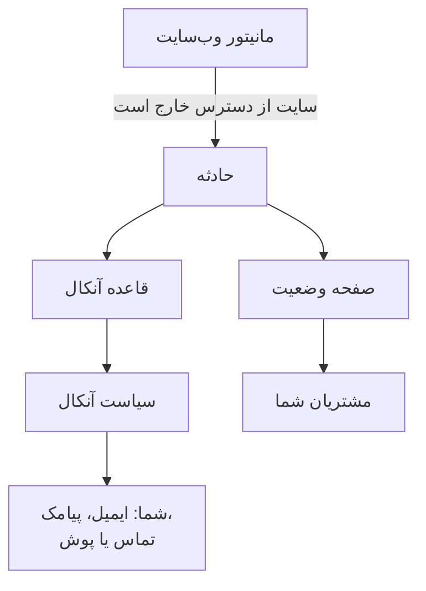

# شروع سریع

این راهنما شما را در حدود پانزده دقیقه از یک حساب تازه به یک راه‌اندازی کارا می‌رساند: مانیتوری که هر پنج دقیقه وب‌سایت شما را بررسی می‌کند، سیاست آنکالی که وقتی سایت از دسترس خارج شد شما را خبر می‌کند، و صفحه وضعیتی که به مشتریانتان اطلاع می‌دهد. این راهنما فهرست **به OneUptime خوش آمدید 👋** را در صفحه خانه پروژه شما، و راه‌اندازی‌های گام‌به‌گامی را که گام‌های آن باز می‌کنند، دنبال می‌کند.

از ابزاری دیگر می‌آیید؟ اول آن را [درون‌ریزی کنید](/docs/introduction/getting-started#مهاجرت-از-ابزاری-دیگر): مانیتورها، زمان‌بندی‌های آنکال و صفحات وضعیت شما همراهتان می‌آیند.

## پیش از شروع

- **یک حساب.** در OneUptime Cloud، در [oneuptime.com](https://oneuptime.com/accounts/register) ثبت‌نام کنید و پیوند ایمیلی را که برایتان می‌فرستد باز کنید. در نصب خودتان، آن را در مرورگر باز کنید و ثبت‌نام کنید: نخستین حساب مدیر ارشد می‌شود. برای نصب، [Docker Compose](/docs/installation/docker-compose) را ببینید.
- **یک وب‌سایت برای پایش.** هر نشانی‌ای که روی HTTP یا HTTPS پاسخ دهد، مانند صفحه اصلی شرکت شما.

## یک پروژه بسازید

همه چیز در OneUptime درون یک پروژه است: مانیتورها، حوادث، سیاست‌های آنکال، صفحات وضعیت و افرادی که روی آن‌ها کار می‌کنند.

:::steps
### یک پروژه تازه شروع کنید

نخستین بار که وارد می‌شوید، OneUptime پیام **هیچ پروژه‌ای نیست** را نشان می‌دهد. روی **ساخت پروژه جدید** کلیک کنید. اگر کسی پیش‌تر شما را به پروژه‌ای دعوت کرده، به‌جای آن دعوت را در همان صفحه بپذیرید.

### نامی برایش بگذارید

یک **نام پروژه** وارد کنید، مانند نام شرکتتان. در OneUptime Cloud، زیر آن یک طرح هم انتخاب کنید: Free از قبل انتخاب شده است و طرح‌های پولی با یک دوره آزمایشی رایگان شروع می‌شوند.

### آن را بسازید

روی **ساخت پروژه** کلیک کنید. صفحه خانه پروژه شما باز می‌شود و فهرست **به OneUptime خوش آمدید 👋** در بالای آن است. نخست می‌پرسد **اول می‌خواهید چه کار کنید؟**: **بدانم وب‌سایت یا API من کی از کار افتاده است**، **وقتی چیزی خراب می‌شود، فرد درست را خبر کنم** و **با یک صفحهٔ وضعیت به مشتریانم خبر بدهم** را تیک بزنید و روی **ادامه** کلیک کنید.
:::

## وب‌سایت خود را پایش کنید

:::steps
### راه‌اندازی وب‌سایت را باز کنید

در فهرست، روی **اولین مانیتور خود را بسازید** کلیک کنید. این کار راه‌اندازی گام‌به‌گام **بدانم وب‌سایت یا API من کی از کار افتاده است** را باز می‌کند که در یک صفحه سایت شما را بررسی می‌کند، انتخاب می‌کند چه کسی باخبر شود و یک آزمایش می‌فرستد. کسی که اجازهٔ ساخت مانیتور ندارد، به جای آن فهرست **مانیتورها** را می‌بیند.

### نشانی را وارد کنید

زیر **چه چیزی را بررسی کنیم؟** نشانی کامل سایت خود را در **نشانی وب‌سایت یا API** وارد کنید، مانند `https://example.com`، و روی **شروع بررسی** کلیک کنید. پراب‌ها بی‌درنگ آن را بررسی می‌کنند و سپس هر ۵ دقیقه: وقتی سایت پاسخ ندهد یا با خطا پاسخ دهد، مانیتور **آفلاین** می‌شود و یک حادثه اعلام می‌کند. روی **ادامه** کلیک کنید.

در طرح Free در OneUptime Cloud، مانیتورها بر اساس مصرف صورت‌حساب می‌شوند، پس پروژه پیش از آنکه بتواند سایت شما را بررسی کند به یک روش پرداخت نیاز دارد: بدون آن، این گام از شما می‌خواهد [یک روش پرداخت اضافه کنید](/docs/configuration/billing#روشهای-پرداخت).

### انتخاب کنید چه کسی باخبر شود

زیر **چه کسی باید باخبر شود؟** شما از قبل در **چه کسی فراخوانده می‌شود** هستید. روی **ذخیره و ادامه** کلیک کنید: این کار `Default on-call policy` را می‌سازد که برای هر حادثه و هشدار تازهٔ پروژه شما را فرا می‌خواند، در آغاز با ایمیل. برای اینکه اعضای تیمی را هم که از قبل در پروژه هستند فرا بخوانید، اول روی **افزودن اعضای تیم** کلیک کنید.

### برای خودتان یک آزمایش بفرستید

زیر **یک آزمایش بفرستید** روی **برایم فراخوان آزمایشی بفرست** کلیک کنید، یک **شدت** انتخاب کنید و روی **فرستادن فراخوان آزمایشی** کلیک کنید. پیوند ایمیل را که در آن TEST نوشته شده باز کنید و فراخوان را همان‌جا تأیید کنید. سپس در پنجره روی **انجام شد** و روی **ادامه** کلیک کنید: راه‌اندازی با خلاصه‌ای از آنچه راه انداخته است تمام می‌شود.
:::

برای اینکه همهٔ گزینه‌ها را خودتان تنظیم کنید، یا چیزی جز یک وب‌سایت را بررسی کنید، **مانیتورها** را از منوی **محصولات** باز کنید و روی **ساخت مانیتور** کلیک کنید. [ساخت مانیتور](/docs/monitor/create-monitor) فرم و همهٔ انواع مانیتور را توضیح می‌دهد.

برای اینکه یک API را هم بررسی کنید، و بدانید وقتی نخستین بررسی هرگز برنمی‌گردد چه کنید، [بدانید چه زمانی وب‌سایت یا API شما از کار می‌افتد](/docs/guides/website-down) را دنبال کنید.

## وقتی از دسترس خارج شد خبر شوید

راه‌اندازی وب‌سایت از قبل `Default on-call policy` را ساخته است که برای هر حادثه و هشدار تازه با ایمیل شما را فرا می‌خواند، پس فهرست **یک سیاست آنکال تنظیم کنید** را انجام‌شده علامت می‌زند. راه‌اندازی گام‌به‌گام آن باز هم تلفن شما، افرادی که همراه شما فراخوانده می‌شوند و اینکه وقتی کسی پاسخ نمی‌دهد چه شود را اضافه می‌کند.

:::steps
### راه‌اندازی آنکال را باز کنید

`Ctrl+K` را فشار دهید (در Mac، `Cmd+K`)، `get paged` را تایپ کنید و **وقتی چیزی خراب می‌شود، فرد درست را خبر کنم** را انتخاب کنید. تا وقتی فهرست **یک سیاست آنکال تنظیم کنید** را علامت نزده است، همان گام همین راه‌اندازی گام‌به‌گام را باز می‌کند.

### انتخاب کنید چگونه به شما برسند

زیر **چطور به شما برسیم؟** ایمیل ورود شما از قبل فهرست شده است. برای اعلان‌های پوش، برنامهٔ OneUptime On-Call را از App Store یا Google Play نصب کنید، وارد شوید و روی **بررسی دوباره** کلیک کنید. برای اینکه پیامک و تماس هم بگیرید، روی **روشن کردن پیامک و تماس تلفنی** کلیک کنید، شماره خود را در **شمارهٔ تلفن شما** وارد کنید و روی **کد را برایم پیامک کن** کلیک کنید: در OneUptime Cloud هزینهٔ پیامک و تماس از موجودی پروژه پرداخت می‌شود، پس این گام اول از شما می‌خواهد موجودی اضافه کنید. روی **ادامه** کلیک کنید.

### انتخاب کنید چه کس دیگری فراخوانده شود

زیر **چه کسان دیگری آنکال هستند؟** `Default on-call policy` را در **سیاست آنکال** نگه دارید. برای اینکه اعضای تیم همراه شما فراخوانده شوند، آن‌ها را زیر **افزودن به نخستین قاعدهٔ تشدید** اضافه کنید. روی **ذخیره و ادامه** کلیک کنید.

### تصمیم بگیرید اگر کسی پاسخ ندهد چه شود

زیر **اگر کسی پاسخ ندهد چه؟** تا وقتی تنها فرد پروژه شما هستید، **فراخواندن دوبارهٔ همان افراد** را انتخاب کنید. وقتی اعضای تیم آمدند، **فراخواندن کس دیگر** فردی را که زیر **سپس فراخوانده می‌شوند** انتخاب می‌کنید فرا می‌خواند. در OneUptime Cloud، این گزینه فقط در طرح‌های پولی هست. روی **ذخیره و ادامه** کلیک کنید.

### یک فراخوان آزمایشی بفرستید

زیر **فرستادن فراخوان آزمایشی** روی **آزمایش این سیاست** کلیک کنید، یک **شدت** انتخاب کنید و روی **فرستادن فراخوان آزمایشی** کلیک کنید. فراخوان را از ایمیل، پیامک یا تماس تأیید کنید، سپس در پنجره روی **انجام شد** و روی **ادامه** کلیک کنید. راه‌اندازی با **فراخوان راه‌اندازی شد** تمام می‌شود.
:::

> [!NOTE]
> پیامک و تماس تلفنی در پروژه تازه خاموش هستند. مالک پروژه، یک Billing Admin یا کسی با دسترسی Manage Billing آن‌ها را در کارت **کانال‌های اعلان** زیر **تنظیمات پروژه ← اعلان‌ها ← کانال‌های اعلان** روشن می‌کند.

دو قاعدهٔ آنکال این سیاست را اجرا می‌کنند: یکی برای هر حادثهٔ تازه و یکی برای هر هشدار تازه. برای دیدن اولی، **حوادث** را از منوی **محصولات** باز کنید، **قواعد** را در منوی کناری باز کنید و **قواعد آنکال** را انتخاب کنید: این قاعده با **همه حادثه‌ها** جور است. برای اینکه سیاست فقط برای برخی حوادث، مثلاً حوادث بحرانی، فراخوانده شود، همان‌جا قاعده را ویرایش کنید، یا روی **ساخت قاعده آنکال حادثه** کلیک کنید تا قاعدهٔ خودتان را اضافه کنید.

برای اینکه به جای آن یک سیاست را فیلد به فیلد بسازید، **آنکال** را از منوی **محصولات** باز کنید و روی **ساخت سیاست آنکال** کلیک کنید. برای سطح‌های بیشتر، چرخش‌ها و اینکه هر سطح چه مدت منتظر می‌ماند، [قواعد تشدید](/docs/on-call/escalation-rules) و [زمان‌بندی‌های آنکال](/docs/on-call/schedules) را ببینید.

برای همهٔ صفحه‌های راه‌اندازی، و اینکه وقتی فراخوانی نمی‌رسد چه کنید، [با تماس، پیامک یا پوش خبر شوید](/docs/guides/paging) را دنبال کنید.

## یک صفحه وضعیت منتشر کنید

:::steps
### راه‌اندازی صفحه وضعیت را باز کنید

در فهرست، روی **یک صفحهٔ وضعیت منتشر کنید** کلیک کنید. این کار راه‌اندازی گام‌به‌گام **یک صفحهٔ وضعیت منتشر کنید** را باز می‌کند که برای صفحه نام می‌گذارد، مانیتور شما را روی آن می‌گذارد و نشان می‌دهد مشتریانتان چه می‌بینند. کسی که اجازهٔ ساخت صفحهٔ وضعیت ندارد، به جای آن فهرست **صفحات وضعیت** را می‌بیند. خلاصهٔ راه‌اندازی وب‌سایت هم همین راه‌اندازی را با **نمایش در یک صفحه وضعیت** باز می‌کند.

### نام بگذارید و مانیتور خود را انتخاب کنید

زیر **نام بگذارید و انتخاب کنید چه چیزی نمایش دهد**، **نام صفحه وضعیت** پیشنهادی را نگه دارید، یا نام خودتان را بنویسید. زیر **آنچه نمایش می‌دهد** مانیتور وب‌سایت خود را تیک بزنید و روی **ساخت صفحه وضعیت** کلیک کنید. از همین لحظه صفحه روی پیوندش عمومی است: هر کسی که نشانی آن را داشته باشد می‌تواند بازش کند.

### صفحه را باز کنید

زیر **این چیزی است که مشتریان شما می‌بینند** نشانی زیر **پیوند عمومی** را باز کنید: وب‌سایت شما عملیاتی نشان داده می‌شود. در راه‌اندازی، روی **خوب به نظر می‌رسد** کلیک کنید. راه‌اندازی با خلاصه‌ای از کارهای بعدی تمام می‌شود.
:::

برای اینکه به جای آن صفحه‌ای را دستی بسازید، **صفحات وضعیت** را از منوی **محصولات** باز کنید و روی **ساخت صفحه وضعیت** کلیک کنید، سپس مانیتور خود را با **افزودن مانیتورها** در **نمای کلی** آن اضافه کنید. برای دادن لوگو و رنگ‌های خودتان به صفحه، [برندینگ و دامنه‌های صفحه وضعیت](/docs/status-pages/branding-and-domains) را ببینید.

برای اینکه صفحه وضعیت روی دامنهٔ خودتان و با HTTPS باز شود، [یک صفحه وضعیت منتشر کنید](/docs/guides/status-page) را دنبال کنید.

## تیم خود را دعوت کنید

در فهرست، روی **تیم خود را دعوت کنید** کلیک کنید، یا **کاربران** را از منوی **محصولات**، زیر **تنظیمات**، باز کنید. روی **دعوت کاربر** کلیک کنید، **ایمیل** آن‌ها را وارد کنید و یک **تیم** انتخاب کنید: در ابتدا تیم اعضا انتخاب شده است. روی **دعوت** کلیک کنید. OneUptime دعوت را برای آن‌ها ایمیل می‌کند، و تیم تعیین می‌کند چه کاری می‌توانند انجام دهند. [کاربران، تیم‌ها و دسترسی‌ها](/docs/permissions/index) را ببینید.

## امتحانش کنید

یک حادثه آزمایشی اعلام کنید تا کار کل زنجیره را ببینید.

:::steps
### یک حادثه آزمایشی اعلام کنید

**حوادث** را باز کنید و روی **اعلام حادثه** کلیک کنید. یک **عنوان** وارد کنید، مانند `Test incident`، یک **شدت حادثه** انتخاب کنید و روی **بعدی** کلیک کنید. زیر **مانیتورها**، مانیتور وب‌سایت خود را انتخاب کنید تا حادثه در صفحه وضعیت شما نمایش داده شود. تا رسیدن به خلاصه روی **بعدی** کلیک کنید، سپس روی **اعلام حادثه** کلیک کنید.

### اتفاق افتادنش را ببینید

ظرف یکی دو دقیقه، سیاست آنکال شما را خبر می‌کند و حادثه در صفحه وضعیت شما نمایش داده می‌شود.

### آن را رفع کنید

در صفحه حادثه، روی **رفع** کلیک کنید. خبر کردن متوقف می‌شود و حادثه از صفحه وضعیت شما برداشته می‌شود.
:::

> [!WARNING]
> هر کسی که صفحه وضعیت شما را باز کند، تا وقتی آن را رفع کنید حادثه آزمایشی را می‌بیند. آزمایش را پیش از اشتراک‌گذاری نشانی صفحه انجام دهید.

## رفع اشکال

:::details خبر نشدم
حادثه را باز کنید و در منوی کناری آن **اجراهای آنکال** را انتخاب کنید: نشان می‌دهد سیاست شما اجرا شد یا نه، و چه کسی را خبر کرد. اگر اجرا نشد، بررسی کنید قاعده آنکال شما فعال باشد و همان سیاست را نام ببرد. اگر اجرا شد، بررسی کنید روش‌های شما زیر **تنظیمات کاربر ← روش‌های اعلان** تأیید شده باشند.
:::

:::details حادثه در صفحه وضعیت من نیست
صفحه وضعیت حادثه‌ای را نشان می‌دهد که یکی از مانیتورهای آن حادثه روی صفحه باشد. بررسی کنید که حادثه، مانیتور شما را در منابع تحت‌تأثیرش فهرست کرده باشد، و آن مانیتور روی صفحه وضعیت باشد.
:::

:::details مانیتور می‌گوید آفلاین است، اما سایت من کار می‌کند
مانیتور را باز کنید و ببینید پراب‌ها چه دریافت کرده‌اند. بخش رفع اشکال [مانیتور وب‌سایت](/docs/monitor/website-monitor) را ببینید.
:::

## گام‌های بعدی

:::cards
- [مفاهیم اصلی](/docs/introduction/core-concepts): ایده‌های پشت آنچه همین حالا راه انداختید.
- [واژه‌نامه](/docs/introduction/glossary): هر واژه‌ای که در این مسیر دیدید، در یکی دو جمله.
- [زمان‌بندی‌های آنکال](/docs/on-call/schedules): آنکال بودن را با تیمتان تقسیم کنید.
- [برندینگ و دامنه‌های صفحه وضعیت](/docs/status-pages/branding-and-domains): صفحه وضعیت را از آن خودتان کنید.
- [OpenTelemetry](/docs/telemetry/open-telemetry): لاگ‌ها، متریک‌ها و ترِیس‌ها را از برنامه‌هایتان بفرستید.
:::
