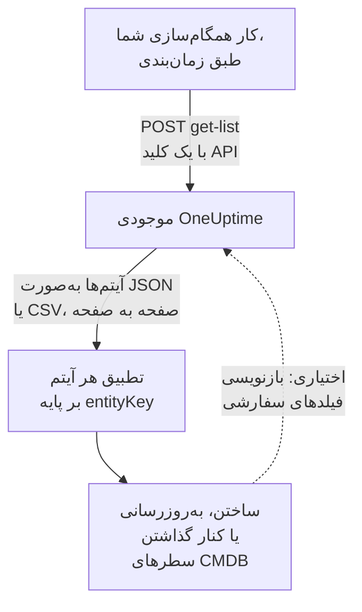

# خروجی گرفتن به CMDB

اگر از پیش یک CMDB یا دفتر ثبت دارایی دارید، OneUptime نمی‌خواهد جایش را بگیرد. آنچه OneUptime دارد و یک CMDB معمولاً ندارد، تصویری از آن چیزی است که واقعاً در حال اجراست، که بی‌آنکه کسی نگهش دارد به‌روز می‌ماند: کشف‌شده از تله‌متری، و از پیمایشگرهایی که از پیش شبکه و حساب‌های ابری شما را زیر نظر دارند. این صفحه دستورِ کشیدن آن تصویر به سامانه ثبت خودتان است.

:::cards
- [همگام‌سازی چگونه کار می‌کند](#همگامسازی-چگونه-کار-میکند): کاری زمان‌بندی‌شده که فهرست را می‌خواند و بر پایه یک کلید پایدار تطبیق می‌دهد.
- [فهرست را بکشید](#فهرست-را-بکشید): درخواست، صفحه به صفحه، به‌صورت JSON یا CSV.
- [جزئیات دارایی](#جزئیات-دارایی): همان واقعیت‌ها و کلیدها برای میزبان‌ها و دستگاه‌های شبکه.
- [بازنویسی](#بازنویسی): برچسب‌های دارایی‌تان را به OneUptime بفرستید، و آنچه را نمی‌بیند بیفزایید.
:::

## همگام‌سازی چگونه کار می‌کند

همگام‌سازی کاری است که آن را طبق زمان‌بندی اجرا می‌کنید. فهرست موجودی را با یک کلید API از راه REST API می‌خواند، هر آیتم را با کلید هویتش به سطری از CMDB شما تطبیق می‌دهد، و برای هماهنگی سطرها را می‌سازد، به‌روز می‌کند یا کنار می‌گذارد. همچنین می‌تواند مقدارها را به فیلدهای سفارشی آیتم‌ها بازنویسی کند.



## چه چیزهایی را می‌توانید بکشید

سه منبع REST، هر کدام با نقطه‌های پایانی استاندارد [OneUptime API](/docs/api-reference/api-reference):

| منبع | نقطه پایانی | چه چیزی نگه می‌دارد |
| --- | --- | --- |
| آیتم موجودی | `/api/inventory-item` | یک سطر برای هر چیز در دارایی‌ها |
| تعریف‌های فیلد سفارشی | `/api/inventory-item-custom-field` | واژگان فیلد خود پروژه‌تان |
| رابطه‌ها | `/api/inventory-item-relationship` | پیوندهای جهت‌دار میان آیتم‌ها |

ستون‌های مفید یک آیتم موجودی:

| ستون | معنا |
| --- | --- |
| `_id` | شناسه OneUptime: آن را به‌عنوان ارجاع بیرونی‌تان به کار ببرید |
| `entityType` | `host`، `k8s.pod`، `network.device`، `appliance`، … |
| `entityKey` | یک درهم‌سازی پایدار هویت. با تغییر نام از میان نمی‌رود، پس برای تطبیق کلید بهتری است |
| `displayName` | نامی که مردم می‌خوانند |
| `source` | `discovered`، `inventory` یا `manual` |
| `description` | متن آزاد |
| `identifyingAttributes` | ویژگی‌هایی که آیتم را همان چیزی می‌کنند که هست، و هرگز تغییر نمی‌کنند |
| `descriptiveAttributes` | هر چیز دیگری که رویش مشاهده شده: [جزئیات دارایی](#جزئیات-دارایی)، [ویژگی‌های دارایی میزبان](#ویژگیهای-دارایی-میزبان) و [ویژگی‌های دارایی دستگاه شبکه](#ویژگیهای-دارایی-دستگاه-شبکه) را در ادامه ببینید |
| `customFields` | فیلدهای خودتان، بر پایه نام فیلد |
| `resourceType` / `resourceId` | اشاره‌گری به رکورد غنی‌تر OneUptime، وقتی وجود داشته باشد |
| `firstSeenAt` / `lastSeenAt` | نخستین و آخرین بار که مشاهده شده است |
| `isArchived` | این‌که آیا از فهرست زنده بیرون برده شده است |

## پیش از آغاز

همگام‌سازی به کلید API‌ای نیاز دارد که بتواند موجودی را بخواند. در OneUptime Cloud، کلیدهای API به طرح **Growth** یا بالاتر نیاز دارند.

:::steps
### یک کلید API بسازید

**تنظیمات پروژه** > **پیشرفته** > **کلیدهای API** را باز کنید و روی **ساخت کلید API** کلیک کنید. به آن یک **نام** بدهید، و زیر **دسترسی** برای خواندن همه چیز در پروژه **بیننده** را برگزینید، یا برای دادن تنها آنچه همگام‌سازی نیاز دارد **دسترسی‌ها را بعداً انتخاب کنید** را.

### تنها آنچه را نیاز دارد به آن بدهید

یک خروجی فقط‌خواندنی به یک مجوز نیاز دارد، **Read Telemetry Service**: موجودی به جای مجوزهای خودش، مجوزهای تله‌متری را به کار می‌برد. در صفحه کلید، روی **افزودن دسترسی** کلیک کنید و آن را برگزینید. برای بازنویسی مقدارها، **Edit Telemetry Service** را هم بیفزایید.

### کلید را کپی کنید

**کلید API** را از صفحه کلید کپی کنید، و آن را در دسترس کارتان بگذارید:

```bash
export ONEUPTIME_API_KEY="your-api-key"
```
:::

کلید در سرآیند `ApiKey` هر درخواست فرستاده می‌شود، و موجودی پروژه خودش را می‌خواند، پس درخواست نام هیچ پروژه‌ای را نمی‌برد.

## فهرست را بکشید

با ستون‌هایی که می‌خواهید به نقطه پایانی فهرست `POST` کنید. `select` الزامی است: API تنها آنچه را درخواست کنید برمی‌گرداند.

```bash
curl -X POST 'https://oneuptime.com/api/inventory-item/get-list' \
  -H "ApiKey: $ONEUPTIME_API_KEY" \
  -H 'Content-Type: application/json' \
  -d '{
    "query": { "isArchived": false },
    "select": {
      "_id": true,
      "entityType": true,
      "entityKey": true,
      "displayName": true,
      "source": true,
      "customFields": true,
      "descriptiveAttributes": true,
      "lastSeenAt": true
    },
    "sort": { "displayName": "ASC" },
    "limit": 100,
    "skip": 0
  }'
```

در نصب خودمیزبان، به جای `https://oneuptime.com` نشانی OneUptime خودتان را به کار ببرید. پاسخ `{ "data": [...], "count": ... }` است، که در آن `count` می‌گوید روی هم چند آیتم مطابق‌اند. با بالا بردن `skip` به اندازه `limit` خود صفحه به صفحه پیش بروید تا همه را داشته باشید؛ `limit` تا ۱۰٬۰۰۰ بالا می‌رود. تاریخ‌ها و شناسه‌های جز `_id` پیچیده‌شده برمی‌گردند، به‌صورت `{ "_type": "DateTime", "value": "..." }` و `{ "_type": "ObjectID", "value": "..." }`: آن‌ها را از `value` بخوانید.

### فقط دستگاه‌های شبکه

فهرست را با `entityType` محدود کنید:

```bash
curl -X POST 'https://oneuptime.com/api/inventory-item/get-list' \
  -H "ApiKey: $ONEUPTIME_API_KEY" \
  -H 'Content-Type: application/json' \
  -d '{
    "query": { "entityType": "network.device", "isArchived": false },
    "select": { "_id": true, "entityKey": true, "displayName": true, "customFields": true },
    "limit": 100,
    "skip": 0
  }'
```

`descriptiveAttributes` هر دستگاه شبکه نام میزبان، آدرس IP، شماره سریال، آدرس MAC، سازنده، مدل، فریم‌ور، سیستم‌عامل، نقش، سایت و مکان آن را دارد: [ویژگی‌های دارایی دستگاه شبکه](#ویژگیهای-دارایی-دستگاه-شبکه) را در ادامه ببینید. هر چیز دیگری که پیمایشگر می‌داند، مانند رابط‌ها و همسایه‌ها، روی خود رکورد Network Device است: `resourceId` را تا `/api/network-device/:id/get-item` دنبال کنید، یا `/api/network-device/get-list` را مستقیم بکشید.

### به‌صورت CSV

هر نقطه پایانی فهرست با `?output-type=csv` به جای JSON به CSV پاسخ می‌دهد:

```bash
curl -X POST 'https://oneuptime.com/api/inventory-item/get-list?output-type=csv' \
  -H "ApiKey: $ONEUPTIME_API_KEY" \
  -H 'Content-Type: application/json' \
  -d '{ "query": {}, "select": { "displayName": true, "entityType": true, "customFields": true }, "limit": 500, "skip": 0 }' \
  -o inventory.csv
```

فهرست **All Items** در داشبورد هم به همین شیوه خروجی می‌دهد، با هر ستون فیلد سفارشی‌ای که روشن کرده‌اید. هر [جزئیات دارایی](#جزئیات-دارایی) آنجا هم یک ستون است: **نام میزبان**، **آدرس IP**، **شماره سریال**، **مدل** و بقیه پنهان آغاز می‌شوند، پس آن‌ها را از انتخابگر ستون روشن کنید، و خروجی برای هر واقعیت یک ستون دارد، چه سطر یک میزبان باشد چه یک دستگاه شبکه.

## جزئیات دارایی

میزبان‌ها و دستگاه‌های شبکه با همان واقعیت‌ها توصیف می‌شوند و زیر همان کلیدها ذخیره می‌شوند. یک ستون CMDB شماره سریال را نگه می‌دارد، چه سطر یک سرور باشد چه یک سوئیچ، و کارت **جزئیات دارایی** یک آیتم در داشبورد همه واقعیت‌ها را برای هر دو به یک ترتیب نشان می‌دهد. واقعیتی که هیچ چیز گزارشش نکرده به جای جا افتادن **ناشناخته** خوانده می‌شود، تا جای خالی دیده شود.

| واقعیت | کلید | روی یک میزبان | روی یک دستگاه شبکه |
| --- | --- | --- | --- |
| نام میزبان | `host.name` | نام میزبان. هویت میزبان است، پس در `identifyingAttributes` قرار دارد | نام خود دستگاه: `sysName` در SNMP آن، وگرنه نام NetBIOS یا DNS که کشف یافته است. هرگز آدرس IP آن نیست |
| آدرس IP | `host.ip` | هر نشانی‌ای که گردآورنده گزارش می‌کند | نشانی‌ای که OneUptime پیمایش می‌کند، وقتی یک آدرس IP باشد، وگرنه نشانی‌ای که پراب آن، آن نام DNS را به آن تبدیل کرده است |
| آدرس MAC | `host.mac` | شناسایی‌شده | روی دستگاه تایپ‌شده، یا آموخته‌شده از جدول ARP یک مسیریاب پیمایش‌شده |
| شماره سریال | `host.serial_number` | ثبت‌شده | ENTITY-MIB |
| سازنده | `device.manufacturer` | ثبت‌شده | ENTITY-MIB، وگرنه آنچه `sysDescr` یا `sysObjectID` نام می‌برد |
| مدل | `device.model.name` | ثبت‌شده | ENTITY-MIB، وگرنه آنچه `sysDescr` نام می‌برد |
| نسخه فریم‌ور | `device.firmware.version` | ثبت‌شده | ENTITY-MIB، وگرنه آنچه `sysDescr` نام می‌برد |
| سیستم‌عامل | `os.name` | `os.description` (یا `os.type`) | آنچه `sysDescr` نام می‌برد: Cisco IOS، Junos OS، Arista EOS، Linux |
| نسخه سیستم‌عامل | `os.version` | شناسایی‌شده | ENTITY-MIB، وگرنه آنچه `sysDescr` نام می‌برد |
| Device Type | `device.type` | ثبت‌شده. وگرنه کارت آن را از سیستم‌عامل و نامش دسته‌بندی می‌کند (سرور، دیواره آتش، ...) | نقشش: نقشی که شما داده‌اید، وگرنه نقشی که نقشه توپولوژی برایش می‌کشد |
| مکان | `device.location` | ثبت‌شده. وگرنه کارت منطقه ابری‌اش را نشان می‌دهد | `sysLocation`. کارت نخست سایتش را نشان می‌دهد |

[جدول میزبان](#ویژگیهای-دارایی-میزبان) و [جدول دستگاه شبکه](#ویژگیهای-دارایی-دستگاه-شبکه) در ادامه به تفصیل می‌گویند هر مقدار از کجا می‌آید.

## ویژگی‌های دارایی میزبان

`descriptiveAttributes` روی یک میزبان واقعیت‌های دارایی‌ای را دارد که یک سطر CMDB معمولاً می‌خواهد، بر پایه نام ویژگی OpenTelemetry آن‌ها:

| فیلد | کلید | به‌طور پیش‌فرض گردآوری می‌شود؟ |
| --- | --- | --- |
| آدرس‌های IP | `host.ip` | بله: وقتی ماشین چند آدرس دارد، جداشده با ویرگول |
| آدرس‌های MAC | `host.mac` | بله: جداشده با ویرگول، یکی برای هر رابط روشن، به‌صورت `AC-DE-48-23-45-67` |
| معماری | `host.arch` | بله |
| شناسه ماشین | `host.id` | بله: GUID ماشین در Windows، `/etc/machine-id` در Linux |
| سیستم‌عامل | `os.type`، `os.description`، `os.version` | بله |
| جایگاه ابری | `cloud.provider`، `cloud.region`، `cloud.availability_zone` | تنها با یک آشکارساز ابری |
| شماره سریال | `host.serial_number` | یک گام پیکربندی لازم دارد |
| سازنده | `device.manufacturer` | یک گام پیکربندی لازم دارد |
| مدل | `device.model.name` | یک گام پیکربندی لازم دارد |
| نسخه فریم‌ور (BIOS یا UEFI) | `device.firmware.version` | یک گام پیکربندی لازم دارد |
| نام سیستم‌عامل | `os.name` | تنها از SDKهایی که گزارشش می‌کنند: وگرنه `os.description` نام سیستم‌عامل را می‌برد |
| نوع دستگاه | `device.type` | اختیاری: آن را هم به همین شیوه ثبت کنید (`Hypervisor`، `Workstation`) |
| مکان | `device.location` | اختیاری: آن را هم به همین شیوه ثبت کنید (`Frankfurt DC, Rack B4`) |

هر چیزی که با «بله» نشان خورده از پردازنده `resourcedetection` گردآورنده می‌آید، و از پیش در پیکربندی‌ای هست که OneUptime برایتان می‌سازد.

کلیدهای `cloud.*` در آن پردازنده به یک آشکارساز ابری نیاز دارند: `detectors: [system, env, ec2]`، یا برای بقیه `gcp` یا `azure`. پیکربندی همراه تنها `[system, env]` را اجرا می‌کند، پس آن سه خالی می‌مانند تا یکی بیفزایید.

شماره سریال، سازنده، مدل و فریم‌ور هیچ آشکارساز منبعی ندارند: در فریم‌ور ماشین زندگی می‌کنند و در Windows از راه WMI و در Linux از راه DMI خوانده می‌شوند، پس یک بار، هنگام آماده‌سازی ماشین، روی منبع ثبت می‌شوند. نوع دستگاه یا مکانی که روی سطر می‌خواهید هم به همین شیوه ثبت می‌شود. [ویژگی‌های موجودی](/docs/telemetry/host-otel-collector#ویژگیهای-موجودی-ip-mac-شماره-سریال-سازنده-مدل-میانافزار) قطعه‌کد دقیق را برای هر سیستم‌عامل دارد. `host.manufacturer`، `host.model.name`، `host.firmware.version` و `host.bios.version` به‌عنوان نگارش‌های دیگر پذیرفته و زیر کلیدهای `device.*` ذخیره می‌شوند (و `device.serial_number` زیر `host.serial_number`)، پس همگام‌سازی برای هر واقعیت همیشه تنها یک کلید می‌خواند.

اگر CMDB شما از پیش بر پایه یک شناسه سخت‌افزاری کلید می‌زند، `host.id` به‌عنوان کلید تطبیق ارزش نگاه کردن دارد: برخلاف `entityKey`، شناسه خود ماشین است، پس با آنچه یک ابزار مدیریت نقطه پایانی برای همان دستگاه گزارش می‌کند جور درمی‌آید.

ویژگی‌ها افزوده می‌شوند و هرگز خالی نمی‌شوند: ویژگی‌ای که دیگر گزارش نشود روی سطر می‌ماند، پس مقداری که همگام‌سازی‌تان از پیش خوانده هرگز بی‌صدا ناپدید نمی‌شود.

## ویژگی‌های دارایی دستگاه شبکه

یک دستگاه شبکه (`entityType: network.device`) از رکورد Network Device خود آینه می‌شود، و `descriptiveAttributes` آن برای همان واقعیت‌ها همان کلیدهایی را به کار می‌برد که یک میزبان، تا یک ستون CMDB شماره سریال را نگه دارد، چه سطر یک سرور باشد چه یک سوئیچ:

| فیلد | کلید | از کجا می‌آید |
| --- | --- | --- |
| نام میزبان | `host.name` | نام خود دستگاه: `sysName` در SNMP آن، وگرنه نام NetBIOS یا DNS معکوسی که کشف یافته است. وقتی تنها آدرس IP آن نامش می‌دهد، حذف می‌شود |
| آدرس IP | `host.ip` | نشانی‌ای که OneUptime پیمایش می‌کند، وقتی یک آدرس IP باشد. برای دستگاهی که با یک نام DNS پیمایش می‌شود، نشانی‌ای که پراب آن آخرین بار آن نام را به آن تبدیل کرده است |
| نام DNS | `net.device.dns_name` | نام DNS معکوسی که هنگام کشف یافته شده، یا نام DNS‌ای که OneUptime پیمایش می‌کند |
| آدرس MAC | `host.mac` | روی دستگاه تایپ‌شده، یا آموخته‌شده از جدول ARP یک مسیریاب پیمایش‌شده |
| سازنده | `device.manufacturer` | `entPhysicalMfgName` در ENTITY-MIB، وگرنه سازنده‌ای که `sysDescr` نام می‌برد، وگرنه فروشنده `sysObjectID` |
| مدل | `device.model.name` | `entPhysicalModelName` در ENTITY-MIB، وگرنه مدلی که `sysDescr` نام می‌برد |
| شماره سریال | `host.serial_number` | `entPhysicalSerialNum` در ENTITY-MIB |
| نسخه فریم‌ور | `device.firmware.version` | `entPhysicalFirmwareRev` در ENTITY-MIB، وگرنه فریم‌وری که `sysDescr` روی دستگاه‌های Ubiquiti، HPE و Aruba نام می‌برد |
| سیستم‌عامل | `os.name` | سیستم‌عاملی که `sysDescr` نام می‌برد |
| نسخه نرم‌افزار یا سیستم‌عامل | `os.version` | `entPhysicalSoftwareRev` در ENTITY-MIB، وگرنه نسخه‌ای که `sysDescr` نام می‌برد |
| توضیح سامانه | `os.description` | `sysDescr` |
| نوع دستگاه | `device.type` | نقشی که به دستگاه داده‌اید، وگرنه نقشی که نقشه توپولوژی آن را در آن دسته‌بندی می‌کند، با نامی که پروژه‌تان برایش دارد |
| مکان | `device.location` | `sysLocation`، مگر این‌که پیش‌فرض یک عامل باشد مانند "Sitting on the Dock of the Bay" در Net-SNMP |
| سایت | `oneuptime.site.name` | Network Site‌ای که دستگاه به آن واگذار شده است |
| نشانی پیمایش‌شده | `net.device.hostname` | نشانی‌ای که OneUptime پیمایش می‌کند: یک آدرس IP یا یک نام DNS. برای همگام‌سازی‌هایی نگه داشته شده که پیش از وجود `host.name` و `host.ip` نوشته شده‌اند |

سطرهای ENTITY-MIB پس از نخستین پیمایش SNMP دستگاه پر می‌شوند. دستگاهی که پیمایش نمی‌شود، چون تنها با ping پایش می‌شود یا هنوز پیمایش نشده، باز هم نام، سازنده، سیستم‌عامل و مکانش را از آنچه آخرین اسکن کشفِ نشانی‌اش از راه SNMP خوانده می‌گیرد، و آدرس MAC خود را از جدول ARP یک مسیریاب پیمایش‌شده. دستگاهی که ENTITY-MIB را پیاده نمی‌کند شماره سریال یا فریم‌وری برای گزارش ندارد. باز هم `sysDescr` آن برای بسیاری از پلتفرم‌ها مدل و سیستم‌عامل را نام می‌برد: یک Cisco Meraki MX مقدار `Meraki MX85` را گزارش می‌کند، که سازنده و مدل را پر می‌کند. پلتفرمی که `sysDescr` آن شکل شناخته‌شده‌ای ندارد، به جای حدس زدن چیزی نمی‌افزاید.

یک دستگاه Meraki آنچه را پیمایش خودش خالی می‌گذارد از داشبورد Meraki می‌گیرد، وقتی یک [اتصال Meraki](/docs/monitor/network-traffic#cisco-meraki-بدون-netflow) سازمانش را می‌خواند: شماره سریال، مدل، فریم‌ور و سازنده‌اش، آدرس MAC، نام، نشانی مدیریت، نشانی پستی‌ای که زیر آن ثبت شده و نوعش. یک دستگاه از دستگاه‌های سازمان است وقتی شماره سریال یا آدرس MAC دستگاه Meraki را داشته باشد، یا وقتی OneUptime آن را در نشانی مدیریت دستگاه Meraki پیمایش کند و همان نام را داشته باشد. مقداری که روی دستگاه ذخیره شده، و آنچه پیمایش خود دستگاه می‌خواند، مقدم‌اند.

مقداری که روی دستگاه ذخیره شده، تایپ‌شده یا تنظیم‌شده از راه API، هرگز با آنچه کشف می‌خواند جایگزین نمی‌شود. از میان مقداری که پیمایش خود دستگاه خوانده و مقداری که یک اسکن خوانده، تازه‌تر به کار می‌رود. خوانده‌های یک اسکن تنها وقتی به کار می‌روند که اسکن همان ماشین را در آن نشانی یافته باشد: وقتی نام سامانه، `sysObjectID` یا نام NetBIOSی که خوانده با مال دستگاه ناسازگار باشد، هیچ چیزی که آنجا خوانده به کار نمی‌رود. کارت **جزئیات دارایی** آیتم می‌گوید هر مقدار از کجا و کی آمده است.

نام میزبان هرگز آدرس IP نیست. دستگاهی که تنها نشانی‌اش نامش می‌دهد `host.ip` دارد و `host.name` ندارد. وقتی پیمایش SNMP آن نام سامانه‌ای گزارش کند، `host.name` در گذر بعدی می‌آید.

این مقدارها هر پانزده دقیقه از رکورد Network Device رونوشت می‌شوند، و به جای افزوده شدن به مقدارهای پیشین **جایگزین آن‌ها می‌شوند**، پس مقداری که روی دستگاه پاک شود (مثلاً یک آدرس MAC برداشته‌شده) از آیتم موجودی هم می‌رود.

هیچ نسخه *ارتقای در دسترس* ای وجود ندارد: SNMP هیچ شیء استانداردی برای آن ندارد، پس OneUptime نسخه‌ای را ثبت می‌کند که دستگاه اجرا می‌کند.

## تطبیق آیتم‌ها با سطرهای CMDB

بر پایه `entityKey` تطبیق دهید، نه `displayName`. این درهم‌سازی ویژگی‌های شناسه آیتم است، پس از تغییر نام و برچسب‌های تازه جان به در می‌برد: میزبانی که برچسب تازه می‌گیرد همان کلید را نگه می‌دارد در حالی که نام نمایشی‌اش تغییر می‌کند. `_id` هم به همان اندازه پایدار است، و اگر همیشه تنها با یک پروژه سروکار دارید ساده‌ترین کلید خارجی است.

تاریخ‌ها در `customFields` رشته‌های ISO-8601 UTC هستند، و خروجی CSV آن‌ها را به همین شکل می‌نویسد، نه به شکل خوانا‌تری که داشبورد نشان می‌دهد، تا بی‌غافلگیری در تجزیه وارد شوند.

## به‌روز نگه داشتن

هیچ جریان تغییری وجود ندارد. نقطه پایانی فهرست را در هر فاصله‌ای که مناسبتان است پیمایش کنید، و بر پایه `entityKey` مقایسه کنید. `lastSeenAt` می‌گوید آیتم آخرین بار کی مشاهده شده، که معمولاً ارزان‌ترین راه برای یافتن چیزهایی است که از آخرین اجرایتان ساکت شده‌اند.

برای اینکه یک دستگاه شبکه را همین حالا دوباره بخوانید، بی‌آنکه منتظر پیمایش بعدی و رونوشت بعدی بمانید، روی کارت **جزئیات دارایی** آیتمش **تازه‌سازی** را بزنید، یا `POST /api/network-device/{id}/refresh` را با کلیدی بفرستید که **Edit Network Device** دارد. پرابش ظرف یک دقیقه آن را پیمایش می‌کند، اتصال Meraki آن سازمان را دوباره می‌خواند، و آیتمش به محض رسیدن خوانش تازه رونوشت می‌شود.

آیتمی که میان دو اجرا ناپدید شود یا منقضی شده است (آیتم کشف‌شده‌ای که بیش از پنجره‌اش ساکت مانده) یا رکورد مالکش حذف شده است. آیتم آینه‌شده‌ای که مقدارهای فیلد سفارشی دارد، وقتی رکوردش برود به جای حذف بایگانی می‌شود، پس با `"isArchived": true` پرس‌وجو کنید تا ببینید چه چیزی کنار گذاشته شده، بی‌آنکه داده‌های دارایی پیوسته به آن را از دست بدهید.

## بازنویسی

همان نقطه‌های پایانی نوشتن را هم می‌پذیرند، پس همگام‌سازی می‌تواند مقدارهایی را در `customFields` بفرستد: برای نمونه، برچسب دارایی‌ای که CMDB شما از پیش دارد، ثبت‌شده روی آیتم OneUptime مطابق. کلید برای این کار به **Edit Telemetry Service** نیاز دارد.

همچنین می‌توانید برای چیزهایی که OneUptime نمی‌بیند آیتم بیفزایید، با `POST /api/inventory-item`، یک `entityType` از `external.service`، `external.database` یا `appliance`، و یک `displayName`. OneUptime کلید هویت را برایتان به دست می‌آورد، و این آیتم‌ها هرگز منقضی نمی‌شوند. کلید برای این کار به **Create Telemetry Service** نیاز دارد.

## رفع اشکال

:::details هر درخواست با 402 Payment Required رد می‌شود
در OneUptime Cloud، کلیدهای API تنها تا وقتی کار می‌کنند که پروژه روی طرح **Growth** یا بالاتر باشد. هیچ چیز حذف نمی‌شود: به محض بازگشت پروژه به طرح، کلید همان‌طور که هست دوباره کار می‌کند. [کلیدهای API و SCIM پایین‌تر از طرحشان](/docs/api-reference/api-reference#کلیدهای-api-و-scim-پایینتر-از-طرحشان) را ببینید.
:::

:::details هر درخواست پاسخ 422 You do not have permissions می‌دهد
کلید هیچ مجوزی ندارد که موجودی را بخواند. کلیدی که با **دسترسی‌ها را بعداً انتخاب کنید** ساخته شده تا مجوزی نگیرد هیچ کاری نمی‌تواند بکند: همان‌گونه که در [پیش از آغاز](#پیش-از-آغاز) آمده، **Read Telemetry Service** را در صفحه‌اش بیفزایید.
:::

:::details فهرست بدون ستون‌هایی که نیاز دارم برمی‌گردد
فهرست تنها ستون‌هایی را که `select` نام می‌برد، و `_id` را برمی‌گرداند. هر ستونی را که می‌خوانید به `select` بیفزایید، از جمله `descriptiveAttributes` و `customFields`.
:::

:::details آیتمی که انتظارش را داشتم نیست
وقتی `"isArchived": false` می‌فرستید، آیتم‌های بایگانی‌شده کنار گذاشته می‌شوند. آیتم کشف‌شده وقتی بیش از پنجره‌اش ساکت بماند حذف می‌شود، و آیتم آینه‌شده با رکوردش می‌رود. برای دیدن آیتم‌های بایگانی‌شده `"isArchived": true` را درخواست کنید.
:::

## گام‌های بعدی

:::cards
- [نمای کلی موجودی](/docs/inventory/overview): آیتم‌ها از کجا می‌آیند، و هر کدام تا کی می‌ماند.
- [فیلدهای سفارشی موجودی](/docs/inventory/custom-fields): فیلدهایی را تعریف کنید که همگام‌سازی‌تان می‌خواند و می‌نویسد.
- [مرجع API OneUptime](/docs/api-reference/api-reference): درخواست‌ها، کدهای وضعیت و قاعده‌هایی که هر نوشتنی از آن‌ها پیروی می‌کند.
:::
