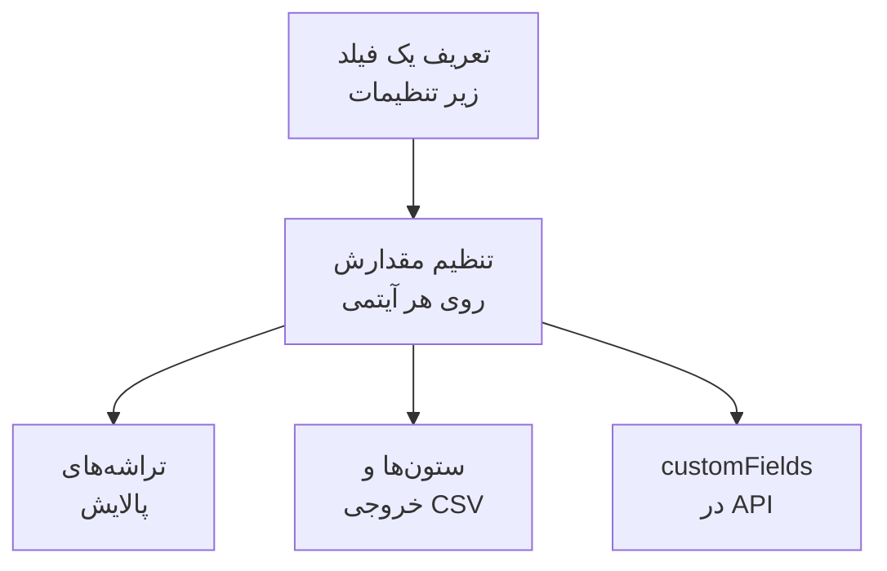

# فیلدهای سفارشی موجودی

OneUptime کشف می‌کند چه چیزی در دارایی‌های شماست. فیلدهای سفارشی آنچه را ثبت می‌کنند که هیچ اندازه زیر نظر گرفتنی نمی‌تواند بگوید: شماره سریال روی برچسب، تاریخ پایان گارانتی، تیمی که مالک یک چیز است، این‌که در خدمت است یا در کشوی قطعات یدکی. فیلدها را یک بار برای پروژه تعریف کنید، سپس روی هر آیتم پرشان کنید.

:::cards
- [فیلدهای سفارشی چگونه کار می‌کنند](#فیلدهای-سفارشی-چگونه-کار-میکنند): یک واژگان، روی هر آیتم، با هر منبعی.
- [تعریف فیلدها](#تعریف-فیلدها): فیلدی بسازید، نوعش را برگزینید، گزینه‌های یک فهرست کشویی را بنویسید.
- [فهرست را پالایش کنید](#فهرست-را-پالایش-کنید): آنچه فصل بعد منقضی می‌شود را با دو کلیک بیابید.
- [نکته‌ها و محدودیت‌ها](#نکتهها-و-محدودیتها): تغییر نام‌ها، تکرارها، تاریخ‌ها و فیلدهای حذف‌شده.
:::

## فیلدهای سفارشی چگونه کار می‌کنند

یک فیلد یک بار برای پروژه تعریف می‌شود، و هر آیتمی می‌تواند مقداری برایش داشته باشد: آن‌هایی که OneUptime کشف کرده، آن‌هایی که آینه می‌کند و آن‌هایی که دستی افزوده‌اید. یک فیلد به یک تراشه پالایش بالای فهرست، یک ستون اختیاری، و یک ستون از خروجی CSV تبدیل می‌شود. API همان مقدارها را زیر `customFields` هر آیتم می‌خواند و می‌نویسد.

> [!NOTE]
> در OneUptime Cloud، فیلدهای سفارشی بخشی از طرح **Growth** و بالاتر هستند. پایین‌تر از آن، فیلدها را نمی‌توان تعریف، فهرست یا تغییر داد: API پاسخ `402 Payment Required` می‌دهد، و فهرست هیچ تراشه یا ستون فیلد سفارشی‌ای نشان نمی‌دهد.

## تعریف فیلدها

:::steps
### صفحه فیلدهای سفارشی را باز کنید

به **محصولات** > **منابع** > **موجودی** بروید، **تنظیمات** را در منوی کناری باز کنید، سپس **فیلدهای سفارشی** را.

### یک فیلد بسازید

روی **ساخت Inventory Item Custom Field** کلیک کنید. به آن یک **نام فیلد**، یک **توضیحات فیلد** اختیاری، و یک **نوع فیلد** از جدول زیر بدهید.

### گزینه‌های یک فهرست کشویی را بنویسید

برای نوع فهرست کشویی، گزینه‌هایش را زیر **گزینه‌های کشویی** بیفزایید. هر گزینه می‌تواند رنگی داشته باشد که در خانه جدول و در تراشه پالایش یکسان به کار می‌رود: یکی از رنگ‌های نام‌دار، **بدون رنگ**، یا برای یک کد رنگ دقیق **رنگ دلخواه** را برگزینید. برای تغییر جای یک گزینه در فهرست، آن را با دستگیره‌اش بکشید.
:::

| نوع | به کارش ببرید برای |
| --- | --- |
| **متن** | شماره سریال، برچسب دارایی، جایگاه در رک، شماره سفارش خرید |
| **شماره** | هزینه، واحد رک، تعداد درگاه |
| **بولی** | زیر پشتیبانی، در محدوده PCI |
| **فهرست کشویی (تک‌انتخابی)** | وضعیت چرخه عمر، محیط، اهمیت: یک پاسخ از یک فهرست ثابت |
| **فهرست کشویی (چندانتخابی)** | محدوده‌های انطباق، برچسب‌ها: چند پاسخ از یک فهرست ثابت |
| **تاریخ** | تاریخ خرید، پایان گارانتی، تاریخ پایان عمر |
| **تاریخ و زمان** | آخرین ممیزی در، کنار گذاشته‌شده در |
| **متن بلند** | دستورهای دسترسی، یادداشت‌ها: چند خط متن ساده |
| **متن قالب‌بندی‌شده (Markdown)** | یادداشت‌هایی با قالب‌بندی و پیوند، نوشته‌شده در ویرایشگر Markdown |
| **فایل** | گواهی گارانتی، سفارش خرید امضاشده، عکس برچسب رک: یک فایل |
| **چند فایل** | دفترچه‌های راهنما، فاکتورها و عکس‌ها: حداکثر ۱۰ فایل |

## نمونه‌ای از واژگان دارایی

یک دفتر ثبت دارایی سخت‌افزاری معمولی مستقیم روی این فیلدها می‌نشیند:

| نام فیلد | نوع | نمونه |
| --- | --- | --- |
| `Serial Number` | متن | `FDO24160ABC` |
| `Asset Tag` | متن | `IT-004821` |
| `Purchase Date` | تاریخ | ۲۰۲۴-۰۳-۱۱ |
| `Warranty Expiry` | تاریخ | ۲۰۲۷-۰۳-۱۰ |
| `Lifecycle Status` | فهرست کشویی | در خدمت، یدکی، در تعمیر، کنارگذاشته |
| `Assigned Site` | فهرست کشویی | London DC، Frankfurt DC، Office HQ |
| `Owner Team` | فهرست کشویی | شبکه، پلتفرم، امنیت |
| `Cost Centre` | متن | `CC-4410` |

مقدارها را در صفحه **فیلدهای سفارشی** یک آیتم تنظیم کنید. هر آیتمی آن‌ها را می‌پذیرد، با هر منبعی، پس سوئیچ‌هایی که OneUptime کشف کرده و دستگاه‌های شبکه‌ای که آینه می‌کند همان واژگان دارایی را دارند که دستگاه‌هایی که دستی افزوده‌اید.

## فهرست را پالایش کنید

هر فیلد سفارشی به یک تراشه پالایش بالای فهرست **All Items** تبدیل می‌شود، و تراشه مقایسه‌هایی را پیش می‌گذارد که به نوعش می‌خورند:

| نوع فیلد | مقایسه‌ها |
| --- | --- |
| **متن**، **متن بلند**، **متن قالب‌بندی‌شده (Markdown)** | است، نیست، شامل است، شامل نیست، شروع می‌شود با، پایان می‌یابد با، خالی است، خالی نیست |
| **شماره** | است، نیست، بزرگ‌تر است از، بزرگ‌تر یا برابر است با، کوچک‌تر است از، کوچک‌تر یا برابر است با، خالی است، خالی نیست |
| **بولی**، **فهرست کشویی (تک‌انتخابی)**، **فهرست کشویی (چندانتخابی)** | است، نیست، خالی است، خالی نیست |
| **تاریخ**، **تاریخ و زمان** | است، پیش از، پس از، بین، خالی است، خالی نیست |
| **فایل**، **چند فایل** | است |

تراشهٔ **فایل** یا **چند فایل** فقط یک چیز می‌پرسد: اینکه فیلد **دارای فایل** است یا **بدون فایل**.

تراشه‌ها با AND ترکیب می‌شوند، پس «پایان گارانتی پیش از ۲۰۲۶-۱۰-۰۱ AND وضعیت چرخه عمر در خدمت است» یک نمای فهرست است. این همان پرسشی است که دفتر ثبت دارایی برای پاسخ دادن به آن وجود دارد، و دلیل به کار بردن نوع‌های تاریخ به جای تاریخی در یک فیلد متنی: فیلد متنی `2026-10-01` را با خوشحالی نگه می‌دارد، اما سپس نمی‌تواند بگوید چه چیزی فصل بعد منقضی می‌شود.

ستون‌های فیلد سفارشی پنهان آغاز می‌شوند: آن‌ها را از انتخابگر ستون روشن کنید. نمی‌توان مرتبشان کرد، چون مقدارها با هم در یک ستون JSON زندگی می‌کنند که فهرست نمی‌تواند بر پایه‌اش مرتب کند.

## نکته‌ها و محدودیت‌ها

- مقدارها روی هر آیتم زیر نام فیلد ذخیره می‌شوند. تغییر نام یک فیلد مقدارهایی را که از پیش زیر نام قدیمی ذخیره شده‌اند جابه‌جا نمی‌کند. فیلدهای سفارشی حادثه استثنا هستند: تغییر نام یکی از آن‌ها مقدارهایش را جابه‌جا می‌کند ([تغییر نام یک فیلد](/docs/incidents/settings#تغییر-نام-فیلد) را ببینید).
- گزینه‌های یک فهرست کشویی را پس از آنکه آیتم‌ها مقدار دارند هم می‌توان افزود، تغییر نام داد، با کشیدن به ترتیب تازه برد و برداشت. تغییر نام یک گزینه آن را روی هر آیتمی که دارد جابه‌جا می‌کند؛ گزینه‌ای که برداشته شود روی آیتم‌هایی که آن را دارند می‌ماند و به‌عنوان چیزی که دیگر گزینه نیست نشان داده می‌شود، مگر این‌که برایشان گزینه دیگری برگزینید ([تغییر گزینه‌های یک فهرست کشویی](/docs/incidents/settings#تغییر-گزینههای-فهرست-کشویی) را ببینید).
- هیچ چیز یک مقدار را یکتا نمی‌کند. دو آیتم می‌توانند یک شماره سریال داشته باشند، و هیچ چیز جلویتان را نمی‌گیرد.
- تاریخ‌ها به‌صورت مُهرهای زمانی ISO-8601 UTC ذخیره و در منطقه زمانی خودتان نشان داده می‌شوند.
- حذف یک فیلد آن را از فهرست و از نوار پالایش برمی‌دارد. مقدارهایی که از پیش نوشته شده‌اند روی آیتم‌ها می‌مانند.
- فیلد **فایل** یا **چند فایل** فایل‌هایی تا ۱۰ مگابایت برای هر کدام می‌پذیرد، از گونه‌هایی که زیر [فیلدهای فایل](/docs/incidents/settings#فیلدهای-فایل) آمده‌اند و در همین پروژه بارگذاری شده‌اند. فقط کسی که اجازهٔ دیدن آیتم را دارد می‌تواند آن‌ها را دانلود کند، و هر فایل همین که چیزی آن را نگه ندارد حذف می‌شود.

## گام‌های بعدی

:::cards
- [نمای کلی موجودی](/docs/inventory/overview): آیتم‌ها از کجا می‌آیند، و هر صفحه چه نشان می‌دهد.
- [خروجی گرفتن به CMDB](/docs/inventory/cmdb-sync): آیتم‌ها و فیلدهای سفارشی‌شان را به سامانه دیگری بکشید.
- [فیلدهای سفارشی حادثه](/docs/incidents/settings#فیلدهای-سفارشی): همان نوع‌های فیلد روی حوادث، با چند افزوده.
:::
