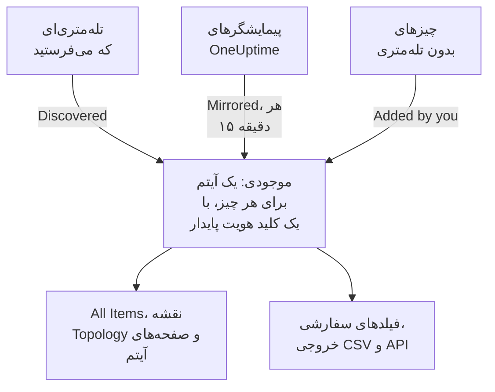

# نمای کلی موجودی

موجودی فهرستی یکپارچه از هر چیزی است که OneUptime درباره دارایی‌های شما می‌داند: سرویس‌ها، میزبان‌ها، اشیای Kubernetes، ماشین‌های مجازی، دستگاه‌های شبکه، منابع ابری، دستگاه‌های اینترنت اشیا، توابع بی‌سرور، و چیزهایی که هیچ تله‌متری‌ای نمی‌فرستند. بیشتر آن خودبه‌خود از آنچه OneUptime از پیش زیر نظر دارد پر می‌شود. آنچه شما می‌افزایید چیزی است که زیر نظر گرفتن نمی‌تواند بگوید: یک چیز برای چه کاری است، مالکش کیست، و گارانتی‌اش کی تمام می‌شود.

:::cards
- [آیتم‌ها چگونه به موجودی می‌آیند](#آیتمها-چگونه-به-موجودی-میآیند): کشف‌شده، آینه‌شده، یا افزوده‌شده به دست شما.
- [راهتان را پیدا کنید](#راهتان-را-پیدا-کنید): صفحه‌های موجودی، و صفحه‌های خود هر آیتم.
- [چیزی را دستی بیفزایید](#چیزی-را-دستی-بیفزایید): یک API شخص ثالث، یک پایگاه داده بیرونی یا یک دستگاه.
- [به جای حذف، بایگانی کنید](#به-جای-حذف-بایگانی-کنید): راهی برای مرتب کردن فهرست که ماندگار است.
:::

## آیتم‌ها چگونه به موجودی می‌آیند

OneUptime از پیش دارایی‌های شما را برای پایش زیر نظر دارد، پس فهرست از آنچه مشاهده می‌کند ساخته می‌شود، نه از آنچه کسی یادش مانده تایپ کند. هر آیتم یک منبع دارد، و منبع تعیین می‌کند آیتم در اختیار کیست: آیا می‌توانید ویرایشش کنید، و آیا می‌تواند خودبه‌خود از میان برود.

| منبع | در API | از کجا می‌آید | تا کی می‌ماند |
| --- | --- | --- | --- |
| **Discovered** | `discovered` | ویژگی‌های منبع OpenTelemetry که هنگام رسیدن تله‌متری خوانده می‌شوند: یک سرویس، میزبان، شیء Kubernetes یا ماشین مجازی که تله‌متری می‌فرستد. | با هر دسته دوباره ثبت می‌شود. وقتی بیش از پنجره نوعش ساکت بماند حذف می‌شود (پایین‌تر را ببینید). |
| **Mirrored** | `inventory` | رکوردی که یک پیمایشگر OneUptime نگه می‌دارد: دستگاه‌های شبکه، منابع ابری، دستگاه‌های اینترنت اشیا، توابع بی‌سرور، برنامه‌های RUM، میزبان‌های Docker و میزبان‌های Podman. هر ۱۵ دقیقه رونوشت می‌شود. | تا وقتی رکوردش هست. رکورد را حذف کنید، آیتم هم با آن می‌رود. |
| **Added by you** | `manual` | افزوده‌شده به دست شما، برای چیزی که OneUptime نمی‌تواند ببیند: یک API شخص ثالث، پایگاه داده‌ای که فروشنده مدیریتش می‌کند، دستگاهی در رک. | تا وقتی حذفش کنید. هیچ چیز منقضی‌اش نمی‌کند. |

آیتم کشف‌شده یا آینه‌شده را نمی‌توان تغییر نام داد یا نوع دیگری به آن داد: منبعش در گذر بعدی تغییر را بازنویسی می‌کند. صفحه **تنظیمات** آیتم می‌گوید تغییر ماندگار را کجا باید داد. آنچه همیشه می‌توانید به هر آیتمی، با هر منبعی، بیفزایید مقدارهای فیلدهای سفارشی است: [فیلدهای سفارشی موجودی](/docs/inventory/custom-fields) را ببینید.

### آیتم ساکت تا کی می‌ماند

آیتم کشف‌شده ضربان دارد. هر بار که تله‌متری‌اش می‌رسد، زمان آخرین دیده‌شدنش جلو می‌رود، و ستون **وضعیت** فهرست می‌گوید این زمان چقدر تازه است. آیتم‌های آینه‌شده و آیتم‌هایی که افزوده‌اید ضربانی ندارند، پس وضعیتشان به جای هشدار دادن خالی می‌ماند.

| وضعیت | معنی |
| --- | --- |
| **زنده** | در ۳۰ دقیقه گذشته دیده شده است. |
| **Recent** | در یک روز گذشته دیده شده است. |
| **Stale** | بیش از یک روز دیده نشده است. صفحه **Gone Quiet** این‌ها را فهرست می‌کند. |

هر سه ساعت، OneUptime آیتم‌های کشف‌شده‌ای را که بیش از پنجره نوعشان ساکت مانده‌اند حذف می‌کند، بایگانی‌شده‌ها را هم، و مقدارهای فیلدهای سفارشی‌شان نیز با آن‌ها می‌رود. آیتم‌های آینه‌شده و آیتم‌هایی که افزوده‌اید هرگز این‌گونه حذف نمی‌شوند.

| نوع آیتم | پس از این مدت بی‌تله‌متری حذف می‌شود |
| --- | --- |
| پادها، استقرارها، مهمان‌های Proxmox و ماشین‌های مجازی VMware | ۱ روز |
| گره‌ها و فضاهای نام Kubernetes، گره‌های Proxmox، میزبان‌ها، خوشه‌ها و انبارهای داده VMware، و پایگاه‌های داده و سرویس‌های دوری که ترِیس‌های شما فرامی‌خوانند | ۷ روز |
| سرویس‌ها، میزبان‌ها، خوشه‌های Kubernetes، Proxmox و Ceph، آرایه‌های ذخیره‌سازی، vCenterها و خوشه‌های Docker Swarm | ۳۰ روز |

رابطه‌ای که OneUptime کشف کرده است، وقتی ۳۰ روز دوباره دیده نشود حذف می‌شود.

## راهتان را پیدا کنید

**محصولات** > **منابع** > **موجودی** را باز کنید. منوی کناری‌اش این صفحه‌ها را دارد. **By Source**، **تنظیمات**، **راهنما** و **پیشرفته** بسته آغاز می‌شوند: برای باز کردن یک بخش روی عنوانش کلیک کنید.

| صفحه | آنچه آنجا می‌یابید |
| --- | --- |
| **نمای کلی** | چند آیتم دارید، چه هستند، چندتا ساکت شده‌اند، و چه چیزی به تازگی افزوده شده است. |
| **All Items** | همه آیتم‌ها. بر پایه نام، توضیحات یا کلید هویت جست‌وجو کنید، فهرست را بر پایه نوع، منبع، وضعیت یا فیلد سفارشی محدود کنید، و آیتمی را دستی بیفزایید. |
| **Topology Map** | آیتم‌ها چگونه به هم وصل‌اند: سرویس‌ها، آنچه فرامی‌خوانند، و میزبان‌ها، پادها و دستگاه‌هایی که رویشان اجرا می‌شوند. |
| **Gone Quiet** | آیتم‌های کشف‌شده‌ای که بیش از یک روز تله‌متری نفرستاده‌اند. |
| **By Source** | آیتم‌های یک منبع: **Discovered**، **Mirrored** یا **Added by You**. |
| **تنظیمات** > **فیلدهای سفارشی** | فیلدهایی که پروژه‌تان روی هر آیتم نگه می‌دارد. |
| **راهنما** > **مستندات** | راهنمایی کوتاه برای موجودی، با انواع آیتمی که می‌شناسد. |
| **پیشرفته** > **بایگانی‌شده** | آیتم‌هایی که بایگانی کرده‌اید. از همین‌جا از بایگانی بیرونشان بیاورید. |

آیتمی را باز کنید؛ منوی کناری خودش **نمای کلی** آن (نوع، منبع و وضعیتش، و هر ویژگی‌ای که رویش مشاهده شده)، **اتصال‌ها** و **فیلدهای سفارشی** آن؛ **لاگ‌ها**، **ترِیس‌ها**، **متریک‌ها**، **پروفایل‌های کارایی** و **استثناها**ی آن؛ و **حوادث**، **هشدارها** و **تعمیر و نگهداری زمان‌بندی‌شده** آن را دارد. زیر **پیشرفته**، **تنظیمات**، **گزارش‌های ممیزی** و **Delete Item** آن قرار دارند. صفحه‌های تله‌متری آنچه را خود آیتم فرستاده نشان می‌دهند. حوادث، هشدارها و رویدادهای نگهداری، آن‌های سرویس، میزبان یا خوشه Kubernetes است که آیتم نماینده‌اش است؛ روی هر آیتم دیگری، آن صفحه‌ها می‌گویند به جایش به کدام منبع نگاه کنید.

### جزئیات دارایی

یک میزبان یا یک دستگاه شبکه کارت **جزئیات دارایی** دارد که هر دو را یکسان توصیف می‌کند: نام میزبان، آدرس IP، آدرس MAC، شماره سریال، سازنده، مدل، نسخه فریم‌ور، سیستم‌عامل، نسخه سیستم‌عامل، نوع دستگاه و مکان. واقعیتی که هیچ چیز گزارشش نکرده **ناشناخته** خوانده می‌شود، و کارت می‌گوید واقعیت‌های ناشناخته چگونه پر می‌شوند.

- واقعیت‌های یک میزبان از ویژگی‌های منبع روی تله‌متری‌اش می‌آیند: آدرس‌های IP و MAC، معماری و سیستم‌عاملش از همان آغاز، و شماره سریال، سازنده، مدل و فریم‌ورش وقتی آن‌ها را رویش ثبت کنید.
- واقعیت‌های یک دستگاه شبکه از پیمایش SNMP، نقش و سایتش می‌آیند. آنچه پیمایشش نخوانده از کشف می‌آید: آخرین اسکن نشانی‌اش، جدول ARP یک مسیریاب، یا جست‌وجوی DNS پرابش. دستگاهی بدون ENTITY-MIB، مانند یک Meraki MX، باز هم سازنده و مدلش را از توضیح سامانه‌اش می‌گیرد. آدرس IP آن هرگز به جای نام میزبانش نشان داده نمی‌شود.

کارت می‌گوید هر واقعیت از کجا و کی آمده است. منبعی که بیشتر واقعیت‌ها در آن مشترک‌اند، مانند گردآورندهٔ یک میزبان، پیمایش SNMP خودِ یک دستگاه شبکه یا اسکن کشفی که آن را خوانده، یک بار، زیر واقعیت‌ها، نام برده می‌شود. هر منبع دیگری، مانند جدول ARP یک مسیریاب یا مقداری ذخیره‌شده روی دستگاه، زیر واقعیت خودش نام برده می‌شود. مقداری که روی یک دستگاه شبکه ذخیره شده هرگز با آنچه کشف می‌خواند جایگزین نمی‌شود، و وقتی این دو فرق دارند، کارت هر دو را نشان می‌دهد.

همین واقعیت‌ها ستون‌های فهرست **All Items** هستند، تا وقتی روشنشان کنید پنهان‌اند، و به خروجی CSV آن می‌روند. [خروجی گرفتن به CMDB](/docs/inventory/cmdb-sync#جزئیات-دارایی) کلیدهایشان را فهرست می‌کند.

### اتصال‌ها

صفحه **اتصال‌ها** یک آیتم همسایه‌هایش را در هر دو جهت فهرست می‌کند، دسته‌بندی‌شده در **فراخوانی‌ها**، **فراخوانده‌شده توسط**، **اجرا روی** و **مرتبط**. هر دسته مجموعش را نشان می‌دهد (دسته‌ای با بیش از ۱۰۰٬۰۰۰ اتصال «۱۰۰٬۰۰۰+» نشان می‌دهد)، و **نمایش بیشتر** بقیه را صفحه به صفحه می‌آورد، تا یک خوشه، فضای نام یا گره پرکار همه اتصال‌هایش را نشان دهد نه فقط چند تای نخست را. این صفحه به بازه زمانی محدود نیست: رابطه‌هایی را که از راه API دستی افزوده شده‌اند، و همسایه‌هایی را که بایگانی شده‌اند هم دربرمی‌گیرد. همسایه‌ای که دیگر در موجودی نیست با کلیدش نشان داده می‌شود.

## چیزی را دستی بیفزایید

برای چیزی که OneUptime هرگز خودش نخواهد دید آیتمی بیفزایید، تا یک وابستگی به چیزی واقعی برسد و آن چیز بتواند فیلدهای سفارشی شما را داشته باشد.

:::steps
### All Items را باز کنید

به **محصولات** > **منابع** > **موجودی** بروید، سپس به **All Items**.

### آیتم را بیفزایید

روی **افزودن Item** کلیک کنید. **نوع** آن را برگزینید، به آن یک **نام** بدهید، و اگر خواستید یک **توضیحات**. نام و نوع با هم هویت آیتم‌اند، پس دو آیتم از یک نوع نمی‌توانند نام یکسانی داشته باشند.

### فیلدهای سفارشی‌اش را پر کنید

آیتم تازه را باز کنید. منبعش **Added by you** خوانده می‌شود، و صفحه **فیلدهای سفارشی** آن مقدارهایی را می‌پذیرد که پروژه‌تان دنبال می‌کند.
:::

سه نوع را می‌توانید دستی بیفزایید:

- `external.service` (**سرویس خارجی**): یک API شخص ثالث یا یک وابستگی نرم‌افزار به‌عنوان سرویس.
- `external.database` (**پایگاه داده خارجی**): پایگاه داده‌ای که سروری نیست که OneUptime بتواند مدلش کند. یک سرور پایگاه داده، خودمیزبان یا مدیریت‌شده، از PostgreSQL تا Snowflake، به جای آن زیر **Databases** > **ساخت پایگاه داده** جای دارد ([پایگاه‌های داده](/docs/telemetry/databases)): آن رکورد به ترِیس‌ها، کانتینرها و متریک‌های موتوری می‌پیوندد که همان نشانی را نام می‌برند، کاری که یک آیتم موجودی هرگز نمی‌کند، و افزودن همان سرور از هر دو راه دو رکورد ناپیوسته به جا می‌گذارد.
- `appliance` (**دستگاه اختصاصی**): سخت‌افزار یا نرم‌افزاری بدون عامل.

این محدودیت جلوی تکرار را می‌گیرد. آیتم دستی از نوعی که OneUptime می‌تواند مشاهده کند، مانند یک میزبان، بر پایه نامی که تایپ کرده‌اید کلید می‌گیرد، در حالی که آیتم کشف‌شده همان ماشین بر پایه ویژگی‌هایی که گزارش می‌کند کلید می‌گیرد. این دو هرگز یکی نمی‌شوند، پس همان میزبان برای همیشه دو بار در فهرستتان می‌ماند.

## به جای حذف، بایگانی کنید

بایگانی کردن آیتم را از فهرست بیرون می‌برد، در حالی که هویت، تاریخچه و مقدارهای فیلدهای سفارشی‌اش می‌مانند. معنایش این است: این را دیده‌ام و نمی‌خواهمش در فهرستم باشد. آیتم بایگانی‌شده به گردآوری تله‌متری ادامه می‌دهد.

| منبع | بایگانی | حذف |
| --- | --- | --- |
| **Discovered** | بایگانی می‌ماند. | با دسته بعدی تله‌متری‌اش برمی‌گردد. |
| **Mirrored** | بایگانی می‌ماند. | با رونوشت بعدی برمی‌گردد. به جایش رکورد اصلی را حذف کنید. |
| **Added by you** | بایگانی می‌ماند. | برای همیشه می‌رود. |

برای بایگانی کردن آیتم‌ها، آن‌ها را در **All Items** برگزینید و یک‌جا بایگانی کنید، یا آیتمی را باز کنید و کارت **بایگانی** را در صفحه **تنظیمات** آن به کار ببرید. آیتم‌های بایگانی‌شده زیر **موجودی** > **پیشرفته** > **بایگانی‌شده** هستند، جایی که می‌توانید برگزینیدشان و از بایگانی بیرونشان بیاورید.

> [!NOTE]
> وقتی یک دستگاه آینه‌شده از رکورد مالکش حذف می‌شود، OneUptime آیتمش را هم حذف می‌کند، مگر این‌که آیتم مقدارهای فیلد سفارشی‌ای داشته باشد که شما وارد کرده‌اید. آن مقدارها تنها نسخه‌اند و راه بازگشتی نیست، پس آیتم به جای حذف بایگانی می‌شود. آن را زیر **پیشرفته** > **بایگانی‌شده** با هر آنچه تایپ کرده‌اید دست‌نخورده می‌یابید.

## رابطه‌ها و توپولوژی

OneUptime آیتم‌ها را با رابطه‌های جهت‌دار، همان‌گونه که مشاهده‌شان می‌کند، به هم پیوند می‌دهد. **موجودی** > **Topology Map** آن‌ها را می‌کشد، و صفحه **اتصال‌ها** یک آیتم رابطه‌های خودش را فهرست می‌کند. [توپولوژی](/docs/telemetry/topology) را ببینید.

| رابطه | برای نمونه |
| --- | --- |
| `runs-on` | یک پاد روی یک گره اجرا می‌شود؛ یک ماشین مجازی روی میزبانش اجرا می‌شود. |
| `member-of` | یک پاد، گره یا فضای نام عضو یک خوشه است. |
| `hosted-on` | یک سرویس روی یک میزبان میزبانی می‌شود. |
| `part-of` | یک پاد بخشی از استقرار خودش است. |
| `depends-on` | یک سرویس سرویس دیگری را فرامی‌خواند، از روی spanهایی که میان آن‌ها عبور می‌کنند. |

## گام‌های بعدی

:::cards
- [فیلدهای سفارشی موجودی](/docs/inventory/custom-fields): شماره‌های سریال، تاریخ‌های گارانتی، مالکان و وضعیت چرخه عمر را دنبال کنید.
- [خروجی گرفتن به CMDB](/docs/inventory/cmdb-sync): فهرست را به سامانه ثبت خودتان بکشید.
- [پایگاه‌های داده](/docs/telemetry/databases): سرورهای پایگاه داده‌ای را که سرویس‌هایتان به کار می‌برند پایش کنید.
:::
