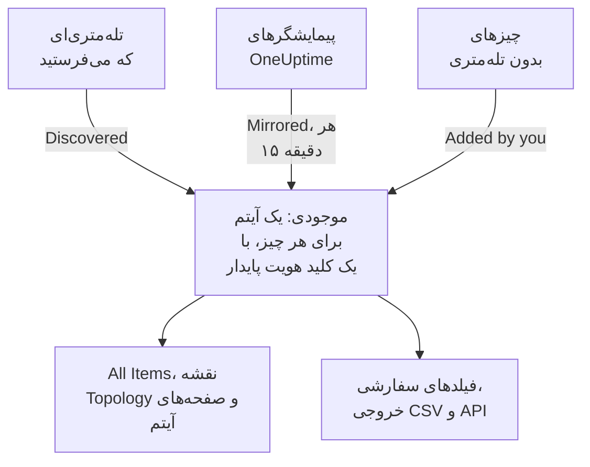

# نمای کلی موجودی

موجودی فهرستی یکپارچه از هر چیزی است که OneUptime درباره دارایی‌های شما می‌داند: سرویس‌ها، میزبان‌ها، اشیای Kubernetes، ماشین‌های مجازی، دستگاه‌های شبکه، منابع ابری، دستگاه‌های اینترنت اشیا، توابع بی‌سرور، و چیزهایی که هیچ تله‌متری‌ای نمی‌فرستند. بیشتر آن خودبه‌خود از آنچه OneUptime از پیش زیر نظر دارد پر می‌شود. آنچه شما می‌افزایید چیزی است که زیر نظر گرفتن نمی‌تواند بگوید: یک چیز برای چه کاری است، مالکش کیست، و گارانتی‌اش کی تمام می‌شود. [واژه‌نامه](/docs/introduction/glossary#آنچه-زیر-نظر-دارید) می‌گوید هر نوع رکورد در آن چیست.

:::cards
- [آیتم‌ها چگونه به موجودی می‌آیند](#آیتمها-چگونه-به-موجودی-میآیند): کشف‌شده، آینه‌شده، یا افزوده‌شده به دست شما.
- [راهتان را پیدا کنید](#راهتان-را-پیدا-کنید): صفحه‌های موجودی، و صفحه‌های خود هر آیتم.
- [دستگاه‌ها را از Esper وارد کنید](#دستگاهها-را-از-esper-وارد-کنید): هر دستگاه Android و Apple که در مستأجر Esper شما ثبت‌نام شده است، همیشه به‌روز.
- [چیزی را دستی بیفزایید](#چیزی-را-دستی-بیفزایید): یک API شخص ثالث، یک پایگاه داده بیرونی یا یک دستگاه.
- [به جای حذف، بایگانی کنید](#به-جای-حذف-بایگانی-کنید): راهی برای مرتب کردن فهرست که ماندگار است.
:::

## آیتم‌ها چگونه به موجودی می‌آیند

OneUptime از پیش دارایی‌های شما را برای پایش زیر نظر دارد، پس فهرست از آنچه مشاهده می‌کند ساخته می‌شود، نه از آنچه کسی یادش مانده تایپ کند. هر آیتم یک منبع دارد، و منبع تعیین می‌کند آیتم در اختیار کیست: آیا می‌توانید ویرایشش کنید، و آیا می‌تواند خودبه‌خود از میان برود.

| منبع | در API | از کجا می‌آید | تا کی می‌ماند |
| --- | --- | --- | --- |
| **کشف‌شده** | `discovered` | ویژگی‌های منبع OpenTelemetry که هنگام رسیدن تله‌متری خوانده می‌شوند: یک سرویس، میزبان، شیء Kubernetes یا ماشین مجازی که تله‌متری می‌فرستد. | با هر دسته دوباره ثبت می‌شود. وقتی بیش از پنجره نوعش ساکت بماند حذف می‌شود (پایین‌تر را ببینید). |
| **آینه‌شده** | `inventory` | رکوردی که یک پیمایشگر OneUptime نگه می‌دارد: دستگاه‌های شبکه، منابع ابری، دستگاه‌های اینترنت اشیا، توابع بی‌سرور، برنامه‌های RUM، میزبان‌های Docker، میزبان‌های Podman و دستگاه‌های Android و Apple که یک اتصال Esper وارد می‌کند. هر ۱۵ دقیقه رونوشت می‌شود. یک دستگاه Esper، هر بار که اتصالش خوانده می‌شود. | تا وقتی رکوردش هست. رکورد را حذف کنید، آیتم هم با آن می‌رود. |
| **افزوده‌شده توسط شما** | `manual` | افزوده‌شده به دست شما، برای چیزی که OneUptime نمی‌تواند ببیند: یک API شخص ثالث، پایگاه داده‌ای که فروشنده مدیریتش می‌کند، دستگاهی در رک. | تا وقتی حذفش کنید. هیچ چیز منقضی‌اش نمی‌کند. |

آیتم کشف‌شده یا آینه‌شده را نمی‌توان تغییر نام داد یا نوع دیگری به آن داد: منبعش در گذر بعدی تغییر را بازنویسی می‌کند. صفحه **تنظیمات** آیتم می‌گوید تغییر ماندگار را کجا باید داد. آنچه همیشه می‌توانید به هر آیتمی، با هر منبعی، بیفزایید مقدارهای فیلدهای سفارشی است: [فیلدهای سفارشی موجودی](/docs/inventory/custom-fields) را ببینید.

### آیتم ساکت تا کی می‌ماند

آیتم کشف‌شده ضربان دارد. هر بار که تله‌متری‌اش می‌رسد، زمان آخرین دیده‌شدنش جلو می‌رود، و ستون **وضعیت** فهرست می‌گوید این زمان چقدر تازه است. یک دستگاه از Esper هم همین‌طور است: هر بار که نزد Esper اعلام حضور می‌کند. دیگر آیتم‌های آینه‌شده و آیتم‌هایی که افزوده‌اید ضربانی ندارند، پس وضعیتشان به جای هشدار دادن خالی می‌ماند.

| وضعیت | معنی |
| --- | --- |
| **زنده** | در ۳۰ دقیقه گذشته دیده شده است. |
| **اخیر** | در یک روز گذشته دیده شده است. |
| **کهنه** | بیش از یک روز دیده نشده است. صفحه **ساکت‌شده** این‌ها را فهرست می‌کند. |

هر سه ساعت، OneUptime آیتم‌های کشف‌شده‌ای را که بیش از پنجره نوعشان ساکت مانده‌اند حذف می‌کند، بایگانی‌شده‌ها را هم، و مقدارهای فیلدهای سفارشی‌شان نیز با آن‌ها می‌رود. آیتم‌های آینه‌شده و آیتم‌هایی که افزوده‌اید هرگز این‌گونه حذف نمی‌شوند.

| نوع آیتم | پس از این مدت بی‌تله‌متری حذف می‌شود |
| --- | --- |
| پادها، استقرارها، مهمان‌های Proxmox و ماشین‌های مجازی VMware | ۱ روز |
| گره‌ها و فضاهای نام Kubernetes، گره‌های Proxmox، میزبان‌ها، خوشه‌ها و انبارهای داده VMware، و پایگاه‌های داده و سرویس‌های دوری که ترِیس‌های شما فرامی‌خوانند | ۷ روز |
| سرویس‌ها، میزبان‌ها، خوشه‌های Kubernetes، Proxmox و Ceph، آرایه‌های ذخیره‌سازی، vCenterها و خوشه‌های Docker Swarm | ۳۰ روز |

رابطه‌ای که OneUptime کشف کرده است، وقتی ۳۰ روز دوباره دیده نشود حذف می‌شود.

## راهتان را پیدا کنید

**محصولات** > **منابع** > **موجودی** را باز کنید. منوی کناری‌اش این صفحه‌ها را دارد. **بر اساس منبع**، **تنظیمات**، **راهنما** و **پیشرفته** بسته آغاز می‌شوند: برای باز کردن یک بخش روی عنوانش کلیک کنید.

| صفحه | آنچه آنجا می‌یابید |
| --- | --- |
| **نمای کلی** | چند آیتم دارید، چه هستند، چندتا ساکت شده‌اند، و چه چیزی به تازگی افزوده شده است. |
| **همه موارد** | همه آیتم‌ها. بر پایه نام، توضیحات یا کلید هویت جست‌وجو کنید، فهرست را بر پایه نوع، منبع، وضعیت یا فیلد سفارشی محدود کنید، و آیتمی را دستی بیفزایید. |
| **دستگاه‌های مدیریت‌شده** | اتصال‌های Esper شما، و هر دستگاهی که وارد می‌کنند، با وضعیت، گروه، مدل و سیستم‌عامل آن. |
| **نقشه توپولوژی** | آیتم‌ها چگونه به هم وصل‌اند: سرویس‌ها، آنچه فرامی‌خوانند، و میزبان‌ها، پادها و دستگاه‌هایی که رویشان اجرا می‌شوند. |
| **ساکت‌شده** | آیتم‌هایی که بیش از یک روز خبری از آن‌ها نرسیده است: آیتم‌های کشف‌شده‌ای که تله‌متری نفرستاده‌اند، و دستگاه‌هایی که دیگر نزد Esper اعلام حضور نمی‌کنند. |
| **بر اساس منبع** | آیتم‌های یک منبع: **کشف‌شده**، **آینه‌شده** یا **افزوده‌شده توسط شما**. |
| **تنظیمات** > **فیلدهای سفارشی** | فیلدهایی که پروژه‌تان روی هر آیتم نگه می‌دارد. |
| **راهنما** > **مستندات** | راهنمایی کوتاه برای موجودی، با انواع آیتمی که می‌شناسد. |
| **پیشرفته** > **بایگانی‌شده** | آیتم‌هایی که بایگانی کرده‌اید. از همین‌جا از بایگانی بیرونشان بیاورید. |

آیتمی را باز کنید؛ منوی کناری خودش **نمای کلی** آن (نوع، منبع و وضعیتش، و هر ویژگی‌ای که رویش مشاهده شده)، **اتصال‌ها** و **فیلدهای سفارشی** آن؛ **لاگ‌ها**، **ترِیس‌ها**، **متریک‌ها**، **پروفایل‌ها** و **استثناها**ی آن؛ و **حوادث**، **هشدارها** و **تعمیر و نگهداری زمان‌بندی‌شده** آن را دارد. زیر **پیشرفته**، **تنظیمات**، **گزارش‌های ممیزی** و **حذف مورد** آن قرار دارند. صفحه‌های تله‌متری آنچه را خود آیتم فرستاده نشان می‌دهند. حوادث، هشدارها و رویدادهای تعمیر و نگهداری، آن‌های سرویس، میزبان یا خوشه Kubernetes است که آیتم نماینده‌اش است؛ روی هر آیتم دیگری، آن صفحه‌ها می‌گویند به جایش به کدام منبع نگاه کنید.

### جزئیات دارایی

یک میزبان یا یک دستگاه شبکه کارت **جزئیات دارایی** دارد که هر دو را یکسان توصیف می‌کند: نام میزبان، آدرس IP، آدرس MAC، شماره سریال، سازنده، مدل، نسخه فریم‌ور، سیستم‌عامل، نسخه سیستم‌عامل، نوع دستگاه و مکان. کارت یک دستگاه Android سطح وصله امنیتی آن را هم دارد، که از عامل Android یا Esper می‌آید. واقعیتی که هیچ چیز گزارشش نکرده **ناشناخته** خوانده می‌شود، و کارت می‌گوید چرا چنین است و واقعیت‌های ناشناخته چگونه پر می‌شوند: دستگاهی که آن‌ها را از راه SNMP گزارش نمی‌کند، دستگاهی که هنوز خوانده نشده، یا یک دستگاه Meraki که داشبوردش آن‌ها را در خود دارد.

- واقعیت‌های یک میزبان از ویژگی‌های منبع روی تله‌متری‌اش می‌آیند: آدرس‌های IP و MAC، معماری و سیستم‌عاملش از همان آغاز، و شماره سریال، سازنده، مدل و فریم‌ورش وقتی آن‌ها را رویش ثبت کنید.
- واقعیت‌های یک دستگاه شبکه از پیمایش SNMP، نقش و سایتش می‌آیند. آنچه پیمایشش نخوانده از کشف می‌آید: آخرین اسکن نشانی‌اش، جدول ARP یک مسیریاب، یا جست‌وجوی DNS پرابش. دستگاهی بدون ENTITY-MIB، مانند یک Meraki MX، باز هم سازنده، مدل و سیستم‌عاملش را از توضیح سامانه‌اش می‌گیرد، و آدرس MAC خود را از پورت‌های خودش. آدرس IP آن هرگز به جای نام میزبانش نشان داده نمی‌شود.
- یک دستگاه Meraki همچنین آنچه را پیمایشش خالی می‌گذارد، از جمله شماره سریال، مدل و فریم‌ورش، از داشبورد Meraki می‌گیرد، وقتی یک [اتصال Meraki](/docs/monitor/network-traffic#cisco-meraki-بدون-netflow) سازمانش را می‌خواند.

کارت می‌گوید هر واقعیت از کجا و کی آمده است. منبعی که بیشتر واقعیت‌ها در آن مشترک‌اند، مانند گردآورندهٔ یک میزبان، پیمایش SNMP خودِ یک دستگاه شبکه یا اسکن کشفی که آن را خوانده، یک بار، زیر واقعیت‌ها، نام برده می‌شود. هر منبع دیگری، مانند جدول ARP یک مسیریاب یا مقداری ذخیره‌شده روی دستگاه، زیر واقعیت خودش نام برده می‌شود. مقداری که روی یک دستگاه شبکه ذخیره شده هرگز با آنچه کشف می‌خواند جایگزین نمی‌شود، و وقتی این دو فرق دارند، کارت هر دو را نشان می‌دهد.

کارت یک دستگاه شبکه برای کسانی که اجازهٔ ویرایش دستگاه‌های شبکه را دارند یک دکمهٔ **تازه‌سازی** دارد. این دکمه دستگاه را همین حالا دوباره می‌خواند: پرابش ظرف یک دقیقه آن را پیمایش می‌کند، و اتصال Meraki آن سازمان را دوباره می‌خواند. کارت می‌گوید خوانش تازه کی رسیده، یا اینکه پراب نتوانسته به دستگاه برسد، و آیتم به محض رسیدن خوانش از روی دستگاه رونوشت می‌شود.

همین واقعیت‌ها ستون‌های فهرست **همه موارد** هستند، تا وقتی روشنشان کنید پنهان‌اند، و به خروجی CSV آن می‌روند. [خروجی گرفتن به CMDB](/docs/inventory/cmdb-sync#جزئیات-دارایی) کلیدهایشان را فهرست می‌کند.

### اتصال‌ها

صفحه **اتصال‌ها** یک آیتم همسایه‌هایش را در هر دو جهت فهرست می‌کند، دسته‌بندی‌شده در **فراخوانی‌ها**، **فراخوانده‌شده توسط**، **اجرا روی** و **مرتبط**. هر دسته مجموعش را نشان می‌دهد (دسته‌ای با بیش از ۱۰۰٬۰۰۰ اتصال «۱۰۰٬۰۰۰+» نشان می‌دهد)، و **نمایش بیشتر** بقیه را صفحه به صفحه می‌آورد، تا یک خوشه، فضای نام یا گره پرکار همه اتصال‌هایش را نشان دهد نه فقط چند تای نخست را. این صفحه به بازه زمانی محدود نیست: رابطه‌هایی را که از راه API دستی افزوده شده‌اند، و همسایه‌هایی را که بایگانی شده‌اند هم دربرمی‌گیرد. همسایه‌ای که دیگر در موجودی نیست با کلیدش نشان داده می‌شود.

## دستگاه‌ها را از Esper وارد کنید

یک مستأجر Esper را متصل کنید تا هر دستگاهی که در آن ثبت‌نام شده است در موجودی باشد: دستگاه‌های Android آن، از جمله دستگاه‌هایی که برنامه‌شان هرگز اجرا نشده است، و دستگاه‌های iPhone، iPad و Apple TV آن. هر دستگاه یک میزبان است، با آنچه فقط Esper درباره‌اش می‌داند: گروهش، سیستم‌عامل و شماره ساختش، شماره سریال و IMEI آن، باتری و فضای ذخیره‌سازی‌اش، و برای یک دستگاه Android، سطح وصله امنیتی و برنامه‌های نصب‌شده‌اش. Esper خودش چیزی نمی‌فرستد، پس OneUptime آن را طبق زمان‌بندی می‌خواند: دستگاه‌ها را هر ۱۵ دقیقه، و برنامه‌های هر دستگاه Android را هر ۶ ساعت.

:::steps
### یک کلید API در Esper بسازید

در کنسول Esper، زیر API Key Management یک کلید بسازید. OneUptime فقط می‌خواند، پس کلید کاربری که نقشش در Esper اجازه خواندن دستگاه‌ها، گروه‌ها و برنامه‌ها را دارد کافی است. کلید وقتی جایگزین شود، یا کاربرش حذف شود، دیگر کار نمی‌کند.

### مستأجر را متصل کنید

به **محصولات** > **منابع** > **موجودی** بروید، سپس به **دستگاه‌های مدیریت‌شده**، و روی **اتصال Esper** کلیک کنید. **مستأجر** را وارد کنید، یعنی نامی که در نشانی کنسول Esper شما پیش از `.esper.cloud` می‌آید (`acme` برای `acme.esper.cloud`)، و سپس **کلید API** را. **فیلدهای بیشتر** نام اتصال و اینکه هر چند وقت یک بار خوانده شود را در خود دارد.

### نخستین خواندن را بررسی کنید

**اتصال** پیش از ذخیره هر چیزی کلید را می‌آزماید: می‌گوید یک خواندن چند دستگاه را وارد خواهد کرد، یا چه چیزی اشتباه است و چگونه درستش کنید. نخستین خواندن ظرف یک دقیقه آغاز می‌شود، و سطر اتصال می‌گوید چگونه پیش رفته است.
:::

| آنچه Esper گزارش می‌دهد | کجا نشان داده می‌شود |
| --- | --- |
| مدل، سازنده، شماره سریال، سیستم‌عامل و نسخه آن، شماره ساخت، و آدرس‌های IP و MAC | کارت **جزئیات دارایی** دستگاه، و ستون‌های **همه موارد** |
| وضعیت، آخرین اعلام حضور، گروه، سطح وصله امنیتی، IMEI، باتری، فضای ذخیره‌سازی و عامل Esper | کارت **Esper** دستگاه، و فهرست **دستگاه‌ها** در **دستگاه‌های مدیریت‌شده** |
| برنامه‌ها و نسخه‌هایشان | فهرست **برنامه‌های نصب‌شده** دستگاه |

### یک دستگاه، نه دو تا

برنامه یا Android Agent که از یک دستگاه تله‌متری می‌فرستد، وقتی دستگاه را همان‌گونه نام ببرد که Esper نام می‌برد، با دستگاهی که Esper وارد می‌کند یک آیتم می‌شود. این ویژگی‌های منبع را از پیکربندی مدیریت‌شده‌ای که Esper روی هر دستگاه پر می‌کند تنظیم کنید:

| ویژگی منبع | مقدار پیکربندی مدیریت‌شده | چیست |
| --- | --- | --- |
| `host.name` | `${esper.deviceName}` | نام دستگاه در Esper، مانند `ESP-ID-AAAAW`. الزامی. |
| `host.serial_number` | `${esper.serialNumber}` | شماره سریال دستگاه. اختیاری. |

OneUptime آیتم یک دستگاه را نخست با نامش در Esper، سپس با شماره سریالش پیدا می‌کند، و تنها وقتی هیچ‌کدام جور نشود آیتمی می‌سازد. Android Agent هر دو را از تنظیمات `device_name` و `device_serial` خود تنظیم می‌کند، و [راه‌اندازی اندروید](/docs/rum/android-setup#ناوگان-را-از-esper-وارد-کنید) پیکربندی مدیریت‌شده یک برنامه را نشان می‌دهد.

### وقتی دستگاهی ساکت می‌شود، یا Esper را ترک می‌کند

یک دستگاه Android که ۳۰ دقیقه اعلام حضور نکرده باشد **آفلاین** است، و می‌گوید آخرین بار چه مدت پیش اعلام حضور کرده است؛ یک iPhone، iPad یا Apple TV وقتی سرویس اعلان Apple بیدارش می‌کند اعلام حضور می‌کند، اغلب با چند ساعت فاصله، پس پس از یک روز **آفلاین** می‌شود. **وضعیت** آیتمش از آخرین اعلام حضورش پیروی می‌کند، یا از تله‌متری‌اش وقتی آن تازه‌تر باشد، پس دستگاهی که یک روز ساکت مانده در صفحه **ساکت‌شده** است.

دستگاهی که از Esper حذف شود **حذف‌شده** علامت می‌خورد، و آیتمش بایگانی می‌شود: از فهرست بیرون می‌رود و زیر **پیشرفته** > **بایگانی‌شده** منتظر می‌ماند. دستگاهی که به Esper برگردد به فهرست هم برمی‌گردد. ۳۰ روز پس از رفتنش، دستگاه حذف می‌شود و آیتمش هم، مگر اینکه تله‌متری یا شما چیزی به آن افزوده باشید.

### دریافت هشدار وقتی دستگاهی دیگر اعلام حضور نمی‌کند

در **دستگاه‌های مدیریت‌شده**، روی **تنظیم هشدارها** در ردیف اتصال کلیک کنید و **Esper Android Device Stopped Checking In** و **Esper Apple Device Stopped Checking In** را بسازید. اولی برای هر دستگاه Android که بیش از یک ساعت به Esper اعلام حضور نکرده باشد، و دومی برای هر دستگاه Apple که بیش از یک روز اعلام حضور نکرده باشد، یک هشدار به نام همان دستگاه باز می‌کند، و وقتی دستگاه دوباره اعلام حضور کند آن را برطرف می‌کند.

هر بار خواندن اتصال، به‌صورت متریک `oneuptime.managed_device.check_in.age` ثبت می‌کند که هر دستگاه چند دقیقه پیش آخرین بار اعلام حضور کرده است، و مانیتور هر ۵ دقیقه آخرین مقدار هر دستگاه را بررسی می‌کند. دستگاهی که Android Agent را هم اجرا می‌کند به **Host Stopped Reporting** سپرده می‌شود تا هرگز دو بار هشدار ندهد، و هشدار دستگاهی که از Esper حذف شود برطرف می‌شود. خواندنی که ناموفق باشد چیزی ثبت نمی‌کند، پس تا خواندن بعدی هیچ هشداری باز یا برطرف نمی‌شود. برای ناوگانی که شب‌ها خاموش می‌شود، آستانه مانیتور را بالا ببرید.

## چیزی را دستی بیفزایید

برای چیزی که OneUptime هرگز خودش نخواهد دید آیتمی بیفزایید، تا یک وابستگی به چیزی واقعی برسد و آن چیز بتواند فیلدهای سفارشی شما را داشته باشد.

:::steps
### همه موارد را باز کنید

به **محصولات** > **منابع** > **موجودی** بروید، سپس به **همه موارد**.

### آیتم را بیفزایید

روی **افزودن مورد** کلیک کنید. **نوع** آن را برگزینید، به آن یک **نام** بدهید، و اگر خواستید یک **توضیحات**. نام و نوع با هم هویت آیتم‌اند، پس دو آیتم از یک نوع نمی‌توانند نام یکسانی داشته باشند.

### فیلدهای سفارشی‌اش را پر کنید

آیتم تازه را باز کنید. منبعش **افزوده‌شده توسط شما** خوانده می‌شود، و صفحه **فیلدهای سفارشی** آن مقدارهایی را می‌پذیرد که پروژه‌تان دنبال می‌کند.
:::

سه نوع را می‌توانید دستی بیفزایید:

- `external.service` (**سرویس خارجی**): یک API شخص ثالث یا یک وابستگی نرم‌افزار به‌عنوان سرویس.
- `external.database` (**پایگاه داده خارجی**): پایگاه داده‌ای که سروری نیست که OneUptime بتواند مدلش کند. یک سرور پایگاه داده، خودمیزبان یا مدیریت‌شده، از PostgreSQL تا Snowflake، به جای آن زیر **پایگاه‌های داده** > **ساخت پایگاه داده** جای دارد ([پایگاه‌های داده](/docs/telemetry/databases)): آن رکورد به ترِیس‌ها، کانتینرها و متریک‌های موتوری می‌پیوندد که همان نشانی را نام می‌برند، کاری که یک آیتم موجودی هرگز نمی‌کند، و افزودن همان سرور از هر دو راه دو رکورد ناپیوسته به جا می‌گذارد.
- `appliance` (**دستگاه اختصاصی**): سخت‌افزار یا نرم‌افزاری بدون عامل.

این محدودیت جلوی تکرار را می‌گیرد. آیتم دستی از نوعی که OneUptime می‌تواند مشاهده کند، مانند یک میزبان، بر پایه نامی که تایپ کرده‌اید کلید می‌گیرد، در حالی که آیتم کشف‌شده همان ماشین بر پایه ویژگی‌هایی که گزارش می‌کند کلید می‌گیرد. این دو هرگز یکی نمی‌شوند، پس همان میزبان برای همیشه دو بار در فهرستتان می‌ماند.

## به جای حذف، بایگانی کنید

بایگانی کردن آیتم را از فهرست بیرون می‌برد، در حالی که هویت، تاریخچه و مقدارهای فیلدهای سفارشی‌اش می‌مانند. معنایش این است: این را دیده‌ام و نمی‌خواهمش در فهرستم باشد. آیتم بایگانی‌شده به گردآوری تله‌متری ادامه می‌دهد.

| منبع | بایگانی | حذف |
| --- | --- | --- |
| **کشف‌شده** | بایگانی می‌ماند. | با دسته بعدی تله‌متری‌اش برمی‌گردد. |
| **آینه‌شده** | بایگانی می‌ماند. | با رونوشت بعدی برمی‌گردد. به جایش رکورد اصلی را حذف کنید. |
| **افزوده‌شده توسط شما** | بایگانی می‌ماند. | برای همیشه می‌رود. |

برای بایگانی کردن آیتم‌ها، آن‌ها را در **همه موارد** برگزینید و یک‌جا بایگانی کنید، یا آیتمی را باز کنید و کارت **بایگانی** را در صفحه **تنظیمات** آن به کار ببرید. آیتم‌های بایگانی‌شده زیر **موجودی** > **پیشرفته** > **بایگانی‌شده** هستند، جایی که می‌توانید برگزینیدشان و از بایگانی بیرونشان بیاورید.

> [!NOTE]
> وقتی یک دستگاه آینه‌شده از رکورد مالکش حذف می‌شود، OneUptime آیتمش را هم حذف می‌کند، مگر این‌که آیتم مقدارهای فیلد سفارشی‌ای داشته باشد که شما وارد کرده‌اید. آن مقدارها تنها نسخه‌اند و راه بازگشتی نیست، پس آیتم به جای حذف بایگانی می‌شود. آن را زیر **پیشرفته** > **بایگانی‌شده** با هر آنچه تایپ کرده‌اید دست‌نخورده می‌یابید.

## رابطه‌ها و توپولوژی

OneUptime آیتم‌ها را با رابطه‌های جهت‌دار، همان‌گونه که مشاهده‌شان می‌کند، به هم پیوند می‌دهد. **موجودی** > **نقشه توپولوژی** آن‌ها را می‌کشد، و صفحه **اتصال‌ها** یک آیتم رابطه‌های خودش را فهرست می‌کند. [توپولوژی](/docs/telemetry/topology) را ببینید.

| رابطه | برای نمونه |
| --- | --- |
| `runs-on` | یک پاد روی یک گره اجرا می‌شود؛ یک ماشین مجازی روی میزبانش اجرا می‌شود. |
| `member-of` | یک پاد، گره یا فضای نام عضو یک خوشه است. |
| `hosted-on` | یک سرویس روی یک میزبان میزبانی می‌شود. |
| `part-of` | یک پاد بخشی از استقرار خودش است. |
| `depends-on` | یک سرویس سرویس دیگری را فرامی‌خواند، از روی spanهایی که میان آن‌ها عبور می‌کنند. |

## گام‌های بعدی

:::cards
- [فیلدهای سفارشی موجودی](/docs/inventory/custom-fields): شماره‌های سریال، تاریخ‌های گارانتی، مالکان و وضعیت چرخه عمر را دنبال کنید.
- [خروجی گرفتن به CMDB](/docs/inventory/cmdb-sync): فهرست را به سامانه ثبت خودتان بکشید.
- [پایگاه‌های داده](/docs/telemetry/databases): سرورهای پایگاه داده‌ای را که سرویس‌هایتان به کار می‌برند پایش کنید.
:::
