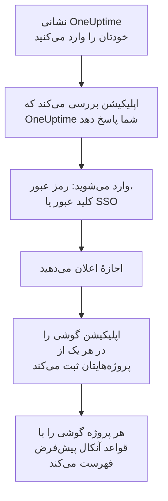

# نصب روی Android

**OneUptime On-Call** را روی یک گوشی یا تبلت Android نصب کنید، آن را به OneUptime خودتان وصل کنید و وارد شوید. سپس برای خودتان یک اعلان آزمایشی بفرستید، و بگذارید فراخوان‌های فوری آنکال از حالت بی‌صدا و مزاحم نشوید عبور کنند و زنگ بزنند.

:::cards
- [اپلیکیشن را نصب کنید](#اپلیکیشن-را-نصب-کنید): از Google Play، یا با APK روی گوشی‌ای که Google Play ندارد.
- [وارد شوید](#وارد-شوید): نخست نشانی OneUptime شما، سپس حساب شما.
- [بررسی کنید که فراخوان‌ها به گوشی می‌رسند](#بررسی-کنید-که-فراخوانها-به-گوشی-میرسند): گوشی را در داشبورد پیدا کنید و آن را بیازمایید.
- [زنگ زدن با وجود حالت بی‌صدا](#زنگ-زدن-با-وجود-حالت-بیصدا): هشدارهای بحرانی و صدای زنگ هشدار.
- [رفع اشکال](#رفع-اشکال): مشکلات ورود، اعلان و نصب.
:::

## پیش از شروع

- یک گوشی یا تبلت با Android 7.0 یا جدیدتر.
- یک حساب در یک پروژهٔ OneUptime. برای اینکه فراخوانده شوید، باید آنکال هم باشید: [قواعد تشدید](/docs/on-call/escalation-rules) را ببینید.
- نشانی OneUptime شما: `https://oneuptime.com` در OneUptime Cloud، یا نشانی خودتان، مانند `https://oneuptime.example.com`. اپلیکیشن فقط روی HTTPS وصل می‌شود.

## اپلیکیشن را نصب کنید

:::tabs
@tab Google Play
1. روی گوشی، [OneUptime On-Call در Google Play](https://play.google.com/store/apps/details?id=com.oneuptime.oncall) را باز کنید، یا در Google Play دنبال OneUptime On-Call بگردید.
2. روی **نصب** و سپس **باز کردن** ضربه بزنید.

Google Play اپلیکیشن را به‌روز نگه می‌دارد.
@tab APK
برای گوشی‌ای که Google Play ندارد. APK برای هر انتشار OneUptime از همان کد ساخته می‌شود و به آن انتشار در GitHub پیوست می‌شود.

1. روی گوشی، [تازه‌ترین APK](https://github.com/OneUptime/oneuptime/releases/latest/download/oneuptime-on-call-android-app.apk) را باز کنید.
2. فایل بارگیری‌شده را باز کنید. اگر Android پرسید، به مرورگرتان اجازه دهید برنامه‌های ناشناس را نصب کند، سپس روی **نصب** ضربه بزنید.
3. OneUptime On-Call را از میان برنامه‌هایتان باز کنید.

APK خودش به‌روز نمی‌شود: هر از گاهی تازه‌ترین APK را روی آن نصب کنید. ورود و تنظیمات شما باقی می‌مانند.
:::

## وارد شوید



:::steps
### نشانی OneUptime خودتان را وارد کنید
اپلیکیشن را باز کنید. در **Connect your workspace**، برای OneUptime Cloud نشانی `https://oneuptime.com` را نگه دارید، یا نشانی OneUptime خودتان را وارد کنید، و روی **Connect** ضربه بزنید. اپلیکیشن به محض اینکه `https://<your-oneuptime>/api/status` پاسخ دهد ادامه می‌دهد.

### به حساب خود وارد شوید
از هر روشی که حساب شما با آن وارد می‌شود استفاده کنید:

- ایمیل و رمز عبورتان، سپس **Sign In**. **Forgot password?** پیوندی برای گذاشتن رمز عبور تازه برایتان ایمیل می‌کند.
- **Sign in with SSO**، اگر سازمانتان از ورود یکپارچه استفاده می‌کند. ارائه‌دهندهٔ خود را انتخاب کنید، یا ایمیل کاری‌تان را وارد کنید و روی **Continue** ضربه بزنید. یک مرورگر امن باز می‌شود، و پس از ورود به اپلیکیشن برمی‌گردید.
- **Sign in with a passkey**، وقتی در داشبورد یک کلید عبور اضافه کرده باشید: [یک کلید عبور اضافه کنید](/docs/introduction/your-account#یک-کلید-عبور-اضافه-کنید) را ببینید. مرورگرتان برای تأیید آن باز می‌شود، سپس شما را برمی‌گرداند.

اگر احراز هویت دومرحله‌ای روشن است، کد شش‌رقمی برنامهٔ احراز هویت خود، یا یکی از کدهای پشتیبانتان را وارد کنید. کلید امنیتی را نمی‌توان در اپلیکیشن به کار برد. اگر مدیرتان احراز هویت دومرحله‌ای را الزامی کرده و شما هنوز آن را راه نینداخته‌اید، اپلیکیشن نخست همراه شما یک برنامهٔ احراز هویت راه می‌اندازد.

### اجازهٔ اعلان بدهید
وقتی Android پرسید که آیا OneUptime On-Call می‌تواند اعلان بفرستد، روی **مجاز** ضربه بزنید. Android 13 و جدیدتر می‌پرسند؛ نسخه‌های قدیمی‌تر آن‌ها را مجاز می‌دانند مگر اینکه خاموششان کنید.

سپس اپلیکیشن گوشی را در هر یک از پروژه‌هایتان ثبت می‌کند. هر پروژه آن را با قواعد آنکال پیش‌فرض در میان دستگاه‌های پوش شما فهرست می‌کند، پس از این پس فراخوان‌هایتان به آن می‌رسند.
:::

اپلیکیشن هر بار یک پروژه را نشان می‌دهد: برای جابه‌جایی، روی نام پروژه در بالای صفحه ضربه بزنید. پروژه‌ای که ورود یکپارچه را الزامی می‌کند، زیر **Settings** > **Manage Projects** عبارت **SSO Required** را نشان می‌دهد، تا وقتی که آنجا روی **Authenticate with SSO** ضربه بزنید.

## بررسی کنید که فراخوان‌ها به گوشی می‌رسند

:::steps
### گوشی را در داشبورد پیدا کنید
در داشبورد، **تنظیمات کاربر** > **روش‌های اعلان** و زبانهٔ **Push Notifications** را باز کنید. گوشی زیر **دستگاه‌های اعلان پوش** با نام مدلش فهرست شده است. هر پروژه فهرست خودش را دارد.

### یک آزمایش بفرستید
در ردیف گوشی روی **اعلان آزمایشی** کلیک کنید. یک اعلان روی گوشی می‌رسد؛ برای باز کردن اپلیکیشن روی آن ضربه بزنید.
:::

قواعد آنکال شما تعیین می‌کنند کدام فراخوان‌ها به گوشی بروند، و با چه سرعتی: **تنظیمات کاربر** > **قواعد آنکال** را ببینید. یک گوشی تازه همان قواعد پیش‌فرض هر روش دیگری را می‌گیرد که اضافه می‌کنید.

## زنگ زدن با وجود حالت بی‌صدا

به‌طور پیش‌فرض یک فراخوان آنکال از تنظیمات صدای گوشی پیروی می‌کند: گوشیِ بی‌صدا ساکت می‌ماند، و مزاحم نشوید فراخوان را نگه می‌دارد. هشدارهای بحرانی می‌گذارند فراخوان‌های آنکال از هر دو عبور کنند و زنگ بزنند. تا وقتی آن‌ها را روشن نکنید خاموش‌اند، برای هر گوشی جداگانه.

```mermaid title="آیا یک فراخوان آنکال روی Android با وجود بی‌صدا زنگ می‌زند"
flowchart TB
    Page["یک فراخوان آنکال<br/>برای این گوشی"]
    Rule{"قاعده روی<br/>هشدار بحرانی است؟"}
    Device{"Critical On-Call<br/>Alerts روشن است؟"}
    Quiet["از صدای گوشی و<br/>مزاحم نشوید<br/>پیروی می‌کند"]
    Loud["زنگ هشدار شما را با<br/>وجود حالت بی‌صدا و<br/>مزاحم نشوید پخش می‌کند"]
    Page --> Rule
    Rule -->|"خیر: عادی"| Quiet
    Rule -->|"بله"| Device
    Device -->|"خیر"| Quiet
    Device -->|"بله"| Loud
```

:::steps
### Critical On-Call Alerts را روشن کنید
در اپلیکیشن، **Settings** را باز کنید و زیر **Notifications** گزینهٔ **Critical On-Call Alerts** را روشن کنید.

### دسترسی به مزاحم نشوید را مجاز کنید
Android فهرست **دسترسی به «مزاحم نشوید»** خود را باز می‌کند. دسترسی را برای OneUptime On-Call روشن کنید، سپس به اپلیکیشن برگردید: اپلیکیشن دسترسی را بررسی می‌کند و زیر کلید می‌گوید که آیا فراخوان‌ها با وجود بی‌صدا زنگ می‌زنند یا نه.

### یک صدای زنگ هشدار انتخاب کنید
روی **Alarm sound** زیر کلید ضربه بزنید. افزون بر صدای خود گوشی، Klaxon، Siren، Digital alarm، Smoke alarm و Rising alarm را پیشنهاد می‌کند که آرام شروع می‌شود و بلندتر می‌شود. برای شنیدن هر صدا، دکمهٔ پخش کنار آن را بزنید. یک فراخوان بحرانی با بلندی زنگ هشدار گوشی پخش می‌شود، پس آن را بالا نگه دارید.
:::

فقط فراخوان‌های آنکال با وجود بی‌صدا زنگ می‌زنند، و فقط از قواعد آنکالی که روی **هشدار بحرانی** تنظیم شده‌اند، که پیش‌فرض است. قاعده‌ای که روی **عادی** تنظیم شده، هر چه کلید بگوید، از تنظیمات گوشی پیروی می‌کند، تا برای یک حادثهٔ بحرانی بیدار شوید و برای حادثه‌ای جزئی بی‌صدا فراخوانده شوید. با گوشیِ بی‌صدا یک **اعلان آزمایشی** بفرستید تا بشنوید یک فراخوان چه خواهد کرد.

## جلوگیری از دیر رسیدن فراخوان‌ها

OneUptime فراخوان‌های آنکال را با اولویت بالا می‌فرستد، که Android حتی به گوشی‌ای که ساعت‌ها بی‌کار مانده هم تحویل می‌دهد. با این حال، گوشی‌ای که مصرف باتری اپلیکیشن را محدود می‌کند هنوز می‌تواند آن‌ها را نگه دارد:

- **تنظیمات** > **برنامه‌ها** > **OneUptime On-Call** > **باتری** را باز کنید و **نامحدود** را انتخاب کنید. برخی گوشی‌ها آن را **مصرف باتری برنامه** می‌نامند.
- زیر **تنظیمات** > **برنامه‌ها** > **OneUptime On-Call** > **اعلان‌ها** بررسی کنید که اعلان‌های اپلیکیشن روشن باشند.
- OneUptime On-Call را از هر فهرست صرفه‌جویی باتری یا برنامه‌های خواب که گوشی‌تان نگه می‌دارد بیرون نگه دارید.

## قفل کردن اپلیکیشن

**Biometrics Login** را زیر **Settings** در اپلیکیشن روشن کنید، تا اپلیکیشن هر بار که شروع می‌شود اثر انگشت، چهره یا قفل صفحهٔ گوشی را بخواهد. این کلید وقتی نمایش داده می‌شود که روی گوشی باز کردن قفل با اثر انگشت یا چهره راه‌اندازی شده باشد. **Appearance**، در همان صفحه، ظاهر روشن یا تیره را انتخاب می‌کند، یا از گوشی پیروی می‌کند.

## به‌روزرسانی، خروج یا حذف نصب

- **به‌روزرسانی.** Google Play اپلیکیشن را به‌روز می‌کند. برای APK، تازه‌ترین APK را روی آن نصب کنید. نسخهٔ اپلیکیشن در پایین صفحهٔ **Settings** آن است.
- **خروج.** **Settings** > **Log Out** شما را خارج می‌کند و گوشی را از دستگاه‌های پوش شما در همهٔ پروژه‌ها، همراه با قواعد آنکالش، حذف می‌کند. ورود دوباره آن را با قواعد پیش‌فرض بازمی‌گرداند.
- **حذف نصب.** اپلیکیشن را مانند هر اپلیکیشن دیگری حذف کنید. اگر هنوز وارد بودید، گوشی تا وقتی پوشی به آن شکست بخورد در فهرست شما می‌ماند: آنگاه OneUptime آن را **اعلان دریافت نمی‌شود** علامت می‌زند. آن مدخل را با **حذف** پاک کنید: نصب دوبارهٔ اپلیکیشن و ورود، گوشی را به‌صورت مدخلی تازه با قواعد پیش‌فرض اضافه می‌کند.

## رفع اشکال

:::details «Could not connect to the server»
اپلیکیشن نتوانست به `https://<your-oneuptime>/api/status` برسد. نشانی را، همراه با `https://`، بررسی کنید. اگر OneUptime شما روی یک شبکهٔ خصوصی است، نخست گوشی را به آن وصل کنید، برای نمونه از راه VPN. آن نشانی را در مرورگر گوشی باز کنید: وقتی گوشی بتواند به OneUptime برسد، `{"status":"ok"}` را نشان می‌دهد.
:::

:::details هیچ اعلانی نمی‌رسد
- در تنظیمات Android بررسی کنید که اعلان‌ها برای اپلیکیشن روشن باشند، و مزاحم نشوید خاموش باشد یا هشدارهای بحرانی روشن باشند.
- بررسی کنید که گوشی زیر **Push Notifications** در **تنظیمات کاربر** > **روش‌های اعلان** فهرست شده باشد، و یک **اعلان آزمایشی** برایش بفرستید.
- اگر گوشی **اعلان دریافت نمی‌شود** علامت خورده است، اپلیکیشن را در حالی که وارد هستید باز کنید. اپلیکیشن گوشی را دوباره ثبت می‌کند؛ [وقتی یک گوشی باید دوباره ثبت شود](/docs/mobile-desktop-apps/faq-troubleshooting#وقتی-یک-گوشی-باید-دوباره-ثبت-شود) را ببینید.
- قواعد آنکال خود را زیر **تنظیمات کاربر** > **قواعد آنکال** بررسی کنید.
- در یک OneUptime خودمیزبان، بررسی کنید که سرورتان به رلهٔ پوش خود برسد: [اعلان‌های پوش](/docs/self-hosted/push-notifications#دسترسی-شبکه) را ببینید.
:::

:::details هشدارهای بحرانی در مزاحم نشوید ساکت می‌مانند
**Settings** اپلیکیشن را باز کنید: سطر زیر **Critical On-Call Alerts** می‌گوید چه چیزی کم است. معمولاً دسترسی به مزاحم نشوید مجاز نشده است: آن را زیر **تنظیمات** > **اعلان‌ها** > **دسترسی به «مزاحم نشوید»** مجاز کنید، سپس به اپلیکیشن برگردید. اگر یک صدای زنگ هشدار انتخاب کرده‌اید، کانال اعلانِ آن صدا هم باید اجازهٔ نادیده گرفتن مزاحم نشوید را داشته باشد.
:::

:::details هنگام نصب APK پیام «برنامه نصب نشد»
OneUptime On-Call از منبع دیگری، مانند Google Play، از قبل روی گوشی است، و Android یکی را روی دیگری نصب نمی‌کند. آن را حذف نصب کنید، APK را نصب کنید، و دوباره وارد شوید.
:::

:::details کلید Biometrics Login نیست
این کلید وقتی نمایش داده می‌شود که در تنظیمات Android باز کردن قفل با اثر انگشت یا چهره راه‌اندازی شده باشد.
:::

## گام‌های بعدی

:::cards
- [پرسش‌های متداول و رفع اشکال](/docs/mobile-desktop-apps/faq-troubleshooting): وقتی یک گوشی دیگر فراخوان نمی‌گیرد چه کنید.
- [نصب روی iOS](/docs/mobile-desktop-apps/ios-installation): همین اپلیکیشن روی iPhone یا iPad.
- [قواعد تشدید](/docs/on-call/escalation-rules): تعیین کنید چه کسی و کی فراخوانده شود.
- [اعلان‌های پوش](/docs/self-hosted/push-notifications): یک OneUptime خودمیزبان چگونه به گوشی‌ها فراخوان می‌فرستد.
:::
