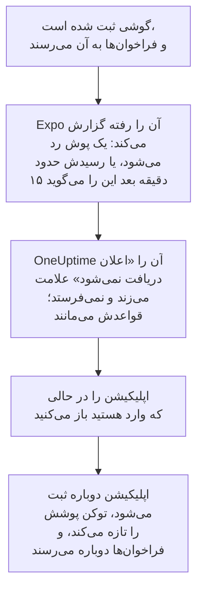

# پرسش‌های متداول و رفع اشکال

پاسخ پرسش‌های رایج دربارهٔ اپلیکیشن‌های موبایل و دسکتاپ OneUptime، و راه‌حل آنچه بیشتر از همه خراب می‌شود: ورود، اعلان‌هایی که نمی‌رسند، و گوشی‌ای که باید دوباره ثبت شود.

:::cards
- [پرسش‌های اپلیکیشن موبایل](#پرسشهای-اپلیکیشن-موبایل): دستگاه‌ها، پروژه‌ها، خودمیزبانی و امنیت.
- [پرسش‌های اپلیکیشن دسکتاپ](#پرسشهای-اپلیکیشن-دسکتاپ): اپلیکیشن دسکتاپ چیست، و چه کاری از آن برنمی‌آید.
- [وقتی یک گوشی باید دوباره ثبت شود](#وقتی-یک-گوشی-باید-دوباره-ثبت-شود): چرا یک گوشی دیگر فراخوان نمی‌گیرد، و چگونه برمی‌گردد.
- [رفع اشکال](#رفع-اشکال): مشکلات ورود، اعلان و نصب.
:::

## پرسش‌های اپلیکیشن موبایل

:::details آیا اپلیکیشن رایگان است؟
بله. OneUptime On-Call در App Store، در Google Play و به‌صورت APK در GitHub رایگان است. با حساب OneUptime خود وارد می‌شوید.
:::

:::details روی کدام گوشی‌ها و تبلت‌ها اجرا می‌شود؟
iPhone و iPad با iOS یا iPadOS 16.4 یا جدیدتر، و گوشی‌ها و تبلت‌های Android با Android 7.0 یا جدیدتر.
:::

:::details آیا با یک OneUptime خودمیزبان کار می‌کند؟
بله. وقتی اپلیکیشن شروع می‌شود نشانی `https://` OneUptime خودتان را وارد کنید، یا در صفحهٔ ورود روی **Change Server** ضربه بزنید. به‌طور پیش‌فرض سرور شما فراخوان‌ها را از راه رلهٔ پوش OneUptime به گوشی‌ها می‌فرستد، پس به هیچ حساب Apple، Google یا Expo نیاز ندارد: [اعلان‌های پوش](/docs/self-hosted/push-notifications) را ببینید.
:::

:::details آیا می‌توانم آن را با چند پروژه به کار ببرم؟
بله. اپلیکیشن گوشی را در همهٔ پروژه‌هایی که عضوشان هستید ثبت می‌کند، تا هر پروژه بتواند شما را فرا بخواند. هر بار یک پروژه را نشان می‌دهد: برای جابه‌جایی، روی نام پروژه در بالای صفحه ضربه بزنید.
:::

:::details آیا می‌توانم روی بیش از یک گوشی وارد شوم؟
بله. هر گوشی یا تبلت یک دستگاه پوش جداگانه است، با قواعد آنکال خودش و تنظیم هشدار بحرانی خودش.
:::

:::details در اپلیکیشن چه کارهایی می‌توانم بکنم؟
- **Home**: آنچه در پروژه به توجه نیاز دارد: حادثه‌ها و هشدارهای فعال، پرونده‌های امنیتی باز اگر نقش شما اجازهٔ دیدنشان را می‌دهد، مانیتورهای دچار مشکل، و رویدادهای گروه‌بندی‌شده.
- **Monitors**: همهٔ مانیتورها، پالایش‌شده بر اساس سلامت، با جزئیاتشان.
- **Inbox**: حادثه‌ها و هشدارها، و اپیزودهایی که آن‌ها را گروه‌بندی می‌کنند. یکی را باز کنید تا **Acknowledge**، **Resolve** یا **Add Note** را به کار ببرید. اگر نقش شما اجازهٔ دیدن پرونده‌های امنیتی پروژه را می‌دهد، **Security** پرونده‌های باز را فهرست می‌کند: یکی را باز کنید تا دربارهٔ گام پلی‌بوکی که منتظر تأیید است با **Approve** یا **Reject** تصمیم بگیرید، پرونده را با **Assign to me** به عهده بگیرید، یا **Close case** را به کار ببرید.
- **On-Call**: اینکه آیا آنکال هستید و تا کی، چه کس دیگری آنکال است، فراخوان‌هایی که برایتان فرستاده شده، و **Cover for me**، که فراخوان‌هایتان را برای مدتی به یک هم‌تیمی می‌سپارد.
- **Settings**: پروژه‌ها و ورود یکپارچهٔ شما، ظاهر، هشدارهای بحرانی و صدای زنگ هشدار، **Biometrics Login**، خوراک تقویم آنکال شما، و **Log Out**.

هر چیز دیگری در داشبورد است.
:::

:::details آیا می‌توانم یک فراخوان را از خود اعلان تأیید کنم؟
خیر. روی اعلان ضربه بزنید: اپلیکیشن حادثه، هشدار، اپیزود یا پروندهٔ امنیتی‌ای را که اعلان دربارهٔ آن است، در پروژهٔ درست باز می‌کند، و شما آن را آنجا تأیید می‌کنید. اگر اپلیکیشن قفل است یا خارج شده‌اید، به محض اینکه وارد شوید فراخوان را باز می‌کند.
:::

:::details آیا ورود من روی گوشی امن است؟
اپلیکیشن فقط روی HTTPS با OneUptime شما گفت‌وگو می‌کند. ورود شما در فضای ذخیره‌سازی خود اپلیکیشن روی گوشی نگه داشته می‌شود، و **Log Out** آن را پاک می‌کند و نشست را روی سرور هم خارج می‌کند. **Biometrics Login** را روشن کنید تا اپلیکیشن هر بار که شروع می‌شود چهره، اثر انگشت یا گذرواژهٔ دستگاه شما را بخواهد.
:::

:::details آیا اپلیکیشن آفلاین کار می‌کند؟
خیر. تا وقتی اتصالی ندارد در بالای صفحه **No internet connection** را نشان می‌دهد، و وقتی اتصال برگشت دوباره ادامه می‌دهد.
:::

## پرسش‌های اپلیکیشن دسکتاپ

:::details اپلیکیشن دسکتاپ چیست؟
داشبورد OneUptime، که از مرورگرتان به‌عنوان یک اپلیکیشن نصب شده است: یک پنجرهٔ جدا، یک نماد در منوی Start، در Dock یا در لانچر شما، و اعلان‌ها. هر کاری را که داشبورد انجام می‌دهد انجام می‌دهد، چون خودِ داشبورد است.
:::

:::details چرا در هیچ فروشگاه اپلیکیشنی نیست؟
لازم نیست باشد. اپلیکیشن هر بار که باز می‌شود داشبورد را از OneUptime شما بارگیری می‌کند، پس همیشه همان نسخه‌ای است که OneUptime شما اجرا می‌کند، روی Windows، macOS و Linux یکسان، بی‌آنکه چیزی برای به‌روزرسانی باشد.
:::

:::details آیا می‌تواند مانند گوشی بیدارم کند؟
خیر. مرورگرها نمی‌توانند مزاحم نشوید یا یک تمرکز را نادیده بگیرند، پس یک اعلان دسکتاپ فقط به همان بلندی‌ای است که رایانه اجازه می‌دهد. برای فراخوان‌هایی که باید بیدارتان کنند، از اپلیکیشن موبایل با هشدارهای بحرانی استفاده کنید.
:::

:::details آیا آفلاین کار می‌کند؟
خیر. به اتصالی به OneUptime شما نیاز دارد، درست مانند داشبورد در یک زبانهٔ مرورگر.
:::

## وقتی یک گوشی باید دوباره ثبت شود

OneUptime فراخوان‌های یک گوشی را از راه Expo می‌فرستد، که آن‌ها را به Apple یا Google می‌سپارد. وقتی Expo می‌گوید دیگر نمی‌توان به گوشی رسید، OneUptime فرستادن به آن را متوقف می‌کند، تا وقتی اپلیکیشن دوباره آن را ثبت کند.

Expo یک گوشی را رفته گزارش می‌کند وقتی اپلیکیشن از آن حذف شده باشد، یا وقتی توکن پوشش دیگر معتبر نباشد. گوشی حذف نمی‌شود: **تنظیمات کاربر** > **روش‌های اعلان**، در زبانهٔ **Push Notifications**، آن را **اعلان دریافت نمی‌شود** نشان می‌دهد، و خط زمانی آنکالِ فراخوانی که به آن نرسیده دلیلش را می‌گوید. گوشی‌ها و روش‌های اعلان دیگر شما مانند همیشه فراخوانده می‌شوند.

اپلیکیشن گوشی را هر بار که شروع می‌شود، وقتی وارد می‌شوید، و وقتی به آن برمی‌گردید ثبت می‌کند، حداکثر هر پنج دقیقه یک بار. ثبت کردن توکن پوش را دوباره از Expo می‌خواهد، که آن را تازه می‌کند، و گوشی دوباره با قواعدی که داشت فراخوان می‌گیرد.

| چه اتفاقی افتاد | چه کنید | OneUptime چه می‌کند |
| --- | --- | --- |
| اپلیکیشن هنوز نصب است | آن را در حالی که وارد هستید باز کنید | گوشی دوباره اعلان می‌گیرد، با قواعدش |
| اپلیکیشن را روی iPhone یا iPad دوباره نصب کردید | آن را نصب کنید و وارد شوید | معمولاً همان مدخل، با قواعدش، برمی‌گردد |
| اپلیکیشن را روی Android دوباره نصب کردید | آن را نصب کنید، وارد شوید، و مدخل قدیمی را حذف کنید | یک مدخل تازه با قواعد پیش‌فرض؛ مدخل قدیمی علامت‌خورده می‌ماند |
| یک گوشی تازه، راه‌اندازی‌شده از پشتیبانِ گوشی قدیمی | اپلیکیشن را روی گوشی تازه باز کنید | اگر مدخل گوشی قدیمی علامت خورده باشد، گوشی تازه آن را با قواعدش به دست می‌گیرد؛ وگرنه گوشی تازه مدخل خودش را می‌گیرد |
| یک گوشی تازه، راه‌اندازی‌شده از صفر | وارد شوید، و مدخل قدیمی را حذف کنید | یک مدخل تازه با قواعد پیش‌فرض |
| از اپلیکیشن خارج شدید | دوباره وارد شوید | خروج، گوشی و قواعدش را حذف کرد؛ با قواعد پیش‌فرض برمی‌گردد |

یک مرورگر هم وقتی اشتراک پوشش منقضی شود ممکن است دیگر اعلان نگیرد. داشبورد هر وقت بتواند آن را تمدید می‌کند؛ اگر مرورگر علامت‌خورده بماند، آن را در همان مرورگر با **ثبت دستگاه** دوباره ثبت کنید.

## رفع اشکال

### ورود

:::details «Could not connect to the server»
اپلیکیشن نتوانست به `https://<your-oneuptime>/api/status` برسد. نشانی را، همراه با `https://`، بررسی کنید: اپلیکیشن روی HTTP ساده وصل نمی‌شود. اگر OneUptime شما روی یک شبکهٔ خصوصی است، نخست گوشی را به آن وصل کنید، برای نمونه از راه VPN. وقتی گوشی بتواند به OneUptime برسد، باز کردن آن نشانی در مرورگر گوشی `{"status":"ok"}` را نشان می‌دهد.
:::

:::details «No SSO configuration found for the email»
هیچ‌یک از پروژه‌هایی که آن ایمیل به آن‌ها تعلق دارد ورود یکپارچه را راه‌اندازی نکرده است، یا آن ایمیل در این OneUptime حسابی ندارد. ایمیل را بررسی کنید، یا با رمز عبورتان وارد شوید. ارائه‌دهندگانی که مدیرتان برای کل نصب راه‌اندازی کرده پیش از فیلد ایمیل فهرست شده‌اند.
:::

:::details کلید امنیتی تنها عامل دوم شماست
اپلیکیشن نمی‌تواند از کلید امنیتی استفاده کند. با یکی از کدهای پشتیبانتان وارد شوید، یا در داشبورد یک برنامهٔ احراز هویت به حسابتان اضافه کنید: [احراز هویت دومرحله‌ای را روشن کنید](/docs/introduction/your-account#احراز-هویت-دومرحلهای-را-روشن-کنید) را ببینید.
:::

:::details ورود با کلید عبور شکست می‌خورد
کلیدهای عبور نیاز دارند که نشانی OneUptime شما با `https://` شروع شود، و به کلید عبوری که برای همین OneUptime اضافه کرده‌اید: [یک کلید عبور اضافه کنید](/docs/introduction/your-account#یک-کلید-عبور-اضافه-کنید) را ببینید. برای استفاده از سرور دیگری، در صفحهٔ ورود روی **Change Server** ضربه بزنید.
:::

### اعلان‌ها

:::details هیچ اعلانی روی گوشی نمی‌رسد
- بررسی کنید که گوشی اعلان‌های OneUptime On-Call را مجاز بداند، و مزاحم نشوید یا یک تمرکز آن‌ها را نگه ندارد.
- در **تنظیمات کاربر** > **روش‌های اعلان**، در زبانهٔ **Push Notifications**، بررسی کنید که گوشی فهرست شده باشد، و یک **اعلان آزمایشی** برایش بفرستید.
- اگر **اعلان دریافت نمی‌شود** علامت خورده است، اپلیکیشن را در حالی که وارد هستید باز کنید: [وقتی یک گوشی باید دوباره ثبت شود](#وقتی-یک-گوشی-باید-دوباره-ثبت-شود) را ببینید.
- قواعد آنکال خود را زیر **تنظیمات کاربر** > **قواعد آنکال** بررسی کنید: آن‌ها تعیین می‌کنند کدام فراخوان‌ها به کدام روش برسند.
- در یک OneUptime خودمیزبان، بررسی کنید که سرور به رلهٔ پوش خود برسد: [اعلان‌های پوش](/docs/self-hosted/push-notifications#دسترسی-شبکه) را ببینید.
:::

:::details فراخوان‌ها روی Android دیر می‌رسند
مصرف باتری اپلیکیشن را در تنظیمات Android برای OneUptime On-Call روی **نامحدود** بگذارید، و اپلیکیشن را از هر فهرست صرفه‌جویی باتری بیرون نگه دارید: [جلوگیری از دیر رسیدن فراخوان‌ها](/docs/mobile-desktop-apps/android-installation#جلوگیری-از-دیر-رسیدن-فراخوانها) را ببینید.
:::

:::details هشدارهای بحرانی از حالت بی‌صدا عبور نمی‌کنند
**Settings** اپلیکیشن را باز کنید: سطر زیر **Critical On-Call Alerts** می‌گوید روی آن گوشی چه چیزی کم است. سپس زیر **تنظیمات کاربر** > **قواعد آنکال** بررسی کنید که قاعدهٔ آنکالی که فراخوان را فرستاده روی **هشدار بحرانی** تنظیم شده باشد، نه **عادی**. هر گوشی کلید خودش را دارد.
:::

### اپلیکیشن دسکتاپ

:::details نماد نصب در نوار نشانی نیست
پس از ورود، از یک صفحهٔ داشبورد، روی `https://`، در Edge یا Chrome، یا در Safari روی macOS Sonoma 14 یا جدیدتر نصب کنید. اگر نماد نمایش داده نشد، منوی مرورگر هم آن را نصب می‌کند: [نصب روی Windows](/docs/mobile-desktop-apps/windows-installation#اپلیکیشن-را-نصب-کنید) را ببینید.
:::

:::details هیچ اعلانی روی دسکتاپ نمی‌رسد
مرورگر را زیر **تنظیمات کاربر** > **روش‌های اعلان**، در زبانهٔ **Push Notifications**، با **ثبت دستگاه** ثبت کنید، وقتی پرسیده شد اعلان‌ها را مجاز کنید، و تنظیمات اعلان خود رایانه را بررسی کنید. یک OneUptime خودمیزبان برای اعلان‌های مرورگر به کلیدهای VAPID خود نیاز دارد.
:::

## کمک گرفتن

اگر چیزی در اینجا با آنچه می‌بینید جور نیست، [در GitHub یک issue باز کنید](https://github.com/OneUptime/oneuptime/issues) و نسخهٔ اپلیکیشن خود را، از پایین صفحهٔ **Settings** آن، و سکویی را که به کار می‌برید بنویسید.

## گام‌های بعدی

:::cards
- [نمای کلی اپلیکیشن‌ها](/docs/mobile-desktop-apps/index): از کدام اپلیکیشن استفاده کنید، و اپلیکیشن‌ها چگونه به OneUptime می‌رسند.
- [نصب روی Android](/docs/mobile-desktop-apps/android-installation): اپلیکیشن را روی Android نصب و راه‌اندازی کنید.
- [نصب روی iOS](/docs/mobile-desktop-apps/ios-installation): اپلیکیشن را روی iPhone یا iPad نصب و راه‌اندازی کنید.
- [اعلان‌های پوش](/docs/self-hosted/push-notifications): یک OneUptime خودمیزبان چگونه فراخوان می‌فرستد، و خطاهای Expo.
:::
