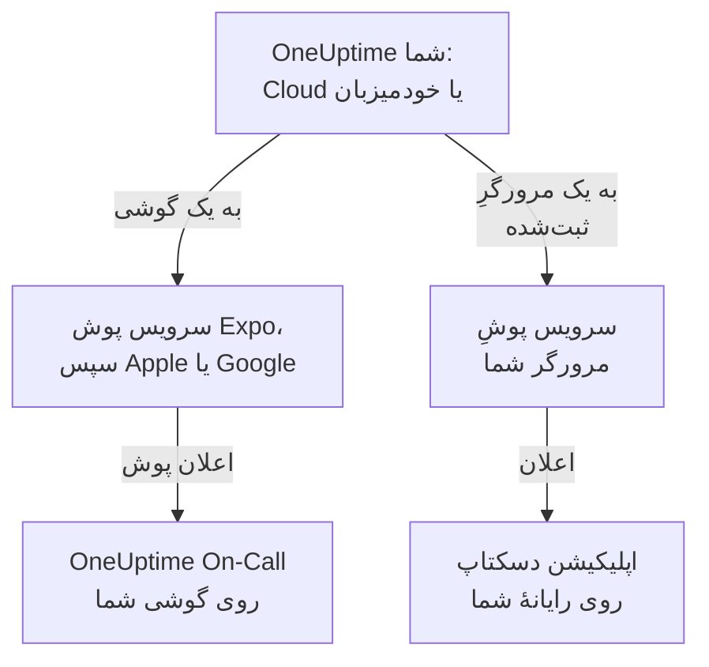

# نمای کلی اپلیکیشن‌ها

OneUptime یک اپلیکیشن برای گوشی و یک اپلیکیشن برای رایانه دارد. **OneUptime On-Call** برای iPhone، iPad و Android وقتی آنکال هستید شما را فرا می‌خواند، و می‌گذارد هر جا که باشید حادثه‌ها را تأیید و رفع کنید. در Windows، macOS و Linux، داشبورد OneUptime از مرورگر به‌عنوان یک اپلیکیشن دسکتاپ نصب می‌شود که در پنجرهٔ خودش باز می‌شود. هر دو با OneUptime Cloud و با OneUptime خودمیزبان کار می‌کنند.

:::cards
- [یک اپلیکیشن انتخاب کنید](#یک-اپلیکیشن-انتخاب-کنید): هر اپلیکیشن به چه کاری می‌آید، کنار هم.
- [اپلیکیشن‌ها چگونه به OneUptime می‌رسند](#اپلیکیشنها-چگونه-به-oneuptime-میرسند): مسیری که ورود و فراخوان‌های آنکال طی می‌کنند.
- [اپلیکیشن موبایل را بگیرید](#اپلیکیشن-موبایل-را-بگیرید): از App Store، Google Play یا GitHub.
- [اپلیکیشن دسکتاپ را بگیرید](#اپلیکیشن-دسکتاپ-را-بگیرید): داشبورد را از Edge، Chrome یا Safari نصب کنید.
:::

## یک اپلیکیشن انتخاب کنید

|  | اپلیکیشن موبایل | اپلیکیشن دسکتاپ |
| --- | --- | --- |
| چیست | OneUptime On-Call، یک اپلیکیشن بومی برای iPhone، iPad و Android | داشبورد OneUptime، نصب‌شده از مرورگر |
| از کجا | App Store، Google Play یا یک APK از GitHub | OneUptime خودتان: چیزی برای دانلود نیست |
| فراخوان‌های آنکال | اعلان‌های پوش که می‌توانند از حالت بی‌صدا و مزاحم نشوید عبور کنند | اعلان‌های مرورگر، پس از ثبت مرورگر |
| چه می‌توانید بکنید | حادثه‌ها، هشدارها، پرونده‌های امنیتی، مانیتورها و اینکه چه کسی آنکال است؛ تأیید، رفع، تأیید گام‌های پلی‌بوک و افزودن یادداشت | هر کاری که داشبورد انجام می‌دهد |
| به‌روزرسانی | از فروشگاه، یا با نصب یک APK جدیدتر | هر بار که باز می‌شود داشبورد را از OneUptime شما بارگیری می‌کند |
| کجا اجرا می‌شود | iOS 16.4 یا جدیدتر، Android 7.0 یا جدیدتر | Windows، macOS و Linux، با Edge یا Chrome، یا Safari روی macOS Sonoma 14 یا جدیدتر |

می‌توانید از هر دو استفاده کنید: اپلیکیشن دسکتاپ را در ساعات کاری باز نگه دارید، و بگذارید شب‌ها گوشی بیدارتان کند.

## اپلیکیشن‌ها چگونه به OneUptime می‌رسند

اپلیکیشن موبایل به OneUptime شما وارد می‌شود و گوشی را در همهٔ پروژه‌هایی که عضوشان هستید ثبت می‌کند. از آن پس OneUptime اعلان‌های پوش گوشی، از جمله فراخوان‌های آنکال، را از راه سرویس پوش Expo می‌فرستد، که آن‌ها را برای تحویل به Apple یا Google می‌سپارد. یک OneUptime خودمیزبان به‌طور پیش‌فرض آن‌ها را از راه رلهٔ پوش OneUptime می‌فرستد، پس به حساب Apple، Google یا Expo از آنِ خودش نیاز ندارد: [اعلان‌های پوش](/docs/self-hosted/push-notifications) را ببینید.

اپلیکیشن دسکتاپ همان داشبورد است، در پنجره‌ای جدا. وقتی مرورگرش را برای اعلان‌های پوش ثبت کنید، اعلان نشان می‌دهد: صفحه‌های Windows، macOS و Linux نشان می‌دهند چگونه.

## پیش از شروع

- یک حساب در یک پروژهٔ OneUptime. برای اینکه فراخوانده شوید، باید آنکال هم باشید: [قواعد تشدید](/docs/on-call/escalation-rules) را ببینید.
- نشانی OneUptime شما. در OneUptime Cloud این نشانی `https://oneuptime.com` است؛ یک OneUptime خودمیزبان نشانی خودش را دارد، مانند `https://oneuptime.example.com`.
- OneUptime شما روی HTTPS. اپلیکیشن موبایل روی HTTP ساده وصل نمی‌شود، و مرورگرها فقط برای سایت‌های HTTPS اعلان نشان می‌دهند، و Edge و Chrome فقط برای آن‌ها اپلیکیشن نصب می‌کنند.

## اپلیکیشن موبایل را بگیرید

:::steps
### OneUptime On-Call را نصب کنید
آن را روی iPhone یا iPad از [App Store](https://apps.apple.com/us/app/oneuptime-on-call/id6759615391) بگیرید، یا روی Android از [Google Play](https://play.google.com/store/apps/details?id=com.oneuptime.oncall). روی گوشی Android بدون Google Play، به‌جای آن [APK](https://github.com/OneUptime/oneuptime/releases/latest/download/oneuptime-on-call-android-app.apk) را نصب کنید. همین پیوندها در داشبورد زیر **تنظیمات پروژه** > **اعلان‌ها** > **اپلیکیشن‌های موبایل** هم هستند.

### آن را به OneUptime خودتان وصل کنید
اپلیکیشن را باز کنید، برای OneUptime Cloud نشانی `https://oneuptime.com` را نگه دارید یا نشانی OneUptime خودتان را وارد کنید، و با رمز عبور، کلید عبور یا ورود یکپارچه وارد شوید.

### اجازهٔ اعلان بدهید
وقتی گوشی پرسید، اجازه بدهید. اپلیکیشن گوشی را در هر یک از پروژه‌هایتان ثبت می‌کند، و فراخوان‌های آنکال روی آن می‌رسند.
:::

هر گام با جزئیات، همراه با آنچه پس از آن باید بررسی کنید: [نصب روی Android](/docs/mobile-desktop-apps/android-installation) و [نصب روی iOS](/docs/mobile-desktop-apps/ios-installation).

## اپلیکیشن دسکتاپ را بگیرید

:::steps
### داشبورد را باز کنید
در Microsoft Edge یا Google Chrome، یا در Safari روی Mac، به OneUptime خودتان وارد شوید.

### آن را نصب کنید
در Edge یا Chrome، روی نماد نصب در سمت راست نوار نشانی کلیک کنید. در Safari، **File** > **Add to Dock** را انتخاب کنید.

### آن را مانند هر اپلیکیشن دیگری باز کنید
در پنجرهٔ خودش، از منوی Start، از Dock یا از لانچر اپلیکیشن‌ها باز می‌شود.
:::

هر مرورگر، گام به گام: [نصب روی Windows](/docs/mobile-desktop-apps/windows-installation)، [نصب روی macOS](/docs/mobile-desktop-apps/macos-installation) و [نصب روی Linux](/docs/mobile-desktop-apps/linux-installation).

## گام‌های بعدی

:::cards
- [نصب روی Android](/docs/mobile-desktop-apps/android-installation): اپلیکیشن را روی Android نصب کنید، وارد شوید و بررسی کنید که فراخوان‌ها می‌رسند.
- [نصب روی iOS](/docs/mobile-desktop-apps/ios-installation): اپلیکیشن را روی iPhone یا iPad نصب کنید و هشدارهای بحرانی را روشن کنید.
- [نصب روی Windows](/docs/mobile-desktop-apps/windows-installation): داشبورد را از Edge یا Chrome نصب کنید.
- [نصب روی macOS](/docs/mobile-desktop-apps/macos-installation): داشبورد را از Safari، Chrome یا Edge به Dock اضافه کنید.
- [نصب روی Linux](/docs/mobile-desktop-apps/linux-installation): داشبورد را از Chrome، Chromium یا Edge نصب کنید.
- [پرسش‌های متداول و رفع اشکال](/docs/mobile-desktop-apps/faq-troubleshooting): پاسخ‌ها، راه‌حل‌ها، و اینکه وقتی گوشی دیگر فراخوان نمی‌گیرد چه کنید.
:::
