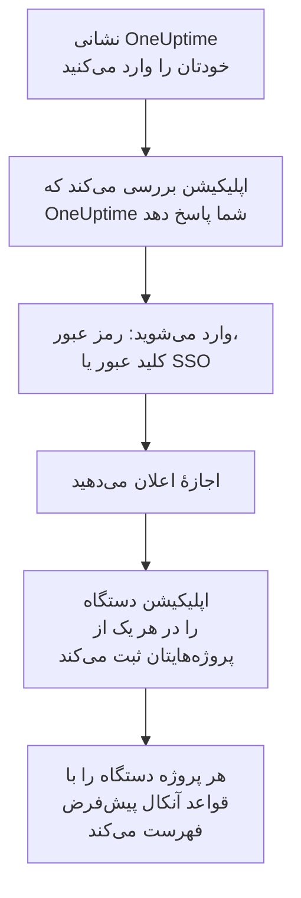

# نصب روی iOS

**OneUptime On-Call** را از App Store روی یک iPhone یا iPad نصب کنید، آن را به OneUptime خودتان وصل کنید و وارد شوید. سپس برای خودتان یک اعلان آزمایشی بفرستید، و بگذارید فراخوان‌های فوری آنکال از حالت بی‌صدا و تمرکز عبور کنند و زنگ بزنند.

:::cards
- [اپلیکیشن را نصب کنید](#اپلیکیشن-را-نصب-کنید): از App Store.
- [وارد شوید](#وارد-شوید): نخست نشانی OneUptime شما، سپس حساب شما.
- [بررسی کنید که فراخوان‌ها به دستگاه می‌رسند](#بررسی-کنید-که-فراخوانها-به-دستگاه-میرسند): آن را در داشبورد پیدا کنید و بیازمایید.
- [زنگ زدن با وجود حالت بی‌صدا](#زنگ-زدن-با-وجود-حالت-بیصدا): هشدارهای بحرانی، صدای زنگ هشدار و بلندی آن.
- [رفع اشکال](#رفع-اشکال): مشکلات ورود، اعلان و هشدار بحرانی.
:::

## پیش از شروع

- یک iPhone با iOS 16.4 یا جدیدتر، یا یک iPad با iPadOS 16.4 یا جدیدتر.
- یک حساب در یک پروژهٔ OneUptime. برای اینکه فراخوانده شوید، باید آنکال هم باشید: [قواعد تشدید](/docs/on-call/escalation-rules) را ببینید.
- نشانی OneUptime شما: `https://oneuptime.com` در OneUptime Cloud، یا نشانی خودتان، مانند `https://oneuptime.example.com`. اپلیکیشن فقط روی HTTPS وصل می‌شود.

## اپلیکیشن را نصب کنید

1. روی iPhone یا iPad، [OneUptime On-Call در App Store](https://apps.apple.com/us/app/oneuptime-on-call/id6759615391) را باز کنید، یا در App Store دنبال OneUptime On-Call بگردید.
2. روی **Get** ضربه بزنید، و با Face ID، Touch ID یا رمز عبور حساب Apple خود تأیید کنید.
3. روی **Open** ضربه بزنید، یا OneUptime On-Call را از صفحهٔ اصلی باز کنید.

تا وقتی **App Updates** زیر **Settings** > **App Store** روشن است، App Store اپلیکیشن را به‌روز نگه می‌دارد.

## وارد شوید



:::steps
### نشانی OneUptime خودتان را وارد کنید
اپلیکیشن را باز کنید. در **Connect your workspace**، برای OneUptime Cloud نشانی `https://oneuptime.com` را نگه دارید، یا نشانی OneUptime خودتان را وارد کنید، و روی **Connect** ضربه بزنید. اپلیکیشن به محض اینکه `https://<your-oneuptime>/api/status` پاسخ دهد ادامه می‌دهد.

### به حساب خود وارد شوید
از هر روشی که حساب شما با آن وارد می‌شود استفاده کنید:

- ایمیل و رمز عبورتان، سپس **Sign In**. **Forgot password?** پیوندی برای گذاشتن رمز عبور تازه برایتان ایمیل می‌کند.
- **Sign in with a passkey**، وقتی در داشبورد یک کلید عبور اضافه کرده باشید: [یک کلید عبور اضافه کنید](/docs/introduction/your-account#یک-کلید-عبور-اضافه-کنید) را ببینید. یک برگهٔ مرورگر برای تأیید آن باز می‌شود، سپس شما را برمی‌گرداند.
- **Sign in with SSO**، اگر سازمانتان از ورود یکپارچه استفاده می‌کند. ارائه‌دهندهٔ خود را انتخاب کنید، یا ایمیل کاری‌تان را وارد کنید و روی **Continue** ضربه بزنید. یک مرورگر امن باز می‌شود، و پس از ورود به اپلیکیشن برمی‌گردید.

اگر احراز هویت دومرحله‌ای روشن است، کد شش‌رقمی برنامهٔ احراز هویت خود، یا یکی از کدهای پشتیبانتان را وارد کنید. کلید امنیتی را نمی‌توان در اپلیکیشن به کار برد. اگر مدیرتان احراز هویت دومرحله‌ای را الزامی کرده و شما هنوز آن را راه نینداخته‌اید، اپلیکیشن نخست همراه شما یک برنامهٔ احراز هویت راه می‌اندازد.

### اجازهٔ اعلان بدهید
وقتی iOS پرسید که آیا OneUptime On-Call می‌تواند برایتان اعلان بفرستد، روی **Allow** ضربه بزنید.

سپس اپلیکیشن iPhone یا iPad را در هر یک از پروژه‌هایتان ثبت می‌کند. هر پروژه آن را با قواعد آنکال پیش‌فرض در میان دستگاه‌های پوش شما فهرست می‌کند، پس از این پس فراخوان‌هایتان به آن می‌رسند.
:::

اپلیکیشن هر بار یک پروژه را نشان می‌دهد: برای جابه‌جایی، روی نام پروژه در بالای صفحه ضربه بزنید. پروژه‌ای که ورود یکپارچه را الزامی می‌کند، زیر **Settings** > **Manage Projects** عبارت **SSO Required** را نشان می‌دهد، تا وقتی که آنجا روی **Authenticate with SSO** ضربه بزنید.

## بررسی کنید که فراخوان‌ها به دستگاه می‌رسند

:::steps
### دستگاه را در داشبورد پیدا کنید
در داشبورد، **تنظیمات کاربر** > **روش‌های اعلان** و زبانهٔ **Push Notifications** را باز کنید. iPhone یا iPad زیر **دستگاه‌های اعلان پوش** با نام مدلش فهرست شده است. هر پروژه فهرست خودش را دارد.

### یک آزمایش بفرستید
در ردیف دستگاه روی **اعلان آزمایشی** کلیک کنید. یک اعلان روی دستگاه می‌رسد؛ برای باز کردن اپلیکیشن روی آن ضربه بزنید.
:::

قواعد آنکال شما تعیین می‌کنند کدام فراخوان‌ها به دستگاه بروند، و با چه سرعتی: **تنظیمات کاربر** > **قواعد آنکال** را ببینید. یک دستگاه تازه همان قواعد پیش‌فرض هر روش دیگری را می‌گیرد که اضافه می‌کنید.

## زنگ زدن با وجود حالت بی‌صدا

به‌طور پیش‌فرض یک فراخوان آنکال از تنظیمات صدای دستگاه پیروی می‌کند: حالت بی‌صدا آن را ساکت نگه می‌دارد، و یک تمرکز مانند مزاحم نشوید آن را نگه می‌دارد. هشدارهای بحرانی می‌گذارند فراخوان‌های آنکال از هر دو عبور کنند و زنگ بزنند. تا وقتی آن‌ها را روشن نکنید خاموش‌اند، برای هر دستگاه جداگانه.

```mermaid title="آیا یک فراخوان آنکال روی iPhone یا iPad با وجود بی‌صدا زنگ می‌زند"
flowchart TB
    Page["یک فراخوان آنکال<br/>برای این دستگاه"]
    Rule{"قاعده روی<br/>هشدار بحرانی است؟"}
    Device{"Critical On-Call<br/>Alerts روشن است؟"}
    Quiet["از صدای دستگاه<br/>و تمرکز پیروی<br/>می‌کند"]
    Loud["زنگ هشدار شما را با<br/>بلندی دلخواهتان، با<br/>وجود حالت بی‌صدا و<br/>تمرکز پخش می‌کند"]
    Page --> Rule
    Rule -->|"خیر: عادی"| Quiet
    Rule -->|"بله"| Device
    Device -->|"خیر"| Quiet
    Device -->|"بله"| Loud
```

:::steps
### Critical On-Call Alerts را روشن کنید
در اپلیکیشن، **Settings** را باز کنید و زیر **Notifications** گزینهٔ **Critical On-Call Alerts** را روشن کنید.

### هشدارهای بحرانی را مجاز کنید
وقتی iOS پرسید که آیا OneUptime On-Call می‌تواند هشدار بحرانی بفرستد، روی **Allow** ضربه بزنید. سپس iOS یک کلید **Critical Alerts** برای اپلیکیشن زیر **Settings** > **Notifications** > **OneUptime On-Call** اضافه می‌کند، که بعداً می‌توانید آنجا نظرتان را عوض کنید. سطر زیر کلید اپلیکیشن می‌گوید که آیا فراخوان‌ها با وجود بی‌صدا زنگ می‌زنند یا نه.

### یک صدای زنگ هشدار و بلندی آن را انتخاب کنید
روی **Alarm sound** زیر کلید ضربه بزنید. افزون بر صدای هشدار بحرانیِ خود دستگاه، Klaxon، Siren، Digital alarm، Smoke alarm و Rising alarm را پیشنهاد می‌کند که آرام شروع می‌شود و بلندتر می‌شود. برای شنیدن هر صدا، دکمهٔ پخش کنار آن را بزنید. سپس بلندی‌ای را انتخاب کنید که فراخوان با آن پخش می‌شود: ۲۵٪، ۵۰٪، ۷۵٪ یا ۱۰۰٪، که پیش‌فرض است.
:::

فقط فراخوان‌های آنکال با وجود بی‌صدا زنگ می‌زنند، و فقط از قواعد آنکالی که روی **هشدار بحرانی** تنظیم شده‌اند، که پیش‌فرض است. قاعده‌ای که روی **عادی** تنظیم شده، هر چه کلید بگوید، از تنظیمات دستگاه پیروی می‌کند، تا برای یک حادثهٔ بحرانی بیدار شوید و برای حادثه‌ای جزئی بی‌صدا فراخوانده شوید. با دستگاهِ بی‌صدا یک **اعلان آزمایشی** بفرستید تا بشنوید یک فراخوان چه خواهد کرد. پیش‌نمایش در صفحهٔ **Alarm sound** با بلندی زنگ تماس پخش می‌شود، و در حالت بی‌صدا اصلاً پخش نمی‌شود؛ یک فراخوان واقعی با بلندی‌ای که انتخاب کرده‌اید از حالت بی‌صدا عبور می‌کند.

> [!NOTE]
> هشدارهای بحرانی به OneUptime On-Call نسخهٔ 1.5.0 یا جدیدتر از App Store نیاز دارند. نسخه‌های قدیمی‌تر بدون مجوز Apple برای هشدارهای بحرانی ساخته شده بودند، پس iOS هرگز این کلید را به آن‌ها پیشنهاد نکرد.

## جلوگیری از نگه داشته شدن فراخوان‌ها

بدون هشدارهای بحرانی، یک تمرکز یا یک خلاصه می‌تواند فراخوان‌ها را نگه دارد:

- **تمرکز.** زیر **Settings** > **Focus**، اپلیکیشن OneUptime On-Call را به اپلیکیشن‌هایی اضافه کنید که هر تمرکز مجاز می‌داند.
- **خلاصهٔ زمان‌بندی‌شده.** زیر **Settings** > **Notifications** > **Scheduled Summary**، اپلیکیشن OneUptime On-Call را بیرون از آن نگه دارید: اعلانی که در خلاصه می‌رود تا نوبت بعدی خلاصه منتظر می‌ماند.
- **اعلان‌ها.** زیر **Settings** > **Notifications** > **OneUptime On-Call**، گزینهٔ **Allow Notifications** را روشن نگه دارید.

## قفل کردن اپلیکیشن

**Biometrics Login** را زیر **Settings** در اپلیکیشن روشن کنید، تا اپلیکیشن هر بار که شروع می‌شود Face ID، Touch ID یا گذرواژهٔ دستگاه را بخواهد. این کلید وقتی نمایش داده می‌شود که Face ID یا Touch ID روی دستگاه راه‌اندازی شده باشد. **Appearance**، در همان صفحه، ظاهر روشن یا تیره را انتخاب می‌کند، یا از دستگاه پیروی می‌کند.

## به‌روزرسانی، خروج یا حذف اپلیکیشن

- **به‌روزرسانی.** App Store اپلیکیشن را به‌روز می‌کند؛ می‌توانید آن را از حساب خود در App Store هم به‌روز کنید. نسخهٔ اپلیکیشن در پایین صفحهٔ **Settings** آن است.
- **خروج.** **Settings** > **Log Out** شما را خارج می‌کند و دستگاه را از دستگاه‌های پوش شما در همهٔ پروژه‌ها، همراه با قواعد آنکالش، حذف می‌کند. ورود دوباره آن را با قواعد پیش‌فرض بازمی‌گرداند.
- **حذف.** نماد اپلیکیشن را لمس کنید و نگه دارید، سپس روی **Remove App** و **Delete App** ضربه بزنید. اگر هنوز وارد بودید، دستگاه تا وقتی پوشی به آن شکست بخورد در فهرست شما می‌ماند: آنگاه OneUptime آن را **اعلان دریافت نمی‌شود** علامت می‌زند. نصب دوبارهٔ اپلیکیشن و ورود معمولاً همان مدخل را همراه با قواعدش بازمی‌گرداند؛ اگر دیگر با آن دستگاه کاری ندارید، مدخل را با **حذف** پاک کنید.

## رفع اشکال

:::details «Could not connect to the server»
اپلیکیشن نتوانست به `https://<your-oneuptime>/api/status` برسد. نشانی را، همراه با `https://`، بررسی کنید. اگر OneUptime شما روی یک شبکهٔ خصوصی است، نخست دستگاه را به آن وصل کنید، برای نمونه از راه VPN. آن نشانی را در Safari روی دستگاه باز کنید: وقتی دستگاه بتواند به OneUptime برسد، `{"status":"ok"}` را نشان می‌دهد.
:::

:::details هیچ اعلانی نمی‌رسد
- بررسی کنید که **Allow Notifications** زیر **Settings** > **Notifications** > **OneUptime On-Call** روشن باشد، و هیچ تمرکزی فراخوان‌ها را نگه ندارد.
- بررسی کنید که دستگاه زیر **Push Notifications** در **تنظیمات کاربر** > **روش‌های اعلان** فهرست شده باشد، و یک **اعلان آزمایشی** برایش بفرستید.
- اگر دستگاه **اعلان دریافت نمی‌شود** علامت خورده است، اپلیکیشن را در حالی که وارد هستید باز کنید. اپلیکیشن دستگاه را دوباره ثبت می‌کند؛ [وقتی یک گوشی باید دوباره ثبت شود](/docs/mobile-desktop-apps/faq-troubleshooting#وقتی-یک-گوشی-باید-دوباره-ثبت-شود) را ببینید.
- قواعد آنکال خود را زیر **تنظیمات کاربر** > **قواعد آنکال** بررسی کنید.
- در یک OneUptime خودمیزبان، بررسی کنید که سرورتان به رلهٔ پوش خود برسد: [اعلان‌های پوش](/docs/self-hosted/push-notifications#دسترسی-شبکه) را ببینید.
:::

:::details کلید Critical Alerts در تنظیمات iOS نیست
نخست **Critical On-Call Alerts** را در اپلیکیشن روشن کنید: iOS کلید خود را فقط پس از آنکه اپلیکیشن هشدارهای بحرانی را درخواست کرده باشد اضافه می‌کند. اگر اپلیکیشن می‌گوید این نسخه نمی‌تواند هشدار بحرانی دریافت کند، OneUptime On-Call را از App Store به‌روز کنید.
:::

:::details هشدارهای بحرانی ساکت می‌مانند
**Settings** اپلیکیشن را باز کنید: سطر زیر **Critical On-Call Alerts** می‌گوید چه چیزی کم است. بررسی کنید که **Critical Alerts** زیر **Settings** > **Notifications** > **OneUptime On-Call** روشن باشد، و بلندی در صفحهٔ **Alarm sound** اپلیکیشن پایین تنظیم نشده باشد.
:::

:::details کلید Biometrics Login نیست
این کلید وقتی نمایش داده می‌شود که Face ID یا Touch ID زیر **Settings** > **Face ID & Passcode** یا **Settings** > **Touch ID & Passcode** راه‌اندازی شده باشد.
:::

## گام‌های بعدی

:::cards
- [پرسش‌های متداول و رفع اشکال](/docs/mobile-desktop-apps/faq-troubleshooting): وقتی یک گوشی دیگر فراخوان نمی‌گیرد چه کنید.
- [نصب روی Android](/docs/mobile-desktop-apps/android-installation): همین اپلیکیشن روی Android.
- [قواعد تشدید](/docs/on-call/escalation-rules): تعیین کنید چه کسی و کی فراخوانده شود.
- [اعلان‌های پوش](/docs/self-hosted/push-notifications): یک OneUptime خودمیزبان چگونه به گوشی‌ها فراخوان می‌فرستد.
:::
