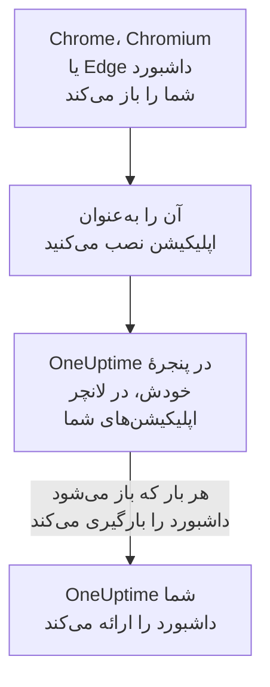

# نصب روی Linux

داشبورد OneUptime روی Linux به‌عنوان یک اپلیکیشن، از Google Chrome، Chromium یا Microsoft Edge، نصب می‌شود. در پنجرهٔ خودش باز می‌شود، با مدخل خودش در لانچر اپلیکیشن‌های دسکتاپ شما، و می‌تواند اعلان نشان دهد. چیزی برای دانلود نیست: اپلیکیشن همان داشبورد OneUptime شماست، و هر وقت OneUptime شما به‌روز باشد، آن هم به‌روز است.

:::cards
- [اپلیکیشن را نصب کنید](#اپلیکیشن-را-نصب-کنید): از Chrome، Chromium یا Edge.
- [آن را از لانچر خود باز کنید](#آن-را-از-لانچر-خود-باز-کنید): مانند هر اپلیکیشن دسکتاپ دیگری.
- [روی این رایانه اعلان بگیرید](#روی-این-رایانه-اعلان-بگیرید): مرورگر را برای اعلان‌های پوش ثبت کنید.
- [رفع اشکال](#رفع-اشکال): نبودِ نماد نصب، نبودِ اعلان، نبودِ مدخل در لانچر.
:::

## اپلیکیشن دسکتاپ چگونه کار می‌کند

اپلیکیشن نصب‌شده ورود، تنظیمات و مجوز اعلانِ مرورگرش را با آن شریک است. مرورگر را ببندید و اپلیکیشن در پنجرهٔ خودش به کار ادامه می‌دهد.

## پیش از شروع

- یک دسکتاپ Linux با یک Google Chrome، Chromium یا Microsoft Edge تازه.
- نشانی OneUptime شما، روی HTTPS: `https://oneuptime.com` در OneUptime Cloud، یا نشانی خودتان، مانند `https://oneuptime.example.com`.
- حسابی که با آن بتوانید به داشبورد وارد شوید.

## اپلیکیشن را نصب کنید

:::tabs
@tab Chrome
1. OneUptime خودتان را در Chrome یا Chromium باز کنید، و وارد شوید.
2. در هر صفحه‌ای از داشبورد، روی نماد نصب در سمت راست نوار نشانی کلیک کنید، سپس روی **نصب**. یا **⋮** > **پخش محتوا، ذخیره، و هم‌رسانی** > **نصب صفحه به‌عنوان برنامه…** را باز کنید.
3. Chrome اپلیکیشن OneUptime را در پنجرهٔ خودش باز می‌کند، و آن را به لانچر اپلیکیشن‌های شما اضافه می‌کند.
@tab Edge
1. OneUptime خودتان را در Edge باز کنید، و وارد شوید.
2. در هر صفحه‌ای از داشبورد، روی نماد نصب در سمت راست نوار نشانی کلیک کنید، سپس روی **نصب**. یا **تنظیمات و موارد بیشتر (…)** > **ابزارهای بیشتر** > **برنامه‌ها** > **نصب این سایت به‌عنوان برنامه** را باز کنید.
3. Edge اپلیکیشن OneUptime را در پنجرهٔ خودش باز می‌کند، و آن را به لانچر اپلیکیشن‌های شما اضافه می‌کند.
:::

پس از ورود، از یک صفحهٔ داشبورد نصب کنید: صفحهٔ ورود، اپلیکیشن نیست.

## آن را از لانچر خود باز کنید

مرورگر یک مدخل دسکتاپ برای اپلیکیشن اضافه می‌کند، یک فایل `.desktop` در `~/.local/share/applications`، پس OneUptime در GNOME، KDE Plasma و لانچرهای دیگر نمایش داده می‌شود. از همان‌جا، مانند هر اپلیکیشن دیگری، آن را به داک یا پنل خود سنجاق کنید.

## روی این رایانه اعلان بگیرید

اپلیکیشن اعلان‌ها را از راه مرورگرش نشان می‌دهد، وقتی مرورگر را در هر پروژه‌ای که از آن اعلان می‌خواهید برای اعلان‌های پوش ثبت کنید.

:::steps
### دستگاه‌های پوش خود را باز کنید
در اپلیکیشن، **تنظیمات کاربر** > **روش‌های اعلان** و زبانهٔ **Push Notifications** را باز کنید.

### این مرورگر را ثبت کنید
روی **ثبت دستگاه** کلیک کنید، **نام دستگاه** پیشنهادی را، مانند `Chrome on Linux`، نگه دارید یا تغییر دهید، و دوباره روی **ثبت دستگاه** کلیک کنید. وقتی مرورگر پرسید که آیا OneUptime می‌تواند اعلان نشان دهد، **اجازه دادن** را انتخاب کنید.

### یک آزمایش بفرستید
در کادر **Browser Registered**، روی **Send Test Notification** کلیک کنید. دسکتاپ شما آن را از راه سرویس اعلانش نشان می‌دهد؛ اگر چیزی ظاهر نشد، [رفع اشکال](#رفع-اشکال) را ببینید.
:::

مرورگر نمی‌تواند از مزاحم نشویدِ دسکتاپ شما عبور کند و زنگ بزند. برای فراخوان‌هایی که باید بیدارتان کنند، از اپلیکیشن موبایل با هشدارهای بحرانی استفاده کنید: [نصب روی Android](/docs/mobile-desktop-apps/android-installation#زنگ-زدن-با-وجود-حالت-بیصدا) را ببینید.

در یک OneUptime خودمیزبان، اعلان‌های مرورگر به کلیدهای VAPID سرور نیاز دارند: [اعلان‌های پوش](/docs/self-hosted/push-notifications#راهاندازی-خودمیزبان) را ببینید.

## به‌روزرسانی‌ها

چیزی برای به‌روزرسانی نیست. اپلیکیشن هر بار که باز می‌شود داشبورد را از OneUptime شما بارگیری می‌کند، پس وقتی OneUptime شما ارتقا می‌یابد تغییر می‌کند. اگر پنجره‌ای از پیش از ارتقا باز مانده است، آن را با Ctrl+R دوباره بارگیری کنید.

## حذف نصب

:::tabs
@tab Chrome
در پنجرهٔ اپلیکیشن، منوی **⋮** را باز کنید، گزینه‌ای را که اپلیکیشن را حذف نصب می‌کند انتخاب کنید، سپس **برداشتن** را.
@tab Edge
در Edge نشانی `edge://apps` را باز کنید، روی OneUptime گزینهٔ **جزئیات** را انتخاب کنید، سپس **حذف نصب** را.
:::

حذف نصب اپلیکیشن ثبت مرورگرش را لغو نمی‌کند: مرورگر هنوز اعلان دریافت می‌کند. برای متوقف کردن آن‌ها، مرورگر را زیر **تنظیمات کاربر** > **روش‌های اعلان**، در زبانهٔ **Push Notifications**، با **حذف** پاک کنید.

## رفع اشکال

:::details نماد نصب در نوار نشانی نیست
پس از ورود یک صفحهٔ داشبورد را باز کنید، نه صفحهٔ ورود را، و بررسی کنید که نشانی با `https://` شروع شود: مرورگرها فقط از سایت‌های امن اپلیکیشن نصب می‌کنند. اگر نماد باز هم نمایش داده نشد، از منوی مرورگر، مانند بالا، استفاده کنید. مرورگرهای دیگر شاید سایت‌ها را به‌عنوان اپلیکیشن نصب نکنند؛ از Chrome، Chromium یا Edge استفاده کنید.
:::

:::details هیچ اعلانی ظاهر نمی‌شود
- در **تنظیمات کاربر** > **روش‌های اعلان**، در زبانهٔ **Push Notifications**، بررسی کنید که این مرورگر فهرست شده باشد، و یک **اعلان آزمایشی** برایش بفرستید.
- بررسی کنید که مزاحم نشویدِ دسکتاپ شما خاموش باشد، و تنظیمات اعلانش مرورگر را مجاز بداند.
- اگر مرورگر اعلان‌های OneUptime را مسدود می‌کند، روی نماد سمت چپ نوار نشانی کلیک کنید، اعلان‌ها را برای سایت مجاز کنید، و مرورگر را دوباره ثبت کنید.
- در یک OneUptime خودمیزبان، کادر **ثبت دستگاه** می‌گوید که سرور کلیدهای VAPID ندارد.
:::

:::details اپلیکیشن در لانچر نیست
به‌جای آن، آن را از مرورگر باز کنید: `chrome://apps` در Chrome یا Chromium، و `edge://apps` در Edge. لانچری که مدخل‌های دسکتاپ را فقط هنگام ورود می‌خواند، پس از خروج و ورود دوباره آن را نشان می‌دهد.
:::

## گام‌های بعدی

:::cards
- [نصب روی Android](/docs/mobile-desktop-apps/android-installation): روی گوشی‌تان، با هشدارهای بحرانی، فراخوانده شوید.
- [نصب روی Windows](/docs/mobile-desktop-apps/windows-installation): همین اپلیکیشن روی Windows.
- [پرسش‌های متداول و رفع اشکال](/docs/mobile-desktop-apps/faq-troubleshooting): پاسخ‌هایی دربارهٔ هر دو اپلیکیشن.
- [حساب کاربری شما](/docs/introduction/your-account): OneUptime چگونه در هر پروژه به شما می‌رسد.
:::
