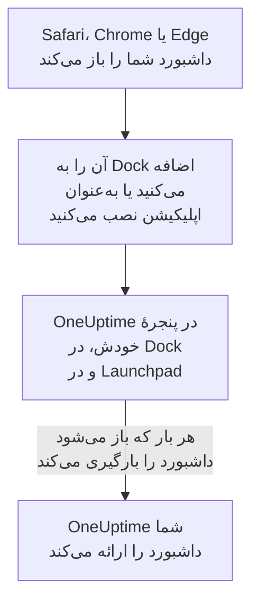

# نصب روی macOS

داشبورد OneUptime روی Mac به‌عنوان یک اپلیکیشن نصب می‌شود: آن را از Safari به Dock اضافه کنید، یا از Google Chrome یا Microsoft Edge نصبش کنید. در پنجرهٔ خودش باز می‌شود، با نماد خودش در Dock و در Launchpad، و می‌تواند اعلان نشان دهد. چیزی برای دانلود نیست: اپلیکیشن همان داشبورد OneUptime شماست، و هر وقت OneUptime شما به‌روز باشد، آن هم به‌روز است.

:::cards
- [اپلیکیشن را نصب کنید](#اپلیکیشن-را-نصب-کنید): از Safari، Chrome یا Edge.
- [آن را در Dock نگه دارید](#آن-را-در-dock-نگه-دارید): با یک کلیک، یا هنگام ورود، بازش کنید.
- [روی این Mac اعلان بگیرید](#روی-این-mac-اعلان-بگیرید): اپلیکیشن را برای اعلان‌های پوش ثبت کنید.
- [رفع اشکال](#رفع-اشکال): نبودِ Add to Dock، نبودِ اعلان، ورود دوباره.
:::

## اپلیکیشن دسکتاپ چگونه کار می‌کند

یک وب‌اپلیکیشن Safari ورود، کوکی‌ها و تنظیمات خودش را دارد، جدا از Safari. اپلیکیشنی که از Chrome یا Edge نصب شده، آن‌ها را با همان مرورگر شریک است.

## پیش از شروع

- macOS Sonoma 14 یا جدیدتر برای Safari. Chrome و Edge روی هر نسخه‌ای از macOS که رویش اجرا شوند اپلیکیشن نصب می‌کنند.
- نشانی OneUptime شما، روی HTTPS: `https://oneuptime.com` در OneUptime Cloud، یا نشانی خودتان، مانند `https://oneuptime.example.com`.
- حسابی که با آن بتوانید به داشبورد وارد شوید.

## اپلیکیشن را نصب کنید

:::tabs
@tab Safari
1. OneUptime خودتان را در Safari باز کنید، و وارد شوید.
2. در هر صفحه‌ای از داشبورد، **File** > **Add to Dock** را انتخاب کنید، یا روی دکمهٔ اشتراک‌گذاری در نوار ابزار و سپس **Add to Dock** کلیک کنید.
3. نام را نگه دارید یا تغییر دهید، و روی **Add** کلیک کنید.
4. OneUptime را از Dock باز کنید، و یک بار دیگر وارد شوید: وب‌اپلیکیشن ورود Safari را شریک نیست.
@tab Chrome
1. OneUptime خودتان را در Chrome باز کنید، و وارد شوید.
2. در هر صفحه‌ای از داشبورد، روی نماد نصب در سمت راست نوار نشانی کلیک کنید، سپس روی **نصب**. یا **⋮** > **Cast, save, and share** > **Install page as app…** را باز کنید.
3. Chrome اپلیکیشن OneUptime را در پنجرهٔ خودش باز می‌کند، و آن را به Launchpad اضافه می‌کند.
@tab Edge
1. OneUptime خودتان را در Edge باز کنید، و وارد شوید.
2. در هر صفحه‌ای از داشبورد، روی نماد نصب در سمت راست نوار نشانی کلیک کنید، سپس روی **نصب**. یا **Settings and more (…)** > **More tools** > **Apps** > **Install this site as an app** را باز کنید.
3. Edge اپلیکیشن OneUptime را در پنجرهٔ خودش باز می‌کند، و آن را به Launchpad اضافه می‌کند.
:::

پس از ورود، از یک صفحهٔ داشبورد نصب کنید: صفحهٔ ورود، اپلیکیشن نیست. Safari وب‌اپلیکیشن را در پوشهٔ Applications درون پوشهٔ خانگی شما ذخیره می‌کند.

## آن را در Dock نگه دارید

- **Dock.** وقتی اپلیکیشن باز است، با نگه داشتن Control روی نماد آن در Dock کلیک کنید و **Options** > **Keep in Dock** را انتخاب کنید. یک وب‌اپلیکیشن Safari از پیش در Dock است.
- **باز شدن هنگام ورود.** با نگه داشتن Control روی نماد Dock کلیک کنید و **Options** > **Open at Login** را انتخاب کنید.
- **Spotlight.** کلیدهای Command-Space را بزنید و OneUptime را تایپ کنید.

## روی این Mac اعلان بگیرید

اپلیکیشن وقتی اعلان نشان می‌دهد که آن را در هر پروژه‌ای که از آن اعلان می‌خواهید برای اعلان‌های پوش ثبت کنید. وب‌اپلیکیشن Safari را از درون خود وب‌اپلیکیشن ثبت کنید: خودش یک مرورگر جداست. اپلیکیشنی که از Chrome یا Edge نصب شده، با مرورگرش ثبت می‌شود.

:::steps
### دستگاه‌های پوش خود را باز کنید
در اپلیکیشن، **تنظیمات کاربر** > **روش‌های اعلان** و زبانهٔ **Push Notifications** را باز کنید.

### این اپلیکیشن را ثبت کنید
روی **ثبت دستگاه** کلیک کنید، **نام دستگاه** پیشنهادی را، مانند `Safari on macOS`، نگه دارید یا تغییر دهید، و دوباره روی **ثبت دستگاه** کلیک کنید. وقتی macOS یا مرورگر پرسید که آیا OneUptime می‌تواند اعلان بفرستد، **Allow** را انتخاب کنید.

### یک آزمایش بفرستید
در کادر **Browser Registered**، روی **Send Test Notification** کلیک کنید. اگر چیزی ظاهر نشد، به تنظیمات اعلان Mac نگاه کنید: [رفع اشکال](#رفع-اشکال) را ببینید.
:::

مرورگر نمی‌تواند از یک تمرکز مانند مزاحم نشوید عبور کند و زنگ بزند. برای فراخوان‌هایی که باید بیدارتان کنند، از اپلیکیشن موبایل با هشدارهای بحرانی استفاده کنید: [نصب روی iOS](/docs/mobile-desktop-apps/ios-installation#زنگ-زدن-با-وجود-حالت-بیصدا) را ببینید.

در یک OneUptime خودمیزبان، اعلان‌های مرورگر به کلیدهای VAPID سرور نیاز دارند: [اعلان‌های پوش](/docs/self-hosted/push-notifications#راهاندازی-خودمیزبان) را ببینید.

## به‌روزرسانی‌ها

چیزی برای به‌روزرسانی نیست. اپلیکیشن هر بار که باز می‌شود داشبورد را از OneUptime شما بارگیری می‌کند، پس وقتی OneUptime شما ارتقا می‌یابد تغییر می‌کند. اگر پنجره‌ای از پیش از ارتقا باز مانده است، آن را با Command-R دوباره بارگیری کنید.

## حذف نصب

:::tabs
@tab Safari
در Finder پوشهٔ خانگی خود را باز کنید، سپس پوشهٔ Applications آن را، و OneUptime را به Trash بکشید.
@tab Chrome
در پنجرهٔ اپلیکیشن، منوی **⋮** را باز کنید، گزینه‌ای را که اپلیکیشن را حذف نصب می‌کند انتخاب کنید، سپس **Remove** را.
@tab Edge
در Edge نشانی `edge://apps` را باز کنید، روی OneUptime گزینهٔ **Details** را انتخاب کنید، سپس **Uninstall** را.
:::

حذف نصب اپلیکیشن ثبت آن را لغو نمی‌کند: مرورگرش هنوز اعلان دریافت می‌کند. برای متوقف کردن آن‌ها، آن را زیر **تنظیمات کاربر** > **روش‌های اعلان**، در زبانهٔ **Push Notifications**، با **حذف** پاک کنید.

## رفع اشکال

:::details گزینهٔ Add to Dock در Safari نیست
Safari از macOS Sonoma 14 به بعد وب‌اپلیکیشن‌ها را به Dock اضافه می‌کند. macOS را به‌روز کنید، یا به‌جای آن اپلیکیشن را از Chrome یا Edge نصب کنید.
:::

:::details هیچ اعلانی ظاهر نمی‌شود
- در **تنظیمات کاربر** > **روش‌های اعلان**، در زبانهٔ **Push Notifications**، بررسی کنید که اپلیکیشن یا مرورگرش فهرست شده باشد، و یک **اعلان آزمایشی** بفرستید.
- روی Mac، **System Settings** > **Notifications** را باز کنید و بررسی کنید که OneUptime، یا مرورگری که از آن نصب شده، اجازهٔ فرستادن اعلان داشته باشد، و هیچ تمرکزی آن‌ها را نگه ندارد.
- اگر مرورگر اعلان‌های OneUptime را مسدود می‌کند، آن‌ها را در تنظیمات مرورگر برای این سایت مجاز کنید، و دوباره ثبت کنید.
- در یک OneUptime خودمیزبان، کادر **ثبت دستگاه** می‌گوید که سرور کلیدهای VAPID ندارد.
:::

:::details اپلیکیشن از شما می‌خواهد دوباره وارد شوید
یک وب‌اپلیکیشن Safari ورود خودش را دارد: درون اپلیکیشن وارد شوید. اپلیکیشنی که از Chrome یا Edge نصب شده ورود مرورگرش را شریک است، پس خروج در مرورگر، یا پاک کردن کوکی‌هایش، آن را هم خارج می‌کند.
:::

## گام‌های بعدی

:::cards
- [نصب روی iOS](/docs/mobile-desktop-apps/ios-installation): روی iPhone خود، با هشدارهای بحرانی، فراخوانده شوید.
- [نصب روی Windows](/docs/mobile-desktop-apps/windows-installation): همین اپلیکیشن روی Windows.
- [پرسش‌های متداول و رفع اشکال](/docs/mobile-desktop-apps/faq-troubleshooting): پاسخ‌هایی دربارهٔ هر دو اپلیکیشن.
- [حساب کاربری شما](/docs/introduction/your-account): OneUptime چگونه در هر پروژه به شما می‌رسد.
:::
