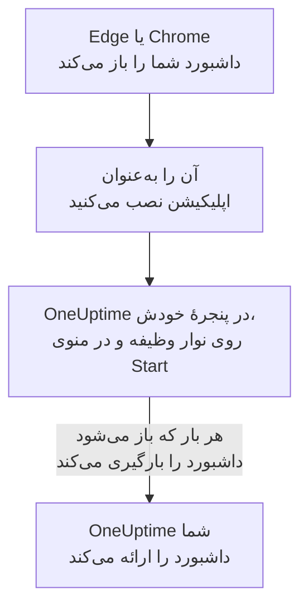

# نصب روی Windows

داشبورد OneUptime روی Windows به‌عنوان یک اپلیکیشن، از Microsoft Edge یا Google Chrome، نصب می‌شود. در پنجرهٔ خودش باز می‌شود، با نماد خودش روی نوار وظیفه و در منوی Start، و می‌تواند اعلان نشان دهد. چیزی برای دانلود نیست: اپلیکیشن همان داشبورد OneUptime شماست، و هر وقت OneUptime شما به‌روز باشد، آن هم به‌روز است.

:::cards
- [اپلیکیشن را نصب کنید](#اپلیکیشن-را-نصب-کنید): از Edge یا Chrome، با چند کلیک.
- [آن را سنجاق کنید و با Windows شروع کنید](#آن-را-سنجاق-کنید-و-با-windows-شروع-کنید): آن را در یک کلیکی نگه دارید.
- [روی این رایانه اعلان بگیرید](#روی-این-رایانه-اعلان-بگیرید): مرورگر را برای اعلان‌های پوش ثبت کنید.
- [رفع اشکال](#رفع-اشکال): نبودِ نماد نصب، نبودِ اعلان، ورود دوباره.
:::

## اپلیکیشن دسکتاپ چگونه کار می‌کند

اپلیکیشن نصب‌شده ورود، تنظیمات و مجوز اعلانِ مرورگرش را با آن شریک است. مرورگر را ببندید و اپلیکیشن در پنجرهٔ خودش به کار ادامه می‌دهد.

## پیش از شروع

- Windows 10 یا Windows 11، با یک Microsoft Edge یا Google Chrome تازه.
- نشانی OneUptime شما، روی HTTPS: `https://oneuptime.com` در OneUptime Cloud، یا نشانی خودتان، مانند `https://oneuptime.example.com`.
- حسابی که با آن بتوانید به داشبورد وارد شوید.

## اپلیکیشن را نصب کنید

:::tabs
@tab Edge
1. OneUptime خودتان را در Edge باز کنید، و وارد شوید.
2. در هر صفحه‌ای از داشبورد، روی نماد نصب در سمت راست نوار نشانی کلیک کنید، سپس روی **نصب**. یا **تنظیمات و موارد بیشتر (…)** > **ابزارهای بیشتر** > **برنامه‌ها** > **نصب این سایت به‌عنوان برنامه** را باز کنید.
3. Edge اپلیکیشن OneUptime را در پنجرهٔ خودش باز می‌کند، و ممکن است پیشنهاد کند آن را به نوار وظیفه یا Start سنجاق کنید.
@tab Chrome
1. OneUptime خودتان را در Chrome باز کنید، و وارد شوید.
2. در هر صفحه‌ای از داشبورد، روی نماد نصب در سمت راست نوار نشانی کلیک کنید، سپس روی **نصب**. یا **⋮** > **پخش محتوا، ذخیره، و هم‌رسانی** > **نصب صفحه به‌عنوان برنامه…** را باز کنید.
3. Chrome اپلیکیشن OneUptime را در پنجرهٔ خودش باز می‌کند و آن را به منوی Start اضافه می‌کند.
:::

پس از ورود، از یک صفحهٔ داشبورد نصب کنید: صفحهٔ ورود، اپلیکیشن نیست. برای باز کردن آن در آینده، در منوی Start دنبال OneUptime بگردید.

## آن را سنجاق کنید و با Windows شروع کنید

- **نوار وظیفه.** وقتی اپلیکیشن باز است، روی نماد آن در نوار وظیفه راست‌کلیک کنید و **سنجاق کردن به نوار وظیفه** را انتخاب کنید.
- **شروع همراه با Windows.** در Edge نشانی `edge://apps` را باز کنید، روی OneUptime گزینهٔ **جزئیات** را انتخاب کنید و **شروع خودکار هنگام ورود به دستگاه** را روشن کنید. همان صفحه اپلیکیشن را به نوار وظیفه یا Start سنجاق می‌کند، یا یک میان‌بر روی دسکتاپ می‌گذارد.

## روی این رایانه اعلان بگیرید

اپلیکیشن اعلان‌ها را از راه مرورگرش نشان می‌دهد، وقتی مرورگر را در هر پروژه‌ای که از آن اعلان می‌خواهید برای اعلان‌های پوش ثبت کنید.

:::steps
### دستگاه‌های پوش خود را باز کنید
در اپلیکیشن، **تنظیمات کاربر** > **روش‌های اعلان** و زبانهٔ **Push Notifications** را باز کنید.

### این مرورگر را ثبت کنید
روی **ثبت دستگاه** کلیک کنید، **نام دستگاه** پیشنهادی را، مانند `Edge on Windows`، نگه دارید یا تغییر دهید، و دوباره روی **ثبت دستگاه** کلیک کنید. وقتی مرورگر پرسید که آیا OneUptime می‌تواند اعلان نشان دهد، **اجازه دادن** را انتخاب کنید.

### یک آزمایش بفرستید
در کادر **Browser Registered**، روی **Send Test Notification** کلیک کنید. اگر چیزی ظاهر نشد، به تنظیمات اعلان خود Windows نگاه کنید: [رفع اشکال](#رفع-اشکال) را ببینید.
:::

مرورگر بلندتر از آنچه Windows اجازه می‌دهد زنگ نمی‌زند: نمی‌تواند مزاحم نشوید را نادیده بگیرد. برای فراخوان‌هایی که باید بیدارتان کنند، از اپلیکیشن موبایل با هشدارهای بحرانی استفاده کنید: [نصب روی Android](/docs/mobile-desktop-apps/android-installation#زنگ-زدن-با-وجود-حالت-بیصدا) یا [نصب روی iOS](/docs/mobile-desktop-apps/ios-installation#زنگ-زدن-با-وجود-حالت-بیصدا) را ببینید.

در یک OneUptime خودمیزبان، اعلان‌های مرورگر به کلیدهای VAPID سرور نیاز دارند: [اعلان‌های پوش](/docs/self-hosted/push-notifications#راهاندازی-خودمیزبان) را ببینید.

## به‌روزرسانی‌ها

چیزی برای به‌روزرسانی نیست. اپلیکیشن هر بار که باز می‌شود داشبورد را از OneUptime شما بارگیری می‌کند، پس وقتی OneUptime شما ارتقا می‌یابد تغییر می‌کند. اگر پنجره‌ای از پیش از ارتقا باز مانده است، آن را با Ctrl+R دوباره بارگیری کنید.

## حذف نصب

:::tabs
@tab Edge
نشانی `edge://apps` را باز کنید، روی OneUptime گزینهٔ **جزئیات** را انتخاب کنید، سپس **حذف نصب** را.
@tab Chrome
در پنجرهٔ اپلیکیشن، منوی **⋮** را باز کنید، گزینه‌ای را که اپلیکیشن را حذف نصب می‌کند انتخاب کنید، سپس **برداشتن** را.
:::

Windows اپلیکیشن را زیر **تنظیمات** > **برنامه‌ها** > **برنامه‌های نصب‌شده** هم فهرست می‌کند، که آنجا **حذف نصب** هم آن را حذف می‌کند.

حذف نصب اپلیکیشن ثبت مرورگرش را لغو نمی‌کند: مرورگر هنوز اعلان دریافت می‌کند. برای متوقف کردن آن‌ها، مرورگر را زیر **تنظیمات کاربر** > **روش‌های اعلان**، در زبانهٔ **Push Notifications**، با **حذف** پاک کنید.

## رفع اشکال

:::details نماد نصب در نوار نشانی نیست
پس از ورود یک صفحهٔ داشبورد را باز کنید، نه صفحهٔ ورود را، و بررسی کنید که نشانی با `https://` شروع شود: مرورگرها فقط از سایت‌های امن اپلیکیشن نصب می‌کنند. اگر نماد باز هم نمایش داده نشد، از منوی مرورگر، مانند بالا، استفاده کنید. مرورگرهای دیگر شاید سایت‌ها را به‌عنوان اپلیکیشن نصب نکنند؛ از Edge یا Chrome استفاده کنید.
:::

:::details هیچ اعلانی ظاهر نمی‌شود
- در **تنظیمات کاربر** > **روش‌های اعلان**، در زبانهٔ **Push Notifications**، بررسی کنید که این مرورگر فهرست شده باشد، و یک **اعلان آزمایشی** برایش بفرستید.
- در Windows، **تنظیمات** > **سیستم** > **اعلان‌ها** را باز کنید: اعلان‌ها باید روشن باشند، برای مرورگر هم، و مزاحم نشوید خاموش. Windows 10 این صفحه را «اعلان‌ها و کنش‌ها» می‌نامد.
- اگر مرورگر اعلان‌های OneUptime را مسدود می‌کند، روی نماد سمت چپ نوار نشانی کلیک کنید، اعلان‌ها را برای سایت مجاز کنید، و مرورگر را دوباره ثبت کنید.
- در یک OneUptime خودمیزبان، کادر **ثبت دستگاه** می‌گوید که سرور کلیدهای VAPID ندارد.
:::

:::details اپلیکیشن از شما می‌خواهد دوباره وارد شوید
اپلیکیشن ورود مرورگرش را با آن شریک است. خروج در مرورگر، یا پاک کردن کوکی‌هایش، اپلیکیشن را هم خارج می‌کند.
:::

## گام‌های بعدی

:::cards
- [نصب روی macOS](/docs/mobile-desktop-apps/macos-installation): همین اپلیکیشن روی Mac.
- [نصب روی Android](/docs/mobile-desktop-apps/android-installation): روی گوشی‌تان فراخوانده شوید.
- [پرسش‌های متداول و رفع اشکال](/docs/mobile-desktop-apps/faq-troubleshooting): پاسخ‌هایی دربارهٔ هر دو اپلیکیشن.
- [حساب کاربری شما](/docs/introduction/your-account): OneUptime چگونه در هر پروژه به شما می‌رسد.
:::
