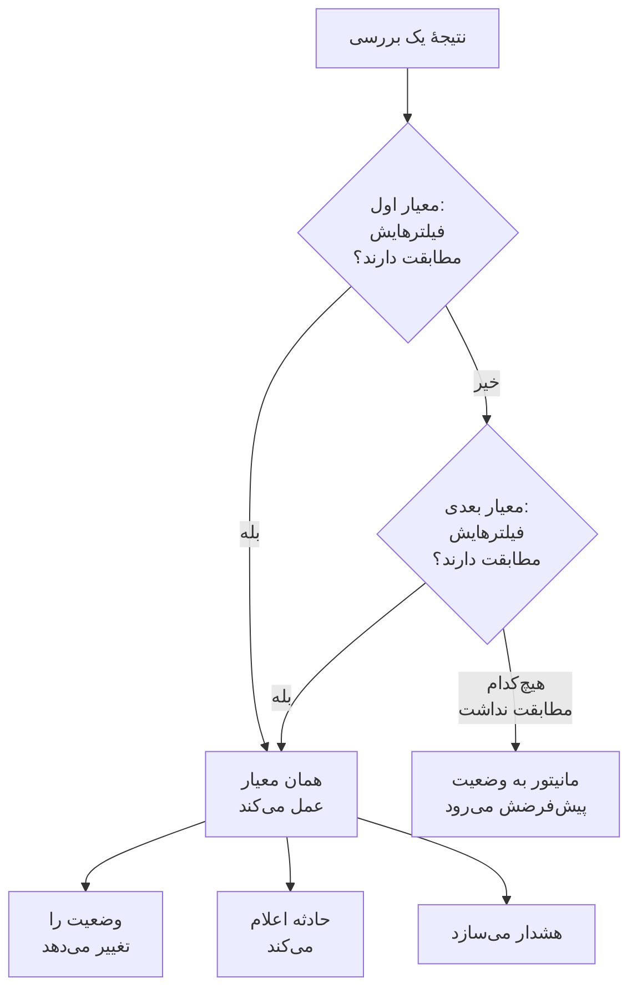
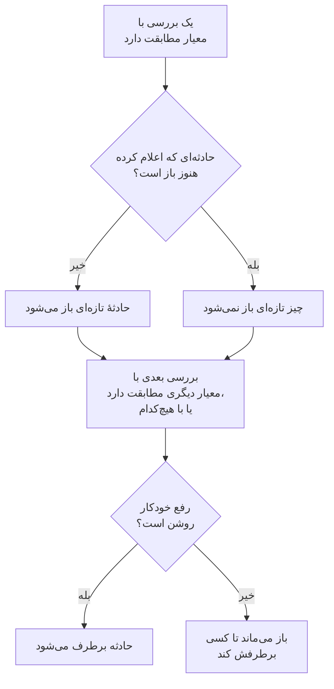

# معیارها و وضعیت‌ها

معیارهای یک مانیتور تعیین می‌کنند که هر بررسی چه معنایی دارد: مانیتور بالا است یا از کار افتاده، و OneUptime حادثه اعلام می‌کند یا هشدار می‌سازد. وضعیت‌ها فهرست پروژهٔ شما از حالت‌هایی‌اند که یک مانیتور می‌تواند داشته باشد، از **عملیاتی** تا **آفلاین**. این صفحه هر دو را برای همهٔ نوع‌های مانیتور توضیح می‌دهد؛ صفحهٔ هر نوع فیلترهایی را که آن نوع ارائه می‌دهد فهرست می‌کند.

:::cards
- [معیارها چگونه تصمیم می‌گیرند](#معیارها-چگونه-تصمیم-میگیرند): از بالا به پایین، و نخستین تطابق برنده است.
- [یک معیار چه چیزهایی دارد](#یک-معیار-چه-چیزهایی-دارد): فیلترها، شرط تطابق، اقدام‌ها و تنظیمات.
- [داوری یک بازه از بررسی‌ها](#داوری-یک-بازه-از-بررسیها): شمردن بررسی‌های ناموفق، پیدا کردن ناپایداری، خواندن یک صدک.
- [تغییر معیارهای یک مانیتور](#تغییر-معیارهای-یک-مانیتور): ویرایش، افزودن، مرتب‌سازی و آزمایش معیارها.
- [وضعیت‌های مانیتور](#وضعیتهای-مانیتور): وضعیت‌های پیش‌ساخته، و وضعیت‌های خودتان.
:::

## معیارها چگونه تصمیم می‌گیرند

هر بار که مانیتوری بررسی می‌شود، معیارهایش نتیجه را از بالای فهرست به پایین می‌سنجند. نخستین معیاری که فیلترهایش مطابقت داشته باشند تعیین می‌کند چه اتفاقی بیفتد، و معیارهای زیر آن برای آن بررسی دیده نمی‌شوند. وقتی هیچ‌کدام مطابقت نداشته باشد، مانیتور به **وضعیت پیش‌فرض مانیتور** خود می‌رود. اما تا وقتی معیاری که آن را برمی‌گرداند هنوز منطبق نشده، وضعیتش را نگه می‌دارد: [معیار کی بازیابی می‌شود](#معیار-کی-بازیابی-میشود) را ببینید.

ترتیب بخشی از قاعده است. مانیتور تازه معیارهایش را از بدترین شروع می‌کند: آفلاین، سپس هشداری اگر نوعش چنین چیزی داشته باشد (گواهی یا دامنه‌ای که به‌زودی منقضی می‌شود)، سپس آنلاین. یک معیار سالم گسترده، مثل **آنلاین بودن** روی **درست**، تقریباً با هر بررسی مطابقت دارد، پس آخر می‌آید: اگر بالای بقیه باشد، هر بار اول مطابقت پیدا می‌کند و بقیه هرگز عمل نمی‌کنند.

معیاری که مطابقت دارد ولی وضعیتی را تغییر نمی‌دهد باز هم دربارهٔ بررسی تصمیم می‌گیرد: مانیتور وضعیتی را که دارد نگه می‌دارد و معیارهای زیرش منتظر بررسی بعدی می‌مانند. **وضعیت پیش‌فرض مانیتور** فقط وقتی اعمال می‌شود که هیچ معیاری مطابقت نداشته باشد. پیش‌فرض مانیتور تازه **عملیاتی** است؛ آن را زیر **فیلدهای بیشتر**، پایین معیارها، تغییر دهید.

> [!NOTE]
> مانیتوری که برای هر میزبان، کانتینر، دیسک یا رابط یک حادثه یا هشدار جدا باز می‌کند، در هر بررسی همهٔ معیارها را می‌سنجد، پس دو میزبان می‌توانند هم‌زمان با دو معیار متفاوت مطابقت داشته باشند. این مانیتوری است که پرس‌وجویش **گروه‌بندی بر اساس** دارد، مثل مانیتور متریک یا مانیتور لاگ، یا معیاری که برای هر دیسک یا رابط `*` را نام می‌برد. پرس‌وجویی که به PromQL نوشته شده هم همین‌طور است. مانیتور درخواست ورودی‌ای که حادثه‌ها را بر اساس یک فیلد payload گروه‌بندی می‌کند، باز هم در نخستین تطابق می‌ایستد.
>
> چنین مانیتوری باز هم فقط یک وضعیت دارد که نخستین معیار منطبق آن را تعیین می‌کند. معیاری که فقط آن را به **وضعیت پیش‌فرض مانیتور** برمی‌گرداند و هیچ حادثه یا هشداری باز نمی‌کند، منتظر میزبان‌هایی می‌ماند که معیاری را برآورده کرده‌اند که وضعیت دیگری تعیین می‌کند: وقتی منطبق می‌شود که هر یک از آن‌ها آن را برآورده کند، فارغ از اینکه میزبان‌های دیگر در چه وضعی باشند. تا آن زمان مانیتور وضعیت خود را حفظ می‌کند، حتی وقتی هیچ معیاری منطبق نیست، و حوادث و هشدارهای هر میزبان همچنان جداگانه برطرف می‌شوند.

## یک معیار چه چیزهایی دارد

یک معیار را باز کنید: نامی دارد و سه بخش، که هر کدام به خلاصه‌ای یک‌خطی تا می‌شود.

| بخش | چه چیزی در آن است |
| --- | --- |
| **نام معیار** | نامی که در فهرست معیارها، و در علت ریشه‌ای هر حادثه و هشداری که معیار باز می‌کند، می‌آید. **افزودن معیار** معیار تازه را از روی فیلترهایش نام‌گذاری می‌کند، و نام همراه فیلترها تغییر می‌کند تا وقتی که نامی از خودتان بنویسید. |
| **فیلترها** | آنچه بررسی باید نشان دهد، به شکل یک یا چند فیلتر. مانیتورهای Kubernetes و متریک آن‌ها را **قواعد هشدار** می‌نامند. |
| **اقدام‌ها** | آنچه وقتی فیلترها مطابقت دارند رخ می‌دهد: تغییر وضعیت، ساخت هشدار، اعلام حادثه، یا هر ترکیبی از این‌ها. |
| **تنظیمات** | **این معیار را فعال کن**، یک **توضیحات** اختیاری، اینکه کی بازیابی می‌شود و کی داوری می‌شود و، در مانیتورهای Incoming Request، **گروه‌بندی حوادث و هشدارها بر اساس یک فیلد payload**. |

### فیلترها

فیلتر یک چیز را از بررسی می‌خواند و مقایسه می‌کند: **نوع فیلتر** (چه چیزی خوانده شود، مثل **کد وضعیت پاسخ**)، **شرط فیلتر** (چگونه مقایسه شود، مثل **بزرگ‌تر از**) و **مقدار**. مانیتورهایی که متریک‌ها را مقایسه می‌کنند، مثل مانیتورهای Kubernetes و متریک، به جای آن **شرط** و **آستانه** می‌خواهند. هر نوع مانیتور نوع‌های فیلتر خودش را دارد که در صفحه‌اش فهرست شده‌اند، مثل [معیارهای پایش](/docs/monitor/website-monitor#معیارهای-پایش).

با دو فیلتر یا بیشتر، **شرط تطابق** زیر آن‌ها ظاهر می‌شود: **همه** یعنی همهٔ فیلترها باید مطابقت داشته باشند، **دست‌کم یکی** یعنی یکی کافی است. معیار تازه روی **همه** شروع می‌کند.

فیلترهایی که هر بررسی را اندازه می‌گیرند، مثل **آنلاین بودن**، **کد وضعیت پاسخ** و **زمان پاسخ (به میلی‌ثانیه)**، گزینهٔ **این معیار را در یک بازه زمانی ارزیابی کن** را دارند. این گزینه به جای آخرین بررسی، پنجره‌ای از بررسی‌های اخیر را می‌سنجد و با ۵ دقیقهٔ اخیر و **همه مقادیر** شروع می‌کند، که فقط وقتی مطابقت دارد که همهٔ بررسی‌های پنجره مطابقت داشته باشند. بازه می‌تواند تا ۲۴ ساعت باشد و بررسی‌ها را بشمارد، همان‌طور که [داوری یک بازه از بررسی‌ها](#داوری-یک-بازه-از-بررسیها) توضیح می‌دهد. [ارزیابی در یک بازهٔ زمانی](/docs/monitor/website-monitor#ارزیابی-در-یک-بازهٔ-زمانی) را ببینید.

### اقدام‌ها

هر اقدام یک کلید زیر **اقدام‌ها** است:

| کلید | چه می‌کند |
| --- | --- |
| **وقتی فیلترها مطابقت پیدا کردند، وضعیت مانیتور را تغییر بده.** | مانیتور را به وضعیتی می‌برد که در **تغییر وضعیت مانیتور به** انتخاب شده است. |
| **وقتی فیلترها مطابقت پیدا کردند، یک هشدار بساز.** | هشدارهایی را که زیر **ساخت هشدار** تنظیم شده‌اند می‌سازد. هشدار به تیم شما خبر می‌دهد و هرگز روی صفحهٔ وضعیت نشان داده نمی‌شود. |
| **وقتی فیلترها مطابقت پیدا کردند، یک حادثه اعلام کن.** | حادثه‌هایی را که زیر **ساخت حادثه** تنظیم شده‌اند اعلام می‌کند. صفحه‌های وضعیت شما می‌توانند آن‌ها را نشان دهند. |

حادثه یا هشدار یک عنوان، یک **شدت** و، در بخش تاشده، توضیحات، مالکان، برچسب‌ها و سیاست‌های آنکال می‌خواهد. عنوان‌ها و توضیحات می‌توانند مقادیری از بررسی را در خود داشته باشند، مثل `{{monitorName}}`: [قالب‌بندی حادثه و هشدار](/docs/monitor/incident-alert-templating) را ببینید. برای فراخواندن کسی وقتی معیار مطابقت دارد، زیر **آنکال** یک سیاست انتخاب کنید: [سیاست‌های آنکال](/docs/on-call/policies) را ببینید.

### تنظیمات

**این معیار را فعال کن** برای هر معیار تازه روشن است. خاموشش کنید تا معیاری را بدون استفاده نگه دارید: در هر بررسی رد می‌شود، وضعیتی را تغییر نمی‌دهد، چیزی باز نمی‌کند، و سرتیترش **غیرفعال** را نشان می‌دهد.

**گروه‌بندی حوادث و هشدارها بر اساس یک فیلد payload** برای هر مقداری که در یک درخواست ورودی پیدا شود یک حادثه باز می‌کند، پس یک نشانی webhook می‌تواند چند حادثه را باز نگه دارد. [روشن کردن گروه‌بندی حادثه‌ها](/docs/monitor/incoming-request-monitor#روشن-کردن-گروهبندی-حادثهها) را ببینید.

**فقط وقتی شرط خودش برقرار شد بازیابی شود** و **این معیار را فقط در روزها و ساعت‌های مشخص ارزیابی کن** برای معیار تازه خاموش‌اند. [معیار کی بازیابی می‌شود](#معیار-کی-بازیابی-میشود) و [فقط در روزها و ساعت‌های مشخص](#فقط-در-روزها-و-ساعتهای-مشخص) را ببینید.

## داوری یک بازه از بررسی‌ها

با تیک‌خوردن **این معیار را در یک بازه زمانی ارزیابی کن**، **ارزیابی** می‌گوید بررسی‌های بازه چگونه داوری شوند، و **بازه گذشته** می‌گوید بازه چقدر طول بکشد، از ۲ دقیقه تا ۲۴ ساعت. شرط خود فیلتر، مانند **آنلاین بودن** روی **نادرست**، می‌گوید هر بررسی باید چه چیزی نشان دهد.

| ارزیابی | کی منطبق می‌شود |
| --- | --- |
| **همه مقادیر** | همه بررسی‌های بازه شرط را برآورده کردند. |
| **هر مقدار** | دست‌کم یک بررسی از بازه شرط را برآورده کرد. |
| **میانگین**، **جمع**، **مقدار بیشینه**، **مقدار کمینه** | آن عدد از مقادیر بازه شرط را برآورده کند، مانند میانگین زمان پاسخ بالای ۳۰۰ میلی‌ثانیه. |
| **صدک** | صدکی که زیر **صدک** انتخاب شده، از p50 تا p99، شرط را برآورده کند: p95 بالای ۳۰۰ میلی‌ثانیه یعنی کندترین ۵٪ بررسی‌ها بالای ۳۰۰ میلی‌ثانیه‌اند. |
| **تعداد** | تعداد بررسی‌هایی که شرط را برآورده کردند، همان‌طور که زیر **بررسی‌های منطبق** تنظیم شده مقایسه می‌شود: مثلاً **بزرگ‌تر از** ۳۰. |
| **درصد** | سهم آن‌ها از بررسی‌های بازه، همان‌طور که زیر **سهم بررسی‌های منطبق** تنظیم شده مقایسه می‌شود: مثلاً **بزرگ‌تر از** ۱۰٪. |
| **تغییرات وضعیت** | دفعاتی که بررسی‌ها بین برآوردن شرط و برآورده نکردن آن تغییر کردند، همان‌طور که زیر **دفعات تغییر** تنظیم شده مقایسه می‌شود. دستگاهی که قطع و دوباره وصل می‌شود دو بار تغییر می‌کند. |

جمله‌ای زیر تنظیمات بازه فیلتر را همان‌طور که تنظیم شده بازگو می‌کند: «بررسی کنید که در بیش از ۳۰ بررسی از ۸ ساعت گذشته، "آنلاین بودن" نادرست است».

- **هر پروب جداگانه.** **تعداد**، **درصد** و **تغییرات وضعیت** بررسی‌های پروبی را می‌شمارند که بررسی را انجام داده، پس مانیتوری که از سه پروب بررسی می‌شود سه برابر سریع‌تر نمی‌شمارد، و پروب‌هایش سپس باید مانند هر معیاری هم‌نظر باشند.
- **بازه‌ای که هنوز پر نشده.** تا وقتی بررسی‌ها به آغاز بازه نرسیده‌اند، مانیتوری که تازه شروع شده بررسی‌های کمتری از آنچه خواهد داشت دارد. **تعداد** و **تغییرات وضعیت** وقتی از **بزرگ‌تر از** یا **بزرگ‌تر یا برابر با** گذشته باشند زودتر منطبق می‌شوند، چون بررسی‌های بیشتر فقط آن‌ها را بالا می‌برند؛ هر چیز دیگری منتظر بازه کامل می‌ماند.
- **بازه‌ای بدون بررسی.** تا وقتی بازه بررسی ندارد، یا هنوز پر نشده، **اگر داده‌ای نبود** تصمیم می‌گیرد: **Ignore** صبر می‌کند، **تریگر** منطبق می‌شود، و **Treat As Zero** آن را چنان داوری می‌کند که گویی بررسی‌های غایب شرط را برآورده نکرده‌اند.

میانگین‌ها و صدک‌ها مقادیر بررسی‌های همه پروب‌ها را می‌خوانند، همان‌طور که **میانگین** همیشه می‌خواند. **تعداد**، **درصد** و **تغییرات وضعیت** برای هر فیلتری که بازه برایش هست ارائه می‌شوند: در مانیتورهای Website، API، Ping، IP و Port، برای CPU، حافظه، دیسک‌ها و بار یک سرور، برای **آنلاین بودن دستگاه SNMP** و زمان پاسخ یک دستگاه شبکه، و در مانیتورهای DNS، NTP، پایگاه داده، صفحه وضعیت خارجی و وضعیت پروب. **آنلاین بودن** یک مانیتور سرور شمرده نمی‌شود: بر پایه زمانی که از آخرین گزارش سرور گذشته داوری می‌شود. مانیتورهای متریک و دیگر مانیتورهای تله‌متری به‌جای آن بازه زمانی پرس‌وجوی خود را با تجمیع خود پرس‌وجو داوری می‌کنند، که صدک را هم می‌خواند.

### مثال: نقطه دسترسی‌ای که از کار افتاده، و یکی که ناپایدار است

یک مانیتور Ping هر دقیقه یک نقطه دسترسی اداره را بررسی می‌کند. پیش از آنکه بازه‌ها بتوانند بررسی‌ها را بشمارند، نقطه دسترسی‌ای که مدام قطع می‌شد یا شبیه نقطه‌ای از کار افتاده بود، یا اصلاً به چشم نمی‌آمد. این سه معیار، به همین ترتیب، این دو را از هم جدا می‌کنند:

| معیار | فیلتر | ارزیابی | وضعیت را تغییر می‌دهد به |
| --- | --- | --- | --- |
| نقطه دسترسی از کار افتاده | **آنلاین بودن** برابر **نادرست** | **همه مقادیر**، **بازه گذشته** ۵ دقیقه | **آفلاین**، و حادثه قطعی اعلام می‌کند |
| نقطه دسترسی ناپایدار است | **آنلاین بودن** برابر **نادرست** | **تغییرات وضعیت**، **بزرگ‌تر از** ۵، **بازه گذشته** ۱ ساعت | **کاهش کارایی**، و حادثه ناپایداری اعلام می‌کند |
| نقطه دسترسی آنلاین است | **آنلاین بودن** برابر **درست** | نه در یک بازه زمانی | **عملیاتی** |

برای دومی، **فقط وقتی شرط خودش برقرار شد بازیابی شود** را با **تغییرات وضعیت**، **کوچک‌تر یا برابر با** ۱، **بازه گذشته** ۱ ساعت روشن کنید: حادثه ناپایداری باز می‌ماند تا نقطه دسترسی یک ساعت پایدار بماند، نه اینکه در نخستین دقیقه‌ای که وصل است بسته شود. برای هشدار وقتی در ۸ ساعت بیش از ۳۰ پینگ ناموفق دارد، معیار دوم را به‌جای آن روی **تعداد**، **بزرگ‌تر از** ۳۰، **بازه گذشته** ۸ ساعت بگذارید.

## معیار کی بازیابی می‌شود

معیار به محض اینکه فیلترهایش دیگر منطبق نباشند از عمل بازمی‌ایستد: در همان بررسی، حادثه و هشدارش رفع می‌شوند، اگر **رفع خودکار حادثه** و **رفع خودکار هشدار** روشن باشند، و مانیتور به معیار منطبق بعدی می‌رود.

**فقط وقتی شرط خودش برقرار شد بازیابی شود** معیار را پس از آنکه فیلترهایش دیگر منطبق نیستند فعال نگه می‌دارد، تا وقتی فیلترهای زیر **شرط بازیابی** منطبق شوند. آن‌ها با عکس فیلترهای معیار، در ۱۰ دقیقه گذشته، شروع می‌شوند و می‌توانند از هر چه یک فیلتر دارد استفاده کنند، مانند بازه‌ای که بررسی‌ها را می‌شمارد. معیار تا وقتی فعال است که مانیتور وضعیتی را که آن معیار تنظیم می‌کند داشته باشد یا حادثه یا هشداری که اعلام کرده باز باشد. تا وقتی برقرار است، در جای خود در فهرست یک تطابق به شمار می‌آید: معیاری بالاتر از آن که منطبق شود همچنان جای آن را می‌گیرد.

وقتی هیچ معیاری منطبق نیست، مانیتوری که معیاری آن را از **وضعیت پیش‌فرض مانیتور** بیرون برده، وضعیت فعلی‌اش را نگه می‌دارد، تا وقتی معیاری هم دارد که فقط آن را به همان وضعیت برمی‌گرداند و چیزی باز نمی‌کند. این حاشیه بازیابی است: الگوها بالای ۹۰٪ فعال می‌شوند و در ۸۱٪ یا کمتر برمی‌گردند، پس در ۸۹٪ مانیتور همان‌جا که هست می‌ماند. حادثه‌ها و هشدارهایش همچنان وقتی معیار خودشان دیگر منطبق نباشد رفع می‌شوند. مانیتوری که چنین معیاری ندارد، مثل همیشه به **وضعیت پیش‌فرض مانیتور** می‌رود.

## فقط در روزها و ساعت‌های مشخص

**این معیار را فقط در روزها و ساعت‌های مشخص ارزیابی کن** روزها، **زمان شروع** و **زمان پایان**، و **منطقه زمانی** را تنظیم می‌کند که با منطقه زمانی شما شروع می‌شود. بیرون از این ساعت‌ها معیار مانند یک معیار غیرفعال نادیده گرفته می‌شود: با هیچ چیز منطبق نمی‌شود، پس آنچه باز کرده رفع می‌شود، و گزارش ارزیابی می‌گوید بیرون از ساعت‌هایش بوده است. ساعت‌ها روی ساعت همان منطقه زمانی خوانده می‌شوند، پس ۰۸:۰۰ پس از تغییر ساعت همان ۰۸:۰۰ می‌ماند، و ساعت‌هایی که زودتر از شروعشان تمام می‌شوند تا صبح روز بعد ادامه دارند.

## حادثه‌ها و هشدارها کی باز و بسته می‌شوند

معیاری که حادثه اعلام می‌کند، وقتی مطابقت دارد یک حادثه باز می‌کند. وقتی مانیتور بهبود می‌یابد، اگر معیار چنین بگوید، حادثه خودبه‌خود بسته می‌شود.

- **یکی در هر زمان.** تا وقتی حادثه‌ای که یک معیار اعلام کرده هنوز باز است، مطابقت دوبارهٔ همان معیار حادثهٔ دیگری اعلام نمی‌کند. هشدارها هم همین‌طورند. مانیتوری که بر اساس میزبان یا فیلد payload گروه‌بندی می‌کند برای هر میزبان یا مقدار یکی را باز نگه می‌دارد، و معیار مانیتور ایمیل ورودی با **برای هر ایمیل یک حادثه جدید باز کن** برای هر ایمیل یکی باز می‌کند.
- **بسته شدن.** در بررسی بعدی‌ای که معیار دیگری مطابقت دارد، یا هیچ‌کدام، حادثه‌ای که معیارش **رفع خودکار حادثه** را روشن دارد برطرف می‌شود، و هشداری با **رفع خودکار هشدار** هم همین‌طور. هر دو زیر **فیلدهای بیشتر** در حادثه یا هشدار هستند، و در معیارهایی که مانیتور تازه با آن‌ها شروع می‌کند روشن‌اند.
- **چند پراب.** مانیتوری که بیش از یک پراب بررسی‌اش می‌کند فقط وقتی تغییر می‌کند که پراب‌هایش هم‌نظر باشند. [معیارها چگونه ارزیابی می‌شوند](/docs/monitor/create-monitor#معیارها-چگونه-ارزیابی-میشوند) را ببینید.
- **مانیتور والدی که از کار افتاده است.** در صفحهٔ **پیکربندی** > **وابستگی‌ها** یک مانیتور، **مانیتورهایی که به آن‌ها وابسته است** مانیتورهایی را که به آن‌ها وابسته است نام می‌برد. تا وقتی یکی از آن‌ها در وضعیتی است که در **سرکوب وقتی وضعیت والد این است** آمده (اگر خالی بماند، هر وضعیت آفلاین)، مانیتور هیچ حادثه یا هشداری باز نمی‌کند. وضعیتش همچنان تغییر می‌کند، و آنچه باز است همچنان برطرف می‌شود.
- **تعمیر و نگهداری زمان‌بندی‌شده.** مانیتوری که در یک رویداد تعمیر و نگهداری در حال اجرا است بررسی نمی‌شود، پس معیارهایش اجرا نمی‌شوند. [نمای کلی تعمیر و نگهداری زمان‌بندی‌شده](/docs/scheduled-maintenance/index) را ببینید.

برای دیدن اینکه یک بررسی چگونه سنجیده شد، **نمای کلی** مانیتور را باز کنید: کارت **خلاصه مانیتور** نشان می‌دهد کدام معیار مطابقت داشت و هر کدام چه کرد، از جمله حادثه‌ای که چون یکی از قبل باز بود رد شد.

## وقتی از کار بیفتد چه کسی مطلع می‌شود

**وقتی از کار بیفتد** در چند جمله می‌گوید وقتی مانیتور از کار بیفتد چه می‌شود و چه کسی مطلع می‌شود: وضعیتی که تعیین می‌کند، حادثه یا هشداری که باز می‌کند، چه کسی ایمیل می‌گیرد و چه کسی را فرا می‌خواند، با نام. هر چیزی که مانع مطلع شدن کسی شود در خطی جداگانه آمده است، با پیوندی به صفحه‌ای که آن را درست می‌کند. این کارت در **نمای کلی** مانیتور، زیر معیارها در صفحه **معیارها**، در مرحله معیارهای **ساخت مانیتور** برای مانیتوری که در حال راه‌اندازی آن هستید، و در راه‌اندازی راهنمای وب‌سایت دیده می‌شود.

زنجیره را همان‌طور به دست می‌آورد که یک حادثه یا هشدار واقعی: با قواعد مالکیت، قواعد حریم خصوصی، قواعد برچسب و قواعد آنکال پروژه شما، قاعده اعلام حادثه از هشدار که هشدار را به حادثه تبدیل می‌کند، و اینکه نخستین قاعده تشدید هر سیاست آنکال همین حالا به چه کسی می‌رسد. قاعده آنکالی که می‌پرسد مالک هشدار کیست (**مالک هشدار**) با مالکانی سنجیده می‌شود که هشدار خواهد داشت: افراد و تیم‌هایی که معیارهایش تعیین می‌کنند، مالکان دستگاه شبکه‌ای که مانیتور پایش می‌کند، و کسانی که قواعد مالکیت می‌افزایند. جای‌نگهداری در عنوان که فقط یک بررسی پرش می‌کند، همان‌طور که نوشته شده نمایش داده می‌شود. **نمایش زنجیره** آن را ردیف به ردیف باز می‌کند:

| ردیف | چه می‌گوید |
| --- | --- |
| **وضعیت** | وضعیتی که معیارها تعیین می‌کنند. |
| **باز می‌کند** | حادثه یا هشدار، شدت آن در پرانتز، و عنوان آن. |
| **ایمیل‌ها** | ایمیل ایجاد به چه کسی می‌رسد: مالکانش، مالکانی که قواعد مالکیت می‌افزایند، یا اگر مالکی نداشته باشد مالکان پروژه. کسی که فراخوان آنکال ابتدا به او می‌رسد، ایمیل مالک را جداگانه نمی‌گیرد. |
| **قواعد مالکیت** | قواعد مالکیتی که مالک می‌افزایند. |
| **خصوصی** | چرا خصوصی است: یک قاعده حریم خصوصی یا معیارها. حادثه خصوصی در هیچ صفحه وضعیتی نمایش داده نمی‌شود و به هیچ مشترکی خبر نمی‌دهد، و فقط مالکانش، مالکان پروژه و مدیران پروژه می‌توانند آن را ببینند. |
| **قواعد برچسب** | قواعد برچسبی که برچسب‌هایشان تعیین می‌کند کدام قواعد آنکال فرا می‌خوانند. |
| **قواعد آنکال** | قواعد آنکالی که با آن مطابقت دارند. برای قاعده‌ای که مالک هشدار را می‌سنجد، این هم گفته می‌شود که کدام مالک باعث مطابقت آن شده است. |
| **سیاست آنکال** | هر سیاستی که آن قواعد اجرا می‌کنند: نخستین قاعده تشدید آن همین حالا به چه کسی و از چه راهی می‌رسد، و به چه کسی نمی‌رسد و چرا. |
| **صفحات وضعیت** | صفحات وضعیتی که آن را نمایش می‌دهند، هر کدام با گروه مانیتوری که مانیتور را از طریق آن نمایش می‌دهد. |
| **قاعده حادثه** | برای هشدار: قاعده اعلام حادثه از هشدار که از آن حادثه اعلام می‌کند، بی‌درنگ یا وقتی هشدار باز بماند، و آن حادثه، که مانند هر حادثه‌ای توضیح داده می‌شود. |

### چه چیزی مانع مطلع شدن افراد می‌شود

| چه چیزی مانع می‌شود | پیوند |
| --- | --- |
| هیچ معیاری وضعیت را تغییر نمی‌دهد یا حادثه یا هشداری باز نمی‌کند. | **باز کردن معیارها** |
| کسی فراخوانده نمی‌شود: هیچ قاعده آنکالی مطابقت ندارد، یا پروژه هنوز سیاست آنکالی ندارد. | **راه‌اندازی فراخوانی** |
| مانیتور هشدار باز می‌کند، و فقط حادثه‌ها قواعد آنکال دارند. | **راه‌اندازی فراخوانی** |
| یک سیاست آنکال هیچ قاعده تشدیدی ندارد. | **باز کردن سیاست آنکال** |
| یک سیاست آنکال همین حالا به هیچ‌کس نمی‌رسد. | **باز کردن سیاست آنکال** |
| به کسی که یک سیاست فرا می‌خواند نمی‌توان رسید: انصراف داده، هیچ روش تأییدشده‌ای ندارد، یا در پروژه‌ای بدون جایگزین هیچ قاعده‌ای برای آن شدت ندارد. | **باز کردن آمادگی** |
| پیامک، تماس، WhatsApp یا Telegram در پروژه خاموش است. | **باز کردن کانال‌های اعلان** |
| پروژه دیگر اعتباری برای پیامک و تماس ندارد (OneUptime Cloud). | **باز کردن صورتحساب** |
| سرور هنوز نمی‌تواند ایمیل، پیامک یا تماس بفرستد. | **باز کردن داشبورد مدیریت**، برای مدیران سرور |

هشداری که یک قاعده اعلام حادثه از هشدار آن را به حادثه‌ای تبدیل می‌کند که کسی را فرا می‌خواند، مانع به حساب نمی‌آید: به جای آن سیاست‌های خود حادثه بررسی می‌شوند.

مالکانی که ایمیل دریافت نمی‌کنند پس از موانع فهرست می‌شوند، هر کدام با دلیل و جایی که تعیین شده‌اند: کسی که عضو پروژه نیست، تیمی که هیچ عضوی از پروژه در آن نیست (**باز کردن تیم**)، یا تیمی از پروژه‌ای دیگر، که در معیارها (**باز کردن معیارها**)، روی دستگاه شبکه‌ای که مانیتور پایش می‌کند (**باز کردن دستگاه شبکه**) یا با یک قاعده مالکیت (**باز کردن قواعد مالکیت**) تعیین شده است. ایمیل همچنان فرستاده می‌شود، به مالکانی که به آن‌ها می‌رسد یا به مالکان پروژه، پس این‌ها مانع نیستند. سلامت پیکربندی هم آن‌ها را به‌عنوان مواردی که ارزش رفع کردن دارند فهرست می‌کند.

### بررسی دوباره، و آنچه می‌توانید ببینید

پاسخ حداکثر یک دقیقه قدمت دارد و **بررسی دوباره** آن را دوباره به دست می‌آورد. اگر بررسی دوباره ناموفق باشد، کارت آخرین پاسخ را نگه می‌دارد و زیر آن دلیلش را می‌گوید.

کارت فقط چیزی را نام می‌برد که اجازه خواندنش را دارید. سیاست آنکال، قاعده، صفحه وضعیت یا گروه مانیتوری که نمی‌توانید ببینید، بدون نام جای خود را نگه می‌دارد، و حادثه یا هشدار خصوصی‌ای که نخواهید توانست ببینید، فقط می‌گوید که باز می‌شود و خصوصی است.

## یک حادثه یا هشدار از بررسی چه چیزی را نگه می‌دارد

حادثه یا هشداری که یک مانیتور باز می‌کند، بررسی‌ای را که آن را باز کرد نگه می‌دارد، تا مدت‌ها پس از پاک شدن لاگ‌های خود مانیتور هم بتوانید دلیل را ببینید. زیر علت ریشه‌ای، **جزئیات ارزیابی** معیاری را که مطابقت داشت نام می‌برد و برای هر فیلتری که مطابقت داشت، آنچه بررسی یافت. **نمایش جزئیات** بقیهٔ شواهد، فیلترهایی که مطابقت نداشتند و خود بررسی را اضافه می‌کند: درخواست، زمان اجرای آن، اینکه از کدام پراب بود و چه چیزی برگشت. آنچه یک فیلتر یافت می‌تواند این‌ها باشد:

- **فیلد.** جایی در بدنهٔ JSON که فیلتر **بدنه پاسخ** در آن مطابقت داشت، مانند `checks[1].status`، یا هدری که فیلتر **مقدار هدر پاسخ** در آن مطابقت داشت.
- **مقدارها.** آنچه هر مقداری که یک **عبارت JavaScript** می‌خواند هنگام ارزیابی در خود داشت، مانند `responseBody.status = "down"`.
- **گزیده.** تکهٔ کوتاهی از پاسخ در اطراف بخش مطابق، با علامت‌گذاری همان بخش: هرگز کل بدنه.

اسرار و داده‌های شخصی پیش از نگه داشتن هر چیزی پوشانده می‌شوند: هدرهایی مانند `Authorization`، `Cookie` و `Set-Cookie`، فیلدهایی که نامشان `password`، `token`، `key`، `session` یا `email` را می‌گوید، و متنی که شبیه یک توکن bearer، یک JWT، شماره کارت یا نشانی ایمیل است. URL درخواست همان است که مانیتور با آن تنظیم شد، پس `{{monitorSecrets.NAME}}` یک نام باقی می‌ماند و مقدار محرمانهٔ پرس‌وجو پوشانده می‌شود. **گزارش‌های پایش** مانیتور، و هر مقداری که یک علت ریشه‌ای نقل می‌کند، به همین شکل پوشانده می‌شوند. حادثه یا هشداری که دستی باز شده، یا پیش از نگه داشتن جزئیات ارزیابی باز شده، چنین جزئیاتی ندارد.

> [!TIP]
> وقتی پاسخ‌های یک مانیتور وب‌سایت یا API به خودی خود حساس هستند، **نگه داشتن محتوای پاسخ** را در کارت **محتوای پاسخ** در صفحهٔ **پیشرفته** > **تنظیمات** آن خاموش کنید. در این صورت گزارش‌های پایش، حادثه‌ها و هشدارهای آن فقط فیلترهایی که مطابقت داشتند، کد وضعیت و زمان پاسخ را نگه می‌دارند و هیچ بخشی از پاسخ را نه. مانیتور درخواست ورودی همین کلید را برای درخواست‌هایی که دریافت می‌کند دارد: **نگه داشتن محتوای درخواست**، در کارت **محتوای درخواست**. این کلید برای بررسی‌هایی که پس از تغییر آن اجرا می‌شوند، و حادثه‌ها و هشدارهایی که پس از آن باز می‌شوند، اعمال می‌شود. آخرین درخواست در نمای کلی مانیتور درخواست ورودی بی‌درنگ از این کلید پیروی می‌کند.

## تغییر معیارهای یک مانیتور

:::steps
### باز کردن صفحهٔ معیارها

به **مانیتورها** بروید و مانیتور را باز کنید. **پیکربندی** را در منوی کناری‌اش باز کنید و روی **معیارها** کلیک کنید. کارت **معیارها** هر معیار، آنچه بررسی می‌کند و آنچه انجام می‌دهد را نشان می‌دهد.

### کلیک روی Edit Monitoring Criteria

ویرایشگر همهٔ معیارها را باز نشان می‌دهد. روی سرتیتر یک معیار کلیک کنید تا به یک خط تا شود: نامش، تعداد فیلترهایش و آنچه انجام می‌دهد.

### افزودن، تغییر یا مرتب‌سازی معیارها

**افزودن معیار** یک معیار در پایین اضافه می‌کند، باز و نام‌گذاری‌شده از روی فیلترش. برای جابه‌جا کردن یک معیار، دستگیرهٔ کنارش را بکشید: نخستین تطابق برنده است، پس بدترین حالت را اول بگذارید. **حذف معیار** یکی را حذف می‌کند؛ مانیتور دست‌کم یک معیار نگه می‌دارد.

### ذخیرهٔ معیارها

روی **ذخیره تغییرات** کلیک کنید. بررسی بعدی با معیارهای تازه سنجیده می‌شود.

### آزمایش مانیتور

در مانیتوری که پراب‌ها بررسی‌اش می‌کنند، روی **آزمایش مانیتور** در کارت کلیک کنید: آزمایش روی پرابی شروع می‌شود که مانیتور را بررسی می‌کند. اگر بخواهید، در **انتخاب پراب** پراب دیگری انتخاب کنید و سپس روی **اجرای آزمایش** کلیک کنید. **نتیجه آزمایش مانیتور** نشان می‌دهد بررسی چه یافت. همچنین می‌گوید پاسخ با کدام معیار مطابقت دارد و پس از آن چه رخ می‌دهد: وضعیت، حادثه یا هشدار، و اینکه چه کسی مطلع می‌شود.
:::

مانیتور دستی معیاری ندارد: وضعیتش را خودتان تعیین می‌کنید. [به‌روزرسانی وضعیت](/docs/monitor/manual-monitor#بهروزرسانی-وضعیت) را ببینید.

## وضعیت‌های مانیتور

مانیتور همیشه در یکی از وضعیت‌های پروژهٔ شماست. پروژهٔ تازه سه وضعیت دارد، از سالم‌ترین تا بدترین:

| وضعیت | جایگاه | رنگ | OneUptime با آن چه می‌کند |
| --- | --- | --- | --- |
| **عملیاتی** | ۱ | سبز | مانیتورهای تازه در آن شروع می‌کنند، و **وضعیت پیش‌فرض مانیتور** هر مانیتور تازه است. پیش‌ساخته. |
| **کاهش کارایی** | ۲ | زرد | به‌خودی‌خود هیچ: یکی از معیارهای شما مانیتور را به اینجا می‌برد. |
| **آفلاین** | ۳ | قرمز | معیار آفلاین مانیتور تازه آن را به اینجا می‌برد، و OneUptime مانیتوری را که در آن است از کار افتاده می‌داند. پیش‌ساخته. |

فهرست یک ترتیب است. جایی که مانیتورها با هم نشان داده می‌شوند، وضعیتی که پایین‌تر از همه در فهرست است برنده است: یک گروه مانیتور، یک گروه صفحهٔ وضعیت و وضعیت کلی یک صفحهٔ وضعیت هر کدام بدترین وضعیت میان مانیتورهایشان را نشان می‌دهند.

### یک وضعیت کجا به حساب می‌آید

| کجا | وضعیت چه چیزی را تعیین می‌کند |
| --- | --- |
| فهرست **مانیتورها** | وضعیت فعلی هر مانیتور. **خارج از سرویس** مانیتورهایی را که در هر وضعیتی جز وضعیت عملیاتی هستند فهرست می‌کند، با شمارشی قرمز کنارش. مانیتورهایی که پایششان خاموش است کنار گذاشته می‌شوند: هیچ چیز آن‌ها را بررسی نمی‌کند، و **غیرفعال** آن‌ها را فهرست می‌کند. **غیرفعال** در منوی کناری زیر **همه مانیتورها** است، با شمارشی خاکستری: خاموش کردن پایش یک انتخاب است، نه یک خرابی. کنار **خارج از سرویس**، زیر **نیازمند توجه**، **پراب‌ها قطع شده‌اند** مانیتورهایی را فهرست می‌کند که پراب‌های فعالشان همه قطع شده‌اند، و **هیچ پرابی فعال نیست** مانیتورهایی را که هیچ پراب فعالی بررسی‌شان نمی‌کند: پراب‌هایشان همه غیرفعال‌اند، یا هیچ پرابی ندارند. |
| صفحه‌های وضعیت | رنگ هر ردیف و زمان کارکردش: فقط وضعیت‌های فهرست **قطعی به حساب می‌آید** صفحه علیه آن شمرده می‌شوند. صفحهٔ وضعیت تازه با همهٔ وضعیت‌ها جز وضعیت عملیاتی شروع می‌کند. [برگزیدن آنچه روی صفحه نشان داده می‌شود](/docs/status-pages/index#برگزیدن-آنچه-روی-صفحه-نشان-داده-میشود) را ببینید. |
| گروه‌های مانیتور | وضعیت گروه: بدترین میان مانیتورهایش. [گروه‌های مانیتور](/docs/monitor/monitor-groups) را ببینید. |
| SLO | قطعی‌ای که یک SLO می‌شمارد، از روی فهرست وضعیت‌های خودش. [کدام وضعیت‌ها قطعی شمرده می‌شوند](/docs/slo/introduction#کدام-وضعیتها-قطعی-شمرده-میشوند) را ببینید. |
| وابستگی‌ها | اینکه آیا مانیتور والد حادثه‌ها و هشدارهای فرزندانش را نگه می‌دارد: به‌طور پیش‌فرض، تا وقتی در یک وضعیت آفلاین است. |

وضعیتی که بعداً اضافه می‌کنید به فهرست **قطعی به حساب می‌آید** یک صفحهٔ وضعیت موجود اضافه نمی‌شود: خودتان آن را آنجا اضافه کنید.

### افزودن وضعیت خودتان

:::steps
### باز کردن وضعیت مانیتور

به **مانیتورها** > **تنظیمات** > **وضعیت مانیتور** بروید. **تنظیمات** در منوی کناری بسته شروع می‌کند: اول آن را باز کنید. کارت **وضعیت‌های مانیتور** وضعیت‌ها را از سالم‌ترین تا بدترین فهرست می‌کند.

### ساخت وضعیت

روی **ساخت وضعیت مانیتور** کلیک کنید و **نام**، **توضیحات** و **رنگ** را پر کنید. وضعیت تازه درست بالای وضعیت آفلاین قرار می‌گیرد، تا قطعی همچنان بدترین خوانده شود.

### گذاشتن آن در جای خودش

وضعیت را با دستگیره‌اش بکشید. وضعیتی که پایین‌تر در فهرست است از همهٔ وضعیت‌های بالایش بدتر خوانده می‌شود.

### استفاده از آن در یک معیار

یک وضعیت تا وقتی معیاری مانیتورها را به آن نبرد کاری نمی‌کند. آن را در **تغییر وضعیت مانیتور به** روی معیاری که باید آن را تعیین کند انتخاب کنید.
:::

وضعیت‌های عملیاتی و آفلاین با **پیش‌ساخته** علامت خورده‌اند: می‌توانید نام و رنگشان را تغییر دهید، ولی نمی‌توانید حذفشان کنید. در OneUptime Cloud، ساختن یا تغییر دادن یک وضعیت به طرح Growth نیاز دارد. مدیریت وضعیت‌ها به نقش مالک پروژه، مدیر پروژه یا مدیر مانیتورها، یا یک نقش سفارشی با مجوز متناظر وضعیت مانیتور نیاز دارد.

### خط زمانی وضعیت

هر تغییر وضعیت در **خط زمانی وضعیت** مانیتور نگه داشته می‌شود: کی شروع شد، چقدر طول کشید، و **مشاهده علت** برای معیاری که آن را تعیین کرد. **ساخت رویداد وضعیت مانیتور** یک وضعیت را دستی اضافه می‌کند. در مانیتوری که پراب‌ها بررسی‌اش می‌کنند، بررسی بعدی‌ای که با معیاری دارای وضعیت مطابقت داشته باشد آن وضعیت را دوباره تعیین می‌کند.

تغییر وضعیت یک مانیتور فقط وقتی به مالکانش اطلاع داده می‌شود که آن‌ها **وضعیت مانیتور تغییر کرد** را در تنظیمات اعلان خود روشن کرده باشند: در ابتدا خاموش است. مانیتوری که چون هیچ معیاری مطابقت نداشت به **وضعیت پیش‌فرض مانیتور** خود برمی‌گردد به هیچ‌کس خبر نمی‌دهد. [برای عضو تازه چه چیزی روشن است](/docs/notifications/notification-settings#برای-عضو-تازه-چه-چیزی-روشن-است) را ببینید.

## بایگانی وضعیت مانیتور

وضعیتی را که تیمتان دیگر نباید از آن استفاده کند، به‌جای حذف بایگانی کنید. بایگانی هیچ مانیتوری را تغییر نمی‌دهد: مانیتوری که در این وضعیت است تا تغییر وضعیتش در آن می‌ماند و خط زمانی وضعیتش همچنان آن را نشان می‌دهد.

- **بایگانی** در منوی **⋯** ردیف است. ابتدا تأیید می‌خواهد و معیارهای مانیتور، الگوها و صفحه‌های وضعیتی را که برای استفاده از این وضعیت تنظیم شده‌اند فهرست می‌کند: تا وقتی تغییرشان ندهید از آن استفاده می‌کنند.
- **هیچ‌کس دیگر نمی‌تواند آن را انتخاب کند.** معیار، منوی وضعیت مانیتور، وضعیت مانیتور یک حادثه یا رویداد تعمیر و نگهداری و وضعیت‌های قطعی صفحهٔ وضعیت آن را نشان نمی‌دهند. API، Terraform و MCP آن را رد می‌کنند.
- **وضعیت‌های بایگانی‌شده جدا فهرست می‌شوند**، در بخش جمع‌شدهٔ **وضعیت‌های بایگانی‌شدهٔ مانیتور** زیر جدول. **خروج از بایگانی** یکی را همان‌طور که بود برمی‌گرداند.
- **وضعیت‌های داخلی را نمی‌توان بایگانی کرد.** مانیتورهای تازه در وضعیت عملیاتی شروع می‌شوند و OneUptime مانیتوری را که در وضعیت آفلاین است از کار افتاده می‌داند. **بایگانی** آن‌ها همراه با دلیل قفل است.

## عیب‌یابی

:::details سایت از کار افتاده، ولی مانیتور عملیاتی می‌ماند
معیاری بالاتر در فهرست اول مطابقت پیدا کرد. **پیکربندی** > **معیارها** را باز کنید و ترتیب را بررسی کنید: معیار سالم آخر می‌آید. همچنین بررسی کنید که **این معیار را فعال کن** در معیار آفلاین روشن باشد، و اقدام آن **وقتی فیلترها مطابقت پیدا کردند، وضعیت مانیتور را تغییر بده.** با یک وضعیت انتخاب‌شده روشن باشد.
:::

:::details وقتی مانیتور از کار افتاد هیچ حادثه‌ای باز نشد
معیاری را که مطابقت داشت بررسی کنید: **وقتی فیلترها مطابقت پیدا کردند، یک حادثه اعلام کن.** باید روشن باشد. تا وقتی حادثهٔ همان معیار هنوز باز است، تا وقتی مانیتور والدی در **مانیتورهایی که به آن‌ها وابسته است** از کار افتاده است، یا تا وقتی مانیتور در تعمیر و نگهداری زمان‌بندی‌شده است، حادثه‌ای اعلام نمی‌شود. کارت **خلاصه مانیتور** در **نمای کلی** مانیتور می‌گوید کدام بوده است.
:::

:::details حادثه پس از بهبود مانیتور باز می‌ماند
معیار حادثه را باز کنید و **فیلدهای بیشتر** را در حادثهٔ آن باز کنید: **رفع خودکار حادثه** باید روشن باشد. حادثهٔ معیاری که از آن زمان حذفش کرده‌اید توسط مانیتور برطرف نمی‌شود: آن را دستی برطرف کنید.
:::

:::details دکمهٔ حذف آفلاین قفل است
**عملیاتی** و **آفلاین** پیش‌ساخته‌اند: OneUptime مانیتورها را به آن‌ها می‌برد، پس می‌توان نامشان را تغییر داد ولی نمی‌توان حذفشان کرد. به جای آن یکی از وضعیت‌های خودتان را حذف کنید، یا نام وضعیت پیش‌ساخته را تغییر دهید.
:::

## گام‌های بعدی

:::cards
- [ساخت مانیتور](/docs/monitor/create-monitor): سه مرحلهٔ یک مانیتور تازه.
- [قالب‌بندی حادثه و هشدار](/docs/monitor/incident-alert-templating): مقادیری از بررسی را در عنوان‌ها و توضیحات بگذارید.
- [گروه‌های مانیتور](/docs/monitor/monitor-groups): چند مانیتور را در یک وضعیت جمع کنید.
- [نمای کلی حوادث](/docs/incidents/index): پس از اینکه یک معیار حادثه اعلام کرد چه رخ می‌دهد.
:::
