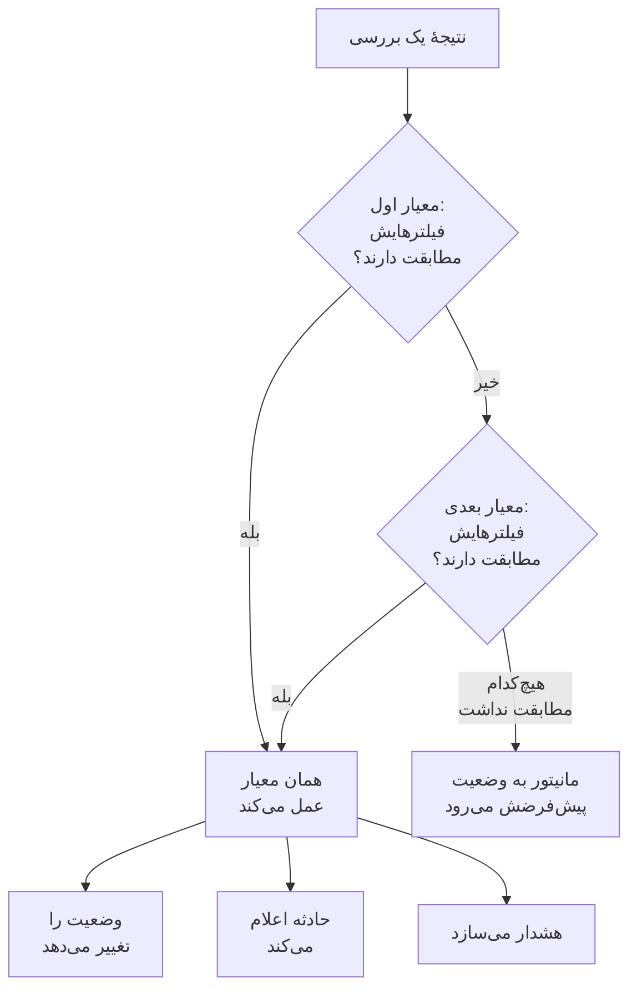
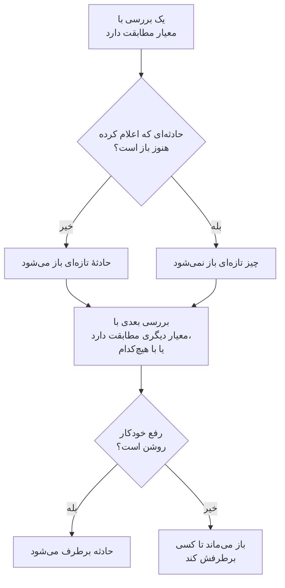

# معیارها و وضعیت‌های مانیتور

معیارهای یک مانیتور تعیین می‌کنند که هر بررسی چه معنایی دارد: مانیتور بالا است یا از کار افتاده، و OneUptime حادثه اعلام می‌کند یا هشدار می‌سازد. وضعیت‌ها فهرست پروژهٔ شما از حالت‌هایی‌اند که یک مانیتور می‌تواند داشته باشد، از **عملیاتی** تا **آفلاین**. این صفحه هر دو را برای همهٔ نوع‌های مانیتور توضیح می‌دهد؛ صفحهٔ هر نوع فیلترهایی را که آن نوع ارائه می‌دهد فهرست می‌کند.

:::cards
- [معیارها چگونه تصمیم می‌گیرند](#معیارها-چگونه-تصمیم-میگیرند): از بالا به پایین، و نخستین تطابق برنده است.
- [یک معیار چه چیزهایی دارد](#یک-معیار-چه-چیزهایی-دارد): فیلترها، شرط تطابق، اقدام‌ها و تنظیمات.
- [تغییر معیارهای یک مانیتور](#تغییر-معیارهای-یک-مانیتور): ویرایش، افزودن، مرتب‌سازی و آزمایش معیارها.
- [وضعیت‌های مانیتور](#وضعیتهای-مانیتور): وضعیت‌های پیش‌ساخته، و وضعیت‌های خودتان.
:::

## معیارها چگونه تصمیم می‌گیرند

هر بار که مانیتوری بررسی می‌شود، معیارهایش نتیجه را از بالای فهرست به پایین می‌سنجند. نخستین معیاری که فیلترهایش مطابقت داشته باشند تعیین می‌کند چه اتفاقی بیفتد، و معیارهای زیر آن برای آن بررسی دیده نمی‌شوند. وقتی هیچ‌کدام مطابقت نداشته باشد، مانیتور به **وضعیت پیش‌فرض مانیتور** خود می‌رود.

ترتیب بخشی از قاعده است. مانیتور تازه معیارهایش را از بدترین شروع می‌کند: آفلاین، سپس هشداری اگر نوعش چنین چیزی داشته باشد (گواهی یا دامنه‌ای که به‌زودی منقضی می‌شود)، سپس آنلاین. یک معیار سالم گسترده، مثل **Is Online** روی **درست**، تقریباً با هر بررسی مطابقت دارد، پس آخر می‌آید: اگر بالای بقیه باشد، هر بار اول مطابقت پیدا می‌کند و بقیه هرگز عمل نمی‌کنند.

معیاری که مطابقت دارد ولی وضعیتی را تغییر نمی‌دهد باز هم دربارهٔ بررسی تصمیم می‌گیرد: مانیتور وضعیتی را که دارد نگه می‌دارد و معیارهای زیرش منتظر بررسی بعدی می‌مانند. **وضعیت پیش‌فرض مانیتور** فقط وقتی اعمال می‌شود که هیچ معیاری مطابقت نداشته باشد. پیش‌فرض مانیتور تازه **عملیاتی** است؛ آن را زیر **فیلدهای بیشتر**، پایین معیارها، تغییر دهید.

> [!NOTE]
> مانیتوری که برای هر میزبان، کانتینر، دیسک یا رابط یک حادثه یا هشدار جدا باز می‌کند، در هر بررسی همهٔ معیارها را می‌سنجد، پس دو میزبان می‌توانند هم‌زمان با دو معیار متفاوت مطابقت داشته باشند. این مانیتوری است که پرس‌وجویش **گروه‌بندی بر اساس** دارد، مثل مانیتور متریک یا مانیتور لاگ، یا معیاری که برای هر دیسک یا رابط `*` را نام می‌برد. مانیتور درخواست ورودی‌ای که حادثه‌ها را بر اساس یک فیلد payload گروه‌بندی می‌کند، باز هم در نخستین تطابق می‌ایستد.

## یک معیار چه چیزهایی دارد

یک معیار را باز کنید: نامی دارد و سه بخش، که هر کدام به خلاصه‌ای یک‌خطی تا می‌شود.

| بخش | چه چیزی در آن است |
| --- | --- |
| **نام معیار** | نامی که در فهرست معیارها، و در علت ریشه‌ای هر حادثه و هشداری که معیار باز می‌کند، می‌آید. **افزودن معیار** معیار تازه را از روی فیلترهایش نام‌گذاری می‌کند، و نام همراه فیلترها تغییر می‌کند تا وقتی که نامی از خودتان بنویسید. |
| **فیلترها** | آنچه بررسی باید نشان دهد، به شکل یک یا چند فیلتر. مانیتورهای Kubernetes و متریک آن‌ها را **Alert Rules** می‌نامند. |
| **اقدام‌ها** | آنچه وقتی فیلترها مطابقت دارند رخ می‌دهد: تغییر وضعیت، ساخت هشدار، اعلام حادثه، یا هر ترکیبی از این‌ها. |
| **تنظیمات** | **این معیار را فعال کن**، **توضیحات** اختیاری و، در مانیتورهای درخواست ورودی، **Group incidents and alerts by a payload field**. |

### فیلترها

فیلتر یک چیز را از بررسی می‌خواند و مقایسه می‌کند: **نوع فیلتر** (چه چیزی خوانده شود، مثل **کد وضعیت پاسخ**)، **شرط فیلتر** (چگونه مقایسه شود، مثل **بزرگ‌تر از**) و **مقدار**. مانیتورهایی که متریک‌ها را مقایسه می‌کنند، مثل مانیتورهای Kubernetes و متریک، به جای آن **شرط** و **آستانه** می‌خواهند. هر نوع مانیتور نوع‌های فیلتر خودش را دارد که در صفحه‌اش فهرست شده‌اند، مثل [معیارهای پایش](/docs/monitor/website-monitor#معیارهای-پایش).

با دو فیلتر یا بیشتر، **شرط تطابق** زیر آن‌ها ظاهر می‌شود: **همه** یعنی همهٔ فیلترها باید مطابقت داشته باشند، **دست‌کم یکی** یعنی یکی کافی است. معیار تازه روی **همه** شروع می‌کند.

فیلترهایی که هر بررسی را اندازه می‌گیرند، مثل **Is Online**، **کد وضعیت پاسخ** و **زمان پاسخ (به میلی‌ثانیه)**، گزینهٔ **این معیار را در یک بازه زمانی ارزیابی کن** را دارند. این گزینه به جای آخرین بررسی، پنجره‌ای از بررسی‌های اخیر را می‌سنجد و با ۵ دقیقهٔ اخیر و **All Values** شروع می‌کند، که فقط وقتی مطابقت دارد که همهٔ بررسی‌های پنجره مطابقت داشته باشند. [ارزیابی در یک بازهٔ زمانی](/docs/monitor/website-monitor#ارزیابی-در-یک-بازهٔ-زمانی) را ببینید.

### اقدام‌ها

هر اقدام یک کلید زیر **اقدام‌ها** است:

| کلید | چه می‌کند |
| --- | --- |
| **وقتی فیلترها مطابقت پیدا کردند، وضعیت مانیتور را تغییر بده.** | مانیتور را به وضعیتی می‌برد که در **تغییر وضعیت مانیتور به** انتخاب شده است. |
| **وقتی فیلترها مطابقت پیدا کردند، یک هشدار بساز.** | هشدارهایی را که زیر **ساخت هشدار** تنظیم شده‌اند می‌سازد. هشدار به تیم شما خبر می‌دهد و هرگز روی صفحهٔ وضعیت نشان داده نمی‌شود. |
| **وقتی فیلترها مطابقت پیدا کردند، یک حادثه اعلام کن.** | حادثه‌هایی را که زیر **ساخت حادثه** تنظیم شده‌اند اعلام می‌کند. صفحه‌های وضعیت شما می‌توانند آن‌ها را نشان دهند. |

حادثه یا هشدار یک عنوان، یک **شدت** و، در بخش تاشده، توضیحات، مالکان، برچسب‌ها و سیاست‌های آنکال می‌خواهد. عنوان‌ها و توضیحات می‌توانند مقادیری از بررسی را در خود داشته باشند، مثل `{{monitorName}}`: [قالب‌بندی حادثه و هشدار](/docs/monitor/incident-alert-templating) را ببینید. برای فراخواندن کسی وقتی معیار مطابقت دارد، زیر **آنکال** یک سیاست انتخاب کنید: [سیاست‌های آنکال](/docs/on-call/policies) را ببینید.

### تنظیمات

**این معیار را فعال کن** برای هر معیار تازه روشن است. خاموشش کنید تا معیاری را بدون استفاده نگه دارید: در هر بررسی رد می‌شود، وضعیتی را تغییر نمی‌دهد، چیزی باز نمی‌کند، و سرتیترش **غیرفعال** را نشان می‌دهد.

**Group incidents and alerts by a payload field** برای هر مقداری که در یک درخواست ورودی پیدا شود یک حادثه باز می‌کند، پس یک نشانی webhook می‌تواند چند حادثه را باز نگه دارد. [روشن کردن گروه‌بندی حادثه‌ها](/docs/monitor/incoming-request-monitor#روشن-کردن-گروهبندی-حادثهها) را ببینید.

## حادثه‌ها و هشدارها کی باز و بسته می‌شوند

معیاری که حادثه اعلام می‌کند، وقتی مطابقت دارد یک حادثه باز می‌کند. وقتی مانیتور بهبود می‌یابد، اگر معیار چنین بگوید، حادثه خودبه‌خود بسته می‌شود.

- **یکی در هر زمان.** تا وقتی حادثه‌ای که یک معیار اعلام کرده هنوز باز است، مطابقت دوبارهٔ همان معیار حادثهٔ دیگری اعلام نمی‌کند. هشدارها هم همین‌طورند. مانیتوری که بر اساس میزبان یا فیلد payload گروه‌بندی می‌کند برای هر میزبان یا مقدار یکی را باز نگه می‌دارد، و معیار مانیتور ایمیل ورودی با **برای هر ایمیل یک حادثه جدید باز کن** برای هر ایمیل یکی باز می‌کند.
- **بسته شدن.** در بررسی بعدی‌ای که معیار دیگری مطابقت دارد، یا هیچ‌کدام، حادثه‌ای که معیارش **رفع خودکار حادثه** را روشن دارد برطرف می‌شود، و هشداری با **رفع خودکار هشدار** هم همین‌طور. هر دو زیر **فیلدهای بیشتر** در حادثه یا هشدار هستند، و در معیارهایی که مانیتور تازه با آن‌ها شروع می‌کند روشن‌اند.
- **چند پراب.** مانیتوری که بیش از یک پراب بررسی‌اش می‌کند فقط وقتی تغییر می‌کند که پراب‌هایش هم‌نظر باشند. [معیارها چگونه ارزیابی می‌شوند](/docs/monitor/create-monitor#معیارها-چگونه-ارزیابی-میشوند) را ببینید.
- **مانیتور والدی که از کار افتاده است.** در صفحهٔ **پیکربندی** > **وابستگی‌ها** یک مانیتور، **Depends On Monitors** مانیتورهایی را که به آن‌ها وابسته است نام می‌برد. تا وقتی یکی از آن‌ها در وضعیتی است که در **Suppress When Parent Status Is** آمده (اگر خالی بماند، هر وضعیت آفلاین)، مانیتور هیچ حادثه یا هشداری باز نمی‌کند. وضعیتش همچنان تغییر می‌کند، و آنچه باز است همچنان برطرف می‌شود.
- **تعمیر و نگهداری زمان‌بندی‌شده.** مانیتوری که در یک رویداد نگهداری در حال اجرا است بررسی نمی‌شود، پس معیارهایش اجرا نمی‌شوند. [نمای کلی تعمیر و نگهداری زمان‌بندی‌شده](/docs/scheduled-maintenance/index) را ببینید.

برای دیدن اینکه یک بررسی چگونه سنجیده شد، **نمای کلی** مانیتور را باز کنید: کارت **خلاصه مانیتور** نشان می‌دهد کدام معیار مطابقت داشت و هر کدام چه کرد، از جمله حادثه‌ای که چون یکی از قبل باز بود رد شد.

## تغییر معیارهای یک مانیتور

:::steps
### باز کردن صفحهٔ معیارها

به **مانیتورها** بروید و مانیتور را باز کنید. **پیکربندی** را در منوی کناری‌اش باز کنید و روی **معیارها** کلیک کنید. کارت **معیارهای پایش** هر معیار، آنچه بررسی می‌کند و آنچه انجام می‌دهد را نشان می‌دهد.

### کلیک روی Edit Monitoring Criteria

ویرایشگر همهٔ معیارها را باز نشان می‌دهد. روی سرتیتر یک معیار کلیک کنید تا به یک خط تا شود: نامش، تعداد فیلترهایش و آنچه انجام می‌دهد.

### افزودن، تغییر یا مرتب‌سازی معیارها

**افزودن معیار** یک معیار در پایین اضافه می‌کند، باز و نام‌گذاری‌شده از روی فیلترش. برای جابه‌جا کردن یک معیار، دستگیرهٔ کنارش را بکشید: نخستین تطابق برنده است، پس بدترین حالت را اول بگذارید. **حذف معیار** یکی را حذف می‌کند؛ مانیتور دست‌کم یک معیار نگه می‌دارد.

### ذخیرهٔ معیارها

روی **ذخیره تغییرات** کلیک کنید. بررسی بعدی با معیارهای تازه سنجیده می‌شود.

### آزمایش مانیتور

در مانیتوری که پراب‌ها بررسی‌اش می‌کنند، روی **آزمایش مانیتور** در کارت کلیک کنید، یک پراب را زیر **انتخاب پراب** برگزینید و روی **اجرای آزمایش** کلیک کنید. **نتیجه آزمایش مانیتور** نشان می‌دهد بررسی چه یافت.
:::

مانیتور دستی معیاری ندارد: وضعیتش را خودتان تعیین می‌کنید. [به‌روزرسانی وضعیت](/docs/monitor/manual-monitor#بهروزرسانی-وضعیت) را ببینید.

## وضعیت‌های مانیتور

مانیتور همیشه در یکی از وضعیت‌های پروژهٔ شماست. پروژهٔ تازه سه وضعیت دارد، از سالم‌ترین تا بدترین:

| وضعیت | جایگاه | رنگ | OneUptime با آن چه می‌کند |
| --- | --- | --- | --- |
| **عملیاتی** | ۱ | سبز | مانیتورهای تازه در آن شروع می‌کنند، و **وضعیت پیش‌فرض مانیتور** هر مانیتور تازه است. پیش‌ساخته. |
| **کاهش کارایی** | ۲ | زرد | به‌خودی‌خود هیچ: یکی از معیارهای شما مانیتور را به اینجا می‌برد. |
| **آفلاین** | ۳ | قرمز | معیار آفلاین مانیتور تازه آن را به اینجا می‌برد، و OneUptime مانیتوری را که در آن است از کار افتاده می‌داند. پیش‌ساخته. |

فهرست یک ترتیب است. جایی که مانیتورها با هم نشان داده می‌شوند، وضعیتی که پایین‌تر از همه در فهرست است برنده است: یک گروه مانیتور، یک گروه صفحهٔ وضعیت و وضعیت کلی یک صفحهٔ وضعیت هر کدام بدترین وضعیت میان مانیتورهایشان را نشان می‌دهند.

### یک وضعیت کجا به حساب می‌آید

| کجا | وضعیت چه چیزی را تعیین می‌کند |
| --- | --- |
| فهرست **مانیتورها** | وضعیت فعلی هر مانیتور. **خارج از سرویس** مانیتورهایی را که در هر وضعیتی جز وضعیت عملیاتی هستند فهرست می‌کند، با شمارشی قرمز کنارش. |
| صفحه‌های وضعیت | رنگ هر ردیف و زمان کارکردش: فقط وضعیت‌های فهرست **قطعی به حساب می‌آید** صفحه علیه آن شمرده می‌شوند. صفحهٔ وضعیت تازه با همهٔ وضعیت‌ها جز وضعیت عملیاتی شروع می‌کند. [برگزیدن آنچه روی صفحه نشان داده می‌شود](/docs/status-pages/index#برگزیدن-آنچه-روی-صفحه-نشان-داده-میشود) را ببینید. |
| گروه‌های مانیتور | وضعیت گروه: بدترین میان مانیتورهایش. [گروه‌های مانیتور](/docs/monitor/monitor-groups) را ببینید. |
| SLO | قطعی‌ای که یک SLO می‌شمارد، از روی فهرست وضعیت‌های خودش. [کدام وضعیت‌ها قطعی شمرده می‌شوند](/docs/slo/introduction#کدام-وضعیتها-قطعی-شمرده-میشوند) را ببینید. |
| وابستگی‌ها | اینکه آیا مانیتور والد حادثه‌ها و هشدارهای فرزندانش را نگه می‌دارد: به‌طور پیش‌فرض، تا وقتی در یک وضعیت آفلاین است. |

وضعیتی که بعداً اضافه می‌کنید به فهرست **قطعی به حساب می‌آید** یک صفحهٔ وضعیت موجود اضافه نمی‌شود: خودتان آن را آنجا اضافه کنید.

### افزودن وضعیت خودتان

:::steps
### باز کردن وضعیت مانیتور

به **مانیتورها** > **تنظیمات** > **وضعیت مانیتور** بروید. **تنظیمات** در منوی کناری بسته شروع می‌کند: اول آن را باز کنید. کارت **وضعیت‌های مانیتور** وضعیت‌ها را از سالم‌ترین تا بدترین فهرست می‌کند.

### ساخت وضعیت

روی **ساخت وضعیت مانیتور** کلیک کنید و **نام**، **توضیحات** و **رنگ** را پر کنید. وضعیت تازه درست بالای وضعیت آفلاین قرار می‌گیرد، تا قطعی همچنان بدترین خوانده شود.

### گذاشتن آن در جای خودش

وضعیت را با دستگیره‌اش بکشید. وضعیتی که پایین‌تر در فهرست است از همهٔ وضعیت‌های بالایش بدتر خوانده می‌شود.

### استفاده از آن در یک معیار

یک وضعیت تا وقتی معیاری مانیتورها را به آن نبرد کاری نمی‌کند. آن را در **تغییر وضعیت مانیتور به** روی معیاری که باید آن را تعیین کند انتخاب کنید.
:::

وضعیت‌های عملیاتی و آفلاین با **پیش‌ساخته** علامت خورده‌اند: می‌توانید نام و رنگشان را تغییر دهید، ولی نمی‌توانید حذفشان کنید. در OneUptime Cloud، ساختن یا تغییر دادن یک وضعیت به طرح Growth نیاز دارد. مدیریت وضعیت‌ها به نقش Project Owner، Project Admin یا Monitor Admin، یا یک نقش سفارشی با مجوز متناظر وضعیت مانیتور نیاز دارد.

### خط زمانی وضعیت

هر تغییر وضعیت در **خط زمانی وضعیت** مانیتور نگه داشته می‌شود: کی شروع شد، چقدر طول کشید، و **مشاهده علت** برای معیاری که آن را تعیین کرد. **ساخت رویداد وضعیت مانیتور** یک وضعیت را دستی اضافه می‌کند. در مانیتوری که پراب‌ها بررسی‌اش می‌کنند، بررسی بعدی‌ای که با معیاری دارای وضعیت مطابقت داشته باشد آن وضعیت را دوباره تعیین می‌کند.

تغییر وضعیت یک مانیتور فقط وقتی به مالکانش اطلاع داده می‌شود که آن‌ها **وضعیت مانیتور تغییر کرد** را در تنظیمات اعلان خود روشن کرده باشند: در ابتدا خاموش است. مانیتوری که چون هیچ معیاری مطابقت نداشت به **وضعیت پیش‌فرض مانیتور** خود برمی‌گردد به هیچ‌کس خبر نمی‌دهد. [برای عضو تازه چه چیزی روشن است](/docs/notifications/notification-settings#برای-عضو-تازه-چه-چیزی-روشن-است) را ببینید.

## بایگانی وضعیت مانیتور

وضعیتی را که تیمتان دیگر نباید از آن استفاده کند، به‌جای حذف بایگانی کنید. بایگانی هیچ مانیتوری را تغییر نمی‌دهد: مانیتوری که در این وضعیت است تا تغییر وضعیتش در آن می‌ماند و خط زمانی وضعیتش همچنان آن را نشان می‌دهد.

- **بایگانی** در منوی **⋯** ردیف است. ابتدا تأیید می‌خواهد و معیارهای مانیتور، الگوها و صفحه‌های وضعیتی را که برای استفاده از این وضعیت تنظیم شده‌اند فهرست می‌کند: تا وقتی تغییرشان ندهید از آن استفاده می‌کنند.
- **هیچ‌کس دیگر نمی‌تواند آن را انتخاب کند.** معیار، منوی وضعیت مانیتور، وضعیت مانیتور یک حادثه یا رویداد نگهداری و وضعیت‌های قطعی صفحهٔ وضعیت آن را نشان نمی‌دهند. API، Terraform و MCP آن را رد می‌کنند.
- **وضعیت‌های بایگانی‌شده جدا فهرست می‌شوند**، در بخش جمع‌شدهٔ **وضعیت‌های بایگانی‌شدهٔ مانیتور** زیر جدول. **خروج از بایگانی** یکی را همان‌طور که بود برمی‌گرداند.
- **وضعیت‌های داخلی را نمی‌توان بایگانی کرد.** مانیتورهای تازه در وضعیت عملیاتی شروع می‌شوند و OneUptime مانیتوری را که در وضعیت آفلاین است از کار افتاده می‌داند. **بایگانی** آن‌ها همراه با دلیل قفل است.

## عیب‌یابی

:::details سایت از کار افتاده، ولی مانیتور عملیاتی می‌ماند
معیاری بالاتر در فهرست اول مطابقت پیدا کرد. **پیکربندی** > **معیارها** را باز کنید و ترتیب را بررسی کنید: معیار سالم آخر می‌آید. همچنین بررسی کنید که **این معیار را فعال کن** در معیار آفلاین روشن باشد، و اقدام آن **وقتی فیلترها مطابقت پیدا کردند، وضعیت مانیتور را تغییر بده.** با یک وضعیت انتخاب‌شده روشن باشد.
:::

:::details وقتی مانیتور از کار افتاد هیچ حادثه‌ای باز نشد
معیاری را که مطابقت داشت بررسی کنید: **وقتی فیلترها مطابقت پیدا کردند، یک حادثه اعلام کن.** باید روشن باشد. تا وقتی حادثهٔ همان معیار هنوز باز است، تا وقتی مانیتور والدی در **Depends On Monitors** از کار افتاده است، یا تا وقتی مانیتور در تعمیر و نگهداری زمان‌بندی‌شده است، حادثه‌ای اعلام نمی‌شود. کارت **خلاصه مانیتور** در **نمای کلی** مانیتور می‌گوید کدام بوده است.
:::

:::details حادثه پس از بهبود مانیتور باز می‌ماند
معیار حادثه را باز کنید و **فیلدهای بیشتر** را در حادثهٔ آن باز کنید: **رفع خودکار حادثه** باید روشن باشد. حادثهٔ معیاری که از آن زمان حذفش کرده‌اید توسط مانیتور برطرف نمی‌شود: آن را دستی برطرف کنید.
:::

:::details دکمهٔ حذف آفلاین قفل است
**عملیاتی** و **آفلاین** پیش‌ساخته‌اند: OneUptime مانیتورها را به آن‌ها می‌برد، پس می‌توان نامشان را تغییر داد ولی نمی‌توان حذفشان کرد. به جای آن یکی از وضعیت‌های خودتان را حذف کنید، یا نام وضعیت پیش‌ساخته را تغییر دهید.
:::

## گام‌های بعدی

:::cards
- [ساخت مانیتور](/docs/monitor/create-monitor): سه مرحلهٔ یک مانیتور تازه.
- [قالب‌بندی حادثه و هشدار](/docs/monitor/incident-alert-templating): مقادیری از بررسی را در عنوان‌ها و توضیحات بگذارید.
- [گروه‌های مانیتور](/docs/monitor/monitor-groups): چند مانیتور را در یک وضعیت جمع کنید.
- [نمای کلی حوادث](/docs/incidents/index): پس از اینکه یک معیار حادثه اعلام کرد چه رخ می‌دهد.
:::
