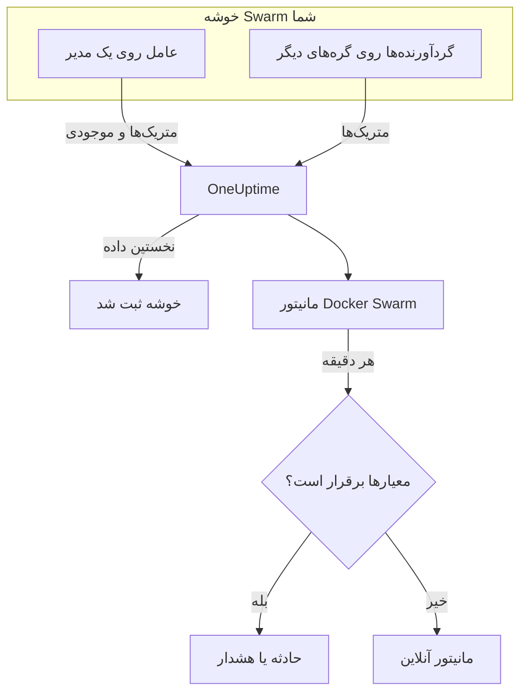

# مانیتور Docker Swarm

مانیتور Docker Swarm کانتینرهای پشت وظایف سرویس‌های یک خوشه Swarm را زیر نظر می‌گیرد و وقتی وظیفه‌ای دوباره راه‌اندازی می‌شود، داغ کار می‌کند یا حافظه‌اش تمام می‌شود به شما خبر می‌دهد. این مانیتور متریک‌های کانتینری را می‌خواند که عامل Docker Swarm در OneUptime می‌فرستد، پس هیچ چیز از بیرون کاوش نمی‌شود: عامل را نصب کنید، سپس مانیتور را از یک الگو یا پرس‌وجوی خودتان بسازید.

از نسخه 0.161.3 فایل‌هایش، عامل هر دقیقه وضعیت خود swarm را هم می‌فرستد، تا یک مانیتور بتواند خود گره‌ها و سرویس‌ها را هم زیر نظر بگیرد: گرهی که آماده نیست، یا سرویسی که کمتر از رونوشت‌هایی که می‌خواهد اجرا می‌کند.

:::cards
- [ساخت مانیتور](#ساخت-یک-مانیتور-docker-swarm): شش گام در داشبورد.
- [الگوها](#الگوهای-هشدار-آماده): هفت هشدار آماده، یک حادثه برای هر گره، سرویس یا وظیفه.
- [متریک‌ها](#متریکهای-جمعآوریشده): متریک‌های کانتینری که می‌توانید بر پایه‌شان هشدار دهید.
- [فیلترها](#تنظیمات-مانیتور): یک مانیتور را به یک سرویس، یک وظیفه یا یک ایمیج محدود کنید.
:::

## چگونه کار می‌کند

عامل Docker Swarm در OneUptime روی یک گره مدیر اجرا می‌شود. گردآورنده آن هر ۳۰ ثانیه آمار کانتینرها را از دیمن Docker همان گره می‌خواند، روی هر دسته نام خوشه، `docker.swarm.cluster.name`، را می‌زند و روی متریک‌های هر وظیفه، سرویس و گره آن را. یک پرسشگر کوچک موجودی در کنار آن هر ۵ دقیقه گره‌ها، سرویس‌ها و وظایف خوشه را از API در Swarm می‌خواند. نخستین داده خوشه را در OneUptime ثبت می‌کند.

پرسشگر هر دقیقه از مدیر هم می‌خواند که هر گره آماده است یا نه و هر سرویس چند رونوشت می‌خواهد و چندتا را اجرا می‌کند، و آن‌ها را به‌صورت متریک می‌فرستد. این‌طور **Node Not Ready** و **Service Replicas Mismatch** ظرف یکی دو دقیقه، نه پنج دقیقه، از گره یا سرویسی که مشکل دارد باخبر می‌شوند.

گردآورنده فقط کانتینرهای گره‌ای را می‌بیند که روی آن اجرا می‌شود. برای گرفتن متریک از همه گره‌ها، گردآورنده را روی هر گره با همان `DOCKER_SWARM_CLUSTER_NAME` اجرا کنید.

مانیتور Docker Swarm به یک خوشه وابسته است. هر دقیقه پرس‌وجوی خود را روی متریک‌های کانتینر آن خوشه اجرا می‌کند و نتیجه را با معیارهایش مقایسه می‌کند.

## پیش از شروع

- **عامل Docker Swarm را نصب کنید**، روی یک گره مدیر. [راهنمای عامل Docker Swarm](/docs/telemetry/docker-swarm) نصب و ارتقای آن و اجرای گردآورنده روی گره‌های دیگر را پوشش می‌دهد.
- **بررسی کنید خوشه ثبت شده باشد.** به محض رسیدن نخستین داده، با نام `DOCKER_SWARM_CLUSTER_NAME` عامل زیر **محصولات ← زیرساخت ← Docker Swarm ← همه خوشه‌ها** پدیدار می‌شود.

## ساخت یک مانیتور Docker Swarm

:::steps
### یک مانیتور تازه شروع کنید

به **مانیتورها** بروید و روی **ساخت مانیتور** کلیک کنید.

### Docker Swarm را برگزینید

زیر **نوع مانیتور**، روی **انواع دیگر مانیتور** کلیک کنید و **Docker Swarm** را زیر **زیرساخت** برگزینید، یا در کادر جست‌وجو `swarm` را تایپ کنید. یک **نام** وارد کنید – در عنوان حادثه‌ها و هشدارها به کار می‌رود – و روی **بعدی** کلیک کنید.

### خوشه را برگزینید

زیر **پیکربندی مانیتور Docker Swarm**، خوشه را از **خوشه Docker Swarm** برگزینید. هر خوشه‌ای که داده فرستاده در فهرست است. پس از انتخاب، خطی زیر فیلد نشان می‌دهد که آیا داده می‌رسد. **افزودن خوشه Docker Swarm** گام‌های راه‌اندازی را با کلیدهای پرشده‌تان باز می‌کند که منتظر نخستین داده می‌مانند.

### برگزینید چه چیزی پایش شود

مانیتور تازه با **Cluster Stopped Reporting** زیر **هشدار برای چه** آغاز می‌شود. برای پایش چیزی دیگر:

- **تغییر** – یک [الگو](#الگوهای-هشدار-آماده) دیگر برگزینید. متریک، تجمیع، بازه زمانی و آستانه‌ها را تعیین می‌کند و معیارهای زیر را با معیارهای خودش جایگزین می‌کند. همچنان می‌توانید **بازه زمانی** را تغییر دهید.
- **Custom Metric** (زیر **فیلدهای بیشتر**) – یک متریک از **متریک Docker Swarm** برگزینید، سپس **تجمیع** و **بازه زمانی** را تعیین کنید. [فیلترها](#تنظیمات-مانیتور) آن را به برخی وظایف محدود می‌کنند.
- **پیشرفته** (زیر **فیلدهای بیشتر**) – پرس‌وجوها و فرمول‌ها را خودتان زیر **انتخاب متریک‌ها** بسازید. برای سنجش جداگانه هر وظیفه از **گروه‌بندی بر اساس** `resource.container.name` استفاده کنید.

### معیارها را بررسی کنید

هر معیار را زیر **معیارها** باز کنید و **متریک**، **تجمیع**، **شرط** و **آستانه** آن را بررسی کنید. الگو این‌ها را پر می‌کند. با **Custom Metric** یا **پیشرفته**، مانیتور با [معیارهای پیش‌فرض](#معیارهای-پیشفرض) شروع می‌شود که فقط نرسیدن داده از متریک را می‌بینند، پس آستانه خودتان را تعیین کنید.

### مانیتور را بسازید

روی **ساخت مانیتور** کلیک کنید. OneUptime صفحه مانیتور را باز می‌کند و آن را هر دقیقه ارزیابی می‌کند. حادثه‌ها و هشدارهایی که باز می‌کند در صفحه‌های **حوادث** و **هشدارها**ی خوشه هم فهرست می‌شوند.
:::

> [!TIP]
> برای راه‌اندازی هم‌زمان چند الگو، خوشه را از **محصولات ← زیرساخت ← Docker Swarm** باز کنید و به **توصیه‌ها** بروید. الگوهای دلخواه و کسانی را که باید خبر داده شوند برگزینید، و OneUptime به ازای هر الگو یک مانیتور می‌سازد.

## تنظیمات مانیتور

| فیلد | زبانه | چه می‌کند |
| --- | --- | --- |
| **خوشه Docker Swarm** | همه | الزامی. هر پرس‌وجو را به `resource.docker.swarm.cluster.name` محدود می‌کند. متریک‌های یک وظیفه، مانند متریک‌های یک میزبان Docker، `container.runtime=docker` را با خود دارند و عامل هرگز `host.name` را نمی‌زند، پس مانیتور بر پایه هیچ‌کدام فیلتر نمی‌کند. |
| **نام سرویس** | Custom Metric، پیشرفته | اختیاری. تطابق دقیق با `resource.docker.swarm.service.name`، یعنی سرویس با نامی که `docker service ls` به آن می‌دهد، برای نمونه `web` (`<stack>_web` در یک پشته). |
| **نام گره** | Custom Metric، پیشرفته | اختیاری. تطابق دقیق با `resource.docker.swarm.node.name`، یعنی نام میزبان گره همان‌طور که `docker node ls` نشان می‌دهد، برای نمونه `swarm-node-1`. عاملی که روی آن گره است، آن را از `DOCKER_SWARM_NODE_NAME` می‌زند. |
| **نام کانتینر** | Custom Metric، پیشرفته | اختیاری. تطابق دقیق با `resource.container.name`. نام کانتینر یک وظیفه `<service>.<slot>.<taskid>` است، برای نمونه `web.1.abc123`. |
| **ایمیج کانتینر** | Custom Metric، پیشرفته | اختیاری. با `resource.container.image.name` تطبیق می‌دهد، با یا بدون digest ایمیج که Swarm آن را سنجاق می‌کند: `nginx:latest` با `nginx:latest@sha256:…` هم تطبیق می‌یابد، اگر خودتان digest بنویسید کنار گذاشته می‌شود، و نامی بدون برچسب به معنای `:latest` است. |
| **متریک Docker Swarm** | Custom Metric | یک متریک از [فهرست](#متریکهای-جمعآوریشده). |
| **تجمیع** | Custom Metric | شیوه ترکیب نمونه‌ها: **میانگین**، **بیشینه**، **کمینه**، **جمع** یا **تعداد**. از تجمیع معمول متریک شروع می‌شود. |
| **بازه زمانی** | همه | پنجره غلتانی که پرس‌وجو می‌خواند، از **Past 1 Minute** تا **Past 365 Days**. مانیتور تازه از **Past 1 Minute** شروع می‌شود؛ الگوها پنجره خودشان را تعیین می‌کنند. |
| **انتخاب متریک‌ها** | پیشرفته | سازنده پرس‌وجو: **متریک**، **تجمیع بر اساس**، **فیلتر بر اساس ویژگی‌ها**، **گروه‌بندی بر اساس**، به همراه **افزودن متریک** و **افزودن فرمول** برای ترکیب پرس‌وجوها. |

> [!NOTE]
> **نام سرویس** و **نام گره** به فایل‌های عامل از نسخه 0.161.2 به بعد نیاز دارند: فایل‌های قدیمی‌تر نه سرویس را می‌فرستند و نه گره را. روی هر گره‌ای که عامل روی آن اجرا می‌شود، [عامل را به‌روزرسانی کنید](/docs/telemetry/docker-swarm#بهروزرسانی-عامل).

## الگوهای هشدار آماده

فهرست **هشدار برای چه** هفت الگو پیشنهاد می‌کند. هر کدام یک مانیتور کامل می‌سازد: یک کوئری، معیاری که فعال می‌شود و معیاری که بازیابی می‌کند. **Node Not Ready** کوئری‌اش را بر اساس گره، `resource.docker.swarm.node.name`، گروه‌بندی می‌کند، **Service Replicas Mismatch** بر اساس سرویس، `resource.docker.swarm.service.name`، و الگوهای وظیفه بر اساس `resource.container.name`، پس هر گره، سرویس یا وظیفه جداگانه سنجیده می‌شود و حادثه و هشدار خودش را می‌گیرد که علت ریشه‌ای آن موارد آسیب‌دیده و مقدارهایشان را فهرست می‌کند. آستانه‌ها نقطه‌های شروعی هستند که می‌توانید ویرایش کنید.

الگوهای وظیفه همچنین فقط وظایف Swarm را می‌خوانند: کانتینری که به هر روش دیگری روی یک گره راه‌اندازی شده، از جمله کانتینر خود عامل، کنار گذاشته می‌شود. یک کوئری **Custom Metric** یا **پیشرفته** هر کانتینری را که عامل گزارش می‌دهد می‌خواند؛ فیلتر **نام سرویس** آن را به وظایف یک سرویس محدود می‌کند.

مگر جدول چیز دیگری بگوید، یک معیار فقط وقتی فعال می‌شود که شرط در همه دقیقه‌های پنجره‌اش برقرار باشد، و ۱۰٪ آن‌سوی آستانه بهبود می‌یابد تا مقداری که حول مرز نوسان دارد مدام جابه‌جا نشود.

| الگو | شدت | چه چیزی را پایش می‌کند | چه وقت فعال می‌شود | چه وقت بهبود می‌یابد |
| --- | --- | --- | --- | --- |
| Cluster Stopped Reporting | بحرانی | `container.memory.percent`، Count روی همه کانتینرهای خوشه، ۱۰ دقیقه گذشته | در تمام پنجره هیچ داده‌ای نیست | داده دوباره می‌رسد |
| Node Not Ready | بحرانی | `docker.swarm.node.ready`، Min به ازای هر `resource.docker.swarm.node.name`، ۵ دقیقه گذشته | کمتر از ۱ | برابر ۱ |
| Service Replicas Mismatch | هشدار | `docker.swarm.service.replicas.desired` − `docker.swarm.service.replicas.running` (هر دو Avg) به ازای هر `resource.docker.swarm.service.name`، ۱۵ دقیقه گذشته | بیش از ۰ | ۰ یا کمتر |
| Task Down (Low Uptime) | بحرانی | `container.uptime`، Min به ازای هر وظیفه، ۱ دقیقه گذشته | هر مقداری کمتر از ۶۰ ثانیه باشد | همه مقدارها ۶۶ ثانیه یا بیشتر باشند |
| High Task CPU Usage | هشدار | `container.cpu.utilization`، Avg به ازای هر وظیفه، ۵ دقیقه گذشته | بیش از ۸۰ (درصدِ یک هسته) | ۷۲ یا کمتر |
| High Task Memory Usage | هشدار | `container.memory.percent`، Avg به ازای هر وظیفه، ۵ دقیقه گذشته | بیش از ۸۵٪ | ۷۶٫۵٪ یا کمتر |
| High Task Process Count | هشدار | `container.pids.count`، Max به ازای هر وظیفه، ۵ دقیقه گذشته | بیش از ۲۰۰۰ | ۱۸۰۰ یا کمتر |

**شدت** برچسبی است که فهرست انتخاب نشان می‌دهد. حادثه و هشداری که یک الگو می‌سازد از شدیدترین شدت حادثه و هشدار پروژه شما شروع می‌شوند؛ آن‌ها را در معیارها تغییر دهید.

> [!NOTE]
> **Cluster Stopped Reporting** وقتی فعال می‌شود که ده دقیقه هیچ چیزی از خوشه نرسد: گره‌هایی که عامل را اجرا می‌کنند از کار افتاده‌اند، یا عامل متوقف شده، مسیرش به OneUptime را از دست داده یا توکنش باطل شده است. وقتی داده برگردد برطرف می‌شود. وقتی داده قطع شود، الگوهای دیگر چیزی برای مقایسه ندارند و آخرین وضعیت خود را نگه می‌دارند، پس این همان الگویی است که به شما خبر می‌دهد. گره‌ای که هیچ وظیفه‌ای ندارد باز هم گزارش می‌دهد، چون عامل خودش به‌صورت یک کانتینر اجرا می‌شود و کانتینر خودش را گزارش می‌دهد.

> [!NOTE]
> **Task Down (Low Uptime)** با یک نمونه تازه تنها فعال می‌شود، چون راه‌اندازی دوباره یک رویداد است، نه یک سطح. Swarm به وظیفه جایگزین یک کانتینر تازه و در نتیجه یک سری تازه می‌دهد، و به همین دلیل الگو به جای ۰ به دنبال مدت روشن‌بودنی کمتر از یک دقیقه می‌گردد. یک استقرار یا افزایش مقیاس هم آن را فعال می‌کند، و وقتی وظایف تازه از یک دقیقه مدت روشن‌بودن گذشتند برطرف می‌شود. وظیفه‌ای که از کار می‌افتد و جایگزین نمی‌شود چیزی نمی‌فرستد، پس گرفته نمی‌شود.

> [!NOTE]
> **Node Not Ready** و **Service Replicas Mismatch** سری‌هایی را می‌خوانند که پرسشگر موجودی عامل از نسخه 0.161.3 فایل‌هایش از یک مدیر می‌فرستد. عامل قدیمی‌تر هیچ‌کدام را نمی‌فرستد، پس هر دو الگو چیزی برای خواندن ندارند و هرگز فعال نمی‌شوند: [عامل را به‌روزرسانی کنید](/docs/telemetry/docker-swarm#بهروزرسانی-عامل)؛ نشانه‌ای کنار نسخه آن در نمای کلی خوشه نشان می‌دهد که چه زمانی عقب است. Service Replicas Mismatch پانزده دقیقه صبر می‌کند تا یک به‌روزرسانی تدریجی، که وظایف یک سرویس را چندتا چندتا جایگزین می‌کند، کسی را فرا نخواند. یک سرویس از نوع کار، وظایفش را تا پایان اجرا می‌کند، رونوشتی ندارد که کم بیاید، و کنار گذاشته می‌شود.

## متریک‌های جمع‌آوری‌شده

گردآورنده عامل از گیرنده `docker_stats` در OpenTelemetry استفاده می‌کند، پس متریک‌ها همان متریک‌های استاندارد کانتینرند، یک سری به ازای هر کانتینر وظیفه. هیچ متریک `docker_swarm_*` وجود ندارد: گره‌ها، سرویس‌ها و وظایف به‌صورت موجودی دنبال می‌شوند، در صفحه‌های **سرویس‌ها**، **وظایف**، **گره‌ها** و صفحه‌های مرتبط خوشه.

در کنار این‌ها، از نسخه 0.161.3 فایل‌هایش، پرسشگر موجودی عامل هر دقیقه وضعیت خود swarm را می‌فرستد: سه متریک زیر [Swarm](#swarm).

### CPU

| متریک | یکا | توضیح |
| --- | --- | --- |
| `container.cpu.utilization` | % | مصرف CPU کانتینر یک وظیفه در هر بازه ۳۰ ثانیه‌ای، که در آن ۱۰۰٪ یک هسته کامل CPU است. |

### حافظه

| متریک | یکا | توضیح |
| --- | --- | --- |
| `container.memory.usage.total` | بایت | حافظه‌ای که کانتینر یک وظیفه مصرف می‌کند. |
| `container.memory.percent` | % | حافظه مصرف‌شده به‌صورت درصدی از محدودیت کانتینر، یا از کل حافظه گره وقتی سرویس محدودیتی تعیین نکرده است. |

### شبکه

| متریک | یکا | توضیح |
| --- | --- | --- |
| `container.network.io.usage.rx_bytes` | بایت | بایت‌های دریافتی کانتینر یک وظیفه. شمارنده‌ای در طول عمر. |
| `container.network.io.usage.tx_bytes` | بایت | بایت‌های ارسالی کانتینر یک وظیفه. شمارنده‌ای در طول عمر. |

### کانتینر

| متریک | یکا | توضیح |
| --- | --- | --- |
| `container.pids.count` | تعداد | تسک‌های درون کانتینر یک تسک: کنترل‌گر pids در cgroup هم رشته‌ها و هم فرایندها را می‌شمارد. افزایش ناگهانی می‌تواند نشانهٔ fork bomb یا نشت رشته باشد. |
| `container.uptime` | ثانیه | مدت زمانی که کانتینر یک وظیفه در حال اجراست. وظیفه‌ای که دوباره زمان‌بندی یا راه‌اندازی شود، کانتینر تازه‌ای را از ۰ شروع می‌کند. |

هر سری هویت کانتینر را به‌صورت ویژگی‌های منبع با خود دارد: `resource.container.name` (`<service>.<slot>.<taskid>`)، `resource.container.image.name`، `resource.docker.swarm.service.name`، `resource.docker.swarm.node.id`، `resource.docker.swarm.node.name` (وقتی عامل نام گره را می‌داند) و `resource.docker.swarm.cluster.name`.

### Swarm

| متریک | یکا | توضیح |
| --- | --- | --- |
| `docker.swarm.node.ready` | — | اینکه یک گره آماده است یا نه، آن‌طور که مدیرها می‌بینند: تا وقتی آماده است ۱، تا وقتی از کار افتاده، قطع‌شده یا نامشخص است ۰. یک سری برای هر گره. |
| `docker.swarm.service.replicas.desired` | count | وظایفی که یک سرویس تکثیرشده یا سراسری می‌خواهد در حال اجرا باشند: رونوشت‌هایش، یا برای سرویس سراسری گره‌هایی که باید روی آن‌ها اجرا شود. یک سری برای هر سرویس. |
| `docker.swarm.service.replicas.running` | count | وظایف سرویس که در حال اجرا هستند. اگر کمتر از تعداد مطلوب باشد، سرویس رونوشت کم دارد. |

سری یک گره `resource.docker.swarm.node.name`، `resource.docker.swarm.node.id` و `resource.docker.swarm.node.role` را دارد؛ سری یک سرویس `resource.docker.swarm.service.name`، `resource.docker.swarm.service.mode` و، در یک پشته، `resource.docker.swarm.stack.namespace` را. هر دو `resource.docker.swarm.cluster.name` را دارند.

## معیارهای مانیتورینگ

یک معیار یکی از پرس‌وجوها یا فرمول‌های مانیتور را با یک آستانه مقایسه می‌کند. معیارهای مانیتور Docker Swarm **نوع فیلتر** ندارند: هر قاعده مقدار متریک را با این فیلدها بررسی می‌کند.

| فیلد | چه می‌کند |
| --- | --- |
| **متریک** | پرس‌وجو یا فرمولی که بررسی می‌شود، بر پایه نام متغیرش. |
| **تجمیع** | اینکه مقدارهای پنجره چطور به یک پاسخ تبدیل می‌شوند: **میانگین**، **جمع**، **مقدار بیشینه**، **مقدار کمینه**، **همه مقادیر** (همه مقدارها باید در کل پنجره جور باشند) یا **هر مقدار** (یکی کافی است). |
| **شرط** | **بزرگ‌تر از**، **کوچک‌تر از**، **بزرگ‌تر یا برابر با**، **کوچک‌تر یا برابر با** یا **برابر با** – یا یک شرط ناهنجاری: **به‌طور غیرعادی بالا**، **به‌طور غیرعادی پایین** یا **غیرعادی**. **بدون داده** وقتی برقرار است که پرس‌وجو در بازه هیچ داده‌ای نفرستاده باشد، و **دارای داده** وقتی که چیزی فرستاده باشد. **پیش‌بینی بالاتر از** و **پیش‌بینی پایین‌تر از** وقتی منطبق‌اند که روند متریک در بازه تا پایان **بازهٔ پیش‌بینی** از آستانه گذشته باشد. |
| **آستانه** | مقداری که با آن مقایسه می‌شود. وقتی متریک یکا دارد، فهرستی از یکاها کنارش هست. برای شرط‌های ناهنجاری نشان داده نمی‌شود. |
| **حساسیت** | فقط شرط‌های ناهنجاری. **پایین** (۴σ)، **متوسط** (۳σ، پیش‌فرض) یا **بالا** (۲σ). |
| **پنجره مبنا** | فقط شرط‌های ناهنجاری. ۱۴ روز (پیش‌فرض)، ۲۸، ۶۰ یا ۹۰ روز سابقه. |
| **اگر داده‌ای نبود** | زیر **فیلدهای بیشتر**. وقتی پنجره هیچ نمونه‌ای ندارد چه شود: **Ignore** (پیش‌فرض)، **Treat As Zero** یا **تریگر**. |

شرط‌های ناهنجاری هر مقدار را با همان ساعت از هفته در خط مبنا مقایسه می‌کنند. تا وقتی پنجره مبنا سابقه کافی نداشته باشد، در وضعیت «Learning» می‌مانند و چیزی پدید نمی‌آورند. این مانیتور پرس‌وجوهایش را با ویژگی‌ها فیلتر می‌کند، پس هر پرس‌وجو، و هر سری از یک پرس‌وجوی گروه‌بندی‌شده، با سابقه خودش مقایسه می‌شود، تا جایی که متریک‌های شما نگهداری می‌شوند. اگر این مدت کمتر از دو هفته باشد، مجموع، شمارش یا پرس‌وجو روی هیستوگرام برای همیشه در همان حالت می‌ماند و هر چیز دیگری با همهٔ سری‌های متریک مقایسه می‌شود. صدک یک هیستوگرام همیشه در همان حالت می‌ماند.

هر معیار همچنین می‌گوید وقتی برقرار شد چه باید کرد: تغییر وضعیت مانیتور، ساختن یک هشدار یا اعلام یک حادثه. معیارها از بالا به پایین بررسی می‌شوند و نخستین معیاری که برقرار شود تصمیم می‌گیرد.

### معیارهای پیش‌فرض

مانیتوری که از الگو نمی‌سازید با دو معیار شروع می‌شود:

| ترتیب | معیار | وقتی برقرار است که | سپس |
| --- | --- | --- | --- |
| ۱ | Check if _monitor name_ is offline | پرس‌وجوی اول در کل بازه هیچ داده‌ای ندارد | مانیتور را **آفلاین** علامت می‌زند و حادثه «_monitor name_ is offline» را اعلام می‌کند، که با بهبود مانیتور خودش برطرف می‌شود. |
| ۲ | Check if _monitor name_ is online | پرس‌وجوی اول داده دارد | مانیتور را **عملیاتی** علامت می‌زند. |

> [!IMPORTANT]
> مقدار `0` هم داده است، پس متریکی که اغلب صفر است، مانند راه‌اندازی‌های دوباره یا خطاها، مانیتور را آفلاین نمی‌کند. برای هشدار روی یک مقدار، از یک الگو شروع کنید یا معیاری با آستانه اضافه کنید. وقتی هیچ داده‌ای نمی‌رسد و هیچ معیاری برقرار نیست، مانیتور وضعیتش را نگه می‌دارد و رخدادهای باز، باز می‌مانند: سکوت به معنای بهبود نیست. زمانی که خود OneUptime داده دریافت نمی‌کرد هرگز «بدون داده» به حساب نمی‌آید: بررسی‌ای که بازه‌اش چنین زمانی دارد منتظر می‌ماند، همان‌طور که [وقتی OneUptime داده دریافت نمی‌کند](/docs/monitor/when-oneuptime-is-not-receiving) توضیح می‌دهد.

## رفع اشکال

:::details خوشه در فهرست Docker Swarm Cluster نیست
خوشه‌ها خودشان از روی داده‌های عامل ثبت می‌شوند. بررسی کنید عامل روی یک گره مدیر در حال اجرا باشد، `DOCKER_SWARM_CLUSTER_NAME` تعیین شده باشد و خوشه زیر **محصولات ← زیرساخت ← Docker Swarm ← همه خوشه‌ها** فهرست شده باشد. [راهنمای عامل Docker Swarm](/docs/telemetry/docker-swarm) بررسی‌هایی را دارد که باید روی گره اجرا کنید.
:::

:::details فقط برخی وظایف متریک دارند
گردآورنده دیمن Docker گره‌ای را می‌خواند که روی آن اجرا می‌شود، پس فقط وظایف همان گره را می‌بیند. گردآورنده را روی هر گره با همان `DOCKER_SWARM_CLUSTER_NAME` اجرا کنید.
:::

:::details مانیتوری که با سرویس یا گره فیلتر شده داده‌ای پیدا نمی‌کند
**نام سرویس** و **نام گره** با `resource.docker.swarm.service.name` و `resource.docker.swarm.node.name` تطبیق می‌دهند که عامل از نسخه 0.161.2 فایل‌هایش به بعد آن‌ها را می‌فرستد: [آن را به‌روزرسانی کنید](/docs/telemetry/docker-swarm#بهروزرسانی-عامل). نام گره از `DOCKER_SWARM_NODE_NAME` در `.env` هر گره می‌آید که اسکریپت نصب آن را می‌نویسد؛ روی گره‌ای که به روش دیگری راه‌اندازی شده، آن را همان‌جا بیفزایید.
:::

:::details همه وظایف به‌صورت یک سری نشان داده می‌شوند
مانند الگوها، بر پایه ویژگی منبع `resource.container.name` گروه‌بندی کنید. `container.name` تنها با هیچ چیزی جور نمی‌شود، پس همه وظایف در یک سری با نام خالی ادغام می‌شوند.
:::

:::details Node Not Ready یا Service Replicas Mismatch هرگز فعال نمی‌شود
هر دو سری‌هایی را می‌خوانند که پرسشگر موجودی عامل از نسخه 0.161.3 فایل‌هایش می‌فرستد، و فقط از یک مدیر: [عامل را به‌روزرسانی کنید](/docs/telemetry/docker-swarm#بهروزرسانی-عامل) و بررسی کنید که پرسشگر موجودی روی یک مدیر اجرا شود (`docker node ls` باید آنجا موفق شود). صفحه **متریک‌ها** خوشه نشان می‌دهد که `docker.swarm.node.ready` می‌رسد یا نه.
:::

## گام‌های بعدی

:::cards
- [عامل Docker Swarm](/docs/telemetry/docker-swarm): عاملی را که این مانیتور می‌خواند نصب و ارتقا دهید.
- [مانیتور Docker](/docs/monitor/docker-monitor): کانتینرهای یک میزبان Docker را پایش کنید.
- [نمای کلی حوادث](/docs/incidents/index): پس از آنکه یک معیار حادثه‌ای اعلام کرد چه اتفاقی می‌افتد.
- [زمان‌بندی‌های آنکال](/docs/on-call/schedules): تصمیم بگیرید وقتی وظیفه‌ای از کار افتاد به چه کسی خبر داده شود.
:::
