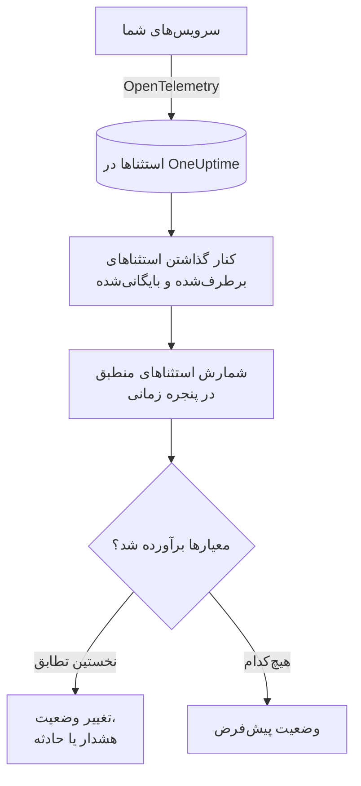

# مانیتور استثناها

مانیتور استثناها استثناهایی را که سرویس‌های شما به OneUptime گزارش می‌دهند و با فیلترهای شما (پیام، نوع استثنا، محیط، سرویس) منطبق‌اند، در یک پنجره زمانی می‌شمارد. وقتی این شمارش معیارهای شما را برآورده کند، وضعیت مانیتور را تغییر می‌دهد، هشدار می‌سازد یا حادثه اعلام می‌کند. از آن برای هشدار روی هر کرش تازه در production، روی یک نوع استثنا یا روی افزایش ناگهانی خطاها استفاده کنید.

:::cards
- [ساخت مانیتور](#ساخت-یک-مانیتور-استثناها): استثناهایی که شمرده می‌شوند و زمان هشدار را انتخاب کنید.
- [محیط‌ها](#محیطها): مانیتور را به `production` محدود کنید.
- [چگونه ارزیابی می‌شود](#چگونه-ارزیابی-میشود): چه چیزی شمرده می‌شود، و برطرف کردن یک استثنا چه اثری دارد.
- [معیارها](#معیارها): شرط‌ها و پیش‌فرض‌ها.
:::

## چگونه کار می‌کند



هر دقیقه، OneUptime استثناهایی را که با فیلترهای مانیتور منطبق‌اند و در پنجره زمانی آن رخ داده‌اند می‌شمارد و استثناهایی را که برطرف‌شده یا بایگانی‌شده علامت زده‌اید کنار می‌گذارد. سپس این شمارش را از بالا به پایین با معیارهای مانیتور می‌سنجد و نخستین معیاری که منطبق شود تعیین می‌کند چه اتفاقی بیفتد. وقتی هیچ‌کدام منطبق نشود، مانیتور به وضعیت پیش‌فرض خود برمی‌گردد.

## پیش از شروع

- سرویس‌های شما استثناها را از طریق OpenTelemetry به OneUptime می‌فرستند. [OpenTelemetry](/docs/telemetry/open-telemetry) را ببینید.
- برای محدود کردن مانیتور به یک محیط، سرویس‌های شما باید ویژگی منبع `deployment.environment` را تنظیم کنند.

## ساخت یک مانیتور استثناها

:::steps
### شروع یک مانیتور تازه

به **مانیتورها** بروید و روی **ساخت مانیتور** کلیک کنید. یا در صفحهٔ یک استثنا، روی **ساخت مانیتور** کنار **رفع** کلیک کنید: مانیتور تازه از همان آغاز نوع آن استثنا را در سرویسش پایش می‌کند و وقتی دوباره رخ دهد هشدار می‌دهد.

### انتخاب نوع استثناها

در **نوع مانیتور**، روی **انواع دیگر مانیتور** کلیک کنید و **استثناها** را زیر **تله‌متری** انتخاب کنید، یا در کادر جستجو `exceptions` را تایپ کنید. یک **نام** وارد کنید و روی **بعدی** کلیک کنید.

### انتخاب اینکه مانیتور دربارهٔ چه چیزی خبر بدهد

زیر **این مانیتور دربارهٔ چه چیزی به شما خبر بدهد؟**، یکی از **هر استثنایی** یا **استثناهای بیش از حد** را انتخاب کنید. هر گزینه قاعده را پر می‌کند و می‌توانید پایین‌تر آن را تغییر دهید. برای اینکه خودتان آن را تنظیم کنید، **مورد دیگر** را انتخاب کنید. **یک استثنای تازه**، **یک استثنای برطرف‌شده برمی‌گردد** و **جهش استثناها** برای استثنایی که نخستین بار دیده می‌شود، برای استثنایی که پس از برطرف کردنش برگشته، و برای افزایشی بسیار بیش از معمول هشدار می‌دهند.

### انتخاب استثناهایی که شمرده می‌شوند

در **استثناهای مورد پایش**، **پیام شامل**، **انواع استثنا** و **Environments** را تنظیم کنید. فیلتری که خالی بگذارید با همهٔ استثناها منطبق است. **استثناهای منطبق**، زیر فیلترها، استثناهایی را نشان می‌دهد که همین حالا با آن‌ها منطبق‌اند.

### محدودتر کردن آن‌ها (اختیاری)

برای فیلتر بر اساس سرویس تله‌متری یا موجودیت زیرساخت، یا برای اینکه استثناهای برطرف‌شده و بایگانی‌شده هم شمرده شوند، **فیلدهای بیشتر** را باز کنید.

### تعیین اینکه چه وقت هشدار داده شود

در **چه وقت هشدار داده شود**، یک **شرط**، **تعداد استثناها** و یک **بازه زمانی** انتخاب کنید. جملهٔ زیر آن‌ها قاعده را با زبانی ساده بازگو می‌کند. نمودار زیر آن، استثناهای منطبق را در هر پنجره در چند ساعت گذشته می‌شمارد، عدد قاعده را به‌صورت یک خط می‌کشد و می‌گوید قاعده چند بار هشدار می‌داد. دکمهٔ آن عددی را پیشنهاد می‌کند که قاعده در آن مدت از آن نمی‌گذشت. **هشدار بر اساس** تعیین می‌کند قاعده چه چیزی را مقایسه کند: **استثناها**، **استثناهای تازه**، **استثناهای برگشته** یا **افزایشی بیش از معمول**. نمودار فقط برای **استثناها** رسم می‌شود.

### انتخاب اینکه چه اتفاقی می‌افتد

در **چه اتفاقی می‌افتد**، یکی از **ساخت هشدار**، **اعلام حادثه** یا **هر دو** را انتخاب کنید و به آن عنوان و شدت بدهید. تا وقتی قاعده منطبق است، مانیتور وضعیتی را که زیر **فیلدهای بیشتر** آمده نشان می‌دهد؛ وقتی دیگر منطبق نباشد، مانیتور به وضعیت پیش‌فرض خود برمی‌گردد و هشدار یا حادثه خودبه‌خود رفع می‌شود.

### ساخت مانیتور

روی **ساخت مانیتور** کلیک کنید. مانیتور در صفحهٔ **نمای کلی** خود باز می‌شود و نخستین ارزیابی آن ظرف یک دقیقه اجرا می‌شود.
:::

## چه چیزی را پرس‌وجو می‌کند

| فیلد | با چه چیزی منطبق است | پیش‌فرض |
| --- | --- | --- |
| **پیام شامل** | استثناهایی که پیامشان این متن را دارد، بدون توجه به بزرگی و کوچکی حروف. | خالی: همهٔ استثناها |
| **انواع استثنا** | استثناهایی از هر یک از این نوع‌ها، جداشده با ویرگول، مثل `TypeError, NullReferenceException`. نام نوع باید دقیقاً منطبق باشد. | خالی: همهٔ نوع‌ها |
| **Environments** | استثناهایی از هر یک از این محیط‌ها، جداشده با ویرگول ([محیط‌ها](#محیطها) را ببینید). | خالی: همهٔ محیط‌ها |
| **بازه زمانی** (در **چه وقت هشدار داده شود**) | استثناهای ۵ ثانیهٔ گذشته تا ۲۴ ساعت گذشته. | **۵ دقیقه گذشته** |
| **فیلتر بر اساس سرویس تله‌متری** (زیر **فیلدهای بیشتر**) | استثناهای هر یک از سرویس‌های انتخاب‌شده. | خالی: همهٔ سرویس‌ها |
| **فیلتر بر اساس موجودیت زیرساخت** (زیر **فیلدهای بیشتر**) | استثناهای هر یک از میزبان‌ها، پادها، کانتینرها و دیگر موجودیت‌های انتخاب‌شده. | خالی: همهٔ موجودیت‌ها |
| **شامل استثناهای برطرف‌شده** (زیر **فیلدهای بیشتر**) | استثناهایی را هم که برطرف‌شده علامت خورده‌اند می‌شمارد. | خاموش |
| **شامل استثناهای بایگانی‌شده** (زیر **فیلدهای بیشتر**) | استثناهایی را هم که بایگانی شده‌اند می‌شمارد. | خاموش |

برای اینکه یک استثنا شمرده شود، باید با همهٔ فیلترهایی که تنظیم کرده‌اید منطبق باشد.

### محیط‌ها

محیط‌ها از ویژگی منبع OpenTelemetry به نام `deployment.environment` روی هر استثنا می‌آیند، همان مقداری که کاوشگر استثناها با `env:production` بر اساس آن فیلتر می‌کند. یک محیط، یا چند محیط جداشده با ویرگول، وارد کنید؛ یک استثنا وقتی شمرده می‌شود که محیطش با هر یک از آن‌ها منطبق باشد.

تطابق دقیق و حساس به بزرگی و کوچکی حروف است: `production` با `Production` یا `prod` منطبق نیست. وقتی این فیلتر تنظیم شده باشد، استثناهای بدون محیط شمرده نمی‌شوند. برای شمردن استثناهای همهٔ محیط‌ها، از جمله آن‌هایی که محیط ندارند، آن را خالی بگذارید.

فیلتر محیط با همهٔ فیلترهای دیگر ترکیب می‌شود، پس مانیتوری که به یک سرویس تله‌متری و `production` محدود شده فقط استثناهای production همان سرویس را می‌شمارد.

هنگام ساخت مانیتور از طریق API، `environments` را در `exceptionMonitor` مرحله روی فهرستی از نام محیط‌ها تنظیم کنید:

```json
{
  "exceptionMonitor": {
    "telemetryServiceIds": [],
    "environments": ["production"],
    "exceptionTypes": [],
    "message": "",
    "includeResolved": false,
    "includeArchived": false,
    "lastXSecondsOfExceptions": 300
  }
}
```

## چگونه ارزیابی می‌شود

- **هر دقیقه.** مانیتور استثناها را پراب‌ها بررسی نمی‌کنند، پس بازه‌ای برای تنظیم ندارد و صفحهٔ **پراب‌ها و بازه** هم ندارد.
- **رخدادها، نه نوع استثناها.** مانیتور هر باری را که یک استثنای منطبق در **بازه زمانی** رخ داده می‌شمارد. استثنایی که ۴۰ بار پرتاب شده، ۴۰ شمرده می‌شود.
- **استثناهای برطرف‌شده و بایگانی‌شده کنار گذاشته می‌شوند.** مگر اینکه **شامل استثناهای برطرف‌شده** یا **شامل استثناهای بایگانی‌شده** را روشن کنید، رخدادهای استثنایی که برطرف‌شده یا بایگانی‌شده علامت زده‌اید شمرده نمی‌شوند. بنابراین برطرف‌شده علامت زدن یک استثنا می‌تواند حادثه‌ای را که باز کرده ببندد. وقتی یک استثنای برطرف‌شده دوباره رخ دهد، به‌طور خودکار از حالت برطرف‌شده بیرون می‌آید و دوباره شمرده می‌شود.
- **نبود استثنا یعنی شمارش ۰.**
- **قطعی خود OneUptime سکوت نیست.** تا وقتی پنجره زمانی شامل زمانی است که خود OneUptime داده دریافت نمی‌کرد (در حال راه‌اندازی دوباره، ارتقا یا جبران عقب‌ماندگی بود)، بررسی صبر می‌کند: وضعیت تغییر نمی‌کند و هیچ حادثه یا هشداری باز یا رفع نمی‌شود. [وقتی OneUptime داده دریافت نمی‌کند](/docs/monitor/when-oneuptime-is-not-receiving) را ببینید.
- **معیارها از بالا به پایین.** نخستین معیاری که منطبق شود تصمیم می‌گیرد، پس شدیدترین را اول بگذارید.

هر تغییر وضعیت، همراه با دلیل آن، در **خط زمانی وضعیت** مانیتور ثبت می‌شود.

## معیارها

معیارهای مانیتور استثناها چهار **نوع فیلتر** دارند: **Exception Count**، یعنی تعداد استثناهایی که در پنجره منطبق شدند، و **New Exceptions**، **Regressed Exceptions** و **Exception Increase (in %)** که در ادامه آمده‌اند. **چه وقت هشدار داده شود** یک معیار تنظیم می‌کند که **شرط** آن یکی از **بیشتر از**، **دست‌کم**، **کمتر از**، **حداکثر** یا **دقیقاً** است. برای چند معیار، یا معیاری با بیش از یک فیلتر، زیر **فیلدهای بیشتر** در **چه اتفاقی می‌افتد** روی **ویرایش به‌عنوان معیارهای سفارشی** کلیک کنید: هر معیار در آنجا یک **شرط فیلتر** و یک **مقدار** دارد.

| شرط فیلتر | منطبق است وقتی شمارش استثنا… |
| --- | --- |
| **بزرگ‌تر از** | بیشتر از مقدار باشد |
| **بزرگ‌تر یا برابر با** | برابر مقدار یا بیشتر از آن باشد |
| **کوچک‌تر از** | کمتر از مقدار باشد |
| **کوچک‌تر یا برابر با** | برابر مقدار یا کمتر از آن باشد |
| **برابر با** | دقیقاً برابر مقدار باشد |
| **نابرابر با** | هر چیزی جز مقدار باشد |

شمارش استثناها شرط ناهنجاری ندارد: مبنایی برای مقایسه با آن‌ها وجود ندارد.

مانیتور استثناهایی که در «ساخت مانیتور» ساخته شود، با قاعدهٔ همان گزینه‌ای شروع می‌شود که زیر **این مانیتور دربارهٔ چه چیزی به شما خبر بدهد؟** انتخاب کرده‌اید:

| گزینه | قاعده | چه اتفاقی می‌افتد |
| --- | --- | --- |
| **هر استثنایی** | **بیشتر از** `0` در **۵ دقیقه گذشته** | هشدار می‌سازد که خودبه‌خود رفع می‌شود |
| **استثناهای بیش از حد** | **بیشتر از** `20` در **۵ دقیقه گذشته** | هشدار می‌سازد که خودبه‌خود رفع می‌شود |
| **یک استثنای تازه** | **استثناهای تازه**: **بیشتر از** `0` در **۱۰ دقیقه گذشته** | هشدار می‌سازد که خودبه‌خود رفع می‌شود |
| **یک استثنای برطرف‌شده برمی‌گردد** | **استثناهای برگشته**: **بیشتر از** `0` در **۱۰ دقیقه گذشته** | هشدار می‌سازد که خودبه‌خود رفع می‌شود |
| **جهش استثناها** | **افزایشی بیش از معمول**: **بیشتر از** `200` در **۱۵ دقیقه گذشته** | هشدار می‌سازد که خودبه‌خود رفع می‌شود |

مانیتور استثناهایی که از راه API یا Terraform بدون معیار ساخته شود، با این معیارها شروع می‌شود:

| معیار | فیلتر | اثر |
| --- | --- | --- |
| Check if … has exceptions | **Exception Count** **بزرگ‌تر از** `0` | مانیتور را آفلاین علامت می‌زند و حادثه‌ای اعلام می‌کند که خودکار رفع می‌شود |
| Check if … has no exceptions | **Exception Count** **برابر با** `0` | مانیتور را آنلاین علامت می‌زند |

## استثناهای تازه، برگشته و در حال جهش

افزون بر تعداد استثناها، مانیتور استثناها می‌تواند برای چیزهایی هشدار دهد که یک ردیاب خطا با آن‌ها آغاز می‌کند. هر کدام فقط وقتی خوانده می‌شود که معیاری آن را بررسی کند.

| نوع فیلتر | آنچه در پنجره می‌شمارد |
| --- | --- |
| **New Exceptions** | استثناهای منطبقی که نخستین بار دیده شده‌اند و نه برطرف‌شده‌اند و نه بایگانی‌شده. |
| **Regressed Exceptions** | استثناهای منطبقی که برطرفشان کرده‌اید، برگشته‌اند و هنوز باز هستند. |
| **Exception Increase (in %)** | تعداد استثناهای منطبق چقدر از معمول بیشتر است: روز پیش از پنجره، به ازای هر پنجره با همان طول، دست‌کم یک. ده استثنا پس از روزی آرام ۹۰۰٪ است. |

استثناهای تازه و برگشته بر اساس سرویس، نوع استثنا، محیط و پیام فیلتر می‌شوند و بر اساس موجودیت زیرساخت هم: یک استثنا وقتی شمرده می‌شود که یکی از رخدادهایش در پنجره از یکی از موجودیت‌های انتخاب‌شده آمده باشد.

## مثال کاربردی: فقط استثناهای production

می‌خواهید هر بار که API در production استثنا پرتاب می‌کند حادثه‌ای اعلام شود، و برای staging هیچ. **هر استثنایی** را انتخاب می‌کنید، **Environments** را روی `production` می‌گذارید، **بازه زمانی** را روی **۵ دقیقه گذشته** نگه می‌دارید و زیر **چه اتفاقی می‌افتد** گزینهٔ **اعلام حادثه** را انتخاب می‌کنید. در پنج دقیقهٔ گذشته:

| استثناها | محیط | حالت | شمرده می‌شود؟ |
| --- | --- | --- | --- |
| `TypeError` × ۳ | `production` | فعال | بله: ۳ |
| `TypeError` × ۴۰ | `staging` | فعال | نه: محیطی دیگر |
| `TimeoutError` × ۲ | هیچ | فعال | نه: بدون محیط |
| `NullReferenceException` × ۴ | `production` | پس از رخ دادن برطرف شد | نه: برطرف‌شده |

**Exception Count** برابر ۳ است، پس **بیشتر از** `0` منطبق می‌شود: مانیتور آفلاین می‌شود و حادثه‌ای اعلام می‌شود. وقتی پنج دقیقه بدون هیچ استثنای فعالی در production بگذرد، قاعده دیگر منطبق نیست، مانیتور به وضعیت پیش‌فرض خود برمی‌گردد و حادثه خودبه‌خود رفع می‌شود.

## رفع اشکال

:::details استثناها در کاوشگر دیده می‌شوند، اما مانیتور ۰ می‌شمارد
مقدار **Environments** را با فیلتر `env:` کاوشگر مقایسه کنید: تطابق دقیق و حساس به بزرگی و کوچکی حروف است، و وقتی فیلتر تنظیم شده باشد استثناهای بدون محیط کنار گذاشته می‌شوند. سپس بررسی کنید آیا آن استثناها برطرف‌شده یا بایگانی‌شده‌اند. صفحهٔ **معیارها** را در مانیتور (زیر **پیکربندی**) باز کنید و روی **Edit Monitoring Criteria** کلیک کنید: **استثناهای منطبق** نشان می‌دهد فیلترها با چه چیزی منطبق‌اند.
:::

:::details وقتی استثنا را برطرف‌شده علامت زدم، حادثه رفع شد
این رفتار مورد انتظار است. استثناهای برطرف‌شده شمرده نمی‌شوند، پس شمارش کاهش یافت و معیار دیگر منطبق نشد. اگر استثنا دوباره رخ دهد، از حالت برطرف‌شده بیرون می‌آید و دوباره شمرده می‌شود. برای شمردن آن‌ها در هر حال، **شامل استثناهای برطرف‌شده** را روشن کنید.
:::

:::details فیلتر نوع استثنا با هیچ چیزی منطبق نمی‌شود
**انواع استثنا** دقیقاً با نام نوعی که استثنا با آن گزارش شده مقایسه می‌شوند، مثل `TypeError`. نوع را از کاوشگر استثناها کپی کنید.
:::

## گام‌های بعدی

:::cards
- [مانیتور ترِیس‌ها](/docs/monitor/traces-monitor): روی اسپن‌ها و endpointهای ناموفق هشدار بگیرید.
- [مانیتور لاگ‌ها](/docs/monitor/logs-monitor): روی حجم و محتوای لاگ هشدار بگیرید.
- [قالب‌بندی حادثه و هشدار](/docs/monitor/incident-alert-templating): عنوان و توضیحات مفیدی برای هشدارها بنویسید.
- [OpenTelemetry](/docs/telemetry/open-telemetry): استثناها را به OneUptime بفرستید.
:::
