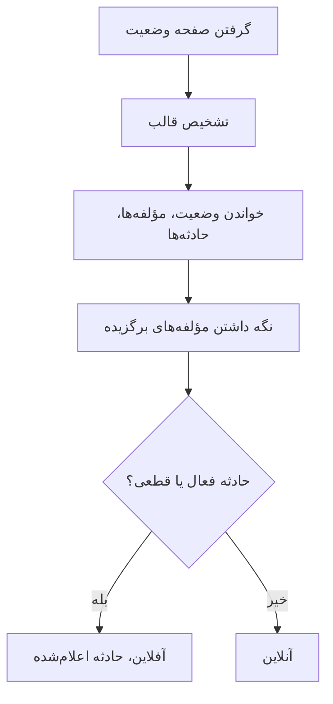

# مانیتور صفحه وضعیت خارجی

مانیتور صفحه وضعیت خارجی صفحه وضعیت عمومی سرویسی را که به آن وابسته‌اید زیر نظر می‌گیرد — AWS، ‏GCP، ‏Azure، ‏GitHub، ‏OpenAI، ‏Anthropic و بسیاری دیگر — و وقتی آن ارائه‌دهنده از قطعی یا کاهش کارایی خبر می‌دهد به شما هشدار می‌دهد. از آن استفاده کنید تا به محض اینکه ارائه‌دهنده مشکلات بالادستی را گزارش داد از آن‌ها باخبر شوید، و آن‌ها را از مشکلات خودتان جدا کنید.

صفحه‌های وضعیتی را هم که با OneUptime ساخته شده‌اند منبع به منبع می‌خواند، و نگهداری برنامه‌ریزی‌شده را از قطعی جدا می‌کند: پروژهٔ تیمی دیگر را بپایید، یا فروشنده‌ای را که صفحه وضعیتش روی OneUptime اجرا می‌شود.

:::cards
- [مانیتور را بسازید](#ساخت-مانیتور-صفحه-وضعیت-خارجی): نشانی یک صفحه وضعیت را بچسبانید و برگزینید چه چیزی پاییده شود.
- [مؤلفه‌ها را برگزینید](#مؤلفهها): فقط مؤلفه‌هایی را بپایید که به آن‌ها وابسته‌اید.
- [معیارها](#معیارهای-پایش): به‌طور پیش‌فرض چه چیزی از کار افتاده به شمار می‌آید.
- [صفحه‌های وضعیت OneUptime](#صفحههای-وضعیت-oneuptime): منبع‌های پروژه‌ای دیگر، و نگهداری آن.
- [صفحه‌های وضعیت پرکاربرد](#نشانی-صفحههای-وضعیت-پرکاربرد): نشانی سرویس‌هایی که بیشتر تیم‌ها به آن‌ها وابسته‌اند.
:::

## چگونه کار می‌کند

در هر بررسی، یک پراب صفحه وضعیت را می‌گیرد، قالب آن را تشخیص می‌دهد، و وضعیت کلی، مؤلفه‌ها و حادثه‌های فعال را می‌خواند. اگر مؤلفه‌ها یا یک گروه مؤلفه را برگزیده باشید، فقط همان‌ها شمرده می‌شوند. سپس معیارها تصمیم می‌گیرند که مانیتور آنلاین است یا آفلاین.

می‌توانید از آن برای این کارها استفاده کنید:

- پایش دسترس‌پذیری سرویس‌های شخص ثالثی که برنامه شما به آن‌ها وابسته است
- گرفتن هشدار وقتی ارائه‌دهندگان بالادستی دچار قطعی می‌شوند
- ردیابی وضعیت تک‌تک مؤلفه‌ها
- پاییدن فقط مؤلفه‌هایی که به آن‌ها وابسته‌اید (برای نمونه Git Operations و Pull Requests در GitHub، یا گروه "APIs" در OpenAI)، تا حادثه‌های نامرتبط در جاهای دیگر صفحه مانیتور شما را فعال نکنند
- شناسایی کاهش کارایی پیش از آنکه بر کاربرانتان اثر بگذارد
- پیوند دادن حادثه‌های خودتان با مشکلات ارائه‌دهندگان بالادستی

## ارائه‌دهندگان پشتیبانی‌شده

| ارائه‌دهنده | توضیح |
| ------------------------ | ---------------------------------------------------------------------- |
| **Auto** (پیش‌فرض) | قالب صفحه وضعیت را خودکار تشخیص می‌دهد |
| **Atlassian Statuspage** | صفحه‌های وضعیتی که بر پایه Atlassian Statuspage کار می‌کنند (JSON API) |
| **incident.io** | صفحه‌های وضعیتی که بر پایه incident.io کار می‌کنند (برای نمونه `https://status.openai.com`) |
| **OneUptime Status Page** | صفحه‌های وضعیتی که با OneUptime ساخته شده‌اند: وضعیت هر منبع، و آنچه زیر نگهداری است |
| **RSS** | صفحه‌های وضعیتی که خوراک RSS دارند |
| **Atom** | صفحه‌های وضعیتی که خوراک Atom دارند |

### تشخیص خودکار

وقتی روی **Auto** تنظیم شده باشد، OneUptime قالب صفحه وضعیت را به این ترتیب خودکار تشخیص می‌دهد:

1. نخست، API صفحه وضعیت incident.io ‏(`/proxy/<host>`) را می‌آزماید.
2. سپس، JSON API ‏Atlassian Statuspage ‏(`/api/v2/status.json`، `/api/v2/components.json` و `/api/v2/incidents/unresolved.json`) را می‌آزماید.
3. سپس خلاصهٔ یک صفحه وضعیت OneUptime ‏(`/status-page-api/summary/<page>`) را درخواست می‌کند.
4. اگر این‌ها شکست بخورند، می‌کوشد صفحه را به‌صورت خوراک RSS یا Atom تجزیه کند.
5. در آخرین گام، یک بررسی ساده دسترس‌پذیری HTTP انجام می‌دهد.

> [!NOTE]
> ‏incident.io نخست بررسی می‌شود چون برخی صفحه‌های وضعیت incident.io (مانند `https://status.openai.com`) یک endpoint محدود و سازگار با Atlassian هم دارند که گروه‌های مؤلفه و حادثه‌های فعال را کنار می‌گذارد. بررسی نخستِ incident.io تضمین می‌کند که داده‌های غنی‌تر و گروه‌دار به کار روند.

بررسی دسترس‌پذیری همچنین جایگزین است وقتی ارائه‌دهنده‌ای که صریحاً برگزیده‌اید شکست بخورد. این بررسی فقط می‌گوید آیا صفحه پاسخ می‌دهد — آنلاین با پاسخ `2xx` یا `3xx` — و هیچ مؤلفه یا حادثه‌ای گزارش نمی‌دهد.

## ساخت مانیتور صفحه وضعیت خارجی

:::steps
### یک مانیتور تازه آغاز کنید

به **مانیتورها** بروید و روی **ساخت مانیتور** کلیک کنید. در **نوع مانیتور** روی **انواع دیگر مانیتور** کلیک کنید و **External Status Page** را زیر **Basic Monitoring** برگزینید، یا در جعبه جست‌وجو `statuspage` را تایپ کنید. یک **نام** وارد کنید و سپس روی **بعدی** کلیک کنید.

### نشانی صفحه وضعیت را وارد کنید

‏**نشانی صفحه وضعیت** را وارد کنید. ‏**ارائه‌دهنده** را روی **Auto** بگذارید، مگر اینکه قالب را بدانید.

### در صورت نیاز مؤلفه‌ها را برگزینید

‏**مؤلفه‌ها** را باز کنید و مؤلفه‌هایی را که به آن‌ها وابسته‌اید از فهرست خود صفحه برگزینید، مانند `Git Operations` و `Pull Requests` در صفحه GitHub؛ برای پاییدن کل صفحه، آن را خالی بگذارید. برای پاییدن یک گروه به جای آن، **فیلدهای بیشتر** را باز کنید و یک **Component Group Filter**، مانند `APIs`، وارد کنید.

### آن را بیازمایید

روی **آزمایش مانیتور** کلیک کنید تا صفحه یک بار گرفته شود، و ارائه‌دهنده، مؤلفه‌ها و حادثه‌هایی را که پیدا کرده بررسی کنید.

### معیارها را بازبینی کنید

گام معیارها با [معیارهای پیش‌فرض](#معیارهای-پیشفرض) آغاز می‌شود، که وقتی ارائه‌دهنده یک حادثه فعال یا قطعی در دامنه گزارش دهد مانیتور را آفلاین علامت می‌زنند. اگر لازم است آن‌ها را تغییر دهید، سپس روی **بعدی** کلیک کنید.

### پراب‌ها را برگزینید و بسازید

‏**پراب‌ها** و یک **بازه پایش** برگزینید — که از **هر ۵ دقیقه** آغاز می‌شود — سپس روی **ساخت مانیتور** کلیک کنید.
:::

## گزینه‌های پیکربندی

| گزینه | چه وارد کنید | پیش‌فرض |
| --- | --- | --- |
| **نشانی صفحه وضعیت** | نشانی صفحه وضعیت. برای سایت‌هایی که بر پایه Atlassian Statuspage و incident.io کار می‌کنند، معمولاً نشانی ریشه است (برای نمونه `https://status.example.com`). برای خوراک‌های RSS/Atom، نشانی خوراک را مستقیم وارد کنید. | — |
| **ارائه‌دهنده** | ‏**Auto** برای تشخیص قالب، یا **Atlassian Statuspage**، ‏**incident.io**، ‏**OneUptime Status Page**، ‏**RSS** یا **Atom** اگر آن را می‌دانید. | **Auto** |
| **مؤلفه‌ها** | مؤلفه‌هایی که پاییده می‌شوند، برگزیده از فهرست خود صفحه یا تایپ‌شده. | کل صفحه |
| **Component Group Filter** | گروهی که دامنه مانیتور به آن محدود می‌شود. زیر **فیلدهای بیشتر**. | همه گروه‌ها |
| **وقفه (میلی‌ثانیه)** | بیشترین زمان انتظار برای صفحه وضعیت. زیر **فیلدهای بیشتر**. | `10000` (۱۰ ثانیه) |
| **تلاش‌های مجدد** | پس از شکست تلاش نخست، چند بار با فاصله یک ثانیه دوباره تلاش شود؛ `0` یعنی یک تلاش. زیر **فیلدهای بیشتر**. | `3` (تا ۴ تلاش) |

### مؤلفه‌ها

مؤلفه‌هایی را که به آن‌ها وابسته‌اید برگزینید، و مانیتور فقط آن‌ها را می‌پاید: **External Status Page Component Status** فقط وضعیت آن‌ها را مقایسه می‌کند، وضعیت کلی بدترین وضعیت میان آن‌هاست، و **External Status Page Active Incidents** فقط حادثه‌هایی را می‌شمارد که دست‌کم بر یکی از آن‌ها اثر می‌گذارند. هر چند مؤلفه که برگزینید، باز هم یک بررسی از صفحه است.

وقتی **مؤلفه‌ها** را باز می‌کنید، مرورگرتان فهرست خود صفحه را از یک Atlassian Statuspage، یک صفحه incident.io یا یک صفحه وضعیت OneUptime می‌خواند، و آن را در گروه‌های صفحه نشان می‌دهد؛ هر مؤلفه‌ای که عملیاتی نیست می‌گوید در چه وضعی است. نامی که برمی‌گزینید مؤلفه‌ای را می‌پاید که دقیقاً همان نام را دارد، بدون توجه به بزرگی و کوچکی حروف: `Copilot` در صفحه GitHub همان `Copilot AI Model Providers` نیست.

وقتی فهرست را نمی‌توان خواند (یک صفحه داخلی، صفحه‌ای که فهرستش را با مرورگر شما به اشتراک نمی‌گذارد، یک خوراک RSS یا Atom)، یک نام تایپ کنید و Enter را بزنید. `*` به جای هر متنی می‌نشیند: `*us-east-1*` هر مؤلفه‌ای را می‌پاید که `us-east-1` در نامش باشد. در خوراک RSS یا Atom، آیتمی شمرده می‌شود که عنوانش یکی از نام‌ها را داشته باشد.

تا وقتی مؤلفه‌های برگزیده را می‌پایید، حادثه‌ای که نام هیچ مؤلفه‌ای را نمی‌برد شمرده نمی‌شود: چیزی نمی‌گوید که بر آن‌ها اثر می‌گذارد. اگر چیزی برنگزیده باشید، مانیتور کل صفحه را می‌پاید و همه حادثه‌ها شمرده می‌شوند.

مانیتوری که با فیلتر نام مؤلفه قدیمی ذخیره شده، همان چیزی را می‌پاید که می‌پایید: فیلتر در **مؤلفه‌ها** به صورت همان نام میان دو ستاره نشان داده می‌شود، مانند `*API*`، که با هر مؤلفه‌ای که نامش آن را دارد تطبیق می‌یابد.

> [!WARNING]
> نامی که با هیچ چیز تطبیق نیابد هیچ چیز را نمی‌پاید، و سالم به نظر می‌رسد. **مؤلفه‌ها** و **آزمایش مانیتور** هر دو مؤلفه‌های برگزیده‌ای را که صفحه فهرست نمی‌کند نام می‌برند.

### Component Group Filter

اگر صفحه وضعیت مؤلفه‌هایش را در گروه‌هایی سازمان داده باشد، می‌توانید دامنه مانیتور را به یک گروه محدود کنید. برای نمونه، در `https://status.openai.com` وارد کردن `APIs` دامنه مانیتور را به سرویس‌های API ‏OpenAI محدود می‌کند.

وقتی یک گروه مؤلفه تنظیم شده باشد، **شمار حادثه‌های فعال** و **وضعیت کلی** فقط با مؤلفه‌های آن گروه محاسبه می‌شوند — حادثه‌ای که گروهی نامرتبط (برای نمونه ChatGPT) را تحت تأثیر قرار دهد، مانیتوری را که به گروه "APIs" محدود شده فعال نمی‌کند. وقتی مؤلفه‌ها هم برگزیده شده باشند، فقط مؤلفه‌های برگزیده آن گروه شمرده می‌شوند.

فیلتر کردن بر پایه گروه مؤلفه برای ارائه‌دهندگان **Atlassian Statuspage**، ‏**incident.io** و **OneUptime Status Page** پشتیبانی می‌شود. خوراک‌های RSS و Atom گروه مؤلفه ندارند.

## معیارهای پایش

می‌توانید معیارهایی پیکربندی کنید تا تعیین شود سرویس خارجی چه زمانی آنلاین یا آفلاین به شمار می‌آید، بر پایه:

| نوع فیلتر | آنچه بررسی می‌کند | شرط‌های فیلتر |
| --- | --- | --- |
| **External Status Page Is Online** | آیا صفحه وضعیت در دسترس است و داده وضعیت برمی‌گرداند | درست یا نادرست |
| **External Status Page Overall Status** | وضعیت کلی‌ای که صفحه گزارش می‌دهد | برابر با، نابرابر با، شامل است، شامل نیست، شروع می‌شود با، تمام می‌شود با |
| **External Status Page Component Status** | وضعیت هر مؤلفه درون دامنه (مؤلفه‌های برگزیده، یا مؤلفه‌های گروه، وقتی تنظیم شده باشند): عملیاتی، Under Maintenance، Degraded Performance، Partial Outage، Major Outage یا Full Outage | برابر با، نابرابر با، شامل است، شامل نیست، شروع می‌شود با، تمام می‌شود با |
| **External Status Page Active Incidents** | شمار حادثه‌های فعال کنونی گزارش‌شده در صفحه وضعیت (وقتی مؤلفه‌ها یا گروهی برگزیده شده باشد، فقط آن‌هایی که بر مؤلفه‌ای درون دامنه اثر می‌گذارند) | برابر با، نابرابر با، و مقایسه‌های عددی |
| **External Status Page Response Time (in ms)** | گرفتن داده‌های صفحه وضعیت چه مدت طول می‌کشد | بزرگ‌تر از، کوچک‌تر از، بزرگ‌تر یا برابر با، کوچک‌تر یا برابر با |

وضعیت کلی همان چیزی است که صفحه می‌گوید، پس مقدارهایش از ارائه‌دهنده‌ای به ارائه‌دهنده دیگر فرق می‌کند: یک Atlassian Statuspage توضیح خودش را گزارش می‌دهد، مانند `All Systems Operational`؛ یک صفحه وضعیت OneUptime بدترین وضعیت میان مؤلفه‌های درون دامنه‌اش را، مانند `under_maintenance`؛ یک خوراک `operational` یا `degraded_performance` را گزارش می‌دهد؛ بررسی دسترس‌پذیری `reachable` یا `unreachable` را گزارش می‌دهد. وقتی مؤلفه‌ها یا گروهی برگزیده شده باشد، در هر صفحه‌ای بدترین وضعیت میان آن‌هاست. این مقایسه‌ها به بزرگی و کوچکی حروف حساس‌اند. برای هشدار درباره قطعی‌ها، **External Status Page Active Incidents** و **External Status Page Component Status** معمولاً قابل‌اعتمادترند.

در خوراک RSS یا Atom، آیتم‌های ۲۴ ساعت گذشته حادثه فعال به شمار می‌آیند: آیتم RSS بر پایه تاریخ انتشارش، و ورودی Atom بر پایه تاریخ به‌روزرسانی‌اش. آیتمی که تاریخش در آینده است تا آن تاریخ به شمار نمی‌آید.

### معیارهای پیش‌فرض

به‌طور پیش‌فرض، OneUptime معیارهایی را بر پایه آنچه واقعاً برای یک صفحه وضعیت مهم است می‌سازد — حادثه‌های فعال و سلامت مؤلفه‌های آن، نه صرفاً دسترس‌پذیری:

| معیار | فیلترها | اثر |
| --- | --- | --- |
| Offline | **دست‌کم یکی** از این‌ها: صفحه آنلاین نیست؛ دست‌کم یک حادثه فعال در دامنه هست؛ یک مؤلفه در دامنه Degraded Performance، ‏Partial Outage، ‏Major Outage یا Full Outage گزارش می‌دهد | مانیتور را آفلاین علامت می‌زند و حادثه‌ای اعلام می‌کند، که وقتی معیار دیگر تطبیق نیابد خودبه‌خود رفع می‌شود |
| Online | **همه** این‌ها: صفحه آنلاین است؛ هیچ حادثه فعالی در دامنه نیست | مانیتور را آنلاین علامت می‌زند |

چون شمار حادثه‌های فعال و وضعیت مؤلفه‌ها مؤلفه‌های برگزیده و گروه را رعایت می‌کنند، این معیارهای پیش‌فرض خودکار فقط مؤلفه‌هایی را هدف می‌گیرند که برایتان مهم‌اند.

## صفحه‌های وضعیت OneUptime

برای پاییدن صفحه وضعیتی که با OneUptime ساخته شده، **OneUptime Status Page** را به‌عنوان ارائه‌دهنده برگزینید، یا **Auto** را نگه دارید: پروژهٔ تیمی دیگر، یا صفحهٔ یک فروشنده روی OneUptime Cloud یا یک OneUptime خودمیزبان. نشانی خود صفحه را در **نشانی صفحه وضعیت** وارد کنید: دامنه‌اش، مانند `https://status.example.com`، یا `https://oneuptime.com/status-page/<status-page-id>` برای صفحه‌ای که دامنهٔ خودش را ندارد.

مانیتور خلاصهٔ صفحه، `/status-page-api/summary/<page>`، را می‌خواند ([خواندن خلاصه](/docs/status-pages/public-api#خواندن-خلاصه) را ببینید): فقط آنچه صفحه به بازدیدکنندگانش نشان می‌دهد، و هیچ چیز دیگری از پروژهٔ دیگر. هر منبع صفحه، یک مانیتور یا یک گروه مانیتور، یک مؤلفه است، با نامی که صفحه به آن می‌دهد، در گروه صفحه؛ گروهی درون گروهی دیگر `Core / Databases` نوشته می‌شود. منبع‌ها را در **مؤلفه‌ها** برگزینید، یا یک گروه را با **Component Group Filter** بپایید.

وضعیت یک مؤلفه همان مقداری است که وضعیتش در صفحه نشان می‌دهد، پس معیارهای وضعیت مؤلفه مانند هر صفحه وضعیت دیگری کار می‌کنند:

| در صفحه | وضعیت مؤلفه |
| --- | --- |
| وضعیت عملیاتی پروژه | `operational` |
| وضعیتی با نام `Degraded` | `degraded_performance` |
| وضعیتی با نام `Offline`، `Down` یا `Major Outage` | `major_outage` |
| وضعیتی با نام `Partial Outage` | `partial_outage` |
| وضعیتی با نام `Full Outage` | `full_outage` |
| وضعیتی با نام `Maintenance` | `under_maintenance` |
| هر وضعیت دیگری | `degraded_performance` |
| وضعیتی که صفحه پنهان می‌کند، وقتی **Show current status** خاموش است | `unknown` |

تا وقتی یک رویداد نگهداری زمان‌بندی‌شدهٔ در جریان بر یک منبع اثر می‌گذارد، چون یکی از مانیتورهای آن یا مانیتوری در گروه مانیتورش را نام می‌برد، مؤلفه `under_maintenance` است، مانیتورهایش در هر وضعیتی که باشند: تا وقتی رویدادی مانیتوری را نگه داشته، آن مانیتور بررسی نمی‌شود. رویدادی که هنوز نیامده، یا تمام شده، چیزی را تغییر نمی‌دهد. حادثه‌های فعال صفحه برای منبع‌هایی که بر آن‌ها اثر می‌گذارند شمرده می‌شوند.

[معیارهای پیش‌فرض](#معیارهای-پیشفرض) هرگز نگهداری را با قطعی اشتباه نمی‌گیرند: مانیتور در طول کار برنامه‌ریزی‌شدهٔ پروژهٔ دیگر آنلاین می‌ماند.

### نشان دادن نگهداری پروژهٔ دیگر روی مانیتور خودتان

:::steps
### افزودن معیار

در معیارهای مانیتور روی **افزودن معیار** کلیک کنید. فیلتر **External Status Page Component Status**، **برابر با**، **Under Maintenance** را به آن بدهید، و وضعیت نگهداری خودتان را در **تغییر وضعیت مانیتور به** برگزینید.

### بردن آن به بالای فهرست

معیار تازه را بالای بقیه بکشید: نخستین معیاری که تطبیق یابد برنده است.

### بررسی با آزمایش مانیتور

وقتی در پروژهٔ دیگر نگهداری در جریان است، روی **آزمایش مانیتور** کلیک کنید: مؤلفه‌ای که تحت تأثیر است **Under Maintenance** را نشان می‌دهد.
:::

### آنچه یک صفحه وضعیت OneUptime به مانیتور اجازهٔ خواندنش را می‌دهد

صفحه‌ای که هر کسی می‌تواند باز کند، همان‌طور خوانده می‌شود که بازدیدکنندگانش می‌بینند. صفحهٔ خصوصی، که ورود، SSO یا گذرواژه می‌خواهد، خوانده نمی‌شود: وقتی **OneUptime Status Page** برگزیده شده، بررسی شکست می‌خورد و دلیلش را می‌گوید. صفحه‌ای با فهرست مجاز IP باید نشانی پراب را راه بدهد: آن را از پرابی درون همان شبکه بپایید.

## متغیرهای قالب

هنگام ساخت حادثه یا هشدار از مانیتورهای صفحه وضعیت خارجی، می‌توانید این متغیرها را در عنوان‌ها، توضیح‌ها و یادداشت‌های رفع مشکل به کار ببرید ([قالب‌بندی حادثه و هشدار](/docs/monitor/incident-alert-templating) را ببینید):

| متغیر | توضیح |
| ------------------------- | ------------------------------------------------------------------------------- |
| `{{isOnline}}`            | آیا صفحه وضعیت آنلاین است (true/false) |
| `{{responseTimeInMs}}`    | زمان پاسخ به میلی‌ثانیه |
| `{{failureCause}}`        | علت شکست، اگر باشد |
| `{{overallStatus}}`       | مقدار شاخص وضعیت کلی |
| `{{activeIncidentCount}}` | شمار حادثه‌های فعال (از مؤلفه‌هایی که می‌پاید، اگر برخی را برگزیده باشد) |
| `{{componentStatuses}}`   | آرایه JSON از وضعیت مؤلفه‌ها (`name`، `status`، `description`، `groupName`) |
| `{{provider}}`            | ارائه‌دهنده تشخیص‌داده‌شده (Atlassian Statuspage، ‏incident.io، ‏OneUptime Status Page، ‏RSS، ‏Atom)؛ پس از بررسی دسترس‌پذیری خالی است |
| `{{componentGroup}}`      | گروه مؤلفه‌ای که دامنه مانیتور به آن محدود شده، اگر باشد |
| `{{componentName}}`       | مؤلفه‌هایی که مانیتور می‌پاید، جدا شده با ویرگول، اگر برخی را برگزیده باشد |

## نشانی صفحه‌های وضعیت پرکاربرد

این فهرستی از صفحه‌های وضعیت سرویس‌های پرکاربرد است. بسیاری از آن‌ها از Atlassian Statuspage یا incident.io استفاده می‌کنند، پس ارائه‌دهنده **Auto** آن‌ها را خودکار تشخیص می‌دهد. صفحه‌ای که بر پایه هیچ‌کدام ساخته نشده و خوراک هم نیست، فقط بررسی دسترس‌پذیری می‌گیرد — برای این‌ها، اگر ارائه‌دهنده خوراک RSS یا Atom منتشر می‌کند، به‌جای آن همان خوراک را بپایید.

| سرویس | نشانی صفحه وضعیت |
| ---------------------------- | --------------------------------------------- |
| AWS                          | `https://health.aws.amazon.com/health/status` |
| Google Cloud Platform        | `https://status.cloud.google.com`             |
| Microsoft Azure              | `https://status.azure.com`                    |
| GitHub                       | `https://www.githubstatus.com`                |
| OpenAI                       | `https://status.openai.com`                   |
| Anthropic                    | `https://status.anthropic.com`                |
| Cloudflare                   | `https://www.cloudflarestatus.com`            |
| Datadog                      | `https://status.datadoghq.com`                |
| PagerDuty                    | `https://status.pagerduty.com`                |
| Twilio                       | `https://status.twilio.com`                   |
| Stripe                       | `https://status.stripe.com`                   |
| Slack                        | `https://status.slack.com`                    |
| Atlassian (Jira, Confluence) | `https://status.atlassian.com`                |
| Vercel                       | `https://www.vercel-status.com`               |
| Netlify                      | `https://www.netlifystatus.com`               |
| DigitalOcean                 | `https://status.digitalocean.com`             |
| Heroku                       | `https://status.heroku.com`                   |
| MongoDB Atlas                | `https://status.cloud.mongodb.com`            |
| Fastly                       | `https://status.fastly.com`                   |
| New Relic                    | `https://status.newrelic.com`                 |
| Sentry                       | `https://status.sentry.io`                    |
| CircleCI                     | `https://status.circleci.com`                 |

## بهترین روش‌ها

- **از ارائه‌دهنده Auto استفاده کنید** مگر اینکه قالب دقیق را بدانید — تشخیص خودکار برای بیشتر صفحه‌های وضعیت خوب کار می‌کند.
- **مؤلفه‌هایی را که به آن‌ها وابسته‌اید برگزینید** (برای نمونه Git Operations و Pull Requests در GitHub)، تا حادثه‌های نامرتبط نویز نسازند.
- **کل یک گروه را بپایید** وقتی به همه آن وابسته‌اید (برای نمونه "APIs" در OpenAI)، تا مؤلفه‌هایی که بعداً به آن افزوده می‌شوند هم پاییده شوند.
- **با مانیتورهای خودتان ترکیب کنید** — مانیتورهای صفحه وضعیت خارجی را کنار مانیتورهای API و وب‌سایت خودتان بگذارید. وقتی هر دو همزمان از کار بیفتند، صفحه وضعیت بالادستی شما را سریع‌تر به علت ریشه‌ای می‌رساند.

## عیب‌یابی

:::details مانیتور آفلاین است، اما حادثه درباره بخشی از سرویس است که از آن استفاده نمی‌کنم
مؤلفه‌هایی را که به آن‌ها وابسته‌اید در **مؤلفه‌ها** برگزینید، یا یک گروه را در **Component Group Filter**. آن‌گاه شمار حادثه‌های فعال و وضعیت مؤلفه‌ها فقط همان‌ها را می‌شمارند؛ حادثه‌ای که نام هیچ مؤلفه‌ای را نمی‌برد شمرده نمی‌شود.
:::

:::details مانیتور هرگز آفلاین نمی‌شود، حتی هنگام قطعی
شاید یک نام برگزیده با هیچ چیز در صفحه تطبیق نیابد، که سالم به نظر می‌رسد، یا شاید صفحه فقط بررسی دسترس‌پذیری بگیرد. ‏**آزمایش مانیتور** را اجرا کنید: ارائه‌دهنده و مؤلفه‌هایی را که پیدا کرده نشان می‌دهد، و هر مؤلفه برگزیده‌ای را که صفحه فهرست نمی‌کند نام می‌برد.
:::

:::details Auto قالب نادرستی برمی‌گزیند، یا هیچ مؤلفه‌ای پیدا نمی‌کند
‏**ارائه‌دهنده** را روی همانی بگذارید که می‌دانید صفحه از آن استفاده می‌کند. برای خوراک RSS یا Atom، نشانی خود خوراک را وارد کنید نه نشانی صفحه وضعیت را.
:::

:::details فهرست مؤلفه‌ها بار نمی‌شود
مرورگرتان فهرست را مستقیم از صفحه وضعیت می‌خواند. صفحه‌ای داخلی که مرورگرتان به آن دسترسی ندارد، صفحه‌ای که فهرستش را با سایت‌های دیگر به اشتراک نمی‌گذارد، و خوراک RSS یا Atom فهرستی برای برگزیدن ندارند: نام هر مؤلفه را همان‌طور که صفحه نشان می‌دهد تایپ کنید و Enter را بزنید. پراب‌ها صفحه را مانند گذشته می‌خوانند.
:::

:::details یک صفحه وضعیت OneUptime هیچ مؤلفه‌ای نشان نمی‌دهد
‏**OneUptime Status Page** را به‌عنوان **ارائه‌دهنده** برگزینید و روی **آزمایش مانیتور** کلیک کنید: نتیجه می‌گوید آیا صفحه خصوصی است، یا فهرست مجاز IP آن پراب را بیرون نگه می‌دارد. یک OneUptime خودمیزبان که مدتی به‌روز نشده هنوز خلاصه‌ای ارائه نمی‌کند: تا وقتی به‌روز شود، صفحه بررسی دسترس‌پذیری می‌گیرد، یا به‌صورت خوراک خوانده می‌شود.
:::

:::details یک صفحه وضعیت داخلی در دسترس نیست
پراب نشانی‌های شبکه خصوصی را رد می‌کند مگر اینکه اجازه دسترسی به آن‌ها را داشته باشد. روی پرابی درون شبکه خود `PROBE_ALLOW_PRIVATE_NETWORK_MONITORS=true` را تنظیم کنید — [دسترسی به شبکه خصوصی](/docs/self-hosted/private-network-access) را ببینید.
:::

## گام‌های بعدی

:::cards
- [قالب‌بندی حادثه و هشدار](/docs/monitor/incident-alert-templating): وضعیت ارائه‌دهنده را در عنوان حادثه‌های خود بگذارید.
- [مانیتور API](/docs/monitor/api-monitor): endpointهای خودتان را کنار وضعیت ارائه‌دهنده بررسی کنید.
- [ساخت مانیتور](/docs/monitor/create-monitor): گام‌هایی که همه انواع مانیتور در آن‌ها مشترک‌اند.
:::
