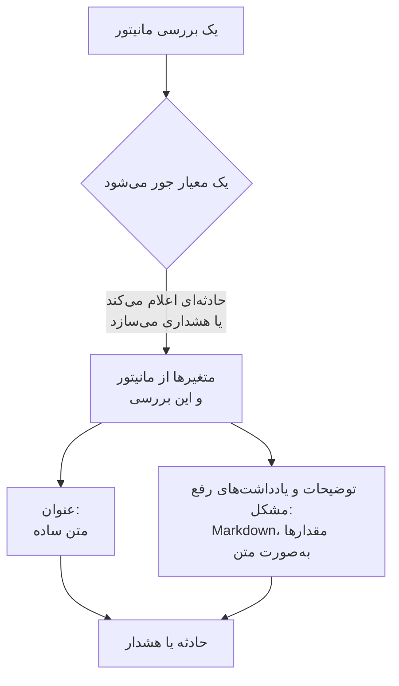

# قالب‌بندی حادثه و هشدار

وقتی معیار یک مانیتور حادثه‌ای اعلام می‌کند یا هشداری می‌سازد، عنوان، توضیحات و یادداشت‌های رفع مشکل آن را از قالبی پر می‌کند که شما می‌نویسید. جای‌نگهدارهای `{{variable}}` را در آن‌ها بگذارید، مانند `{{monitorName}}` یا `{{responseStatusCode}}`، تا هر حادثه بگوید چه چیزی خراب شد، با مقدارهای بررسی‌ای که آن را باز کرد.

:::cards
- [کجا قالب را می‌نویسید](#کجا-قالب-را-مینویسید): عنوان، توضیحات و یادداشت‌های رفع مشکل حادثه یا هشدار یک معیار.
- [کاربرد پایه](#کاربرد-پایه): جای‌نگهدارها، مسیرها به درون شیءها، و فهرست‌ها.
- [متغیرهایی که هر مانیتور دارد](#متغیرهایی-که-هر-مانیتور-دارد): نام مانیتور، و منبعی که از حد گذشت.
- [متغیرها بر پایه نوع مانیتور](#متغیرها-بر-پایه-نوع-مانیتور): هر نوع بررسی چه چیزی گزارش می‌دهد.
:::

## قالب‌بندی چگونه کار می‌کند

یک قالب یک بار پر می‌شود، وقتی معیار حادثه یا هشدار را می‌سازد. OneUptime متغیرها را از مانیتور و از بررسی‌ای که جور شد جمع می‌کند، هر مقدار را جای جای‌نگهدارش می‌گذارد، و نتیجه را ذخیره می‌کند. تغییر قالب در آینده حادثه‌ها و هشدارهایی را تغییر می‌دهد که پس از آن ساخته می‌شوند، نه آن‌هایی را که از پیش باز هستند.



- **عنوان متن ساده است.** هر جا نشان داده شود، دقیقاً همان‌طور خوانده می‌شود که قالب آن را ساخت.
- **توضیحات و یادداشت‌های رفع مشکل Markdown هستند.** متن Markdown که می‌نویسید رندر می‌شود، و هر مقداری که سامانه پایش‌شده فرستاده به‌صورت متن گذاشته می‌شود، پس هیچ چیز درون آن نمی‌تواند پیوند، تصویر یا اشاره‌ای اضافه کند. [مقدارها در توضیحات و یادداشت‌های رفع مشکل](#مقدارها-در-توضیحات-و-یادداشتهای-رفع-مشکل) را ببینید.
- **یک مانیتور گروه‌بندی‌شده هر حادثه را برای سری خودش پر می‌کند.** مانیتوری که به ازای هر میزبان، پاد یا دستگاه یک حادثه باز می‌کند، هر قالب را با مقدارهای همان سری پر می‌کند، و وقتی قالب شما نام سری را از پیش نگفته باشد، آن را به عنوان اضافه می‌کند.

## کجا قالب را می‌نویسید

:::steps
### معیارهای مانیتور را باز کنید

به **مانیتورها** بروید، مانیتور را باز کنید، و در منوی کناری آن روی **معیارها** کلیک کنید. روی **ویرایش معیارهای پایش** کلیک کنید.

### حادثه یا هشدار را روشن کنید

در یک معیار، زیر **اقدام‌ها**، گزینه **وقتی فیلترها مطابقت پیدا کردند، یک حادثه اعلام کن.** یا **وقتی فیلترها مطابقت پیدا کردند، یک هشدار بساز.** را روشن کنید. فرم حادثه یا هشدار زیر آن باز می‌شود.

### عنوان را بنویسید

عنوان را در **عنوان حادثه** یا **عنوان هشدار** تایپ کنید، برای نمونه `{{monitorName}} is down`. پیوند **Learn about dynamic templates**، کنار آن، پنجره **Dynamic Template Variables** را باز می‌کند: هر متغیری که نوع این مانیتور دارد، با آنچه در خود نگه می‌دارد. روی یک متغیر کلیک کنید تا رونوشت شود.

### توضیحات و یادداشت‌های رفع مشکل را بنویسید

**توضیحات** را برای **توضیحات حادثه** یا **توضیحات هشدار**، و **فیلدهای بیشتر** را برای **یادداشت‌های رفع مشکل** باز کنید. این ویرایشگرها خودشان متغیرها را پیشنهاد می‌کنند: **متغیرهای قالب** آن‌ها را زیر ویرایشگر فهرست می‌کند، **درج متغیر** در نوار ابزارش همان فهرست را باز می‌کند، و تایپ کردن `{{` آن را در جای مکان‌نما باز می‌کند.

### معیار را ذخیره کنید

روی **ذخیره تغییرات** کلیک کنید. حادثه یا هشدار بعدی که این معیار می‌سازد از قالب‌های تازه استفاده می‌کند.
:::

## کاربرد پایه

یک جای‌نگهدار نام یک متغیر درون دو آکولاد است. وقتی حادثه ساخته می‌شود، OneUptime آن را با مقدار متغیر جایگزین می‌کند، و متن پیرامونش را همان‌طور که نوشته‌اید نگه می‌دارد.

```text title="Title template"
{{monitorName}} returned {{responseStatusCode}} in {{responseTimeInMs}} ms
```

اگر نام مانیتور `Checkout API` باشد، کد وضعیت پاسخ `502` باشد و پاسخ `842` میلی‌ثانیه طول کشیده باشد، عنوان حادثه این می‌شود:

```text title="Title as created"
Checkout API returned 502 in 842 ms
```

### مسیرها به درون شیءها و فهرست‌ها

متغیری که یک شیء یا یک فهرست نگه می‌دارد با یک مسیر خوانده می‌شود، به همان شیوه [عبارت‌های JavaScript](/docs/monitor/javascript-expression):

| بنویسید | برای خواندن | نمونه |
| --- | --- | --- |
| `{{object.field}}` | یک فیلد از یک شیء، در هر عمقی | `{{responseBody.error.message}}` |
| `{{list[0]}}` یا `{{list.0}}` | یک آیتم از یک فهرست، با شمارش از ۰ | `{{diskMetrics[0].usagePercent}}` |
| `{{list[last]}}` | آخرین آیتم یک فهرست | `{{processes[last].name}}` |
| `{{object}}` | کل شیء یا فهرست، به‌صورت JSON | `{{responseBody}}` |

نام یک فیلد می‌تواند خط تیره داشته باشد، مانند `{{responseHeaders.content-type}}`. یک اندیس منفی، مانند `[-1]`، چیزی نمی‌خواند: از `[last]` استفاده کنید.

### وقتی مقداری وجود ندارد

جای‌نگهداری که مسیرش به جایی نمی‌رسد همان‌طور که نوشته‌اید، با آکولادها و همه چیز، در متن می‌ماند: اگر پاسخ فیلد `error` نداشته باشد، `{{responseBody.error.id}}` همان‌طور که هست در عنوان دیده می‌شود. متغیری هم که این بررسی گزارش نکرده، مانند `failureCause` در بررسی‌ای که شکست نخورده، همین‌طور است. مقداری که بررسی به‌صورت متن خالی گزارش کرده با هیچ جایگزین می‌شود.

برای نوشتن یک قالب که چه مانیتور گروه‌بندی‌شده باشد چه نباشد کار کند، از متغیرهای [منبع آسیب‌دیده](#منبع-آسیبدیده) استفاده کنید: همیشه وجود دارند، و وقتی مانیتور گروه‌بندی نشده خالی‌اند.

### مقدارها در توضیحات و یادداشت‌های رفع مشکل

توضیحات و یادداشت‌های رفع مشکل Markdown هستند: در صفحه حادثه یا هشدار، در ایمیل، و در کانال‌های Slack و Microsoft Teams آن نشان داده می‌شوند. مقدارهایی که یک قالب آنجا می‌گذارد همان چیزی است که سامانه پایش‌شده فرستاده – بدنه یا سرآیند یک پاسخ، یک درخواست یا ایمیل ورودی، برچسب‌های یک دستگاه یا یک سری – پس هر کدام به‌صورت متن گذاشته می‌شود. دقیقاً همان‌طور که فرستاده شده خوانده می‌شود، هر جا قالب آن را بگذارد، و یک پیوند، یک تصویر، یک تگ HTML یا یک اشاره Slack مانند `<!channel>` درون آن به جای عمل کردن به‌صورت متن نشان داده می‌شود. یک نشانی وب ساده در یک مقدار همچنان پیوند می‌شود، پیوندی که نشان می‌دهد به کجا می‌رود. متن Markdown که در خود قالب می‌نویسید همان‌طور که نوشته‌اید رندر می‌شود.

یک مقدار می‌تواند هر اندازه‌ای داشته باشد – بدنه یک پاسخ یا لاگی چند مگابایتی – و اعلان همچنان با آن فرستاده می‌شود. هر کانال آنچه را می‌پذیرد می‌برد، و توضیحاتی که برای آن بیش از حد بلند است بریده می‌شود، اگر شکست خطی باشد در همان شکست خط، و با «… (truncated — see OneUptime for the full text)» پایان می‌یابد:

- **ایمیل**: هر توضیحات، یادداشت یا علت ریشه‌ای تا حدود ۲۵۶ KB از متن ایمیل را می‌برد، و یادداشت پایانی متنی بلندتر به حادثه یا هشدار پیوند می‌دهد. کل یک ایمیل – متن و نماگرفت‌هایش – زیر ۳ MB می‌ماند، که هر سرور ایمیل و Microsoft Graph می‌پذیرند: نماگرفتی که کنار متن جا نشود کنار گذاشته می‌شود، با یادداشتی به جای آن.
- **صفحه حادثه یا هشدار** همه آن را نشان می‌دهد. توضیحاتی بیش از ۱۲۸ KB که چیدنش طول می‌کشد، به‌صورت متن ساده، خط به خط، نشان داده می‌شود.
- **Slack** حداکثر همان اندازه‌ای را می‌برد که Slack از یک پیام نشان می‌دهد (حدود ۳۰٬۰۰۰ نویسه). **Microsoft Teams** حدود ۴۰٬۰۰۰ نویسه را در پیامی از برنامه OneUptime می‌برد، و حدود ۱۲٬۰۰۰ را از راه یک وب‌هوک ورودی (مشترکان صفحه وضعیت، گردش‌های کاری) – هنگام فرستادن پیام اندازه گرفته می‌شود، پس یک جدول به اندازه HTML که از آن ساخته می‌شود حساب می‌شود.
- **پیامک، تماس‌های تلفنی، اعلان‌های push، WhatsApp و Telegram** آنچه را ارائه‌دهندگانشان می‌پذیرند می‌برند: [سطح‌ها چگونه افراد را خبر می‌کنند](/docs/on-call/escalation-rules#سطحها-چگونه-افراد-را-خبر-میکنند) را ببینید.

هر کانال متن را در زمانی رندر می‌کند که با طول آن بیشتر می‌شود. بخشی که رندر کردنش خیلی بیشتر طول بکشد – خطی بلندتر از ۶۴ KB، پاراگرافی بلند از خط‌های ساده، پاراگرافی پر از `*`، `_` یا `[` که هرگز بسته نمی‌شوند، نقل‌قول‌ها یا فهرست‌هایی که بیش از شانزده سطح تودرتو هستند، و در صفحه حادثه یا هشدار جدول یا فهرستی بیش از هزار خط – همان‌جا به‌صورت متن ساده خوانده می‌شود، و بقیه توضیحات طبق معمول رندر می‌شود.

## کاربرد پیشرفته

### حلقه روی یک فهرست

`{{#each path}}` متن تا `{{/each}}` را یک بار برای هر آیتم فهرستی که در `path` است تکرار می‌کند:

```text title="Loop syntax"
{{#each arrayPath}}
  ...text with {{field}} placeholders for each item...
{{/each}}
```

درون حلقه:

- `{{field}}` و `{{field.nested}}` آیتم کنونی را می‌خوانند. نامی که آیتم ندارد در آیتم دربرگیرنده، و سپس در متغیرهای کل قالب جست‌وجو می‌شود.
- `{{@index}}` جایگاه آیتم است، با شمارش از ۰.
- `{{this}}` خود آیتم است، برای فهرستی از مقدارهای ساده مانند رشته‌ها.
- حلقه روی مسیری که فهرست نیست، یا روی فهرستی خالی، چیزی نمی‌نویسد.
- حلقه‌ها تودرتو می‌شوند: یک `{{#each}}` درون یکی دیگر فهرست درونی هر آیتم بیرونی را می‌خواند.

برای نمونه، یک [مانیتور درخواست ورودی](/docs/monitor/incoming-request-monitor) که این اعلان هشدار را دریافت می‌کند:

```json title="Request body"
{
  "receiver": "payments",
  "alerts": [
    { "status": "firing", "labels": { "alertname": "HighLatency" } },
    { "status": "resolved", "labels": { "alertname": "DiskFull" } }
  ]
}
```

و این قالب توضیحات را دارد:

```text title="Description template"
Alerts for {{requestBody.receiver}}:
{{#each requestBody.alerts}}
- {{@index}}: {{labels.alertname}} ({{status}})
{{/each}}
```

حادثه‌ای می‌سازد که توضیحاتش مانند زیر است. هر آیتم شکست‌های خط پیرامونش را نگه می‌دارد، پس یک خط خالی آیتم‌ها را از هم جدا می‌کند، و توضیحات همچنان یک فهرست نشان می‌دهد:

```text title="Description as created"
Alerts for payments:

- 0: HighLatency (firing)

- 1: DiskFull (resolved)
```

### مقدارها از یک مانیتور گروه‌بندی‌شده

یک مانیتور مبتنی بر متریک با ویژگی‌های **Group by** به ازای هر سری یک حادثه باز می‌کند، و مقدار هر ویژگی متغیری با نام همان ویژگی است. گروه‌بندی بر پایه `host.name` متغیر `{{host.name}}` را می‌دهد، و گروه‌بندی بر پایه `resource.k8s.pod.name` متغیر `{{resource.k8s.pod.name}}` را. `{{seriesLabels}}` همه آن‌ها را به‌صورت یک شیء نگه می‌دارد.

یک [مانیتور لاگ‌ها](/docs/monitor/logs-monitor) وقتی گروه‌بندی شده باشد هم همین‌طور کار می‌کند: مقدار هر ویژگی گروه‌بندی متغیری با کلید آن است.

## متغیرهایی که هر مانیتور دارد

### مانیتور

| متغیر | چه نگه می‌دارد | نمونه |
| --- | --- | --- |
| `monitorName` | نام مانیتور. | `Checkout API` |
| `monitorId` | شناسه مانیتور. | `a0f78958-da0a-4775-9fd9-c9fc63d3456f` |
| `monitorType` | نوع مانیتور. | `Website`، `Synthetic Monitor` |

### منبع آسیب‌دیده

این‌ها سری‌ای را توصیف می‌کنند که یک مانیتور گروه‌بندی‌شده حادثه را برایش باز کرد: یک پاد، یک کانتینر، یک میزبان، یک دیسک. برای مانیتوری که گروه‌بندی نشده خالی‌اند، پس یک قالب می‌تواند روی هر مانیتوری از آن‌ها استفاده کند.

| متغیر | چه نگه می‌دارد |
| --- | --- |
| `seriesResourceSuffix` | هویت سری، که با یک جداکننده شروع می‌شود، برای گذاشتن در انتهای یک عنوان. |
| `seriesResourceSummary` | همان هویت بدون جداکننده، برای گذاشتن در یک جمله. |
| `seriesResourceBlock` | همه برچسب‌های سری، به‌صورت یک فهرست Markdown. برای توضیحات از همه بهتر است. |
| `seriesDebugCommands` | دستورهای فقط‌خواندنی برای همین منبع، مانند `kubectl` یا `docker`، به‌صورت یک فهرست Markdown. |

## متغیرها بر پایه نوع مانیتور

### مانیتورهای وب‌سایت و API

| متغیر | چه نگه می‌دارد | نوع |
| --- | --- | --- |
| `responseBody` | بدنه پاسخ: وقتی JSON باشد یک شیء، وگرنه متن. | `JSON` یا `string` |
| `responseHeaders` | سرآیندهای پاسخ، بر پایه نام با حروف کوچک. | `Dictionary<string>` |
| `responseStatusCode` | کد وضعیت HTTP. | `number` |
| `responseTimeInMs` | زمان پاسخ، بر حسب میلی‌ثانیه. | `number` |
| `isOnline` | اینکه آیا مانیتور پاسخ را آنلاین حساب کرد. | `boolean` |

### مانیتورهای درخواست ورودی

| متغیر | چه نگه می‌دارد | نوع |
| --- | --- | --- |
| `requestBody` | بدنه درخواست: وقتی JSON باشد یک شیء. | `JSON` یا `string` |
| `requestHeaders` | سرآیندهای درخواست، بر پایه نام با حروف کوچک. | `Dictionary<string>` |
| `requestMethod` | متد HTTP، مانند `POST`. | `string` |
| `incomingRequestReceivedAt` | زمان دریافت درخواست، به‌صورت یک مهر زمانی ISO 8601. | `string` |

وقتی معیار گزینه **Group incidents and alerts by a payload field** را روشن داشته باشد، کلید گروه‌بندی هم یک متغیر است، که نامش از **آخرین بخش** مسیر گروه‌بندی می‌آید: گروه‌بندی بر پایه `requestBody.alerts[*].labels.alertname` متغیر `{{alertname}}` را می‌دهد، و گروه‌بندی بر پایه `requestBody.alerts[*].fingerprint` متغیر `{{fingerprint}}` را. کل `requestBody` همچنان کنار آن هست.

> [!NOTE]
> `[*]` فقط در فیلدهای مسیر گروه‌بندی کار می‌کند. در یک قالب چیزی نمی‌خواند، پس جای‌نگهدار همان‌طور که نوشته شده می‌ماند. `{{requestBody.alerts[0].annotations.summary}}` همیشه نخستین هشدار payload را می‌خواند، نه آنی را که حادثه برایش باز شد: از متغیر گروه‌بندی و فیلدهای مشترک payload، مانند `commonLabels` و `commonAnnotations`، استفاده کنید. [مانیتور درخواست ورودی](/docs/monitor/incoming-request-monitor) را ببینید.

### مانیتورهای ایمیل ورودی

| متغیر | چه نگه می‌دارد | نوع |
| --- | --- | --- |
| `emailSubject` | موضوع ایمیل. | `string` |
| `emailFrom` | نشانی ایمیل فرستنده. | `string` |
| `emailTo` | ایمیل برای چه کسی فرستاده شده، با نشانی خود مانیتور که پوشانده شده است. | `string` |
| `emailBody` | بدنه متن ساده ایمیل. | `string` |
| `emailReceivedAt` | زمان دریافت ایمیل، به‌صورت یک مهر زمانی ISO 8601 در UTC. | `string` |

در یک عنوان، هر کدام از این‌ها به یک خط با حداکثر ۱۵۰ نویسه بریده می‌شود. توضیحات و یادداشت‌های رفع مشکل مقدار کامل را می‌گیرند. [مانیتور ایمیل ورودی](/docs/monitor/incoming-email-monitor#متغیرهای-قالب) را ببینید.

### مانیتورهای Ping، IP و پورت

| متغیر | چه نگه می‌دارد | نوع |
| --- | --- | --- |
| `isOnline` | اینکه آیا هدف پاسخ داد. | `boolean` |
| `responseTimeInMs` | زمان پاسخ، بر حسب میلی‌ثانیه. برای یک پورت، جست‌وجوی DNS و اتصال TCP با هم. | `number` |
| `failureCause` | چرا بررسی شکست خورد، اگر شکست خورد. | `string` |
| `isTimeout` | اینکه آیا زمان بررسی به پایان رسید. | `boolean` |

### مانیتورهای NTP

| متغیر | چه نگه می‌دارد | نوع |
| --- | --- | --- |
| `isOnline` | اینکه آیا سرور زمان به درخواست پراب پاسخ داد. | `boolean` |
| `isSynchronized` | اینکه آیا در stratum ۱ تا ۱۵ پاسخ داد، بدون هشدار leap و با مهرهای زمانی واقعی. | `boolean` |
| `stratum` | لایه stratum که سرور گزارش کرد: ۱ برای سرور اولیه، ۱۶ وقتی همگام نیست، ۰ برای kiss-o'-death. | `number` |
| `clockOffsetInMs` | ساعت سرور چقدر با ساعت پراب فاصله دارد، بر حسب میلی‌ثانیه. مثبت یعنی سرور جلوتر است. | `number` |
| `referenceId` | سرور با چه چیزی همگام می‌شود: منبعی مانند `GPS` در stratum ۱، یا نشانی سرور بالادستش. | `string` |
| `leapIndicator` | ۰ تا ۲ وقتی همه چیز درست است، ۳ وقتی سرور می‌گوید ساعتش همگام نیست. | `number` |
| `kissCode` | با stratum ۰، کد چهارحرفی که سرور به جای زمان فرستاد، مانند `RATE`. | `string` |
| `responseTimeInMs` | زمان از درخواست تا پاسخ، بر حسب میلی‌ثانیه. | `number` |
| `roundTripDelayInMs` | رفت و برگشت شبکه در این تبادل، بدون زمان پردازش خود سرور. | `number` |
| `rootDelayInMs` | رفت و برگشت از سرور تا ساعت مرجعش، بر حسب میلی‌ثانیه. | `number` |
| `rootDispersionInMs` | برآورد خود سرور از بیشترین خطایش، بر حسب میلی‌ثانیه. | `number` |
| `serverTime` | ساعت سرور هنگام فرستادن پاسخ، به‌صورت یک مهر زمانی ISO 8601. | `string` |
| `referenceTime` | آخرین باری که ساعت سرور تنظیم یا اصلاح شد، به‌صورت یک مهر زمانی ISO 8601. | `string` |
| `serverAddress` | نشانی‌ای که درخواست به آن رفت. | `string` |
| `port` | پورت UDP که درخواست به آن رفت. | `number` |
| `failureCause` | چرا سرور پاسخ نداد، یا چرا همگام نیست. | `string` |
| `isTimeout` | اینکه آیا سرور به‌موقع پاسخ نداد. | `boolean` |

### مانیتورهای گواهی SSL

| متغیر | چه نگه می‌دارد | نوع |
| --- | --- | --- |
| `isOnline` | اینکه آیا بررسی گواهی موفق بود. | `boolean` |
| `isSelfSigned` | اینکه آیا گواهی خودامضا است. | `boolean` |
| `createdAt` | زمان صدور گواهی، به‌صورت یک مهر زمانی ISO 8601. | `string` |
| `expiresAt` | زمان انقضای گواهی، به‌صورت یک مهر زمانی ISO 8601. | `string` |
| `commonName` | نام عمومی (CN) گواهی. | `string` |
| `organizationalUnit` | واحد سازمانی (OU) آن. | `string` |
| `organization` | سازمان (O) آن. | `string` |
| `locality` | محل (L) آن. | `string` |
| `state` | ایالت یا استان (ST) آن. | `string` |
| `country` | کشور (C) آن. | `string` |
| `serialNumber` | شماره سریال آن. | `string` |
| `fingerprint` | اثر انگشت SHA-1 آن. | `string` |
| `fingerprint256` | اثر انگشت SHA-256 آن. | `string` |
| `failureCause` | چرا بررسی شکست خورد، اگر شکست خورد. | `string` |

### مانیتورهای DNS

| متغیر | چه نگه می‌دارد | نوع |
| --- | --- | --- |
| `isOnline` | اینکه آیا به پرس‌وجو پاسخ داده شد. | `boolean` |
| `responseTimeInMs` | زمان پرس‌وجو، بر حسب میلی‌ثانیه. | `number` |
| `isTimeout` | اینکه آیا زمان پرس‌وجو به پایان رسید. | `boolean` |
| `isDnssecValid` | نتیجه اعتبارسنجی DNSSEC. | `boolean` |
| `records` | رکوردهای برگشتی، هر کدام به‌صورت `{type, value, ttl}`. | `Array<Object>` |
| `recordValues` | فقط مقدارهای رکوردها. | `Array<string>` |
| `failureCause` | چرا پرس‌وجو شکست خورد، اگر شکست خورد. | `string` |

### مانیتورهای DNSSEC

| متغیر | چه نگه می‌دارد | نوع |
| --- | --- | --- |
| `isOnline` | اینکه آیا بررسی کامل شد. | `boolean` |
| `domainName` | zone بررسی‌شده. | `string` |
| `isZoneSigned` | اینکه آیا zone رکوردهای DNSKEY دارد. | `boolean` |
| `isParentDsPresent` | اینکه آیا zone والد برای آن رکوردهای DS دارد. | `boolean` |
| `isChainValid` | اینکه آیا زنجیره اعتماد معتبر است. | `boolean` |
| `resolverConsensusAd` | اینکه آیا هر resolver پرچم AD را برگرداند. | `boolean` |
| `isNameserverConsistent` | اینکه آیا هر nameserver معتبر همان سریال SOA را برگرداند. | `boolean` |
| `earliestSignatureExpiration` | زمان انقضای نخستین امضای RRSIG، به‌صورت یک مهر زمانی ISO 8601. | `string` |
| `daysUntilSignatureExpiry` | روزهای مانده تا انقضای آن امضا. | `number` |
| `dnskeyCount` | شمار رکوردهای DNSKEY. | `number` |
| `dsRecordCount` | شمار رکوردهای DS در والد. | `number` |
| `rrsigCount` | شمار رکوردهای RRSIG دیده‌شده. | `number` |
| `responseTimeInMs` | مدتی که بررسی طول کشید، بر حسب میلی‌ثانیه. | `number` |
| `failureCause` | چرا بررسی شکست خورد، اگر شکست خورد. | `string` |

### مانیتورهای دامنه

| متغیر | چه نگه می‌دارد | نوع |
| --- | --- | --- |
| `isOnline` | اینکه آیا جست‌وجوی ثبت دامنه موفق بود. | `boolean` |
| `domainName` | دامنه جست‌وجوشده. | `string` |
| `lookupMethod` | پروتکلی که پاسخ داد: RDAP یا WHOIS. | `string` |
| `registrar` | ثبت‌کننده. | `string` |
| `createdDate` | زمان ثبت دامنه. | `string` |
| `updatedDate` | آخرین باری که ثبت تغییر کرد. | `string` |
| `expiresDate` | زمان انقضای ثبت. | `string` |
| `nameServers` | nameserverهای دامنه. | `Array<string>` |
| `domainStatus` | کدهای وضعیت رجیستری، مانند `clientTransferProhibited`. | `Array<string>` |
| `dnssec` | وضعیت DNSSEC در رجیستری. | `string` |
| `responseTimeInMs` | مدتی که جست‌وجو طول کشید، بر حسب میلی‌ثانیه. | `number` |
| `failureCause` | چرا جست‌وجو شکست خورد، اگر شکست خورد. | `string` |

### مانیتورهای سرور / ماشین مجازی

| متغیر | چه نگه می‌دارد | نوع |
| --- | --- | --- |
| `hostname` | نام میزبان سرور. | `string` |
| `requestReceivedAt` | زمان دریافت گزارش سرور، به‌صورت یک مهر زمانی ISO 8601. | `string` |
| `cpuUsagePercent` | CPU در حال استفاده، ۰ تا ۱۰۰. | `number` |
| `cpuCores` | شمار هسته‌های CPU. | `number` |
| `memoryUsagePercent` | حافظه در حال استفاده، ۰ تا ۱۰۰. | `number` |
| `memoryFreePercent` | حافظه آزاد، ۰ تا ۱۰۰. | `number` |
| `memoryTotalBytes` | کل حافظه، بر حسب بایت. | `number` |
| `diskMetrics` | یک مدخل به ازای هر دیسک mount شده. | `Array<Object>` |
| `diskMetrics[].diskPath` | نقطه mount دیسک. | `string` |
| `diskMetrics[].usagePercent` | فضای در حال استفاده روی دیسک، ۰ تا ۱۰۰. | `number` |
| `diskMetrics[].freePercent` | فضای آزاد روی دیسک، ۰ تا ۱۰۰. | `number` |
| `diskMetrics[].totalBytes` | اندازه دیسک، بر حسب بایت. | `number` |
| `processes` | فرایندهای در حال اجرا که عامل گزارش کرد. | `Array<Object>` |
| `processes[].pid` | شناسه فرایند. | `number` |
| `processes[].name` | نام فرایند. | `string` |
| `processes[].command` | دستوری که فرایند با آن شروع شد. | `string` |
| `failureCause` | چرا بررسی شکست خورد، اگر شکست خورد. | `string` |

### مانیتورهای مصنوعی

یک مانیتور مصنوعی اسکریپتش را یک بار برای هر مرورگر و اندازه صفحه‌ای که برای استفاده تنظیم شده اجرا می‌کند، مانند Chromium روی صفحه دسکتاپ و Firefox روی صفحه موبایل. `syntheticResponses` به ازای هر اجرا یک مدخل نگه می‌دارد: یک اجرا را بر پایه جایگاهش بخوانید، مانند `{{syntheticResponses[0].browserType}}`، یا همه اجراها را با `{{#each syntheticResponses}}`.

| متغیر | چه نگه می‌دارد | نوع |
| --- | --- | --- |
| `failureCause` | چرا بررسی شکست خورد، اگر شکست خورد. | `string` |
| `syntheticResponses` | یک مدخل به ازای هر مرورگر و اندازه صفحه‌ای که اسکریپت روی آن اجرا شد. | `Array<Object>` |
| `syntheticResponses[].executionTimeInMs` | مدتی که اجرا طول کشید، بر حسب میلی‌ثانیه. | `number` |
| `syntheticResponses[].result` | آنچه اسکریپت برگرداند. | `string`، `number`، `boolean` یا `JSON` |
| `syntheticResponses[].scriptError` | خطایی که اجرا با آن پایان یافت، اگر خطایی بود. | `string` |
| `syntheticResponses[].logMessages` | آنچه اجرا لاگ کرد. | `Array<string>` |
| `syntheticResponses[].screenshots` | نماگرفت‌هایی که اجرا گرفت، بر پایه نام، هر کدام به‌صورت متن base64. [نمایش نماگرفت](#نمایش-نماگرفت) را ببینید. | `Object` |
| `syntheticResponses[].browserType` | مرورگر اجرا. | `string` |
| `syntheticResponses[].screenSizeType` | اندازه صفحه اجرا. | `string` |

#### نمایش نماگرفت

هر مدخل `screenshots` نماگرفتی است که اسکریپت گرفته، زیر نامی که اسکریپت به آن داده (`screenshots["login-page"] = await page.screenshot()`)، به‌صورت متن base64. برای نشان دادن یکی در توضیحات یا یادداشت‌های رفع مشکل یک حادثه یا هشدار، یک تصویر دور آن بنویسید:

```text title="Description template"
{{syntheticResponses[0].scriptError}}


```

آن‌گاه نماگرفت در صفحه حادثه یا هشدار، در صفحه‌های وضعیتی که حادثه را نشان می‌دهند، در اعلان‌های ایمیلی درباره آن، و در پیام‌های Slack و Microsoft Teams درباره آن پدیدار می‌شود. در ایمیل، پیوست می‌شود و در بدنه نشان داده می‌شود، که Gmail، Outlook و Apple Mail همگی نمایش می‌دهند، پس هر کسی که آنکال است می‌تواند ببیند صفحه چه شکلی داشت بی‌آنکه OneUptime را باز کند.

- نماگرفت‌های PNG، JPEG، GIF و WebP نشان داده می‌شوند. `image/png` برای نماگرفت JPEG (`page.screenshot({ type: "jpeg" })`) هم کار می‌کند.
- یک ایمیل حداکثر ۲ MB تصویر، و حداکثر ۲۰ تصویر، می‌برد. تصویری که جا نشود با یادداشتی حاوی متن جایگزین (alt) آن عوض می‌شود، پس به هر تصویر متن جایگزین بدهید. نماگرفت JPEG بسیار کوچک‌تر از PNG است، و یک نماگرفت از اجرای ناموفق معمولاً بیش از همه نماگرفت‌های همه اجراها چیز می‌گوید.
- در Slack و Microsoft Teams نماگرفت همان جایی نشان داده می‌شود که توضیحات آن را دارد: تصویری روی خطی جداگانه جای آن خط را می‌گیرد، و تصویری در میانه یک جمله، یک فهرست یا یک جدول متن جایگزینش را آنجا می‌گذارد و پس از آن نشان داده می‌شود. Slack نماگرفت‌های PNG، JPEG و GIF را نشان می‌دهد، حداکثر ۱۰ تا و ۱۰ MB در هر پیام؛ برنامه OneUptime هر کدام را به‌صورت خصوصی در فضای کاری Slack شما بارگذاری می‌کند و در پیام نشان می‌دهد. Teams نماگرفت‌های PNG، JPEG و GIF تا ۱ MB هر کدام را درون کارت پیام نشان می‌دهد، حداکثر ۱۰ تا و ۲ MB در هر پیام.
- بارگذاری در Slack به مجوز `files:write` برنامه نیاز دارد. اگر فضای کاری شما Slack را پیش از آنکه OneUptime این مجوز را بخواهد وصل کرده، Slack را در **تنظیمات پروژه → فضای کاری → Slack** دوباره وصل کنید (روی سرور خودمیزبان، نخست مجوز را به برنامه Slack خود اضافه کنید – [یکپارچه‌سازی Slack](/docs/self-hosted/slack-integration#تصویرها-در-پیامها) را ببینید).
- نماگرفتی که یک گفت‌وگو نمی‌تواند نشان دهد – یک WebP، نماگرفتی فراتر از آن حدها، نماگرفتی که Slack یا Teams رد می‌کند، یا هر نماگرفتی در پیامی که از راه یک وب‌هوک ورودی فرستاده می‌شود – به‌صورت متن جایگزینش، یا «[image]» وقتی متن جایگزینی ندارد، نشان داده می‌شود، پس به هر تصویر متن جایگزین بدهید. base64 تصویر هرگز به گفت‌وگو نمی‌رسد.
- فقط تصویری که در قالب می‌نویسید نشان داده می‌شود. تصویری در مقداری که صفحه یا اسکریپت پایش‌شده گزارش کرده – یک پیام خطا، یک خط لاگ – همچنان به‌صورت متن نشان داده می‌شود ([مقدارها در توضیحات و یادداشت‌های رفع مشکل](#مقدارها-در-توضیحات-و-یادداشتهای-رفع-مشکل) را ببینید).
- OneUptime AI متن پیرامون نماگرفت را می‌خواند، نه خود نماگرفت را. آنچه یک بررسی AI، یک گزارش پس از حادثه یا یادداشت پیش‌نویس‌شده، گام AI یک رانبوک یا گام AI یک گردش کاری به مدل می‌دهد، به جای تصویر یادداشتی کوتاه دارد، مانند `[image omitted: PNG, 340 KB]`: مدل متن می‌خواند، نه تصویر، و base64 یک نماگرفت در هر فراخوانی صدها هزار توکن می‌شد. فعالیت بررسی می‌گوید چه چیزی کنار گذاشته شد.

برای نشان دادن نماگرفت هر اجرای ناموفق، تصویر را در یک حلقه بگذارید. اینجا اسکریپت هر نماگرفت را به‌صورت `screenshots["failure"]` ذخیره می‌کند:

```text title="Description template"
### What the page looked like
{{#each syntheticResponses}}
**{{browserType}} / {{screenSizeType}}**: {{scriptError}}


{{/each}}
```

### مانیتورهای کد سفارشی JavaScript

| متغیر | چه نگه می‌دارد | نوع |
| --- | --- | --- |
| `result` | آنچه اسکریپت برگرداند. یک فیلد را با یک مسیر بخوانید، مانند `{{result.status}}`. | `string`، `number`، `boolean` یا `JSON` |
| `executionTimeInMs` | مدتی که اسکریپت اجرا شد، بر حسب میلی‌ثانیه. | `number` |
| `scriptError` | خطایی که اسکریپت با آن پایان یافت، اگر خطایی بود. | `string` |
| `logMessages` | آنچه اسکریپت با `console.log` لاگ کرد. | `Array<string>` |
| `failureCause` | چرا بررسی شکست خورد، اگر شکست خورد. | `string` |

### مانیتورهای دستگاه شبکه

| متغیر | چه نگه می‌دارد | نوع |
| --- | --- | --- |
| `isOnline` | اینکه آیا دستگاه، با ping **یا** SNMP، در دسترس است. در هر سرکشی تعیین می‌شود. | `boolean` |
| `responseTimeInMs` | زمان پاسخ **پیمایش** SNMP، بر حسب میلی‌ثانیه. هرگز رفت و برگشت ping نیست. | `number` |
| `failureCause` | چرا پیمایش SNMP شکست خورد، اگر شکست خورد. | `string` |
| `isTimeout` | اینکه آیا زمان پیمایش SNMP به پایان رسید. | `boolean` |
| `oidResponses` | OIDهای پرس‌وجوشده، هر کدام به‌صورت `{oid, name, value, type}`. | `Array<Object>` |
| `{{OID_NAME}}` | مقدار یک OID نام‌دار، بر پایه نامش، مانند `{{sysUpTime}}`. | `string` یا `number` |
| `sysName` | نام دستگاه، از گروه system در SNMP. | `string` |
| `sysDescr` | توضیح دستگاه، از گروه system در SNMP. | `string` |
| `sysObjectId` | OID سازمانی ثبت‌شده سازنده: اثر انگشت دستگاه. | `string` |
| `sysLocation` | مکان دستگاه، از گروه system در SNMP. | `string` |
| `downInterfaces` | رابط‌هایی که از نظر مدیریتی روشن اما از نظر عملیاتی خاموش‌اند، هر کدام به‌صورت `{name, alias, interfaceIndex}`. به پایش رابط نیاز دارد. | `Array<Object>` |
| `interfacesTotal` | شمار رابط‌های پیمایش‌شده. | `number` |
| `interfacesUp` | رابط‌هایی که از نظر مدیریتی و عملیاتی روشن‌اند. | `number` |
| `interfacesDown` | رابط‌هایی که از نظر مدیریتی روشن اما از نظر عملیاتی خاموش‌اند. | `number` |
| `interfaceWalkFailure` | خطا، وقتی پیمایش رابط‌ها شکست خورد. | `string` |
| `tables` | جدول‌های SNMP دستگاه، بر پایه کلید: `rowCount`، `rows`، `unhealthyRowCount` و `unhealthyRows` هر کدام، مانند `{{tables.ipsec_tunnels.unhealthyRowCount}}`. | `Object` |
| `snmpTable` | جدول SNMP که یک هشدار به ازای هر سطر درباره آن است. | `string` |
| `snmpTableRow` | سطری که یک هشدار به ازای هر سطر درباره آن است: یک تونل، یک رادیو، یک همسایه. | `string` |
| `trapOid` | OID مربوط به trap. فقط وقتی یک trap در SNMP بررسی را راه انداخت. | `string` |
| `trapSourceIp` | نشانی‌ای که trap از آن آمد. فقط وقتی یک trap در SNMP بررسی را راه انداخت. | `string` |
| `trapVarbinds` | varbindهای trap، هر کدام به‌صورت `{oid, value}`. فقط وقتی یک trap در SNMP بررسی را راه انداخت. | `Array<Object>` |

یک دستگاه شبکه در هر سرکشی ping می‌شود و فقط وقتی اعتبارنامه دارد از راه SNMP پیمایش می‌شود، پس **`isOnline` تنها متغیر بالاست که دستگاهی که فقط ping می‌شود پر می‌کند**: هر متغیر دیگر از پیمایش SNMP می‌آید و بدون آن همان‌طور که نوشته شده می‌ماند. در قالب‌هایی که ممکن است برای دستگاه‌های بدون اعتبارنامه به کار روند، با `{{isOnline}}` و نام دستگاه شروع کنید. برای اینکه هر نوع سرکشی چه چیزی جمع می‌کند، [مانیتور دستگاه شبکه](/docs/monitor/network-device-monitor#یک-سرکشی-واقعاً-چه-میکند) را ببینید.

### مانیتورهای سلامت پایگاه داده

| متغیر | چه نگه می‌دارد | نوع |
| --- | --- | --- |
| `isOnline` | اینکه آیا پراب توانست وصل شود و پرس‌وجوی پایه را اجرا کند. متریک‌های غایب هرگز این را false نمی‌کنند. | `boolean` |
| `responseTimeInMs` | زمان وصل شدن و اجرای پرس‌وجوی پایه، بر حسب میلی‌ثانیه. | `number` |
| `failureCause` | چرا بررسی شکست خورد، اگر شکست خورد. | `string` |
| `connectionError` | خطای اتصال، بدون اعتبارنامه‌ها یا رشته اتصال. | `string` |
| `engineVersion` | نسخه‌ای که سرور پایگاه داده گزارش کرد. | `string` |
| `collectedGroups` | گروه‌های متریکی که در این بررسی مقدار تولید کردند. | `Array<string>` |
| `unavailableGroups` | گروه‌هایی که جمع نشدند، هر کدام به‌صورت `{group, reason, message, remediation}`. | `Array<Object>` |
| `collectionIssueSummary` | یک خط درباره هر گروهی که در دسترس نبود، آماده برای یک عنوان. وقتی همه چیز جمع شده خالی است. | `string` |
| `metrics` | مقدارهای جمع‌شده، بر پایه نام سری. | `Object` |

نام‌های سری در `metrics` نقطه دارند، مانند `oneuptime.monitor.database.connections.used.percent`، و یک مسیر هر نقطه را گامی به درون یک شیء می‌خواند، پس یک قالب نمی‌تواند یک مقدار را از `metrics` بیرون بکشد. `{{metrics}}` را به‌صورت کامل، به شکل JSON، بگذارید، یا از `{{collectionIssueSummary}}` استفاده کنید. متریکی که جمع نشده در `metrics` غایب است، نه اینکه صفر باشد. برای عمل بر پایه یک مقدار، آن را در معیار با یک [عبارت JavaScript](/docs/monitor/javascript-expression) مقایسه کنید.

### مانیتورهای صفحه وضعیت خارجی

| متغیر | چه نگه می‌دارد | نوع |
| --- | --- | --- |
| `overallStatus` | وضعیت کلی صفحه وضعیت، مانند `major_outage`. | `string` |
| `activeIncidentCount` | شمار حادثه‌های باز در صفحه وضعیت. | `number` |
| `componentStatuses` | مؤلفه‌های آن، هر کدام به‌صورت `{name, status, description, groupName}`. | `Array<Object>` |
| `provider` | نوع صفحه وضعیت: Atlassian Statuspage، incident.io، RSS یا Atom. | `string` |
| `componentGroup` | گروه مؤلفه‌ای که مانیتور زیر نظر دارد، اگر یکی را زیر نظر داشته باشد. | `string` |
| `componentName` | مؤلفه‌ای که مانیتور زیر نظر دارد، اگر یکی را زیر نظر داشته باشد. | `string` |
| `isOnline` | اینکه آیا صفحه وضعیت پاسخ داد. | `boolean` |
| `responseTimeInMs` | مدتی که صفحه وضعیت برای پاسخ طول کشید، بر حسب میلی‌ثانیه. | `number` |
| `failureCause` | چرا بررسی شکست خورد، اگر شکست خورد. | `string` |

### مانیتورهای متریک و زیرساخت

مانیتورهای Metrics، Kubernetes، Docker، Host، Podman، Docker Swarm، Proxmox، VMware، Ceph و Storage Array یک متغیر مخصوص به خود دارند:

| متغیر | چه نگه می‌دارد | نوع |
| --- | --- | --- |
| `metricName` | نام متریکی که نخستین پرس‌وجوی مانیتور می‌خواند، مانند `container.cpu.time`. | `string` |

اگر گروه‌بندی شده باشند، مقدار هر ویژگی **Group by** و `seriesLabels` را هم دارند: [مقدارها از یک مانیتور گروه‌بندی‌شده](#مقدارها-از-یک-مانیتور-گروهبندیشده) را ببینید. مانیتور IoT Device متغیر `metricName` ندارد، اما مانیتوری از این نوع که گروه‌بندی شده باشد، همان‌طور که قالب‌هایش هستند، `{{device.id}}` را دارد.

### دیگر نوع‌های مانیتور

مانیتورهای Logs، Traces، Exceptions، Security Events، AI / LLM و SQL Query متغیر مخصوص به خود ندارند. از [متغیرهایی که هر مانیتور دارد](#متغیرهایی-که-هر-مانیتور-دارد) استفاده کنید، و در یک مانیتور Logs گروه‌بندی‌شده از [مقدارهای گروه](#مقدارها-از-یک-مانیتور-گروهبندیشده).

## نمونه‌ها

### یک API کند

```text title="Title"
{{monitorName}} is slow: {{responseTimeInMs}} ms
```

```text title="Description"
### API error
Status: **{{responseStatusCode}}**
Latency: **{{responseTimeInMs}} ms**
Message: `{{responseBody.error.message}}`
```

### گواهی‌ای که به‌زودی منقضی می‌شود

```text title="Title"
Certificate for {{commonName}} expires {{expiresAt}}
```

### سروری که جایش در حال تمام شدن است

```text title="Description"
### {{hostname}}
CPU: **{{cpuUsagePercent}}%**
Memory: **{{memoryUsagePercent}}%**

**Disks:**
{{#each diskMetrics}}
- {{diskPath}}: {{usagePercent}}% used ({{freePercent}}% free)
{{/each}}

**Processes:**
{{#each processes}}
- [{{pid}}] {{name}}: {{command}}
{{/each}}
```

### بررسی Ping، IP یا پورتی که شکست خورد

```text title="Description"
{{monitorName}} could not be reached: {{failureCause}}
Timed out: {{isTimeout}}
Response time: {{responseTimeInMs}} ms
```

### هر اجرای یک مانیتور مصنوعی

```text title="Description"
### Synthetic monitor results
{{#each syntheticResponses}}
- **{{browserType}} / {{screenSizeType}}**: {{result}} in {{executionTimeInMs}} ms
  - Script error: {{scriptError}}
  - First log line: {{logMessages[0]}}
{{/each}}
```

### یک بررسی کد سفارشی

```text title="Description"
The script ran for {{executionTimeInMs}} ms and returned {{result}}.
Last log line: {{logMessages[last]}}
```

### یک دستگاه شبکه

این نمونه‌ها فرض می‌کنند دستگاه اعتبارنامه SNMP دارد: روی دستگاهی که فقط ping می‌شود، همه چیز جز `{{isOnline}}` همان‌طور که نوشته شده می‌ماند.

```text title="Title"
{{sysName}}: {{interfacesDown}} interfaces down
```

```text title="Description"
### {{sysName}} ({{sysLocation}})
Online: {{isOnline}}
SNMP walk: {{responseTimeInMs}} ms

{{#each downInterfaces}}
- {{name}} ({{alias}}) is down
{{/each}}
```

### هشدارهای Alertmanager یا Grafana

```text title="Title"
[{{requestBody.status}}] {{requestBody.receiver}}
```

```text title="Description"
### Alerts from {{requestBody.receiver}}
{{#each requestBody.alerts}}
**Alert {{@index}}**: {{labels.alertname}}
- Status: {{status}}
- Summary: {{annotations.summary}}
- Source: {{generatorURL}}
{{/each}}
```

## رفع اشکال

:::details عنوان جای‌نگهدار را، با آکولادها و همه چیز، نشان می‌دهد
مسیر در این بررسی به مقداری نمی‌رسد. نام متغیر و کوچکی و بزرگی حروف آن را با جدول‌های بالا مقایسه کنید، یا **Learn about dynamic templates** را در معیار باز کنید: متغیرهای نوع این مانیتور را فهرست می‌کند. مسیری به درون بدنه یک پاسخ یا یک درخواست باید با بدنه، همان‌طور که فرستاده شده، جور باشد، و `[*]` و اندیس‌های منفی مانند `[-1]` چیزی نمی‌خوانند: از `[0]` یا `[last]` استفاده کنید.
:::

:::details یک مقدار به‌صورت JSON نشان داده می‌شود
مسیر روی یک شیء یا یک فهرست می‌ایستد، پس کل آن به‌صورت JSON گذاشته می‌شود. فیلدی را که می‌خواهید به مسیر اضافه کنید، مانند `{{responseBody.error.message}}`، یا با `{{#each}}` روی یک فهرست حلقه بزنید.
:::

:::details یک حلقه چیزی نمی‌نویسد
مسیر پس از `#each` در این بررسی یک فهرست نیست، یا فهرست خالی است. مسیر را با payload مقایسه کنید، و بررسی کنید که هر `{{#each}}` یک `{{/each}}` داشته باشد.
:::

:::details متن Markdown در یک مقدار به‌صورت متن ساده نشان داده می‌شود
این عمدی است: مقداری که سامانه پایش‌شده فرستاده به‌صورت متن گذاشته می‌شود، پس هرگز نمی‌تواند پیوند، تصویر یا اشاره‌ای به توضیحات اضافه کند. به جای آن، قالب‌بندی را در خود قالب، پیرامون مقدار، بنویسید. [مقدارها در توضیحات و یادداشت‌های رفع مشکل](#مقدارها-در-توضیحات-و-یادداشتهای-رفع-مشکل) را ببینید.
:::

:::details یک نماگرفت در Slack، Microsoft Teams یا ایمیل نشان داده نمی‌شود
قالب و اندازه تصویر را با [نمایش نماگرفت](#نمایش-نماگرفت) مقایسه کنید. در Slack، برنامه OneUptime به مجوز `files:write` نیاز دارد: اگر فضای کاری شما Slack را پیش از آنکه OneUptime این مجوز را بخواهد وصل کرده، Slack را در **تنظیمات پروژه → فضای کاری → Slack** دوباره وصل کنید.
:::

## گام‌های بعدی

:::cards
- [عبارت‌های JavaScript](/docs/monitor/javascript-expression): همان جای‌نگهدارها، در شرط‌های یک معیار.
- [اعلام یک حادثه](/docs/incidents/declaring-incidents): پس از آنکه یک معیار حادثه‌ای اعلام کرد چه اتفاقی می‌افتد.
- [مانیتور سینتتیک](/docs/monitor/synthetic-monitor): نماگرفت‌هایی را بگیرید که یک توضیحات می‌تواند نشان دهد.
- [مانیتور درخواست ورودی](/docs/monitor/incoming-request-monitor): وب‌هوک‌ها را به حادثه‌هایی تبدیل کنید که به نام هر هشدار نام‌گذاری شده‌اند.
:::
