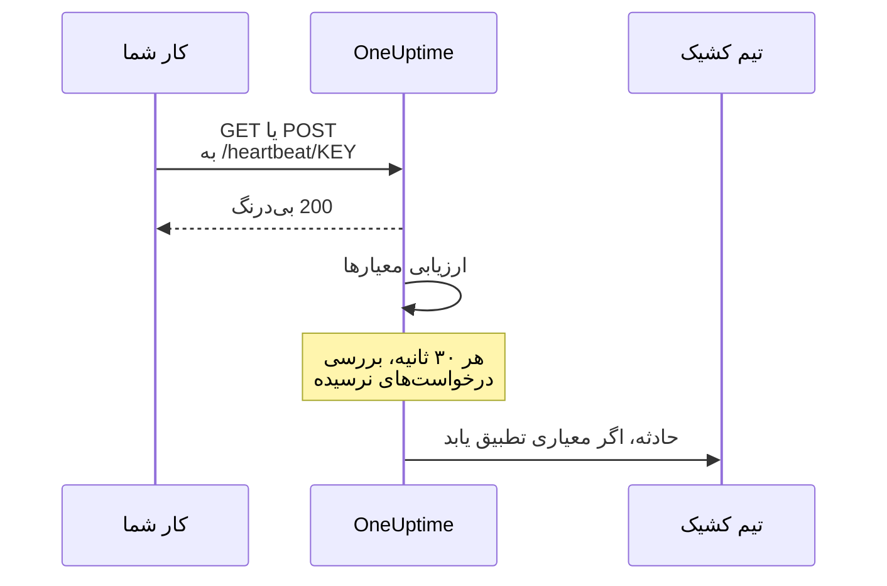
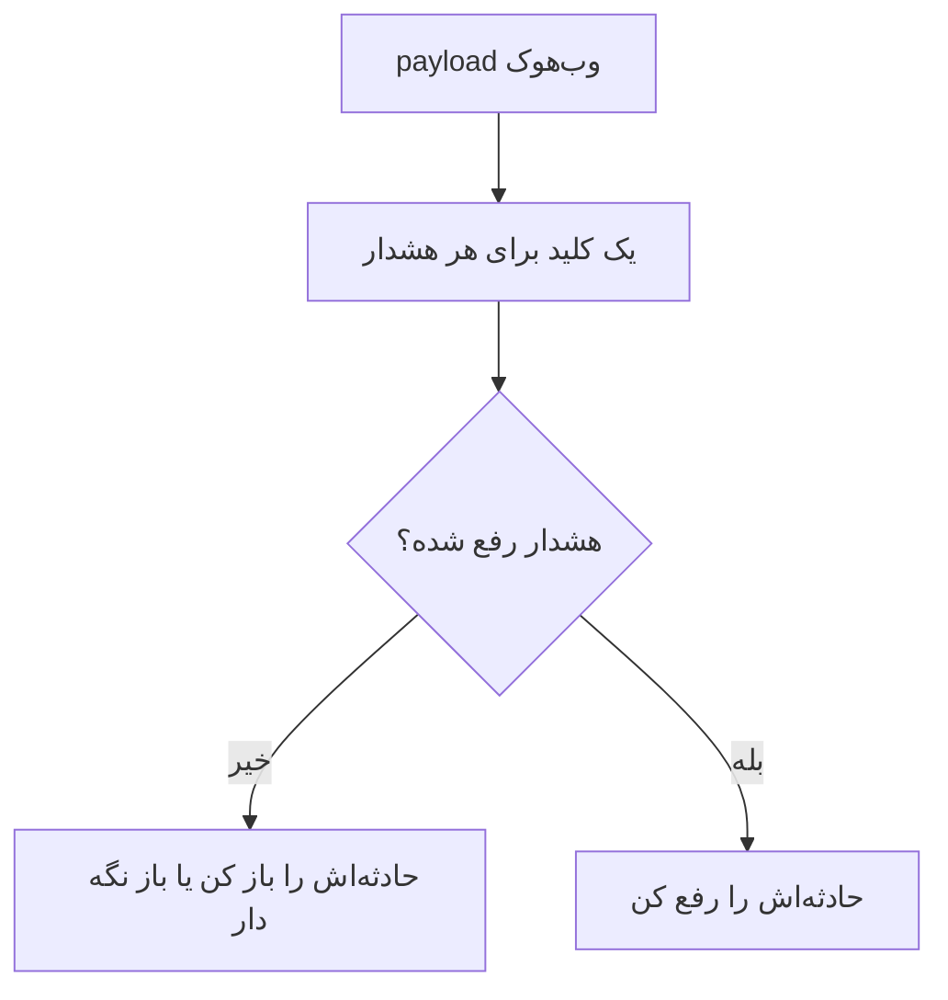

# مانیتور درخواست ورودی

مانیتور درخواست ورودی نشانی‌ای به شما می‌دهد که سامانه‌های دیگر درخواست‌های HTTP را به آن می‌فرستند. OneUptime هر درخواست را بر پایه معیارهای شما می‌سنجد، و می‌تواند وضعیت مانیتور را تغییر دهد، حادثه اعلام کند، و افراد کشیک را فرا بخواند.

دو کار متفاوت را پوشش می‌دهد:

- **مانیتورینگ ضربان قلب** — یک کار زمان‌بندی‌شده cron، یک worker یا یک دستگاه بر پایه زمان‌بندی نشانی را پینگ می‌کند، و OneUptime وقتی پینگ‌ها دیگر نرسند حادثه‌ای باز می‌کند.
- **دریافت هشدار از سامانه‌ای دیگر** — ‏Prometheus Alertmanager، ‏Grafana، یا هر چیز دیگری که بتواند JSON را POST کند هشدارها را به درون می‌فرستد، و OneUptime هرکدام را به حادثه‌ای با تشدید کشیک و رفع خودکار هنگام بهبود تبدیل می‌کند.

هر دو همان نوع مانیتور را به کار می‌برند. آنچه آن‌ها را از هم جدا می‌کند معیارهایی است که پیکربندی می‌کنید.

:::cards
- [مانیتور را بسازید](#ساخت-مانیتور-درخواست-ورودی): در چند گام یک نشانی ضربان قلب بگیرید.
- [ضربان قلب بفرستید](#ضربان-قلب-بفرستید): از curl، ‏cron، ‏Node.js، ‏Python یا Go.
- [هشدار وقتی پینگ‌ها بند می‌آیند](#اگر-۱۰-دقیقه-ضربان-قلبی-نرسید-آفلاین-علامت-بزن-یک-کلید-مرد-مرده): مانیتور را به کلید مرد مرده تبدیل کنید.
- [هشدار دریافت کنید](#دریافت-هشدار-از-سامانهای-دیگر): یک حادثه برای هر هشدار Alertmanager یا Grafana.
- [در SNS یا Event Grid مشترک شوید](#اشتراک-در-amazon-sns-یا-azure-event-grid): اشتراک را با یک کلیک تأیید کنید.
:::

## چگونه کار می‌کند

هیچ چیز سامانه شما را از بیرون بررسی نمی‌کند: سامانه شما نشانی مانیتور را فرا می‌خواند، OneUptime بی‌درنگ پاسخ می‌دهد، و سپس درخواست را بر پایه معیارهای مانیتور می‌سنجد. معیاری که درخواست‌هایی را می‌پاید که *دیگر* نمی‌رسند، افزون بر این هر ۳۰ ثانیه در پس‌زمینه دوباره بررسی می‌شود، تا سکوت هم بتواند حادثه‌ای باز کند.



از آن برای این کارها استفاده کنید:

- پایش کارهای cron و وظیفه‌های زمان‌بندی‌شده
- اطمینان از اجرای workerهای پس‌زمینه
- پایش سرویس‌های پشت دیوار آتش که از بیرون در دسترس نیستند
- دریافت هشدار از Prometheus Alertmanager، ‏Grafana و دیگر سامانه‌های هشداردهی
- ردیابی سیگنال‌های ضربان قلب از هر سامانه‌ای که HTTP بلد است

## ساخت مانیتور درخواست ورودی

:::steps
### یک مانیتور تازه آغاز کنید

به **مانیتورها** بروید و روی **ساخت مانیتور** کلیک کنید.

### درخواست ورودی را برگزینید

در **نوع مانیتور**، ‏**درخواست ورودی** را برگزینید — یکی از نوع‌های رایج در بالای فهرست است. یک **نام** وارد کنید و سپس روی **بعدی** کلیک کنید.

### معیارها را بازبینی کنید

گام **معیارها** با [معیارهای پیش‌فرض](#آنچه-از-ابتدا-دارید) آغاز می‌شود. برای ضربان قلب، روی **افزودن معیار** کلیک کنید و به معیار تازه فیلتری از نوع **درخواست ورودی** / **دریافت‌نشده طی (دقیقه)** بدهید که وضعیت را آفلاین کند و حادثه‌ای اعلام کند، با **رفع خودکار حادثه** روشن. سپس آن را به بالای فهرست بکشید — دلیلش را در [نمونه معیارها](#نمونه-معیارها) ببینید.

### مانیتور را بسازید

روی **ساخت مانیتور** کلیک کنید. مانیتور در صفحه **نمای کلی** خود باز می‌شود، که در آن کارت **اولین ضربان را بفرستید** ‏**نشانی ضربان** را با دکمه رونوشت و یک فرمان نمونه `curl` نشان می‌دهد.

### نخستین درخواست را بفرستید

سرویس خود را طوری پیکربندی کنید که به آن نشانی درخواست بفرستد ([ضربان قلب بفرستید](#ضربان-قلب-بفرستید) را ببینید). وقتی نخستین درخواست برسد، کارت جای خود را به تاریخچه مانیتور می‌دهد، و یک کارت **نشانی ضربان** نشانی و زمان رسیدن واپسین درخواست را نشان می‌دهد.
:::

> [!NOTE]
> نشانی شامل کلید محرمانه مانیتور است، پس فقط کسانی که می‌توانند مانیتورها را ویرایش کنند آن را می‌بینند. هر زمان می‌توانید آن را دوباره در صفحه **مستندات** مانیتور، در بخش **پیکربندی** منوی کناری آن، پیدا کنید.

## نشانی درخواست

مانیتور شما نشانی یکتایی با این قالب دارد:

```text
https://oneuptime.com/heartbeat/YOUR_SECRET_KEY
```

اگر خودمیزبان هستید، `https://oneuptime.com` را با نشانی نمونه OneUptime خود جایگزین کنید.

درخواست‌های **GET** یا **POST** را به این نشانی بفرستید. ‏HEAD پذیرفته می‌شود و مانند GET با آن رفتار می‌شود؛ ‏PUT، ‏PATCH و DELETE پاسخ ۴۰۴ برمی‌گردانند. کلید محرمانه در مسیر اعتبارنامه است: هیچ هدر یا توکنی لازم نیست، مگر اینکه پروژه [در هر درخواست یک راز را الزامی کرده باشد](#الزامی-کردن-راز-در-هر-درخواست). رشته‌های کوئری نادیده گرفته می‌شوند: آنچه را معیارها باید بخوانند در بدنه یا هدرها بفرستید.

> [!WARNING]
> هر کسی که این نشانی را بداند می‌تواند مانیتور را سالم علامت بزند، پس آن را مانند یک راز نگه دارید. اگر فاش شد، صفحه **تنظیمات** مانیتور را باز کنید و روی **بازنشانی کلید محرمانه درخواست ورودی** کلیک کنید، سپس همه فرستنده‌ها را به‌روز کنید. نمای کلی مانیتور آخرین درخواست را همان‌طور نشان می‌دهد که لاگ‌هایش آن را نگه می‌دارند: با اسرار و داده‌های شخصی پوشانده‌شده، و بدون هدرها و بدنه وقتی **نگه داشتن محتوای درخواست** خاموش است. پوشاندن فقط نام‌ها و الگوهایی را که می‌شناسد پیدا می‌کند، پس کلیدهای API یا توکن‌ها را به این endpoint نفرستید.

> [!IMPORTANT]
> ‏OneUptime بی‌درنگ با `200` و یک شیء JSON خالی (`{}`) پاسخ می‌دهد و درخواست را در یک صف پردازش می‌کند. این پاسخ پیش از هر اعتبارسنجی نوشته می‌شود، پس `200` تأییدی بر پذیرفته شدن درخواست **نیست** — کلید محرمانه نادرست، مانیتور حذف‌شده و مانیتور غیرفعال همگی `200` برمی‌گردانند. برای اطمینان از رسیدن درخواست‌ها، خط زمانی خود مانیتور را ببینید. پروژه‌ای که در هر درخواست یک راز را الزامی کرده است به درخواستی که رازی ندارد پاسخ `401` می‌دهد، و سرویسی که پیش از فرستادن هر چیزی نشانی را بررسی می‌کند همان پاسخی را می‌گیرد که انتظار دارد: [سرویس‌هایی که اول نشانی را بررسی می‌کنند](#سرویسهایی-که-اول-نشانی-را-بررسی-میکنند) را ببینید.

### فرستادن بدنه درخواست

اگر می‌خواهید به فیلدهای درون بدنه دسترسی داشته باشید — `{{requestBody.status}}` در عنوان حادثه، یک مسیر JSON در گروه‌بندی حادثه‌ها، یا معیاری با عبارت JavaScript — ‏`Content-Type: application/json` را بفرستید. این مستندات همه‌جا همین قالب را فرض می‌کنند. بدنه باید یک شیء یا آرایه JSON باشد: JSON نادرست، یا مقداری تنها مانند `"error"`، با `500` رد می‌شود.

| نوع محتوا | آنچه معیارها و قالب‌ها می‌بینند |
| --- | --- |
| `application/json` | ‏JSON تجزیه‌شده. |
| `application/x-www-form-urlencoded` | فرم تجزیه‌شده. کلیدهای کروشه‌دار تودرتو می‌شوند (`alerts[0][status]=firing`)، و هر مقدار یک رشته است. |
| `text/plain` | ‏JSON تجزیه‌شده، وقتی متن یک شیء یا آرایه JSON باشد: Amazon SNS پیام‌هایش را این‌گونه می‌فرستد. هر متن دیگری خود همان متن است، پس `backup failed: error 42` با معیارهای پیش‌فرض مانیتور را آفلاین می‌کند. |
| ‏`application/cloudevents+json` یا نوع `+json` دیگری | ‏JSON تجزیه‌شده: Azure Event Grid رویدادهای CloudEvents را این‌گونه تحویل می‌دهد. |
| هر چیز دیگر، یا هیچ | بدنه‌ای خالی (`{}`)، پس هیچ ارجاعی به `requestBody` جای‌گذاری نمی‌شود، و قالب آن را همان‌طور که هست باقی می‌گذارد. |

بدنه‌های تا ۵۰ MB پذیرفته می‌شوند؛ بدنه بزرگ‌تر با `413` رد می‌شود. بدنه را با `Content-Encoding: gzip` فشرده نکنید: در این صورت به‌صورت JSON ذخیره نمی‌شود، و مسیرهای درون آن یافت نمی‌شوند.

### ضربان قلب بفرستید

هر نمونه یک درخواست می‌فرستد. ‏`YOUR_SECRET_KEY` را با کلید موجود در نشانی مانیتور خود جایگزین کنید.

:::tabs
@tab curl
```bash
# Simple GET request
curl https://oneuptime.com/heartbeat/YOUR_SECRET_KEY

# POST request with a JSON body
curl -X POST https://oneuptime.com/heartbeat/YOUR_SECRET_KEY \
  -H "Content-Type: application/json" \
  -d '{"status": "healthy", "version": "1.2.3"}'
```
@tab Cron
```bash
# Send a heartbeat every 5 minutes
*/5 * * * * curl -fsS https://oneuptime.com/heartbeat/YOUR_SECRET_KEY > /dev/null

# Or ping only when the job succeeds, so a failed run counts as a missed heartbeat
0 2 * * * /usr/local/bin/backup.sh && curl -fsS https://oneuptime.com/heartbeat/YOUR_SECRET_KEY > /dev/null
```
@tab Node.js
```javascript title="heartbeat.mjs"
// Node.js 18 or later: fetch is built in. Run with `node heartbeat.mjs`.
const response = await fetch(
  "https://oneuptime.com/heartbeat/YOUR_SECRET_KEY",
  {
    method: "POST",
    headers: { "Content-Type": "application/json" },
    body: JSON.stringify({ status: "healthy", version: "1.2.3" }),
  },
);

console.log(response.status); // 200
```
@tab Python
```python title="heartbeat.py"
# Python 3, standard library only. Run with `python3 heartbeat.py`.
import json
import urllib.request

request = urllib.request.Request(
    "https://oneuptime.com/heartbeat/YOUR_SECRET_KEY",
    data=json.dumps({"status": "healthy", "version": "1.2.3"}).encode(),
    headers={"Content-Type": "application/json"},
    method="POST",
)

with urllib.request.urlopen(request, timeout=10) as response:
    print(response.status)  # 200
```
@tab Go
```go title="heartbeat.go"
// Run with `go run heartbeat.go`.
package main

import (
	"bytes"
	"fmt"
	"net/http"
)

func main() {
	body := []byte(`{"status": "healthy", "version": "1.2.3"}`)

	resp, err := http.Post(
		"https://oneuptime.com/heartbeat/YOUR_SECRET_KEY",
		"application/json",
		bytes.NewReader(body),
	)
	if err != nil {
		panic(err)
	}
	defer resp.Body.Close()

	fmt.Println(resp.StatusCode) // 200
}
```
@tab PowerShell
```powershell
# Windows PowerShell 5.1 or PowerShell 7
Invoke-RestMethod -Method Post `
  -Uri "https://oneuptime.com/heartbeat/YOUR_SECRET_KEY" `
  -ContentType "application/json" `
  -Body '{"status": "healthy", "version": "1.2.3"}'
```
:::

## الزامی کردن راز در هر درخواست

هر کسی که نشانی یک مانیتور را داشته باشد می‌تواند به آن درخواست بفرستد. مالک پروژه یا مدیر پروژه می‌تواند کاری کند که هر مانیتور درخواست ورودی در پروژه، فارغ از اینکه چه کسی آن را راه‌اندازی کرده، یکی از اسرار خود پروژه را هم الزامی کند: **الزامی کردن راز در هر درخواست** را روشن کنید. درخواستی که رازی ندارد، پیش از آنکه ضربان حساب شود، به‌عنوان آخرین درخواست مانیتور نگه داشته شود یا به معیاری برسد، با `401` و دلیل آن رد می‌شود. درخواستی که راز دارد مثل قبل به معیارهای خود مانیتور می‌رسد.

مالکان پروژه و مدیران پروژه اسرار و این الزام را مدیریت می‌کنند، و نقشی سفارشی با مجوزهای Create، Read، Edit و Delete Incoming Request Secret هم همین کار را می‌کند: Read مقدار اسرار را نشان می‌دهد و Edit الزام را هم روشن و خاموش می‌کند.

:::steps
### یک راز بسازید

به **مانیتورها ← تنظیمات ← اسرار درخواست ورودی** بروید و یک راز بسازید. نامی به آن بدهید تا OneUptime مقدارش را بسازد؛ آن را از فهرست کپی کنید.

### آن را از هر فرستنده بفرستید

راز را در هدر `X-OneUptime-Secret` یا به‌صورت توکن Bearer در هدر `Authorization` بفرستید، هر کدام که فرستنده‌تان بتواند تنظیم کند. فرستنده‌ای که نمی‌تواند هدری از خودش تنظیم کند، می‌تواند به جای آن هر درخواست را با راز امضا کند: [امضای درخواست‌ها با راز](#امضای-درخواستها-با-راز) را ببینید.

### فرستنده‌هایی را که جا مانده‌اند پیدا کنید

از همان لحظه که پروژه رازی دارد، OneUptime هر درخواست را از نظر داشتن راز بررسی می‌کند، بی‌آنکه هنوز درخواستی را رد کند. **درخواست‌های بدون راز** در همان صفحه هر مانیتور درخواست ورودی را که در ۲۴ ساعت گذشته درخواستی بدون راز معتبر گرفته است، همراه با دلیلش فهرست می‌کند: هیچ رازی فرستاده نشده، یا رازی نادرست. آن فرستنده‌ها را درست کنید. مانیتوری که فرستنده‌هایش درست شده‌اند، در **آخرین بار با راز** زمانی دیرتر از **آخرین بار بدون راز** نشان می‌دهد و ظرف ۲۴ ساعت از فهرست بیرون می‌رود.

### الزام را روشن کنید

**الزامی کردن راز در هر درخواست** را روشن کنید. تا وقتی پروژه هیچ رازی ندارد نمی‌توان آن را روشن کرد، تا هیچ فرستنده‌ای به اشتباه رد نشود. پیش از روشن شدن، اگر مانیتور درخواست ورودی‌ای در ۲۴ ساعت گذشته درخواستی بدون راز معتبر گرفته باشد، تعدادشان را می‌گوید: از آن پس فرستنده‌هایشان رد می‌شوند.
:::

```bash
curl -X POST https://oneuptime.com/heartbeat/YOUR_SECRET_KEY \
  -H "X-OneUptime-Secret: YOUR_PROJECT_SECRET"

# Or as a bearer token
curl -X POST https://oneuptime.com/heartbeat/YOUR_SECRET_KEY \
  -H "Authorization: Bearer YOUR_PROJECT_SECRET"
```

OneUptime هرگز راز را نگه نمی‌دارد: پیش از نگه داشتن هر چیزی، هدر را از درخواست برمی‌دارد و توکن Bearer را که یکی از اسرار پروژه باشد پنهان می‌کند.

نشانی‌ای که در ۱۵ دقیقه بیش از ۱۰ راز نادرست متفاوت به یک مانیتور بفرستد، از آن پس هر رازی که بفرستد، درست یا نادرست، تا زمانی که هدر `Retry-After` آن می‌گوید، حداکثر ۱۵ دقیقه، با `429` رد می‌شود. فرستنده‌های نشانی‌های دیگر تأثیری نمی‌پذیرند، و فرستنده‌ای که یک راز قدیمی را پیوسته می‌فرستد، همچنان همان `401` را می‌گیرد که می‌گوید چه چیزی نادرست است.

> [!TIP]
> برای جایگزین کردن یک راز بی‌آنکه کسی رد شود، راز دومی بسازید، فرستنده‌هایتان را به آن منتقل کنید و وقتی **آخرین استفاده** راز قدیمی دیگر تغییر نکرد، آن را حذف کنید. هر یک از اسرار پروژه پذیرفته می‌شود، مگر آنکه به مانیتورهای دیگر محدود شده باشد، و تا وقتی الزام روشن است، آخرین رازی را که مانیتوری را پوشش می‌دهد نمی‌توان حذف کرد.

### امضای درخواست‌ها با راز

فرستنده می‌تواند به جای فرستادن راز، هر درخواست را با آن امضا کند، که امن‌تر است: هیچ چیز محرمانه‌ای فرستاده نمی‌شود، و درخواستی که کسی رهگیری کرده باشد بعداً دوباره فرستاده نمی‌شود. هر جا فرستنده بتواند امضا کند، همین را برگزینید. ‏OneUptime این امضاها را بررسی می‌کند که هر یک یک HMAC-SHA256 به‌صورت هگز با راز به‌عنوان کلید است:

| فرستنده | هدر | آنچه امضا می‌شود |
| --- | --- | --- |
| کد خودتان | ‏`X-OneUptime-Signature: t=<time>,v1=<signature>` | ‏`<time>.<body>` |
| وب‌هوک‌های GitHub | ‏`X-Hub-Signature-256` | بدنه |
| Slack | ‏`X-Slack-Signature` همراه با `X-Slack-Request-Timestamp` | ‏`v0:<time>:<body>` |
| Stripe | ‏`Stripe-Signature` | ‏`<time>.<body>` |

‏`<time>` زمانی است که درخواست امضا شد، به ثانیه از ۱۹۷۰. امضایی که بیش از ۵ دقیقه با ساعت OneUptime فاصله داشته باشد رد می‌شود، و همین‌طور درخواست امضاشده‌ای که بار دوم فرستاده شود؛ امضای GitHub زمان ندارد، پس OneUptime هر یک را یک روز به یاد می‌سپارد. برای GitHub، یکی از اسرار پروژه را به‌عنوان راز وب‌هوک به آن بدهید. ‏Slack و Stripe راز امضای خودشان را می‌سازند: راز پروژه را با همان مقدار، در **فیلدهای بیشتر** بسازید.

```bash
body='{"status":"healthy"}'
t=$(date +%s)
sig=$(printf '%s.%s' "$t" "$body" | openssl dgst -sha256 -hmac "YOUR_PROJECT_SECRET" | sed 's/^.* //')

curl -X POST https://oneuptime.com/heartbeat/YOUR_SECRET_KEY \
  -H "Content-Type: application/json" \
  -H "X-OneUptime-Signature: t=$t,v1=$sig" \
  -d "$body"
```

رازی که در رشتهٔ پرس‌وجوی نشانی باشد پذیرفته نمی‌شود: پراکسی‌ها و گزارش‌های دسترسی نشانی‌ها را کامل نگه می‌دارند، کنار کلید خود مانیتور. ورودی درخواست‌های دریافتی یک پراب بدنهٔ درخواست امضاشده را همان‌طور که رسیده است می‌فرستد، پس امضا از راه پراب هم معتبر می‌ماند.

### محدود کردن یک راز به برخی مانیتورها

هر رازی را همهٔ مانیتورهای درخواست ورودی پروژه می‌پذیرند، مگر آنکه محدودش کنید، چنان‌که پروژه‌ای که هر مستأجرش راز خودش را می‌فرستد می‌کند: در **فیلدهای بیشتر**، **مانیتورهای مشخص** یا **مانیتورهای دارای برچسب** را برگزینید. هر مانیتور دیگری آن را با `401` رد می‌کند، همان‌طور که رازی نادرست را رد می‌کند، و **درخواست‌های بدون راز** دلیلش را **راز برای این مانیتور نیست** نشان می‌دهد. تا وقتی الزام روشن است، پروژه دست‌کم یک راز نگه می‌دارد که مانیتوری را پوشش دهد.

## معیارهای پایش

می‌توانید معیارهایی پیکربندی کنید تا تعیین شود سرویس شما چه زمانی آنلاین، دچار کاهش کارایی یا آفلاین به شمار می‌آید. هر فیلتر معیار یک **نوع فیلتر** (به چه نگاه شود)، یک **شرط فیلتر** (چگونه مقایسه شود) و یک **مقدار** دارد.

### آنچه از ابتدا دارید

مانیتور درخواست ورودی تازه با دو معیار ساخته می‌شود که بدنه درخواست را می‌خوانند:

| معیار | نوع فیلتر | شرط فیلتر | مقدار | اثر |
| -------- | ------------ | ---------------- | ------- | -------------------------------------------- |
| Offline  | بدنه درخواست | شامل است | `error` | مانیتور را آفلاین علامت می‌زند، حادثه‌ای باز می‌کند |
| Online   | بدنه درخواست | شامل نیست | `error` | مانیتور را آنلاین علامت می‌زند |

این برای حالت رایجی مناسب است که فرستنده سلامت خودش را در payload گزارش می‌دهد: درخواستی که بدنه‌اش `error` را نام ببرد مانیتور را پایین می‌آورد، و درخواست بعدی بدون آن واژه مانیتور را بالا می‌آورد و حادثه را رفع می‌کند. درخواستی که اصلاً بدنه ندارد «شامل `error` نیست» به شمار می‌آید، پس یک پینگ ساده ضربان قلب مانیتور را آنلاین نگه می‌دارد.

مقدار را به آنچه فرستنده‌تان واقعاً می‌فرستد تغییر دهید (`"status":"firing"`، `FAILED` و مانند این‌ها) — تطبیق، جست‌وجوی زیررشته با حساسیت به بزرگی و کوچکی حروف در کل بدنه، از جمله کلیدها، است، پس `{"error":null}` هم با `error` تطبیق می‌یابد.

> [!NOTE]
> این پیش‌فرض‌ها کلید مرد مرده **نیستند**: وقتی درخواست‌ها دیگر نرسند، هیچ چیز اینجا فعال نمی‌شود. اگر می‌خواهید هنگام سکوت هشدار بگیرید، معیاری از نوع **درخواست ورودی** / **دریافت‌نشده طی (دقیقه)** را همان‌طور که در ادامه آمده بیفزایید.

### نوع‌های فیلتر در دسترس

| نوع فیلتر | بررسی می‌کند | یادداشت |
| --------------------- | ------------------------------------------------------ | -------------------------------------------------------------------------------------------- |
| درخواست ورودی | آیا درخواستی در یک بازه زمانی رسیده است | تنها بررسی‌ای که وقتی هیچ چیز نمی‌رسد می‌تواند فعال شود |
| بدنه درخواست | بدنه درخواست | تطبیق زیررشته. بدنه‌های شیء به‌صورت JSON فشرده مقایسه می‌شوند |
| هدر درخواست | نام هدرهای درخواست | تطبیق دقیق با نام کامل هدر، بدون توجه به بزرگی و کوچکی حروف |
| مقدار هدر درخواست | مقدار هدرهای درخواست | تطبیق دقیق با مقدار کامل هدر، بدون توجه به بزرگی و کوچکی حروف |
| عبارت JavaScript | هر عبارتی روی `requestBody` و `requestHeaders` | انعطاف‌پذیرترین گزینه — [عبارت‌های JavaScript](/docs/monitor/javascript-expression) را ببینید |

### شرط‌های فیلتر

هر نوع فیلتر مجموعه شرط‌های خودش را دارد:

| نوع فیلتر | شرط‌ها |
| --- | --- |
| **درخواست ورودی** | **دریافت‌شده طی (دقیقه)** — درخواستی در شمار دقیقه‌های تعیین‌شده رسیده است. **دریافت‌نشده طی (دقیقه)** — هیچ درخواستی در شمار دقیقه‌های تعیین‌شده نرسیده است. |
| **بدنه درخواست**، **هدر درخواست**، **مقدار هدر درخواست** | **شامل است** و **شامل نیست** |
| **عبارت JavaScript** | **به درست ارزیابی می‌شود** |

> [!NOTE]
> نام‌ها و مقدارهای هدر با حروف کوچک و با کل نام یا مقدار مقایسه می‌شوند، نه به‌صورت زیررشته: `application/json` با `application/json; charset=utf-8` تطبیق نمی‌یابد. فقط **بدنه درخواست** تطبیق زیررشته انجام می‌دهد. هدرهایی که پراکسی شما یا متعادل‌کننده بار خود OneUptime می‌افزایند (`x-forwarded-for`، `x-real-ip`) هم ذخیره می‌شوند.

بدنه‌های شیء به‌صورت JSON فشرده و بدون فاصله مقایسه می‌شوند، پس فیلتر **بدنه درخواست** / **شامل است** باید `"status":"firing"` نوشته شود — رونوشت گرفتن `"status": "firing"` از یک payload قالب‌بندی‌شده هرگز تطبیق نمی‌یابد.

### نمونه معیارها

#### اگر ۱۰ دقیقه ضربان قلبی نرسید، آفلاین علامت بزن (یک کلید مرد مرده)

| فیلد | مقدار |
| --- | --- |
| **نوع فیلتر** | درخواست ورودی |
| **شرط فیلتر** | دریافت‌نشده طی (دقیقه) |
| **مقدار** | `10` |

#### بر پایه محتوای بدنه درخواست، کاهش کارایی علامت بزن

| فیلد | مقدار |
| --- | --- |
| **نوع فیلتر** | بدنه درخواست |
| **شرط فیلتر** | شامل است |
| **مقدار** | `"status":"degraded"` |

> [!IMPORTANT]
> کلید مرد مرده را **بالای** معیارهای پیش‌فرض بگذارید. معیارها از بالا بررسی می‌شوند، و نخستین معیاری که تطبیق یابد تصمیم می‌گیرد. بررسی پس‌زمینه واپسین درخواست را دوباره می‌خواند، پس معیار آنلاین پیش‌فرض — "بدنه درخواست شامل نیست `error`" — همچنان با آن تطبیق می‌یابد، و معیاری که زیر آن است هرگز نوبت نمی‌گیرد. **افزودن معیار** یک معیار در پایین می‌افزاید: آن را بالا بکشید.

> [!WARNING]
> یک مانیتور فقط وقتی در پس‌زمینه دوباره ارزیابی می‌شود که دست‌کم یکی از معیارهایش **درخواست ورودی** را بررسی کند. مانیتوری که معیارهایش فقط بدنه درخواست، هدر درخواست یا یک عبارت JavaScript را بررسی می‌کنند، فقط هنگام رسیدن درخواست ارزیابی می‌شود و در هیچ زمان دیگری نه — پس هرگز نمی‌تواند خودبه‌خود آفلاین شود. اگر هشداری برای ضربان قلب نرسیده می‌خواهید، به معیاری از نوع **درخواست ورودی** نیاز دارید.

بررسی پس‌زمینه دقیقه‌های کامل را می‌شمارد و همین که *بیش* از مقدار گذشته باشد فعال می‌شود: "دریافت‌نشده طی (دقیقه): 10" حدود ۱۱ دقیقه پس از واپسین درخواست فعال می‌شود (بررسی هر ۳۰ ثانیه اجرا می‌شود). با مانیتوری که هرگز درخواستی نگرفته طوری رفتار می‌شود که انگار زمان ساخت آن واپسین درخواست بوده، پس همان معیار روی یک مانیتور کاملاً تازه حدود ۱۱ دقیقه پس از ساخت آن فعال می‌شود، حتی اگر فرستنده هرگز وصل نشده باشد. فقط دقیقه‌هایی که OneUptime در حال دریافت بوده در مقدار شمرده می‌شوند: دقیقه‌هایی که خود OneUptime در حال راه‌اندازی دوباره، ارتقا یا جبران عقب‌افتادگی است شمرده نمی‌شوند، همان‌طور که [وقتی OneUptime داده دریافت نمی‌کند](/docs/monitor/when-oneuptime-is-not-receiving) توضیح می‌دهد.

## دریافت هشدار از سامانه‌ای دیگر

‏Alertmanager، ‏Grafana و ابزارهای مشابه یک سند JSON را POST می‌کنند که یک یا چند هشدار را توصیف می‌کند. به‌طور پیش‌فرض یک معیار **یک** حادثه باز می‌کند، پس payloadی که پنج هشدار دارد یک حادثه تنها می‌سازد. گروه‌بندی حادثه‌ها این را تغییر می‌دهد: مقداری را از payload بیرون می‌کشد و **برای هر مقدار متمایز یک حادثه جداگانه** باز می‌کند، که همه می‌توانند همزمان باز باشند.



### روشن کردن گروه‌بندی حادثه‌ها

:::steps
1. معیار را باز کنید و **تنظیمات** را بگسترانید.
2. ‏**گروه‌بندی حوادث و هشدارها بر اساس یک فیلد payload** را روشن کنید.
3. ‏**باز کردن یک حادثه جداگانه برای هر…** را پر کنید. برای اینکه هر حادثه خودبه‌خود رفع شود، فیلد و مقدار زیر **برطرف کردن خودکار هر حادثه وقتی…** را هم پر کنید (در ادامه). سپس مانیتور را ذخیره کنید.
:::

| فیلد | نمونه | چه می‌کند |
| ---------------------------------- | ---------------------------------------- | ---------------------------------------------------------------------- |
| Open a separate incident for each… | `requestBody.alerts[*].labels.alertname` | مسیری که مقدارهای متمایزش حادثه‌ها را از هم جدا می‌کنند |
| Field that signals recovery | `requestBody.alerts[*].status` | مسیری که برای تصمیم به بهبود یک هشدار بررسی می‌شود |
| Value that means recovered | `resolved` | مقدار دقیقی که بهبود را نشان می‌دهد |
| Max incidents per request | `100` (پیش‌فرض) | سقف ایمنی، تا فیلدی با مقدارهای فراوان نتواند حادثه‌های بی‌شمار باز کند |

گروه‌بندی به معیاری تعلق دارد که در آن روشن شده است. معیارهای دیگر مانیتور گروه‌بندی نمی‌کنند: وقتی یکی از آن‌ها با یک درخواست تطبیق می‌یابد، حادثه و هشدارش را همان‌طور باز می‌کند که در مانیتوری که هیچ معیارش گروه‌بندی نمی‌کند باز می‌کرد.

### نحو مسیر

مسیرها باید با پیشوند لفظی `requestBody.` آغاز شوند. مسیری بدون آن — `alerts[*].labels.alertname` — در هیچ درخواستی مقداری پیدا نمی‌کند. پوشش `{{ }}` اختیاری است: ‏`requestBody.status` و `{{requestBody.status}}` یکسان رفتار می‌کنند.

- ‏`[*]` روی یک آرایه گسترش می‌یابد — یک حادثه برای هر مقدار **متمایز**. دو عضو که یک مقدار می‌دهند در یک حادثه یکی می‌شوند، و وضعیت آن حادثه (فعال/رفع‌شده) از **نخستین** عضو تطبیق‌یافته گرفته می‌شود. **فقط نخستین `[*]` در یک مسیر نویسه عام است**؛ ‏`requestBody.groups[*].alerts[*].name` با هیچ چیز تطبیق نمی‌یابد.
- ‏`[0]` و `[last]` یک عضو را برمی‌گزینند، و می‌توانند پس از یک `[*]` بیایند.
- مقدارهای شیء و آرایه، رشته‌های خالی و nullها نادیده گرفته می‌شوند. ‏`0` و `false` کلیدهای معتبرند.
- بدنه باید یک شیء JSON باشد؛ payloadی که سطح بالایش آرایه است گروه‌بندی نمی‌شود.

### درخواست‌های بدون این فیلد

درخواستی که با یک معیار گروه‌بندی‌شده تطبیق می‌یابد اما در مسیر آن مقداری ندارد — فیلد وجود ندارد یا خالی است، یک شیء یا فهرست دارد، یا بدنه یک شیء JSON نیست — باز هم حادثه و هشدار آن معیار را باز می‌کند: یکی برای کل مانیتور، همان‌طور که معیار بدون گروه‌بندی می‌کرد. معیار گروه‌بندی‌شده‌ای هم که چون درخواست‌ها دیگر نمی‌رسند تطبیق می‌یابد همین کار را می‌کند. عنوانی که متغیر گروه‌بندی را نام می‌برد، مانند `{{alertname}}`، آن را همان‌طور که نوشته شده نشان می‌دهد، چون مقداری برای جای‌گذاری نیست.

اگر **رفع خودکار حادثه** روشن باشد، آن حادثه وقتی رفع می‌شود که درخواستی بعدی بدون این فیلد گزارش دهد بهبود یافته است، یا درخواستی بعدی با معیار دیگری تطبیق یابد. چنین بهبودی چیز تازه‌ای باز نمی‌کند.

وقتی برخی عضوهای یک آرایه مقدار دارند و برخی ندارند، هر مقدار حادثه خودش را باز می‌کند و عضوهای بی‌مقدار چیزی برای خودشان باز نمی‌کنند.

کارت **خلاصه مانیتور** در **نمای کلی** مانیتور نشان می‌دهد هر درخواست چه کرد، از جمله وقتی معیاری آن را برای کل مانیتور رسیدگی کرد یا چیز تازه‌ای باز نکرد.

### رفع بر پایه رویداد است

یک وب‌هوک فقط آنچه را در همان payload است توصیف می‌کند، پس OneUptime هرگز حادثه‌ای را به این دلیل که کلیدش دیگر پیدا نمی‌شود رفع نمی‌کند. حادثه فقط وقتی رفع می‌شود که payloadی صریحاً بگوید آن کلید بهبود یافته است. دو چیز باید هر دو برقرار باشند:

1. ‏**فیلدی که نشانه بهبود است** و **مقداری که به معنای بهبود است** تنظیم شده باشند و با payload تطبیق یابند. مقایسه دقیق و حساس به بزرگی و کوچکی حروف است — `Resolved` با `resolved` تطبیق نمی‌یابد.
2. حادثه معیار، **رفع خودکار حادثه** را روشن داشته باشد، زیر **فیلدهای بیشتر** در فرم حادثه. بدون آن، رویدادهای بهبود تطبیق‌یافته نادیده گرفته می‌شوند و حادثه‌ها باز می‌مانند. (همین برای هشدارها و **رفع خودکار هشدار** هم صدق می‌کند.) معیار آفلاین پیش‌فرض با این گزینه روشن آغاز می‌شود؛ حادثه‌ای که خودتان به یک معیار می‌افزایید با این گزینه خاموش آغاز می‌شود.

هشداری که خودتان به یک معیار می‌افزایید هم با **رفع خودکار هشدار** خاموش آغاز می‌شود، پس تا وقتی آن روشن نشود، بهبود هشدار را باز می‌گذارد. **برطرف کردن خودکار هر حادثه وقتی…** نشان می‌دهد بهبود کدام حادثه‌ها و هشدارهای معیار را رفع می‌کند و هر کدام را که باز می‌گذارد، همراه با دکمه‌ای که کلید آن را روشن می‌کند، نام می‌برد. کارت **خلاصه مانیتور** در **نمای کلی** مانیتور هر حادثه و هشداری را که بهبود باز گذاشت، همراه با دلیلش نام می‌برد.

‏**حداکثر حادثه به ازای هر درخواست** بیرون‌کشیدن را محدود می‌کند، نه فقط ساختن را. کلیدهای فراتر از سقف برای بهبود هم دیده نمی‌شوند، پس در payloadی که کلیدهای متمایزش از سقف بیشتر است، هشداری که فراتر از سقف `resolved` گزارش دهد حادثه‌اش را نمی‌بندد.

> [!NOTE]
> مانیتوری که یکی از معیارهایش بر اساس یک فیلد از محتوای درخواست گروه‌بندی می‌کند، هر درخواستی را که دریافت می‌کند یکی‌یکی و به ترتیب رسیدن ارزیابی می‌کند، پس هجوم هشدارها و بهبودها حادثه و هشدار هر مقدار را باز و رفع می‌کند. تا ۱۰۰۰ درخواست، یا ۱۶ مگابایت از آن‌ها، منتظر ارزیابی می‌مانند؛ فراتر از آن، قدیمی‌ترین درخواست‌های منتظر رد می‌شوند و کارت **خلاصه مانیتور** می‌گوید چند تا. مانیتور بدون گروه‌بندی فقط تازه‌ترین درخواست منتظرش را ارزیابی می‌کند.

> [!NOTE]
> اگر **فیلدی که نشانه بهبود است** شامل `[*]` باشد اما **باز کردن یک حادثه جداگانه برای هر…** نباشد، یک درخواست فقط وقتی بهبود یافته است که همه عضوهای آن آرایه این را بگویند. با `requestBody.alerts[*].status` و `resolved`، حادثه‌ای که بر پایه `requestBody.groupLabels.alertname` گروه‌بندی شده است وقتی رفع می‌شود که همه هشدارهای یک درخواست رفع شده باشند، و تا وقتی یکی هنوز فعال است باز می‌ماند.

> [!WARNING]
> مسیر بهبود بدون `[*]` در برابر کل payload ارزیابی می‌شود، پس یک `status: resolved` در سطح payload همه کلیدهای آن payload را رفع می‌کند — از جمله هشدارهایی که وضعیت خودشان هنوز فعال است.

### نام‌گذاری حادثه‌ها

کلید گروه‌بندی به‌صورت متغیری به نام **واپسین بخش مسیر** در اختیار قالب‌های حادثه و هشدار قرار می‌گیرد:

| مسیر | متغیر |
| ---------------------------------------- | ----------------- |
| `requestBody.alerts[*].labels.alertname` | `{{alertname}}`   |
| `requestBody.alerts[*].fingerprint`      | `{{fingerprint}}` |
| `requestBody.commonLabels.severity`      | `{{severity}}`    |

کل payload هم در کنار آن در دسترس است، پس هم عنوان حادثه `{{alertname}}` و هم توضیحی که به `{{requestBody.commonAnnotations.summary}}` ارجاع می‌دهد کار می‌کنند. [قالب‌بندی حادثه و هشدار](/docs/monitor/incident-alert-templating) را ببینید.

> [!WARNING]
> نام متغیر بخشی از هویتی است که OneUptime برای تطبیق یک رویداد بهبود با حادثه‌ای باز به کار می‌برد. تغییر مسیر گروه‌بندی به مسیری با واپسین بخش متفاوت، همه حادثه‌هایی را که اکنون زیر مسیر قدیمی باز هستند یتیم می‌کند — دیگر نمی‌توان آن‌ها را خودکار رفع کرد و باید دستی بسته شوند.

‏`[*]` **فقط** در دو فیلد مسیر گروه‌بندی کار می‌کند. جاهای دیگر جای‌گذاری نمی‌شود، و جای‌نگهداری که جای‌گذاری نشود **همان‌طور که هست** چاپ می‌شود، نه خالی — عنوانی مانند `{{requestBody.alerts[*].labels.alertname}}` با آکولادها نمایش داده می‌شود. عنوان `{{requestBody.alerts[0].annotations.summary}}` جای‌گذاری می‌شود، اما همیشه نخستین هشدار payload را می‌خواند، نه هشداری را که این حادثه برایش باز شده. متغیر گروه‌بندی را همراه فیلدهای مشترک `commonAnnotations` در payload ترجیح دهید.

### نمونه کامل

برای پیکربندی کامل Alertmanager، [Prometheus Alertmanager](/docs/integrations/prometheus-alertmanager) را ببینید. برای Grafana، [Grafana](/docs/integrations/grafana) را ببینید.

## سرویس‌هایی که اول نشانی را بررسی می‌کنند

برخی سرویس‌ها پیش از آنکه چیزی به یک نقطه پایانی تازه بفرستند آن را بررسی می‌کنند: درخواستی به آن می‌فرستند و تنها وقتی تحویل را آغاز می‌کنند که آن‌گونه که انتظار دارند پاسخ دهد. ‏OneUptime خودش به این بررسی‌ها پاسخ می‌دهد، پس کافی است **نشانی ضربان** مانیتور را در سرویس بچسبانید.

| سرویس | بررسی | پاسخ OneUptime |
| --- | --- | --- |
| ‏Azure Event Grid، اسکیمای Event Grid | یک `SubscriptionValidationEvent` | ‏`validationCode` آن، به‌صورت `validationResponse` |
| ‏Azure Event Grid، اسکیمای CloudEvents | یک درخواست `OPTIONS` که مبدأ خود را می‌گوید | ‏`WebHook-Allowed-Origin`، با همان مبدأ |
| Slack Events API | یک درخواست `url_verification` | ‏`challenge` آن |
| اعلان‌های تغییر Microsoft Graph | یک `POST` با `validationToken` | توکن، به‌صورت `text/plain` |
| قلاب‌های رویداد Okta | یک `GET` با `X-Okta-Verification-Challenge` | مقدار سرآیند، به‌صورت `verification` |

به بررسی تنها روی نشانی خود مانیتور پاسخ داده می‌شود، و تنها وقتی درخواست به حساب آید: در پروژه‌ای که در هر درخواست یک راز را الزامی کرده است، بررسی‌ای که رازی نفرستد مانند هر درخواست دیگری با `401` رد می‌شود، پس سرویس باید راز را در یک سرآیند بفرستد. پاسخ فقط همان چیزی را دارد که سرویس فرستاده تا پس بگیرد، و نه چیز دیگری از درخواست، و آن هم فقط وقتی که همان شکلی را داشته باشد که سرویس به آن می‌دهد.

بررسی مانند هر درخواست دیگری به مانیتور می‌رسد، پس معیارهای آن ارزیابی‌اش می‌کنند و در **نمای کلی** مانیتور نشان داده می‌شود؛ به بررسی CloudEvents فقط پاسخ داده می‌شود و بس. ورودی درخواست‌های دریافتی یک پراب به بررسی هم مانند هر درخواستی با `{}` پاسخ می‌دهد، پس این سرویس‌ها را به نشانی خود OneUptime بفرستید.

## اشتراک در Amazon SNS یا Azure Event Grid

‏Amazon SNS تا وقتی کسی اشتراک را تأیید نکند چیزی به یک نقطه پایانی تازه نمی‌فرستد؛ تأیید با باز کردن پیوندی است که SNS به همان نشانی می‌فرستد. ‏Azure Event Grid هم چنین پیوندی را برای نقطه پایانی‌ای می‌فرستد که به بررسی‌اش پاسخ ندهد، و OneUptime به آن پاسخ می‌دهد. وقتی پیوندی برسد که هنوز باید باز شود، کارت **خلاصه مانیتور** در **نمای کلی** مانیتور نشان می‌دهد سرویس منتظر چیست، موضوع کدام است، و یک دکمه که پیوند را در زبانه‌ای تازه باز می‌کند.

| سرویس | درخواست | دکمه | مدت کار کردن پیوند |
| --- | --- | --- | --- |
| Amazon SNS | ‏`SubscriptionConfirmation`، برای یک اشتراک HTTPS تازه | **تأیید اشتراک** | دو روز |
| Amazon SNS | ‏`UnsubscribeConfirmation`، وقتی اشتراک حذف می‌شود | **بازیابی اشتراک** | دو روز |
| Azure Event Grid | ‏`SubscriptionValidationEvent`، برای یک اشتراک رویداد تازه با وب‌هوک | **اعتبارسنجی اشتراک** | ۱۰ دقیقه |

دکمه تا رسیدن درخواست بعدی مانیتور باقی می‌ماند، حتی پس از آنکه پیوند را باز کنید. وقتی زمان پیوند به سر برسد، کارت به‌جای دکمه می‌گوید چگونه پیوندی تازه بگیرید. اگر درخواست‌های تازه‌تری رسیده‌اند، **گزارش‌های پایش** را باز کنید و در ردیف آن درخواست روی **مشاهده خلاصه** کلیک کنید.

پیوند، و توکن درون آن، هر جا که درخواست نگه داشته شود بدون پوشاندن نگه داشته می‌شوند: در جزئیات آن، در لاگ‌هایش، و در حادثه‌ها و هشدارهایی که باز می‌کند. تنها کاری که این پیوند می‌تواند بکند، آغاز ارسال به این مانیتور است. فقط پیوندی به نشانی خود سرویس به حساب می‌آید: هر پیوند دیگری مثل همیشه پوشانده می‌شود و دکمه‌ای نمی‌گیرد.

### Amazon SNS

:::steps
1. در کنسول Amazon SNS، موضوع را باز کنید و **Create subscription** را برگزینید. ‏`HTTPS` را به‌عنوان پروتکل برگزینید، و **نشانی ضربان** مانیتور را به‌عنوان نقطه پایانی بچسبانید.
2. ‏**نمای کلی** مانیتور را باز کنید، و در کارت **خلاصه مانیتور** روی **تأیید اشتراک** کلیک کنید. در کنسول SNS، وضعیت اشتراک از **Pending confirmation** به تأییدشده تغییر می‌کند.
:::

‏SNS پیام‌هایش را به‌صورت JSON با برچسب `text/plain` می‌فرستد، و مانیتور آن‌ها را به‌صورت JSON می‌خواند، پس معیارها، قالب‌ها و گروه‌بندی حادثه‌ها می‌توانند فیلدهای آن‌ها را به کار ببرند، مانند `{{requestBody.Subject}}` و `{{requestBody.Message}}`. ‏JSON اختصاصی هر اعلان، مانند JSON یک هشدار CloudWatch، به‌صورت متن در `Message` می‌رسد.

اگر کارت بگوید پیوند دیگر باز نمی‌شود، اشتراک را در کنسول SNS انتخاب کنید و **Request confirmation** را برگزینید. ‏SNS اشتراکی را که ظرف ۴۸ ساعت تأیید نشود حذف می‌کند؛ اگر چنین شد، اشتراک را دوباره بسازید.

### Azure Event Grid

:::steps
1. در پورتال Azure، منبعی را که رویدادهایش را می‌خواهید باز کنید و یک اشتراک رویداد بیفزایید. ‏**Event Grid Schema** یا **Cloud Event Schema v1.0** را به‌عنوان اسکیمای رویداد، **Web Hook** را به‌عنوان نوع نقطه پایانی، و **نشانی ضربان** مانیتور را به‌عنوان نقطه پایانی آن برگزینید.
2. اشتراک رویداد را بسازید. ‏OneUptime به بررسی Event Grid پاسخ می‌دهد، پس اشتراک همان هنگام ساخت اعتبارسنجی می‌شود و رویدادهایش شروع به رسیدن می‌کنند.
:::

‏Event Grid نقطه پایانی‌ای را اعتبارسنجی می‌کند که کدی را به آن برگرداند، یا مالکش پیوندی را که Event Grid می‌فرستد باز کند. ‏OneUptime کد را برمی‌گرداند، پس کارت **خلاصه مانیتور** دکمه **اعتبارسنجی اشتراک** را فقط برای اعتبارسنجی‌ای پیشنهاد می‌کند که OneUptime به آن پاسخ نداده است: آن را ظرف ۱۰ دقیقه باز کنید. پیوند به Event Grid روی پورت ۵۵۳ اشاره می‌کند، و دیوار آتشی که جلوی مرورگر شماست باید این پورت را مجاز بداند. اگر ۱۰ دقیقه زودتر بگذرد، اشتراک رویداد شکست می‌خورد: آن را دوباره بسازید.

## بهترین روش‌ها

1. **بازه زمانی را مناسب تنظیم کنید** — اگر کار cron شما هر ۵ دقیقه اجرا می‌شود، آستانه "دریافت‌نشده طی (دقیقه)" را ۱۰ تا ۱۵ دقیقه بگذارید تا تأخیرهای گاه‌به‌گاه را تاب بیاورد، و آن معیار را در آغاز بگذارید.
2. **داده معنادار بفرستید** — اطلاعات وضعیت را در بدنه درخواست بفرستید تا بتوانید معیارهای دقیق‌تری تنظیم کنید.
3. **از POST با `Content-Type: application/json` استفاده کنید** — هر چیزی که درون بدنه را می‌خواند به آن وابسته است.
4. **دو کار را روی یک مانیتور با هم نیامیزید** — مانیتوری که هشدارهای رویدادمحور دریافت می‌کند آهنگ منظمی ندارد، پس معیار "دریافت‌نشده طی (دقیقه)" روی آن مدام بالا و پایین می‌شود. برای کلید مرد مرده مانیتوری جداگانه به کار ببرید.
5. **پایشگر را پایش کنید** — مطمئن شوید سرویسی که درخواست‌ها را می‌فرستد خطاها را درست مدیریت می‌کند، تا درخواست‌های ناموفق از چشم نیفتند.

## عیب‌یابی

:::details فرستنده من ۲۰۰ می‌گیرد، اما چیزی روی مانیتور نمایش داده نمی‌شود
‏`200` پیش از اعتبارسنجی درخواست فرستاده می‌شود، پس ثابت نمی‌کند که درخواست پذیرفته شده است. بررسی کنید کلید محرمانه در نشانی با **نشانی ضربان** مانیتور یکی باشد، و مانیتور غیرفعال نباشد. سپس در خط زمانی مانیتور ببینید آیا درخواست‌ها می‌رسند.
:::

:::details فرستنده‌ام پاسخ ۴۰۱ می‌گیرد
پروژه در هر درخواست یک راز می‌خواهد و درخواست هیچ رازی نفرستاده، یا رازی فرستاده که از آنِ پروژه نیست: پاسخ می‌گوید کدام. همان‌طور که [الزامی کردن راز در هر درخواست](#الزامی-کردن-راز-در-هر-درخواست) نشان می‌دهد، یکی از اسرار پروژه را در هدر `X-OneUptime-Secret` یا به‌صورت توکن Bearer بفرستید. درخواستی که رد شود هرگز به مانیتور نمی‌رسد. درخواستی که یکی از اسرار پروژه را بفرستد که به مانیتورهای دیگر محدود شده است هم `401` می‌گیرد، و همین‌طور درخواست امضاشده‌ای که امضایش بیش از ۵ دقیقه قدمت دارد، پیش‌تر فرستاده شده است، یا با رازی دیگر یا روی بدنه‌ای ساخته شده که در راه تغییر کرده است.
:::

:::details فرستنده‌ام پاسخ ۴۲۹ می‌گیرد
نشانی آن در ۱۵ دقیقه بیش از ۱۰ راز یا امضای نادرست متفاوت به یک مانیتور فرستاده است، پس هر درخواستی که با راز به آن مانیتور بفرستد، تا زمانی که هدر `Retry-After` آن می‌گوید رد می‌شود. فرستنده‌ای که با راز نادرست امضا می‌کند هر بار امضای نادرست تازه‌ای می‌سازد و زود به اینجا می‌رسد: همان‌طور که [الزامی کردن راز در هر درخواست](#الزامی-کردن-راز-در-هر-درخواست) نشان می‌دهد، رازی به آن بدهید که مانیتور بپذیرد، تا وقتی زمانش گذشت درخواست‌هایش پذیرفته شوند.
:::

:::details پس از الزامی شدن راز، دیگر درخواستی به مانیتور نمی‌رسد
فرستنده‌هایش رازی نمی‌فرستند، یا راز نادرستی می‌فرستند، پس هر درخواستی که می‌فرستند رد می‌شود. سطری زیر **نشانی ضربان** مانیتور می‌گوید آخرین درخواست ردشده چه زمانی رسید، و **درخواست‌های بدون راز** هر مانیتوری را که در ۲۴ ساعت گذشته چنین درخواستی گرفته است، همراه با دلیلش فهرست می‌کند. همان‌طور که [الزامی کردن راز در هر درخواست](#الزامی-کردن-راز-در-هر-درخواست) نشان می‌دهد، یکی از اسرار پروژه را از آن فرستنده‌ها بفرستید.
:::

:::details مانیتور وقتی ضربان‌های قلب بند می‌آیند هرگز آفلاین نمی‌شود
فقط معیاری از نوع **درخواست ورودی** ‏(**دریافت‌نشده طی (دقیقه)**) می‌تواند سکوت را تشخیص دهد. اگر نیست یکی بیفزایید، و آن را بالای معیارهای پیش‌فرض بکشید: معیار آنلاین پیش‌فرض در هر بررسی پس‌زمینه با واپسین درخواست تطبیق می‌یابد، و نخستین معیاری که تطبیق یابد تصمیم می‌گیرد.
:::

:::details فیلتر بدنه درخواست هرگز تطبیق نمی‌یابد
‏`Content-Type: application/json` را بفرستید، و مقدار را به‌صورت JSON فشرده بنویسید — `"status":"firing"`، بدون فاصله پس از دونقطه. بدون نوع محتوای JSON، فرم یا `text/plain`، بدنه خالی است و فیلتری روی آن هرگز تطبیق نمی‌یابد.
:::

:::details سرویسی می‌گوید نشانی به بررسی‌اش پاسخ نداد
**نشانی ضربان** مانیتور را به سرویس بدهید، روی خود OneUptime و نه روی یک پراب. اگر پروژه در هر درخواست یک راز را الزامی کرده باشد، بررسی با `401` رد می‌شود مگر آنکه سرویس راز را بفرستد. سپس بگذارید سرویس نشانی را دوباره بررسی کند: بی‌درنگ پاسخ داده می‌شود.
:::

:::details فیلتر هدر درخواست هرگز تطبیق نمی‌یابد
نام‌ها و مقدارهای هدر به‌طور کامل مقایسه می‌شوند. به‌جای بخشی از مقدار، مقدار کامل را بدهید، مانند `application/json; charset=utf-8`.
:::

:::details Amazon SNS می‌گوید اشتراک در انتظار تأیید است
در کارت **خلاصه مانیتور** در **نمای کلی** مانیتور، روی **تأیید اشتراک** کلیک کنید. اگر درخواست‌های تازه‌تری رسیده‌اند، **گزارش‌های پایش** را باز کنید و در ردیف درخواست تأیید روی **مشاهده خلاصه** کلیک کنید. وقتی **نگه داشتن محتوای درخواست** خاموش است، مانیتور هیچ بدنه‌ای نگه نمی‌دارد، پس پیوندی هم ندارد: آن را در **تنظیمات** مانیتور روشن کنید، تا آخرین درخواست دوباره همراه با پیوندش نمایش داده شود.
:::

:::details فرستنده ۵۰۰ می‌گیرد
درخواست می‌گوید `Content-Type: application/json` اما بدنه‌اش یک شیء یا آرایه JSON نیست. JSON معتبر بفرستید، یا نوع محتوای دیگری.
:::

## گام‌های بعدی

:::cards
- [Prometheus Alertmanager](/docs/integrations/prometheus-alertmanager): یک راه‌اندازی کامل برای هشدارهای ورودی.
- [Grafana](/docs/integrations/grafana): همین کار، برای هشدارهای Grafana.
- [قالب‌بندی حادثه و هشدار](/docs/monitor/incident-alert-templating): همه متغیرهای در دسترس در عنوان‌ها و توضیح‌ها.
- [عبارت‌های JavaScript](/docs/monitor/javascript-expression): نحو عبارت و قاعده‌های گیومه‌گذاری.
:::
