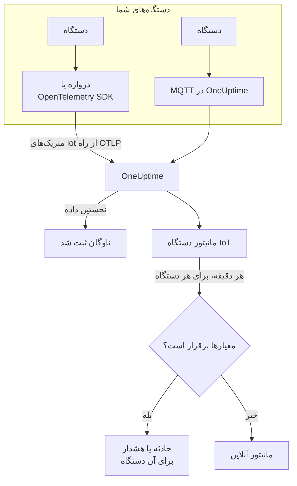

# مانیتور دستگاه IoT

مانیتور دستگاه IoT یک ناوگان از دستگاه‌ها را زیر نظر می‌گیرد و وقتی دستگاهی آفلاین می‌شود، باتری‌اش رو به پایان است، سیگنالش ضعیف می‌شود، بیش از حد داغ می‌شود یا CPU آن مدام مشغول می‌ماند به شما خبر می‌دهد. این مانیتور متریک‌های `iot_*` را می‌خواند که دستگاه‌های شما از راه OpenTelemetry یا MQTT به OneUptime می‌فرستند، پس هیچ چیز از بیرون بررسی نمی‌شود و هیچ پرابی در کار نیست.

:::cards
- [ساخت مانیتور](#ساخت-یک-مانیتور-دستگاه-iot): شش گام در داشبورد.
- [قالب‌ها](#قالبهای-هشدار-آماده): پنج هشدار آماده، یک حادثه به ازای هر دستگاه.
- [تشخیص آفلاین](#تشخیص-آفلاین): دستگاه مرده یا ساکت چگونه شناسایی می‌شود.
- [متریک‌ها](#متریکهای-جمعآوریشده): سری‌های `iot_*` که مانیتور می‌خواند.
:::

## چگونه کار می‌کند

دستگاه‌های شما، یا دروازه‌ای که با آن در ارتباط‌اند، خوانش‌هایشان را به OneUptime می‌فرستند: از راه OpenTelemetry، یا مستقیم به نقطه پایانی MQTT در OneUptime. هر خوانش نام ناوگان، `iot.fleet.name`، و شناسه خود دستگاه، `device.id`، را با خود دارد. نخستین داده ناوگان را ثبت می‌کند.

مانیتور دستگاه IoT به یک ناوگان وابسته است. هر دقیقه پرس‌وجوی خود را روی متریک‌های آن ناوگان اجرا می‌کند و نتیجه را با معیارهایش مقایسه می‌کند. قالب‌ها بر پایه `device.id` گروه‌بندی می‌کنند، پس ۳۰ حسگر آفلاین ۳۰ حادثه باز می‌کنند که هر کدام دستگاه خودش را نام می‌برد و هر کدام با بهبود دستگاهش خودش برطرف می‌شود.



## پیش از شروع

- **دستگاه‌هایتان را به گزارش دادن وادارید.** [راهنمای دستگاه‌های اینترنت اشیا](/docs/telemetry/iot-devices) نشان می‌دهد چطور متریک‌ها را با یک SDK یا Collector از OpenTelemetry، یا از راه MQTT، بفرستید.
- **بررسی کنید ناوگان ثبت شده باشد.** با نام `iot.fleet.name` که دستگاه‌ها می‌فرستند، زیر **محصولات → زیرساخت → IoT → All Fleets** پدیدار می‌شود.
- **دستگاه‌هایی را که انتظارشان را دارید ثبت کنید**، زیر **Device Registry** ناوگان، تا وقتی یکی ساکت شد خبردار شوید: [تشخیص آفلاین](#تشخیص-آفلاین) را ببینید.

## ساخت یک مانیتور دستگاه IoT

:::steps
### یک مانیتور تازه شروع کنید

به **مانیتورها** بروید و روی **ساخت مانیتور** کلیک کنید.

### IoT Device را برگزینید

زیر **نوع مانیتور**، روی **انواع دیگر مانیتور** کلیک کنید و **IoT Device** را زیر **زیرساخت** برگزینید، یا در کادر جست‌وجو `iot` را تایپ کنید. یک **نام** وارد کنید – در عنوان حادثه‌ها و هشدارها به کار می‌رود – و روی **بعدی** کلیک کنید.

### ناوگان را برگزینید

زیر **IoT Monitor Configuration**، ناوگان را از **IoT Fleet** برگزینید. هر ناوگانی که داده فرستاده در فهرست است.

### برگزینید چه چیزی پایش شود

یکی از سه زبانه را برگزینید:

- **Quick Setup** – روی یک [قالب](#قالبهای-هشدار-آماده) کلیک کنید. متریک، تجمیع، بازه زمانی، یک گروه‌بندی بر پایه `device.id` و آستانه‌ها را تعیین می‌کند و معیارهای زیر را با معیارهای خودش جایگزین می‌کند. همچنان می‌توانید **بازه زمانی** را تغییر دهید.
- **Custom Metric** – یک متریک از **IoT Metric** برگزینید، سپس **تجمیع** و **بازه زمانی** را تعیین کنید. [فیلترها](#تنظیمات-مانیتور) آن را به یک دستگاه یا یک نوع دستگاه محدود می‌کنند. متریک سفارشی گروه‌بندی نمی‌شود: کل ناوگان را یک‌جا می‌سنجد.
- **پیشرفته** – پرس‌وجوها و فرمول‌ها را خودتان زیر **انتخاب متریک‌ها** بسازید، از جمله روی نام‌های متریک خودتان، برای نمونه حافظه در حال استفاده به‌صورت درصدی از اندازه حافظه دستگاه. برای سنجش جداگانه هر دستگاه از **Group by** `device.id` استفاده کنید.

### معیارها را بررسی کنید

هر معیار را زیر **معیارهای مانیتور** باز کنید و **Select Metric Variable**، **تجمیع**، **شرط** و **Threshold** آن را بررسی کنید. قالب این‌ها را پر می‌کند. با **Custom Metric** یا **پیشرفته**، مانیتور با [معیارهای پیش‌فرض](#معیارهای-پیشفرض) شروع می‌شود که فقط افت متریک به صفر را می‌بینند، پس آستانه خودتان را تعیین کنید.

### مانیتور را بسازید

روی **ساخت مانیتور** کلیک کنید. OneUptime صفحه مانیتور را باز می‌کند و آن را هر دقیقه ارزیابی می‌کند. حادثه‌ها و هشدارهایی که باز می‌کند، مانند هر مانیتور دیگری، به سیاست‌های آنکال، Slack، Microsoft Teams، ایمیل، پیامک و وب‌هوک‌های شما می‌رسند.
:::

> [!TIP]
> برای راه‌اندازی هم‌زمان چند قالب، ناوگان را از **محصولات → زیرساخت → IoT** باز کنید و به **Recommendations** بروید. قالب‌های دلخواه و کسانی را که باید خبر داده شوند برگزینید، و OneUptime به ازای هر قالب یک مانیتور می‌سازد.

## تنظیمات مانیتور

| فیلد | زبانه | چه می‌کند |
| --- | --- | --- |
| **IoT Fleet** | همه | الزامی. هر پرس‌وجو را به `resource.iot.fleet.name` محدود می‌کند. |
| **دامنه منبع** | Custom Metric، پیشرفته | اختیاری. **دستگاه** یا **Fleet**: تطابق دقیق با ویژگی `iot.scope`. برگزیدن یک متریک آن را روی **دستگاه** می‌گذارد. |
| **Device ID** | Custom Metric، پیشرفته | اختیاری. یک دستگاه، بر پایه `device.id` آن، مانند `sensor-001`. |
| **Device Type** | Custom Metric، پیشرفته | اختیاری. دستگاه‌هایی که این `iot.device.type` را گزارش می‌کنند، مانند `sensor` یا `gateway`. |
| **IoT Metric** | Custom Metric | یک متریک از [فهرست](#متریکهای-جمعآوریشده). |
| **تجمیع** | Custom Metric | شیوه ترکیب نمونه‌ها: **میانگین**، **بیشینه**، **کمینه**، **جمع** یا **تعداد**. از تجمیع معمول متریک شروع می‌شود. |
| **بازه زمانی** | همه | پنجره غلتانی که پرس‌وجو می‌خواند، از **Past 1 Minute** تا **Past 365 Days**. مانیتور تازه از **Past 1 Minute** شروع می‌شود؛ قالب‌ها پنجره خودشان را تعیین می‌کنند. |
| **انتخاب متریک‌ها** | پیشرفته | سازنده پرس‌وجو: **متریک**، **Aggregate by**، **Filter by attributes**، **Group by**، به همراه **افزودن متریک** و **افزودن فرمول** برای ترکیب پرس‌وجوها. |

فیلترها با هم کار می‌کنند: با یک **Device ID** و یک **Device Type**، دستگاهی از نوع دیگر با هیچ چیز جور نمی‌شود.

## قالب‌های هشدار آماده

**Quick Setup** ۵ قالب ارائه می‌دهد. هر کدام یک مانیتور کامل می‌سازد: پرس‌وجوی متریک، یک گروه‌بندی بر پایه `device.id`، یک معیار که فعال می‌شود و یکی که بهبود می‌یابد. آستانه‌ها نقطه شروع‌اند و می‌توانید ویرایششان کنید.

یک معیار فقط وقتی فعال می‌شود که شرط در همه دقیقه‌های پنجره‌اش برقرار باشد – به جز **Device Offline** که با نخستین خوانش کمتر از ۱ فعال می‌شود. یک معیار آستانه‌ای ۱۰٪ آن‌سوی آستانه‌اش بهبود می‌یابد تا مقداری که حول مرز نوسان دارد مدام جابه‌جا نشود.

| قالب | دسته | شدت | چه چیزی را پایش می‌کند | چه وقت فعال می‌شود | چه وقت بهبود می‌یابد |
| --- | --- | --- | --- | --- | --- |
| Device Offline | در دسترس بودن | بحرانی | `iot_device_up`، Min به ازای هر `device.id`، ۳۰ دقیقه گذشته | هر خوانشی کمتر از ۱ باشد، یا دستگاهی ثبت‌شده در کل پنجره چیزی نفرستد | دوباره ۱ |
| Low Battery | Power | Warning | `iot_battery_percent`، Avg به ازای هر `device.id`، ۵ دقیقه گذشته | کمتر از ۲۰٪ | ۲۲٪ یا بیشتر |
| Weak Signal | Connectivity | Warning | `iot_signal_strength_dbm`، Avg به ازای هر `device.id`، ۵ دقیقه گذشته | کمتر از منفی ۱۰۰ dBm | منفی ۹۰ dBm یا بیشتر |
| High Temperature | محیط | بحرانی | `iot_temperature_celsius`، Max به ازای هر `device.id`، ۵ دقیقه گذشته | بیش از ۷۰ °C | ۶۳ °C یا کمتر |
| High CPU Usage | System | Warning | `iot_cpu_usage_ratio`، Avg به ازای هر `device.id`، ۵ دقیقه گذشته | بیش از ۰٫۹ (۹۰٪ از CPU آن) | ۰٫۸۱ یا کمتر |

**شدت** برچسبی است که فهرست انتخاب نشان می‌دهد. حادثه و هشداری که یک قالب می‌سازد از شدیدترین شدت حادثه و هشدار پروژه شما شروع می‌شوند؛ آن‌ها را در معیارها تغییر دهید.

- **Device Offline سی دقیقه را می‌خواند** تا دستگاهی که هر چند دقیقه یک بار گزارش می‌دهد میان دو گزارش آفلاین خوانده نشود. دستگاهی که کمتر از حدود هر ۱۵ دقیقه یک بار گزارش می‌دهد به پنجره بلندتری نیاز دارد.
- **High Temperature در هر دقیقه از Max استفاده می‌کند**، تا یک خوانش داغ پشت خوانش‌های خنک‌تر همان دقیقه پنهان نشود. باز هم باید در همه دقیقه‌های پنجره داغ بماند.
- **High CPU Usage یک نسبت را مقایسه می‌کند:** `iot_cpu_usage_ratio` از ۰ تا ۱ است، پس ۰٫۹ یعنی ۹۰٪.

## تشخیص آفلاین

**Device Offline** وقتی فعال می‌شود که دستگاهی `iot_device_up = 0` گزارش کند. دستگاه مرده یا ساکت از سه راه آن را فعال می‌کند:

| چگونه | چه رخ می‌دهد |
| --- | --- |
| **دروازه آن را گزارش می‌کند** | دروازه یا گردآورنده برای دستگاهی که دیگر به آن نمی‌رسد `iot_device_up = 0` می‌فرستد. |
| **MQTT Last Will** | دستگاهی که به نقطه پایانی MQTT در OneUptime وصل است یک Last Will روی موضوع `status` خود ثبت می‌کند. وقتی دستگاه می‌میرد، کارگزار همان لحظه که نشست قطع می‌شود برایش `iot_device_up = 0` می‌فرستد: نه نظرسنجی، نه انتظار برای گزارشی که نرسیده. [فرستادن متریک‌ها از راه MQTT](/docs/telemetry/iot-devices#فرستادن-متریکها-از-راه-mqtt) را ببینید. |
| **دستگاه ثبت شده است** | دستگاهی که در **Device Registry** ناوگان است مورد انتظار است. وقتی در کل پنجره چیزی نمی‌فرستد، مانیتور با آن طوری رفتار می‌کند که انگار `0` گزارش کرده است، پس حادثه خودش را می‌گیرد که وقتی دستگاه دوباره گزارش دهد خودش برطرف می‌شود. |

دستگاه ثبت‌شده همچنین به‌صورت آفلاین در موجودی ناوگان نگه داشته می‌شود، در حالی که دستگاه ثبت‌نشده پس از ۱۵ دقیقه سکوت حذف می‌شود. تشخیص سکوت به سیاست نبود داده **Treat As Zero** روی معیار `iot_device_up` نیاز دارد که مانیتورهای Device Offline ساخته‌شده از قالب آن را دارند. مانیتور Device Offline که پیش از آمدن ثبت دستگاه ساخته شده، باید این سیاست را دستی بگیرد، یا دوباره از قالب ساخته شود.

> [!NOTE]
> دستگاه ثبت‌نشده‌ای که بی Last Will یا گزارش دروازه ساکت می‌شود، فقط دیگر داده نمی‌فرستد، و مانیتوری که برای هر دستگاه جدا گروه‌بندی می‌کند نمی‌تواند آن را جدا تشخیص دهد. دستگاه‌هایتان را ثبت کنید، یا به یک دستگاه حیاتی مانیتور خودش را بدهید (**Custom Metric**، با **Device ID** آن) و **اگر داده‌ای نبود** را روی **تریگر** بگذارید. تشخیص سکوت همچنین نیاز دارد که دست‌کم یک دستگاه دیگر از ناوگان هنوز گزارش دهد: ناوگانی که کاملاً خاموش شود، برای نمونه در یک قطعی دروازه، یک حادثه برای مانیتور پدید می‌آورد، نه یکی به ازای هر دستگاه.

## متریک‌های جمع‌آوری‌شده

هر سری برچسب `device.id` دستگاه و ویژگی‌های `iot.scope`، `iot.device.type` و `iot.device.kind` را دارد.

| متریک | یکا | توضیح |
| --- | --- | --- |
| `iot_device_up` | — | ۱ وقتی دستگاه روشن است، ۰ وقتی خاموش یا آفلاین است. |
| `iot_battery_percent` | `%` | شارژ باقی‌مانده باتری، از ۰ تا ۱۰۰. سطحی که پایین می‌رود یعنی دستگاه به‌زودی دیگر گزارش نمی‌دهد. |
| `iot_signal_strength_dbm` | `dBm` | قدرت سیگنال بی‌سیم. نزدیک‌تر به ۰ قوی‌تر است؛ سیگنال ضعیف پیش از قطع اتصال می‌آید. |
| `iot_temperature_celsius` | `°C` | دمای دستگاه. خوانش بالا می‌تواند یعنی سخت‌افزاری که بیش از حد داغ شده یا مشکلی در اطراف آن. |
| `iot_cpu_usage_ratio` | `ratio` | CPU در حال استفاده، از ۰ تا ۱، که ۱ یعنی کاملاً در استفاده. |
| `iot_memory_usage_bytes` | `bytes` | حافظه در حال استفاده. برای دیدن فشار حافظه آن را با اندازه حافظه دستگاه مقایسه کنید. |
| `iot_uptime_seconds` | `s` | مدتی که دستگاه در حال اجراست. با راه‌اندازی دوباره به صفر برمی‌گردد. |

## معیارهای مانیتورینگ

یک معیار یکی از پرس‌وجوها یا فرمول‌های مانیتور را با یک آستانه مقایسه می‌کند. معیارهای مانیتور دستگاه IoT یک **نوع فیلتر** ارائه می‌دهند، **Metric Value**: هر قاعده مقدار متریک را با این فیلدها بررسی می‌کند.

| فیلد | چه می‌کند |
| --- | --- |
| **نوع فیلتر** | همیشه **Metric Value**، تنها بررسی‌ای که این مانیتور ارائه می‌دهد. |
| **Select Metric Variable** | پرس‌وجو یا فرمولی که بررسی می‌شود، بر پایه نام متغیرش. |
| **تجمیع** | اینکه مقدارهای پنجره چطور به یک پاسخ تبدیل می‌شوند: **میانگین**، **جمع**، **Maximum Value**، **Minimum Value**، **All Values** (همه مقدارها باید جور باشند) یا **Any Value** (یکی کافی است). |
| **شرط** | **Greater Than**، **Less Than**، **Greater Than Or Equal To**، **Less Than Or Equal To** یا **Equal To** – یا یک شرط ناهنجاری: **Anomalously High**، **Anomalously Low** یا **Anomalous**. |
| **Threshold** | مقداری که با آن مقایسه می‌شود. وقتی متریک یکا دارد، فهرستی از یکاها کنارش هست. برای شرط‌های ناهنجاری نشان داده نمی‌شود. |
| **حساسیت** | فقط شرط‌های ناهنجاری. **پایین** (۴σ)، **متوسط** (۳σ، پیش‌فرض) یا **بالا** (۲σ). |
| **پنجره مبنا** | فقط شرط‌های ناهنجاری. ۱۴ روز (پیش‌فرض)، ۲۸، ۶۰ یا ۹۰ روز سابقه. |
| **اگر داده‌ای نبود** | زیر **فیلدهای بیشتر**. وقتی یک سری در پنجره هیچ نمونه‌ای ندارد چه شود: **Ignore** (پیش‌فرض) از آن می‌گذرد، **Treat As Zero** آن را `0` می‌خواند، و **تریگر** معیار را برقرار می‌کند. |

شرط‌های ناهنجاری هر مقدار را با همان ساعت از هفته در خط مبنا مقایسه می‌کنند. تا وقتی پنجره مبنا سابقه کافی نداشته باشد، در وضعیت «Learning» می‌مانند و چیزی پدید نمی‌آورند.

### معیارهای پیش‌فرض

مانیتوری که از قالب نمی‌سازید با دو معیار شروع می‌شود:

| ترتیب | معیار | وقتی برقرار است که | سپس |
| --- | --- | --- | --- |
| ۱ | Check if _monitor name_ is offline | هر مقداری از نخستین پرس‌وجو `0` باشد | مانیتور را **آفلاین** علامت می‌زند و حادثه «_monitor name_ is offline» را اعلام می‌کند، که با بهبود مانیتور خودش برطرف می‌شود. |
| ۲ | Check if _monitor name_ is online | هر مقداری بیش از `0` باشد | مانیتور را **عملیاتی** علامت می‌زند. |

> [!IMPORTANT]
> سکوت با هیچ‌یک از دو معیار جور نیست: ناوگانی که دیگر داده نمی‌فرستد مانیتور را همان‌طور که بود رها می‌کند. برای اینکه وقتی داده قطع شد خبردار شوید، **اگر داده‌ای نبود** را در یک معیار روی **تریگر** بگذارید. زمانی که خود OneUptime داده دریافت نمی‌کرد هرگز «بدون داده» به حساب نمی‌آید: بررسی‌ای که پنجره‌اش چنین زمانی را در بر دارد به جای آن صبر می‌کند، همان‌طور که [وقتی OneUptime داده دریافت نمی‌کند](/docs/monitor/when-oneuptime-is-not-receiving) توضیح می‌دهد.

## Terraform

[فراهم‌کننده Terraform در OneUptime](/docs/terraform/monitor-steps) پیکربندی گام مانیتور دستگاه IoT را در ویژگی `iot_monitor` نگه می‌دارد: JSON خام پیکربندی `iotMonitor` (`fleetIdentifier`، `resourceFilters`، `metricViewConfig`، `rollingTime`)، نوشته‌شده با `jsonencode()`:

```hcl title="main.tf"
monitor_steps = [{
  iot_monitor = jsonencode({
    fleetIdentifier = "building-a-sensors"
    resourceFilters = {}
    rollingTime     = "Past 5 Minutes"
    metricViewConfig = {
      queryConfigs = [{
        metricAliasData = { metricVariable = "battery_percent", title = "Battery", description = "", legend = "" }
        metricQueryData = {
          filterData = {
            metricName     = "iot_battery_percent"
            attributes     = {}
            aggegationType = "Avg"
            aggregateBy    = {}
          }
          groupByAttributeKeys = ["device.id"]
        }
      }]
      formulaConfigs = []
    }
  })
  criteria = [ /* ... */ ]
}]
```

`fleetIdentifier` همان `iot.fleet.name` ناوگان است، نه شناسه OneUptime آن.

## رفع اشکال

:::details ناوگان در فهرست IoT Fleet نیست
ناوگان‌ها خودشان از روی داده‌های دستگاه‌ها ثبت می‌شوند. بررسی کنید دستگاه‌ها `iot.fleet.name` را بفرستند، و [راهنمای دستگاه‌های اینترنت اشیا](/docs/telemetry/iot-devices) را دنبال کنید تا مطمئن شوید داده می‌رسد.
:::

:::details به جای یک حادثه برای هر دستگاه، یک حادثه برای کل ناوگان فعال می‌شود
پرس‌وجو گروه‌بندی نشده است. مانیتورهای **Custom Metric** کل ناوگان را یک‌جا می‌سنجند؛ از یک قالب استفاده کنید، یا از **پیشرفته** با **Group by** `device.id`.
:::

:::details دستگاهی از کار افتاد اما Device Offline فعال نشد
دستگاه هیچ Last Will نفرستاد و هیچ دروازه‌ای آن را گزارش نکرد، پس فقط ساکت شد. آن را زیر **Device Registry** ناوگان ثبت کنید، و بررسی کنید **اگر داده‌ای نبود** در معیار `iot_device_up` روی **Treat As Zero** باشد. [تشخیص آفلاین](#تشخیص-آفلاین) را ببینید.
:::

:::details Device Offline برای دستگاه‌های سالم فعال می‌شود
آن‌ها کمتر از آنچه پنجره ۳۰ دقیقه‌ای در بر می‌گیرد گزارش می‌دهند، پس برخی پنجره‌ها هیچ چیزی از آن‌ها ندارند. **بازه زمانی** را بلندتر کنید، یا دستگاه‌ها را به گزارش دادن بیشتر وادارید. روی نقطه پایانی MQTT از راه WebSocket، keepalive در MQTT را زیر ۵ دقیقه نگه دارید: OneUptime اتصال‌های WebSocket بیکار را پس از ۳۰۰ ثانیه می‌بندد، که Last Will را می‌فرستد.
:::

:::details یک قالب هیچ داده‌ای نشان نمی‌دهد
قالب‌ها نام‌های متریک `iot_*` را دقیقاً می‌خوانند، و بر پایه برچسب `device.id` گروه‌بندی می‌کنند. آنچه دستگاه‌هایتان می‌فرستند را، در صفحه **متریک‌ها**ی ناوگان، با [قراردادهای متریک](/docs/telemetry/iot-devices#قراردادهای-متریک) مقایسه کنید.
:::

## گام‌های بعدی

:::cards
- [دستگاه‌های اینترنت اشیا](/docs/telemetry/iot-devices): متریک‌های دستگاه را از راه OpenTelemetry یا MQTT بفرستید.
- [مانیتور متریک‌ها](/docs/monitor/metrics-monitor): بر پایه هر متریکی هشدار دهید، نه فقط متریک‌های IoT.
- [قالب‌بندی حادثه و هشدار](/docs/monitor/incident-alert-templating): شناسه دستگاه را در عنوان حادثه‌ها بگذارید.
:::
