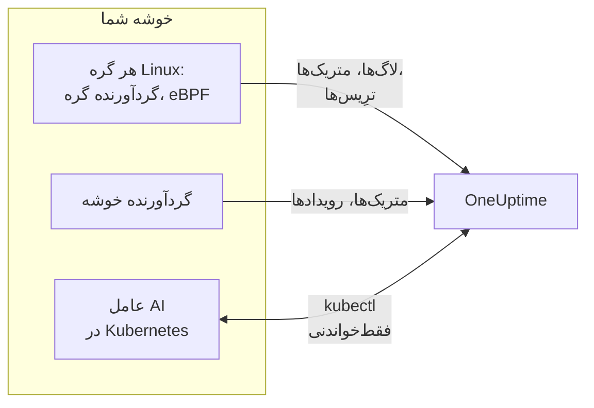

# عامل Kubernetes (نصب با Helm)

عامل Kubernetes در OneUptime یک چارت Helm است که متریک‌ها، رویدادها و لاگ‌های پاد خوشه شما، ترِیس‌های برنامه که با eBPF گرفته می‌شوند، و متریک‌های سیستم‌عامل هر گره را جمع می‌کند و به OneUptime می‌فرستد. یک `helm install` آن را سر جایش می‌گذارد، بی‌آنکه کد برنامه‌هایتان تغییر کند. [مانیتورهای Kubernetes](/docs/monitor/kubernetes-monitor) بر پایه آنچه می‌فرستد هشدار می‌دهند.

:::cards
- [نصب عامل](#نصب-عامل): چهار گام با Helm.
- [برگزیدن پیش‌تنظیم](#برگزیدن-پیشتنظیم): خوشه‌های استاندارد، GKE Autopilot یا EKS Fargate.
- [گزینه‌های رایج](#گزینههای-رایج): تنظیماتی که بیشتر خوشه‌ها تغییر می‌دهند.
- [رفع اشکال](#رفع-اشکال): یک اسکریپت تشخیصی، و مشکلات معمول.
:::

## چارت چه چیزهایی نصب می‌کند

چارت چند بار کاری را در namespace خودش اجرا می‌کند. هر کدام آنچه را جمع می‌کند، با کلید دریافت داده‌ای که به آن می‌دهید، از راه OTLP به URL در OneUptime شما می‌فرستد.



| بار کاری | نوع | چه می‌کند | به‌طور پیش‌فرض روشن |
| --- | --- | --- | --- |
| گردآورنده خوشه | Deployment | متریک‌های خوشه، رویدادهای Kubernetes و مشخصات کامل پادها، گره‌ها و بارهای کاری، از API در Kubernetes. | بله |
| گردآورنده گره | DaemonSet | لاگ‌های پاد از `/var/log/pods`، متریک‌های kubelet و cAdvisor، و متریک‌های سیستم‌عامل گره. | بله |
| ابزارگذاری eBPF (OBI) | DaemonSet | ترِیس‌ها و متریک‌های درخواست HTTP، gRPC، SQL و Redis از هر پاد، و نقشه سرویس. | بله |
| عامل AI در Kubernetes | Deployment | به OneUptime AI اجازه می‌دهد هنگام بررسی یک حادثه یا هشدار روی این خوشه، `kubectl` فقط‌خواندنی اجرا کند. | بله |
| دنبال‌کننده لاگ | Deployment | لاگ‌های پاد از راه API در Kubernetes، جایی که گردآورنده گره نمی‌تواند آن‌ها را بخواند. | با پیش‌تنظیم‌های `gke-autopilot` و `eks-fargate` |
| پروفایلر eBPF | DaemonSet | نمودارهای شعله‌ای پیوسته CPU از هر فرایند. | خیر |
| kube-state-metrics | Deployment | فازهای پاد، دلیل‌های انتظار کانتینر و سهمیه‌های منابع. | خیر |

همه ایمیج‌های عامل فقط برای Linux ساخته شده‌اند، پس هر بار کاری به گره‌های Linux سنجاق شده است.

## پیش از شروع

- **یک کلید دریافت داده.** آن را در OneUptime زیر **تنظیمات پروژه → تله‌متری و APM → کلیدهای دریافت داده** بسازید. عامل آن را به‌صورت سرآیند `x-oneuptime-token` می‌فرستد، پس کلید API پروژه اینجا کار نمی‌کند.
- **Helm 3** و دسترسی `kubectl` به خوشه. ارتقاها از `--reset-then-reuse-values` استفاده می‌کنند که به Helm 3.14 یا بالاتر نیاز دارد.
- **یک نام برای خوشه**، یکتا در پروژه شما. چارت بدون آن نصب نمی‌شود: دو خوشه با یک نام به‌صورت یک خوشه نشان داده می‌شوند.
- **HTTPS خروجی** از خوشه به URL در OneUptime شما.

## نصب عامل

:::steps
### افزودن مخزن Helm

```bash
helm repo add oneuptime https://helm-chart.oneuptime.com
helm repo update
```

### نصب چارت

URL را با URL در OneUptime خودتان، و دو جای‌نگهدار را با کلید دریافت داده و نام خوشه جایگزین کنید:

```bash
helm install oneuptime-agent oneuptime/kubernetes-agent \
  --namespace oneuptime-kubernetes-agent \
  --create-namespace \
  --set oneuptime.url=https://oneuptime.com \
  --set oneuptime.apiKey=<YOUR_API_KEY> \
  --set clusterName=<A_UNIQUE_NAME_FOR_THIS_CLUSTER>
```

این دستور از پیش‌تنظیم `standard` استفاده می‌کند. روی GKE Autopilot یا EKS Fargate، به جای آن [پیش‌تنظیم آن‌ها را برگزینید](#برگزیدن-پیشتنظیم).

### بررسی اجرای پادها

```bash
kubectl get pods -n oneuptime-kubernetes-agent
```

هر پاد باید در یکی دو دقیقه به `Running` برسد.

### یافتن خوشه در OneUptime

**محصولات → زیرساخت → Kubernetes → همه خوشه‌ها** را باز کنید. خوشه در چند دقیقه با نام خودش پدیدار می‌شود، و گره‌ها، پادها و بارهای کاری‌اش پر می‌شوند.
:::

## برگزیدن پیش‌تنظیم

برخی پلتفرم‌های Kubernetes اجازه نمی‌دهند یک بار کاری حجم `hostPath` را mount کند یا یک DaemonSet اجرا کند، که گردآورنده گره از هر دو استفاده می‌کند. تنظیم `preset` آنچه را روی پلتفرم شما کار می‌کند برمی‌گزیند:

| پیش‌تنظیم | برای | لاگ‌های پاد | روی هر گره |
| --- | --- | --- | --- |
| `standard` (پیش‌فرض) | خودمدیریت، **EKS on EC2**، **GKE Standard**، **AKS**، minikube، kind، k3s | گردآورنده گره `/var/log/pods` را می‌خواند | متریک‌های kubelet، cAdvisor و سیستم‌عامل |
| `gke-autopilot` | **GKE Autopilot** | دنبال‌کننده لاگ آن‌ها را از راه API در Kubernetes می‌خواند | متریک‌های kubelet و cAdvisor، بدون `hostPath` |
| `eks-fargate` | **EKS Fargate** | دنبال‌کننده لاگ آن‌ها را از راه API در Kubernetes می‌خواند | هیچ: Fargate هیچ DaemonSet اجرا نمی‌کند |

اگر مطمئن نیستید، `preset` را تعیین‌نشده بگذارید تا `standard` را بگیرید. اگر نصب با خطای Pod Security که `hostPath` را نام می‌برد شکست خورد، دوباره با `gke-autopilot` نصب کنید، یا روی EKS Fargate با `eks-fargate`.

GKE Autopilot و EKS Fargate پادهای privileged را هم رد می‌کنند، که ابزارگذاری eBPF و پروفایل‌گیری به آن‌ها نیاز دارند، پس پیش‌تنظیم‌هایشان هر دو را کنار می‌گذارند:

:::tabs
@tab Standard
```bash
helm install oneuptime-agent oneuptime/kubernetes-agent \
  --namespace oneuptime-kubernetes-agent --create-namespace \
  --set oneuptime.url=https://oneuptime.com \
  --set oneuptime.apiKey=<YOUR_API_KEY> \
  --set clusterName=prod
```
@tab GKE Autopilot
```bash
helm install oneuptime-agent oneuptime/kubernetes-agent \
  --namespace oneuptime-kubernetes-agent --create-namespace \
  --set oneuptime.url=https://oneuptime.com \
  --set oneuptime.apiKey=<YOUR_API_KEY> \
  --set clusterName=prod-gke-autopilot \
  --set preset=gke-autopilot
```
@tab EKS Fargate
```bash
helm install oneuptime-agent oneuptime/kubernetes-agent \
  --namespace oneuptime-kubernetes-agent --create-namespace \
  --set oneuptime.url=https://oneuptime.com \
  --set oneuptime.apiKey=<YOUR_API_KEY> \
  --set clusterName=prod-eks-fargate \
  --set preset=eks-fargate
```
:::

## برچسب زدن به خوشه

برچسب‌هایی که هنگام نصب می‌دهید به خوشه، و به سرویس‌ها و میزبان‌هایی که این عامل گزارش می‌کند، وصل می‌شوند. `--set oneuptime.labels.<key>=<value>` به یک برچسب پروژه با نام `<key>:<value>` تبدیل می‌شود:

```bash
helm install oneuptime-agent oneuptime/kubernetes-agent \
  --namespace oneuptime-kubernetes-agent \
  --create-namespace \
  --set oneuptime.url=https://oneuptime.com \
  --set oneuptime.apiKey=<YOUR_API_KEY> \
  --set clusterName=prod \
  --set oneuptime.labels.team=payments \
  --set oneuptime.labels.env=production \
  --set oneuptime.labels.region=us-east-1
```

یا آن‌ها را در یک فایل values نگه دارید:

```yaml title="values.yaml"
oneuptime:
  url: https://oneuptime.com
  apiKey: <YOUR_API_KEY>
  labels:
    team: payments
    env: production
    region: us-east-1
clusterName: prod
```

```bash
helm install oneuptime-agent oneuptime/kubernetes-agent \
  --namespace oneuptime-kubernetes-agent --create-namespace \
  -f values.yaml
```

از آن پس هر رکوردی که این عامل می‌فرستد – لاگ‌ها، متریک‌ها، ترِیس‌ها و پروفایل‌ها – `team:payments`، `env:production` و `region:us-east-1` را با خود دارد. هر برچسب یک ویژگی منبع `oneuptime.label.<key>=<value>` است، و OneUptime هر ویژگی‌ای را که با `oneuptime.label.` شروع شود به برچسب تبدیل می‌کند. برچسب‌ها بدون توجه به کوچکی و بزرگی حروف تطبیق داده می‌شوند، پس برچسب موجود `Production` دوباره به کار می‌رود و تکراری ساخته نمی‌شود. عامل هرگز برچسبی را که در OneUptime اضافه کرده‌اید حذف نمی‌کند.

## لاگ‌های پاد

`preset` مقدار `logs.mode` را تعیین می‌کند، که می‌توانید خودتان هم آن را تعیین کنید:

| `logs.mode` | لاگ‌ها چطور خوانده می‌شوند | مزیت | مراقب باشید |
| --- | --- | --- | --- |
| `daemonset` | یک گردآورنده گره در هر گره فایل‌های زیر `/var/log/pods` را دنبال می‌کند. | کمترین سربار، با گره‌ها مقیاس می‌گیرد، باری روی سرور API در Kubernetes نمی‌گذارد، چرخش لاگ را دنبال می‌کند. | به `hostPath` و DaemonSetها نیاز دارد. |
| `api` | یک دنبال‌کننده لاگ، لاگ هر کانتینر را از API در Kubernetes جریان‌وار می‌خواند، همان‌طور که `kubectl logs -f` می‌کند. | جایی کار می‌کند که `hostPath` مسدود است یا Pod Security Standard از نوع `restricted` اعمال می‌شود. | هر جریان کانتینر یک اتصال بلندمدت به سرور API است. یک replica چند هزار کانتینر را پوشش می‌دهد. |
| `disabled` | هیچ کاری نمی‌کند. | برای برنامه‌هایی که لاگ‌هایشان را از راه دیگری می‌فرستند. | |

برای خاموش کردن جمع‌آوری لاگ، `--set logs.enabled=false` را تعیین کنید و لاگ‌های برنامه را به جای آن با SDKهای [OpenTelemetry](/docs/telemetry/open-telemetry) بفرستید. متریک‌ها تحت تأثیر قرار نمی‌گیرند: گردآورنده گره به کارش ادامه می‌دهد.

### خوشه‌های با سیستم‌عامل‌های مختلف (استخرهای گره Windows)

گره‌های Windows هرگز پادی از عامل اجرا نمی‌کنند. داده‌های سطح خوشه درباره آن‌ها و پادهایشان همچنان می‌رسد، چون از API در Kubernetes می‌آید: وضعیت گره‌ها، فازهای پاد، رویدادهای Kubernetes و kube-state-metrics. آنچه گره‌های Windows ندارند چیزی است که روی خود گره جمع می‌شود: متریک‌های سیستم‌عامل، متریک‌های kubelet و cAdvisor، ترِیس‌های eBPF، پروفایل‌ها و، در حالت لاگ `daemonset`، لاگ‌های پاد.

برای جمع کردن لاگ‌های پادهای روی گره‌های Windows هم، حالت ترکیبی را روشن کنید:

```bash
helm upgrade oneuptime-agent oneuptime/kubernetes-agent \
  --namespace oneuptime-kubernetes-agent --reset-then-reuse-values \
  --set logs.windowsPods.enabled=true
```

آن‌گاه دنبال‌کننده لاگ کنار گردآورنده‌های گره اجرا می‌شود، فقط برای پادهای روی گره‌های Windows. پادهای Linux همان دنبال کردن ارزان‌تر فایل را نگه می‌دارند، و این دو پادها را بر پایه سیستم‌عامل گره میان خود تقسیم می‌کنند، پس هیچ خط لاگی دو بار فرستاده نمی‌شود.

- **نسخه ایمیج دنبال‌کننده.** تقسیمی که فقط Windows را هدف می‌گیرد در ایمیج `kubernetes-log-tailer` ساخته شده است. ایمیج قدیمی‌تر آن را نادیده می‌گیرد و *همه* پادها را دنبال می‌کند، و لاگ‌های هر پاد Linux را دو بار می‌فرستد. `logs.api.image.tag` را به نسخه‌ای قدیمی‌تر از نسخه انتشار چارت سنجاق نکنید، و اگر ممکن است گره‌ای ایمیج قدیمی `release` را در حافظه نهان داشته باشد، `--set logs.api.image.pullPolicy=Always` را به دستور ارتقا اضافه کنید.
- **پالایش بر پایه شدت.** وقتی `filters.logs.minSeverity` تعیین شده باشد، خطی که شدت قابل تشخیصی ندارد در مسیر گردآورنده گره کنار گذاشته می‌شود اما در مسیر دنبال‌کننده لاگ نگه داشته می‌شود – [پالایش بر پایه شدت گزارش](/docs/telemetry/kubernetes-agent#پالایش-بر-پایه-شدت-گزارش) را ببینید. در نتیجه پادهای Windows ممکن است خط‌های بی‌سطح بیشتری از پادهای Linux بفرستند.

## ترِیس‌های برنامه با eBPF

چارت [OpenTelemetry eBPF Instrumentation (OBI)](https://opentelemetry.io/docs/zero-code/obi/) را روی هر گره اجرا می‌کند. OBI برنامه‌های eBPF را در هسته Linux بارگذاری می‌کند و ترافیک شبکه هر پاد را زیر نظر می‌گیرد، پس می‌تواند فراخوانی‌های HTTP و HTTPS، gRPC، و SQL و Redis را بدون هیچ تغییری در برنامه‌هایتان بازسازی کند: نه SDK، نه sidecar. آن‌ها را به‌صورت ترِیس و متریک درخواست به OneUptime می‌فرستد.

سرویس‌های شما در یکی دو دقیقه زیر **محصولات → ترِیس‌ها** و روی نقشه سرویس پدیدار می‌شوند، با `k8s.cluster.name` برابر نام خوشه، پس می‌توانید بر پایه خوشه فیلتر کنید.

### چه وقت eBPF را خاموش کنید

eBPF به‌طور پیش‌فرض روشن است. در این حالت‌ها آن را با `--set ebpf.enabled=false` خاموش کنید:

- خوشه **GKE Autopilot** یا **EKS Fargate** است. پیش‌تنظیم‌های آن‌ها این کار را برایتان می‌کنند: این دو پادهای privileged را رد می‌کنند، و OBI برای بارگذاری برنامه‌هایش باید privileged باشد.
- گره‌ها هسته‌ای قدیمی‌تر از **Linux 5.8** بدون BTF اجرا می‌کنند. Debian 11، Ubuntu 20.10، Fedora 34، RHEL 9 و نسخه‌های بعدی مشکلی ندارند.
- برنامه‌هایتان از پیش با یک SDK از OpenTelemetry ترِیس می‌فرستند، و نمی‌خواهید آن‌ها دو بار برسند.

### eBPF چه می‌فرستد

OBI چند نوع سیگنال می‌فرستد. هر کدام را می‌توان با `--set ebpf.features.<key>=false` خاموش کرد:

| تنظیم | پیش‌فرض | چه اضافه می‌کند |
| --- | --- | --- |
| `ebpf.features.httpMetrics` | روشن | متریک‌های درخواست HTTP و gRPC به ازای هر سرویس: نرخ درخواست، هیستوگرام‌های تأخیر و خطاها. |
| `ebpf.features.spanMetrics` | روشن | متریک‌های اسپن: فراخوانی‌ها و مدت زمان به ازای هر سرویس، مسیر یا عملیات، نوع اسپن و وضعیت – `traces.span.metrics.calls` و `traces.span.metrics.duration` (ثانیه). |
| `ebpf.features.serviceGraph` | روشن | نرخ و تأخیر هر فراخوانی از یک سرویس به سرویس دیگر، که نقشه سرویس را می‌کشند. |
| `ebpf.features.networkMetrics` | روشن | بایت‌ها و بسته‌ها میان هر جفت پاد، روی TCP و UDP، با نام‌های Kubernetes آن‌ها. هر جفت پادی را که با هم حرف می‌زنند نشان می‌دهد، حتی روی پروتکل‌هایی که OBI نمی‌تواند بخواند. |
| `ebpf.features.networkInterZoneMetrics` | خاموش | همین، میان zoneها. شمار سری‌ها را دو برابر می‌کند: فقط اگر بر پایه zone زمان‌بندی می‌کنید روشنش کنید. |
| `ebpf.features.tcpStats` | روشن | آمار TCP به ازای هر گره: زمان‌های رفت و برگشت، اتصال‌های ناموفق و ارسال‌های دوباره. |

### پیوند دادن ترِیس‌ها میان سرویس‌ها

OBI همچنین می‌تواند ترِیس را از یک فراخوانی عبور دهد: وقتی پاد A پاد B را از راه HTTP یا gRPC فرا می‌خواند، اسپن سمت B به ترِیس A می‌پیوندد، بی‌آنکه در هیچ‌یک از دو برنامه SDK باشد. **این به‌طور پیش‌فرض خاموش است.** پس از خواندن هشدار زیر، آن را با `--set ebpf.contextPropagation=true` روشن کنید.

| گزینه | پیش‌فرض | چه می‌کند |
| --- | --- | --- |
| `ebpf.contextPropagation` | خاموش | یک `traceparent` از W3C را در ترافیک خروجی می‌نویسد، تا اسپن‌ها میان سرویس‌ها به هم پیوند بخورند. |
| `ebpf.contextPropagationMode` | `headers` | چگونه: `headers` (سرآیندهای درخواست HTTP/1.1، محدودترین)، `tcp` (یک گزینه TCP، از راه Linux Traffic Control) یا `all` (هر دو). فقط وقتی `contextPropagation` روشن است خوانده می‌شود. |
| `ebpf.trackRequestHeaders` | روشن | سرآیندهای درخواست را در هسته دنبال می‌کند، تا سمت دریافت‌کننده `traceparent` را روی سرورهای HTTP ساده هم پیدا کند. فقط وقتی `contextPropagation` روشن است اثر دارد. |

> [!WARNING]
> هر حالت انتشار، ترافیکی را که از پیش در جریان است تغییر می‌دهد. برای HTTP ساده، OBI درخواست خروجی را در هسته پهن‌تر می‌کند تا سرآیند جا شود؛ برای TLS و TCP خام یک گزینه TCP را از یک hook در Traffic Control اضافه می‌کند و بسته و checksum آن را بازنویسی می‌کند. وقتی سپس حساب بایت‌های اتصال دقیقاً اصلاح نشود، جریان **ناهمگام می‌شود**: انتقال‌ها از راه یک proxy مانند nginx در میانه راه، وقتی پاسخ از حدود ۶۴ KB بگذرد، گیر می‌کنند تا وقتی اتصال به پایان زمان برسد. درخواست‌های کوچک کار می‌کنند، پس شبیه یک باگ برنامه یا proxy به نظر می‌رسد. هیچ نسخه‌ای از هسته این بازنویسی را از میان نمی‌برد. ترِیس‌ها، متریک‌های درخواست و نقشه سرویس همگی بدون آن کار می‌کنند؛ یک SDK از OpenTelemetry در سرویس‌هایتان ترِیس‌ها را بدون هیچ بازنویسی در هسته به هم پیوند می‌دهد. اگر آن را روشن می‌کنید، نخست روی خوشه‌ای که production نیست امتحانش کنید، و انتقال‌های بزرگ از راه proxy خود را بررسی کنید.

### پیوند دادن لاگ‌ها به ترِیس‌ها

**به‌طور پیش‌فرض خاموش.** وقتی روشن باشد، OBI یک probe به فراخوان سیستمی `write()` هر فرایندی که ابزارگذاری می‌کند وصل می‌کند، و:

- یک **خط لاگ JSON** فیلدهای `trace_id` و `span_id` را می‌گیرد (فیلدهایی که خط از پیش دارد نگه داشته می‌شوند). گردآورنده گره آن‌ها را به فیلدهای ترِیس خود رکورد لاگ منتقل می‌کند، پس لاگ‌های یک اسپن در OneUptime با یک کلیک در دسترس‌اند، و ترِیس یک خط لاگ هم همین‌طور.
- **هر خط لاگ دیگر** بی‌تغییر، بدون پیوند، جمع می‌شود.

```bash
helm upgrade oneuptime-agent oneuptime/kubernetes-agent \
  --namespace oneuptime-kubernetes-agent --reset-then-reuse-values \
  --set ebpf.logToTraceCorrelation=true
```

| گزینه | پیش‌فرض | چه می‌کند |
| --- | --- | --- |
| `ebpf.logToTraceCorrelation` | `false` | غنی‌ساز لاگ OBI و برداشتن `trace_id` در گردآورنده گره را روشن می‌کند. |
| `ebpf.logEnricher.services` | `[{service: [{exe_path: "*"}]}]` | غنی‌ساز به کدام فرایندها دست می‌زند. هر مدخل یک انتخابگر [GlobAttributes](https://opentelemetry.io/docs/zero-code/obi/configure/options/#service-discovery) در OBI است، با فیلدهایی مانند `exe_path`، `languages`، `k8s_pod_labels`، `k8s_pod_annotations`، `open_ports` و `cmd_args`. |

#### عامل‌های APM که با آن از کار می‌افتند

غنی‌ساز بافر خروجی برنامه را **درون فرایند** بازنویسی می‌کند: وقتی فرایندی که جور شده `write()` را فرا می‌خواند، OBI بایت‌های اصلی را پاک می‌کند و یک نسخه غنی‌شده می‌نویسد. عامل‌های APM که از راه `LD_PRELOAD` بارگذاری می‌شوند و خودشان `write()` را در بر می‌گیرند از این جان سالم به در نمی‌برند:

| عامل APM | کتابخانه | چه رخ می‌دهد |
| --- | --- | --- |
| Dynatrace OneAgent | `liboneagentproc.so` | برنامه با SIGSEGV از کار می‌افتد (کد خروج ۱۳۹). خود `write()` در watchdog شرکت Dynatrace از حد ۱۰ ثانیه‌ای‌اش فراتر گیر می‌کند و OneAgent پشت سر هم دوباره راه‌اندازی می‌شود. |
| New Relic | `libnewrelic*.so` | همان نوع از کار افتادن. |
| AppDynamics | `libappdynamics*.so` | همان نوع از کار افتادن. |
| Datadog | `libdd*.so` | همان نوع از کار افتادن. |
| Instana | `libinstana*.so` | همان نوع از کار افتادن. |

**برنامه‌های .NET بیش از همه در معرض‌اند:** عامل .NET در Dynatrace همیشه از راه `LD_PRELOAD` بارگذاری می‌شود، و لاگ کنسول Microsoft.Extensions.Logging بافر ندارد، پس هر خط از همین مسیر می‌گذرد. برنامه‌های Python و Go معمولاً تحت تأثیر نیستند.

برای استفاده از آن کنار یکی از این عامل‌ها، `logEnricher.services` را فقط به پادهایی نشانه بگیرید که چنین عاملی ندارند. غنی‌ساز راهی برای کنار گذاشتن ندارد، پس پادهایی را که باید غنی شوند فهرست کنید:

```yaml title="values.yaml"
ebpf:
  logToTraceCorrelation: true
  logEnricher:
    services:
      # Enrich only pods with the apm-agent=none label
      - service:
          - k8s_pod_labels:
              apm-agent: "none"
```

یا بر پایه runtime انتخاب کنید. بارگذاری `LD_PRELOAD` در Dynatrace برنامه‌های .NET را هدف می‌گیرد، پس غنی کردن فقط Python، Go، Ruby و Node.js از آن دوری می‌کند:

```yaml title="values.yaml"
ebpf:
  logToTraceCorrelation: true
  logEnricher:
    services:
      - service:
          - languages: "python,go,ruby,nodejs"
```

#### لاگ‌ها باید JSON و بدون بافر باشند

- **فقط خط‌های JSON یک `trace_id` می‌گیرند.** logger را به یک قالب JSON ببرید: `structlog`، `pino`، `winston`، `serilog`، `logback-json`، klog با `--logging-format=json` و مانند آن‌ها.
- **خروجی بافرشده پیوند را می‌شکند**، چون آن‌گاه `write()` در رشته‌ای غیر از رشته درخواست رخ می‌دهد. در **Python**، `PYTHONUNBUFFERED=1` را تعیین کنید. در **.NET**، هنگام راه‌اندازی `Console.SetOut(new StreamWriter(Console.OpenStandardOutput()) { AutoFlush = true })` را فرا بخوانید؛ `AddConsole()` در Microsoft.Extensions.Logging و sinkهای ناهمگام Serilog کار نمی‌کنند، اما `WriteTo.Console()` ساده در Serilog کار می‌کند.
- Greenlet، gevent، Tornado و دیگر runtimeهای ناهمگام سفارشی پوشش داده نمی‌شوند.

### تنظیم دقیق eBPF

| گزینه | پیش‌فرض | چه می‌کند |
| --- | --- | --- |
| `ebpf.enabled` | `true` | DaemonSet مربوط به eBPF را اجرا می‌کند. `false` آن را کنار می‌گذارد. |
| `ebpf.image.tag` | `v0.14.0` | ایمیج OBI. OBI هنوز پیش از نسخه ۱٫۰ است: نسخه‌ای را که آزموده‌اید سنجاق کنید، و پیش از جابه‌جا کردنش دوباره بیازمایید. |
| `ebpf.autoTargetExe` | `*` | الگوهای glob فایل‌های اجرایی که باید ابزارگذاری شوند، جداشده با ویرگول. برای ابزارگذاری runtimeهای کمتر آن را تنگ کنید، مانند `*/python,*/java`. |
| `ebpf.excludeExePaths` | پوسته‌ها، لوله‌کشی خوشه، sidecarهای service mesh، عامل‌های CNI، مرورگرها، ClickHouse، گردآورنده‌ها و خود OBI | الگوهای glob فایل‌های اجرایی که باید نادیده گرفته شوند، جداشده با ویرگول. یک glob گسترده باینری‌های خود شما را هم نادیده می‌گیرد. |
| `ebpf.logLevel` | `info` | `debug`، `info`، `warn` یا `error`. |
| `ebpf.printTraces` | `false` | اسپن‌ها را در لاگ خود OBI هم چاپ می‌کند، تا ببینید چه چیزی را می‌گیرد. |
| `ebpf.resources.*` | درخواست `100m` برای CPU و `512Mi` برای حافظه، با حدهای `2000m` و `2Gi` | برای گره‌هایی با ترافیک سنگین یا فرایندهای کوتاه‌عمر فراوان آن‌ها را بالا ببرید. |

برای بررسی اینکه OBI اجرا می‌شود و ترافیک را می‌بیند:

```bash
kubectl get pods -n oneuptime-kubernetes-agent -l component=ebpf-instrument
kubectl logs -n oneuptime-kubernetes-agent -l component=ebpf-instrument --tail=200
```

## پروفایل‌گیری پیوسته CPU

[OpenTelemetry eBPF Profiler](https://github.com/open-telemetry/opentelemetry-ebpf-profiler) هم می‌تواند روی هر گره اجرا شود، به‌صورت ایمیج `otel/opentelemetry-collector-ebpf-profiler`. این پروفایلر ۱۹ بار در ثانیه از آنچه هر فرایند اجرا می‌کند نمونه می‌گیرد، در Go، Java، .NET، Python، Ruby، Node.js، PHP، Perl، C، C++ و Rust، و پروفایل‌ها را به OneUptime می‌فرستد. آن‌ها زیر **محصولات → پروفایل‌های کارایی**، و به‌صورت نمودار شعله‌ای روی هر اسپن ترِیس، پدیدار می‌شوند.

**پروفایل‌گیری به‌طور پیش‌فرض خاموش است:** به ازای هر گره CPU و حافظه بیشتری از ابزارگذاری eBPF مصرف می‌کند. آن را با `--set profiling.enabled=true` روشن کنید.

وقتی ابزارگذاری eBPF هم روشن باشد (پیش‌فرض)، هر نمونه ترِیسی را که به آن تعلق دارد با خود دارد، پس یک اسپن نمودار شعله‌ای خودش را دارد. برای این کار، چارت از OBI می‌خواهد زمینه ترِیس در حال اجرا را در دسترس نگه دارد (`OTEL_EBPF_BPF_POPULATE_TRACE_CONTEXT=true`)، که برای برنامه‌های ابزارگذاری‌شده در هر جابه‌جایی زمینه ناهمگام کمی هزینه دارد. برای نمودارهای شعله‌ای بدون پیوند به اسپن‌ها، `profiling.obiProcessContext=false` را تعیین کنید.

پروفایل‌گیری به **Linux 5.10** یا بالاتر، و یک پاد privileged با شناسه‌های فرایند گره نیاز دارد: نمی‌تواند روی GKE Autopilot یا EKS Fargate اجرا شود، و پیش‌تنظیم‌هایشان آن را خاموش نگه می‌دارند. روی گره‌هایی که خودشان کانتینرند، مانند kind یا k3d، نمی‌تواند فرایندها را از هم تشخیص دهد، و تقریباً هیچ نمونه‌ای به یک اسپن پیوند نمی‌خورد.

| گزینه | پیش‌فرض | چه می‌کند |
| --- | --- | --- |
| `profiling.enabled` | `false` | DaemonSet پروفایلر را اجرا می‌کند. |
| `profiling.image.tag` | `0.152.0` | ایمیج پروفایلر. هنوز پیش از نسخه ۱٫۰ است: نسخه‌ای را که آزموده‌اید سنجاق کنید. |
| `profiling.samplesPerSecond` | `19` | چند نمونه در ثانیه. عدد ۱۹ از هم‌زمان شدن با بسامدهای رایج زمان‌سنج‌ها دوری می‌کند. |
| `profiling.offCpuThreshold` | `0` | مقداری از بیش از ۰ تا ۱ زمانی را هم که بیرون از CPU می‌گذرد پروفایل می‌کند، که رقابت بر سر قفل‌ها و I/O مسدودکننده را نشان می‌دهد، با کمی هزینه بیشتر. |
| `profiling.tracers` | `""` (هر runtime) | ردیاب‌های زبانی که باید بارگذاری شوند، جداشده با ویرگول، مانند `go,python`. |
| `profiling.obiProcessContext` | `true` | نمونه‌ها را به ترِیس‌های OBI پیوند می‌دهد، و از OBI می‌خواهد زمینه ترِیس را برای آن در دسترس نگه دارد. |

## جمع‌آوری داده‌های دیگر

| گزینه | پیش‌فرض | چه اضافه می‌کند |
| --- | --- | --- |
| `hostMetrics.enabled` | روشن | متریک‌های سیستم‌عامل هر گره از `/proc` و `/sys`: صف‌های I/O دیسک، inodeهای سیستم فایل، خطاهای رابط شبکه، صفحه‌بندی و میانگین بار. در گردآورنده گره اجرا می‌شود، بدون پاد اضافه. |
| `kubeletstats.utilizationMetrics.enabled` | روشن | CPU و حافظه کانتینر و پاد به‌صورت درصدی از request و limit آن‌ها، که مانیتورهای اشباع CPU و حافظه می‌خوانند. برای پادی بدون request یا limit همیشه ۰ است. |
| `kubeletstats.volumeMetrics.enabled` | روشن | فضای آزاد و کل هر PVC (`k8s.volume.available`، `k8s.volume.capacity`)، که مانیتور PVC Low Disk Space می‌خواند. یک سری به ازای هر PVC در هر پاد. |
| `cadvisor.enabled` | روشن | throttling در CPU و کشته شدن‌های OOM از `/metrics/cadvisor` هر kubelet: `container_cpu_cfs_throttled_seconds_total`، `container_cpu_cfs_periods_total` و `container_oom_events_total`، و هیچ چیز دیگر. |
| `kubeStateMetrics.enabled` | خاموش | فازهای پاد (Pending، Terminating)، پادهایی که زمان‌بندی نمی‌شوند، دلیل‌های انتظار کانتینر (CrashLoopBackOff، ImagePullBackOff) و مصرف سهمیه منابع، از kube-state-metrics. `kubeStateMetrics.mode: bundled` (پیش‌فرض) یک kube-state-metrics کوچک برایتان اجرا می‌کند؛ `external` نمونه‌ای را که خودتان اجرا می‌کنید، در `kubeStateMetrics.endpoint`، می‌خواند. |
| `auditLogs.enabled` | خاموش | لاگ ممیزی Kubernetes، `/var/log/kubernetes/audit.log`: هر درخواست به API، از سوی چه کسی، روی چه چیزی. فقط خوشه‌های خودمدیریت: خوشه‌های مدیریت‌شده (EKS، GKE، AKS، DOKS) آن را به ارائه‌دهنده ابر می‌فرستند. |
| `csi.enabled` | خاموش | متریک‌های درایورهای ذخیره‌سازی CSI، از پادهایی با برچسب `app=csi-driver` یا `app.kubernetes.io/component=csi-driver`: زمان‌های attach و detach حجم، شکست‌های تأمین، IOPS. |
| `coreDns.enabled` | خاموش | متریک‌های CoreDNS روی `:9153/metrics`: نرخ پرس‌وجو، تأخیر، برخوردهای حافظه نهان و خطاها. |
| `controlPlane.enabled` | خاموش | etcd، سرور API، زمان‌بند و controller manager. فقط خوشه‌های خودمدیریت: خوشه‌های مدیریت‌شده آن‌ها را در دسترس نمی‌گذارند. |
| `cost.enabled` | خاموش | هزینه هر بار کاری. [مشاهده‌پذیری هزینه Kubernetes](/docs/telemetry/kubernetes-cost) را ببینید. |

## گزینه‌های رایج

| گزینه | پیش‌فرض | چه می‌کند |
| --- | --- | --- |
| `oneuptime.url` | (الزامی) | URL در OneUptime شما. |
| `oneuptime.apiKey` | (الزامی) | کلید دریافت داده، از **تنظیمات پروژه → تله‌متری و APM → کلیدهای دریافت داده**. به‌صورت سرآیند `x-oneuptime-token` فرستاده می‌شود؛ کلید API پروژه کار نمی‌کند. |
| `clusterName` | (الزامی) | نام خوشه، یکتا در پروژه. هر رکورد آن را به‌صورت `k8s.cluster.name` با خود دارد. |
| `preset` | (خالی: `standard`) | `standard`، `gke-autopilot` یا `eks-fargate`. [برگزیدن پیش‌تنظیم](#برگزیدن-پیشتنظیم) را ببینید. |
| `oneuptime.labels` | `{}` | برچسب‌هایی برای هر رکورد از این عامل. [برچسب زدن به خوشه](#برچسب-زدن-به-خوشه) را ببینید. |
| `namespaceFilters.rules` | `kube-system` را از `podLogs` و `ebpfDiscovery` کنار می‌گذارد | قاعده‌هایی که namespaceها را برای `podLogs`، `ebpfDiscovery`، `metrics` و `traces` در بر می‌گیرند یا کنار می‌گذارند. الگوها می‌توانند از `*` استفاده کنند، و کنار گذاشتن همیشه برنده است. |
| `filters.logs.minSeverity` | `""` | خط‌های لاگ پاد زیر این سطح را کنار می‌گذارد: `TRACE`، `DEBUG`، `INFO`، `WARN`، `ERROR` یا `FATAL`. |
| `filters.metrics.exclude` | `[]` | نام‌های متریکی که باید کنار گذاشته شوند. |
| `sampling.traces.percentage` | `100` | سهم ترِیس‌هایی که نگه داشته می‌شوند، از ۰ تا ۱۰۰. ترِیس‌ها به‌صورت کامل نگه داشته یا کنار گذاشته می‌شوند. |
| `logs.enabled` | `true` | لاگ‌های پاد را جمع می‌کند. |
| `logs.mode` | (از `preset`) | `daemonset`، `api` یا `disabled`. بر پیش‌تنظیم مقدم است. |
| `logs.windowsPods.enabled` | `false` | پادهای روی گره‌های Windows را هم دنبال می‌کند. [خوشه‌های با سیستم‌عامل‌های مختلف](#خوشههای-با-سیستمعاملهای-مختلف-استخرهای-گره-windows) را ببینید. |
| `logs.api.replicas` | `1` | شمار replicaهای دنبال‌کننده لاگ، در حالت `api`. |
| `ebpf.enabled` | `true` | ترِیس‌ها و متریک‌های درخواست eBPF. [ترِیس‌های برنامه با eBPF](#ترِیسهای-برنامه-با-ebpf) را ببینید. |
| `profiling.enabled` | `false` | نمودارهای شعله‌ای CPU. [پروفایل‌گیری پیوسته CPU](#پروفایلگیری-پیوسته-cpu) را ببینید. |
| `kubeStateMetrics.enabled` | `false` | وضعیت خوشه از kube-state-metrics. |
| `aiAgent.enabled` | `true` | عامل AI در Kubernetes. برای اینکه چه کارهایی می‌تواند بکند، [عامل AI در Kubernetes](/docs/telemetry/kubernetes-agent) را ببینید. |

[`values.yaml`](https://github.com/OneUptime/oneuptime/blob/master/HelmChart/Public/kubernetes-agent/values.yaml) در چارت هر گزینه را فهرست و توضیح می‌دهد، و [عامل Kubernetes](/docs/telemetry/kubernetes-agent) پالایش، نمونه‌برداری و پایین نگه داشتن حجم داده را پوشش می‌دهد.

## ارتقا

```bash
helm repo update
helm upgrade oneuptime-agent oneuptime/kubernetes-agent \
  --namespace oneuptime-kubernetes-agent \
  --reset-then-reuse-values
```

`--reset-then-reuse-values` (Helm 3.14 و بالاتر) مقدارهایی را که تعیین کرده‌اید – پیش‌تنظیم، نام خوشه، فیلترها – نگه می‌دارد و هر مقدار دیگر را از چارت تازه می‌گیرد. هر `--set` تازه را پس از آن اضافه کنید. روی Helm 3.13 یا پیش از آن، به جای آن با مقدارهایی که تعیین کرده‌اید ارتقا دهید:

```bash
helm repo update
helm get values oneuptime-agent --namespace oneuptime-kubernetes-agent -o yaml > values.yaml && \
  helm upgrade oneuptime-agent oneuptime/kubernetes-agent \
  --namespace oneuptime-kubernetes-agent -f values.yaml
```

با `--reuse-values` ارتقا ندهید: پیش‌فرض‌های چارتی را هم که از آن ارتقا می‌دهید نگه می‌دارد، پس پیش‌فرض‌های چارت تازه‌تر، از جمله ایمیج eBPF آن، هرگز اعمال نمی‌شوند. وقتی یک release با پیش‌فرض‌های یک چارت قدیمی‌تر اجرا می‌شود، یادداشت‌هایی که Helm پس از نصب یا ارتقا چاپ می‌کند با یک هشدار و دستوری که آن را درست می‌کند پایان می‌یابند.

> [!WARNING]
> **متریک‌های اسپن eBPF نام‌های تازه دارند.** `ebpf.features.spanMetrics` اکنون `traces.span.metrics.calls` و `traces.span.metrics.duration` (ثانیه) را به جای `traces_spanmetrics_calls_total` و `traces_spanmetrics_latency` می‌فرستد: همان سری‌ها، با نام‌هایی که OBI نگه می‌دارد (OBI نام‌های قدیمی را منسوخ کرده است). داشبورد، نمودار یا مانیتور متریکی که روی یک نام قدیمی است پس از ارتقا هیچ داده تازه‌ای نمی‌گیرد، بی‌هیچ خطایی – آن را به نام تازه ببرید، و هر مدخل `filters.metrics` را هم که یک نام قدیمی را می‌برد به‌روز کنید.

## حذف نصب

```bash
helm uninstall oneuptime-agent --namespace oneuptime-kubernetes-agent
kubectl delete namespace oneuptime-kubernetes-agent
```

## رفع اشکال

:::details خوشه Disconnected نشان داده می‌شود، یا هیچ داده‌ای نمی‌رسد
اسکریپت تشخیصی چارت را اجرا کنید. پادها، کلید دریافت داده و راه خروج از خوشه را بررسی می‌کند، از OneUptime می‌پرسد که آیا کلید پذیرفته می‌شود، و یک حکم چاپ می‌کند. فقط می‌خواند و چیزی را تغییر نمی‌دهد:

```bash
curl -fsSL https://raw.githubusercontent.com/OneUptime/oneuptime/master/HelmChart/Public/kubernetes-agent/troubleshoot.sh \
  | bash -s -- -n oneuptime-kubernetes-agent
```

علت معمول، به‌ویژه پس از نصب دوباره، یک کلید دریافت داده نادرست یا باطل‌شده است: OneUptime آن را رد می‌کند، و گردآورنده هر دسته را کنار می‌گذارد در حالی که پادهایش `Running` می‌مانند.
:::

:::details نصب با «hostPath volumes are not allowed» شکست می‌خورد
خوشه `hostPath` را مسدود می‌کند. به پیش‌تنظیمی بروید که لاگ‌ها را از راه API در Kubernetes می‌خواند؛ این پیش‌تنظیم eBPF را هم کنار می‌گذارد:

```bash
helm repo update
helm upgrade oneuptime-agent oneuptime/kubernetes-agent \
  --namespace oneuptime-kubernetes-agent \
  --reset-then-reuse-values \
  --set preset=gke-autopilot
```

روی EKS Fargate، از `--set preset=eks-fargate` استفاده کنید.
:::

:::details پادهای عامل روی گره‌های Windows در ImagePullBackOff گیر کرده‌اند
چارت‌های قدیمی‌تر DaemonSetهای عامل را روی گره‌های Windows هم زمان‌بندی می‌کردند، جایی که ایمیج‌های Linux آن‌ها هرگز دریافت نمی‌شوند. `helm upgrade` را اجرا کنید: چارت فعلی هر بار کاری را به گره‌های Linux سنجاق می‌کند، و پادهای گیرکرده از میان می‌روند. برای جمع کردن لاگ‌های پادهای روی گره‌های Windows، [خوشه‌های با سیستم‌عامل‌های مختلف](#خوشههای-با-سیستمعاملهای-مختلف-استخرهای-گره-windows) را ببینید.
:::

:::details هیچ لاگی در OneUptime نمی‌رسد
پادهای عامل و لاگ‌هایشان را بررسی کنید:

```bash
kubectl get pods -n oneuptime-kubernetes-agent
kubectl logs -n oneuptime-kubernetes-agent -l app.kubernetes.io/part-of=oneuptime --tail=200
```

در حالت `api`، دنبال‌کننده لاگ روی `/healthz`، پورت ۱۳۱۳۳، با وضعیت صادرات خود پاسخ می‌دهد: با `kubectl port-forward` به آن برسید.
:::

:::details پادهای eBPF در CrashLoopBackOff هستند، یا شروع نمی‌شوند
لاگ OBI را بخوانید:

```bash
kubectl logs -n oneuptime-kubernetes-agent -l component=ebpf-instrument --tail=200
```

- **هسته خیلی قدیمی است، یا BTF ندارد.** OBI به Linux 5.8 یا بالاتر با BTF نیاز دارد؛ با `uname -r` روی یک گره بررسی کنید. اگر نمی‌توانید آن را ارتقا دهید، eBPF را با `--set ebpf.enabled=false` خاموش کنید.
- **پادهای privileged رد می‌شوند.** برخی خوشه‌ها حتی بیرون از Autopilot و Fargate هم آن‌ها را رد می‌کنند. eBPF را خاموش کنید.
- **OBI اجرا می‌شود، اما هیچ ترِیسی نمی‌رسد.** `--set ebpf.printTraces=true` را تعیین کنید و دوباره لاگ OBI را بخوانید. اگر آنجا اسپن هست، یعنی صادر کردن به OneUptime شکست می‌خورد: URL و کلید دریافت داده را بررسی کنید. اگر آنجا اسپنی نیست، ممکن است ترافیک با یک کتابخانه TLS رمزگذاری شده باشد که OBI نمی‌تواند بخواند، مانند کتابخانه‌ای که به‌صورت ایستا پیوند خورده است.
:::

:::details انتقال‌های بزرگ پس از روشن کردن پیوند ترِیس گیر می‌کنند
این کار `ebpf.contextPropagation` است که ترافیک را بازنویسی می‌کند: هشدار [پیوند دادن ترِیس‌ها میان سرویس‌ها](#پیوند-دادن-ترِیسها-میان-سرویسها) را ببینید. آن را با `--set ebpf.contextPropagation=false` خاموش کنید.
:::

:::details برنامه‌ها پس از روشن کردن پیوند لاگ با کد خروج ۱۳۹ از کار می‌افتند
یک عامل APM که از راه `LD_PRELOAD` بارگذاری می‌شود در همان پادهاست: [عامل‌های APM که با آن از کار می‌افتند](#عاملهای-apm-که-با-آن-از-کار-میافتند) را ببینید. `ebpf.logToTraceCorrelation` را خاموش کنید، یا `ebpf.logEnricher.services` را به پادهایی بدون آن عامل نشانه بگیرید.
:::

:::details یک دنبال‌کننده لاگ برای خوشه کافی نیست (حالت api)
namespaceها را میان چند release تقسیم کنید، که هر کدام با قاعده‌های namespace خودش نصب شده باشد:

```bash
helm install oneuptime-agent-ns-a oneuptime/kubernetes-agent \
  --set preset=gke-autopilot \
  --set-json 'namespaceFilters.rules=[{"action":"include","namespaces":["app-a","app-b"],"scopes":["podLogs"]}]' \
  ...
```

بالا بردن `logs.api.replicas` دنبال‌کننده‌های بیشتری اضافه می‌کند، اما هر کدام همه namespaceهای مجاز را می‌خواند، پس برای پرهیز از تکرار همچنان باید namespaceها را تقسیم کنید.
:::

## گام‌های بعدی

:::cards
- [مانیتور Kubernetes](/docs/monitor/kubernetes-monitor): بر پایه آنچه عامل می‌فرستد هشدار دهید.
- [عامل Kubernetes](/docs/telemetry/kubernetes-agent): پالایش، نمونه‌برداری، عامل AI، و پایین نگه داشتن حجم داده.
- [مشاهده‌پذیری هزینه Kubernetes](/docs/telemetry/kubernetes-cost): ببینید هر بار کاری چقدر هزینه دارد.
- [مانیتور ترِیس‌ها](/docs/monitor/traces-monitor): بر پایه ترِیس‌هایی که eBPF می‌گیرد هشدار دهید.
:::
