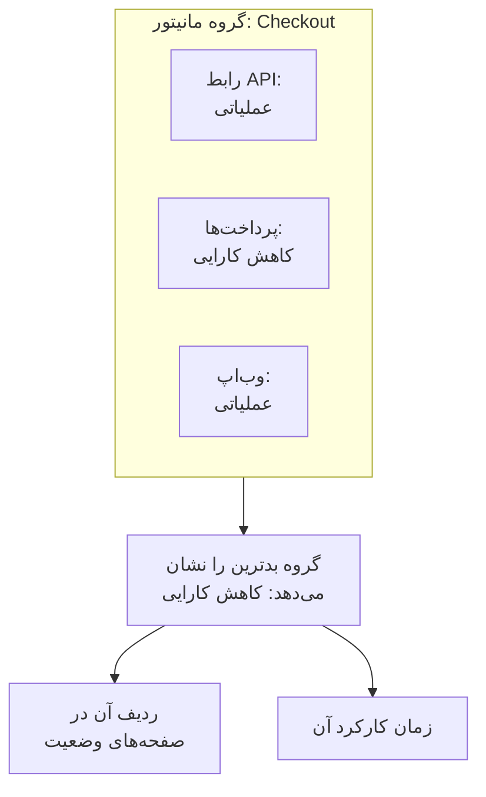

# گروه‌های مانیتور

یک گروه مانیتور چند مانیتور را در یک وضعیت جمع می‌کند. مانیتورهایی را که با هم یک سرویس را می‌سازند، مثل Checkout، گروه کنید: API آن، سرویس پرداختش و وب‌اپش. گروه بدترین وضعیت میان آن‌ها را نشان می‌دهد، زمان کارکرد خودش را دارد، و یک صفحهٔ وضعیت می‌تواند کل گروه را به شکل یک ردیف نشان دهد.

:::cards
- [وضعیت یک گروه چگونه به دست می‌آید](#وضعیت-یک-گروه-چگونه-به-دست-میآید): بدترین وضعیت میان مانیتورهایش.
- [روشن کردن گروه‌های مانیتور](#روشن-کردن-گروههای-مانیتور): یک کلید در تنظیمات پروژه.
- [ساخت یک گروه مانیتور](#ساخت-یک-گروه-مانیتور): نامی به آن بدهید، سپس مانیتورهایش را اضافه کنید.
- [نمایش یک گروه روی صفحهٔ وضعیت](#نمایش-یک-گروه-روی-صفحهٔ-وضعیت): یک ردیف برای کل گروه.
:::

## وضعیت یک گروه چگونه به دست می‌آید

گروه از وضعیت عملیاتی شما شروع می‌کند و بدترین وضعیت میان مانیتورهایش را می‌گیرد: همان که در فهرست وضعیت‌های مانیتور پروژهٔ شما پایین‌تر از همه است. اگر یک مانیتور به **کاهش کارایی** برود، کل گروه **کاهش کارایی** می‌شود؛ اگر یکی به **آفلاین** برود، گروه **آفلاین** می‌شود.

- **مانیتورهای بایگانی‌شده شمرده نمی‌شوند.** مانیتور بایگانی‌شده بررسی نمی‌شود، پس وضعیتش ثابت می‌ماند؛ گروه آن را کنار می‌گذارد.
- **گروه خالی عملیاتی است.** گروهی بدون مانیتور، یا فقط با مانیتورهای بایگانی‌شده، وضعیت عملیاتی شما را نشان می‌دهد. تا وقتی مانیتوری اضافه نکنید، داشبورد به‌جای وضعیت آن **هنوز مانیتوری وجود ندارد** را نشان می‌دهد.
- **ترتیب با شماست.** اینکه کدام وضعیت بدترین است، ترتیب **مانیتورها** > **تنظیمات** > **وضعیت مانیتور** است. [وضعیت‌های مانیتور](/docs/monitor/criteria-and-statuses#وضعیتهای-مانیتور) را ببینید.

گروه مانیتور با گروه صفحهٔ وضعیت یکی نیست. گروه صفحهٔ وضعیت عنوانی روی یک صفحهٔ وضعیت است که ردیف‌هایی را در بر می‌گیرد. گروه مانیتور یک ردیف است که نمایندهٔ چند مانیتور است، و هر صفحهٔ وضعیتی می‌تواند آن را نشان دهد.

## پیش از شروع

- **طرح شما.** در OneUptime Cloud، گروه‌های مانیتور به طرح Scale نیاز دارند.
- **کلید.** گروه‌های مانیتور پنهان‌اند تا وقتی **گروه‌های مانیتور** برای پروژه روشن شود (پایین را ببینید). روشن کردن آن به نقش Project Owner، یا یک نقش سفارشی با مجوز Edit Project یا Manage Billing نیاز دارد.
- **نقش شما.** ساختن، تغییر دادن و حذف گروه‌ها به نقش Project Owner، Project Admin، Project Member، Monitor Admin یا Monitor Member، یا یک نقش سفارشی با مجوزهای متناظر گروه مانیتور نیاز دارد. Viewer می‌تواند گروه‌ها را ببیند ولی نمی‌تواند تغییرشان دهد.

## روشن کردن گروه‌های مانیتور

:::steps
### باز کردن پرچم‌های قابلیت

به **تنظیمات پروژه** > **پیشرفته** > **پرچم‌های قابلیت** بروید. **پیشرفته** در منوی کناری بسته شروع می‌کند: اول آن را باز کنید.

### زدن کلید

کلید **گروه‌های مانیتور** را بزنید. بی‌درنگ ذخیره می‌شود: **گروه‌های مانیتور** در منوی کناری **مانیتورها** ظاهر می‌شود، و نام آیتم **مانیتورها** در هر صفحهٔ وضعیت به **منابع** تغییر می‌کند، جایی که می‌توانید یک گروه اضافه کنید.
:::

خاموش کردن دوبارهٔ کلید **گروه‌های مانیتور** را از منو پنهان می‌کند. هیچ گروهی حذف نمی‌شود.

## ساخت یک گروه مانیتور

:::steps
### باز کردن گروه‌های مانیتور

به **مانیتورها** > **گروه‌های مانیتور** بروید. کارت **گروه‌های مانیتور** هر گروه را با **وضعیت فعلی**، برچسب‌ها و مالکانش فهرست می‌کند.

### ساخت گروه

روی **ساخت گروه مانیتور** کلیک کنید، یک **نام** و، اگر خواستید، یک **توضیحات** وارد کنید و روی **ساخت گروه مانیتور** در پایین فرم کلیک کنید. گروه بدون هیچ مانیتوری شروع می‌کند.

### افزودن مانیتورهای آن

گروه را باز کنید: تا وقتی مانیتوری ندارد، **نمای کلی** آن **Add Monitors** را پیشنهاد می‌دهد. بعدها روی **مانیتورها** در منوی کناری‌اش و سپس روی **Add Monitors** کلیک کنید. هر مانیتور گروه را در **مانیتورها** برگزینید و روی **Add Monitors** کلیک کنید.

### بررسی وضعیت آن

روی **نمای کلی** کلیک کنید. **وضعیت فعلی** وضعیت کنونی گروه را نشان می‌دهد، و **نمودار زمان کارکرد** ۹۰ روز اخیرش را، برای هر روز یک ستون.
:::

برای بیرون بردن یک مانیتور از گروه، روی **حذف** در ردیف آن در **مانیتورهای گروه** کلیک کنید. خود مانیتور تغییری نمی‌کند. یک مانیتور می‌تواند به بیش از یک گروه تعلق داشته باشد.

## صفحه‌های یک گروه

یک گروه را باز کنید تا صفحه‌هایش را در منوی کناری ببینید:

| صفحه | چه نشان می‌دهد |
| --- | --- |
| **نمای کلی** | **جزئیات گروه مانیتور**، **وضعیت فعلی** و **نمودار زمان کارکرد** با درصد زمان کارکرد گروه در ۹۰ روز اخیر. گروهی که مانیتوری ندارد، به‌جای نمودار **Add Monitors** را پیشنهاد می‌دهد. |
| **مانیتورها** | **مانیتورهای گروه**، با **Add Monitors** و **حذف**. |
| **حوادث** | حادثه‌های هر مانیتوری در گروه. |
| **هشدارها** | هشدارهای هر مانیتوری در گروه. |
| **مالکان** | افراد و تیم‌هایی که مسئول گروه‌اند. زیر **پیشرفته** است، که بسته شروع می‌کند. |
| **گزارش‌های ممیزی** | چه کسی گروه را تغییر داد، و کی؛ آن هم زیر **پیشرفته**. |
| **حذف گروه** | گروه را حذف می‌کند، آن هم زیر **پیشرفته**. |

زمان کارکرد در **نمای کلی** همهٔ وضعیت‌ها جز وضعیت عملیاتی را قطعی می‌شمارد. یک صفحهٔ وضعیت فقط وضعیت‌های فهرست **قطعی به حساب می‌آید** خودش را می‌شمارد: [برگزیدن آنچه روی صفحه نشان داده می‌شود](/docs/status-pages/index#برگزیدن-آنچه-روی-صفحه-نشان-داده-میشود) را ببینید.

فهرست **گروه‌های مانیتور** می‌تواند گروه‌ها را بر اساس مالک و برچسب فیلتر کند، روی چند گروه با هم برچسب و مالک بگذارد، و گروه‌ها را به شکل JSON صادر یا وارد کند.

## نمایش یک گروه روی صفحهٔ وضعیت

:::steps
### باز کردن منابع صفحهٔ وضعیت

به **صفحات وضعیت** بروید، صفحه را باز کنید و روی **منابع** در منوی کناری‌اش کلیک کنید.

### تغییر دیالوگ به گروه

روی **افزودن مانیتور** کلیک کنید. زیر فهرست کشویی مانیتورها، روی **Add a Monitor Group instead.** کلیک کنید. فهرست کشویی به **گروه مانیتور** تبدیل می‌شود.

### انتخاب گروه و افزودن آن

گروه را انتخاب کنید. **نام نمایشی**، نامی که بازدیدکنندگان می‌خوانند، تا وقتی نامی از خودتان ننویسید با نام گروه پر می‌شود. روی **افزودن مانیتور** کلیک کنید: ردیف با وضعیت گروه روی صفحه ظاهر می‌شود.
:::

روی صفحهٔ وضعیت، ردیف نمایندهٔ همهٔ مانیتورهای گروه است:

- **وضعیتش.** وضعیت گروه است: بدترین میان مانیتورهایش.
- **حادثه‌هایش.** حادثهٔ هر مانیتوری در گروه روی صفحه ظاهر می‌شود، و نام گروه میان منابع تحت تأثیر می‌آید.
- **مشترکانش.** مشترکی که گروه را برمی‌گزیند دربارهٔ همهٔ مانیتورهای آن خبر می‌گیرد. [اجازه دادن به مشترکان برای برگزیدن منابع و نوع رویداد](/docs/status-pages/subscribers#اجازه-دادن-به-مشترکان-برای-برگزیدن-منابع-و-نوع-رویداد) را ببینید.

برای دیگر گزینه‌های ردیف، مثل زمان کارکرد و نمودار تاریخچه‌اش، [منابع و گروه‌های صفحه وضعیت](/docs/status-pages/resources-and-groups) را ببینید.

> [!WARNING]
> حذف یک گروه مانیتور ردیف آن را هم از هر صفحهٔ وضعیتی که نشانش می‌دهد حذف می‌کند. مانیتورهای گروه، و حادثه‌هایشان، حذف نمی‌شوند.

## API و Terraform

یک گروه `/api/monitor-group` است، و هر مانیتور در آن ردیفی از `/api/monitor-group-resource` است که یک `monitorGroupId` را با یک `monitorId` جفت می‌کند. در Terraform این‌ها `oneuptime_monitor_group` و `oneuptime_monitor_group_resource` هستند: [گروه مانیتور](/docs/terraform/examples#گروه-مانیتور) را ببینید.

## عیب‌یابی

:::details گروه‌های مانیتور در منوی مانیتورها نیست
کلید **گروه‌های مانیتور** خاموش است. آن را در **تنظیمات پروژه** > **پیشرفته** > **پرچم‌های قابلیت** روشن کنید. در OneUptime Cloud، گروه‌ها به طرح Scale هم نیاز دارند.
:::

:::details گروه آفلاین نشان می‌دهد، ولی بیشتر مانیتورهایش بالا هستند
قاعده همین است: گروه بدترین مانیتورش را نشان می‌دهد. **مانیتورها** را در گروه باز کنید تا مانیتوری را که از کار افتاده پیدا کنید، یا مانیتوری را که به گروه تعلق ندارد حذف کنید.
:::

:::details صفحهٔ وضعیت نمی‌تواند گروه را اضافه کند
**Add a Monitor Group instead.** فقط وقتی در دیالوگ ظاهر می‌شود که کلید **گروه‌های مانیتور** برای پروژه روشن باشد.
:::

## گام‌های بعدی

:::cards
- [معیارها و وضعیت‌های مانیتور](/docs/monitor/criteria-and-statuses): چه چیزی وضعیت هر مانیتور را تعیین می‌کند.
- [منابع و گروه‌های صفحه وضعیت](/docs/status-pages/resources-and-groups): ردیف‌های یک صفحهٔ وضعیت را بچینید.
- [مشترکان و اطلاعیه‌ها](/docs/status-pages/subscribers): دربارهٔ حادثه‌های یک گروه به مشتریان خبر دهید.
:::
