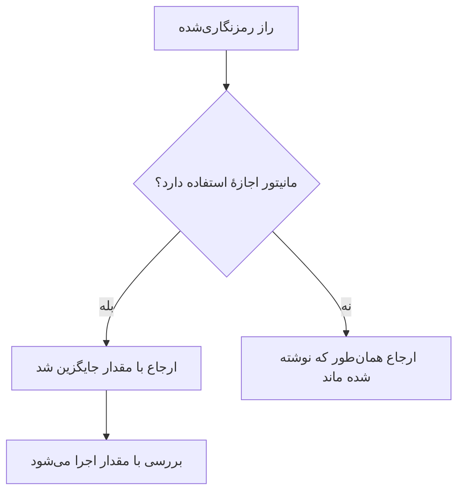

# اسرار مانیتور

رازهای مانیتور گذرواژه‌ها، کلیدهای API و توکن‌هایی را که مانیتورهای شما نیاز دارند بیرون از خود مانیتور نگه می‌دارند. یک مقدار را یک بار، رمزنگاری‌شده، ذخیره می‌کنید، انتخاب می‌کنید کدام مانیتورها می‌توانند از آن استفاده کنند، و هر جا مانیتور به آن نیاز داشت آن را به‌صورت `{{monitorSecrets.NAME}}` ارجاع می‌دهید.

:::cards
- [افزودن یک راز](#افزودن-یک-راز): یک مقدار را ذخیره کنید و انتخاب کنید چه کسی می‌تواند از آن استفاده کند.
- [انتخاب دسترسی](#انتخاب-اینکه-کدام-مانیتورها-میتوانند-از-یک-راز-استفاده-کنند): همهٔ مانیتورها، مانیتورهای مشخص، یا مانیتورهای دارای برچسب.
- [استفاده از یک راز](#استفاده-از-یک-راز): `{{monitorSecrets.NAME}}` کجا کار می‌کند.
- [ورود با کد یک‌بارمصرف](#ورود-با-کد-یکبارمصرف): بگذارید مانیتور از احراز هویت دومرحله‌ای یک سایت عبور کند.
:::

## رازها چگونه به یک مانیتور می‌رسند

یک راز رمزنگاری‌شده ذخیره می‌شود و پس از ذخیره دیگر هرگز نشان داده نمی‌شود. پیش از آنکه OneUptime یک مانیتور را به یک پراب بسپارد، هر ارجاعی را که مانیتور اجازهٔ استفاده از آن را دارد با مقدار رمزگشایی‌شده جایگزین می‌کند؛ ارجاعی که مانیتور اجازهٔ استفاده از آن را ندارد همان‌طور که نوشته شده می‌ماند. راز کد یک‌بارمصرف استثناست: پراب کد آن را هنگام اجرای بررسی می‌سازد ([ورود با کد یک‌بارمصرف](#ورود-با-کد-یکبارمصرف) را ببینید).



پرابی که بررسی را اجرا می‌کند مقدار را دریافت می‌کند، پس مانیتوری که از یک راز استفاده می‌کند باید روی پراب‌هایی اجرا شود که به آن‌ها اعتماد دارید: پراب‌های خود OneUptime، یا یک [پراب سفارشی](/docs/probe/custom-probe) که خودتان اجرا می‌کنید.

## پیش از شروع

- **طرح Growth یا بالاتر**، در OneUptime Cloud. نصب‌های خودمیزبان طرحی ندارند.
- **نقشی که بتواند رازها را مدیریت کند**: مالک پروژه، مدیر پروژه، یا یک نقش سفارشی با مجوز Create Monitor Secret.

## کار با رازها

### افزودن یک راز

:::steps
1. به **مانیتورها ← تنظیمات ← اسرار** بروید و روی **ساخت راز مانیتور** کلیک کنید.
2. یک **نام** و **مقدار راز** را وارد کنید. نام همان چیزی است که ارجاع می‌دهید، برای نمونه `ApiKey`. فقط می‌تواند حروف، اعداد، خط تیره (`-`) و زیرخط (`_`) داشته باشد، و دو راز در یک پروژه نمی‌توانند نام یکسان داشته باشند. برای کلید راه‌اندازی احراز هویت دومرحله‌ای یک سایت، ابتدا **کد یک‌بارمصرف (TOTP)** را انتخاب کنید ([ورود با کد یک‌بارمصرف](#ورود-با-کد-یکبارمصرف) را ببینید).
3. در گام **دسترسی**، انتخاب کنید کدام مانیتورها می‌توانند از آن استفاده کنند (بخش بعدی را ببینید)، سپس روی **ساخت راز مانیتور** کلیک کنید.
:::

> [!IMPORTANT]
> رازها رمزنگاری و به‌طور امن ذخیره می‌شوند. مقدار راز پس از ذخیره دیگر هرگز نشان داده نمی‌شود — نه در جدول، نه در فرم ویرایش، و نه از راه API. اگر مقدار را گم کنید، باید آن را از همان جایی که آمده دوباره بگیرید و دوباره تعیین کنید. برای چرخاندن یک راز، از دکمهٔ **به‌روزرسانی مقدار راز** در ردیف آن استفاده کنید؛ لازم نیست آن را حذف و دوباره بسازید. همین دکمه همراه با یک مقدار تازه، آنچه راز نگه می‌دارد را هم تغییر می‌دهد، **متن** یا **کد یک‌بارمصرف (TOTP)**، و مانیتورهایی که از راز استفاده می‌کنند نوع تازه را در بررسی بعدی‌شان به کار می‌گیرند.

### انتخاب اینکه کدام مانیتورها می‌توانند از یک راز استفاده کنند

هر راز یکی از سه گزینهٔ دسترسی را دارد:

| گزینه | کدام مانیتورها می‌توانند از راز استفاده کنند | برای چه |
| --- | --- | --- |
| **همه مانیتورها** | همهٔ مانیتورهای پروژه، از جمله مانیتورهایی که بعداً می‌سازید. | اعتبارنامه‌ای که بسیاری از مانیتورها در آن شریک‌اند. |
| **مانیتورهای مشخص** | فقط مانیتورهایی که انتخاب می‌کنید. این پیش‌فرض است، و رازهایی که پیش از وجود این گزینه‌ها ساخته شده‌اند به همین شکل کار می‌کنند. | اعتبارنامه‌ای برای یک یا چند مانیتور محدود. |
| **مانیتورهای دارای برچسب** | مانیتورهایی که دست‌کم یکی از برچسب‌های انتخابی شما را دارند. افزودن یکی از آن برچسب‌ها به یک مانیتور به آن دسترسی می‌دهد، و برداشتن برچسب دسترسی را در اجرای بعدی مانیتور می‌گیرد. | اعتبارنامه‌ای برای گروهی از مانیتورها که با گذشت زمان تغییر می‌کند. |

می‌توانید هر زمان با **ویرایش** در ردیف راز، گزینه را تغییر دهید. فقط فهرست گزینهٔ انتخاب‌شده نگه داشته می‌شود: رفتن به **همه مانیتورها** فهرست‌های مانیتور و برچسب راز را پاک می‌کند، و جابه‌جایی میان **مانیتورهای مشخص** و **مانیتورهای دارای برچسب** فهرستی را که از آن جابه‌جا شدید پاک می‌کند.

یک راز هرگز در دسترس مانیتورهای پروژهٔ دیگری نیست.

> [!WARNING]
> هر کسی که بتواند مانیتوری را ویرایش کند که اجازهٔ استفاده از یک راز را دارد، می‌تواند آن راز را به هر جایی که مانیتور به آن وصل می‌شود بفرستد. با **همه مانیتورها**، این یعنی هر کسی که بتواند در پروژه مانیتور بسازد یا ویرایش کند. با **مانیتورهای دارای برچسب**، هر کسی را هم که بتواند یکی از آن برچسب‌ها را به یک مانیتور اضافه کند در بر می‌گیرد.

در API، گزینهٔ دسترسی فیلد `monitorAccess` است: `All Monitors`، `Specific Monitors` یا `Monitors With Labels`. فیلدهای `monitors` و `labels` فهرست‌ها را نگه می‌دارند. رازی که بدون `monitorAccess` ساخته شود `Specific Monitors` می‌گیرد.

### استفاده از یک راز

برای استفاده از یک راز، `{{monitorSecrets.SECRET_NAME}}` را در فیلدی بنویسید که راز می‌پذیرد. برای نمونه، سرآیند درخواست `Authorization: Bearer {{monitorSecrets.ApiKey}}` مقدار راز `ApiKey` را می‌فرستد.

این نوع‌های مانیتور و فیلدها راز می‌پذیرند:

| نوع مانیتور | فیلدها |
| --- | --- |
| API | نشانی، سرآیندها و بدنهٔ درخواست، و گواهی کلاینت، کلید خصوصی و عبارت عبور (mTLS) |
| وب‌سایت | نشانی، و گواهی کلاینت، کلید خصوصی و عبارت عبور (mTLS) |
| Ping, IP, پورت, NTP, گواهی SSL | میزبان یا نشانی‌ای که بررسی می‌شود |
| DNS | نام دامنه و سرور DNS |
| DNSSEC, دامنه | نام دامنه |
| پرس‌وجوی SQL | میزبان، نام پایگاه داده، نام کاربری، گذرواژه و کوئری |
| سلامت پایگاه داده | میزبان، نام پایگاه داده، نام کاربری و گذرواژه |
| صفحه وضعیت خارجی | نشانی صفحهٔ وضعیت |
| مانیتور سینتتیک, کد JavaScript سفارشی | اسکریپت |
| دستگاه شبکه | رشتهٔ community در SNMP، و کلیدهای احراز هویت و حریم خصوصی SNMPv3 |

رازها پیش از اجرای اسکریپت یک مانیتور مانیتور سینتتیک یا کد JavaScript سفارشی پر می‌شوند، پس ارجاعی مانند `{{monitorSecrets.ApiKey}}` داخل اسکریپت هنگام اجرا همان مقدار رمزگشایی‌شده است.

اگر مانیتوری به رازی ارجاع دهد که اجازهٔ استفاده از آن را ندارد، ارجاع همان‌طور که هست می‌ماند و با مقدار جایگزین نمی‌شود.

وقتی بررسی یک مانیتور API، وب‌سایت یا صفحه وضعیت خارجی شکست می‌خورد، خطای آن نشانی را فقط با طرح، میزبان و درگاه آن نام می‌برد، مثل `https://api.example.com`، پس رازی که در نشانی است هرگز نشان داده نمی‌شود.

وقتی یک مانیتور را پیش از ذخیره آزمایش می‌کنید، فقط رازهایی که برای **همه مانیتورها** در دسترس‌اند پر می‌شوند، چون یک مانیتور تازه هنوز در هیچ فهرستی نیست و برچسبی ندارد. پس از ذخیرهٔ مانیتور، آزمایش‌ها از هر رازی که مانیتور اجازهٔ استفاده از آن را دارد استفاده می‌کنند.

## ورود با کد یک‌بارمصرف

برخی سایت‌ها هنگام ورود، کدی از یک اپلیکیشن احراز هویت می‌خواهند. رازی از نوع **کد یک‌بارمصرف (TOTP)** کلید راه‌اندازی آن سایت را نگه می‌دارد، تا مانیتور بتواند همان‌طور که شما وارد می‌شوید وارد شود: هر جا مانیتور از این راز استفاده کند، پراب کد فعلی را با ساعت خودش، درست در لحظه‌ای که بررسی به آن نیاز دارد، می‌سازد. کلید راه‌اندازی مانند هر مقدار راز دیگری رمزنگاری‌شده ذخیره می‌شود و دیگر هرگز نشان داده نمی‌شود، و هرگز در خود مانیتور نوشته نمی‌شود.

1. احراز هویت دومرحله‌ای را برای حسابی که مانیتور با آن وارد می‌شود روشن کنید. جایی که سایت یک کد QR نشان می‌دهد، به‌جای آن وارد کردن دستی کلید را انتخاب کنید، و کلید راه‌اندازی یا پیوند `otpauth://` را کپی کنید.
2. به **مانیتورها ← تنظیمات ← اسرار** بروید، روی **ساخت راز مانیتور** کلیک کنید، **کد یک‌بارمصرف (TOTP)** را انتخاب کنید، و کلید یا پیوند را در **کلید راه‌اندازی** بچسبانید.
3. بررسی کنید که **کد فعلی** زیر آن با کدی که اپلیکیشن احراز هویت شما اکنون نشان می‌دهد یکی باشد، سپس مانند هر راز دیگری، در گام **دسترسی** انتخاب کنید کدام مانیتورها می‌توانند از این راز استفاده کنند.

| آنچه می‌چسبانید | کدهایی که مانیتور می‌سازد |
| --- | --- |
| یک کلید راه‌اندازی، مانند `JBSW Y3DP EHPK 3PXP` | الگوریتم SHA1، کدهای ۶ رقمی، و یک کد تازه هر ۳۰ ثانیه: همان چیزی که هر اپلیکیشن احراز هویت فرض می‌کند |
| یک پیوند `otpauth://totp/` | مقدارهای `algorithm` (`SHA1`، `SHA256` یا `SHA512`)، `digits` (`6` یا `8`) و `period` به ثانیه (`30` وقتی پیوند آن را ندارد) در خود پیوند |

| نوع مانیتور | کد کجا می‌رود و کی ساخته می‌شود |
| --- | --- |
| API | ‏`{{monitorSecrets.NAME}}` در نشانی، یک سرآیند درخواست یا بدنهٔ درخواست، درست پیش از فرستادن هر تلاش |
| مانیتور سینتتیک، کد JavaScript سفارشی | ‏`{{monitorSecrets.NAME}}` در اسکریپت، هنگام شروع اسکریپت، و `await oneuptime.getTotpCode("NAME")`، وقتی اسکریپت آن را بخواهد |

هر فیلد دیگری `{{monitorSecrets.NAME}}` را همان‌طور که نوشته شده نگه می‌دارد. در بدنهٔ درخواست JSON، ارجاع را در گیومه بگذارید، مانند `{"otp": "{{monitorSecrets.LoginCode}}"}`، چون یک کد می‌تواند با صفر شروع شود.

ورود معمولاً چند صفحه پس از شروع اسکریپت به درخواست کد می‌رسد، پس کد را همان‌جا بخواهید. این اسکریپت با یک گذرواژه و یک کد یک‌بارمصرف وارد می‌شود:

```javascript
await page.goto("https://app.example.com/login");
await page.fill("#email", "monitoring@example.com");
await page.fill("#password", "{{monitorSecrets.AppPassword}}");
await page.click("button[type=submit]");

// The code is made now, when the sign-in asks for it.
await page.waitForSelector("#otp");
await page.fill("#otp", await oneuptime.getTotpCode("AppLoginCode"));
await page.click("button[type=submit]");

await page.waitForSelector(".dashboard", { timeout: 10000 });

return {
  data: { signedIn: true },
};
```

پراب هرگز کدی را که کمتر از پنج ثانیه از اعتبارش مانده، یا وقتی بازه کوتاه‌تر است کمتر از یک‌سوم بازه، تحویل نمی‌دهد: به‌جای آن حداکثر پنج ثانیه منتظر کد بعدی می‌ماند و این انتظار را از زمان اجرای بررسی کنار می‌گذارد. هر کدی که یک بررسی می‌سازد در پیام‌های لاگ، نتیجه، خطا و نام نماگرفت‌های آن به‌صورت ستاره نشان داده می‌شود، مانند `******`. نماگرفت تصویری از صفحه است، پس آن را پیش از تایپ کد یا پس از اینکه صفحه به مرحلهٔ بعد رفت بگیرید.

> [!NOTE]
> پراب کدها را می‌سازد، پس پراب سفارشی به OneUptime 17.1.0 یا بالاتر نیاز دارد. روی پرابی قدیمی‌تر، بررسی‌ای که به کد نیاز دارد اجرا نمی‌شود و با جمله‌ای شکست می‌خورد که می‌گوید پراب را به‌روزرسانی کنید؛ فرم مانیتور و صفحهٔ پراب، پرابی را که بیش از حد قدیمی است نام می‌برند، و [به‌روزرسانی پراب](/docs/probe/custom-probe#بهروزرسانی-پراب) می‌گوید چگونه. ساعت پراب هم باید درست باشد، چون پرابی که یک دقیقه جلو یا عقب باشد کدهایی می‌سازد که سایت از آن‌ها گذشته است.

## رفع اشکال

:::details `{{monitorSecrets.NAME}}` عیناً فرستاده می‌شود
مانیتور اجازهٔ استفاده از راز را ندارد، یا نام مطابقت ندارد. گزینهٔ دسترسی راز را با **ویرایش** در ردیف آن بررسی کنید، و اینکه نام در ارجاع دقیقاً نام راز باشد.
:::

:::details آزمایش یک مانیتور تازه راز را پر نمی‌کند
پیش از ذخیرهٔ مانیتور، فقط رازهایی که برای **همه مانیتورها** در دسترس‌اند پر می‌شوند. مانیتور را ذخیره کنید، سپس دوباره آزمایش کنید.
:::

:::details یک فیلد راز را نادیده می‌گیرد
فقط فیلدهای جدول بالا راز می‌پذیرند. در هر فیلد دیگری، `{{monitorSecrets.NAME}}` همان‌طور که نوشته شده فرستاده می‌شود.
:::

:::details سایت کد یک‌بارمصرف را نمی‌پذیرد
بررسی کنید که هنگام ذخیرهٔ راز، **کد فعلی** با اپلیکیشن احراز هویت شما یکی بوده باشد، ساعت پراب درست باشد، و ارجاع در بدنهٔ درخواست JSON در گیومه باشد. اگر ورود مدتی طول می‌کشد تا به درخواست کد برسد، کد را همان‌جا با `oneuptime.getTotpCode` بخواهید.
:::

:::details بررسی می‌گوید پراب قدیمی‌تر از آن است که کد یک‌بارمصرف بسازد
پراب نسخه‌ای قدیمی‌تر از OneUptime 17.1.0 را اجرا می‌کند که نمی‌تواند کد یک‌بارمصرف بسازد، پس بررسی روی آن اجرا نشد. پراب را به‌روزرسانی کنید ([به‌روزرسانی پراب](/docs/probe/custom-probe#بهروزرسانی-پراب) را ببینید)، یا مانیتور را با پراب‌هایی بررسی کنید که 17.1.0 یا بالاتر را اجرا می‌کنند.
:::

## گام‌های بعدی

:::cards
- [مانیتور API](/docs/monitor/api-monitor): یک راز را در سرآیند درخواست بفرستید.
- [مانیتور سینتتیک](/docs/monitor/synthetic-monitor): از یک راز داخل یک اسکریپت مرورگر استفاده کنید.
- [مانیتور کوئری SQL](/docs/monitor/sql-monitor): گذرواژهٔ پایگاه داده را رمزنگاری‌شده نگه دارید.
:::
