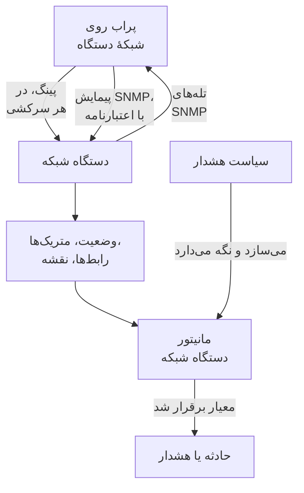
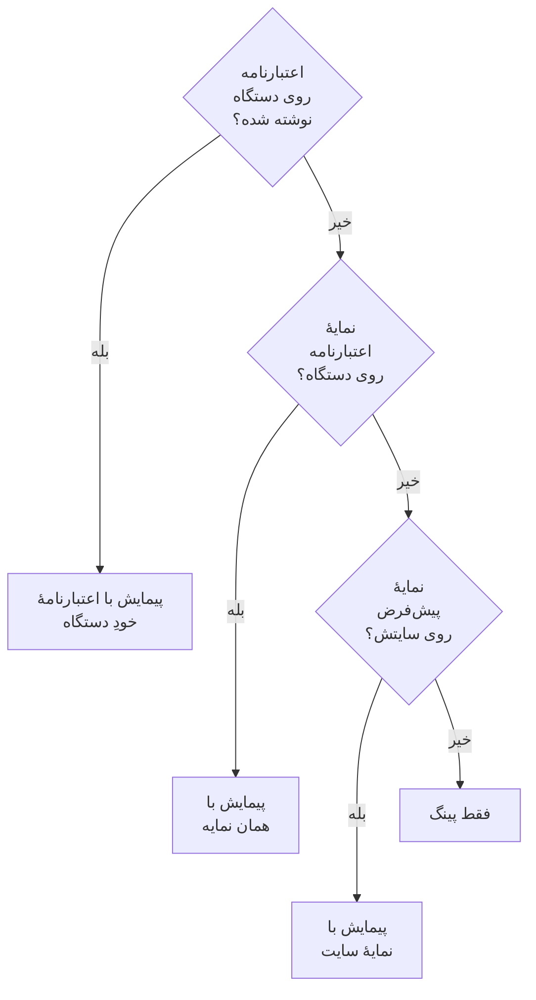
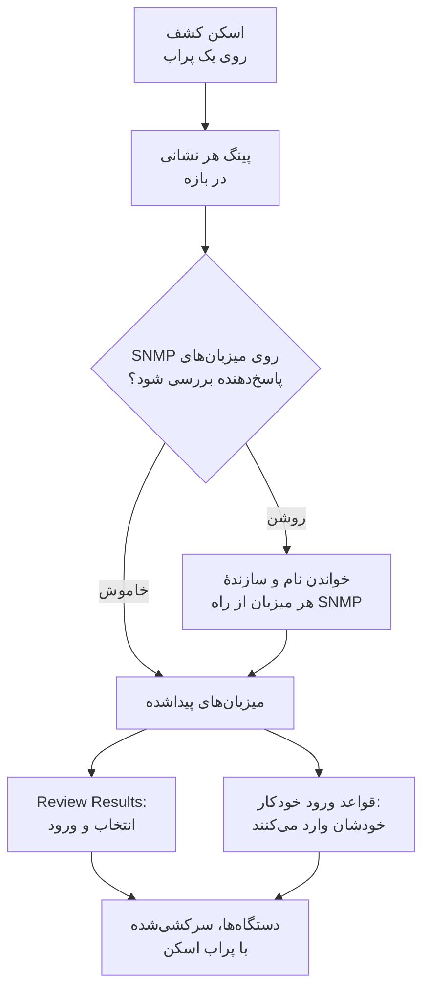
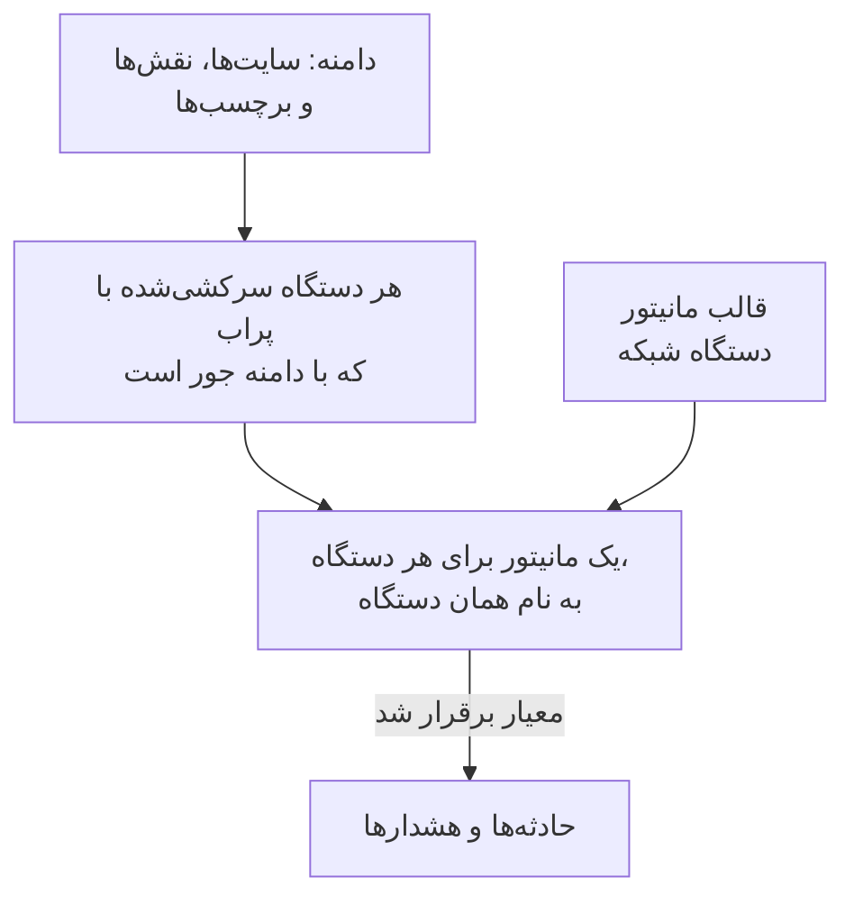
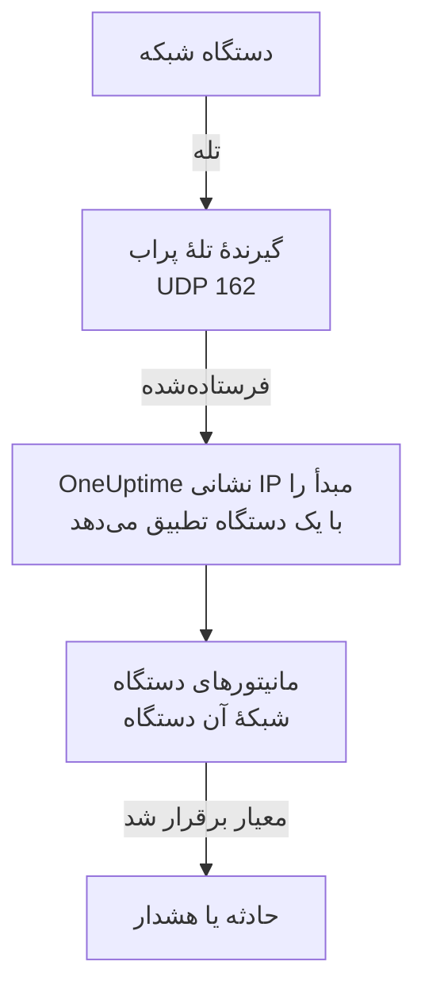

# مانیتور دستگاه شبکه

سوئیچ‌ها، روترها، فایروال‌ها، نقطه‌های دسترسی، PDUها، دوربین‌ها و چاپگرها را پایش کنید: هر چیزی که روی شبکهٔ شما نشانی دارد، چه SNMP بلد باشد چه نه.

دستگاهی را با نشانی‌اش و یک پراب اضافه کنید تا پراب طبق یک زمان‌بندی آن را پینگ کند: دستگاه وضعیت روشن یا خاموش، جایی روی نقشهٔ شبکه و یک رأی در سلامت سایتش می‌گیرد. به آن اعتبارنامهٔ SNMP بدهید تا همان پراب آن را پیمایش SNMP هم بکند: رابط‌ها و ماژول‌های نوری درونشان، سیاههٔ سخت‌افزار، همسایه‌های LLDP و CDP و OIDهای سلامت. یک مانیتور، یا یک سیاست هشدار برای یک ناوگان کامل، اضافه کنید تا سرکشی‌ها و تله‌های آن حادثه و هشدار باز کنند.

:::cards
- [افزودن یک دستگاه](#افزودن-یک-دستگاه-شبکه): نشانی‌اش و یک پراب، در یک صفحه.
- [کشف یک شبکه](#کشف-دستگاهها-با-اسکن-شبکه): یک بازهٔ نشانی را اسکن کنید و هرچه پاسخ داد وارد کنید.
- [خواندن دستگاه‌ها از راه SNMP](#اعتبارنامههای-snmp-و-نمایههای-اعتبارنامه): رابط‌ها، ماژول‌های نوری، سیاهه و سلامت.
- [هشدار گرفتن](#هشداردهی): یک مانیتور برای یک دستگاه، یک سیاست برای یک ناوگان.
- [دیدن نقشه](#توپولوژی-شبکه): همسایه‌ها به‌صورت زنده ترسیم و به PDF صادر می‌شوند.
- [رفع یک مشکل](#رفع-اشکال): دستگاه‌های در انتظار، پیمایش‌های ناموفق، تله‌هایی که نمی‌رسند.
:::

## چگونه کار می‌کند



دستگاه و مانیتور کارهای متفاوتی انجام می‌دهند:

| بخش | چه می‌کند | کی به آن نیاز دارید |
| --- | --- | --- |
| دستگاه | پرابش آن را طبق زمان‌بندی خودِ دستگاه سرکشی می‌کند. هر سرکشی دسترس‌پذیری، زمان رفت‌وبرگشت پینگ و از دست رفتن بسته را ثبت می‌کند؛ سرکشی‌ای که اعتبارنامهٔ SNMP دارد هویت، رابط‌ها، همسایه‌ها و OIDهای سلامت دستگاه را هم می‌خواند. | همیشه: دستگاه همان چیزی است که اضافه می‌کنید. |
| مانیتور | معیارها را در برابر هر نتیجهٔ سرکشی و هر تلهٔ دستگاه می‌سنجد و حادثه و هشدار باز می‌کند. | فقط برای حادثه و هشدار. وضعیت، سیاهه، نمودارها و نقشه به مانیتور نیازی ندارند. |

## پیش از شروع

- **پرابی که به دستگاه برسد.** پراب دستگاه را از شبکهٔ خودش پینگ و پیمایش می‌کند، پس دستگاهی با نشانی خصوصی به یک [پراب سفارشی](/docs/probe/custom-probe) درون همان شبکه نیاز دارد: پرابی روی اینترنت عمومی به آن نمی‌رسد.
- **SNMP، برای چیزی بیش از پینگ.** اختیاری. یک community string نسخهٔ v1 یا v2c، یا یک کاربر SNMPv3، که روی دستگاه تنظیم شده باشد، با UDP 161 باز از سمت پراب. بدون آن دستگاه فقط پینگ می‌شود.
- **تله‌ها، syslog و جریان‌ها.** اختیاری. پراب تله‌های SNMP را روی UDP 162، syslog را پس از روشن کردنش روی UDP 5140 و رکوردهای جریان را روی UDP 2055، 4739 و 6343 می‌گیرد، پس این‌ها را از دستگاه‌هایتان تا پراب باز کنید.

## نمای کلی شبکه

**شبکه** > **نمای کلی** جایی است که بخش شبکه باز می‌شود، و با پاسخ شروع می‌کند: یک جمله که می‌گوید شبکهٔ شما سالم است یا نه و، اگر نیست، چه چیزی خراب است، بدترین خبر اول.

| چه می‌گوید | کی |
| --- | --- |
| **3 دستگاه از کار افتاده‌اند** | پراب یا مانیتور یک دستگاه به آن نمی‌رسد. |
| **2 سایت نیاز به توجه دارند** | همهٔ دستگاه‌ها پاسخ می‌دهند، اما سلامت یک سایت عملیاتی نیست. |
| **5 رابط قطع‌اند** | همهٔ دستگاه‌ها پاسخ می‌دهند، اما پورت‌هایی خاموش‌اند. |
| **2 دستگاه جزئیاتشان را گزارش نمی‌کنند** | به پینگ پاسخ می‌دهند، اما پیمایش SNMP آن‌ها شکست می‌خورد، پس رابط‌ها و سلامتشان تازه نمی‌شود: معمولاً اعتبارنامه‌ها. |
| **در انتظار نخستین بررسی** | دستگاه‌هایی اضافه شده‌اند و پرابشان هنوز آن‌ها را بررسی نکرده است. |
| **هر 40 دستگاه روشن‌اند** | همهٔ دستگاه‌ها پاسخ می‌دهند. دستگاه‌هایی که هنوز در انتظار نخستین بررسی‌اند در یک سطر جداگانه شمرده می‌شوند. |

زیر آن، یک سطر می‌گوید آیا وقتی دستگاهی از کار می‌افتد چیزی حادثه باز می‌کند: چند [سیاست هشدار](#سیاستهای-هشدار) روشن‌اند، یا اگر هیچ‌کدام نیست، پیوند **Set up alerts**. دکمه‌های **Add Device** و **Discover Devices** کنار آن همان فرم‌ها را باز می‌کنند، و کاشی‌ها و فهرست‌های پایین جزئیات را نشان می‌دهند: دستگاه‌ها و سایت‌هایی که نیاز به توجه دارند، ناوگان بر پایهٔ سازنده و اسکن‌های اخیر.

تا وقتی چیزی اضافه نشده، نمای کلی به‌جای آن دو راه شروع را نشان می‌دهد: **کشف دستگاه‌ها** یک بازهٔ نشانی را اسکن می‌کند تا انتخاب کنید چه چیزی اضافه شود، که برای یک شبکهٔ کامل یا یک سایت تازه بهترین است، و **افزودن یک دستگاه** یک دستگاه را با نشانی IP یا نام میزبانش اضافه می‌کند.

منوی شبکه آنچه هر روز باز می‌کنید را در دید نگه می‌دارد: **نمای کلی**، **Devices**، **سایت‌ها**، **Map**، **Traffic** و **Discovery**. بقیه در بخش‌هایی جمع شده‌اند، و هر بخش روی هر یک از صفحه‌هایش خودبه‌خود باز می‌شود:

| بخش | صفحه‌ها |
| --- | --- |
| **توپولوژی** | **Device Topology**، **نقاط پایانی**، **Latency Matrix**، **Site Links**، **Device Links** |
| **قواعد** | **Auto Import Rules**، **Site Assignment Rules**، **قواعد مالکیت**، **قواعد برچسب**، **Link Rules** |
| **تنظیمات** | **Alert Policies**، **اعتبارنامه‌های SNMP**، **Device Roles**، **Site Types**، **OID Collection Templates** |
| **پیشرفته** | **Archived Devices** |

## افزودن یک دستگاه شبکه

:::steps
### فهرست دستگاه‌ها را باز کنید
به **شبکه** > **Devices** بروید و روی **Add Device** کلیک کنید. **Add Device** در **نمای کلی** شبکه همان فرم را باز می‌کند.

### نشانی دستگاه را بنویسید
در **نام میزبان**، نشانی IP یا نام میزبان آن را بنویسید. **نام** را خالی بگذارید تا دستگاه به نام میزبانش نام‌گذاری شود.

### سایت و پراب را بررسی کنید
اگر از سایت‌ها استفاده می‌کنید، **Site** محل دستگاه را انتخاب کنید. **پراب** خودبه‌خود با پراب پیش‌فرض سایت، یا با تنها پراب سفارشی پروژه، پر می‌شود؛ مطمئن شوید پرابی است که به دستگاه می‌رسد.

### دستگاه را اضافه کنید
روی **Add Device** کلیک کنید. در عرض چند دقیقه پراب دستگاه را پینگ می‌کند و وضعیتش **Up** یا **Down** می‌شود. با اعتبارنامهٔ SNMP، نمای کلی دستگاه هم پس از نخستین پیمایش موفق با هویت، رابط‌ها و سلامت دستگاه پر می‌شود.
:::

فرم یک صفحه است — نام میزبان، یک نام، سایت و پراب — و **SNMP** و **فیلدهای بیشتر** زیر آن جمع شده‌اند. چیزی دربارهٔ نحوهٔ پایش دستگاه نمی‌پرسد: هر دستگاهی که اضافه می‌کنید را پرابش سرکشی می‌کند، و [بازنویسی مانیتور مقید](#بازنویسی-مانیتور-مقید) برای معدود دستگاه‌هایی که به آن نیاز دارند در صفحهٔ **تنظیمات** دستگاه است.

جزئیات یک دستگاه — نام، توضیح، نقش، سایت، برچسب‌ها و نشانی‌ها — بعداً در یک جا ویرایش می‌شوند: کارت **Device Settings** در صفحهٔ **تنظیمات** آن. کارت **جزئیات دستگاه** در نمای کلی آن‌ها را با پیوند **ویرایش در تنظیمات** نشان می‌دهد.

### دستگاه

| فیلد | توضیح | الزامی |
| --- | --- | --- |
| نام میزبان | نشانی IP یا نام میزبانی که پراب پینگ می‌کند، و وقتی دستگاه اعتبارنامه دارد از راه SNMP پیمایش می‌کند. | بله |
| نام | یک نام خوانا، مانند core-switch-01. خالی بگذارید تا دستگاه به نام میزبانش نام‌گذاری شود. API هم همین کار را می‌کند: دستگاهی که بی‌نام ساخته شود به نام میزبانش نام‌گذاری می‌شود. | خیر |
| Site | [سایت شبکه‌ای](/docs/monitor/network-sites) که دستگاه در آن است. سلامت سایت از دستگاه‌هایش تجمیع می‌شود، و سایتی که پراب پیش‌فرض دارد پراب زیر را پر می‌کند. | خیر |
| پراب | پرابی که این دستگاه را پینگ می‌کند، وقتی اعتبارنامه دارد از راه SNMP پیمایشش می‌کند، و تله‌ها، syslog و [رکوردهای جریان](/docs/monitor/network-traffic) آن را می‌گیرد. باید مستقیم به دستگاه برسد: پرابی روی اینترنت عمومی به نشانی خصوصی نمی‌رسد. | بله |

**پراب** هر جا بتواند خودش پر می‌شود: پروژه‌ای که دقیقاً یک پراب سفارشی دارد با همان شروع می‌کند، و انتخاب یک سایت آن را با [پراب پیش‌فرض سایت](/docs/monitor/network-sites#پیشفرضهای-پایش) جایگزین می‌کند. پرابی را که خودتان انتخاب کرده‌اید هرگز بازنویسی نمی‌کند. روی سایت‌هایتان پراب پیش‌فرض بگذارید تا بتوان دستگاه را فقط با نشانی‌اش اضافه کرد.

### فیلدهای بیشتر (جمع‌شده)

| فیلد | توضیح | الزامی |
| --- | --- | --- |
| توضیحات | متن آزاد. | خیر |
| Device Role | سوئیچ هسته، سوئیچ دسترسی، فایروال و مانند آن. ردهٔ دستگاه روی نقشه را تعیین می‌کند و دامنهٔ سیاست‌های هشدار را محدود می‌کند. | خیر |
| آدرس MAC | MAC خودِ دستگاه. نقشه از آن استفاده می‌کند تا دستگاهی را که نه LLDP بلد است نه CDP روی پورت سوئیچی بگذارد که آن را یاد گرفته است؛ [دستگاه‌های فقط-پینگ و پورت سوئیچشان](#دستگاههای-فقط-پینگ-و-پورت-سوئیچشان) را ببینید. معمولاً از جدول ARP یک روتر برایتان یاد گرفته می‌شود. | خیر |
| ساخت یک مانیتور Ping هم برای حادثه‌ها | پراب از قبل دستگاه را پینگ می‌کند و به آن وضعیت می‌دهد؛ مانیتور Ping چیزی است که پینگ‌های ناموفق را به حادثه تبدیل می‌کند. تیکش را بزنید تا هنگام ذخیره یکی روی نام میزبان ساخته و به دستگاه مقید شود. در طرح شما شمرده می‌شود، و حادثه‌هایش تا وقتی آن‌ها را از صفحهٔ مانیتور روشن نکنید خاموش می‌مانند. | خیر |

تیک زدن مانیتور Ping گزینهٔ **Ping from probes** را نشان می‌دهد، یعنی پراب‌های خودِ مانیتور. این پراب‌ها باید به شبکهٔ دستگاه برسند؛ فیلد را خالی بگذارید تا پراب‌های پیش‌فرض پروژه به کار روند. برای هشدار گرفتن روی دستگاه‌های زیاد با هم، به‌جای آن از [سیاست‌های هشدار](#سیاستهای-هشدار) استفاده کنید.

### SNMP (جمع‌شده، اختیاری)

جمع‌شده نگهش دارید تا دستگاه فقط پینگ شود: بخش جمع‌شده این را در یک جمله می‌گوید. دستگاه همچنان از نخستین سرکشی وضعیت می‌گیرد و همچنان در سایتش و روی نقشه هست، اما تا اعتبارنامه نداشته باشد رابط، سیاهه یا OID سلامت ندارد. بخش را باز کنید تا یک community string یا یک کاربر v3 بنویسید، یا یک نمایهٔ اعتبارنامهٔ ذخیره‌شده را انتخاب کنید.

:::tabs
@tab SNMP v1 / v2c
| فیلد | توضیح | الزامی |
| --- | --- | --- |
| نسخه SNMP | V1، V2c یا V3. | بله، از V2c شروع می‌کند |
| SNMP Community String | community string نسخهٔ v1 یا v2c، مانند `public`. | خیر: خالی یعنی فقط پینگ |
| SNMP Port | پورت UDP که عامل روی آن گوش می‌دهد. | خیر، پیش‌فرض 161 |
| SNMP Credential Profile | یک مجموعه اعتبارنامهٔ ذخیره‌شده به‌جای نوشتن اعتبارنامه در اینجا. | خیر |
@tab SNMPv3
| فیلد | توضیح | الزامی |
| --- | --- | --- |
| SNMP v3 Security Level | No Auth, No Priv؛ Auth, No Priv؛ یا Auth, Priv. | بله |
| SNMP v3 Username | نام امنیتی (کاربر) که روی دستگاه پیکربندی شده است. | بله: خالی یعنی فقط پینگ |
| SNMP v3 Authentication Protocol | MD5، SHA، SHA-256 یا SHA-512. | با احراز هویت |
| SNMP v3 Authentication Key | عبارت عبور احراز هویت. | با احراز هویت |
| SNMP v3 Privacy Protocol | DES، AES یا AES-256. | با حریم خصوصی |
| SNMP v3 Privacy Key | عبارت عبور حریم خصوصی (رمزنگاری). | با حریم خصوصی |
:::

اعتبارنامه‌ای که روی دستگاه نوشته شده بر نمایهٔ اعتبارنامه‌ای که کنارش انتخاب شده مقدم است، و سایت دستگاه هم می‌تواند یک نمایهٔ پیش‌فرض داشته باشد. اعتبارنامه‌های یک نمایه به‌صورت رمزنگاری‌شده ذخیره می‌شوند. اعتبارنامه‌ای که روی دستگاه نوشته می‌شود با همان مجوزهای خواندن محافظت می‌شود اما رمزنگاری‌شده ذخیره نمی‌شود: دلیلی دیگر برای نگه داشتن اعتبارنامه‌های مشترک در یک نمایه.

## تغییر چند دستگاه با هم

اسکن کشف شبکهٔ یک مشتری ده‌ها دستگاه می‌آورد که به یک سایت تعلق دارند، یک نقش دارند و از یک سازنده‌اند. آن‌ها را یکی‌یکی باز نمی‌کنید: در فهرست **Devices** انتخابشان کنید، با تیک زدن سطرها یا انتخاب همهٔ دستگاه‌هایی که با فیلترها جور درمی‌آیند، و **اقدامات گروهی** را باز کنید.

| اقدام | چه می‌کند |
| --- | --- |
| **تنظیم سایت** / **پاک کردن سایت** | هر دستگاه انتخاب‌شده را به سایتی که برمی‌گزینید می‌برد، جایی که در سلامت سایت شمرده می‌شود؛ دستگاهی که پراب خودش را ندارد پراب پیش‌فرض سایت را می‌گیرد. **پاک کردن سایت** آن‌ها را از سایت‌هایشان بیرون می‌آورد. دستگاهی که با یک قاعدهٔ تخصیص سایت جور درمی‌آید در سرکشی بعدی به سایت قاعده برمی‌گردد، پس برای دستگاه‌هایی که کشف مدام پیدایشان می‌کند، بهتر است قاعده‌ای زیر **شبکه** > **قواعد** > **Site Assignment Rules** اضافه کنید؛ پنجرهٔ **تنظیم سایت** به آن پیوند می‌دهد. |
| **تنظیم نقش دستگاه** / **پاک کردن نقش دستگاه** | به همهٔ دستگاه‌های انتخاب‌شده یک نقش می‌دهد، مانند بیست سوئیچی که همه «Access Switch» هستند. نقش‌ها نقش‌های خودِ پروژه‌اند، زیر **شبکه** > **تنظیمات** > **Device Roles**، که پنجره به آن پیوند می‌دهد. **پاک کردن نقش دستگاه** نقش هر دستگاه را دوباره از هویت SNMP آن به دست می‌آورد. |
| **اعمال قالب سازنده** | OIDهای سلامت و جدول‌های SNMP یک [قالب سازنده](#قالبهای-سلامت-سازندگان) را به هر دستگاه انتخاب‌شده اضافه می‌کند. **تطبیق با سازنده هر دستگاه**، نخستین گزینهٔ پنجره، قالب هر دستگاه را از روی آنچه پیمایش SNMP آن گزارش می‌دهد انتخاب می‌کند، پس یک انتخاب درهم همه‌جا قالب درست را می‌گیرد؛ یا یک قالب برای همه انتخاب کنید. |

هر اقدام یک پنجره و یک ذخیره برای کل انتخاب است، و هر دستگاه از همان بررسی‌هایی می‌گذرد که ویرایش در صفحهٔ تنظیمات خودش: مجوزها، دامنهٔ برچسب و مالکیت نقش شما و محدودیت‌های آنچه یک دستگاه می‌تواند جمع کند.

**اعمال قالب سازنده** پیش از هر کاری نشان می‌دهد چه خواهد کرد: چند دستگاه کدام قالب را می‌گیرند، و چند دستگاه را دست‌نخورده می‌گذارد و چرا. به آنچه هر دستگاه از قبل جمع می‌کند اضافه می‌کند و چیزی حذف نمی‌کند، و دستگاهی که همه‌چیزِ قالب را از قبل دارد دوباره نوشته نمی‌شود. این‌ها را دست‌نخورده می‌گذارد: دستگاه متکی به مانیتور (هیچ چیز سرکشی‌اش نمی‌کند)، دستگاهی که به یک [OID Collection Template](#oid-collection-templates) پیوند خورده (قالب تعیین می‌کند چه جمع کند، پس OIDهای سازنده را آنجا اضافه کنید) و، در حالت تطبیق، دستگاهی که هنوز پیمایش SNMP نشده یا سازنده‌اش قالبی ندارد.

وقتی اقدامی تمام می‌شود، فهرست می‌کند چند دستگاه تغییر کردند، کدام‌ها شکست خوردند و چرا — دستگاهی که نقش شما اجازهٔ ویرایشش را ندارد، فهرستی بیش از حدش — و کدام‌ها را تغییر نداد و چرا: دستگاهی که از قبل در آن سایت یا نقش بود، یا دستگاهی که قالب سازنده دست‌نخورده‌اش می‌گذارد.

باقی اقدامات گروهی جای خودشان توضیح داده شده‌اند: **Set OID Collection Template** در [OID Collection Templates](#oid-collection-templates)، **Set SNMP Credential Profile**، **Switch to Probe Polling** و **Create Ping Monitors** در [به‌صورت گروهی](#بهصورت-گروهی)، و **Shorten Names to Hostname** در [دستگاه‌های کشف‌شده چگونه نام‌گذاری می‌شوند](#دستگاههای-کشفشده-چگونه-نامگذاری-میشوند).

## یک سرکشی واقعاً چه می‌کند

هر سرکشی دستگاهی که پراب آن را سرکشی می‌کند یک پینگ است. وقتی دستگاه اعتبارنامهٔ SNMP قابل استفاده دارد، پراب یک پیمایش SNMP کامل هم اجرا می‌کند. این دو کنار هم اجرا می‌شوند و پیمایش هرگز منتظر پینگ نمی‌ماند، پس تجهیزات SNMP پشت یک ACL که ICMP را دور می‌اندازد همچنان **Up** گزارش می‌شوند.

| نتیجه | دستگاه فقط-پینگ | دستگاه با اعتبارنامهٔ SNMP |
| --- | --- | --- |
| وضعیت (Up یا Down) | از پینگ | از پینگ یا پیمایش: پاسخ هر کدام کافی است |
| زمان رفت‌وبرگشت پینگ و از دست رفتن بسته | به‌صورت متریک‌های دستگاه ثبت می‌شوند | به‌صورت متریک‌های دستگاه ثبت می‌شوند |
| زمان پاسخ SNMP | — | زمان پیمایش، هرگز زمان پینگ |
| رابط‌ها، همسایه‌ها، نقاط پایانی | — | از یک پیمایش موفق |
| هویت سامانه، سازنده، مدل، شمارهٔ سریال | — | از یک پیمایش موفق |
| OIDهای سلامت و جدول‌های SNMP | — | از یک پیمایش موفق |

اعتبارنامهٔ قابل استفاده یک مجموعهٔ v1 یا v2c با community string، یا یک مجموعهٔ v3 با نام کاربری است که از راه [زنجیرهٔ اعتبارنامه‌ها](#اعتبارنامههای-snmp-و-نمایههای-اعتبارنامه) پیدا می‌شود. مجموعهٔ خالی نادیده گرفته می‌شود، پس دستگاه هرگز با یک community پیش‌فرض حدسی پیمایش نمی‌شود.

از دست رفتن بسته از همان سری [مانیتور Ping](/docs/monitor/ping-monitor) استفاده می‌کند، پس در سراسر محصول یکسان خوانده می‌شود. زمان رفت‌وبرگشت سری خودش را دارد، `oneuptime.monitor.ping.round.trip.time`، چون روی یک دستگاه شبکه زمان پاسخ سادهٔ آن، زمان پیمایش SNMP است. صفحهٔ **متریک‌ها** دستگاه بهره‌وری رابط‌ها و OIDهای سلامت را نمودار می‌کند؛ زمان رفت‌وبرگشت ساعت گذشته در پنل کناری دستگاه روی نقشه رسم می‌شود.

### «SNMP failing» یعنی «Down» نیست

دستگاهی که به پینگ پاسخ می‌دهد اما پیمایشش شکست می‌خورد **Up** است و برچسب **SNMP failing** می‌خورد، و هر دو نیمه اهمیت دارند:

- روشن است چون چیزی روی آن نشانی پاسخ می‌دهد. قرمز کردنش دستگاهی را که به‌خوبی کار می‌کند وارد شمار حادثه‌های شما می‌کرد.
- SNMP failing است چون رابط‌ها، سیاهه و OIDهای سلامتش دیگر تازه نمی‌شوند، تقریباً همیشه به خاطر اعتبارنامه‌ها، یک عامل SNMP غیرفعال یا یک ACL. هیچ چیز دیگری در صفحه به شما نمی‌گفت که اعداد یخ زده‌اند.

دستگاهی که هم پینگ و هم پیمایشش شکست بخورد به‌سادگی **Down** است، پس این برچسب همیشه فقط کنار یک وضعیت سبز می‌نشیند.

### خواندن وضعیت یک دستگاه

هر جایی که یک دستگاه را نشان می‌دهد — فهرست Devices، صفحهٔ Devices یک سایت، نمای کلی، نقشه — همان سه حکم و همان توصیف‌گرها را کنارشان به کار می‌برد.

| حکم | یعنی |
| --- | --- |
| **Up** | آخرین سرکشی (پینگ یا SNMP)، یا مانیتور مقید، به دستگاه رسید. |
| **Down** | آخرین سرکشی (پینگ یا SNMP)، یا مانیتور مقید، نتوانست به دستگاه برسد. |
| **در انتظار** | هنوز حکمی نیست: هرگز سرکشی نشده، پرابی تخصیص نیافته یا مانیتوری مقید نشده است. |

| توصیف‌گر | کی نشان داده می‌شود | چه باید کرد |
| --- | --- | --- |
| **Stale** | مدتی بسیار بیشتر از فاصلهٔ سرکشی دستگاه، هیچ سرکشی‌ای انجام نشده است. | بررسی کنید پراب دستگاه آنلاین است و از پس ناوگانش برمی‌آید. |
| **No probe** | دستگاه با پراب سرکشی می‌شود اما پرابی ندارد، یا سرکشی‌اش خاموش است. | پرابی تخصیص دهید که به آن برسد؛ تا آن زمان هیچ چیز سرکشی‌اش نمی‌کند. |
| **No monitor** | دستگاه از [بازنویسی مانیتور مقید](#بازنویسی-مانیتور-مقید) استفاده می‌کند و چیزی مقید نشده است. | یک مانیتور مقید کنید، یا آن را به سرکشی با پراب برگردانید. |
| **SNMP failing** | با پینگ روشن است، اما آخرین پیمایش SNMP شکست خورده است. | اعتبارنامه‌ها، عامل SNMP یا یک ACL را بررسی کنید. |

فهرست **Devices** یک فیلتر **SNMP** با سه مقدار دارد: **OK** (آخرین پیمایش موفق بود)، **Failing** (آخرین پیمایش شکست خورد) و **Not configured** (فقط پینگ، بی‌اعتبارنامه یا هرگز سرکشی‌نشده). «کدام دستگاه‌ها اعتبارنامه‌ای دارند که دیگر کار نمی‌کند» با یک کلیک پیدا می‌شود. ستون **Interfaces (Up / Down)** فهرست برای دستگاهی که پینگ می‌شود و هرگز پیمایش نمی‌شود به‌جای `0 / 0` عبارت **No SNMP** را نشان می‌دهد: صفر پورت سالم ادعای دیگری بود، و ادعایی نادرست.

## اعتبارنامه‌های SNMP و نمایه‌های اعتبارنامه

یک دستگاه با نخستین مجموعه اعتبارنامهٔ قابل استفاده‌ای که به این ترتیب پیدا شود پیمایش می‌شود، و جست‌وجو در نخستین یافته متوقف می‌شود:



گام سایت فقط سایت خودِ دستگاه را می‌خواند و جلوتر نمی‌رود: دستگاهی در یک Unit نمایه‌ای را که روی Region بالای آن گذاشته شده نمی‌گیرد. اما پراب پیش‌فرض یک سایت در درخت پایین می‌رود، چون پراب یک بار روی دستگاه کپی می‌شود در حالی که اعتبارنامه در هر سرکشی دوباره خوانده می‌شود؛ جزئیات در [سایت‌های شبکه](/docs/monitor/network-sites#پیشفرضهای-پایش) است.

### صفحهٔ اعتبارنامه‌های SNMP

**شبکه** > **تنظیمات** > **اعتبارنامه‌های SNMP** نمایه‌های اعتبارنامهٔ پروژه را نگه می‌دارد. نمایه یک مجموعهٔ نام‌دار است — یک community string نسخهٔ v1 یا v2c، یا یک کاربر v3 با سطح امنیت، پروتکل‌ها و کلیدهایش — که هر تعداد دستگاه و سایت به آن اشاره می‌کنند. چیزی روی دستگاه‌ها کپی نمی‌شود، پس چرخاندن یک community string یک ویرایش در اینجاست، و هر دستگاهی که از نمایه استفاده می‌کند مقدار تازه را در سرکشی بعدی‌اش برمی‌دارد.

رازهای یک نمایه رمزنگاری‌شده ذخیره می‌شوند، و فقط نقش‌هایی که اجازهٔ خواندن اعتبارنامهٔ خودِ یک دستگاه را دارند می‌توانند آن‌ها را بخوانند. دستگاه یا سایتی که نمایه‌اش را نشان می‌دهد، نام و نسخهٔ نمایه را نشان می‌دهد، هرگز رازهایش را.

نمایه‌ای را که هنوز یک دستگاه یا سایت به آن اشاره می‌کند نمی‌توان حذف کرد: حذف با شمارشی از آنچه مانع است رد می‌شود. آن دستگاه‌ها و سایت‌ها را به نمایهٔ دیگری ببرید، یا نمایه را از رویشان پاک کنید، و سپس حذفش کنید.

### برگرداندن یک دستگاه به فقط-پینگ

در صفحهٔ **تنظیمات** دستگاه، **ویرایش تنظیمات** در گام **اعتبارنامه‌های SNMP** خود یک چک‌باکس **Ping only — clear this device's own SNMP credentials** دارد. هنگام ذخیره، community string و نام کاربری v3 خودِ دستگاه را پاک می‌کند. وجود دارد چون خالی کردن فیلد درست بدیهی نیست: دستگاه v3 تا وقتی نام کاربری‌اش باقی است قابل پیمایش می‌ماند، هر چیز دیگری را که خالی کنید.

پاک کردن اعتبارنامهٔ خودِ دستگاه نمایه را پاک نمی‌کند. اگر دستگاه یا سایتش هنوز نمایه‌ای را نام ببرد، دستگاه همچنان با آن پیمایش می‌شود؛ نمایه را هم پاک کنید تا دستگاه فقط پینگ شود.

### به‌صورت گروهی

دستگاه‌ها را در فهرست **Devices** انتخاب کنید و از این‌ها استفاده کنید:

- **Set SNMP Credential Profile** / **Clear SNMP Credential Profile**: نمایه‌ای را به یک انتخاب وصل کنید، یا آن را بردارید.
- **Switch to Probe Polling**: برای دستگاه‌هایی که بازنویسی مانیتور مقید دارند. پرابی انتخاب کنید تا از آن پس هر دستگاه انتخاب‌شده طبق زمان‌بندی‌اش پینگ شود، و وقتی اعتبارنامه داشته باشد پیمایش هم بشود. مانیتوری که از قبل مقید است مقید می‌ماند؛ وضعیت دستگاه اکنون از پراب می‌آید.
- **Create Ping Monitors**: برای دستگاه‌هایی که بازنویسی مانیتور مقید دارند، روی نام میزبان هر دستگاه یک مانیتور Ping می‌سازد و مقیدش می‌کند تا دستگاه Up یا Down نشان دهد.

صفحهٔ **Devices** وقتی پروژه دستگاه‌هایی با بازنویسی مانیتور مقید و بدون هیچ مانیتور مقیدی دارد — دستگاه‌هایی که هیچ چیز سرکشی‌شان نمی‌کند و هیچ چیز گزارششان نمی‌دهد — یک بنر نشان می‌دهد و به انتخابی که درستشان می‌کند پیوند می‌دهد.

## پیش‌فرض‌های پایش سایت

یک [سایت شبکه](/docs/monitor/network-sites#پیشفرضهای-پایش) دو پیش‌فرض برای دستگاه‌هایش دارد. **Default Probe** آن روی دستگاهی کپی می‌شود که بدون پراب خودش در سایت ساخته یا به آن منتقل شود. **Default SNMP Credential Profile** آن در هر سرکشی دستگاهی از سایت که اعتبارنامهٔ خودش را ندارد خوانده می‌شود. هر دو را روی یک سایت بگذارید تا دستگاهی در آن را بتوان فقط با نشانی‌اش اضافه کرد و از نخستین سرکشی پینگ و پیمایش شود. راهنمای سایت‌ها می‌گوید هر پیش‌فرض تا کجای درخت سایت پایین می‌رود.

## بازنویسی مانیتور مقید

برخی تجهیزات را هیچ پرابی نمی‌تواند برسد یا به شکل مفید پینگ کند: دستگاهی پشت NAT، دستگاهی که سلامتش با یک بررسی HTTP بهتر سنجیده می‌شود، سرویسی که سیگنال واقعی‌اش بررسی یک پورت است. برای این‌ها، **ویرایش تنظیمات** در صفحهٔ **تنظیمات** دستگاه یک **Monitoring Method** دارد:

| روش | یعنی چه |
| --- | --- |
| **پراب** | پیش‌فرض. پراب تخصیص‌یافته طبق زمان‌بندی‌اش آن را پینگ می‌کند، و وقتی اعتبارنامه دارد از راه SNMP پیمایشش می‌کند. |
| **Bound monitor** | وضعیت یک مانیتور موجود، وضعیت این دستگاه است. |

بردن یک دستگاه به **Bound monitor** سرکشی آن را متوقف می‌کند. پراب، فاصلهٔ سرکشی و کلید سرکشی از کارت **Polling & Data Collection** بیرون می‌روند، نتایج سرکشی قدیمی دستگاه پاک می‌شوند و وضعیتش از مانیتوری که مقید می‌کنید می‌آید. مقید کردن یکی اختیاری است: تا وقتی این کار را نکنید، دستگاه **در انتظار** را با برچسب **No monitor** نشان می‌دهد.

برگشت به **پراب** سرکشی را برمی‌گرداند و یک پراب می‌خواهد. مانیتوری که مقید بود مقید می‌ماند و همچنان هشدار می‌دهد؛ فقط دیگر وضعیت دستگاه را تعیین نمی‌کند.

بیشتر دستگاه‌ها این را نمی‌خواهند. هر دستگاهی که پراب سرکشی‌اش می‌کند از قبل وضعیت دسترس‌پذیری دارد، پس لازم نیست برای داشتنش یک مانیتور Ping مقید کنید؛ وقتی حادثه‌های یک مانیتور را می‌خواهید، آن را مقید کنید.

## سرکشی و جمع‌آوری داده

سرکشی در صفحهٔ **تنظیمات** دستگاه، روی کارت **Polling & Data Collection** (**ویرایش Polling**) است. پیش‌فرض‌ها برای دستگاه تازه مناسب‌اند، پس به تنظیم نیازی ندارد:

| تنظیم | توضیح | پیش‌فرض |
| --- | --- | --- |
| پراب | پرابی که دستگاه را سرکشی می‌کند. | هنگام افزودن دستگاه تعیین می‌شود |
| Polling Enabled | پراب طبق زمان‌بندی زیر دستگاه را سرکشی می‌کند. خاموشش کنید تا سرکشی بدون حذف دستگاه متوقف شود. | روشن |
| Polling Interval (Minutes) | پراب هر چند وقت دستگاه را سرکشی کند. دست‌کم 1 دقیقه. | 5 |
| Walk Interfaces | در هر سرکشی جدول‌های رابط (IF-MIB) را پیمایش می‌کند: وضعیت، پهنای باند، بهره‌وری و خطاهای هر پورت، به‌علاوهٔ همسایه‌های LLDP و CDP برای نقشه. | روشن |
| Collect Connected Endpoints | جدول‌های ARP و پیشرانی پل را هم پیمایش می‌کند تا آنچه به دستگاه وصل است پیدا شود: پایانه‌های فروش، چاپگرها، تلفن‌ها، لپ‌تاپ‌ها. از روی جدول ARP، آدرس MAC دستگاه‌هایی را هم که روی آن نشانی‌ها ثبت شده‌اند پر می‌کند. در هر سرکشی پیمایش‌های اضافی هزینه دارد. | خاموش |
| OID Collection Template | یک فهرست OID مشترک و نام‌دار که دستگاه جمع می‌کند. ویرایش قالب هر دستگاه پیوندخورده را در سرکشی بعدی‌اش تغییر می‌دهد. | هیچ |
| Device-Specific Health OIDs | OIDهای اضافه‌ای که فقط این دستگاه جمع می‌کند، افزون بر OIDهای قالبش. | هیچ |
| Auto-Apply Vendor Health Template | وقتی سازندهٔ دستگاه شناخته شود و فهرست OID خودش خالی باشد، در سرکشی بعدی فهرست را از قالب سازنده پر می‌کند. | خاموش؛ برای دستگاه‌هایی که کشف وارد می‌کند روشن |
| Device-Specific SNMP Tables | [جدول‌های SNMP](#جدولهای-snmp) اضافه‌ای که فقط این دستگاه پیمایش می‌کند، افزون بر جدول‌های قالبش. جدولی با همان کلید جدول قالب، روی این دستگاه جایگزین آن می‌شود. | هیچ |

هر چیزی از **Walk Interfaces** به پایین به اعتبارنامهٔ SNMP نیاز دارد: روی دستگاه فقط-پینگ این تنظیمات نگه داشته می‌شوند اما پیمایشی ندارند که به آن اعمال شوند.

### پیمایش رابط‌ها

با روشن بودن **Walk Interfaces** و پیدا شدن اعتبارنامه، هر سرکشی وضعیت عملیاتی و اداری، بیت‌های ورودی و خروجی، بهره‌وری و خطاهای هر رابط را دنبال می‌کند. همان پیمایش همسایه‌های LLDP و CDP را برای نقشه جمع می‌کند.

رابطی را در صفحهٔ **Interfaces** دستگاه بی‌صدا کنید، برای یک پورت آزمایشگاهی یا پیوندی که عمداً جدا شده، تا در سیاهه بماند اما از هشدارها و متریک‌ها بیرون برود. پیمایش ناموفق هرگز آنچه جمع شده را نیمه‌کاره پاک نمی‌کند: آخرین تصویر لحظه‌ای رابط‌ها می‌ماند، و دستگاه برچسب **SNMP failing** می‌خورد تا کسی آن را تصویری به‌روز نپندارد.

### قالب‌های سلامت سازندگان

در ویرایشگر **Health OIDs**، **Vendor Health Template** یک مجموعه OID آماده برای سازندهٔ دستگاه اعمال می‌کند. بسیاری از قالب‌ها [جدول‌های SNMP](#جدولهای-snmp) هم دارند که با **Add a Vendor's Tables** در ویرایشگر **SNMP Tables** اضافه می‌شوند.

| قالب سازنده | OIDهای سلامت | جدول‌های SNMP |
| --- | --- | --- |
| Generic (Host Resources MIB) | بار CPU، کل RAM و RAM در دسترس، میانگین بار | هسته‌های CPU (یک سطر برای هر هسته، هر طور که سکو شماره‌گذاری‌شان کند) |
| Arista EOS | بار CPU، میانگین بار، کل RAM و RAM در دسترس | — |
| Cambium Networks cnMatrix | CPU، RAM، فلش، دما، ولتاژ تغذیه | فن‌ها، پورت‌های PoE، منبع تغذیهٔ افزونه |
| Cambium Networks Enterprise Wi-Fi (cnPilot, XV, XE, XH) | CPU، حافظهٔ آزاد، کلاینت‌های Wi-Fi، اتصال به cnMaestro | رادیوهای Wi-Fi (باند، کانال، پهنا، توان ارسال، کلاینت‌ها، کف نویز، زمان پخش، حالت)، SSIDها |
| Cisco IOS / IOS-XE | CPU، حافظهٔ مصرف‌شده و آزاد، دما، حالت فن، حالت منبع تغذیه | — |
| Dell Force10 / OS9 | CPU، حافظه | — |
| Extreme Networks EXOS / Switch Engine | CPU، دما، آلارم دمای بیش از حد، حالت تغذیه | منابع تغذیه، فن‌ها، حافظه به ازای هر اسلات، اعضای پشته |
| Extreme Networks Fabric Engine / VOSS | نشست vIST، شمار I-SID | هم‌جواری‌های فابریک (IS-IS) به نام همسایه، CPU و حافظه به ازای هر اسلات، حسگرهای دما، فن‌ها، منابع تغذیه |
| Extreme Networks IQ Engine (HiveOS) Access Points | CPU، حافظه، کلاینت‌های Wi-Fi، دما | رادیوهای Wi-Fi (کانال، توان ارسال، کف نویز)، SSIDها |
| Extreme Networks Wireless Controller (XIQ-C, ExtremeWireless) | نقطه‌های دسترسی، نقطه‌های دسترسی فعال، کلاینت‌های Wi-Fi | نقطه‌های دسترسی (حالت، کلاینت‌ها، نشانی، نرم‌افزار)، رادیوهای Wi-Fi (باند، کانال، پهنا، کف نویز، زمان پخش اشغال‌شده)، WLANها (SSID، کلاینت‌ها) |
| Fortinet FortiGate | CPU، حافظه، دیسک | — |
| HPE / Aruba ProCurve | CPU، کل حافظه و حافظهٔ آزاد | — |
| HPE Aruba Instant (AOS 8) | نام خوشه، نسخهٔ سفت‌افزار، conductor | نقطه‌های دسترسی (وضعیت، مدل، CPU، حافظه)، رادیوهای Wi-Fi به نام نقطهٔ دسترسی (کانال، توان ارسال، کف نویز، بهره‌وری، کلاینت‌ها، حالت)، SSIDها (کلاینت‌ها) |
| HPE Aruba Mobility Controller (AOS 8) | نقطه‌های دسترسی، کلاینت‌های Wi-Fi، نقش کنترلر | نقطه‌های دسترسی (وضعیت، مدل، گروه AP)، رادیوهای Wi-Fi به نام نقطهٔ دسترسی (باند، کانال، توان ارسال، بهره‌وری، کلاینت‌ها، حالت کار)، SSIDها (کلاینت‌ها، نقطه‌های دسترسی روشن و خاموش)، پردازنده‌ها، حافظه |
| Huawei VRP | CPU، حافظه، دما | — |
| Juniper Junos | CPU، بافر حافظه، دما | — |
| MikroTik RouterOS | بار CPU، دما، ولتاژ | — |
| Palo Alto PAN-OS | CPU مدیریت، بهره‌وری نشست‌ها، نشست‌های فعال | — |
| Sophos Firewall (SFOS / XGS) | حافظه، دیسک، swap، حالت HA و حالت همتا، سرویس IPsec، دمای CPU (SFOS v22 و بعد) | تونل‌های IPsec (وضعیت به SFOS v20 و بعد نیاز دارد)، هسته‌های CPU |
| TP-Link Omada Access Points (EAP) | کلاینت‌های Wi-Fi | — |
| Ubiquiti EdgeOS / EdgeSwitch / UniFi Switches | بار CPU، کل RAM و RAM در دسترس | — |
| Ubiquiti UniFi Access Points | حالت ایزوله، میانگین بار، کل RAM و RAM در دسترس | رادیوهای Wi-Fi (باند، زمان پخش)، SSIDها (باند، کانال، کلاینت‌ها، توان ارسال، کیفیت اتصال)، هسته‌های CPU |

OIDهای قالب در فهرست خودِ دستگاه کپی می‌شوند، جایی که می‌توانید هرسشان کنید یا گسترششان دهید. پس از اینکه نخستین پیمایش سازنده را شناسایی کرد، صفحهٔ دستگاه قالب متناظر را پیشنهاد می‌دهد. تطبیق `sysObjectID` دستگاه را می‌خواند، و جایی که یک شمارهٔ enterprise میزبان دو سیستم‌عامل است، `sysDescr` آن را هم: Extreme Fabric Engine روی سخت‌افزار عمومی همان شمارهٔ enterprise (1916) را گزارش می‌دهد که EXOS، و فقط توضیحش (`…-FabricEngine (9.0.4.0)`) آن دو را از هم جدا می‌کند. نقطه‌های دسترسی UniFi هم به همین شیوه از روترهای Ubiquiti جدا می‌شوند (`U6-Pro 6.6.50.15098`)، حتی وقتی سفت‌افزار قدیمی‌تر با شاخهٔ Net-SNMP پاسخ می‌دهد، و نقطه‌های دسترسی IQ Engine از سوئیچ‌های Aerohive که شاخه‌شان مشترک است (`AP230, HiveOS 8.2r1`).

دستگاه‌هایی که **Auto-Apply Vendor Health Template** در آن‌ها روشن است OIDها و جدول‌های قالب را در نخستین سرکشی‌شان می‌گیرند: دستگاه‌هایی که یک قاعدهٔ ورود خودکار وارد می‌کند، و دستگاه‌هایی که از **Review Results** با کلید قالب سازندهٔ روشن وارد می‌شوند، که روشن است مگر اینکه خاموشش کنید. برای دادن قالب به دستگاه‌های زیاد با هم، مانند ناوگانی که پیش از وجود این کلید کشف شده، آن‌ها را در فهرست **Devices** انتخاب کنید و از **اعمال قالب سازنده** استفاده کنید ([تغییر چند دستگاه با هم](#تغییر-چند-دستگاه-با-هم) را ببینید).

اعمال یک قالب سازنده کپی یک‌باره است، پس وقتی قالب تغییر می‌کند چیزی منتشر نمی‌شود. برای هر چیزی فراتر از یک دستگاه، به‌جای آن از یک **OID Collection Template** استفاده کنید؛ هنگام ساختنش، قالب‌های سازندگان به‌عنوان نقطهٔ شروع پیشنهاد می‌شوند.

### OID Collection Templates

یک **OID Collection Template** (**شبکه** > **تنظیمات** > **OID Collection Templates**) فهرستی نام‌دار از OIDهاست، معمولاً به نام یک نوع دستگاه مانند «Cisco Catalyst 9300»، که هر تعداد دستگاه به آن پیوند می‌خورند. پیوند زنده است، نه کپی: فهرست OID یک دستگاه در هر سرکشی سرهم می‌شود، پس ویرایش یک قالب آنچه هر دستگاه پیوندخورده در سرکشی بعدی‌اش جمع می‌کند را تغییر می‌دهد، بی‌آنکه گام همگام‌سازی‌ای در کار باشد.

پیش از ساختن یکی، مطمئن شوید به آن نیاز دارید. بیت‌های ورودی و خروجی هر پورت، وضعیت عملیاتی، بهره‌وری و خطاها در ثانیه برای هر پورت در هر سرکشی بدون هیچ OIDی جمع می‌شوند ([پیمایش رابط‌ها](#پیمایش-رابطها) را ببینید) و از قبل برای هر پورت قابل هشدارند. قالب‌ها برای چیزهایی‌اند که به پورت وابسته نیستند: CPU، حافظه، دما، فن‌ها، منابع تغذیه، همتاهای BGP.

اگر از Zabbix می‌آیید:

| Zabbix | OneUptime |
| --- | --- |
| Template | OID Collection Template |
| Item | یک OID در آن قالب |
| قاعدهٔ کشف «Network interfaces by SNMP» با نمونه‌های اولیهٔ آیتم | داخلی و همیشه روشن برای شمارنده‌های رابط: چیزی برای نوشتن نیست |
| Trigger | معیارهای مانیتور |
| نمونهٔ اولیهٔ تریگر، یکی برای هر رابط کشف‌شده | معیاری با **رابط** برابر `*` که برای هر پورت پخش می‌شود |
| قاعدهٔ کشف روی هر جدول SNMP دیگر (تونل‌ها، رادیوها، فن‌ها) با نمونه‌های اولیهٔ آیتم | یک [جدول SNMP](#جدولهای-snmp) در قالب |
| نمونهٔ اولیهٔ تریگر روی چنین جدولی | معیار SNMP Table Value یا SNMP Table Row Is Unhealthy با **Row** برابر `*` |
| گروه میزبان | برچسب‌ها |
| اقدام «Link template on host discovery» | **OID Collection Template** یک قاعدهٔ ورود خودکار |
| اقدام روی یک گروه میزبان («روی هر سوئیچ هشدار بده») | یک [سیاست هشدار](#سیاستهای-هشدار) |

یک OID در قالب همان‌طور که نوشته شده جمع می‌شود، پس OIDی که یک سطر از یک جدول را نام می‌برد (`…ifSpeed.3`) فقط همان سطر را جمع می‌کند، هر چه روز سرکشی در اندیس 3 باشد. هر چیزی که فهرست است — تونل‌ها، رادیوها، فن‌ها، همسایه‌ها — جایش در یک [جدول SNMP](#جدولهای-snmp) است، که هر سطر را پیمایش می‌کند و آمدن و رفتن سطرها را دنبال می‌کند. دادهٔ رابط برای هر پورت به هیچ‌کدام نیاز ندارد: پیمایش رابط‌ها وضعیت عملیاتی، بیت‌های ورودی و خروجی در ثانیه، بهره‌وری و نرخ ترکیبی خطا در ثانیه را به‌صورت سری ثبت می‌کند. خطاهای هر جهت، بسته‌های دورریخته، وضعیت اداری و سرعت پیوند به سیاههٔ رابط‌های دستگاه می‌روند، اما سری نیستند و قابل هشدار نیستند.

سه راه برای پیوند دادن دستگاه‌ها هست، و در ناوگانی که کشف مدام پیدایش می‌کند، سومی از همه مهم‌تر است:

- یک دستگاه در هر بار، روی کارت **Polling & Data Collection** دستگاه.
- به‌صورت گروهی، با انتخاب دستگاه‌ها در فهرست **Devices** و استفاده از **Set OID Collection Template**. ستون **Template** فهرست نشان می‌دهد کدام دستگاه‌ها به چه چیزی پیوند خورده‌اند.
- خودکار، با گذاشتن یک OID Collection Template روی یک قاعدهٔ ورود خودکار، تا هر دستگاهی که یک اسکن وارد می‌کند همان لحظهٔ ساخته شدن پیوند بخورد.

دستگاه نخست OIDهای قالبش را جمع می‌کند و سپس **Device-Specific Health OIDs** خودش را. وقتی هر دو یک OID را نام ببرند، یک بار جمع می‌شود، نام و توضیح دستگاه برنده می‌شوند و مدخل‌های قالب جای خود را نگه می‌دارند، پس افزوده‌های خاص دستگاه هرگز نمی‌توانند آن‌ها را بیرون برانند.

| محدودیت | مقدار |
| --- | --- |
| OIDهای سلامتی که یک دستگاه سرکشی می‌کند | 200 |
| OIDهای یک قالب | 150 |
| OIDهای خودِ یک دستگاه پیوندخورده | 50 |
| OIDهای خودِ یک دستگاه پیوندنخورده | 200 |

محدودیت‌ها با هم جمع می‌شوند، پس یک دستگاه پیوندخورده هرگز نمی‌تواند بیش از 200 OID سرکشی کند. فراتر رفتن هنگام ذخیره یک خطای اعتبارسنجی است، هرگز بریدنی بی‌صدا هنگام سرکشی، و پیوند دادن دستگاهی که از قبل بیش از 50 OID خودش دارد با پیامی رد می‌شود که می‌گوید چندتا را باید حذف کرد.

قالبی را که هنوز دستگاه‌هایی به آن پیوند خورده‌اند نمی‌توان حذف کرد. نخست پیوندشان را بردارید، برای نمونه با اقدام گروهی **Clear OID Collection Template**، تا حذف هرگز بی‌صدا جمع‌آوری را در سراسر یک ناوگان متوقف نکند.

### OIDهای سفارشی

هر OIDی را که می‌خواهید در هر سرکشی جمع شود، در یک قالب یا به‌عنوان افزودهٔ خاص دستگاه، اضافه کنید:

| فیلد | توضیح | الزامی |
| --- | --- | --- |
| OID | OID عددی، مانند 1.3.6.1.2.1.1.1.0. | بله |
| نام | نامی خوانا برای OID، مانند sysDescr. | خیر |
| توضیحات | اینکه OID چه چیزی را نشان می‌دهد. | خیر |

مقادیر جمع‌شده در صفحهٔ **متریک‌ها** دستگاه نمودار می‌شوند، و معیارهای **SNMP OID Value** و **SNMP OID Exists** روی آن‌ها هشدار می‌دهند. انتخابگر OID این معیارها OIDهایی را که دستگاه انتخاب‌شده جمع می‌کند فهرست می‌کند، هم OIDهای قالبش و هم OIDهای خودش، پس چیزی برای نوشتن نیست.

فهرست‌های بلند OID میان چند درخواست SNMP GET تقسیم می‌شوند تا هر کدام در یک دیتاگرام UDP جا شود. اگر فهرست‌های OID خود را کوتاه نگه می‌داشتید چون نسخه‌ای قدیمی‌تر دستگاهی را که `tooBig` پاسخ می‌داد آفلاین گزارش می‌کرد، دیگر لازم نیست.

### جدول‌های SNMP

بخشی از آنچه یک دستگاه می‌داند یک فهرست است: یک سطر برای هر تونل IPsec، رادیوی Wi-Fi، SSID، همسایهٔ فابریک، فن یا منبع تغذیه. یک جدول SNMP با ستون‌هایش تعریف می‌شود، و هر سطر در هر سرکشی پیمایش می‌شود، پس تونلی که اضافه، تغییرنام یا حذف شود بی‌آنکه کسی چیزی را ویرایش کند دنبال می‌شود.

| فیلد | چه می‌کند |
| --- | --- |
| نام و کلید | نام جدول. کلید (حروف، ارقام و زیرخط، که اگر خالی بماند از نام ساخته می‌شود) همان چیزی است که معیارها، متریک‌ها و متغیرهای قالب به کار می‌برند، پس تغییر نام یک جدول هرگز هشداری را نمی‌شکند. |
| نوع | سطرها چه هستند: تونل‌های VPN، نقطه‌های دسترسی Wi-Fi، رادیوهای Wi-Fi، SSIDهای Wi-Fi، همسایه‌های مسیریابی، سخت‌افزار یا عمومی. نوع‌های Wi-Fi [صفحهٔ Wi-Fi](#زبانهٔ-wi-fi) دستگاه را تغذیه می‌کنند. |
| ستون‌ها | OIDهای ستونی که باید جمع شوند (OID مدخل جدول به‌علاوهٔ شمارهٔ ستون، مانند `1.3.6.1.4.1.2604.5.1.6.1.1.1.1.9` برای وضعیت یک تونل Sophos)، هر کدام با یک نام و به‌طور اختیاری یک واحد، یک نقش (وضعیت، باند، کانال، پهنای کانال، توان ارسال، کلاینت‌ها، کف نویز، بهره‌وری، SSID)، برچسب‌های مقدار و مقادیر سالم. |
| نام سطرها | ستون‌های اختیاری که مقدارشان به هر سطر نام می‌دهد، مانند نام اتصال یک تونل. بدون آن‌ها سطرها به اندیسشان نام‌گذاری می‌شوند. نام می‌تواند از یک جدول هم‌ردیف با اندیس مشترک بیاید (Fabric Engine هم‌جواری‌های IS-IS را از روی `rcIsisAdjHostName` نام‌گذاری می‌کند)، یا از یک جدول والد که اندیسش آغاز اندیس این جدول است (Aruba Instant هر رادیو را به نام نقطهٔ دسترسی‌اش می‌نامد). جدولی که با یک نام اندیس‌گذاری شده (ArubaOS، SSIDهایش را با خودِ SSID اندیس‌گذاری می‌کند) به اندیس رمزگشایی‌شده‌اش نام‌گذاری می‌شود. |
| حد سطرها | چند سطر نگه داشته شود: پیش‌فرض 100، حداکثر 250. |

اعداد به‌صورت عدد خوانده می‌شوند، و متنی که با عددی شروع می‌شود همان عدد خوانده می‌شود (`"36"`، `"-95 dBm"`، `"80MHz"`)، چون بسیاری از سازندگان عددها را در رشته‌ها می‌گذارند. برای مقدارهایی که فقط ظاهر عددی دارند، نوع مقدار ستون را **Text only** بگذارید. **Value labels** کدها را به واژه تبدیل می‌کنند (`0=inactive, 1=active`): مقدار خام همچنان همان چیزی است که نمودار و مقایسه می‌شود، و برچسب همان چیزی است که نمایش داده می‌شود. **Healthy values** (`1`) می‌گویند کدام مقدارها یعنی همه‌چیز درست است: سطر را در صفحهٔ **SNMP Tables** دستگاه رنگ می‌کنند و معیار **SNMP Table Row Is Unhealthy** را به کار می‌اندازند.

برخی ستون‌های قالب‌های سازندگان عددی را که می‌خوانند **تنظیم** هم می‌کنند، برای MIBهایی که مقداری را در واحد خودشان نگه می‌دارند: ArubaOS توان ارسال را دوبرابر گزارش می‌دهد (خواندن × 0.5)، Aruba Instant کف نویز را بی‌علامت (× −1)، Aerohive کف نویز را به‌علاوهٔ 256 (− 256)، و کنترلر Extreme پهنای کانال را در گام‌های 20 MHz (× 20). عدد تنظیم‌شده همان چیزی است که نمایش، نمودار و مقایسه می‌شود، پس **Noise Floor Greater Than -80** برای هر سازنده‌ای یک معنا دارد، و ویرایشگر جدول این حساب را زیر ستون نشان می‌دهد.

جدول‌ها از یک [OID Collection Template](#oid-collection-templates) می‌آیند که میان همهٔ دستگاه‌های پیوندخورده مشترک است (حداکثر 10 جدول)، یا از خودِ دستگاه زیر **Device-Specific SNMP Tables** (حداکثر 10 جدول دیگر). در هر سرکشی بر پایهٔ کلید ادغام می‌شوند، نخست قالب، و جدول دستگاه با همان کلید جایگزین جدول قالب می‌شود. هر دو ویرایشگر **Add a Vendor's Tables** را پیشنهاد می‌دهند.

پراب هر ستون را به‌صورت یک زیردرخت پیمایش می‌کند، درون بودجه‌ای 30 ثانیه‌ای که همهٔ جدول‌های دستگاه در آن شریک‌اند. جدولی که پیمایش نشود دلیلش را می‌گوید و هرگز سرکشی را شکست نمی‌دهد: صفحهٔ **SNMP Tables** دستگاه آخرین سطرهای سالمش را نگه می‌دارد و می‌گوید آخرین پیمایش شکست خورد، در حالی که معیارها فقط آنچه همین پیمایش تولید کرده را می‌سنجند، پس تمام شدن مهلت هرگز جدول خالی خوانده نمی‌شود. هر خانهٔ عددی به‌صورت متریک `oneuptime.monitor.snmp.table.value` با ویژگی‌های `snmpTableKey`، `snmpTableName`، `snmpTableColumn`، `snmpTableColumnOid`، `snmpTableRow` و `snmpTableRowIndex` ثبت می‌شود، پس یک داشبورد می‌تواند وضعیت هر تونل یا توان ارسال هر رادیو را نمودار کند، و یک مانیتور متریک می‌تواند بر پایهٔ `snmpTableRow` گروه‌بندی کند.

### زبانهٔ Wi-Fi

دستگاهی که پیمایشش یک جدول Wi-Fi دارد — نقطه‌های دسترسی، رادیوها یا SSIDها، آن‌طور که قالب‌های Wi-Fi سازندگان می‌آورند — یک صفحهٔ **Wi-Fi** می‌گیرد. این صفحه با نقطه‌های دسترسی روشن (روی یک کنترلر)، رادیوهای روشن، کلاینت‌ها و SSIDها باز می‌شود، سپس هر نقطهٔ دسترسی‌ای را که یک کنترلر مدیریت می‌کند با حالت، رادیوها و کلاینت‌هایش فهرست می‌کند؛ هر رادیو را با باند، کانال، بسامد، پهنای کانال، توان ارسال، کلاینت‌ها، کف نویز و زمان پخش؛ و هر SSID را با باند و کلاینت‌هایش. ستون‌ها بر پایهٔ نقششان پیدا می‌شوند، پس جدول‌های هر سازنده‌ای که ستون‌هایش را برچسب بزند به همین شکل نشان داده می‌شوند.

سازندگان این واقعیت‌ها را به شکل‌های متفاوت تقسیم می‌کنند، و صفحه آن‌ها را دوباره کنار هم می‌گذارد:

- بسامد از روی باند و کانال با طرح کانال 802.11 (2.4، 5 و 6 GHz) محاسبه می‌شود. کنترلری که بسامد را جایی گزارش می‌دهد که MIB آن کانال می‌گوید (کنترلر Extreme) برعکس خوانده می‌شود.
- رادیویی که باند گزارش نمی‌دهد بر پایهٔ کانالش جای‌گذاری می‌شود: 1 تا 14 یعنی 2.4 GHz، 32 تا 177 یعنی 5 GHz، و عددی که فقط 6 GHz به کار می‌برد (37، 53، 181…) یعنی 6 GHz.
- UniFi کانال، توان ارسال و کلاینت‌ها را به ازای هر SSID گزارش می‌دهد: رادیو این‌ها را از SSIDهای باند خودش برمی‌دارد.
- Aruba کلاینت‌ها را به ازای هر رادیو می‌شمارد: کلاینت‌های یک نقطهٔ دسترسی همان کلاینت‌های رادیوهای آن است.
- رابطی که هیچ شبکه‌ای پخش نمی‌کند (IQ Engine هر رابط را فهرست می‌کند و برای این‌ها N/A می‌گذارد) به‌عنوان SSID فهرست نمی‌شود.

روی دستگاهی که هنوز Wi-Fi گزارش نمی‌دهد، صفحه قالب سازنده‌اش را نام می‌برد، که مانند اعمال خودکار از روی آخرین سرکشی تطبیق داده شده، و با **اعمال قالب** آن را اعمال می‌کند؛ رادیوها پس از سرکشی بعدی پدیدار می‌شوند.

### سازندگان Wi-Fi پشتیبانی‌شده

آنچه هر سازندهٔ Wi-Fi از راه SNMP گزارش می‌دهد، و آنچه فقط ابرش دارد:

| سازنده | نقطه‌های دسترسی و کنترلرها | قالب سازنده | خوانده‌شده از راه SNMP | نیازمند API ابری سازنده (ساخته نشده) |
| --- | --- | --- | --- | --- |
| Cambium Networks | نقطه‌های دسترسی Wi-Fi سازمانی (cnPilot، XV، XE، XH) | Cambium Networks Enterprise Wi-Fi (cnPilot, XV, XE, XH) | باند، کانال، پهنا، توان ارسال، کلاینت‌ها، کف نویز، زمان پخش و حالت هر رادیو؛ SSIDها؛ CPU، حافظه | نماهای ناوگان در cnMaestro |
| Ubiquiti UniFi | نقطه‌های دسترسی UniFi (UAP، U6، U7، UK) | Ubiquiti UniFi Access Points | باند و زمان پخش هر رادیو؛ کانال، کلاینت‌ها و توان ارسال هر SSID؛ CPU هر هسته، حافظه | دادهٔ هر کلاینت و نماهای هر سایت در برنامهٔ UniFi Network |
| HPE Aruba | خوشه‌های Instant (AOS 8)، از راه کنترلر مجازی‌شان | HPE Aruba Instant (AOS 8) | وضعیت، CPU و حافظهٔ هر نقطهٔ دسترسی؛ کانال، توان ارسال، کف نویز، بهره‌وری، کلاینت‌ها و حالت هر رادیو؛ SSIDها با کلاینت‌ها | — |
| HPE Aruba | Mobility Controllerها (AOS 8) | HPE Aruba Mobility Controller (AOS 8) | وضعیت هر نقطهٔ دسترسی مدیریت‌شده؛ باند، کانال، توان ارسال، بهره‌وری و کلاینت‌های هر رادیو؛ SSIDها با کلاینت‌ها؛ CPU و حافظهٔ کنترلر | — |
| HPE Aruba | نقطه‌های دسترسی روی AOS 10، مدیریت‌شده با Aruba Central | — | دسترس‌پذیری (پینگ) | رادیوها، SSIDها و کلاینت‌ها: API ‏Aruba Central |
| Extreme Networks | نقطه‌های دسترسی IQ Engine (HiveOS) | Extreme Networks IQ Engine (HiveOS) Access Points | کانال، توان ارسال و کف نویز هر رادیو؛ SSIDها؛ CPU، حافظه، کلاینت‌ها، دما | نماهای کلاینت و ناوگان در ExtremeCloud IQ |
| Extreme Networks | ExtremeCloud IQ Controller (پیش‌تر Extreme Campus Controller) و کنترلرهای ExtremeWireless | Extreme Networks Wireless Controller (XIQ-C, ExtremeWireless) | حالت و کلاینت‌های هر نقطهٔ دسترسی؛ باند، کانال، پهنا، کف نویز و زمان پخش اشغال‌شدهٔ هر رادیو؛ WLANها با کلاینت‌ها | — |
| TP-Link | نقطه‌های دسترسی Omada (EAP) | TP-Link Omada Access Points (EAP) | شمار کلاینت‌ها، روی سفت‌افزاری که MIB کلاینت EAP شرکت TP-Link را دارد | رادیوها، کانال‌ها و SSIDها: API ‏Omada Controller |
| Juniper | نقطه‌های دسترسی Mist | — | دسترس‌پذیری (پینگ)؛ روشن و خاموش شدن نقطه‌های دسترسی از راه وب‌هوک‌های Mist | همهٔ موارد دیگر: API ابری Mist |

قالب‌ها از روی `sysObjectID` و `sysDescr` هر دستگاه تطبیق داده می‌شوند، پس اعمال خودکار، گزینهٔ **تطبیق با سازنده هر دستگاه** در اقدام گروهی **اعمال قالب سازنده** و صفحهٔ Wi-Fi بی‌آنکه به آن‌ها گفته شود انتخابشان می‌کنند، جز قالب TP-Link که خودتان اعمالش می‌کنید. روشن کردن SNMP، بر پایهٔ سازنده:

- **Cambium**: در cnMaestro، ‏SNMP برای هر گروه AP تنظیم می‌شود (Configuration → Wi-Fi Profiles → AP Groups → Management → SNMP)، با یک community نسخهٔ v2c یا یک کاربر v3. هر نقطهٔ دسترسی را اضافه کنید.
- **Ubiquiti UniFi**: ‏SNMP را در برنامهٔ UniFi Network روشن کنید، که آن را روی دستگاه‌هایی که مدیریت می‌کند تنظیم می‌کند. هر نقطهٔ دسترسی را اضافه کنید.
- **HPE Aruba Instant**: ‏SNMP را برای خوشه روشن کنید و نشانی کنترلر مجازی آن را به‌عنوان یک دستگاه اضافه کنید؛ به جای هر نقطهٔ دسترسی پاسخ می‌دهد.
- **HPE Aruba Mobility Controller**: کنترلر را اضافه کنید؛ نقطه‌های دسترسی campus خودشان به SNMP پاسخ نمی‌دهند.
- **Extreme IQ Engine**: ‏SNMP را در سیاست شبکه‌ای که ExtremeCloud IQ به نقطه‌های دسترسی می‌فرستد روشن کنید و هر نقطهٔ دسترسی را اضافه کنید.
- **Extreme Wireless Controller**: ‏SNMP را در تنظیمات مدیریتی کنترلر روشن کنید و کنترلر را اضافه کنید.
- **TP-Link Omada**: ‏SNMP را برای سایت در Omada Controller روشن کنید (Network Config → SNMP)، نقطه‌های دسترسی را اضافه کنید و قالب را از صفحهٔ تنظیماتشان یا با **اعمال قالب سازنده** اعمال کنید.
- **Juniper Mist**: نقطه‌های دسترسی Mist به SNMP پاسخ نمی‌دهند. آن‌ها را برای دسترس‌پذیری به‌عنوان دستگاه‌های فقط-پینگ اضافه کنید، و وب‌هوک `device-updowns` شرکت Mist را به یک [مانیتور درخواست ورودی](/docs/monitor/incoming-request-monitor) بفرستید تا نقطهٔ دسترسی‌ای که آفلاین می‌شود به حادثه تبدیل شود.

جدول یک کنترلر حداکثر 250 سطر نگه می‌دارد: روی کنترلری با بیش از 250 نقطهٔ دسترسی یا رادیو، بقیه فهرست نمی‌شوند و جدول این را می‌گوید. شمار نقطه‌های دسترسی و کلاینت‌های آن OIDهای سلامت‌اند، پس همه‌چیز را می‌شمارند.

### فرستنده‌گیرنده‌ها

ماژول‌های نوری SFP، ‏SFP+، ‏SFP28 و QSFP در پورت‌های یک دستگاه در هر سرکشی که رابط‌ها را پیمایش می‌کند خوانده می‌شوند: چیزی برای روشن کردن و قالبی برای اعمال نیست. برای هر ماژول نوری، OneUptime این‌ها را نگه می‌دارد:

- اینکه چیست: سازنده، شمارهٔ قطعه، شمارهٔ سریال، بازنگری، نوع و طول موج، آن‌طور که خود ماژول گزارش می‌دهد. ماژول‌های شخص ثالث (FS.com، ‏FLEXOPTIX، ‏Carritech و دیگران) همانند ماژول‌های خودِ سازندهٔ سوئیچ خوانده می‌شوند.
- خوانش‌هایش: دما، ولتاژ تغذیه، جریان بایاس لیزر و توان ارسالی و دریافتی، از پایش نوری دیجیتالش (DOM، که DDM هم نامیده می‌شود). یک QSFP توان و بایاس را برای هر مسیر گزارش می‌دهد.
- آستانه‌های خودِ دستگاه: حدهای پایین و بالای هشدار و آلارم که سوئیچ برای هر خوانش گزارش می‌دهد. یک ماژول در برابر همین‌ها سنجیده می‌شود و نه چیز دیگری؛ OneUptime هرگز حدی از خودش نمی‌سازد.
- یک ماه توان دریافتی: میانگین روزانهٔ ضعیف‌ترین مسیر در 30 روز گذشته. یک کانکتور کثیف، یک فیبر خم‌شده یا ماژولی که فرسوده می‌شود هفته‌ها پیش از افتادن پیوند اینجا دیده می‌شود.

صفحهٔ **Interfaces** دستگاه با یک کارت **فرستنده‌گیرنده‌ها** باز می‌شود: نخست مشکل‌ها، سپس یک سطر برای هر ماژول با پورتش، اینکه چیست، وضعیتی به زبان ساده و خوانش‌هایش. خوانشی که از آستانه بگذرد رنگ و نام می‌گیرد (**آلارم پایین**، **هشدار بالا**)، و نموداری کوچک از توان دریافتی ماه کنار مقدار RX می‌نشیند؛ سطر یک QSFP بدترین مسیرش را نشان می‌دهد. روی یک سطر کلیک کنید تا هر مسیر را در برابر هر آستانه، روند توان دریافتی با بهترین روزش و هویت ماژول را ببینید. دستگاهی که هیچ ماژول نوری گزارش نمی‌دهد، با فقط پورت‌های مسی یا عاملی که آن‌ها را نمایش نمی‌دهد، اصلاً کارتی نشان نمی‌دهد.

| وضعیت | یعنی |
| --- | --- |
| سالم | هر خوانشی که دستگاه برایش آستانه دارد درون آن‌هاست. |
| هشدار | خوانشی به آستانهٔ هشدار رسیده یا از آن گذشته است. |
| آلارم | خوانشی به آستانهٔ آلارم رسیده یا از آن گذشته است، یا دستگاه از دست رفتن سیگنال یا خرابی فرستنده را اعلام می‌کند. |
| شناسایی نشده | پورت ماژولی داشت و دیگر هیچ ماژولی گزارش نمی‌دهد، در حالی که پورت هنوز فعال است. صفحه همچنان آنچه را آنجا بود نام می‌برد. |
| بی‌آستانه | ماژول خوانش گزارش می‌دهد، اما دستگاه هیچ حدی برای سنجیدنشان گزارش نمی‌دهد. با **SNMP Transceiver Reading** روی آن‌ها هشدار بگیرید. |
| شناسایی‌شده | ماژول اصلاً هیچ تشخیصی گزارش نمی‌دهد: برای SFPهای مسی و کابل‌های direct-attach عادی است. |
| پورت غیرفعال | پورت خاموش است، پس لیزرش عمداً خاموش است: خوانش‌هایش نشان داده می‌شوند اما هرگز سنجیده نمی‌شوند. |

`sysObjectID` دستگاه تعیین می‌کند خوانش‌ها از کجا بیایند: نخست جدول خودِ سازنده، جایی که چیزی دارد که جدول استاندارد ندارد، و ENTITY-SENSOR-MIB به‌عنوان جایگزین.

| دستگاه‌ها | خوانده‌شده از | آستانه‌ها |
| --- | --- | --- |
| Cisco | CISCO-ENTITY-SENSOR-MIB، که از راه ENTITY-MIB به پورت‌ها نگاشت می‌شود | بله |
| Arista | ENTITY-SENSOR-MIB، با آستانه‌های ARISTA-ENTITY-SENSOR-MIB | بله |
| Juniper | JUNIPER-DOM-MIB، با خوانش هر مسیر برای ماژول‌های چندمسیره | بله |
| HPE Comware و H3C | HH3C-TRANSCEIVER-INFO-MIB | بله |
| HPE Aruba ProCurve / ArubaOS-Switch | HP-ICF-TRANSCEIVER-MIB | بله |
| MikroTik RouterOS | MIKROTIK-MIB (`mtxrOpticalTable`)، با پرچم‌های از دست رفتن سیگنال و خرابی فرستنده | خیر |
| Cambium Networks cnMatrix (4.5 و بعد) | CAMBIUM-NETWORKS-TRANSCEIVER-MIB | خیر |
| هر دستگاه دیگر | ENTITY-SENSOR-MIB (RFC 3433)، که از راه ENTITY-MIB به پورت‌ها نگاشت می‌شود | خیر |

نخستین سرکشی همه‌چیز را می‌خواند. سرکشی‌های بعدی فقط آنچه تغییر می‌کند را می‌خوانند — خوانش‌ها، و شماره‌های سریالی که ماژول تعویض‌شده را لو می‌دهند — و بقیه (آستانه‌ها، هویت، اینکه کدام ماژول در کدام پورت است) وقتی ماژولی گذاشته، برداشته یا تعویض شود، و دست‌کم ساعتی یک بار، دوباره خوانده می‌شود. دستگاهی که هیچ‌کدام از این MIBها را ندارد به ازای هر MIB آزموده‌شده یک درخواست هزینه دارد. خواندن بودجهٔ 20 ثانیه‌ای خودش را دارد، و خواندنی که مهلتش تمام شود یا نیمه‌کاره بماند آخرین ماژول‌های سالم دستگاه را نگه می‌دارد به‌جای اینکه گم‌شده گزارششان کند.

ماژولی که از یک پورت فعال غایب است بی‌درنگ در صفحه **شناسایی نشده** نشان داده می‌شود، و برای هشدار پس از دو سرکشی پیاپی غایب شمرده می‌شود، پس عاملی که یک بار خالی پاسخ دهد کسی را بیدار نمی‌کند. ماژولی که از پورتی خاموش بیرون کشیده شود به‌سادگی فراموش می‌شود، و رابط بی‌صدا ماژولش را در صفحه نگه می‌دارد اما هرگز برایش هشدار داده نمی‌شود.

هر خوانش یک متریک دستگاه هم هست، یک سری برای هر پورت و مسیر، با همان واحدهایی که صفحه نشان می‌دهد: `oneuptime.monitor.snmp.transceiver.temperature` (°C)، `oneuptime.monitor.snmp.transceiver.voltage` (V)، `oneuptime.monitor.snmp.transceiver.bias.current` (mA)، `oneuptime.monitor.snmp.transceiver.tx.power` و `oneuptime.monitor.snmp.transceiver.rx.power` (dBm)، با ویژگی‌های `interfaceName`، `interfaceIndex` و `lane`. یک داشبورد می‌تواند نور یک پیوند را در طول ماه‌ها نمودار کند، و یک مانیتور متریک می‌تواند روی آن هشدار دهد.

بررسی OneUptime AI روی یک حادثه یا هشدار از مانیتور دستگاه شبکه با ماژول‌های نوری پورت‌های مربوط شروع می‌شود: هنوز شناسایی می‌شوند یا نه، هر خوانش در برابر آستانه‌های دستگاه و توان دریافتی هفته‌های اخیر. هوش مصنوعی هر وقت دربارهٔ ماژول‌های نوری هر دستگاهی بپرسید می‌تواند آن‌ها را هم بخواند.

### هویت دستگاه

پس از نخستین پیمایش موفق، OneUptime گروه سامانهٔ SNMPv2 و، جایی که دستگاه پشتیبانی کند، ENTITY-MIB را می‌خواند و رکورد دستگاه را پر می‌کند: نام سامانه، توضیح، مکان، تماس، مدت روشن بودن، سازنده، مدل، شمارهٔ سریال و نسخهٔ سفت‌افزار. OID سازمانی سازنده (`sysObjectID`) اثر انگشت دستگاه است: سازنده را نام می‌برد و قالب سازندهٔ متناظر را برمی‌گزیند. همین واقعیت‌ها در [موجودی](/docs/inventory/cmdb-sync) کنار همهٔ دارایی‌های دیگر شما پدیدار می‌شوند.

دستگاه فقط-پینگ نام و نشانی‌ای را که شما، یا یک اسکن کشف، به آن داده‌اید نگه می‌دارد: عامل SNMPای نیست که چیز بهتری از آن پرسیده شود.

## کشف دستگاه‌ها با اسکن شبکه

به‌جای افزودن دستگاه‌ها یکی‌یکی، یک بازهٔ نشانی را از یک پراب اسکن کنید و هرچه پاسخ داد وارد کنید.



:::steps
### کشف را باز کنید
به **شبکه** > **Discovery** بروید و روی **شروع اسکن** کلیک کنید. **Discover Devices** در **نمای کلی** شبکه همان فرم را باز می‌کند.

### بگویید چه چیزی اسکن شود
در گام **هدف اسکن**، بازه را بنویسید، **پراب** را بررسی کنید و تصمیم بگیرید که آیا **Check SNMP on hosts that answer** را می‌خواهید.

### اعتبارنامه‌هایی برای آزمودن اضافه کنید
با روشن بودن SNMP، گام **اعتبارنامه‌های SNMP** مجموعه‌های اعتبارنامه‌ای را که باید آزموده شوند می‌خواهد. با خاموش بودن آن گام دومی نیست: اسکن یک [اسکن فقط-پینگ](#اسکنهای-فقط-پینگ) است، و **شروع اسکن** در صفحهٔ نخست است.

### اسکن را شروع کنید
روی **شروع اسکن** کلیک کنید. پراب بازه را جاروب می‌کند و گزارش می‌دهد چند میزبان را اسکن کرد و چندتا پاسخ دادند: چندتا به SNMP پاسخ دادند، یا در یک اسکن فقط-پینگ، چندتا به پینگ پاسخ دادند.

### آنچه پیدا کرد را وارد کنید
روی **Review Results** در اسکن تمام‌شده کلیک کنید، دستگاه‌هایی را که می‌خواهید انتخاب کنید و روی **Import Selected** کلیک کنید.
:::

| فیلد | توضیح | الزامی |
| --- | --- | --- |
| هدف اسکن | نشانی‌هایی که باید اسکن شوند، با [نمادگذاری CIDR یا بازهٔ اوکتتی](#نمادگذاری-هدف-اسکن). | بله |
| پراب | پرابی که جاروب را اجرا می‌کند. باید مستقیم به بازه برسد. پروژه‌ای که دقیقاً یک پراب سفارشی دارد با همان شروع می‌کند. | بله |
| Check SNMP on hosts that answer | اسکن نخست بازه را پینگ می‌کند؛ این گزینه تعیین می‌کند که آیا سپس نام و سازندهٔ میزبان‌های پاسخ‌دهنده از راه SNMP پرسیده شود. برای یک [اسکن فقط-پینگ](#اسکنهای-فقط-پینگ) خاموشش کنید. هنگام ساختن اسکن انتخاب می‌شود و پس از آن ثابت است. پیش‌فرض روشن. | خیر |
| SNMP Configs | گام دوم: مجموعه‌های اعتبارنامه‌ای که به ترتیب آزموده می‌شوند. از هر میزبان با هر مجموعه پرسیده می‌شود تا یکی پاسخ دهد، پس برای هر گروه از دستگاه‌هایی که نسخه و community یا کاربر v3 مشترک دارند یک مجموعه اضافه کنید. | وقتی بررسی SNMP روشن است |

جمع‌شده زیر **فیلدهای بیشتر** در گام نخست، برای اسکن‌هایی که به آن‌ها نیاز دارند:

| فیلد | توضیح | پیش‌فرض |
| --- | --- | --- |
| نام | اسکن برای چیست، تا بتوانید آن را از اسکن‌های دیگر جدا کنید. وقتی خالی است، فهرست هدف اسکن را نشان می‌دهد. | خالی |
| جست‌وجوی نام‌های Windows (NetBIOS) | از هر میزبانی که نام سامانهٔ SNMP ندارد، نام NetBIOS آن، یعنی نام رایانهٔ Windows آن، روی UDP 137 پرسیده می‌شود. این نام بر نام DNS معکوس میزبان مقدم است. فقط نشانی‌های خصوصی و پراب‌های سفارشی؛ [دستگاه‌های کشف‌شده چگونه نام‌گذاری می‌شوند](#دستگاههای-کشفشده-چگونه-نامگذاری-میشوند) را ببینید. | روشن |
| Name devices by their short hostname | دستگاه‌های واردشده را با بخش نخست یک نام میزبان کامل نام‌گذاری می‌کند: `core-sw-01` به‌جای `core-sw-01.corp.example.com`. | خاموش |
| Repeat this scan | اسکن را در یک فاصلهٔ زمانی، یعنی **Rescan Interval (Minutes)**، دست‌کم 15 دقیقه، دوباره اجرا می‌کند تا کشف ادامه یابد؛ [قواعد ورود خودکار](#ورود-خودکار-با-قواعد-ورود-خودکار) را ببینید. میزبان‌هایی که اسکن تکراری پیدا می‌کند منتظر بازبینی شما می‌مانند مگر اینکه یک قاعدهٔ ورود خودکار با آن‌ها جور دربیاید. | خاموش |

### نمادگذاری هدف اسکن

هدف اسکن دو نمادگذاری را می‌پذیرد، هر دو فقط IPv4. ‏CIDR یک زیرشبکهٔ پیوسته است:

```text
192.168.1.0/24
10.0.5.0/28
```

نشانی‌های شبکه و همه‌پخشی نادیده گرفته می‌شوند، پس یک `/24`، ‏254 میزبان را جاروب می‌کند. `/31` و `/32` نشانی شبکه یا همه‌پخشی‌ای برای نادیده گرفتن ندارند، پس هر نشانی‌ای در آن‌ها اسکن می‌شود.

در یک بازهٔ اوکتتی، هر یک از چهار اوکتت می‌تواند به‌جای یک عدد، یک بازهٔ شاملِ `low-high` باشد:

```text
10.16-22.0-255.51-66
10.48-50.0-255.51-66
192.168.1.10-40
10.0.0.5
```

هر نشانی در نتیجه اسکن می‌شود، و هیچ‌کدام نشانی شبکه یا همه‌پخشی شمرده نمی‌شود، چون طول پیشوندی نیست که از آن به دست آید: `10.0.0.0-255` شامل `10.0.0.0` و `10.0.0.255` است.

- هر اوکتت عددی از 0 تا 255 است، یا بازه‌ای که کران پایینش اول می‌آید. `10.22-16.0.1` به‌عنوان بازهٔ وارونه رد می‌شود به‌جای اینکه بی‌صدا هیچ چیز را اسکن نکند.
- یک نشانی تنها (`10.0.0.5`) دقیقاً همان میزبان را اسکن می‌کند.
- یک اسکن حداکثر 32,768 نشانی را پوشش می‌دهد. هدف بزرگ‌تر هنگام ذخیرهٔ اسکن رد می‌شود: آن را به چند اسکن بشکنید، یا بازه‌ها را تنگ‌تر کنید.

هدف‌ها هنگام ذخیرهٔ اسکن بررسی می‌شوند، پس یک غلط تایپی در فرم دیده می‌شود نه چند دقیقه بعد به‌صورت یک اسکن ناموفق.

بازه‌های اوکتتی برای شبکه‌هایی هستند که شکل بلوک‌های CIDR ندارند. `10.16-22.0-255.51-66` از `.51` تا `.66` را در هر `/24` از `10.16` تا `10.22` جاروب می‌کند: 28,672 نشانی. اگر به CIDR نوشته شود 1,792 اسکن لازم دارد، و کوچک‌ترین بلوک CIDR که آن را دربر می‌گیرد (`10.16.0.0/13`) 512k نشانی است که 95% آن ارزش کاوش ندارد.

### یک اسکن چه چیزی وارد می‌کند

هر میزبانی که یک اسکن پیدا می‌کند به‌صورت دستگاهی وارد می‌شود که پراب سرکشی‌اش می‌کند، با پراب اسکن تخصیص‌یافته و سرکشی روشن، پس از نخستین سرکشی وضعیت دارد. آنچه میان میزبان‌ها فرق می‌کند چیزی است که با خود می‌آورند:

- میزبان‌هایی که به SNMP پاسخ دادند با نشانی‌ای که پاسخ داد به‌عنوان نام میزبان، نامی که مانند زیر انتخاب می‌شود و اعتبارنامه‌ای که پاسخ داد وارد می‌شوند، پس یک اسکن v3 دستگاه‌هایی آماده برای پیمایش با v3 وارد می‌کند که بی‌درنگ شروع به جمع کردن رابط‌ها و سیاهه می‌کنند.
- میزبان‌هایی که به پینگ پاسخ دادند اما به SNMP نه — هر میزبانی که یک [اسکن فقط-پینگ](#اسکنهای-فقط-پینگ) پیدا می‌کند، و میزبان‌هایی که یک اسکن SNMP نتوانست شناسایی کند — بدون اعتبارنامه وارد می‌شوند. پراب آن‌ها را طبق زمان‌بندی‌شان پینگ می‌کند؛ بعداً اعتبارنامه اضافه کنید، روی دستگاه یا به‌صورت نمایه‌ای روی آن یا سایتش، تا همان پراب پیمایششان را هم آغاز کند.

دستگاه‌هایی که از قبل ثبت شده‌اند علامت می‌خورند و نادیده گرفته می‌شوند. فقط اگر حادثه‌های یک مانیتور [Ping](/docs/monitor/ping-monitor) یا [IP](/docs/monitor/ip-monitor) را می‌خواهید آن را به دستگاه واردشده مقید کنید؛ برای یک ناوگان، معمولاً یک [سیاست هشدار](#سیاستهای-هشدار) پاسخ بهتری است.

وقتی اسکنی میزبان‌های SNMP پیدا کرده باشد، **Review Results** گزینهٔ **اعمال قالب سازنده هر میزبان SNMP در نخستین نظرسنجی آن (پیشنهادی)** را پیشنهاد می‌دهد که پیش‌فرض روشن است: هر دستگاه SNMP واردشده [قالب سازنده](#قالبهای-سلامت-سازندگان) متناظر با آنچه نخستین پیمایشش گزارش می‌دهد، یعنی OIDهای سلامت و جدول‌های SNMP آن، را می‌گیرد، درست مانند دستگاه‌هایی که یک قاعدهٔ ورود خودکار وارد می‌کند. دستگاهی که سازنده‌اش قالبی ندارد همان‌طور که هست می‌ماند. برای دسته‌ای که باید بدون آن شروع کند کلید را خاموش کنید.

### دستگاه‌های کشف‌شده چگونه نام‌گذاری می‌شوند

یک میزبان کشف‌شده با نخستینِ این نام‌ها که داشته باشد نام‌گذاری می‌شود:

1. نام سامانهٔ SNMP آن (`sysName`)، نامی که دستگاه برای خودش گزارش می‌دهد. یک نام جای‌نگهدار مانند `localhost`، یا یک نشانی IP، به حساب نمی‌آید.
2. نام NetBIOS آن، نام رایانه‌ای که یک میزبان Windows یا Samba برای خودش گزارش می‌دهد، وقتی **جست‌وجوی نام‌های Windows (NetBIOS)** در اسکن روشن است. بزرگی و کوچکی حروف همان‌طور که میزبان گزارش می‌دهد می‌ماند: `WB0024KDS03`.
3. نام DNS معکوس آن، رکورد PTR که پراب پس از جاروب جست‌وجو می‌کند.
4. نشانی IP آن.

نام‌های خودِ دستگاه اول می‌آیند چون همان نام‌هایی‌اند که صاحبانش به کار می‌برند: میزبان Windowsی به نام `WB0024KDS03` آن نام را نگه می‌دارد حتی وقتی ناحیهٔ معکوسش آن را `wb-0024-kds03.wbhq.com` بنامد. نام DNS معکوس هم نگه داشته می‌شود: **Review Results** آن را کنار نشانی نشان می‌دهد، و دستگاه آن را به‌عنوان **DNS Name** خود نگه می‌دارد. ‏NetBIOS نام رایانه را به 15 نویسه کوتاه می‌کند، پس نام NetBIOSی که آغاز یک نام DNS معکوس بلندتر است (`WB-0024-KITCHEN` برای `wb-0024-kitchen-display-03.wbhq.com`) جایش را به نام DNS معکوس می‌دهد.

**Review Results** نامی را که دستگاه خواهد گرفت نشان می‌دهد، و دستگاه همان نام را می‌گیرد چه آن را از آنجا وارد کنید چه یک [قاعدهٔ ورود خودکار](#ورود-خودکار-با-قواعد-ورود-خودکار) این کار را بکند. نام میزبان دستگاه همیشه نشانی IP آن است. تا وقتی نام یک دستگاه هنوز همان است که کشف به آن داده، نمای کلی آن نشان می‌دهد نام از کجا آمده، با عنوان **منبع نام**.

**Name devices by their short hostname** یک نام کامل را به نخستین برچسبش کوتاه می‌کند: `core-sw-01.corp.example.com` به‌صورت `core-sw-01` وارد می‌شود. این برای نام DNS معکوس و برای `sysName`ی که یک نام میزبان کامل است اعمال می‌شود؛ هر چیز دیگر (`Core Switch`، `ubuntu-22.04`، یک نشانی IP) همان‌طور که هست می‌ماند. فقط نام دستگاه‌ها را تغییر می‌دهد، پس به اسکن دوباره نیازی نیست: **Review Results** و قواعد ورود خودکار دفعهٔ بعد که به میزبانی نام بدهند از آن استفاده می‌کنند، و دستگاه‌هایی که از قبل وارد شده‌اند نام‌هایشان را نگه می‌دارند.

دستگاهی که از میزبانی با نام DNS معکوس وارد شده، نام کامل را به‌عنوان **DNS Name** خود نگه می‌دارد، چه اسکن از نام‌های کوتاه استفاده کند چه نه. این نام در نمای کلی دستگاه نشان داده می‌شود، جست‌وجوی فهرست **Devices** آن را پیدا می‌کند، و قواعد تخصیص سایت الگوهای نام میزبان را با آن تطبیق می‌دهند، پس یک قاعدهٔ `*.store-0660.corp.example.com` همچنان دستگاهی را که نامش دامنه‌اش را از دست داده جای‌گذاری می‌کند. نام NetBIOS هرگز به‌عنوان DNS Name ذخیره نمی‌شود: میزبان آن را دربارهٔ خودش گزارش می‌دهد و یک رکورد DNS نیست.

> [!WARNING]
> قواعد برچسب و مالکیت روی نام دستگاه تطبیق می‌دهند. الگویی که برای نام‌های DNS (`*.wbhq.com`) یا نام‌های کامل (`*.corp.example.com`) نوشته شده با دستگاهی که به نام خودش یا نام کوتاهش نام‌گذاری شده جور درنمی‌آید. قواعد تخصیص سایت DNS Name را هم امتحان می‌کنند، پس همچنان جور درمی‌آیند.

برای کوتاه کردن دستگاه‌هایی که از قبل وارد کرده‌اید، آن‌ها را در فهرست **Devices** انتخاب کنید و از **Shorten Names to Hostname** استفاده کنید. تأییدیه نشان می‌دهد چند دستگاه تغییرنام می‌یابند، با نمونه‌هایی. دستگاهی که DNS Name ندارد نام کاملش را به‌عنوان DNS Name نگه می‌دارد، مگر اینکه آن نام نام سامانهٔ SNMP آن هم باشد یا آن‌قدر بلند باشد که هنگام ورود کوتاه شده باشد. دستگاهی نادیده گرفته می‌شود وقتی دستگاه دیگری از قبل نام کوتاهش را دارد، وقتی دو دستگاه انتخاب‌شده همان نام کوتاه را بگیرند، یا وقتی نامش پس از انتخاب شما تغییر کرده باشد. قواعد تخصیص سایت برای هر دستگاه تغییرنام‌یافته دوباره اجرا می‌شوند؛ قواعد برچسب و مالکیت نه، پس روی قاعده‌ای که نام دستگاه‌ها را تطبیق می‌دهد از [Run Now](/docs/configuration/run-rules-now) استفاده کنید. مانیتورهای Ping موجود نام‌هایشان را نگه می‌دارند، و سری‌های متریکی که با نام دستگاه برچسب خورده‌اند یک سری تازه با نام تازه آغاز می‌کنند.

:::details نام‌های NetBIOS: جست‌وجو چگونه کار می‌کند
میزبان‌های Windows و Samba اغلب عامل SNMP ندارند، پس بدون این گزینه با نام DNS معکوسی که ممکن است صاحبانشان به کار نبرند، یا با نشانی‌شان، فهرست می‌شدند. با روشن بودن **جست‌وجوی نام‌های Windows (NetBIOS)**، پراب پس از جاروب از هر میزبانی که نام سامانهٔ SNMP ندارد، با یک پرس‌وجوی NBSTAT به UDP 137، نام NetBIOS آن را می‌پرسد، و از میزبان‌های بی‌نام DNS معکوس شروع می‌کند. این گزینه برای اسکن‌های تازه روشن است و برای اسکن‌هایی که پیش از وجودش ساخته شده‌اند خاموش؛ روشن یا خاموش کردنش نتایج اسکن را نگه می‌دارد و از اجرای بعدی اسکن اثر می‌کند. در حد امکان کار می‌کند:

- فقط از میزبان‌هایی با نشانی‌های خصوصی (`10.0.0.0/8`، `172.16.0.0/12`، `192.168.0.0/16`) و NAT سطح اپراتور (`100.64.0.0/10`) پرسیده می‌شود. از نشانی‌های عمومی هرگز.
- پراب‌های سراسری هرگز این پرس‌وجوها را نمی‌فرستند، هرچه اسکن بگوید. اسکن را از یک [پراب سفارشی](/docs/probe/custom-probe) درون شبکه اجرا کنید، و UDP 137 را از پراب و پاسخ‌ها را به سمت آن مجاز کنید.
- نام، بزرگی و کوچکی حروفی را که میزبان گزارش می‌دهد نگه می‌دارد (`FILESRV01`)، و فقط وقتی به کار می‌رود که 1 تا 15 نویسه داشته باشد، یک برچسب نام میزبان معتبر باشد و حرفی در آن باشد.
- جست‌وجو در هر اسکن از حداکثر 2,000 میزبان می‌پرسد و تا حدود یک دقیقه به پایان اسکن می‌افزاید. یک پراب سفارشی می‌تواند شمار میزبان‌ها را با `PROBE_DISCOVERY_NETBIOS_MAX_HOSTS` بالا ببرد. وقتی سقف یا محدودیت زمانی آن را زودتر متوقف کند، پیام وضعیت اسکن می‌گوید از چند میزبان پرسیده نشد، و میزبانی که پاسخ ندهد نام DNS معکوس یا نشانی‌اش را به‌عنوان نام نگه می‌دارد.
- پرس‌وجوهای NBSTAT به میزبان‌های زیاد می‌توانند قواعد تشخیص نفوذ را به کار بیندازند. در اسکن‌های شبکه‌هایی که این مهم است گزینه را خاموش کنید، یا پیش‌تر به تیم امنیت خود خبر دهید.
:::

:::details وقتی میزبانی نام ندارد
میزبانی که در **Review Results** با نشانی‌اش فهرست شده **No name found** و یک (i) کنارش نشان می‌دهد. نشانگر را روی (i) ببرید یا روی آن فوکوس کنید تا ببینید هر راه نام‌گذاری چه نتیجه‌ای داد:

- SNMP: اسکن SNMP را بررسی نکرد، میزبان پاسخ نداد، یا بی‌نام سامانه یا با نامی پاسخ داد که نمی‌تواند نام باشد، مانند `localhost` یا یک نشانی IP.
- NetBIOS: گزینه برای اسکن خاموش است، اسکن روی یک پراب سراسری اجرا شد، از آن نشانی پرسیده نشد (نشانی عمومی، یا رسیدن به سقف میزبان یا زمان)، یا میزبان روی UDP 137 پاسخ نداد.
- DNS معکوس: سرور DNS پراب برای نشانی رکورد PTR ندارد، رکوردی برگرداند که نام میزبان معتبری نیست، به‌موقع پاسخ نداد، شکست خورد (SERVFAIL)، پرس‌وجو را رد کرد یا در دسترس نبود؛ یا نشانی هرگز جست‌وجو نشد، چون زمان اسکن برای جست‌وجوی نام‌ها تمام شد یا سرور DNS اصلاً پاسخ نمی‌داد.

پراب نام‌ها را از راه سرورهای DNS خودش جست‌وجو می‌کند، همان‌هایی که در `/etc/resolv.conf` جایی که اجرا می‌شود هستند: سرورهای میزبان برای پراب‌های همراهِ Docker Compose، و DNS خوشه برای پرابی در Kubernetes. ممکن است این‌ها همان سرورهایی نباشند که ایستگاه کاری شما از آن‌ها می‌پرسد، پس وقتی میزبانی که می‌دانید رکورد PTR دارد هیچ رکوردی نشان نمی‌دهد، برای مقایسه `nslookup <address>` را از درون کانتینر یا pod پراب اجرا کنید. جست‌وجویی که مهلتش تمام شود یا شکست بخورد، تا وقتی زمان اسکن برای جست‌وجوی نام‌ها باقی است یک بار دیگر آزموده می‌شود و به نوبت از هر سرور نام پیکربندی‌شده (تا سه سرور) می‌پرسد، و فقط پاسخ «رکورد PTR نیست» از نخستین سرور نام قطعی است. وقتی جست‌وجوها همچنان شکست بخورند، پیام وضعیت اسکن می‌گوید برای چند میزبان، و اسکن دوباره دوباره تلاش می‌کند. نام‌های موجود در `/etc/hosts` پراب پیش از پرسیدن از DNS به کار می‌روند.
:::

:::details نام‌های بهتری که بعداً پیدا می‌شوند
یک اسکن همیشه بار نخست بهترین نام میزبان را پیدا نمی‌کند. نتایج جزئی‌ای که یک اسکن در حال اجرا بارگذاری می‌کند نامی ندارند، چون نام‌های DNS معکوس و NetBIOS یک بار، پس از جاروب، جست‌وجو می‌شوند، پس میزبانی که از روی آن‌ها وارد شود — با یک قاعدهٔ ورود خودکار، یا از **Review Results** وقتی اسکن هنوز در حال اجراست — نخست به نشانی IP خود نام‌گذاری می‌شود. ممکن است پاسخ NetBIOS گم شود، و میزبانی پس از ورود عامل SNMP بگیرد.

پس دستگاهی که کشف به آن نام داده به یاد دارد نامش از کجا آمده. وقتی یک اسکن تمام‌شده از نشانی آن نام بهتری پیدا کند — نام سامانهٔ SNMP یا نام NetBIOS به‌جای نام DNS معکوس، هر نامی به‌جای نشانی IP — دستگاه به نامی که اکنون یک ورود به آن می‌داد تغییرنام می‌یابد، و اگر DNS Name ندارد پر می‌شود. اگر دستگاه دیگری از قبل آن نام را داشته باشد، دستگاه با نشانی‌اش در پرانتز نام‌گذاری می‌شود (`FILESRV01 (10.0.0.5)`)، و اگر آن هم گرفته شده باشد، نامش را نگه می‌دارد.

نام فقط بهتر می‌شود: دستگاه وقتی رکورد DNS آن تغییر کند، یا وقتی اسکنی بعدی پاسخ NetBIOS نگیرد، نامش را نگه می‌دارد. دستگاهی که نام DNS دارد فقط با اسکنی تغییرنام می‌یابد که همان نام DNS را در نشانی آن پیدا کند، پس وقتی نشانی اکنون مال ماشین دیگری است (مثلاً اجارهٔ DHCPی که جابه‌جا شده)، دستگاه نام آن ماشین را نمی‌گیرد. دستگاهی که خودتان تغییرنام داده‌اید — در صفحهٔ تنظیماتش، از راه API یا با **Shorten Names to Hostname** — هرگز با اسکن تغییرنام نمی‌یابد. دستگاه‌هایی که پیش از آنکه کشف منبع نام‌ها را ثبت کند وارد شده‌اند نام‌هایشان را نگه می‌دارند، جز دستگاهی که یک اسکن هنوز در حال اجرا آن را با نشانی IP وارد کرده، که وقتی آن اسکن تمام شود تغییرنام می‌یابد.
:::

### ورود خودکار با قواعد ورود خودکار

بازبینی دستی هر اسکن فراتر از چند زیرشبکهٔ نخست مقیاس‌پذیر نیست. **شبکه** > **قواعد** > **Auto Import Rules** جایی است که ورود را یک بار می‌نویسید: یک قاعده می‌گوید کدام میزبان‌های کشف‌شده را برمی‌دارد (یک بازهٔ IP، و الگوهای اختیاری نام سامانه، توضیح و `sysObjectID`) و، به‌طور اختیاری، دستگاه‌هایی که وارد می‌کند کدام قالب مانیتور و کدام [OID Collection Template](#oid-collection-templates) را بگیرند. قاعده‌ای که به‌عنوان استثنا علامت خورده چیزی برنمی‌دارد و دیگران را وتو می‌کند: این‌گونه چاپگرها و تلفن‌ها از یک قاعدهٔ زیرشبکهٔ گسترده جدا می‌شوند.

قواعد زمان‌بندی خودشان را ندارند و به آن نیازی ندارند. قواعد فعال خودشان روی نتایج هر اسکن به‌محض رسیدن اجرا می‌شوند، از جمله نتایج جزئی‌ای که یک جاروب طولانی در حال اجرا بارگذاری می‌کند، پس میزبان‌ها در عرض یک دقیقه پس از پیدا شدن وارد می‌شوند نه در پایان بازه. **Repeat this scan** را روی یک اسکن کشف روشن کنید تا این دو با هم به یک ترتیب دائمی تبدیل شوند: اسکن بازه‌اش را در فاصلهٔ زمانی شما دوباره جاروب می‌کند، و هر میزبان تازه‌ای که پیدا کند بی‌آنکه کسی دکمه‌ای بزند وارد می‌شود.

ذخیرهٔ یک قاعده آن را روی نتایجی که پروژه از قبل دارد هم اعمال می‌کند: قاعده‌ای که امروز می‌نویسید یا فعال می‌کنید در حدود یک دقیقه به میزبان‌هایی که در 24 ساعت گذشته کشف شده‌اند می‌رسد، پس قاعده‌ای که پس از یک اسکن یک‌باره نوشته شود منتظر اسکنی که دیگر اجرا نمی‌شود نمی‌ماند. نتایج قدیمی‌تر دست‌نخورده می‌مانند، چون وارد کردن مجموعه‌ای که ماه گذشته کشف شده یک تصمیم است، نه اثر جانبی ذخیرهٔ یک قاعده. دو دکمهٔ یک قاعده راه گرفتن این تصمیم‌اند، و به هر اسکن پروژه، هرچقدر قدیمی، می‌رسند:

- **Dry Run** هر اسکن تمام‌شده را ارزیابی می‌کند و گزارش می‌دهد قاعده چه چیزی را وارد و پایش می‌کرد. چیزی نوشته نمی‌شود، پس راه امن دیدن اینکه قاعده‌ای چه برمی‌دارد پیش از فعال کردنش روی یک مجموعهٔ زنده است. قاعدهٔ غیرفعال را می‌توان با Dry Run آزمود؛ فقط اجرای واقعی به فعال بودنش نیاز دارد، و به همین دلیل قاعده‌ای که در داشبورد ساخته شود با **فعال** خاموش شروع می‌کند: آن را با Dry Run بیازمایید، سپس روشنش کنید.
- **Run Rule** همان ارزیابی را انجام می‌دهد و ورود را اجرا می‌کند.

**چه کسی می‌تواند یک قاعده را اجرا کند.** یک اجرا به هر اسکن پروژه می‌رسد، پس زدن **Dry Run** یا **Run Rule** به مجوزهایی نیاز دارد که به کل پروژه برسند: مجوز ویرایش قاعده، ساخت دستگاه‌های شبکه و - وقتی قاعده یک قالب مانیتور دارد - ساخت مانیتورها، هر کدام با دامنه‌ای روی همهٔ منابع پروژه. مجوزی که به برچسب‌ها یا دستگاه‌های تحت مالکیت محدود باشد کافی نیست، و انسداد یک تیم با برچسب روی ساخت دستگاه یا مانیتور اجرا را رد می‌کند. **Run Now** یک قاعدهٔ تخصیص سایت یا قاعدهٔ برچسب دستگاه به مجوز ویرایش قاعده و ویرایش دستگاه‌های شبکه نیاز دارد که به همان شکل به کل پروژه برسد ([اجرای قواعد روی منابع موجود](/docs/configuration/run-rules-now#پیش-از-شروع) را ببینید که هر مجوز را نام می‌برد).

مجموعه‌های بزرگ در دسته‌هایی سنجیده وارد می‌شوند. ساخت یک دستگاه یا مانیتور کل خط پردازش را اجرا می‌کند — تخصیص سایت، مالکان، برچسب‌ها و، برای مانیتورها، طرح، وضعیت و کار صفحه‌های وضعیت — پس یک اجرا هر بار چند صد عدد از هر کدام می‌سازد نه ده‌ها هزار یکجا. یک بار زدن **Run Rule** به اندازه‌ای که مجموعه نیاز دارد دسته اجرا می‌کند و جمع کل را گزارش می‌دهد، پس اسکن 900 روتر یک بار زدن دکمه است. اگر اجرایی با کار باقی‌مانده متوقف شود، گزارش دقیقاً می‌گوید چقدر («Stopped at the run cap with 409 active Network Device monitors still to create»)، و زدن دوبارهٔ دکمه ادامه می‌دهد: میزبان‌های ازقبل‌واردشده و مانیتورهای ازقبل‌ساخته‌شده نادیده گرفته می‌شوند، پس اجرای دوباره هرگز دو بار اضافه نمی‌کند.

دستگاه‌ها و مانیتورها کارهای جداگانه با محدودیت‌های جداگانه‌اند: قاعده‌ای که پس از ورود دستگاه‌هایش یک قالب مانیتور می‌گیرد اصلاً دستگاهی نمی‌سازد، فقط مانیتور، و گزارشش همین را می‌گوید.

### اسکن‌های فقط-پینگ

**Check SNMP on hosts that answer** را خاموش کنید تا اسکن یک جاروب سادهٔ ICMP باشد: هر نشانی بازه را پینگ می‌کند، آن‌هایی را که پاسخ دادند گزارش می‌دهد و اصلاً هیچ بستهٔ SNMPی نمی‌فرستد. گام اعتبارنامه‌های SNMP از فرم بیرون می‌رود، پس فرم یک صفحه با **شروع اسکن** است، و هیچ نسخه، community string یا اعتبارنامهٔ v3 پرسیده یا روی اسکن ذخیره نمی‌شود.

این انتخاب هنگام ساختن اسکن انجام می‌شود و قابل تغییر نیست: اسکنی که فقط-پینگ ساخته شود فقط-پینگ می‌ماند، از جمله در هر اجرای یک اسکن تکراری. برای اسکن کردن همان بازه به شیوهٔ دیگر، یک اسکن دوم بسازید.

وقتی سراغش بروید که:

- برای بازه اعتبارنامهٔ SNMP ندارید: یک آزمایشگاه، شبکهٔ یک مستأجر، زیرشبکه‌ای که به ارث برده‌اید. اسکن فقط-پینگ به شما می‌گوید آنجا چه چیزی زنده است بی‌آنکه نخست مجبور باشید یک community string حدس بزنید.
- یک جاروب سیاهه می‌خواهید نه یک بررسی هویت: چه چیزی در این بازه پاسخ می‌دهد، نه اینکه چه مدلی است. از آن دو سریع‌تر هم هست، چون پرس‌وجوی SNMP و مهلت هر میزبان آن را برای میزبان‌هایی که به پینگ پاسخ می‌دهند اما با شما SNMP حرف نمی‌زنند کنار می‌گذارد.

دو چیز که پیش از اجرای یکی باید بدانید:

- پراب به محیط اجرایی‌ای نیاز دارد که ICMP را اجازه دهد. جاروب `ping` سیستم‌عامل را اجرا می‌کند، پس کانتینر پراب به قابلیت `NET_RAW` و خودِ برنامه نیاز دارد. استقرارهای خود OneUptime هر دو را دارند: `docker-compose.base.yml` و `probeContainerSecurityContext` در چارت Helm قابلیت `NET_RAW` را اضافه می‌کنند، و ایمیج پراب `iputils-ping` را نصب می‌کند. شکست در اینجا معمولاً یعنی یک `securityContext` سخت‌گیرانهٔ Kubernetes قابلیت `NET_RAW` را حذف کرده، یا یک ایمیج پراب سفارشی `ping` را کنار گذاشته است. آن وقت اسکن فقط-پینگ چیز دیگری برای آزمودن ندارد، پس با پیامی که همین را می‌گوید شکست می‌خورد به‌جای اینکه یک بازهٔ خالی گزارش دهد. اگر پینگ در میانهٔ کار از کار بیفتد، اسکن میزبان‌هایی را که از قبل تأیید کرده نگه می‌دارد و می‌گوید بازه کامل بررسی نشد.
- هر چیزی که پیدا کند به‌صورت دستگاهی بی‌اعتبارنامه وارد می‌شود که پراب سرکشی‌اش می‌کند و پراب اسکن از نخستین سرکشی پینگش می‌کند. هر وقت اعتبارنامه داشتید، روی دستگاه یا به‌صورت نمایه‌ای روی آن یا سایتش، اضافه‌اش کنید تا پراب پیمایش دستگاه را هم آغاز کند.

اسکن فقط-پینگ فقط میزبان‌هایی را پیدا می‌کند که به اکوی ICMP پاسخ می‌دهند. میزبان‌هایی که پینگ را دور می‌اندازند (میزبان‌های Windows به‌طور پیش‌فرض، و اغلب VLANهای مدیریتی) حتی وقتی به SNMP پاسخ دهند برای آن نامرئی می‌مانند. اسکن SNMP این حالت را پوشش می‌دهد: وقتی دور پینگ آن اصلاً هیچ پاسخ‌دهندهٔ SNMPی پیدا نکند، برمی‌گردد و از نشانی‌های ساکت هم از راه SNMP می‌پرسد. پس اگر انتظار دستگاه‌های مدیریت‌شده در یک بازه را دارید و اسکن فقط-پینگ خالی برمی‌گردد، آن را دوباره با روشن بودن **Check SNMP on hosts that answer** اسکن کنید.

## هشداردهی

سرکشی به شما وضعیت، سیاهه و نمودار می‌دهد. حادثه‌ها، هشدارها و فراخوان‌ها به یک مانیتور نیاز دارند، و دو راه برای داشتن یکی هست: یک سیاست هشدار که روی هر دستگاه یک مجموعه یک مانیتور نگه می‌دارد، یا مانیتوری که برای یک دستگاه می‌سازید.

### سیاست‌های هشدار

**شبکه** > **تنظیمات** > **Alert Policies** جایی است که هشداردهی یک ناوگان یک بار نوشته می‌شود. یک سیاست می‌گوید کدام دستگاه‌ها (دامنه‌ای از سایت‌ها، نقش‌های دستگاه و برچسب‌ها) و روی چه چیزی هشدار بگیرند (یک قالب مانیتور دستگاه شبکه)، پس «هر سوئیچ انبار وقتی از دسترس خارج شود حادثه باز می‌کند» یک سطر است نه دویست مانیتور.



سپس OneUptime برای هر دستگاهی که جور درمی‌آید یک مانیتور دستگاه شبکه، ساخته‌شده از قالب، نگه می‌دارد، همان‌طور که دستگاه‌ها اضافه، میان سایت‌ها جابه‌جا، برچسب‌گذاری دوباره، بایگانی و حذف می‌شوند؛ دویست‌ویکمین سوئیچ همان لحظه که کشف شود پوشش داده می‌شود. تغییر در چند دستگاه بی‌درنگ اعمال می‌شود، و یک جاروب هر پنج دقیقه تغییرهای بزرگ‌تر را وارد می‌کند، مانند بردن هزار دستگاه به یک سایت.

- **دامنه** میان گونه‌ها «و» است و درون یک گونه «یا»: دستگاه باید با سایت‌ها و نقش‌ها و برچسب‌ها جور باشد، جایی که «در سایت A یا سایت B» با هر کدام برقرار است. گونهٔ خالی با همه‌چیز جور است، پس سیاستی که همهٔ گونه‌هایش خالی است هر دستگاه پروژه را پوشش می‌دهد، و جدول کنارش **All devices** را نشان می‌دهد.
- فقط دستگاه‌هایی که پراب سرکشی‌شان می‌کند و پراب دارند پوشش داده می‌شوند. دستگاهی که بازنویسی مانیتور مقید دارد از قبل مانیتور خودش را دارد، و دستگاه بایگانی‌شده کنار گذاشته می‌شود.
- مانیتورهای ساخته‌شده به نام دستگاه نام‌گذاری می‌شوند و با قالب هماهنگ نگه داشته می‌شوند: معیارهای قالب را ویرایش کنید تا هر مانیتور دنبالش برود؛ یک مانیتور ساخته‌شده را دستی ویرایش کنید تا همگام‌سازی بعدی آن را بازنویسی کند. غیرفعال کردن یک سیاست مانیتورهایش را بی‌آنکه حذفشان کند از کار بازمی‌دارد؛ حذف یک سیاست مانیتورهایی را که ساخته حذف می‌کند.
- یک قالب فقط می‌تواند پشتوانهٔ یک سیاست باشد، و نمی‌تواند هم‌زمان با یک قاعدهٔ ورود خودکار انتخاب شود، چون یک مانیتور ساخته‌شده به یک دستگاه و یک قالب تعلق دارد. فرم این انتخاب‌ها را با یک جمله رد می‌کند. یک سیاست از قالبش بیشتر عمر می‌کند: نام و دامنه‌اش را نگه می‌دارد، تا قالب دیگری انتخاب نشود چیزی نمی‌سازد، و در جدول بی‌قالب نشان داده می‌شود.

> [!IMPORTANT]
> هر مانیتوری که یک سیاست می‌سازد در طرح شما شمرده می‌شود. سیاستی روی یک مجموعهٔ بزرگ یعنی مانیتورهای فراوان از یک ذخیره، پس تأییدیهٔ سیاست پیشنهادی پیش از ساختن هر چیزی شمار دستگاه‌های پروژه را نام می‌برد.

ستون **Covered Devices** جدول تا نخستین همگام‌سازی سیاست **Not counted yet** نشان می‌دهد، و **Last Sync** می‌گوید آن کی بود، یا چرا شکست خورد.

تا وقتی سیاستی نیست، صفحه **Create the recommended policy** را پیشنهاد می‌دهد: یک قالب مانیتور **Network device alert pack (recommended)** که [بستهٔ هشدار پیشنهادی](#بستهٔ-هشدار-پیشنهادی) را حمل می‌کند، و یک سیاست **Alert on every device** که آن را روی کل پروژه اعمال می‌کند. قالب با نشانه‌ای در توضیحش دوباره پیدا می‌شود، پس این اقدام هرگز نسخهٔ دومی نمی‌سازد، و قالب مانیتوری است که برای مانیتورهایی که خودتان می‌سازید هم می‌توانید به کار ببرید. اگر کل پروژه زیاد است، بعداً دامنهٔ سیاست را تنگ‌تر کنید.

### یک دستگاه در هر بار

صفحهٔ دستگاه را باز کنید و روی **ساخت مانیتور** در کارت **Monitors alerting on this device** کلیک کنید. فرم مانیتور با نوع Network Device و دستگاه انتخاب‌شده، و [بستهٔ هشدار پیشنهادی](#بستهٔ-هشدار-پیشنهادی) پرشده باز می‌شود: آن را بازبینی کنید، شدت‌ها و سیاست‌های آماده‌به‌کار را تنظیم کنید و ذخیره کنید.

برای ساختن یکی از **مانیتورها**:

1. به **مانیتورها** بروید و روی **ساخت مانیتور** کلیک کنید.
2. **Network Device** را به‌عنوان نوع مانیتور انتخاب کنید.
3. دستگاه شبکه‌ای را که باید رویش هشدار گرفت انتخاب کنید. هر چیزی دربارهٔ جمع‌آوری داده — نام میزبان، اعتبارنامه، زمان‌بندی، پیمایش رابط‌ها، OIDهای سلامت — از دستگاه می‌آید؛ مانیتور فقط از راه معیارهایش انتخاب می‌کند روی چه چیزی هشدار دهد.

مانیتور دستگاه شبکه فاصلهٔ زمانی خودش را ندارد: هر بار که نتایج سرکشی دستگاه می‌رسد، و هر بار که تله‌ای از دستگاه می‌رسد، ارزیابی می‌شود.

### پیش‌فرض‌های فیلدهای سفارشی

اگر پروژهٔ شما فیلدهای سفارشی مانیتور تعریف کرده — سازنده، آیتم پیکربندی، سرویس مالک، هر چه CMDB شما نیاز دارد — یک قالب مانیتور می‌تواند آن‌ها را پر کند. قالب را از **مانیتورها** > **تنظیمات** > **قالب‌ها** باز کنید و **Custom Field Defaults** آن را تنظیم کنید.

هر مانیتوری که پس از آن از آن قالب ساخته شود این مقدارها را دارد: آن‌هایی که با **ساخت مانیتور از روی قالب** می‌سازید، و آن‌هایی که یک قاعدهٔ ورود خودکار یا یک سیاست هشدار می‌سازد وقتی یک [اسکن کشف](#کشف-دستگاهها-با-اسکن-شبکه) هزار دستگاه را یکجا وارد می‌کند.

- فیلدی که در قالب خالی مانده پیش‌فرض نیست: هر مانیتور همچنان خودش آن را پاسخ می‌دهد، پس یک قالب می‌تواند سازنده را برای کل ناوگان سوئیچ‌ها پیش‌فرض کند در حالی که آیتم پیکربندی برای هر دستگاه جداست.
- پیش‌فرض‌ها هنگام ساختن مانیتور اعمال می‌شوند، نه روی مانیتورهایی که از قبل هستند. **Sync Custom Fields to Linked Monitors**، روی همان کارت، آن‌ها را روی مانیتورهای موجود می‌برد. فیلدهایی را که قالب پیش‌فرض می‌کند، از جمله مقدارهای دستی، بازنویسی می‌کند و تأییدیه‌اش نخست آن فیلدها را نام می‌برد؛ فیلدهایی که قالب خالی می‌گذارد هرگز دست نمی‌خورند.

یک **همگام‌سازی از روی قالب** ساده به فیلدهای سفارشی کاری ندارد: فرستادن معیارها یا یک فاصلهٔ زمانی هرگز مقدارهای مانیتورهای شما را بازنویسی نمی‌کند.

## معیارهای پایش

معیارها هر نتیجهٔ سرکشی و هر تله را بررسی می‌کنند و حادثه یا هشدار باز می‌کنند.

### گونه‌های فیلتر در دسترس

| نوع فیلتر | چه چیزی را بررسی می‌کند | در سرکشی فقط-پینگ |
| --- | --- | --- |
| SNMP Device Is Online | اینکه دستگاه با پینگ یا SNMP در دسترس است یا نه: همان حکمِ وضعیتش. | ارزیابی می‌شود |
| SNMP Walk Is Succeeding | اینکه آخرین پیمایش SNMP موفق بود یا نه. «نادرست» همان حالت «SNMP failing» است: در دسترس، اما رابط‌ها و سیاهه دیگر تازه نمی‌شوند. | ارزیابی نمی‌شود |
| SNMP Response Time (in ms) | زمان پاسخ پیمایش به میلی‌ثانیه، هرگز زمان پینگ. | ارزیابی نمی‌شود |
| SNMP OID Value | مقداری که یک OID برگرداند. | ارزیابی نمی‌شود |
| SNMP OID Exists | اینکه یک OID مقداری برمی‌گرداند یا نه. | ارزیابی نمی‌شود |
| SNMP Interface Is Down | وقتی رابطی که از نظر اداری فعال است از نظر عملیاتی قطع باشد درست است. | ارزیابی نمی‌شود |
| SNMP Interface Utilization (in %) | بهره‌وری پیوند شلوغ‌ترین رابط. | ارزیابی نمی‌شود |
| SNMP Interface Errors (per second) | نرخ خطای بدترین رابط. | ارزیابی نمی‌شود |
| SNMP Transceiver Not Detected | وقتی پورتی که ماژولی داشت دو سرکشی پیاپی هیچ ماژولی گزارش نداده باشد، در حالی که پورت فعال است، درست است. | ارزیابی نمی‌شود |
| SNMP Transceiver Past Alarm Threshold | وقتی خوانش یک ماژول به آستانهٔ آلارمی که دستگاه گزارش می‌دهد رسیده یا از آن گذشته باشد، یا دستگاه از دست رفتن سیگنال یا خرابی فرستنده را اعلام کند، درست است. | ارزیابی نمی‌شود |
| SNMP Transceiver Past Warning Threshold | همین برای آستانه‌های هشدار؛ ماژولی که از آستانهٔ آلارم گذشته هم شمرده می‌شود. | ارزیابی نمی‌شود |
| SNMP Transceiver RX Power Drop (in dB) | توان دریافتی یک ماژول چقدر پایین‌تر از بهترین میانگین روزانه‌اش در 30 روز گذشته است. | ارزیابی نمی‌شود |
| SNMP Transceiver Reading | یک خوانش — توان RX یا TX (dBm)، دما (°C)، ولتاژ تغذیه (V) یا جریان بایاس (mA) — در برابر مقداری از خودتان، برای دستگاه‌هایی که آستانه گزارش نمی‌دهند. وقتی هر مسیری از هر ماژولی در دامنه جور باشد برقرار است. | ارزیابی نمی‌شود |
| SNMP Table Value | یک ستون از یک [جدول SNMP](#جدولهای-snmp)، سطر به سطر. وقتی هر سطری در دامنه جور باشد برقرار است؛ Row `*` برای هر سطر یک هشدار می‌دهد. | ارزیابی نمی‌شود |
| SNMP Table Row Is Unhealthy | وقتی سطری در دامنه وضعیتی بیرون از مقادیر سالم ستونش داشته باشد درست است. Row `*` برای هر سطر یک هشدار می‌دهد. | ارزیابی نمی‌شود |
| SNMP Table Row Count | یک جدول، یا سطرهای درون دامنه، چند سطر دارد. | ارزیابی نمی‌شود |
| SNMP Trap Received (Trap OID) | وقتی تله‌ای با OID داده‌شده از دستگاه برسد برقرار است. | با تله‌ها راه می‌افتد |
| SNMP Trap Varbind Value | مقدارهایی که یک تله با خود دارد، یا یکی از varbindهای آن. | با تله‌ها راه می‌افتد |

در سرکشی‌ای که پیمایشی اجرا نشده، معیارهایی که «ارزیابی نمی‌شود» دارند به‌جای حکمی منفی هیچ حکمی برنمی‌گردانند. معیاری که وقتی زمان پاسخ SNMP زیاد است حادثه باز می‌کند نمی‌تواند روی دستگاهی که فقط پینگ می‌شود برانگیخته شود، پس دستگاه فقط-پینگی که با معیارهای مبتنی بر پیمایش پایش می‌شود هرگز هشدار نادرست نمی‌دهد.

بررسی‌های رابط به روشن بودن **Walk Interfaces** در تنظیمات سرکشی دستگاه نیاز دارند، که به‌طور پیش‌فرض روشن است. بررسی‌های OID، ‏OIDهای سلامت پیکربندی‌شدهٔ دستگاه را می‌خوانند. رابط‌هایی که از نظر اداری غیرفعال‌اند عمداً قطع‌اند و هرگز خرابی شمرده نمی‌شوند.

معیارهای جدول SNMP یک جدول، یک ستون (برای SNMP Table Value) و یک دامنهٔ سطر انتخاب می‌کنند. خالی همهٔ سطرها را به‌صورت یک هشدار ترکیبی می‌سنجد؛ `*` برای هر سطر یک هشدار جداگانه می‌دهد که هر کدام خودش برطرف می‌شود و به نام سطرش است؛ هر چیز دیگر یک سطر را با نام یا اندیسش نام می‌برد. اعداد به‌صورت عدد مقایسه می‌شوند، و متن هم با مقدار خام و هم با برچسبش، پس Not Equal To `active` و Not Equal To `1` هر دو تونل قطع‌شدهٔ Sophos را می‌گیرند. جدولی که پیمایشش در این سرکشی شکست خورد به‌جای خالی خوانده شدن ارزیابی نمی‌شود، و معیارهای جدول فقط پیمایش جاری را می‌سنجند، نه یک بازهٔ زمانی را.

معیارهای فرستنده‌گیرنده مانند بررسی‌های رابط دامنه دارند: خالی همهٔ ماژول‌ها را به‌صورت یک هشدار ترکیبی می‌سنجد، `*` برای هر پورت دارای ماژول یک هشدار جداگانه می‌دهد (هر کدام خودش برطرف می‌شود و به نام پورتش است)، و هر چیز دیگر یک پورت را با نام یا نام مستعارش نام می‌برد. [فرستنده‌گیرنده‌های](#فرستندهگیرندهها) دستگاه را همان‌طور که در این سرکشی هستند می‌سنجند که از قبل تاریخچه‌شان را دارند — یک ماژول چند سرکشی غایب بوده، یک ماه توان دریافتی — پس این‌ها هم روی یک بازهٔ زمانی ارزیابی نمی‌شوند. سرکشی‌ای که خواندن فرستنده‌گیرنده‌هایش شکست خورد آن‌ها را با آخرین خواندن سالم می‌سنجد، پس هشدار بازی در سرکشی‌ای که نتوانست نگاه کند برطرف نمی‌شود.

### بستهٔ هشدار پیشنهادی

روی **Add Recommended Alerts** در فرم معیارها کلیک کنید تا مجموعه‌ای آماده از معیارها اضافه شود: هشدارهایی که بیشتر گردانندگان شبکه می‌خواهند، بی‌آنکه هر بار دستی ساخته شوند. این بسته وقتی از صفحهٔ دستگاه مانیتوری بسازید پر می‌شود، و همان چیزی است که قالب سیاست هشدار پیشنهادی حمل می‌کند.

| معیار | کی برانگیخته می‌شود | می‌سازد |
| --- | --- | --- |
| Device unreachable | دستگاه دیگر به پینگ و SNMP پاسخ نمی‌دهد. | حادثه |
| SNMP walk failing | دستگاه به پینگ پاسخ می‌دهد اما پیمایش SNMP آن شکست می‌خورد. | هشدار |
| Interface down | رابطی که از نظر اداری فعال است از نظر عملیاتی قطع می‌شود. | حادثه |
| Interface saturated | رابطی بالای 80% بهره‌وری کار می‌کند. | هشدار |
| Interface errors | رابطی بیش از 1 خطا در ثانیه ثبت می‌کند. | هشدار |
| Transceiver not detected | ماژولی دو سرکشی پیاپی در پورتی که هنوز فعال است دیگر شناسایی نمی‌شود. | هشدار |
| Transceiver past its alarm threshold | خوانش یک ماژول از آستانهٔ آلارمی که دستگاه گزارش می‌دهد گذشته، یا دستگاه از دست رفتن سیگنال یا خرابی فرستنده را اعلام می‌کند. | هشدار |
| Transceiver RX power dropping | ماژولی دست‌کم 2 dB نور کمتر از بهترین روزش در 30 روز گذشته دریافت می‌کند. | هشدار |

وقتی دستگاه [جدول‌های SNMPی](#جدولهای-snmp) را پیمایش می‌کند که مقادیر سالم اعلام می‌کنند، بسته برای هر چنین جدولی یک معیار **SNMP Table Row Is Unhealthy** هم با Row `*` اضافه می‌کند: یک حادثه برای هر سطر برای تونل‌ها، همسایه‌های مسیریابی و نقطه‌های دسترسی یک کنترلر («IPsec Tunnels: row unhealthy»، یا «Access Points: row unhealthy» برای نقطهٔ دسترسی‌ای که از کنترلرش ناپدید شده)، و یک هشدار برای هر سطر برای جدول‌های سخت‌افزار و رادیوها.

SNMP walk failing عمداً هشدار است نه حادثه: دستگاه از کار نیفتاده، پس بیدار کردن کسی در ساعت 2 بامداد برای آن نادرست بود، اما سیاهه‌اش دیگر تازه نمی‌شود و کسی باید اعتبارنامه‌ها را درست کند. هرگز روی دستگاه فقط-پینگ برانگیخته نمی‌شود، چون وقتی پیمایشی اجرا نشده معیار ارزیابی نمی‌شود.

سه معیار فرستنده‌گیرنده برای هر پورت یک هشدار می‌دهند (`*`)، و به همان دلیل هشدارند نه حادثه: ماژولی که خاموش شده خودش رابطش را از کار می‌اندازد، و Interface down برای آن فراخوان می‌دهد، در حالی که این‌ها می‌گویند چرا، یا پیش از وقوع هشدار می‌دهند. ‏2 dB یعنی حدود یک‌سوم نور از دست رفته: بسیار فراتر از چند دهم dB که یک پیوند سالم از روزی به روز دیگر نوسان می‌کند، و به اندازهٔ کافی زود که بتوان پیش از آنکه پیوند حاشیهٔ خود را از دست بدهد کانکتوری را تمیز کرد. هیچ‌کدام نمی‌توانند روی دستگاهی که هیچ ماژول نوری گزارش نمی‌دهد برانگیخته شوند.

پس از افزودن بسته، مثل همیشه برای هر معیار شدت و سیاست آماده‌به‌کار انتخاب کنید؛ آستانه‌ها مانند هر معیاری که خودتان می‌سازید قابل ویرایش‌اند.

## تله‌های SNMP

سرکشی مشکل را در سرکشی بعدی می‌گیرد؛ تله‌ها آن را در چند ثانیه می‌گیرند. هر پراب یک گیرندهٔ تلهٔ SNMP اجرا می‌کند که تله‌ها و informهای v1 و v2c را می‌پذیرد و به OneUptime می‌فرستد.



### روشن کردن گیرندهٔ تله

گیرنده به‌طور پیش‌فرض روشن است و روی UDP 162 گوش می‌دهد. آن را روی پراب با متغیرهای محیطی پیکربندی کنید:

| متغیر محیطی | توضیح | پیش‌فرض |
| --- | --- | --- |
| `PROBE_SNMP_TRAP_RECEIVER_ENABLED` | برای خاموش کردن گیرندهٔ تله روی `false` بگذارید. | `true` |
| `PROBE_SNMP_TRAP_RECEIVER_PORT` | پورت UDP که گیرنده روی آن گوش می‌دهد. | `162` |
| `PROBE_SNMP_TRAP_RATE_LIMIT_PER_MINUTE` | چند تله در دقیقه می‌فرستد پیش از آنکه بقیه را دور بیندازد. | `300` |

اگر پراب در Docker اجرا می‌شود، پورت UDP را منتشر کنید تا تله‌ها به آن برسند:

```bash
docker run ... -p 162:162/udp oneuptime/probe
```

بیرون از Docker، پورتی پایین‌تر از 1024 به دسترسی‌های بالاتر نیاز دارد: پراب را با آن‌ها اجرا کنید، یا `PROBE_SNMP_TRAP_RECEIVER_PORT` را روی پورتی بالاتر از 1024 بگذارید و تله‌های دستگاه‌هایتان را به آنجا بفرستید. شکست در اتصال به پورت ثبت می‌شود و هرگز روی سرکشی اثر نمی‌گذارد.

سپس مقصد تلهٔ دستگاه‌هایتان را به پراب نشانه بروید؛ برای نمونه در Cisco IOS:

```text
snmp-server host <probe-ip> traps version 2c <community>
```

### تله‌ها چگونه به مانیتورها نگاشت می‌شوند

تله‌ها از راه سیاههٔ دستگاه‌ها تطبیق داده می‌شوند:

1. تله‌ای به گیرندهٔ یک پراب می‌رسد و به OneUptime فرستاده می‌شود.
2. ‏OneUptime دستگاه‌های شبکهٔ تخصیص‌یافته به آن پراب را جست‌وجو می‌کند که نام میزبانشان، یا یکی از **نشانی‌های دیگر** آن‌ها، نشانی IP مبدأ تله است.
3. تله در تاریخچهٔ تلهٔ دستگاه ثبت می‌شود، و هر مانیتور دستگاه شبکه روی دستگاهی که جور درمی‌آید آن را در برابر معیارهایش می‌سنجد، معمولاً یک فیلتر **SNMP Trap Received (Trap OID)**.

تطبیق بر پایهٔ نشانی است نه اعتبارنامه، پس دستگاه فقط-پینگ هم می‌تواند تله بگیرد: دستگاهی که اعتبارنامهٔ خواندنش را ندارید همچنان می‌تواند تله بفرستد. دستگاه را با نشانی‌ای که از آن تله می‌فرستد ثبت کنید، یا آن نشانی را در صفحهٔ **تنظیمات** آن به **نشانی‌های دیگر** اضافه کنید. تله‌های عمومی SNMPv1 ‏(coldStart، linkDown، linkUp و مانند آن) به OIDهای اعلان استاندارد SNMPv2 تبدیل می‌شوند، پس linkDown با OID تلهٔ `1.3.6.1.6.3.1.1.5.3` جور درمی‌آید، هر نسخهٔ SNMPی که باشد.

#### نمونه: باز کردن حادثه روی linkDown

- **نوع فیلتر**: SNMP Trap Received (Trap OID)
- **شرط فیلتر**: Equal To
- **مقدار**: `1.3.6.1.6.3.1.1.5.3`

فیلتر Contains، ‏Starts With و Ends With را هم پیشنهاد می‌دهد، پس یک معیار می‌تواند خانواده‌ای از تله‌های enterprise را با پیشوند OID بگیرد.

#### نمونه: جدا کردن رویدادهایی که یک OID تله دارند

برخی سازندگان هر رویدادی را به‌صورت همان یک تله می‌فرستند و رویداد را در یک varbind متنی می‌گذارند: هر اعلان یک Sophos Firewall، ‏`sfosNotification` (`1.3.6.1.4.1.2604.5.1.8.1.1`) است با پیام در `sfosTrapMessage` (`1.3.6.1.4.1.2604.5.1.8.1.2`). این دو را در یک معیار ترکیب کنید:

- **SNMP Trap Received (Trap OID)**: Equal To `1.3.6.1.4.1.2604.5.1.8.1.1`
- **SNMP Trap Varbind Value**: ‏OID ‏varbind ‏`1.3.6.1.4.1.2604.5.1.8.1.2`، Contains `IPSec`

یک فیلتر منفی (Not Contains، ‏Not Equal To، ‏Is Empty) فقط وقتی برقرار است که هیچ varbindی در دامنه با شکل مثبتش جور نباشد. ‏OID ‏varbind را خالی بگذارید تا در هر varbindی که تله دارد جست‌وجو شود.

## متغیرهای قالب برای هشدارها

قالب‌های حادثه و هشدار روی یک مانیتور دستگاه شبکه می‌توانند این متغیرها را به کار ببرند:

| متغیر | توضیح |
| --- | --- |
| `{{isOnline}}` | اینکه دستگاه با پینگ یا SNMP در دسترس است یا نه (true یا false) |
| `{{responseTimeInMs}}` | زمان پیمایش SNMP به میلی‌ثانیه |
| `{{failureCause}}` | پیام خطا وقتی پیمایش SNMP شکست خورد |
| `{{isTimeout}}` | اینکه زمان پیمایش SNMP به پایان رسید یا نه (true یا false) |
| `{{oidResponses}}` | پاسخ‌های OID، به‌صورت آرایه |
| `{{OID_NAME}}` | مقدار یک OID با نامش: `{{sysUpTime}}` |
| `{{sysName}}` | نام دستگاه از گروه سامانهٔ SNMP |
| `{{sysDescr}}` | توضیح دستگاه از گروه سامانهٔ SNMP |
| `{{sysObjectId}}` | ‏OID سازمانی سازنده (اثر انگشت دستگاه) |
| `{{sysLocation}}` | مکان دستگاه از گروه سامانهٔ SNMP |
| `{{downInterfaces}}` | رابط‌هایی که از نظر اداری فعال اما از نظر عملیاتی قطع‌اند، هر کدام با `name`، `alias` و `interfaceIndex` |
| `{{interfacesTotal}}` | چند رابط پیمایش شد |
| `{{interfacesUp}}` | رابط‌هایی که هم از نظر اداری و هم عملیاتی فعال‌اند |
| `{{interfacesDown}}` | رابط‌هایی که از نظر اداری فعال اما از نظر عملیاتی قطع‌اند |
| `{{interfaceWalkFailure}}` | پیام خطا وقتی پیمایش رابط‌ها شکست خورد |
| `{{trapOid}}` | ‏OID تله، در بررسی‌هایی که یک تله برانگیخت |
| `{{trapSourceIp}}` | نشانی‌ای که تله از آن آمد، در بررسی‌هایی که یک تله برانگیخت |
| `{{trapVarbinds}}` | varbindهایی که تله داشت، هر کدام با `oid` و `value` |
| `{{tables.<key>.rowCount}}` | سطرهای پیمایش‌شده در یک [جدول SNMP](#جدولهای-snmp)، با کلیدش: `{{tables.ipsec_tunnels.rowCount}}` |
| `{{tables.<key>.unhealthyRowCount}}` / `{{tables.<key>.unhealthyRows}}` | سطرهایی با وضعیتی بیرون از مقادیر سالمشان، هر کدام با `name`، `index` و `values.<column>` |
| `{{tables.<key>.rows}}` | هر سطر (تا 50)، هر کدام با `name`، `index` و `values.<column>`، با نام ستون‌ها به حروف کوچک و فاصله‌ها به‌صورت `_` |
| `{{snmpTable}}` / `{{snmpTableRow}}` | در هشدار هر سطر (Row `*`)، جدول و سطری که دربارهٔ آن است |

`{{isOnline}}` در هر سرکشی پر می‌شود. هر متغیر دیگر از پیمایش SNMP می‌آید، پس در سرکشی فقط-پینگ همه خالی‌اند: اگر دامنهٔ یک سیاست ممکن است دستگاه‌های بی‌اعتبارنامه را دربر بگیرد، قالب‌هایی بنویسید که با `{{isOnline}}` و نام دستگاه شروع شوند. متغیرهای رابط و سامانه به روشن بودن پیمایش رابط‌ها هم نیاز دارند، و متغیرهای تله فقط وقتی تنظیم می‌شوند که تله‌ای بررسی را برانگیخته باشد. عنوان حادثه‌ای مانند این:

```text
{{downInterfaces.0.name}} on {{sysName}} is down
```

به «Gi0/1 on core-switch-01 is down» تبدیل می‌شود. [قالب‌بندی حادثه و هشدار](/docs/monitor/incident-alert-templating) قالب‌بندی را به‌طور کلی توضیح می‌دهد.

## توپولوژی شبکه

**شبکه** > **توپولوژی** > **Device Topology** نقشه‌ای زنده از شبکهٔ شماست که از همسایه‌های LLDPی که پیمایش‌های رابط جمع می‌کنند ساخته می‌شود، و در مجموعه‌های Cisco با CDP تکمیل می‌شود. دستگاه‌های مدیریت‌شده توپُر و همتاهای LLDP مدیریت‌نشده توخالی‌اند؛ رنگ یک گره وضعیت دستگاهش است، و کلیک روی یک دستگاه مدیریت‌شده آن را باز می‌کند.

برای اینکه نقشه پر شود:

- به دستگاه‌ها اعتبارنامهٔ SNMP بدهید. جدول‌های همسایه از پیمایش می‌آیند، پس دستگاه فقط-پینگ روی نقشه پدیدار می‌شود اما همسایه‌ای از خودش گزارش نمی‌دهد.
- **Walk Interfaces** را در تنظیمات سرکشی دستگاه‌ها روشن نگه دارید: جدول‌های همسایه همراه رابط‌ها پیمایش می‌شوند.
- ‏LLDP، یا CDP روی دستگاه‌های Cisco، را روی خودِ دستگاه‌ها روشن کنید.

روی یک همتای مدیریت‌نشده کلیک کنید تا **Add to Monitoring** آن را به‌صورت دستگاهی که پراب سرکشی‌اش می‌کند ثبت کند. پرابی را می‌گیرد که همسایه‌هایش روی آن توافق دارند، پس از نخستین سرکشی پینگ می‌شود، و اگر معلوم شد SNMP دارد بعداً می‌توانید اعتبارنامه اضافه کنید.

### صدور نقشه به PDF

**خروجی PDF**، بالای نقشه، نقشه‌ای را که به آن نگاه می‌کنید به‌صورت PDFی دانلود می‌کند که می‌توانید به یک ارزیابی، یک درخواست تغییر یا یک بازبینی حادثه پیوست کنید، یا آفلاین بخوانید. همهٔ نماهای نقشهٔ دستگاه آن را دارند: **Device Topology**، یک سایت روی **Map** و زبانهٔ **شبکه** در **توپولوژی**.

این PDF دربردارندهٔ این‌هاست:

- کل نقشه، نه فقط بخشی که روی صفحه است، که به‌صورت برداری رسم شده تا در هر بزرگنمایی تیز بماند. هر دستگاه نامش، شکل نوعش و رنگ وضعیتش (Up، ‏Down یا Unknown) را دارد. هر پیوند در حالت خودش رسم می‌شود، و دستگاه‌های بی‌پیوند زیر **Not linked to anything** گروه‌بندی می‌شوند.
- نمای شما از آن: چیدمانی که انتخاب کردید، دستگاه‌هایی که کشیدید و فیلترهایتان — گونه‌های گرهٔ پنهان، VLAN نقاط پایانی، یک فیلتر سلامت یا یک جست‌وجو، که دستگاه‌های ناجور را کم‌رنگ می‌کند. سربرگ می‌گوید کدام فیلترها روشن بودند.
- راهنمای نقشه، و سربرگی با پروژه، سایت و زمان صدور.
- دو جدول: هر دستگاه (نوع، گونه، وضعیت، سازنده و مدل، نشانی، رابط‌ها و شمار پیوندها)، و هر اتصال (پورت هر سر، حالت، بهره‌وری و اینکه چگونه پیدا شد).

یک سایت کوچک در یک صفحهٔ A4 جا می‌شود. شبکهٔ بزرگ‌تر صفحهٔ نخست بزرگ‌تری می‌گیرد تا نام دستگاه‌ها هنگام بزرگنمایی خوانا بمانند، و جدول‌ها در صفحه‌های A4 می‌آیند. PDF همیشه روشن است، هر پوسته‌ای که به کار ببرید، و در مرورگر شما از روی نقشهٔ روی صفحه ساخته می‌شود. متن آن انگلیسی است: نام‌هایی به خط‌هایی که قلم درونی آن نمی‌تواند رسم کند، مانند چینی، ژاپنی یا سیریلیک، جایگزین می‌شوند و PDF این را می‌گوید.

### پینگ و traceroute از روی نقشه

کلیک روی یک دستگاه مدیریت‌شده روی نقشه پنل کناری آن را باز می‌کند، و بخش **Connectivity** پنل به دو پرسشی پاسخ می‌دهد که معمولاً پس از «روشن است؟» می‌آیند: تا حالا چطور بوده، و آیا همین الان به آن می‌رسم.

- **Round-trip time, past hour** نمودار کوچکی از زمان رفت‌وبرگشت پینگ دستگاه از سرکشی‌های خودش است، با مقدارهای کنونی، میانگین و بیشینه زیرش و بدترین از دست رفتن بستهٔ آن ساعت کنارشان. **Open metrics** صفحهٔ **متریک‌ها** دستگاه را باز می‌کند. دستگاهی که در ساعت گذشته پینگ نشده **No ping data in the last hour.** را نشان می‌دهد.
- **Ping** پنج درخواست اکوی ICMP به دستگاه می‌فرستد و گزارش می‌دهد آیا پاسخ داد، کمینه، میانگین و بیشینهٔ زمان رفت‌وبرگشت، لرزش و از دست رفتن بسته. دستگاهی که به برخی از آن‌ها پاسخ دهد در دسترس، با از دست رفتن بسته، گزارش می‌شود.
- **Traceroute** مسیر پراب تا دستگاه را گام به گام گزارش می‌دهد — شمارهٔ گام، میزبانی که پاسخ داد و زمان رفت‌وبرگشتش — با گام‌های بی‌پاسخ که با `* * *` نشان داده می‌شوند و، وقتی مسیر به دستگاه نرسید، گامی که در آن گسست.

هر دو از پراب تخصیص‌یافتهٔ دستگاه اجرا می‌شوند، نه از سرور OneUptime، پس پاسخ نمایی است از جایی که دستگاه واقعاً پایش می‌شود. پراب درخواست را در حدود ده ثانیه برمی‌دارد و نتیجه به‌محض گزارش پراب پدیدار می‌شود. اگر پراب در دو دقیقه پاسخ نداده باشد، پنل این را می‌گوید و پیشنهاد می‌کند بررسی کنید که پراب آنلاین است و نسخه‌ای را اجرا می‌کند که از عیب‌یابی پشتیبانی می‌کند. دستگاه بی‌پراب به‌جای دکمه‌ها یادداشتی نشان می‌دهد که به صفحهٔ **تنظیمات** آن اشاره می‌کند. اجرای یک عیب‌یابی به مجوز **Create Network Device Diagnostic** نیاز دارد که اعضای پروژه دارند؛ بدون آن دکمه‌ها پنهان‌اند، اما نمودار رفت‌وبرگشت همچنان نشان داده می‌شود.

نتایج دو روز نگه داشته و سپس حذف می‌شوند. همین ابزارها در نمای کلی دستگاه، در کارت **Connectivity tools**، هستند برای وقتی که به‌جای نقشه به خود دستگاه می‌رسید.

### دستگاه‌های فقط-پینگ و پورت سوئیچشان

یک صندوق فروش، یک گوشی تلفن، یک کیوسک یا یک دوربین نه LLDP بلد است نه CDP، پس هیچ چیزی که گزارش می‌دهد نمی‌تواند آن را روی نقشه جای دهد. اما سوئیچش می‌داند: هر سوئیچ پیمایش‌شده جدول پیشرانی‌اش را گزارش می‌دهد، یعنی کدام MAC را روی کدام پورت یاد گرفته، و نقشه از آن برای رسم کابل دستگاه استفاده می‌کند، از سوئیچ تا گرهٔ خودِ دستگاه، با پورت و VLANی که روی آن یاد گرفته شد. پیوند هر بار که نقشه بارگذاری می‌شود از آخرین پیمایش محاسبه می‌شود، پس وقتی دستگاه به پورت یا سوئیچ دیگری می‌رود، نقشه در سرکشی بعدی دنبالش می‌رود.

برای این کار، نقشه باید بداند کدام MAC یادگرفته‌شده مال دستگاه است. دو راه هست، و به‌ندرت به هیچ‌کدام به‌صورت دستی نیاز دارید:

- از یک جدول ARP: وقتی روتری در سایت، یا هر دستگاه پیمایش‌شده‌ای که پیمایشش یک جدول ARP برمی‌گرداند، **Collect Connected Endpoints** را روشن داشته باشد، جدول هر نشانی را به یک MAC گره می‌زند، و دستگاه ثبت‌شده‌ای که نام میزبانش همان نشانی است **آدرس MAC** خود را پرشده می‌گیرد. MACی که این‌گونه یاد گرفته شود وقتی پیمایشی بعدی نشانی را به MAC دیگری گره بزند اصلاح می‌شود؛ MACی که خودتان نوشته‌اید هرگز دست نمی‌خورد. دستگاه‌هایی که با نشانی IP ثبت شده‌اند، همان‌طور که کشف واردشان می‌کند، به چیز دیگری نیاز ندارند.
- با نوشتن آن: **آدرس MAC** را روی دستگاه، در صفحهٔ **تنظیمات** آن یا کارت نمای کلی، تنظیم کنید، وقتی نام میزبانش یک نام DNS است یا هیچ روتری در سایت پیمایش نمی‌شود. هر یک از نگارش‌های رایج پذیرفته می‌شود.

سوئیچی که دستگاه به آن وصل است هم باید **Collect Connected Endpoints** را روشن داشته باشد: پورت از همان‌جا می‌آید. نشانی‌ها درون سایت دستگاه تطبیق داده می‌شوند، چون هر شعبه یک `10.0.0.5` دارد؛ یک MAC هر سایتی که باشد جور درمی‌آید.

نمای کلی دستگاه یک کارت **Connected to** دارد که سوئیچ، پورت و VLAN را نام می‌برد. روی نقشه، پنل کناری دستگاه همین را زیر **Connected to** نشان می‌دهد، و پنل پیوند می‌گوید که از جدول پیشرانی سوئیچ یاد گرفته شد. نمای Parent-Child دستگاه را زیر سوئیچش رسم می‌کند. پیوندی که خودتان دستی زیر **Device Links** برای همان جفت رسم کرده‌اید به‌جای دوبرابر شدن با پیوند یادگرفته‌شده ادغام می‌شود: پورت یادگرفته‌شده جای پورتی را که اشتباه نوشته شده می‌گیرد، و والدی که روی پیوند دستی تنظیم کرده‌اید نگه داشته می‌شود.


## بهترین شیوه‌ها

- **همه‌چیز را ثبت کنید، هر جا توانستید اعتبارنامه اضافه کنید.** دستگاهی بی‌اعتبارنامهٔ SNMP همچنان وضعیت، سایت و جایی روی نقشه دارد، پس تا وقتی دنبال یک community string هستید چیزی را کنار نگذارید.
- **پیش‌فرض‌های پایش را روی سایت‌هایتان بگذارید.** یک پراب پیش‌فرض و یک نمایهٔ اعتبارنامهٔ پیش‌فرض برای هر سایت یعنی دستگاه تازه را می‌توان فقط با نشانی‌اش اضافه کرد، و چرخاندن اعتبارنامه در سراسر یک سایت یک ویرایش است.
- **نمایه‌های اعتبارنامه را بر اعتبارنامهٔ هر دستگاه، و SNMPv3 را بر v2c ترجیح دهید.** آن وقت چرخاندن یک community string به‌جای صدها دستگاه یک نمایه را لمس می‌کند، و v3 احراز هویت و رمزنگاری را می‌افزاید.
- **کشف کنید، سپس وارد کنید.** یک اسکن کشف سریع‌تر و کم‌خطاتر از افزودن دستی دستگاه‌هاست، و هر چیزی که پیدا کند از لحظهٔ ورود سرکشی می‌شود.
- **هشداردهی یک ناوگان را به‌صورت یک سیاست بنویسید.** یک سیاست دستگاه‌هایی را که به‌زودی کشف می‌کنید هم مانند آن‌هایی که دارید پوشش می‌دهد؛ مانیتورهای دست‌ساز فقط آن‌هایی را که داشتید پوشش می‌دهند.
- **دستگاه‌ها را با نشانی‌ای که از آن تله می‌فرستند ثبت کنید**، یا آن نشانی را در **نشانی‌های دیگر** فهرست کنید: تله‌ها بر پایهٔ IP مبدأ تطبیق داده می‌شوند.
- **پیمایش رابط‌ها را برای سوئیچ‌ها و روترها روشن نگه دارید، و Collect Connected Endpoints را روی سوئیچ‌ها و روتر هر سایت روشن کنید.** پیمایش رابط‌ها هشدارهای رابط، بهره‌وری و نقشه را تغذیه می‌کند؛ پیمایش‌های نقاط پایانی هر دستگاه فقط-پینگ را روی پورتی که به آن وصل است می‌گذارند.
- **بازنویسی مانیتور مقید را برای تجهیزاتی نگه دارید که هیچ پرابی به آن‌ها نمی‌رسد.** این بازنویسی سرکشی را خاموش می‌کند، و همراه آن رابط‌ها، سیاهه و متریک‌های خودِ دستگاه را.

## رفع اشکال

:::details دستگاهی «در انتظار» می‌ماند
تا وقتی هنوز چیزی دربارهٔ دستگاهی گزارش نشده، دستگاه **در انتظار** را نشان می‌دهد. توصیف‌گر کنار وضعیت را بخوانید:

- **No probe**: پرابی تخصیص دهید، یا **Polling Enabled** را دوباره روشن کنید. تا این کار را نکنید هیچ چیز دستگاه را سرکشی نمی‌کند.
- **No monitor**: دستگاه [بازنویسی مانیتور مقید](#بازنویسی-مانیتور-مقید) را بدون هیچ مانیتور مقیدی دارد. مانیتوری مقید کنید، یا از **Switch to Probe Polling** استفاده کنید تا پرابش آن را پینگ کند.
- اصلاً توصیف‌گری نیست: دستگاه پراب دارد و منتظر نخستین سرکشی‌اش است. در یک ناوگان بزرگ پراب در هر چرخه شمار محدودی دستگاه را پخش می‌کند، پس نخستین سرکشی ممکن است بیشتر از فاصلهٔ زمانی دستگاه طول بکشد.

اگر دستگاهی فقط-پینگ ساعت‌ها «در انتظار» بماند در حالی که دستگاه‌های دارای اعتبارنامه روی همان پراب سالم‌اند، نسخهٔ آن پراب را بررسی کنید. پرابی از پیش از سرکشیِ اول‌پینگ نمی‌تواند دستگاهی را پینگ کند، و سپردن دستگاهی بی‌اعتبارنامه به آن باعث می‌شد با یک community پیش‌فرض پیمایش کند و دستگاهی سالم را Down گزارش دهد. پس سرور دستگاه‌های فقط-پینگ را از پراب قدیمی دریغ می‌کند و برای هر دسته یک هشدار ثبت می‌کند که پراب و شمار دستگاه‌های دریغ‌شده را نام می‌برد. آن دستگاه‌ها «در انتظار» می‌مانند، آشکارا منتظر و هرگز به‌نادرست Down، تا پراب به‌روز شود؛ سپس بی‌آنکه کار دیگری لازم باشد در چرخهٔ بعدی گزارش می‌دهند.
:::

:::details دستگاهی Up است اما برچسب «SNMP failing» دارد
دستگاه به پینگ پاسخ می‌دهد و پیمایش SNMP آن نه. به ترتیب احتمال:

- اعتبارنامه‌ها نادرست‌اند یا چرخانده شده‌اند. [زنجیرهٔ اعتبارنامه‌ها](#اعتبارنامههای-snmp-و-نمایههای-اعتبارنامه) را بررسی کنید: اعتبارنامهٔ خودِ دستگاه بر نمایه‌اش مقدم است، و آن نمایه بر نمایهٔ سایتش.
- ‏SNMP روی دستگاه فعال نیست، یا عامل متوقف شده است.
- یک ACL یا فایروال UDP 161 را از سمت پراب مسدود می‌کند.
- برای v3، نام کاربری، پروتکل یا کلید احراز هویت، پروتکل یا کلید حریم خصوصی، یا سطح امنیت با دستگاه جور نیست.

در این میان دستگاه آخرین رابط‌ها و سیاهه‌اش را نگه می‌دارد: یخ زده‌اند، نه پاک شده، و این دقیقاً همان چیزی است که برچسب به شما می‌گوید.
:::

:::details ستون Interfaces عبارت «No SNMP» را نشان می‌دهد
دستگاه سرکشی شد و هیچ پیمایشی آزموده نشد، چون در هیچ جای زنجیره‌اش اعتبارنامهٔ قابل استفاده‌ای پیدا نشد. روی دستگاه اعتبارنامه اضافه کنید، آن را به یک نمایهٔ اعتبارنامه نشانه بروید، یا روی سایتش یک نمایهٔ پیش‌فرض بگذارید. این برای یک تلفن، یک دوربین یا یک PDU حالتی عادی است: هر دستگاهی نیاز به پیمایش ندارد.
:::

:::details رابط‌ها روی دستگاهی دارای اعتبارنامه نشان داده نمی‌شوند
- بررسی کنید **Walk Interfaces** در تنظیمات سرکشی دستگاه روشن باشد.
- متغیر قالب `{{interfaceWalkFailure}}` و لاگ‌های مانیتور را بررسی کنید: ممکن است دستگاه زیردرخت IF-MIB را برای اعتبارنامه‌های شما محدود کرده باشد.
:::

:::details دستگاهی فقط-پینگ به سوئیچش وصل نشان داده نمی‌شود
نقشه کابل دستگاه فقط-پینگ را از جدول پیشرانی سوئیچش رسم می‌کند، و برای این کار سه چیز باید جور باشند:

- سوئیچ نقاط پایانی را جمع می‌کند: **Collect Connected Endpoints** در تنظیمات سرکشی آن روشن است، با اعتبارنامه‌ای که بگذارد پیمایش موفق شود. نمای کلی دستگاه به‌محض اینکه سوئیچی آن را یاد گرفت کارت **Connected to** را نشان می‌دهد.
- ‏MAC دستگاه معلوم است: **آدرس MAC** آن تنظیم شده، یا روتری در سایت نقاط پایانی را جمع می‌کند و نام میزبان دستگاه نشانی‌ای است که جدول ARP آن روتر گره می‌زند. دستگاهی که با نام DNS و بی‌MAC ثبت شده قابل تطبیق نیست، پس MAC را بنویسید.
- همان سایت: یک نشانی فقط با دستگاهی تطبیق داده می‌شود که در همان سایتِ سوئیچی است که آن را یاد گرفت. دستگاه بی‌سایت فقط وقتی با نشانی تطبیق داده می‌شود که آن سوئیچ هم سایتی نداشته باشد؛ اگر سوئیچ در یک سایت است، دستگاه را در همان سایت بگذارید. یک MAC هر سایتی که باشد جور درمی‌آید.

اگر دستگاه پشت یک سوئیچ مدیریت‌نشده یا یک هاب است، سوئیچ مدیریت‌شده هر MAC پشت آن را روی یک پورت یاد می‌گیرد، و همان پورت چیزی است که نقشه رسم می‌کند: حقیقت فیزیکی آن‌طور که سوئیچ مدیریت‌شده می‌بیند.
:::

:::details فقط برخی از دستگاه‌های کشف‌شده وارد شدند
گزارش اجرا به این پاسخ می‌دهد، در پنجره‌ای که با پایان یک اجرا باز می‌شود نه در یک لاگ. اجرایی که در حد دسته‌اش متوقف شده این را می‌گوید و آنچه مانده را نام می‌برد: دوباره **Run Rule** را بزنید تا از جایی که متوقف شد ادامه دهد. اجرایی که تمام شده اما میزبان‌های کمتری از انتظارتان برداشته می‌گوید بقیه کجا رفتند: با یک قاعدهٔ استثنا وتو شدند، از قبل در آن نشانی ثبت شده بودند، یا با معیارهای قاعده جور نبودند.

وقتی همهٔ دستگاه‌ها هستند اما مانیتورها نه: دستگاه‌ها و مانیتورها کارهای جداگانه‌اند، پس قاعده‌ای که پس از ورود دستگاه‌هایش قالب مانیتور گرفته هیچ دستگاه واردشده‌ای گزارش نمی‌دهد و فقط مانیتورهای ساخته‌شده را. این همان قاعده است که دقیقاً کار باقی‌مانده را انجام می‌دهد، نه یک ورود ناموفق؛ [ورود خودکار با قواعد ورود خودکار](#ورود-خودکار-با-قواعد-ورود-خودکار) را ببینید.
:::

:::details جدول SNMPی هیچ سطری نشان نمی‌دهد
- دستگاه زیر آن OIDهای ستون چیزی برنگرداند. یکی از آن‌ها را از شبکهٔ پراب پیمایش کنید (`snmpwalk -v2c -c <community> <device> <column OID>`): ستونی که دستگاه پیاده نکرده سطری ندارد.
- ممکن است نمای SNMPی که اعتبارنامه‌های شما به کار می‌برند آن زیردرخت را دربر نگیرد؛ یک کاربر v3 محدود اغلب فقط گروه سامانه و IF-MIB را می‌بیند.
- وضعیت تونل‌های Sophos به SFOS v20 یا بعد نیاز دارد؛ شمار کلاینت‌های Cambium پیش از سفت‌افزار 6.5.3 صفر خوانده می‌شود.
- یک جدول Wi-Fi تا وقتی SNMP در جایی که سازنده تنظیمش می‌کند روشن نشود خالی می‌ماند ([سازندگان Wi-Fi پشتیبانی‌شده](#سازندگان-wi-fi-پشتیبانیشده) را ببینید)؛ نقطه‌های دسترسی Juniper Mist و نقطه‌های دسترسی AOS 10 در Aruba Central اصلاً به SNMP پاسخ نمی‌دهند.
- جدولی که زیر **Waiting for the first walk** فهرست شده هنوز پیمایش نشده؛ پس از سرکشی SNMP موفق بعدی دستگاه پدیدار می‌شود.
:::

:::details کارت فرستنده‌گیرنده‌ها پدیدار نمی‌شود
- دستگاه هیچ ماژول نوری گزارش نمی‌دهد، یا هیچ‌کدام را از راه SNMP نشان نمی‌دهد. ‏ENTITY-SENSOR-MIB را از شبکهٔ پراب پیمایش کنید (`snmpwalk -v2c -c <community> <device> 1.3.6.1.2.1.99.1.1.1.1`): نبود سطر یعنی عامل حسگرها را این‌گونه گزارش نمی‌دهد.
- **Walk Interfaces** در تنظیمات سرکشی دستگاه خاموش است: فرستنده‌گیرنده‌ها همراه پیمایش رابط‌ها خوانده و به پورت‌هایی که پیدا می‌کند نگاشت می‌شوند.
- ممکن است نمای SNMPی که اعتبارنامه‌های شما به کار می‌برند ENTITY-MIB یا جدول فرستنده‌گیرندهٔ سازنده را دربر نگیرد؛ یک کاربر v3 محدود اغلب فقط گروه سامانه و IF-MIB را می‌بیند.
- سوئیچ Cambium cnMatrix فرستنده‌گیرنده‌هایش را از سفت‌افزار 4.5 به بعد گزارش می‌دهد.
:::

:::details تله‌ها نمی‌رسند
- ‏UDP 162 را تا پراب منتشر و مجاز کنید، یا پورتی که در `PROBE_SNMP_TRAP_RECEIVER_PORT` است.
- بررسی کنید نام میزبان دستگاه، یا یکی از **نشانی‌های دیگر** آن، همان نشانی‌ای باشد که از آن تله می‌فرستد: تله‌ها این‌گونه با دستگاه‌ها تطبیق داده می‌شوند.
- لاگ‌های پراب را برای خطاهای اتصال به پورت بررسی کنید: پورت در حال استفاده است، یا دسترسی لازم برای پورتی پایین‌تر از 1024 نیست.
:::

:::details آزمودن SNMP از شبکهٔ پراب
پیش از افزودن اعتبارنامه به یک دستگاه، آن را با ابزارهای خط فرمان از شبکهٔ خودِ پراب بیازمایید:

:::tabs
@tab SNMP v2c
```bash
snmpget -v2c -c public 192.168.1.1 1.3.6.1.2.1.1.1.0
```
@tab SNMPv3
```bash
snmpget -v3 -u username -l authPriv -a SHA -A authpassword -x AES -X privpassword 192.168.1.1 1.3.6.1.2.1.1.1.0
```
:::

پاسخی با توضیح دستگاه یعنی پراب می‌تواند با آن اعتبارنامه‌ها آن را پیمایش کند.
:::

## گام‌های بعدی

:::cards
- [سایت‌های شبکه](/docs/monitor/network-sites): دستگاه‌ها را در مکان‌ها گروه‌بندی کنید و سلامتشان را در درخت تجمیع کنید.
- [ترافیک شبکه](/docs/monitor/network-traffic): ببینید چه کسی با چه کسی صحبت می‌کند، از روی رکوردهای جریان دستگاه‌هایتان.
- [راهنماهای سازندگان تجهیزات شبکه](/docs/monitor/network-vendor-guides): ‏Sophos، ‏Extreme و Cambium، از آغاز تا پایان.
- [ضبط بسته](/docs/probe/packet-capture): بسته‌ها را روی پراب یک دستگاه برای Wireshark ضبط کنید.
:::
