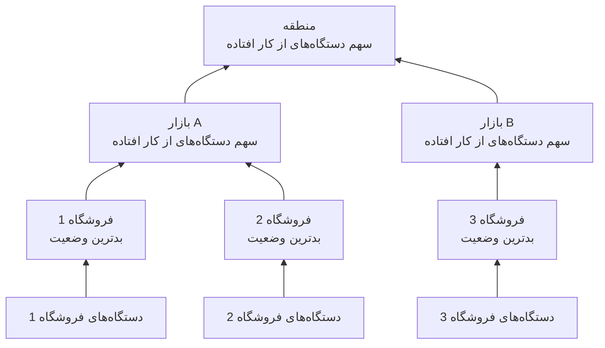

# سایت‌های شبکه (تجمیع سلامت و زمان کارکرد)

یک سایت شبکه یک مکان است: یک منطقه، یک بازار، یک نمایندگی، یک مرکز توزیع، یک فروشگاه. سایت‌ها درون هم جای می‌گیرند، دستگاه‌های شبکه به آن‌ها متصل می‌شوند، و OneUptime سلامت دستگاه‌ها را در درخت بالا می‌برد تا یک وضعیت روی یک منطقه به «آیا آن بیرون چیزی خراب است؟» پاسخ دهد.

آن‌ها را زیر **شبکه** > **سایت‌ها**، و روی نقشه زیر **شبکه** > **Map** پیدا کنید. این صفحه مشخص می‌کند وضعیت یک سایت چگونه از آنچه زیرش است به دست می‌آید، زمان کارکردش چه معنایی دارد و تعمیر و نگهداری زمان‌بندی‌شده چگونه هر دو را تغییر می‌دهد.

:::cards
- [افزودن یک سایت](#افزودن-یک-سایت): سه گام، یا یک فایل CSV برای یک مجموعهٔ کامل.
- [تنظیم پیش‌فرض‌های پایش](#پیشفرضهای-پایش): یک پراب و اعتبارنامه برای هر دستگاه یک سایت.
- [انتخاب شیوهٔ تجمیع سلامت](#سلامت-والد-چگونه-محاسبه-میشود): بدترین وضعیت برای یک فروشگاه، یک سهم برای یک منطقه.
- [خواندن زمان کارکرد](#زمان-کارکرد): درصدها چه چیزی را می‌شمارند، روز به روز.
:::

## چگونه کار می‌کند



وضعیت هر سایت از همهٔ دستگاه‌های زیردرختش می‌آید که با [سیاست تجمیع](#سلامت-والد-چگونه-محاسبه-میشود) خودِ سایت سنجیده می‌شوند. زمان کارکرد یک سایت از خط زمانی وضعیت خودش می‌آید، و یک [پنجرهٔ تعمیر و نگهداری](#تعمیر-و-نگهداری-زمانبندیشده-برای-سایتهای-شبکه) روی یک سایت دستگاه‌هایش را از رأی‌گیری بالای آن بیرون می‌برد.

## سلسله‌مراتب

سایت‌ها یک درخت می‌سازند. هر سایت یک **Site Type** و، به‌طور اختیاری، یک سایت والد دارد. گونه‌های سایت فهرست خودِ پروژه‌اند، زیر **شبکه** > **تنظیمات** > **Site Types**، و پروژهٔ تازه با Account Type، ‏Region، ‏Franchisee، ‏Market و Unit، به همین ترتیب از بالا، به‌علاوهٔ Data Center و Other شروع می‌کند. گونه‌ها سلسله‌مراتب خودشان را دارند (**Parent Site Type**)، که تعیین می‌کند کدام سایت‌ها می‌توانند والد یک سایت باشند. گونه‌ای که **Is Unit Level** علامت خورده پایین‌ترین ردهٔ مجموعهٔ شماست، یعنی تک فروشگاه یا شعبه: سایت‌هایش دستگاه دارند، نه سایت‌های دیگر.

گونه، نام، توضیح، والد و مکان یک سایت در یک جا ویرایش می‌شوند: کارت **Site Settings** در صفحهٔ **تنظیمات** سایت. نمای کلی سایت آن‌ها را با پیوند **ویرایش در تنظیمات** نشان می‌دهد، و فهرست **سایت‌ها** سایت اضافه می‌کند اما ویرایششان نمی‌کند.

هر دستگاه به یک سایت متصل است. زیردرخت یک سایت خودِ سایت به‌علاوهٔ همهٔ سایت‌های زیر آن است، و دستگاه‌های زیردرخت همان چیزی‌اند که سلامتش از آن‌ها تجمیع می‌شود، پس منطقه‌ای بی‌دستگاهِ خودی همچنان وضعیت دارد، چون واحدهای زیرش دارند.

> [!NOTE]
> تجمیع وقتی دوباره محاسبه می‌شود که وضعیت یک دستگاه تغییر کند، دستگاهی به سایت دیگری برود، سایتی در درخت جابه‌جا شود، و با جاروبی هر پنج دقیقه که حالت‌هایی را می‌گیرد که فقط گذر زمان پاسخ را تغییر داده است.

## افزودن یک سایت

:::steps
### یک سایت تازه را آغاز کنید
به **شبکه** > **سایت‌ها** بروید و روی **افزودن Site** کلیک کنید.

### بگویید سایت چیست
در گام **Site Details**، ‏**Site Type** را انتخاب کنید (چه جور جایی است: یک منطقه، یک فروشگاه، یک مرکز داده) و یک **نام** بنویسید. توضیح، نشانی پستی و عرض و طول جغرافیایی که سایت را روی نقشه می‌نشانند زیر **فیلدهای بیشتر** جمع شده‌اند: اکنون یا بعداً پرشان کنید.

### آن را در درخت جای دهید
در گام **Hierarchy**، اگر سایت زیر سایت دیگری است **Parent Site** را انتخاب کنید. خالی‌اش بگذارید تا سایت در بالاترین سطح بماند.

### پیش‌فرض‌هایش را تنظیم کنید
در گام **Monitoring Defaults**، [پراب و نمایهٔ اعتبارنامهٔ پیش‌فرض](#پیشفرضهای-پایش) را برای دستگاه‌هایی که به سایت اضافه می‌شوند انتخاب کنید و روی **افزودن Site** کلیک کنید.
:::

در صفحهٔ **Child Sites** خودِ یک سایت، **افزودن سایت فرزند** فقط گونه و نام را می‌پرسد، در یک صفحه با مکانِ جمع‌شده، و سایت تازه را زیر همان سایت می‌گذارد.

### وارد کردن سایت‌ها از یک فایل CSV

برای آوردن یک مجموعهٔ کامل به‌یکباره، منوی بالای فهرست **سایت‌ها** را باز کنید و روی **Import from CSV** کلیک کنید. فایل به یک سطر سرستون نیاز دارد؛ ستون‌ها می‌توانند به هر ترتیبی بیایند و نامشان به بزرگی و کوچکی حروف حساس نیست:

```csv title="sites.csv"
name,siteType,parentName,address,latitude,longitude
North,Region,,,,
Leeds,Market,North,,,
Store 0660,Unit,Leeds,"1 High Street, Leeds",53.7997,-1.5492
```

- `name` و `siteType` الزامی‌اند. `siteType` باید یکی از گونه‌های سایت پروژه باشد.
- `parentName` سایت والد را نام می‌برد که می‌تواند در همان فایل باشد: سطرهای بی‌والد، یا با والدی که از قبل هست، اول می‌روند و سپس فرزندانشان. برای سایت سطح بالا خالی‌اش بگذارید.
- سطری که والدش پیدا نشود نادیده گرفته می‌شود و نتایج آن را فهرست می‌کنند. **Preview Import** پیش از نوشتن هر چیزی نشان می‌دهد فایل چه خواهد ساخت.

## نقشه

**شبکه** > **Map** سایت‌های شما را روی نقشه‌ای نشان می‌دهد که هر جا باشند همان‌جا قاب گرفته می‌شود؛ روی یک سایت کلیک کنید تا واردش شوید. سایتی که سایت‌هایی زیرش دارد آن‌ها را نشان می‌دهد، روی نقشه و به‌صورت گرافی از پیوندهای میانشان. سایتی که سایتی زیرش ندارد اما دستگاه‌های خودش را دارد، یا سایتی که گونه‌اش در سطح واحد است، توپولوژی زندهٔ آن دستگاه‌ها را باز می‌کند.

پروژه‌ای که هنوز سایتی ندارد همچنان نقشه دارد: Map به‌جای آن توپولوژی دستگاه‌هایش را نشان می‌دهد، و گروه‌بندی دستگاه‌ها در سایت‌ها آن‌ها را بر پایهٔ مکان روی نقشه می‌گذارد.

## پیش‌فرض‌های پایش

سایت همچنین جایی است که یک بار می‌گویید دستگاه‌های درونش چگونه پایش شوند. **ویرایش تنظیمات** روی کارت **Site Settings** یک گام **Monitoring Defaults** با دو فیلد دارد:

| تنظیم | اثر |
| --- | --- |
| **Default Probe** | پرابی که دستگاه‌های این سایت را پینگ می‌کند، و وقتی اعتبارنامه دارند از راه SNMP پیمایششان می‌کند. دستگاهی که بی‌پراب خودش در سایت ساخته شود آن را می‌گیرد، و دستگاهی هم که بی‌پراب به سایت منتقل شود همین‌طور. |
| **Default SNMP Credential Profile** | [نمایهٔ اعتبارنامه‌ای](/docs/monitor/network-device-monitor#اعتبارنامههای-snmp-و-نمایههای-اعتبارنامه) که دستگاه‌های این سایت با آن پیمایش می‌شوند وقتی نه دستگاه و نه نمایهٔ خودش اعتبارنامه‌ای نداشته باشد. |

هر دو را روی یک سایت بگذارید تا دستگاه تازه‌ای در آن را بتوان فقط با نشانی‌اش اضافه کرد: از نخستین سرکشی پینگ و از نخستین سرکشی پیمایش می‌شود.

این دو، عمداً، رفتار متفاوتی دارند:

- پراب هنگامی روی دستگاه کپی می‌شود که دستگاه در سایت ساخته یا به آن منتقل شود. تغییر پراب پیش‌فرض یک سایت در آینده دستگاه‌هایی را که پراب دارند جابه‌جا نمی‌کند: اینکه کدام پراب به یک دستگاه می‌رسد واقعیتی دربارهٔ شبکه است، نه ترجیحی که از فرم یک سایت به‌صورت گروهی بازنویسی شود.
- نمایهٔ اعتبارنامه به‌صورت زنده، در هر سرکشی، خوانده می‌شود. یکی را روی سایتی بگذارید تا هر دستگاه بی‌اعتبارنامهٔ آن در سرکشی بعدی‌اش پیمایش شود، بی‌آنکه دستگاهی ویرایش شود؛ پاکش کنید تا دوباره فقط پینگ شوند.

این دو در درخت هم تا عمق‌های متفاوتی می‌رسند:

- پراب در کل درخت پایین می‌رود. دستگاهی که در سایتی بی‌پراب پیش‌فرض قرار بگیرد پراب نزدیک‌ترین نیا را می‌گیرد، پس یک پراب که روی یک منطقه گذاشته شود هر بازار و واحد زیر آن را پوشش می‌دهد، و بازاری که پراب خودش را نام ببرد آن را برای زیردرخت خودش جایگزین می‌کند.
- نمایهٔ اعتبارنامه فقط از سایت خودِ دستگاه خوانده می‌شود. دستگاهی در یک Unit نمایه‌ای را که روی Region آن گذاشته شده نمی‌گیرد، پس آن را روی سایت‌هایی بگذارید که دستگاه‌ها واقعاً به آن‌ها متصل‌اند.

## سلامت والد چگونه محاسبه می‌شود

هر سایت یکی از دو سیاست تجمیع را در کارت **Health Rollup** صفحهٔ **تنظیمات** خود (**Rollup Policy**) انتخاب می‌کند.

### بدترین وضعیت هر دستگاه (پیش‌فرض)

بدترین وضعیتی که هر دستگاهی در زیردرخت گزارش دهد وضعیت سایت می‌شود. بد بودن یک وضعیت از اولویتش به‌عنوان وضعیت مانیتور می‌آید: وضعیت‌های یک پروژهٔ تازه Operational (1)، ‏Degraded (2) و Offline (3) هستند، و بیشتر یعنی بدتر. یک دستگاه آفلاین سایت را آفلاین می‌کند، هر تعداد دستگاه سالم که کنارش باشد.

این پاسخ درست برای یک Unit است. چهار سوئیچ و یک فایروال در یک ساختمان مستقل نیستند: خاموش شدن یکی از آن‌ها مشکلی در همان نشانی است، و میانگین گرفتن یک قطعی واقعی را پنهان می‌کند.

این معمولاً پاسخ نادرست برای منطقه‌ای بالای چهارصد فروشگاه است. یک سوئیچ خاموش در فروشگاه 12,000 کل منطقه را Offline رنگ می‌کند: در تنگ‌ترین معنا درست و در هر معنای عملی بی‌فایده، چون منطقه هر بار که هر فروشگاهی در هر جا مشکلی داشته باشد قرمز است و دیگر چیزی به شما نمی‌گوید.

### درصد دستگاه‌های از کار افتاده

وضعیت سایت با سهمی از دستگاه‌های گزارش‌دهندهٔ زیردرخت تعیین می‌شود که در وضعیت عملیاتی نیستند:

| سهم دستگاه‌های از کار افتاده | وضعیت سایت |
| --- | --- |
| 0% | Operational |
| بالای 0%، زیر آستانه | Degraded: وضعیتی از پروژه که نه عملیاتی است نه آفلاین، یا Offline وقتی پروژه چنین وضعیتی ندارد |
| در آستانه یا بالاتر | Offline |

آستانه برای هر سایت جداگانه، به‌صورت **Offline Threshold (%)**، تنظیم می‌شود و پیش‌فرضش 50 است.

وقتی هیچ چیز از کار نیفتاده، سایت هرچقدر هم آستانه پایین باشد Operational است: آستانهٔ 0 یعنی «هر دستگاه از کار افتاده این را آفلاین می‌کند»، نه «یک منطقهٔ سالم آفلاین است».

### کدام دستگاه‌ها رأی می‌دهند

هر دو سیاست اینجا هم‌نظرند، و این مهم‌تر از چیزی است که به نظر می‌رسد:

- دستگاه‌های بایگانی‌شده هرگز رأی نمی‌دهند. از رده خارج شده‌اند: سایتشان را نگه می‌دارند اما کنار گذاشته می‌شوند.
- دستگاه‌هایی که هرگز چیزی گزارش نداده‌اند هرگز رأی نمی‌دهند. دستگاهی که منتظر نخستین سرکشی‌اش است گواه قطعی نیست، پس از هر دو سوی سهم بیرون گذاشته می‌شود، و منطقه‌ای که نیمی از راه راه‌اندازی را رفته بر پایهٔ همان نیمه‌ای که پاسخ داده سنجیده می‌شود.
- دستگاهی که پراب سرکشی‌اش می‌کند، یعنی گونهٔ عادی، با نتیجهٔ آخرین سرکشی‌اش رأی می‌دهد: در دسترس با پینگ یا SNMP، نه اینکه آخرین موفقیتش چقدر پیش بوده. دستگاهی که به پینگ پاسخ می‌دهد در حالی که پیمایش SNMP آن شکست می‌خورد در دسترس است و همین‌طور رأی می‌دهد؛ سایت می‌گوید روشن است، و سطر دستگاه **SNMP failing** را نشان می‌دهد تا کسی اعتبارنامه‌ها را درست کند.
- دستگاهی که به مانیتور متکی است، یعنی دستگاهی که در صفحهٔ تنظیماتش به بازنویسی مانیتور مقید برده شده، با وضعیت مانیتوری که به آن مقید است رأی می‌دهد، چون هیچ چیز سرکشی‌اش نمی‌کند. بی‌هیچ مانیتور مقیدی هرگز گزارشی نداده، پس اصلاً رأی نمی‌دهد.

یک مانیتور دستگاه شبکه روی دستگاهی که پراب سرکشی‌اش می‌کند شیوهٔ رأی دادن دستگاه را تغییر نمی‌دهد. مانیتوری با معیار «رابط قطع است، پس Offline» روی سوئیچی که به هر پینگ پاسخ می‌دهد مهر Offline می‌زد، و یک پورت خاموش کل یک سایت را قرمز می‌کرد در حالی که هر سطر دستگاه زیر آن Up می‌خواند: سایت با فهرستی که خلاصه‌اش می‌کند ناسازگار می‌شد. برای یک دستگاه سرکشی‌شده، سرکشی منبع سلامت آن است؛ مانیتور برای باز کردن حادثه‌ها آنجاست.

### انتخاب یک سیاست

یک آغاز معقول برای مجموعه‌ای از نمایندگی‌ها:

| رده | سیاست | چرا |
| --- | --- | --- |
| Unit یا فروشگاه | بدترین وضعیت | یک دستگاه از کار افتاده یعنی یک سایت در دردسر. |
| بازار | درصدی، آستانهٔ حدود 50% | بازاری که نیمی از فروشگاه‌هایش از کار افتاده‌اند از کار افتاده است. |
| منطقه | درصدی، آستانهٔ 25% تا 50% | خرابی یک فروشگاه منطقه را Degraded می‌کند، نه Offline، و وقتی چیزی فراگیر رخ دهد Offline می‌شود. |

سیاست برای هر سایت جداگانه تنظیم می‌شود، پس می‌توانید به سطرهای منطقه سیاست درصدی بدهید و هر چیز زیر آن‌ها را روی پیش‌فرض بگذارید.

## زمان کارکرد

هر سایت یک خط زمانی وضعیت دارد: یک سطر برای هر تغییر وضعیت تجمیع‌شده‌اش، که وقتی وضعیت تغییر کند باز و وقتی دوباره تغییر کند بسته می‌شود. زمان کارکرد از روی آن محاسبه می‌شود:

- زمانی که در وضعیتی بگذرد که عملیاتی علامت نخورده، زمان از کار افتادگی است.
- سطرهای هم‌پوشان ادغام می‌شوند، پس هیچ ثانیه‌ای دو بار شمرده نمی‌شود.
- زمانی که هیچ سطری آن را پوشش ندهد روشن شمرده می‌شود. خط زمانی فقط پس از اجرای یک تجمیع سطر می‌گیرد، و نبود شاهد قطعی نیست.
- سطری که هنوز باز است تا پایان پنجرهٔ سنجش ادامه می‌یابد.

‏Degraded عملیاتی نیست، پس آن هم از کار افتاده شمرده می‌شود. بنابراین با هر دو سیاست، زمان کارکرد یک سایت سهمی از زمان است که هیچ دستگاه گزارش‌دهنده‌ای زیر آن از کار نیفتاده بود: سیاست وضعیتی را که یک قطعی جزئی نشان می‌دهد تغییر می‌دهد، Degraded یا Offline، نه اینکه شمرده شود یا نه.

سایتی که اصلاً هیچ سطری در خط زمانی ندارد به‌جای 100% نماد `—` را نشان می‌دهد: سایتی که هرگز چیزی برایش تجمیع نشده پایش‌نشده است، نه بی‌نقص.

### زمان کارکرد روزانه

کنار رقم 30 روزه، نمای کلی هر سایت **Uptime (24h)** را نشان می‌دهد، و صفحهٔ **خط زمانی وضعیت** آن 24 ساعت، 7، 30 و 90 روز گذشته، و برای 30 روز گذشته یک ستون برای هر روز را نشان می‌دهد.

میانگین 30 روزه نمی‌تواند یک روز بد را نشان دهد. یک روز کامل قطعی در پنجره‌ای 30 روزه 3.3 امتیاز هزینه دارد، پس سایتی که یک سه‌شنبهٔ کامل خاموش بود همچنان برای ماه 96.7% گزارش می‌دهد، عددی که شبیه گرد کردن است. ستون‌های روزانه همان داده را جایی می‌گذارند که یک روز بد یعنی یک ستون بد.

روزها برش‌های 24 ساعتهٔ لغزانی‌اند که در اکنون پایان می‌یابند، نه روزهای تقویمی: دستگاه‌ها، بیننده و سرور هر کدام ممکن است در منطقهٔ زمانی متفاوتی باشند، و هیچ «روز»ی نیست که بر سرش توافق کنند.

### زمان کارکرد والد میانگین زمان کارکرد فرزندان نیست

زمان کارکرد والد از خط زمانی خودِ والد می‌آید که سیاست تجمیعش ساخته است، نه از میانگین درصدهای فرزندانش.

میانگینی روی فرزندان به فروشگاهی با دو دستگاه همان وزنی را می‌دهد که به مرکز توزیعی با دویست دستگاه. خط زمانی خودِ والد در عوض خوانشی می‌دهد که می‌توان در یک جمله گفت: سهمی از زمان که مطلقاً هیچ چیز در منطقه از کار نیفتاده بود. عمداً سخت‌گیر است، پس در یک منطقهٔ بزرگ آن را همراه ستون‌های روزانه بخوانید، و همراه وضعیت، که می‌گوید یک قطعی جزئی Degraded بود یا Offline.

## تعمیر و نگهداری زمان‌بندی‌شده برای سایت‌های شبکه

سایت‌ها را زیر **سایر منابع تحت تأثیر**، در گام **منابع تحت تأثیر** رویداد، به یک رویداد تعمیر و نگهداری زمان‌بندی‌شده وصل کنید، همان‌طور که یک میزبان را وصل می‌کنید. صفحهٔ **تعمیر و نگهداری زمان‌بندی‌شده** خودِ یک سایت رویدادهای وصل‌شده به آن را فهرست می‌کند، و **ساخت رویداد تعمیر و نگهداری زمان‌بندی‌شده** آن فرم را با سایتِ از پیش انتخاب‌شده باز می‌کند.

یک پنجره روی والد هر چیزی زیر آن را پوشش می‌دهد: پنجره‌ای روی یک منطقه هر بازار و واحد درون آن را پوشش می‌دهد، از جمله سایت‌هایی که پس از زمان‌بندی پنجره ساخته شده‌اند، پس یک جابه‌جایی منطقه‌ای اپراتور نیازی به فهرست کردن چهارصد فروشگاه ندارد.

پوشش فقط به پایین می‌رسد. پنجره‌ای روی یک Unit منطقه‌اش را به تعمیر و نگهداری نمی‌برد: همچنان انتظار می‌رود منطقه روشن باشد، و خرابی واقعی در واحد دیگری در همان ساعت‌ها همچنان علیه آن شمرده می‌شود.

### یک پنجرهٔ تعمیر و نگهداری چه چیزی را تغییر می‌دهد

| در طول پنجره | چه رخ می‌دهد |
| --- | --- |
| وضعیت زندهٔ سایت | بی‌تغییر. واحدی که برای کار برنامه‌ریزی‌شده خاموش است همچنان روی نقشه و در درخت Offline خوانده می‌شود، با نشان «در تعمیر و نگهداری» کنارش: هر کس به آن نگاه کند باید بداند خاموش است. |
| زمان کارکرد سایت | پنجره هم از زمان از کار افتادگی و هم از دورهٔ سنجش بیرون گذاشته می‌شود. دو ساعت تعمیر و نگهداری روز را 22 ساعته می‌کند، و هیچ چیز درون آن دو ساعت به هیچ سمتی شمرده نمی‌شود. |
| تجمیع سلامت نیاهایش | دستگاه‌های زیردرختِ در تعمیر و نگهداری دیگر رأی نمی‌دهند، پس منطقه برای جابه‌جایی‌ای که در تقویم بود قرمز نمی‌شود. |
| زمان کارکرد نیاهایش | بی‌اثر، بی‌آنکه چیزی برای اصلاح باشد، چون قطعی برنامه‌ریزی‌شده هرگز به خط زمانی آن‌ها نرسید. |

همین سطر آخر دلیل آن است که نیاها با نگه داشتن رأی‌ها رسیدگی می‌شوند نه با بیرون گذاشتن پنجره از زمان کارکردشان: بیرون گذاشتن آن از دورهٔ منطقه یک خرابی واقعی در جای دیگری از منطقه در همان ساعت‌ها را هم پاک می‌کرد.

زمان کارکرد با آغاز و پایان اعلام‌شدهٔ رویداد اصلاح می‌شود، نه با زمانی که فرایندی آن را میان حالت‌ها جابه‌جا کرد، پس عدد را می‌توان دستی در برابر تقویم بررسی کرد. روزی که تماماً درون یک پنجره بیفتد در ستون‌های روزانه به‌صورت تعمیر و نگهداری رسم می‌شود نه یک روز بی‌نقص، و چیزی به میانگین نمی‌افزاید.

### تعامل با مانیتورها

وصل کردن یک مانیتور به همان رویداد همچنان همان کاری را می‌کند که همیشه می‌کرد: پایش فعال آن مانیتور در طول پنجره متوقف می‌شود. این دو مستقل‌اند: سایت را وصل کنید تا از تجمیع و از زمان کارکردش بیرون بماند، و مانیتورها را وصل کنید تا هشدار ندهند.

## هشداردهی روی یک سایت

کارت **Alerting** در صفحهٔ **تنظیمات** یک سایت گزینهٔ **Alert When Unhealthy** را دارد: وقتی تجمیع سایت به وضعیتی برود که عملیاتی نیست هشداری باز می‌شود، و وقتی سایت بهبود یابد خودش برطرف می‌شود. **شدت هشدار** شدتش را تنظیم می‌کند؛ اگر خالی بماند، شدیدترین شدت پروژه است.

فقط روی تغییر هشدار می‌دهد: روشن کردنش برای سایتی که از قبل ناسالم است تغییر بعدی را مسلح می‌کند نه اینکه دربارهٔ گذشته هشدار دهد. ‏Degraded عملیاتی نیست، پس سایتی با سیاست درصدی به‌محض اینکه یکی از دستگاه‌های گزارش‌دهنده‌اش از کار بیفتد هشدار می‌دهد، همان‌طور که سایتی با سیاست بدترین وضعیت؛ هشدار، بی‌هشدار دوم، باز می‌ماند در حالی که سایت میان Degraded و Offline جابه‌جا می‌شود، و عنوانش وضعیتی را نام می‌برد که سایت اول به آن رسید.

## رفع اشکال

:::details منطقه‌ای همیشه قرمز است
سایت روی سیاست بدترین وضعیت است، پس یک دستگاه آفلاین در هر جای زیر آن آفلاینش می‌کند. منطقه را در کارت **Health Rollup** آن به **Percentage of devices down** ببرید، با آستانه‌ای که با اینکه چه مقدار از منطقه باید از کار افتاده باشد تا آن را از کار افتاده بدانید جور باشد.
:::

:::details سایتی به‌جای زمان کارکرد — نشان می‌دهد
هرگز تجمیعی برای سایت اجرا نشده، پس سطری در خط زمانی ندارد: پایش‌نشده است، نه بی‌نقص. به سایت، یا به سایت‌های زیر آن، دستگاه اضافه کنید تا تجمیع بعدی خط زمانی‌اش را آغاز کند.
:::

:::details دستگاهی برای سایتش شمرده نمی‌شود
دستگاه‌های بایگانی‌شده، و دستگاه‌هایی که هنوز گزارشی نداده‌اند، هرگز رأی نمی‌دهند. دستگاه متکی به مانیتور که هیچ مانیتوری به آن مقید نیست هم هرگز گزارشی نداده است. وضعیت دستگاه را بررسی کنید: دستگاهی که **در انتظار** است پس از نخستین سرکشی‌اش رأی دادن را آغاز می‌کند.
:::

:::details هشدار یک سایت برانگیخته نشد
**Alert When Unhealthy** با تغییری از یک وضعیت عملیاتی به هر وضعیت دیگری برانگیخته می‌شود، پس سایتی که وقتی روشنش کردید از قبل ناسالم بود در تغییر بعدی‌اش، پس از بهبود، هشدار می‌دهد. این را هم بررسی کنید که دستگاه‌هایش رأی می‌دهند: دستگاه‌های بایگانی‌شده و دستگاه‌هایی که منتظر نخستین سرکشی‌اند هرگز رأی نمی‌دهند، و دستگاه‌های سایتی که در تعمیر و نگهداری است در تجمیع‌های بالای آن رأی نمی‌دهند.
:::

## گام‌های بعدی

:::cards
- [مانیتور دستگاه شبکه](/docs/monitor/network-device-monitor): دستگاه‌هایی را که به این سایت‌ها متصل می‌شوند اضافه، سرکشی و رویشان هشدار بگیرید.
- [ترافیک شبکه](/docs/monitor/network-traffic): ترافیک یک سایت را از روی رکوردهای جریان دستگاه‌هایش ببینید.
- [موجودی](/docs/inventory/overview): دستگاه‌های شبکه کنار همهٔ دارایی‌های دیگر شما.
:::
