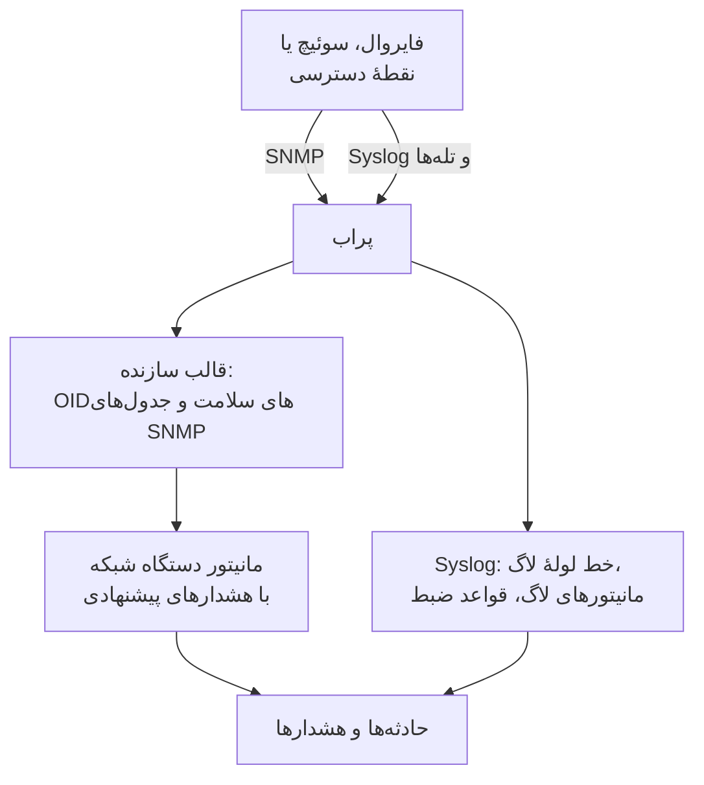

# راهنماهای سازندگان تجهیزات شبکه (Sophos، Extreme، Cambium)

چگونه سه مجموعهٔ رایج را با OneUptime از آغاز تا پایان پایش کنید: یک Sophos Firewall ‏(XGS، SFOS) با تونل‌های IPsec، پیوندهای WAN و SD-WAN آن؛ سوئیچ‌های Extreme Networks ‏(EXOS / Switch Engine و Fabric Engine / VOSS) با فابریکشان؛ و سوئیچ‌های cnMatrix و نقطه‌های دسترسی Wi-Fi سازمانی Cambium Networks، تا کانال و توان ارسال هر رادیو.

:::cards
- [Sophos Firewall](#sophos-firewall-xgs-sfos): تونل‌ها، پیوندهای WAN، دروازه‌ها و SD-WAN.
- [Extreme Networks](#extreme-networks-exos-switch-engine-و-fabric-engine-voss): سوئیچ‌ها، فابریک و سخت‌افزار آن.
- [Cambium Networks](#cambium-networks-wi-fi-سازمانی-و-cnmatrix): نقطه‌های دسترسی تا هر رادیو، و سوئیچ‌های cnMatrix.
:::

## چگونه کار می‌کند

هر راهنما از همین قطعه‌ها استفاده می‌کند:

- یک [دستگاه شبکه](/docs/monitor/network-device-monitor) برای هر جعبه، که پرابی که به آن می‌رسد سرکشی‌اش می‌کند، با یک قالب سازنده که OIDهای سلامت و [جدول‌های SNMP](/docs/monitor/network-device-monitor#جدولهای-snmp) درست را می‌آورد.
- یک مانیتور دستگاه شبکه برای هر دستگاه برای هشداردهی. آن را از صفحهٔ دستگاه بسازید تا [هشدارهای پیشنهادی](/docs/monitor/network-device-monitor#بستهٔ-هشدار-پیشنهادی)، از جمله یک هشدار برای هر سطر برای هر جدولی که می‌داند سالم چه شکلی است، برایتان پر شوند. برای یک ناوگان، یک [سیاست هشدار](/docs/monitor/network-device-monitor#سیاستهای-هشدار) روی هر دستگاه یکی نگه می‌دارد.
- برای آنچه یک سازنده فقط در لاگ‌هایش گزارش می‌دهد: syslog به پراب، یک [خط لولهٔ لاگ](/docs/telemetry/log-pipelines) برای تبدیل هر سطر به ویژگی‌ها، [مانیتورهای لاگ با Group By](/docs/monitor/logs-monitor#هشدار-به-تفکیک-گروه-group-by) برای هشدار دادن یک بار برای هر تونل یا دروازه، و [قواعد ضبط لاگ](/docs/telemetry/log-recording-rules) برای نمودار کردن اعداد درون آن لاگ‌ها.

## Sophos Firewall (XGS / SFOS)

| آنچه می‌خواهید ببینید | از کجا می‌آید |
| --- | --- |
| سلامت فایروال: حافظه، دیسک، swap، حالت HA، سرویس IPsec، ‏CPU هر هسته | SNMP، با قالب سازندهٔ **Sophos Firewall (SFOS / XGS)** |
| وضعیت هر تونل IPsec، با نام | جدول SNMP ‏`ipsec_tunnels` (SFOS v20 و بعد) |
| وضعیت، توان عبور، بهره‌وری و خطاهای هر پیوند WAN | پیمایش رابط‌های پورت‌های WAN |
| تأخیر، از دست رفتن بسته و لرزش هر پیوند WAN | مانیتورهای Ping و سرکشی‌های دستگاه از پراب‌های OneUptime |
| روشن و خاموش شدن دروازه، برقراری یا نبود SLA ‏SD-WAN، تغییر مسیرهای SD-WAN | ‏syslog فایروال |
| تأخیر، لرزش و از دست رفتن بستهٔ SD-WAN برای هر دروازه، به‌صورت نمودار | قواعد ضبط لاگ روی لاگ‌های SLA ‏SD-WAN |

Sophos سلامت دروازه یا SD-WAN را از راه SNMP، در هیچ نسخه‌ای از SFOS، گزارش نمی‌دهد: این فقط در لاگ‌های فایروال و در هشدارهای Sophos Central هست، و به همین دلیل سه سطر آخر از syslog می‌گذرند.

### ثبت فایروال

:::steps
1. روی فایروال، SNMP را زیر **Administration → SNMP** روشن کنید: یک کاربر SNMPv3، یا یک community نسخهٔ v2c، اضافه کنید و به نشانی پراب اجازهٔ پرس‌وجو بدهید.
2. در OneUptime، به **شبکه** > **Devices** بروید و روی **Add Device** کلیک کنید. نشانی مدیریتی فایروال را بنویسید، پرابی را که به آن می‌رسد انتخاب کنید و اعتبارنامهٔ SNMP را زیر **SNMP** اضافه کنید.
3. در صفحهٔ **تنظیمات** دستگاه، زیر **Polling & Data Collection**، قالب **Sophos Firewall (SFOS / XGS)** را از **Vendor Health Template** اعمال کنید و جدول‌هایش را از **Add a Vendor's Tables** اضافه کنید. یا **Auto-Apply Vendor Health Template** را روشن کنید تا نخستین سرکشی هر دو کار را انجام دهد.
:::

پس از سرکشی بعدی، صفحهٔ **SNMP Tables** دستگاه هر اتصال IPsec را با وضعیتش (active، inactive، partially active) و هسته‌های CPU را فهرست می‌کند. ‏SFOS هسته‌هایش را از 196608 شماره‌گذاری می‌کند، و به همین دلیل CPU از یک جدول می‌آید نه از یک `hrProcessorLoad.1` تنها.

### هشدار روی هر تونل IPsec

در صفحهٔ دستگاه، روی **ساخت مانیتور** کلیک کنید. هشدارهای پیشنهادی **IPsec Tunnels: row unhealthy** را دربر دارند، یک معیار **SNMP Table Row Is Unhealthy** روی جدول `ipsec_tunnels` با Row `*`: برای هر تونلی که فعال نیست یک حادثه به نام تونل باز می‌کند، و هر کدام را وقتی تونلش برگردد برطرف می‌کند.

تونلی که Sophos آن را فعال گزارش می‌دهد فقط پیوندهای امنیتی‌اش برقرارند. برای اثبات اینکه ترافیک از آن می‌گذرد، یک [مانیتور Ping](/docs/monitor/ping-monitor) از پرابی در یک سایت به میزبانی آن سوی هر تونل اضافه کنید، و تونل را به‌صورت یک پیوند سایت زیر **شبکه** > **توپولوژی** > **Site Links** میان دو [سایت](/docs/monitor/network-sites) رسم کنید و به همان مانیتور مقید کنید: آن وقت پیوند روی نقشه رنگ مانیتور را می‌گیرد.

### پیوندهای WAN

- **سلامت پورت.** پیمایش رابط‌ها از قبل وضعیت، بیت‌های ورودی و خروجی، بهره‌وری و خطاهای هر پورت WAN را اندازه می‌گیرد. روی مانیتور فایروال، یک معیار **SNMP Interface Is Down** یا **SNMP Interface Utilization (in %)** با **رابط** برابر نام پورت WAN، یا `*` برای هر پورت، برای هر پیوند هشدار می‌دهد.
- **کیفیت مسیر.** تأخیر، از دست رفتن بسته و لرزش هر پیوند از بیرون فایروال اندازه گرفته می‌شوند: یک مانیتور Ping از پراب‌های ابری OneUptime به نشانی عمومی هر پیوند WAN، و یک مانیتور Ping از پرابی در سایت به دروازهٔ هر ارائه‌دهنده. معیارهای از دست رفتن بسته و لرزش روی آن مانیتورها برای هر پیوند هشدار می‌دهند، و **شبکه** > **توپولوژی** > **Latency Matrix** در یک نگاه هر پراب را در برابر هر مانیتور نشان می‌دهد.
- **ترافیک.** ‏SFOS ‏NetFlow v5 صادر می‌کند. آن را روی UDP 2055 به پراب بفرستید، جایی که گردآورندهٔ جریان پراب به‌طور پیش‌فرض گوش می‌دهد، تا صفحهٔ **Traffic** دستگاه نشان دهد چه کسی با چه کسی روی هر پیوند WAN صحبت می‌کند؛ [ترافیک شبکه](/docs/monitor/network-traffic) جزئیات را دارد.

### دروازه‌ها و SD-WAN از syslog

:::steps
1. گیرندهٔ syslog پراب را روشن کنید: روی پراب `PROBE_SYSLOG_RECEIVER_ENABLED=true` را تنظیم کنید. به‌طور پیش‌فرض روی UDP 5140 گوش می‌دهد (`PROBE_SYSLOG_RECEIVER_PORT` آن را تغییر می‌دهد)؛ اگر پراب در Docker اجرا می‌شود پورت را منتشر کنید. پیام‌ها با دستگاه شبکه‌ای تطبیق داده می‌شوند که نام میزبانش، یا یکی از **نشانی‌های دیگر** آن، نشانی فرستنده است، و در صفحهٔ **لاگ‌ها** دستگاه پدیدار می‌شوند.
2. روی فایروال، زیر **System services → Log settings**، یک سرور syslog اضافه کنید که به پراب و همان پورت اشاره کند، و گونه‌های لاگ **Event** برای IPsec و دروازه‌ها و گونهٔ لاگ **SD-WAN** را تیک بزنید: لاگ‌های SLA تا وقتی آن تیک نخورد خاموش می‌مانند.
3. زیر **لاگ‌ها** > **تنظیمات** > **خطوط لوله**، یک خط لوله بسازید که فیلترش با لاگ‌های فایروال جور باشد، مانند `attributes.networkDevice.name = 'hq-firewall'`، و یک **Key=Value Parser** با **Target Prefix** ‏`sophos` اضافه کنید. سطری از فایروال را در آزمایشگر آن بچسبانید تا نام دقیق ویژگی‌هایی را که نسخهٔ SFOS شما تولید می‌کند ببینید؛ [نمونهٔ Sophos](/docs/telemetry/log-pipelines#نمونه-فایروال-sophos-xgs) آن را گام به گام نشان می‌دهد.
4. روی لاگ‌های فایروال [مانیتورهای لاگ](/docs/monitor/logs-monitor) بسازید، هر کدام با **Group by Attributes** تا هر تونل یا دروازه جداگانه هشدار دهد، و معیار **Log Count** **Greater Than** ‏`0` در چند دقیقه. سطرهای زیر سه موردی‌اند که باید با آن‌ها شروع کرد.
5. کیفیت SD-WAN را نمودار کنید: با روشن بودن لاگ‌گیری SD-WAN، فایروال برای هر نمایه و دروازه یک خلاصهٔ SLA می‌نویسد (`latency`، `jitter`، `packet_loss`). زیر **لاگ‌ها** > **تنظیمات** > **قواعد ضبط**، برای هر عدد یک قاعده بسازید، مانند میانگین `sophos.latency` گروه‌بندی‌شده بر پایهٔ `sophos.gw_name` و `sophos.profile_name`، سپس نتایج را نمودار کنید، یا با یک [مانیتور متریک](/docs/monitor/metrics-monitor) که بر پایهٔ دروازه گروه‌بندی می‌کند رویشان هشدار بگیرید. [قواعد ضبط لاگ](/docs/telemetry/log-recording-rules) این نمونه را گام به گام نشان می‌دهد.
:::

| هشدار | لاگ‌هایی که باید شمرد | گروه‌بندی بر پایهٔ |
| --- | --- | --- |
| تونل IPsec پایان یافت | ویژگی `sophos.log_component` = `IPSec`، بدنه شامل `terminated` | `sophos.con_name` |
| دروازه از کار افتاد | ویژگی `sophos.log_component` = `Gateway`، بدنه شامل `is Down` | `sophos.gatewayname` |
| SLA ‏SD-WAN برقرار نیست | ویژگی `sophos.log_type` = `SD-WAN`، بدنه شامل `SLA not met` | `sophos.gw_name` |

رویدادهای syslog جدول SNMP را تکمیل می‌کنند: همان لحظه که تونلی می‌افتد می‌رسند، در حالی که جدول تونلی را هم که هرگز برقرار نشد می‌گیرد.

### تله‌ها

هر اعلان Sophos همان یک تله است، `sfosNotification` (`1.3.6.1.4.1.2604.5.1.8.1.1`)، با رویداد به‌صورت متن در `sfosTrapMessage` (`1.3.6.1.4.1.2604.5.1.8.1.2`). برای هشدار روی یک گونه رویداد، **SNMP Trap Received (Trap OID)** را با Equal To `1.3.6.1.4.1.2604.5.1.8.1.1` با **SNMP Trap Varbind Value** روی همان varbind ترکیب کنید، برای نمونه Contains `IPSec`. مقصد تلهٔ فایروال را روی SNMP v2c بگذارید: گیرندهٔ تلهٔ پراب تله‌های v1 و v2c را می‌پذیرد.

## Extreme Networks (EXOS / Switch Engine و Fabric Engine / VOSS)

| آنچه می‌خواهید ببینید | از کجا می‌آید |
| --- | --- |
| ‏EXOS: ‏CPU، دما و آلارم آن، حالت تغذیه، منابع تغذیه، فن‌ها، حافظه به ازای هر اسلات، اعضای پشته | قالب **Extreme Networks EXOS / Switch Engine** |
| ‏Fabric Engine: ‏CPU و حافظه به ازای هر اسلات، حسگرهای دما، فن‌ها، منابع تغذیه، نشست vIST، شمار I-SID | قالب **Extreme Networks Fabric Engine / VOSS** |
| هر هم‌جواری Fabric Connect ‏(IS-IS)، به نام همسایه‌اش | جدول `isis_adjacencies` قالب Fabric Engine |
| پورت‌ها، همسایه‌های LLDP، نقشهٔ شبکه | پیمایش رابط‌ها، روی هر دو |

### کدام قالب

‏Fabric Engine روی سخت‌افزار عمومی Extreme (سری‌های 5000 و 7000) همان شمارهٔ enterprise را گزارش می‌دهد که EXOS: فقط توضیح سامانهٔ آن (`7520-48Y-8C-FabricEngine (9.0.4.0)`) می‌گوید کدام سیستم‌عامل در حال اجراست. ‏OneUptime هر دو را می‌خواند، پس اعمال خودکار و پیشنهاد صفحهٔ دستگاه قالب درست را برمی‌گزینند، و سوئیچ‌های قدیمی‌تر VSP شاخهٔ Avaya/Nortel را گزارش می‌دهند و مستقیماً Fabric Engine شناخته می‌شوند.

### هشدارهای فابریک و سخت‌افزار

هشدارهای پیشنهادی روی یک سوئیچ Fabric Engine **Fabric Adjacencies (IS-IS): row unhealthy** را دربر دارند، یک حادثه برای هر همسایه‌ای که هم‌جواری‌اش برقرار نیست. ‏Fabric Engine وقتی هم‌جواری تغییر کند یک تله هم می‌فرستد، `rcnIsisPlsbAdjStateTrap` (`1.3.6.1.4.1.2272.1.21.0.281`)، و یک معیار **SNMP Trap Received (Trap OID)** روی آن پیش از سرکشی بعدی در چند ثانیه هشدار می‌دهد.

منابع تغذیه، فن‌ها، حسگرهای دما و اعضای پشته جدول‌هایی‌اند که مقادیر سالمشان را اعلام می‌کنند، پس هر کدام در هشدارهای پیشنهادی یک هشدار برای هر سطر می‌گیرند.

### جریان‌ها و Wi-Fi

‏EXOS و Fabric Engine جریان‌ها را به‌صورت sFlow و IPFIX صادر می‌کنند. ‏sFlow را روی UDP 6343، یا IPFIX را روی UDP 4739، به پراب بفرستید تا صفحهٔ **Traffic** دستگاه ترافیکش را نشان دهد؛ [ترافیک شبکه](/docs/monitor/network-traffic) را ببینید.

نقطه‌های دسترسی IQ Engine ‏(HiveOS) و ExtremeCloud IQ Controller قالب‌های سازندهٔ خودشان را دارند که صفحهٔ **Wi-Fi** دستگاه را پر می‌کنند. [سازندگان Wi-Fi پشتیبانی‌شده](/docs/monitor/network-device-monitor#سازندگان-wi-fi-پشتیبانیشده) آن‌ها را پوشش می‌دهد، همراه با Ubiquiti UniFi، ‏HPE Aruba، ‏TP-Link Omada و Juniper Mist.

## Cambium Networks (Wi-Fi سازمانی و cnMatrix)

### نقطه‌های دسترسی

:::steps
1. ‏SNMP را روی نقطه‌های دسترسی روشن کنید. در cnMaestro، ‏SNMP برای هر گروه AP تنظیم می‌شود: **Configuration → Wi-Fi Profiles → AP Groups → Management → SNMP**. آن را با یک community خواندنی v2c یا یک کاربر SNMPv3 روشن کنید.
2. هر نقطهٔ دسترسی را با نشانی مدیریتی‌اش و همان اعتبارنامه‌ها اضافه کنید، و قالب **Cambium Networks Enterprise Wi-Fi (cnPilot, XV, XE, XH)** را اعمال کنید، یا اعمال خودکار را روشن کنید.
3. صفحهٔ **Wi-Fi** دستگاه را باز کنید. نشان می‌دهد چند رادیو روشن‌اند، کلاینت‌ها و SSIDها، سپس باند، کانال، بسامد، پهنای کانال، توان ارسال، کلاینت‌ها، کف نویز و زمان پخش هر رادیو، و هر SSID را با کلاینت‌هایش. بسامد از روی باند و کانال محاسبه می‌شود؛ نقطهٔ دسترسی آن را گزارش نمی‌دهد.
:::

هشدارهای سودمند، همه روی جدول `wifi_radios` با Row `*`، تا هر رادیو جداگانه هشدار دهد:

| هشدار | معیار |
| --- | --- |
| رادیویی خاموش شد | **SNMP Table Row Is Unhealthy**، بخشی از هشدارهای پیشنهادی |
| توان ارسال تغییر کرد | **SNMP Table Value**، ستون TX Power، ‏Not Equal To توان برنامه‌ریزی‌شدهٔ شما |
| رادیویی شلوغ | **SNMP Table Value**، ستون Clients، ‏Greater Than حد شما |
| کانالی پرنویز | **SNMP Table Value**، ستون Noise Floor، ‏Greater Than ‏`-80` |

هر مقدار عددی رادیو یک متریک هم هست (`oneuptime.monitor.snmp.table.value`، یک سری برای هر رادیو و ستون)، پس کانال، توان و کلاینت‌ها را می‌توان در طول زمان روی یک داشبورد نمودار کرد؛ کانالی که مدام عوض می‌شود همان DFS در حال کار است.

‏Cambium شمار کل کلاینت‌ها را فقط از سفت‌افزار 6.5.3 گزارش می‌دهد؛ سفت‌افزارهای پیشین 0 برمی‌گردانند.

### سوئیچ‌های cnMatrix

قالب **Cambium Networks cnMatrix**، ‏CPU، ‏RAM، فلش، دما و ولتاژ تغذیه را جمع می‌کند، و به‌صورت جدول فن‌ها، منبع تغذیهٔ افزونه و مصرف PoE هر پورت را. پورت‌ها و همسایه‌های LLDP مانند هر سوئیچی از پیمایش رابط‌ها می‌آیند.

### آلارم‌های cnMaestro

‏cnMaestro می‌تواند آلارم‌هایش، مانند آفلاین شدن یک نقطهٔ دسترسی، را به یک وب‌هوک HTTPS بفرستد. آن را به یک [مانیتور درخواست ورودی](/docs/monitor/incoming-request-monitor) نشانه بروید تا آن آلارم‌ها کنار دادهٔ SNMP به حادثه‌های OneUptime تبدیل شوند.

## رفع اشکال

:::details جدول IPsec Tunnels وضعیتی ندارد
وضعیت تونل به SFOS v20 یا بعد نیاز دارد. این را هم بررسی کنید که نمای SNMP اعتبارنامه‌های شما درخت enterprise شرکت Sophos (`1.3.6.1.4.1.2604`) را دربر بگیرد: یک کاربر v3 محدود اغلب فقط گروه سامانه و IF-MIB را می‌بیند.
:::

:::details هیچ syslogی از فایروال نمی‌رسد
گیرندهٔ syslog پراب به‌طور پیش‌فرض خاموش است: `PROBE_SYSLOG_RECEIVER_ENABLED=true` را تنظیم کنید و UDP 5140، یا `PROBE_SYSLOG_RECEIVER_PORT` خود را، تا پراب منتشر کنید. پیام‌ها با نشانی فرستنده به یک دستگاه تطبیق داده می‌شوند، پس نام میزبان فایروال در OneUptime، یا یکی از **نشانی‌های دیگر** آن، باید همان نشانی‌ای باشد که از آن syslog می‌فرستد.
:::

:::details سوئیچی Fabric Engine قالب EXOS را گرفت
قالب از روی توضیح سامانهٔ سوئیچ برگزیده می‌شود. بررسی کنید نمای کلی دستگاه توضیحی نشان دهد که Fabric Engine را نام ببرد (مانند `7520-48Y-8C-FabricEngine (9.0.4.0)`)؛ اگر چنین است، OIDها و جدول‌های EXOS را حذف کنید و **Extreme Networks Fabric Engine / VOSS** را از **Vendor Health Template** اعمال کنید.
:::

:::details نقطه‌های دسترسی Cambium صفر کلاینت گزارش می‌دهند
شمار کل کلاینت‌ها به سفت‌افزار 6.5.3 یا بعد نیاز دارد. روی سفت‌افزارهای قدیمی‌تر، رادیوها همچنان کانال، توان و کف نویز خود را گزارش می‌دهند.
:::

## گام‌های بعدی

:::cards
- [مانیتور دستگاه شبکه](/docs/monitor/network-device-monitor): هر چیزی که یک دستگاه جمع می‌کند، و هر معیاری که می‌تواند رویش هشدار دهد.
- [خط‌های لوله لاگ](/docs/telemetry/log-pipelines): لاگ‌های فایروال را به ویژگی‌ها تجزیه کنید.
- [مانیتور لاگ‌ها](/docs/monitor/logs-monitor): یک بار برای هر تونل یا دروازه هشدار بگیرید.
:::
